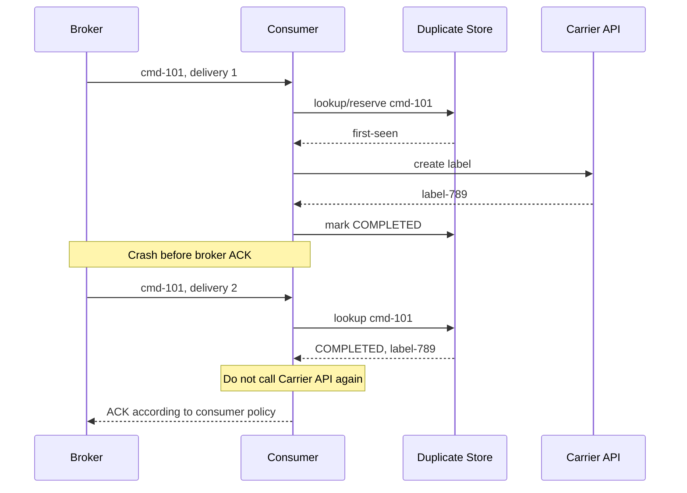
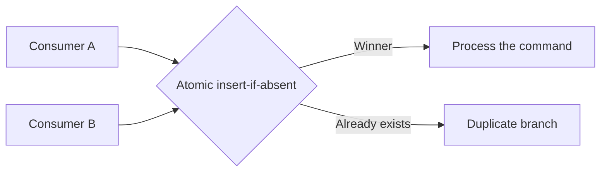
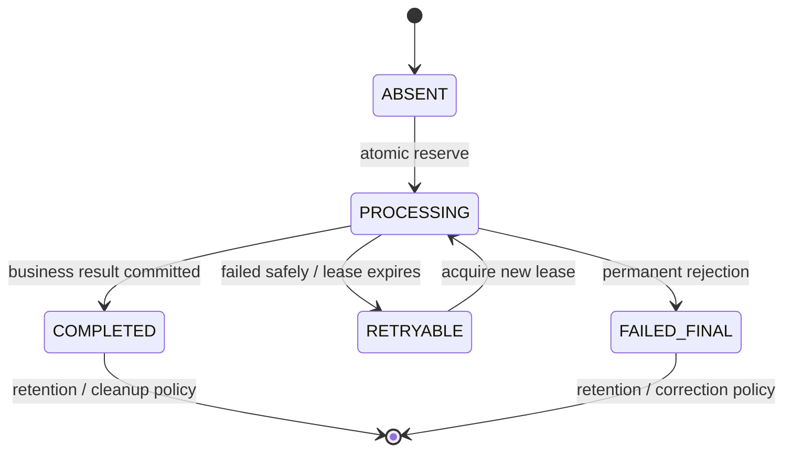
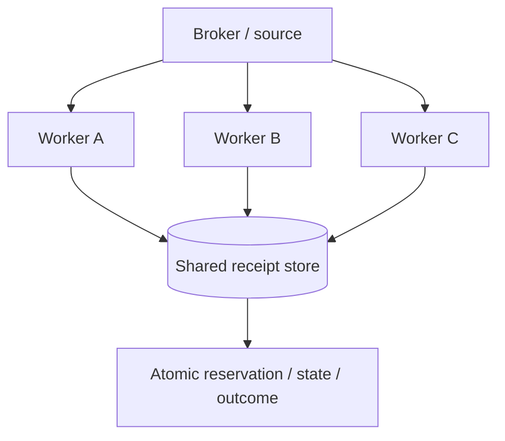
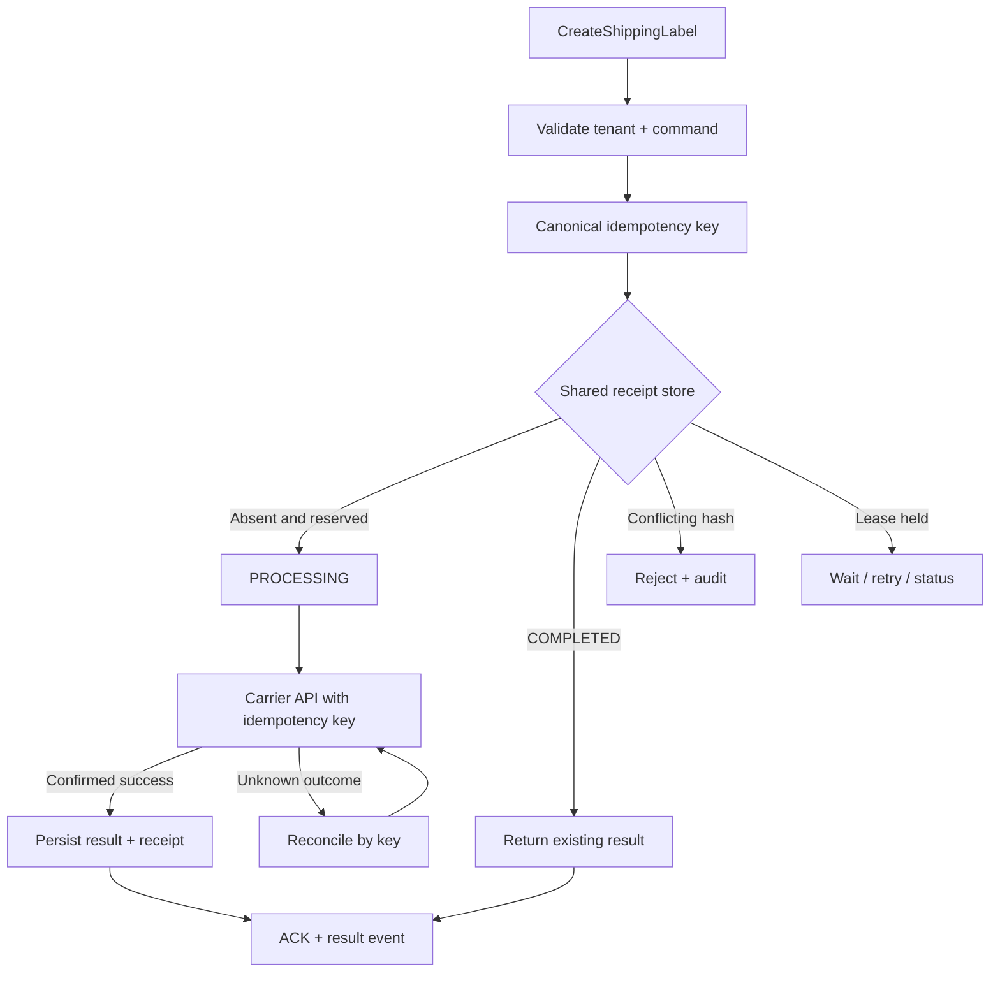

# Kho duplicate message

Trong một hệ thống tích hợp, **cùng một message có thể được giao nhiều lần dù producer chỉ định gửi một lần**. Broker có thể redeliver sau khi consumer xử lý xong nhưng chưa kịp ACK; ứng dụng có thể retry sau timeout; một operator có thể replay event; hoặc hai instance nhận cùng một công việc gần như đồng thời. Nếu mỗi lần nhận đều tạo đơn vận chuyển, trừ tiền, ghi sổ hoặc gửi email, hệ thống sẽ phát sinh **side effect trùng**.

**Idempotent Receiver** là một Enterprise Integration Pattern (EIP) giúp consumer nhận biết một request đã được xử lý hoặc đang được xử lý, từ đó quyết định **bỏ qua, trả kết quả cũ, từ chối xung đột hoặc xử lý lần đầu**. Thành phần then chốt là **kho duplicate message** (*deduplication store, receipt store, idempotency ledger*): nơi lưu **khóa định danh bền vững** và trạng thái liên quan để các lần nhận lại có thể được đối chiếu.

Bài **“Kho duplicate message”** thuộc chương **Idempotent receiver** của module `SPRING_INTEGRATION_PATTERN`. Phạm vi module là học triển khai Enterprise Integration Patterns bằng Spring Integration để xây dựng luồng thông điệp ít phụ thuộc và dễ mở rộng; thực hành Router, Filter, Transformer, Splitter, Aggregator, Gateway, retry, error channel, correlation, đồng thời kiểm thử và quan sát những nhánh xử lý.

**Sau bài này, bạn có thể:**

- Phân biệt **duplicate delivery**, **business duplicate**, **đang xử lý** và **đã xử lý thành công**.
- Chọn **idempotency key** phù hợp và tránh nhầm Spring message ID với ID nghiệp vụ bền vững.
- Giải thích yêu cầu **atomic put-if-absent / unique constraint** khi nhiều consumer cạnh tranh.
- Đánh giá `ConcurrentMetadataStore`, `MetadataStoreSelector`, `IdempotentReceiverInterceptor` và một **receipt table** tùy biến.
- Thiết kế lifecycle `PROCESSING → COMPLETED/FAILED`, lease, retry, TTL, cleanup và xử lý xung đột payload.
- Gắn deduplication vào Spring Integration mà không làm mất ACK, reply, correlation hoặc lỗi cần retry.
- Kiểm thử đồng thời, restart, broker redelivery, duplicate reply và side effect bên ngoài.

## 1. Vì sao duplicate là điều bình thường trong messaging?

Xét một flow tạo nhãn vận chuyển:

```text
ShipmentRequested(commandId=cmd-101)
    |
    v
Broker -> Shipping consumer
    |
    v
Carrier API: createLabel()
    |
    v
Persist label result
    |
    v
ACK broker
```

Nếu consumer gọi Carrier API thành công, lưu kết quả, rồi **crash trước ACK**, broker có thể giao lại `cmd-101`. Lần thứ hai **không phải một yêu cầu tạo nhãn mới**; nó là một lần delivery khác của cùng command. Không có cơ chế idempotency, consumer có thể gọi `createLabel()` hai lần.



Sơ đồ là mục tiêu thiết kế. Với Carrier API thật, **mark `COMPLETED` và side effect bên ngoài không tự thuộc cùng một transaction**. Cần một idempotency key được Carrier chấp nhận hoặc một cơ chế đối soát để bảo đảm việc gọi lại không tạo nhãn thứ hai.

### Ba loại “trùng” dễ nhầm

| Loại | Ví dụ | Có nên bỏ không? |
| --- | --- | --- |
| **Delivery duplicate** | Broker giao lại cùng event/command sau lỗi ACK. | Thường **không thực hiện lại side effect**, có thể ACK và trả kết quả đã lưu. |
| **Business duplicate** | Người dùng nhấn “Đặt hàng” hai lần, tạo hai `commandId` khác nhau. | Tùy nghiệp vụ; receipt theo command ID **không tự nhận ra** hai yêu cầu cùng mục đích. |
| **Conflicting duplicate** | Cùng `commandId=cmd-101` nhưng lần hai có payload khác. | **Không âm thầm coi là bình thường**; kiểm tra fingerprint/contract và báo xung đột. |

**Idempotent Receiver không có khả năng suy luận ý định người dùng.** Nó cần một **đơn vị công việc và khóa định danh** được xác định bởi hợp đồng nghiệp vụ.

## 2. Kho duplicate message cần lưu gì?

Một kho duplicate đơn giản có thể chỉ là tập hợp các khóa từng gặp:

```text
seen_keys:
  TENANT-A / SHIP_LABEL / cmd-101
  TENANT-A / SHIP_LABEL / cmd-102
```

Nhưng “đã từng thấy” không đồng nghĩa “đã hoàn thành”. Trong một hệ thống phải retry an toàn, nên lưu **receipt** phong phú hơn:

```text
IdempotencyReceipt {
  tenantId       = TENANT-A
  operation      = CREATE_SHIPPING_LABEL
  commandId      = cmd-101
  contractVersion= v1
  payloadHash    = <SHA-256 of canonical request>
  status         = COMPLETED
  resultRef      = label-789
  createdAt      = ...
  updatedAt      = ...
  expiresAt      = ...
}
```

Đây là **schema ứng dụng minh họa**, không phải một lớp Spring Integration có sẵn.

| Trường | Ý nghĩa |
| --- | --- |
| `tenantId` | Phạm vi chủ thể được xác thực, tránh trộn hai tenant có cùng command ID. |
| `operation` | Phân biệt `CREATE_LABEL` với `CANCEL_LABEL` hoặc `REFUND`. |
| `commandId` / `eventId` | Khóa nghiệp vụ bền vững qua retry/redelivery. |
| `contractVersion` | Cho phép version hóa khóa/canonicalization khi contract thay đổi. |
| `payloadHash` | Phát hiện **cùng khóa nhưng nội dung khác**; không thay authentication. |
| `status` | `PROCESSING`, `COMPLETED`, `FAILED` hoặc trạng thái riêng theo policy. |
| `resultRef` | Tham chiếu kết quả để duplicate request nhận lại output cũ nếu cần. |
| `createdAt`, `updatedAt` | Điều tra timeline và tiến trình đang kẹt. |
| `leaseUntil` / `owner` | Điều phối độc quyền khi work kéo dài; cần CAS/locking thật. |
| `expiresAt` | Thời hạn giữ receipt; không tự xóa record nếu không có cleanup. |

**Kho duplicate không nhất thiết lưu nguyên message.** Nhiều ứng dụng chỉ cần key, fingerprint, outcome và vài metadata để tránh lưu payload nhạy cảm/khổng lồ. Nếu cần replay message gốc, đó còn là trách nhiệm của broker, event store, Claim Check hoặc kho nguồn thích hợp.

## 3. Chọn idempotency key là quyết định quan trọng nhất

Khóa quá hẹp làm bỏ lọt duplicate; khóa quá rộng khiến **hai yêu cầu hợp lệ bị coi là một**.

Một thiết kế cho nhãn vận chuyển có thể là:

```text
key = tenantId + operation + commandId + contractVersion

TENANT-A | CREATE_LABEL | cmd-101 | v1
```

### Những khóa thường gây lỗi

| Khóa | Vấn đề |
| --- | --- |
| `MessageHeaders.id` | Spring message mới sau replay có thể nhận ID mới. |
| `traceId` | Một trace có thể chứa nhiều công việc; tracing không phải khóa nghiệp vụ. |
| `customerId` | Một khách có nhiều đơn hợp lệ. |
| `orderId` không có operation | Tạo, sửa, hủy cùng đơn có thể đều hợp lệ. |
| `batchId` cho tất cả item | Có thể bỏ nhầm nhiều phần tử khác nhau của một batch. |
| `timestamp` hiện tại | Mỗi retry tạo khóa mới, deduplication mất tác dụng. |
| Hash toàn bộ JSON thô | Chỉ đổi thứ tự field/whitespace cũng có thể sinh hash khác. |

**Khóa tốt phải định nghĩa đúng đơn vị idempotency**: một lần thanh toán, một lệnh cấp nhãn, một event nhập kho, hay một tác vụ xử lý từng trang.

### Key phải được chuẩn hóa có chủ đích

Nếu `commandId=" Cmd-101 "` và `"cmd-101"` được xem là một lệnh, cần chuẩn hóa rõ. Nếu ID phân biệt chữ hoa/thường, **không tự lowercase**. Khi nối các trường, tránh ghép chuỗi mơ hồ:

```text
tenant=A|B, operation=C, id=D
tenant=A, operation=B|C, id=D
```

Hai bộ có thể trùng chuỗi nếu dùng delimiter không escape. Hãy dùng key có cấu trúc hoặc encode có length-prefix, ví dụ:

```text
8:TENANT-A|12:CREATE_LABEL|7:cmd-101|2:v1
```

Độ dài ở trên chỉ minh họa kỹ thuật **length-prefix**, phải được tính thật trong code; không copy những số này như dữ liệu production.

### Fingerprint: cùng key nhưng payload thay đổi

Dùng hash của **biểu diễn canonical** sau khi đã xác định rõ trường có ý nghĩa nghiệp vụ. Ví dụ `commandId` cũ kèm địa chỉ mới có thể là **xung đột**, không phải duplicate thành công. Khi so sánh, kiểm tra checksum ở store dưới cùng transaction/lock khi cần.

**Không coi hash là chữ ký số.** Nó không chứng minh nguồn đáng tin cậy và không thay kiểm tra tenant/authorization; với dữ liệu có cấu trúc nhạy cảm, cân nhắc tránh đưa hash raw không có ngữ cảnh bảo mật vào hệ thống công khai.

## 4. Atomicity: tại sao `get` rồi `put` không đủ?

Xét hai worker nhận đồng thời cùng command:

```text
Worker A: if store.get(key) == null -> true
Worker B: if store.get(key) == null -> true
Worker A: store.put(key, "seen")
Worker B: store.put(key, "seen")
Worker A: create label
Worker B: create label
```

Cả hai cùng thấy key chưa tồn tại. Đó là **race condition dạng check-then-act**.



Cần thao tác **nguyên tử** ở kho:

- `putIfAbsent`/compare-and-set có semantics atomic trong phạm vi storage được dùng.
- `INSERT ... ON CONFLICT DO NOTHING` với **unique constraint** ở database.
- Unique index + transaction hoặc optimistic locking/CAS.
- Với distributed cache, thao tác atomic server-side và chính sách persistence/eviction phù hợp.

**Không dùng một `synchronized` cục bộ để chống duplicate giữa ba JVM.** Nó chỉ khóa trong một process. Nếu hai instance dùng hai kho in-memory riêng, mỗi instance vẫn có thể xử lý cùng command một lần.

## 5. Các cách lưu duplicate phổ biến

| Loại kho | Điểm mạnh | Hạn chế |
| --- | --- | --- |
| **In-memory concurrent map** | Nhanh, dễ demo và unit test. | Mất sau restart; không chia sẻ giữa replica. |
| **Spring `SimpleMetadataStore`** | Dễ học API của Spring Integration, phù hợp flow một JVM/test. | Không có durability tự nhiên qua restart. |
| **JDBC-backed metadata store** | Lưu bền vững, có thể dùng shared DB, hỗ trợ atomicity theo DB. | Cần schema, transaction, retention, hiệu năng và migration. |
| **Distributed key/value store** | Nhanh và có thể chia sẻ đa instance. | Cần xác minh atomic write, persistence, eviction và TTL. |
| **Receipt table có state + result** | Dễ diễn đạt `PROCESSING/COMPLETED`, audit, replay/reply. | Phải tự định nghĩa repository, concurrency, lease, cleanup. |
| **Business DB unique constraint** | Có thể đặt dedup và side effect cùng transaction. | Không bao phủ tự động side effect ở HTTP/broker khác DB. |

Spring Integration cung cấp các abstraction như **`MetadataStore`**, **`ConcurrentMetadataStore`** và các implementation cụ thể tùy module/version. Tên và overload constructor có thể thay đổi theo dependency; khi triển khai thật cần đối chiếu API phiên bản dự án.

### `MetadataStore` so với receipt repository

Một metadata store có thể phục vụ quyết định **first seen / already seen**, trong khi một receipt repository có thể lưu cả **trạng thái nghiệp vụ và kết quả cuối**. Nếu Gateway cần trả lại cùng outcome cho duplicate, receipt thường giàu thông tin hơn một Boolean.

Một `MessageGroupStore` của Aggregator phục vụ gom các message theo correlation, **không tự thay** kho deduplication. Hai store có thể cùng dùng DB nhưng vẫn giải quyết **hai câu hỏi khác nhau**.

## 6. Spring Integration và `MetadataStoreSelector`

Spring Integration hỗ trợ bộ chọn dùng metadata để xác định message có được xem là **lần đầu tiên** với một key không. Khái niệm thường được liên kết với **`MetadataStoreSelector`** và một `ConcurrentMetadataStore`.

Ví dụ minh họa wiring:

```java
import org.springframework.context.annotation.Bean;
import org.springframework.context.annotation.Configuration;
import org.springframework.integration.handler.advice.IdempotentReceiverInterceptor;
import org.springframework.integration.selector.MetadataStoreSelector;
import org.springframework.integration.metadata.ConcurrentMetadataStore;
import org.springframework.integration.metadata.SimpleMetadataStore;
import org.springframework.messaging.Message;

@Configuration
class DuplicateMetadataConfiguration {

    @Bean
    ConcurrentMetadataStore duplicateMetadataStore() {
        return new SimpleMetadataStore();
    }

    @Bean
    IdempotentReceiverInterceptor idempotentReceiverInterceptor(
            ConcurrentMetadataStore store) {

        MetadataStoreSelector selector = new MetadataStoreSelector(
                message -> {
                    DispatchCommand cmd =
                            (DispatchCommand) message.getPayload();
                    return cmd.tenantId() + "|" + cmd.operation()
                            + "|" + cmd.commandId();
                },
                store
        );

        return new IdempotentReceiverInterceptor(selector);
    }
}
```

`DispatchCommand` là kiểu ứng dụng được định nghĩa ở phần thực hành sau. Đây là **ví dụ cách phối hợp API**, chưa phải mã đã được biên dịch trong repo; cần kiểm tra package/import và overload `MetadataStoreSelector` theo phiên bản Spring Integration đang sử dụng khi QA chuyên môn.

### Selector và interceptor có vai trò khác nhau

- **`MetadataStoreSelector`**: quyết định message có phải key mới theo lưu trữ metadata.
- **`IdempotentReceiverInterceptor`**: đưa việc kiểm tra vào `MessageHandler`/endpoint thông qua advice.
- **Endpoint/handler**: thực hiện nghiệp vụ hoặc tạo response.
- **Kho metadata**: lưu trạng thái nhận diện key tùy semantics implementation.

**Lưu ý hành vi duplicate:** Trong các cách dùng của Spring Integration, interceptor có thể **đánh dấu duplicate qua header** và cung cấp cấu hình để discard hoặc throw thay vì luôn bỏ message. Đừng giả định chỉ thêm interceptor là handler sẽ không bao giờ chạy khi duplicate; cần **cấu hình chính sách cụ thể và kiểm thử** hành vi ở phiên bản/framework dùng thật.

### `duplicateMessage` header không đồng nghĩa “đã xử lý xong”

Một header báo duplicate có thể biểu thị **key đã tồn tại**. Nếu key được ghi vào store **trước** khi handler hoàn tất, worker thứ hai có thể thấy duplicate trong lúc worker đầu còn đang xử lý. Nó **không tự chứng minh** bên đầu đã commit business result.

Với tác vụ có side effect quan trọng, dùng state `PROCESSING/COMPLETED` hoặc transaction/idempotency ở handler, thay vì chỉ dựa vào “key đã từng thấy”.

## 7. Demo độc lập: kiểm tra key nguyên tử bằng map trong JVM

Ví dụ dưới đây tách riêng hành vi **first seen** khỏi nghiệp vụ thật. Nó chỉ trả một trạng thái mô phỏng và **không gọi API ngoài**, để tránh người học nhầm in-memory dedup với bảo đảm giao dịch tài chính.

### 7.1. Kiểu dữ liệu và bộ kiểm tra

```java
import java.util.concurrent.ConcurrentHashMap;
import java.util.concurrent.ConcurrentMap;

record DispatchCommand(
        String tenantId,
        String operation,
        String commandId,
        String parcelId
) {}

record DispatchDecision(
        String commandId,
        String status
) {}

final class InMemoryDuplicateGuard {
    private final ConcurrentMap<String, Boolean> seen =
            new ConcurrentHashMap<>();

    boolean firstSeen(DispatchCommand command) {
        if (command.tenantId() == null || command.tenantId().isBlank()
                || command.operation() == null
                || command.operation().isBlank()
                || command.commandId() == null
                || command.commandId().isBlank()) {
            throw new IllegalArgumentException("INVALID_DEDUP_KEY");
        }

        String key = command.tenantId() + ":"
                + command.operation() + ":"
                + command.commandId();

        return seen.putIfAbsent(key, Boolean.TRUE) == null;
    }
}
```

`ConcurrentHashMap.putIfAbsent()` bảo đảm **một key chỉ có một winner** khi nhiều thread cùng dùng *một instance* map. Đây **không phải persistent store**; cũng chưa giải quyết chuyện payload của cùng key có khác nhau không.

Trong production, hãy dùng key encoding không mơ hồ và receipt schema; phép nối chuỗi bằng `:` ở ví dụ chỉ để minh họa.

### 7.2. Gắn vào Java DSL

```java
import org.springframework.context.annotation.Bean;
import org.springframework.context.annotation.Configuration;
import org.springframework.integration.channel.DirectChannel;
import org.springframework.integration.channel.QueueChannel;
import org.springframework.integration.config.EnableIntegration;
import org.springframework.integration.dsl.IntegrationFlow;

@Configuration
@EnableIntegration
class DuplicateDemoFlowConfig {

    @Bean
    InMemoryDuplicateGuard duplicateGuard() {
        return new InMemoryDuplicateGuard();
    }

    @Bean
    DirectChannel dispatchInput() {
        return new DirectChannel();
    }

    @Bean
    QueueChannel dispatchDecisions() {
        return new QueueChannel();
    }

    @Bean
    IntegrationFlow dispatchFlow(InMemoryDuplicateGuard guard) {
        return IntegrationFlow.from("dispatchInput")
                .handle(DispatchCommand.class, (command, headers) -> {
                    boolean first = guard.firstSeen(command);
                    return new DispatchDecision(
                            command.commandId(),
                            first ? "FIRST_SEEN" : "DUPLICATE");
                })
                .channel("dispatchDecisions")
                .get();
    }
}
```

Flow trên cố ý **trả một `DispatchDecision`** cho cả lần đầu và duplicate; không tạo nhãn vận chuyển, không commit database và không ACK broker. Nó giúp nhìn rõ **hành vi quan sát của kho duplicate** mà không che giấu side effect.

### Demo này không nên được dùng trực tiếp để “ngăn trùng thanh toán”

Nếu đặt lời gọi thanh toán **sau** khi guard đánh dấu `seen` mà thanh toán thất bại, retry có thể bị coi là duplicate và **không bao giờ được thử lại**, dẫn đến mất công việc. Cần state + transaction/compensation/idempotent downstream; hãy xem các mục tiếp theo.

## 8. JUnit integration test: first seen, duplicate và tenant scope

Spring Test có thể boot flow ở mục 7 và gửi cùng command hai lần:

```java
import static org.junit.jupiter.api.Assertions.assertEquals;
import static org.junit.jupiter.api.Assertions.assertNotNull;
import static org.junit.jupiter.api.Assertions.assertTrue;

import org.junit.jupiter.api.Test;
import org.springframework.beans.factory.annotation.Autowired;
import org.springframework.beans.factory.annotation.Qualifier;
import org.springframework.integration.channel.QueueChannel;
import org.springframework.messaging.Message;
import org.springframework.messaging.MessageChannel;
import org.springframework.messaging.support.MessageBuilder;
import org.springframework.test.annotation.DirtiesContext;
import org.springframework.test.context.junit.jupiter.SpringJUnitConfig;

@SpringJUnitConfig(DuplicateDemoFlowConfig.class)
@DirtiesContext(classMode = DirtiesContext.ClassMode.AFTER_EACH_TEST_METHOD)
class DuplicateDemoFlowTest {

    @Autowired @Qualifier("dispatchInput")
    MessageChannel input;

    @Autowired @Qualifier("dispatchDecisions")
    QueueChannel output;

    @Test
    void sameCommandIsOnlyFirstSeenOnce() {
        DispatchCommand cmd = new DispatchCommand(
                "TENANT-A", "CREATE_LABEL", "cmd-101", "P-1");

        assertTrue(input.send(
                MessageBuilder.withPayload(cmd).build()));
        assertTrue(input.send(
                MessageBuilder.withPayload(cmd).build()));

        Message<?> first = output.receive(1_000);
        Message<?> second = output.receive(1_000);
        assertNotNull(first);
        assertNotNull(second);

        assertEquals("FIRST_SEEN",
                ((DispatchDecision) first.getPayload()).status());
        assertEquals("DUPLICATE",
                ((DispatchDecision) second.getPayload()).status());
    }

    @Test
    void sameCommandIdInAnotherTenantIsNotTheSameKey() {
        input.send(MessageBuilder.withPayload(new DispatchCommand(
                "TENANT-A", "CREATE_LABEL", "cmd-102", "P-1")).build());
        input.send(MessageBuilder.withPayload(new DispatchCommand(
                "TENANT-B", "CREATE_LABEL", "cmd-102", "P-1")).build());

        assertEquals("FIRST_SEEN",
                ((DispatchDecision) output.receive(1_000)
                        .getPayload()).status());
        assertEquals("FIRST_SEEN",
                ((DispatchDecision) output.receive(1_000)
                        .getPayload()).status());
    }
}
```

Hai test là **mức Spring Integration wiring**: channel, handler, response payload và map trong một JVM. Chúng **không chứng minh** durability, atomicity giữa các replica, retry khi transaction rollback hoặc exactly-once side effect.

`@DirtiesContext` tạo context mới giữa test, có chi phí chạy nhưng tránh state map cũ. Trong dự án thật, có thể dùng fixture reset hoặc một store namespace riêng cho từng test.

## 9. Khi nào “first seen” là chưa đủ?

Giả sử state chỉ có Boolean:

```text
T1: reserve(key) -> first seen
T2: call payment API -> timeout
T3: message re-delivered
T4: reserve(key) -> duplicate
```

Nếu T2 là lỗi tạm và payment thực sự **chưa xảy ra**, T4 bị chặn làm nhiệm vụ không hoàn thành. Nếu T2 thực tế **đã trừ tiền** nhưng response bị mất, retry mù lại có thể trừ thêm lần nữa.

Vì vậy, receipt production cần phân biệt:



Sơ đồ là **state machine của ứng dụng**, không phải enum Spring Integration tự có.

| State | Ý nghĩa | Cách xử lý message đến cùng key |
| --- | --- | --- |
| `ABSENT` | Chưa có receipt. | Thử reserve nguyên tử. |
| `PROCESSING` | Một worker có quyền xử lý; chưa có outcome xác nhận. | Chờ/đưa retry có delay/return `IN_PROGRESS`, không tự chạy side effect lần hai. |
| `COMPLETED` | Đã ghi outcome thành công. | Không chạy lại; ACK/return cached result nếu cần. |
| `RETRYABLE` | Lần trước thất bại mà có thể thử lại an toàn. | Acquire lease/CAS rồi retry. |
| `FAILED_FINAL` | Kết quả từ chối cuối theo nghiệp vụ. | Trả outcome từ chối đã ghi; không retry vô hạn. |
| `EXPIRED` | Qua thời gian retention/key validity. | Theo policy: từ chối replay hoặc coi là yêu cầu mới nếu được phép. |

**Không có một state machine chung cho mọi hệ thống.** Một flow chỉ ghi metric có thể chỉ cần key set; một flow tạo giao dịch tài chính cần outcome, reconciliation và idempotency ở phía nhận side effect.

## 10. Một receipt table trên PostgreSQL

Để chia sẻ duplicate store giữa nhiều consumer, có thể dùng bảng receipt với **unique constraint**.

```sql
CREATE TABLE idempotency_receipts (
    tenant_id        VARCHAR(80) NOT NULL,
    operation        VARCHAR(80) NOT NULL,
    command_id       VARCHAR(120) NOT NULL,
    contract_version VARCHAR(32) NOT NULL,
    payload_hash     CHAR(64) NOT NULL,
    status           VARCHAR(32) NOT NULL,
    result_ref       VARCHAR(200),
    lease_owner      VARCHAR(120),
    lease_until      TIMESTAMPTZ,
    created_at       TIMESTAMPTZ NOT NULL,
    updated_at       TIMESTAMPTZ NOT NULL,
    expires_at       TIMESTAMPTZ,
    PRIMARY KEY (
        tenant_id, operation, command_id, contract_version
    )
);
```

Đây là schema **minh họa cho PostgreSQL**, chưa có index/scheduler/partition/migration phù hợp mọi production system. Các ràng buộc về payload size, trạng thái hợp lệ, tiêu chuẩn bảo mật và retention cần được bổ sung.

### Atomic insert-if-absent

```sql
INSERT INTO idempotency_receipts (
    tenant_id, operation, command_id, contract_version,
    payload_hash, status, created_at, updated_at
) VALUES (
    :tenant_id, :operation, :command_id, :version,
    :payload_hash, 'PROCESSING', NOW(), NOW()
)
ON CONFLICT (
    tenant_id, operation, command_id, contract_version
)
DO NOTHING;
```

Khi execute, **số row được chèn** là tín hiệu:

- `1`: key này được claim lần đầu trong phạm vi transaction.
- `0`: đã có bản ghi theo unique key; phải **đọc trạng thái/fingerprint** và áp dụng policy duplicate.

`SELECT` rồi `INSERT` không thay thế được thao tác atomic này. Với các DB khác, dùng unique constraint và cú pháp upsert/insert-if-absent tương ứng, không copy nguyên SQL PostgreSQL.

### Vì sao unique constraint quan trọng?

Nếu hai instance gọi cùng SQL đồng thời, database phải quyết định **một transaction thắng** đối với cùng unique key. Không cần dựa vào lock trên từng JVM. Tuy nhiên, thao tác upsert một receipt **chưa tự ràng buộc** mọi side effect tới receipt; còn cần transaction phù hợp.

## 11. Ghi business result và receipt trong cùng transaction DB

Khi side effect là thay đổi dữ liệu **trong cùng database**, có thể dùng transaction để ghi receipt và kết quả nghiệp vụ **nguyên tử**.

```text
DB transaction:
  INSERT receipt (if absent)
  IF inserted:
      INSERT shipment_result / update business rows
      UPDATE receipt status=COMPLETED, result_ref=...
  ELSE:
      compare payload_hash and read stored outcome
COMMIT
```

Nếu DB transaction rollback do lỗi, **cả business change lẫn receipt marker** phải rollback cùng nhau.

### Ví dụ service theo transaction

```java
import org.springframework.stereotype.Service;
import org.springframework.transaction.annotation.Transactional;

record ShipmentCommand(
        String tenantId,
        String commandId,
        String parcelId,
        String operation
) {}

record ProcessOutcome(
        String status,
        String resultReference
) {}

interface ReceiptRepository {
    boolean insertIfAbsent(
            ShipmentCommand command, String payloadHash);
    StoredReceipt find(ShipmentCommand command);
    void markCompleted(
            ShipmentCommand command, String resultRef);
}

record StoredReceipt(
        String payloadHash,
        String status,
        String resultReference
) {}

interface ShipmentRepository {
    String createRecord(ShipmentCommand command);
}

@Service
class ShipmentCommandService {
    private final ReceiptRepository receipts;
    private final ShipmentRepository shipments;

    ShipmentCommandService(
            ReceiptRepository receipts,
            ShipmentRepository shipments) {
        this.receipts = receipts;
        this.shipments = shipments;
    }

    @Transactional
    public ProcessOutcome handle(
            ShipmentCommand command, String canonicalHash) {

        if (!receipts.insertIfAbsent(command, canonicalHash)) {
            StoredReceipt old = receipts.find(command);
            if (!old.payloadHash().equals(canonicalHash)) {
                throw new IllegalArgumentException(
                        "IDEMPOTENCY_CONFLICT");
            }
            if ("COMPLETED".equals(old.status())) {
                return new ProcessOutcome(
                        "ALREADY_COMPLETED", old.resultReference());
            }
            return new ProcessOutcome("IN_PROGRESS", null);
        }

        // Trong ví dụ, createRecord CHỈ ghi cùng database.
        String ref = shipments.createRecord(command);
        receipts.markCompleted(command, ref);
        return new ProcessOutcome("PROCESSED", ref);
    }
}
```

**Giới hạn thiết kế cần ghi nhớ:**

- Repository receipt và shipment phải dùng **cùng database/transaction manager**. Một `@Transactional` không làm atomic với HTTP carrier API, Kafka hoặc object store.
- `insertIfAbsent` cần unique constraint và phải phản ánh số row chèn/cạnh tranh chính xác.
- Khi duplicate trả `IN_PROGRESS`, policy caller cần biết có thể retry, query status hoặc đợi. Không coi đó là business success.
- `canonicalHash` phải được tính từ hợp đồng được chuẩn hóa và xác thực; không nhận một hash tùy ý từ client làm bằng chứng dữ liệu.
- Tại transaction cô lập phù hợp, trường hợp cạnh tranh có thể phải chờ transaction trước commit/rollback; cần bounded timeout và xử lý deadlock/serialization conflict.
- Nếu `createRecord()` thực chất gọi external API, ví dụ không còn có bảo đảm atomic mà mô tả ở trên.

### Khi DB rollback, có nên xóa receipt?

Nếu receipt được insert **trong cùng DB transaction** và transaction rollback, bản ghi thường rollback theo, cho phép retry. Nếu receipt nằm ở **cache độc lập** đã ghi trước transaction, rollback DB không tự xóa cache key: có thể xuất hiện **false duplicate**. Đó là một trong những lý do không nên chọn kho duplicate chỉ theo tốc độ.

## 12. External side effect: lưu receipt không thể thay idempotency ở đích

Với một carrier/payment API bên ngoài:

```text
1. reserve receipt PROCESSING
2. POST /create-label
3. remote service creates label
4. remote reply lost / timeout
5. local worker cannot know if label exists
```

Nếu worker gọi API lần nữa với **request ID mới**, có thể tạo nhãn thứ hai. Nếu đánh dấu receipt `COMPLETED` mà chưa biết kết quả, có thể ghi nhận thành công giả.

Cách tiếp cận mạnh hơn:

1. Gửi **idempotency key bền vững** tới API đích nếu API hỗ trợ, ví dụ `tenantId/operation/commandId`.
2. Khi timeout, **truy vấn trạng thái** theo key trước khi thực hiện side effect khác.
3. Ghi receipt `PROCESSING`/`UNKNOWN_REMOTE_OUTCOME` phù hợp, không giả định failed.
4. Dùng outbox khi phải phát command/event bên ngoài từ một business transaction.
5. Với API không hỗ trợ idempotency, thiết kế reconciliation/compensation và chấp nhận mức bảo đảm đã phân tích.

**Kho duplicate ở consumer bảo vệ một ranh giới; nó không biến toàn bộ hệ thống thành exactly-once.** Chính xác một tác dụng phụ chỉ có thể được bảo vệ bằng phối hợp transaction, unique constraints, idempotency của downstream và recovery theo thực tế.

## 13. Lease cho công việc kéo dài và concurrent consumers

Nếu một công việc OCR mất 10 phút, ghi `PROCESSING` rồi chờ mãi là không đủ: worker có thể crash. Cần một **lease** hoặc cơ chế ownership có giới hạn:

```text
receipt:
  key = (tenant, operation, commandId)
  status = PROCESSING
  owner = worker-07
  leaseUntil = 2026-11-21T10:10:00Z
  version = 17
```

Các bước:

1. Worker A acquire lease bằng **transaction/CAS**.
2. A xử lý; khi cần, renew lease nếu vẫn đang sở hữu.
3. Nếu A crash, lease hết hạn; worker B có thể acquire bằng CAS.
4. Nếu A quay lại sau khi lease mất, nó **không được commit state trái ownership**.
5. Với external side effect, dùng **fencing token** hoặc idempotency ở đích; lease địa phương không thể ngăn một lời gọi HTTP cũ hoàn tất muộn.

### SQL CAS minh họa

```sql
UPDATE idempotency_receipts
SET lease_owner = :new_owner,
    lease_until = :new_lease_until,
    updated_at = NOW()
WHERE tenant_id = :tenant_id
  AND operation = :operation
  AND command_id = :command_id
  AND contract_version = :version
  AND status = 'PROCESSING'
  AND (lease_until IS NULL OR lease_until < NOW());
```

Nếu `rowCount=1`, worker thắng tại thời điểm update. Nếu `0`, có owner hợp lệ hoặc state không phù hợp. Production cần thêm **monotonic version/fencing token** để ngăn stale worker commit. Không coi một `UPDATE` đơn lẻ là cơ chế exactly-once cho tác vụ đã gửi tới service ngoài.

## 14. TTL và cửa sổ deduplication

Kho duplicate không thể giữ khóa vô hạn trong mọi hệ thống. Tuy nhiên, TTL quá ngắn làm message cũ sau redelivery **được coi là mới**.

```text
T0       handle cmd-101 -> completed
T0+1h    receipt TTL expires
T0+3h    broker replays cmd-101
```

Nếu message được coi là mới, handler có thể lặp side effect. Một thời hạn phù hợp phải xét:

- Thời gian broker giữ message và khả năng redelivery.
- Chính sách retry/backoff/DLQ/manual replay.
- Thời hạn người dùng có thể gửi lại cùng request.
- Thời gian xử lý dài nhất và lease expiry.
- Thời gian cần trả lại outcome cũ cho Gateway/API.
- Quy định retention, quyền xóa dữ liệu và mức bảo đảm nghiệp vụ.

### TTL áp dụng cho state nào?

| State | Điều nên cân nhắc |
| --- | --- |
| `PROCESSING` | Không xóa đơn giản vì đã qua TTL nếu worker đang có lease hợp lệ. |
| `COMPLETED` | Giữ đủ cửa sổ replay/idempotency hoặc lưu business result bền vững. |
| `FAILED_FINAL` | Giữ nếu retry cùng request cần nhận lại cùng lỗi cuối. |
| `RETRYABLE` | Không cleanup trước deadline retry đang được phép. |
| `EXPIRED` | Giữ tombstone nếu cần phân biệt replay muộn với command mới. |

**Xóa receipt không tự xóa tác dụng phụ đã xảy ra.** Nếu hệ thống không thể chấp nhận thực hiện lại payment sau một tháng, chỉ giữ dedup key một ngày là sai contract.

### Cleanup không được gây race với worker

Đừng chạy:

```sql
DELETE FROM idempotency_receipts
WHERE created_at < :cutoff;
```

mà không xét `status`, `leaseUntil`, retention và business policy. Một cleanup đúng cần kiểm tra các điều kiện xử lý đã kết thúc, có thể có tombstone hoặc archive, và dùng transaction/CAS nếu worker khác có thể cập nhật cùng key.

## 15. In-memory, JDBC và distributed store: chọn theo yêu cầu

### Một JVM không yêu cầu durability

`SimpleMetadataStore` hoặc concurrent map hợp lý để **học/kiểm thử/giảm duplicate cục bộ**. Nhưng khi process restart, map trống và một event cũ có thể được xem là mới. Trên nhiều replica, mỗi replica có map riêng nên duplicate có thể chạy một lần ở **mỗi replica**.

### JDBC-backed store

Một kho JDBC có thể dùng shared DB và transaction, với unique constraint để chống tranh chấp. Spring Integration có metadata-store implementation cho JDBC theo module/version, nhưng để hỗ trợ outcome, lease, fingerprint và query status, một **receipt repository chuyên dụng** thường dễ diễn đạt hợp đồng hơn.

### Distributed cache

Redis hoặc cache dùng chung có thể hỗ trợ lệnh atomic và TTL. Tuy nhiên phải xét:

- Persistence/restart: dữ liệu có còn sau failover không?
- Eviction policy: key có bị loại khi memory đầy không?
- Atomicity của thao tác reserve/complete.
- Lease expiration và stale workers.
- Tính nhất quán giữa cache và business DB.
- Replication/failover có thể có cửa sổ chưa đồng bộ.

**Không gọi một cache có `SETNX` là exactly-once receipt store** khi business side effect vẫn ở một database/API khác và cache có thể mất dữ liệu trước khi cửa sổ replay kết thúc.

### Một bảng chọn nhanh

| Yêu cầu | Lựa chọn ban đầu nên xem xét |
| --- | --- |
| Demo đơn giản trong một JVM | Concurrent map hoặc `SimpleMetadataStore`. |
| Nhiều instance, chỉ chặn trùng theo key | Shared `ConcurrentMetadataStore` có atomic semantics và retention phù hợp. |
| Cần outcome/reply, lease và audit | Receipt table tùy biến với unique key, state và transaction. |
| Business rows cũng ở cùng DB | Đặt receipt + business change trong một transaction. |
| External payment/carrier API | Receipt + downstream idempotency + reconciliation. |
| Cần restart/replay dài hạn | Persistent receipt store, cleanup/tombstone và test crash. |

## 16. Broker ACK, retry và Filter: duplicate không luôn phải drop

Khi consumer nhận một message bị nhận diện là duplicate, hành vi cần dựa trên **state và contract**:

| State/outcome | Hành vi gợi ý |
| --- | --- |
| `COMPLETED` cùng fingerprint | Có thể ACK delivery hiện tại và trả cached reply, không xử lý lại. |
| `PROCESSING` do worker khác sở hữu | Delay/requeue/status query, không ACK như thành công nếu còn cần kết quả. |
| `RETRYABLE` | Cho phép retry khi acquire lease thành công. |
| `FAILED_FINAL` | ACK/return business rejection cũ theo contract. |
| `IDEMPOTENCY_CONFLICT` | Reject/quarantine và audit, không âm thầm bỏ. |
| Không đọc được duplicate store | Fail/retry theo chính sách; tránh **fail open** với tác vụ nhạy cảm. |

**Đừng tự động ACK mọi message có key tồn tại.** Một record `PROCESSING` có thể đến từ worker đã chết, chưa có business result. ACK và bỏ nó có thể khiến công việc mất vĩnh viễn.

### `Filter` có giống Idempotent Receiver không?

Một `Filter` với predicate `firstSeen(message)` có thể chặn message trùng, nhưng cần quyết định:

- Predicate ghi key vào store trước khi handler xử lý hay chỉ kiểm tra?
- Nếu handler sau Filter thất bại, ai xóa/reset key?
- Filter discard channel có consumer/audit không?
- Gateway đang chờ reply có bị timeout vì duplicate bị drop không?
- Có xử lý xung đột payload và `PROCESSING` không?

**Filter chỉ là cơ chế điều khiển message**; bộ nhớ trạng thái và business semantics thuộc duplicate store và application service.

### Error channel khác với kho duplicate

`errorChannel` chuyển các lỗi theo semantics của endpoint/poller/async. Nó **không tự ghi receipt thành `FAILED`**, không tự xóa key đã reserve và không tự biến exception thành reply cached. Khi error handler retry, phải hiểu key còn trong store và state nào được coi là có thể xử lý lại.

## 17. Router, Splitter, Aggregator, Gateway và Claim Check

### Router: khóa phải phù hợp với nhánh nghiệp vụ

Một message có thể được Router gửi tới `CREATE_LABEL` hoặc `CANCEL_LABEL`. Nếu dedup key chỉ dùng `parcelId`, lệnh hủy có thể bị coi là duplicate của lệnh tạo. Vì vậy phải có `operation` hoặc command ID đúng phạm vi.

### Splitter: mỗi item cần identity riêng

Giả sử một batch có ba item:

```text
Batch B-101
  item L-1
  item L-2
  item L-3
```

Nếu Splitter tạo ba message con nhưng tất cả dùng `batchId=B-101` làm dedup key, **chỉ item đầu tiên sẽ được xử lý**. Nên dùng `(batchId, lineId, operation)` hoặc ID command của từng item, tùy hợp đồng.

**`correlationId` và `sequenceNumber` không tự thay thế khóa idempotency**. Correlation giúp Aggregator gom; sequence biểu thị vị trí trong lần split, có thể thay đổi khi replay.

### Aggregator: duplicate có thể làm release sai

Nếu Aggregator chờ ba item nhưng một item bị giao lại hai lần và một item chưa tới, một release strategy chỉ đếm số message có thể bị đánh lừa. Deduplication theo **item identity** và release strategy phù hợp là hai lớp khác nhau. Nếu duplicate bị lọc trước Aggregator mà group vẫn cần một outcome, phải đảm bảo kết quả hợp lệ đã có hoặc đã được gửi theo đúng contract.

### Gateway: duplicate request vẫn cần reply

Một Gateway có thể gọi cùng `commandId` lần hai vì timeout lần đầu. Nếu Idempotent Receiver chỉ **drop** duplicate mà không trả reply, caller lần hai có thể **timeout tiếp** dù tác vụ đã hoàn tất.

Giải pháp thường là lưu result/status theo key và trả lại **cùng business outcome** cho duplicate `COMPLETED`. Khi đang `PROCESSING`, Gateway có thể trả `ACCEPTED/PENDING`, đợi có giới hạn hoặc cung cấp status query — không tạo `SUCCESS` giả.

### Claim Check: ticket trùng không đồng nghĩa business trùng

Một event lớn có thể được Claim Check In hai lần dưới hai `claimId` khác nhau do producer retry. Nếu dùng `claimId` làm dedup key duy nhất, cùng một nghiệp vụ có thể được xử lý hai lần. Cần ID nghiệp vụ bền vững và mapping claim/ticket, bên cạnh quyền check-out và TTL của claim store.

### Scatter–Gather: một response/recipient/run

Nếu một provider gửi hai reply do redelivery, Gatherer không nên coi chúng là hai recipient hoàn tất. Dùng response key như `(requestRunId, providerId)` và release strategy kiểm tra nguồn trả lời. Kho duplicate có thể đặt ở đường reply trước Gatherer, nhưng không làm mất một kết quả bắt buộc của group.

## 18. Test concurrency: nhiều thread cùng command

Unit test với cùng một guard instance phải chứng minh **chỉ một thread thắng** thao tác nguyên tử:

```java
import static org.junit.jupiter.api.Assertions.assertEquals;

import java.util.List;
import java.util.concurrent.Callable;
import java.util.concurrent.CountDownLatch;
import java.util.concurrent.ExecutorService;
import java.util.concurrent.Executors;
import java.util.concurrent.Future;

import org.junit.jupiter.api.Test;

class InMemoryDuplicateGuardConcurrencyTest {

    @Test
    void exactlyOneThreadObservesFirstSeen() throws Exception {
        InMemoryDuplicateGuard guard = new InMemoryDuplicateGuard();
        DispatchCommand command = new DispatchCommand(
                "TENANT-A", "CREATE_LABEL", "cmd-777", "P-7");

        int workers = 8;
        CountDownLatch start = new CountDownLatch(1);
        ExecutorService pool = Executors.newFixedThreadPool(workers);

        try {
            List<Callable<Boolean>> tasks =
                    java.util.stream.IntStream.range(0, workers)
                            .<Callable<Boolean>>mapToObj(i -> () -> {
                                start.await();
                                return guard.firstSeen(command);
                            })
                            .toList();

            List<Future<Boolean>> futures = tasks.stream()
                    .map(pool::submit)
                    .toList();

            start.countDown();

            int winners = 0;
            for (Future<Boolean> future : futures) {
                if (future.get()) {
                    winners++;
                }
            }
            assertEquals(1, winners);
        } finally {
            start.countDown();
            pool.shutdownNow();
        }
    }
}
```

Bài test chứng minh atomicity của **một concurrent map trong một JVM**. Nó không chứng minh PostgreSQL unique constraint, restart recovery hoặc chỉ một downstream API call khi nhiều replica.

Để tránh test bị treo trên CI, production suite nên dùng `future.get(timeout, unit)` và cơ chế shutdown có giới hạn thay vì chờ vô hạn. Điều kiện test phải chủ động làm các worker cạnh tranh trên cùng key.

## 19. Test lỗi giữa receipt và side effect

Những test về duplicate store **chỉ có happy path là chưa đủ**.

### Ma trận failure injection

| Điểm tiêm lỗi | Kỳ vọng |
| --- | --- |
| Crash trước insert receipt | Event có thể retry như lần đầu. |
| Insert receipt thất bại | Không thực thi side effect mà không có policy dedup. |
| Insert receipt thành công, business DB insert thất bại cùng transaction | Cả hai rollback; retry an toàn. |
| Receipt ghi vào cache, business DB thất bại | Không giữ false `COMPLETED`; có recovery phù hợp. |
| External API thành công, response mất | Tra cứu theo idempotency key; không tạo tác vụ mới vô điều kiện. |
| Business DB commit thành công, broker ACK mất | Redelivery nhận `COMPLETED`, không ghi lại. |
| Hai worker acquire lease cùng lúc | Một owner hợp lệ; stale worker không được commit. |
| Lease hết hạn khi worker cũ vẫn chạy | Fencing/idempotency downstream ngăn side effect trùng. |
| Receipt bị cleanup trước redelivery | Không lặp side effect sai contract; TTL/tombstone phải được thiết kế. |
| Payload khác cùng key | Báo `IDEMPOTENCY_CONFLICT`, audit. |
| Store outage | Retry/error đúng policy; không chạy tác vụ nhạy cảm theo kiểu fail open. |
| Nhiều tenant cùng `commandId` | Không trộn receipt hoặc trả result sai tenant. |

### Ví dụ test rollback với database thật

Một integration test dùng PostgreSQL/Testcontainers có thể:

1. Mở transaction và insert receipt qua `ON CONFLICT DO NOTHING`.
2. Làm `ShipmentRepository.createRecord()` ném lỗi.
3. Xác minh transaction rollback **cả receipt và business row**.
4. Redeliver cùng command và xác minh lần sau có thể xử lý thành công.
5. Commit kết quả, redeliver lần nữa và xác minh **chỉ một business row**.

Đây là **quy trình kiểm thử**, không phải bài test có thể chạy khi thiếu database schema, migration và transaction manager của dự án.

## 20. Multi-instance và khả năng phục hồi sau restart

Một duplicate store đặt đúng chỗ sẽ được truy cập bởi **mọi consumer có thể xử lý cùng một idempotency key**. Nếu consumer nhóm theo partition Kafka, partition affinity có thể giảm tranh chấp nhưng **không tự thay** durable dedup: rebalance, replay và thay đổi topology vẫn xảy ra.



**Các câu hỏi cần kiểm tra:**

1. Cả ba worker đang dùng **cùng database/namespace** hay mỗi JVM có một store riêng?
2. Unique constraint có bao gồm **tenant, operation, command ID và version** đúng không?
3. Khi worker A crash, B có thể phục hồi `PROCESSING` qua lease mà không chạy side effect trùng không?
4. Database failover có thể mất write chưa durable/replicated không?
5. Cache eviction có xảy ra trong cửa sổ replay hợp lệ không?
6. Cleanup có thể xóa receipt đang được worker khác update không?
7. Một event đã xử lý rồi được replay sau khi deploy version mới sẽ được nhận diện ra sao?

**Restart test:** xử lý command, restart tất cả consumer, redeliver cùng command và kiểm tra kết quả cũ được đọc từ receipt **persistent**. Nếu test với in-memory map, việc dedup không còn hoạt động sau restart chính là giới hạn dự kiến.

## 21. Bảo mật và dữ liệu trong kho duplicate

Receipt thường chứa ID, trạng thái và thông tin kết quả. Dù không lưu payload gốc, nó vẫn là **dữ liệu nghiệp vụ** cần được bảo vệ.

- **Tenant isolation:** unique key và query bắt buộc scoped theo tenant đã được xác thực.
- **Access control:** chỉ consumer hợp lệ được read/update receipt; API công khai không cho truy vấn `commandId` tùy ý của tenant khác.
- **PII minimization:** không ghi toàn bộ payload, email hoặc token vào key/metric.
- **Encryption:** mã hóa tại nơi lưu và TLS khi truyền theo yêu cầu.
- **Fingerprint:** checksum không thay quyền truy cập hoặc chữ ký số.
- **Result caching:** nếu lưu cached reply, kiểm tra dữ liệu nhạy cảm và retention.
- **Tamper resistance:** không cho client tùy tiện sửa receipt thành `COMPLETED`.
- **Rate limiting/quota:** ngăn key random hàng loạt làm phình metadata store.
- **Audit:** ghi `RECEIPT_CREATED`, `DUPLICATE_SEEN`, `CONFLICT`, `COMPLETED`, `EXPIRED`, `REPLAY_REJECTED` với thông tin phù hợp.

Nếu một request bị xem là duplicate, cũng phải kiểm tra **caller có quyền nhận lại result cũ hay không**, không chỉ thấy ID khớp rồi tiết lộ kết quả.

## 22. Quan sát hiệu quả deduplication

Một hệ thống có thể chạy “không lỗi” nhưng liên tục **drop các lệnh chưa hoàn tất** vì state `PROCESSING` bị kẹt. Do đó, đếm số duplicate thôi không đủ.

| Metric minh họa | Ý nghĩa |
| --- | --- |
| `idempotent_received_total` | Tổng số delivery vào receiver. |
| `idempotent_first_seen_total` | Số key mới reserve thành công. |
| `idempotent_duplicate_total{status}` | Số lần nhìn thấy key đã có, theo state. |
| `idempotent_conflict_total` | Cùng key nhưng fingerprint khác. |
| `idempotent_processing_active` | Số receipt đang `PROCESSING`. |
| `idempotent_processing_age_seconds` | Tuổi receipt đang chờ, nhất là nhóm lâu nhất. |
| `idempotent_lease_expired_total` | Số lease cần recovery. |
| `idempotent_store_latency_seconds{operation}` | Độ trễ reserve/read/CAS/complete. |
| `idempotent_store_error_total{reason}` | Lỗi kho metadata hoặc DB. |
| `idempotent_replay_after_expiry_total` | Delivery xảy ra sau cửa sổ retention. |
| `idempotent_cached_reply_total` | Số duplicate nhận lại outcome cũ. |

Đây là **tên metric do ứng dụng có thể đặt**, không phải framework cam kết cung cấp đúng những tên này. Không đưa `commandId`, `eventId`, `customerId`, toàn bộ key hoặc payload hash vào **metric labels** vì high cardinality và rủi ro thông tin.

Log có thể có dạng:

```text
eventId=evt-101 operation=CREATE_LABEL tenantScope=TENANT-A
receiptState=COMPLETED decision=DUPLICATE_SUPPRESSED
resultRef=label-789 traceId=trace-101
```

Chỉ log các ID đã được phê duyệt cho vận hành; nếu key đóng vai trò token truy cập, dùng audit ID hoặc fingerprint không thể dùng trực tiếp để lấy dữ liệu.

### Cảnh báo cần có

- `PROCESSING` age tăng vượt lease/retry deadline.
- Duplicate tăng bất thường sau broker rebalance/redeploy.
- Store timeout tăng làm throughput giảm.
- `IDEMPOTENCY_CONFLICT` tăng do producer đổi payload nhưng giữ key.
- Receipt cleanup xóa quá nhiều bản `COMPLETED` trước cửa sổ redelivery.
- Late replay sau TTL gây side effect trùng.
- Cached result được trả cho caller không đủ quyền.

## 23. Bài tập tình huống: tạo vận đơn idempotent qua nhiều service

**Bối cảnh:** Một nền tảng thương mại điện tử gửi `CreateShippingLabel` tới hệ thống vận chuyển. Kafka có thể giao lại event; Carrier API có thể timeout sau khi đã tạo vận đơn; hệ thống có ba worker instance; một đơn có nhiều kiện; có yêu cầu người dùng gửi lại cùng request và nhận đúng vận đơn đã tạo trước đó.



### Yêu cầu thiết kế

1. **Khóa:** xác định `tenantId`, `parcelId`, `commandId`, `operation`, `version`; giải thích vì sao `orderId` một mình có thể chưa đủ.
2. **Fingerprint:** cùng command ID mà địa chỉ giao hàng khác phải báo conflict theo rule nào?
3. **Store:** lựa chọn PostgreSQL receipt table hay distributed metadata store; giải thích durability, unique constraint, TTL và shared access.
4. **State:** định nghĩa `PROCESSING`, `COMPLETED`, `RETRYABLE`, `FAILED_FINAL` và lease expiry; phân biệt work đang chạy với work đã thành công.
5. **Carrier idempotency:** nếu API có `Idempotency-Key`, dùng key nào? Nếu API không hỗ trợ, cần reconcile thế nào sau timeout?
6. **Broker ACK:** khi `COMPLETED` thì ACK và trả result cũ; khi `PROCESSING` thì policy chờ/retry ra sao?
7. **Splitter:** một đơn có 3 kiện; mỗi kiện phải có khóa dedup riêng, nhưng vẫn giữ correlation về cùng batch cho Aggregator.
8. **Gateway:** request đồng bộ bị timeout lần đầu, lần hai cần reply cached hay `PENDING`?
9. **Concurrency:** hai replica xử lý cùng command; unique constraint và CAS/fencing phải chặn side effect lặp.
10. **Retention:** TTL phải bao trùm broker replay, manual retry và thời hạn user query outcome.
11. **Bảo mật:** tenant A không được đọc receipt của tenant B dù biết command ID.
12. **Kiểm thử:** duplicate trước/đang/sau xử lý, DB rollback, Carrier timeout, ACK loss, lease expiry, restart, concurrent replicas và replay sau TTL.

### Câu hỏi tự đánh giá

**Câu 1:** Consumer nhận lại cùng command sau khi broker ACK mất. Có nên gọi Carrier API lần nữa ngay không? **Không**, cần kiểm tra receipt/outcome và dùng idempotency tại Carrier khi cần.

**Câu 2:** Hai thread cùng chạy `if get(key)==null` rồi `put(key)`. Có chắc chỉ một thread xử lý không? **Không.** Cần thao tác atomic hoặc unique constraint.

**Câu 3:** Key đã có nghĩa tác vụ đã hoàn tất chưa? **Không.** Có thể receipt đang `PROCESSING` hoặc `RETRYABLE`.

**Câu 4:** `SimpleMetadataStore` dùng trong một JVM có chống duplicate sau restart và giữa nhiều replica không? **Không được giả định.** Cần shared persistent store nếu đó là yêu cầu.

**Câu 5:** Một event đã bị Filter loại khỏi Aggregator sau Splitter. Có nên tự coi nhóm đã đủ không? **Không.** Cần kết quả thay thế hoặc release/timeout policy phù hợp.

**Câu 6:** Nếu cùng key nhưng payload khác, có nên luôn trả cached result cũ không? **Không.** Có thể là xung đột idempotency; cần so fingerprint và authorization.

**Câu 7:** `@Transactional` trên handler có làm HTTP Carrier API trở thành một phần transaction DB không? **Không.** Cần idempotency/reconciliation của downstream.

**Câu 8:** Chỉ cần TTL một giờ trong khi broker có thể replay sau 24 giờ có an toàn không? **Không**, nếu replay muộn có thể gây side effect trùng và nghiệp vụ không cho phép.

## 24. Checklist trước khi đưa duplicate store vào production

- [ ] Đơn vị idempotency và key được mô tả trong contract nghiệp vụ, có tenant/operation scope.
- [ ] Cùng key nhưng payload khác có fingerprint và policy `IDEMPOTENCY_CONFLICT`.
- [ ] Kho thực hiện reserve bằng **atomic putIfAbsent/unique constraint**, không check-then-act.
- [ ] Tách `PROCESSING`, `COMPLETED`, `RETRYABLE`, `FAILED_FINAL` theo nhu cầu.
- [ ] Có lease, timeout và recovery cho worker crash nếu công việc có thể kéo dài.
- [ ] Business changes trong cùng DB được ghi cùng transaction với receipt khi có thể.
- [ ] Side effect bên ngoài có downstream idempotency key hoặc reconciliation.
- [ ] Duplicate `COMPLETED` có thể trả cached outcome khi caller cần reply.
- [ ] ACK/retry/Filter/errorChannel không bỏ mất công việc còn `PROCESSING`.
- [ ] Store persistence, replication, failover và retention phù hợp cửa sổ redelivery.
- [ ] Cleanup có điều kiện và tombstone khi cần; không xóa key đang có lease.
- [ ] Splitter/Aggregator dùng correlation và item identity đúng phạm vi.
- [ ] Có test parallel consumers, crash windows, DB rollback, replay và TTL expiry.
- [ ] Metrics theo `firstSeen/duplicate/conflict/inProgress/leaseExpired`, không lộ key.
- [ ] Phân quyền và tenant isolation được xác minh tại cả read và write receipt.

## Tổng kết

- **Kho duplicate message** là nền tảng của **Idempotent Receiver**: nó lưu key/trạng thái/outcome để nhận diện **delivery lặp**, không chỉ đánh dấu đã nhìn thấy một Spring message ID.
- **Idempotency key** phải bền vững, đúng đơn vị nghiệp vụ và có phạm vi tenant/operation/version; thêm fingerprint để phát hiện **cùng key nhưng payload xung đột**.
- **Atomic put-if-absent/unique constraint** ngăn hai worker cùng nhận quyền xử lý. `get` rồi `put` không an toàn dưới concurrency; in-memory store không đủ cho multi-instance hoặc restart.
- **`PROCESSING` khác `COMPLETED`**. Đánh dấu “seen” trước side effect rồi drop mọi duplicate có thể gây **mất việc xử lý** nếu handler đầu tiên thất bại.
- Với **business DB**, cố gắng ghi receipt và kết quả trong một transaction. Với **external API/broker**, cần downstream idempotency, outbox/ACK/reconciliation; kho duplicate không tự tạo exactly-once end-to-end.
- **Retry, lease, TTL, cleanup và cached reply** phải theo hợp đồng: không ACK sai message còn in-flight, không xóa receipt quá sớm và không để Gateway chờ vô hạn vì duplicate bị drop.
- Kiểm thử **concurrency, retry, duplicate, payload conflict, DB rollback, lost ACK, restart, nhiều instance, broker redelivery và TTL**; giám sát số receipt đang xử lý lâu, xung đột và kết quả được replay.
