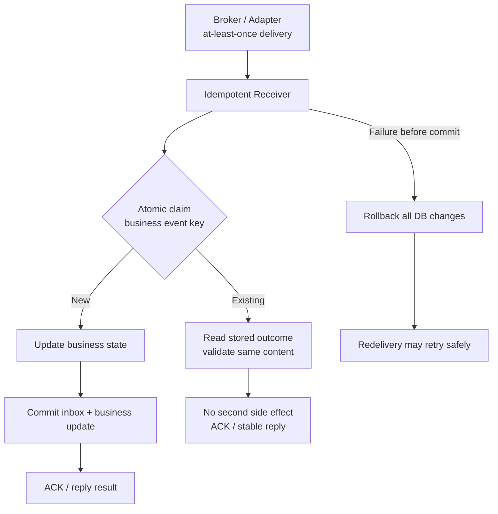
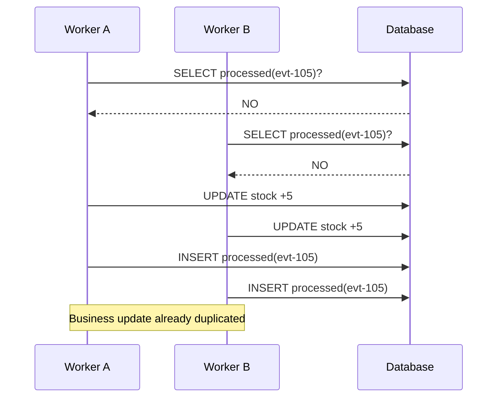
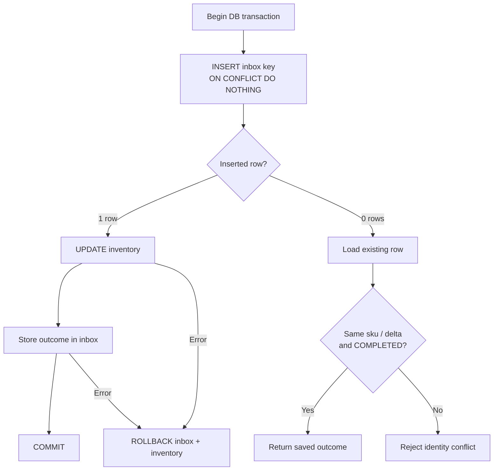
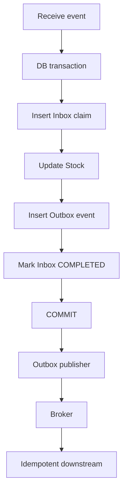

# Kiểm tra rồi ghi nhận message atomically

## 1. Vì sao “kiểm tra trước rồi xử lý” chưa đủ an toàn?

Trong một luồng nhập kho, broker giao sự kiện `StockAdjustmentRequested` với `eventId=evt-105` và yêu cầu cộng 5 đơn vị vào tồn kho của một SKU. Consumer ghi tồn kho thành công nhưng mất kết nối trước khi xác nhận ACK. Broker giao lại **cùng một logical event**. Nếu receiver lại cộng 5 đơn vị, tồn kho bị tăng hai lần.

Đó là lý do của **Idempotent Receiver** trong Enterprise Integration Patterns (EIP): một receiver có thể nhận lại cùng yêu cầu, nhưng **tác dụng nghiệp vụ được phép xảy ra tối đa một lần cho mỗi khóa idempotency**. Trong thực tế, điều khó nhất không phải viết `if (seen) return`, mà là bảo đảm việc **kiểm tra, ghi dấu và cập nhật dữ liệu nghiệp vụ** an toàn khi có hai thread, hai JVM, transaction rollback hoặc crash.

Trong chương **Idempotent receiver** của module **SPRING_INTEGRATION_PATTERN**, người học triển khai EIP bằng Spring Integration để xây dựng luồng thông điệp ít phụ thuộc và dễ mở rộng. Nội dung kết nối trực tiếp với Router, Filter, Transformer, Splitter, Aggregator, Gateway, retry, error channel và correlation; đồng thời thực hành kiểm thử, quan sát các nhánh và cách xử lý message được phát lại.



**Phân biệt quan trọng:** Message *có thể được chuyển nhiều lần* nhưng tác dụng được thiết kế để chỉ ghi nhận một lần. Điều này **không** biến broker thành exactly-once delivery và cũng không tự bảo đảm một external API chỉ được gọi đúng một lần.

## 2. Định nghĩa tính idempotent và phạm vi cần bảo vệ

Một thao tác `f` được gọi là idempotent khi thực hiện lặp lại với cùng một logical request không làm thay đổi trạng thái nghiệp vụ sau lần thành công đầu tiên:

```text
apply(event E) -> stock = 15
apply(event E) -> stock = 15 (duplicate suppressed)
apply(event E) -> stock = 15 (duplicate suppressed)

apply(event F) -> stock = 19 (event khác, được xử lý)
```

Có ba lớp cần phân biệt:

| Lớp | Ví dụ | Idempotency giải quyết gì? |
| --- | --- | --- |
| **Delivery** | Broker redeliver sau ACK timeout | Chấp nhận nhận nhiều lần |
| **Receiver / processing** | Cùng event vào nhiều lần, kể cả đồng thời | Không thực hiện side effect nghiệp vụ lặp |
| **Downstream side effect** | Gọi ngân hàng, gửi email, publish event mới | Cần cơ chế idempotency/transaction/outbox riêng |

Nếu mục tiêu chỉ là “không xử lý trùng event ở một consumer”, hãy định nghĩa rõ **consumer nào**, **event identity nào** và **side effect nào**. Cùng một event có thể cần đi qua hai consumer độc lập: cập nhật tồn kho và ghi báo cáo. Chặn ở consumer tồn kho không có nghĩa consumer báo cáo cũng phải bỏ qua.

### 2.1. Hai kiểu trả kết quả khi nhận duplicate

1. **Suppress:** không chạy logic nghiệp vụ lần nữa, có thể trả một ACK hoặc no-op.
2. **Replay saved outcome:** trả lại kết quả đã lưu của lần xử lý đầu, hữu ích khi request–reply hoặc Gateway bị retry sau timeout.

Ví dụ consumer lần đầu trả số lượng còn lại bằng 15. Khi duplicate tới sau một event khác đã làm tồn kho thành 20, receiver nên **trả lại outcome của event gốc (15)** nếu contract là “replay result”, thay vì đọc tồn kho hiện tại (20) và giả vờ đó là kết quả của event trùng.

### 2.2. Idempotency không phải “bỏ tất cả thứ gì đã từng thấy”

Một event có cùng `eventId` nhưng payload khác là **identity conflict**, không phải duplicate hợp lệ. Cần so sánh dữ liệu đã canonicalize hoặc request fingerprint; không được chỉ kiểm tra key tồn tại rồi ACK một yêu cầu có nội dung bị thay đổi.

```text
First:     (tenant-a, evt-105, SKU-A, +5)
Duplicate: (tenant-a, evt-105, SKU-A, +5)   -> replay / no-op

Conflict:  (tenant-a, evt-105, SKU-B, +50)  -> reject / investigate
```

## 3. Phản mẫu: SELECT rồi INSERT trong hai thao tác rời

Một triển khai rất phổ biến:

```java
// PHẢN MẪU: không an toàn khi nhiều consumer đồng thời.
if (!repository.existsByEventId(event.eventId())) {
    inventory.add(event.sku(), event.delta());
    repository.insertProcessed(event.eventId());
}
```

Khi có hai consumer trên các thread hoặc instance khác nhau:



Hai lần `SELECT` đều hợp lệ tại thời điểm chúng chạy, nhưng **không tạo được quyền xử lý độc quyền**. Đây là lỗi *check-then-act race* / *time-of-check to time-of-use (TOCTOU)*.

### 3.1. Thêm UNIQUE constraint sau side effect chưa đủ

Giả sử bảng processed events có UNIQUE `eventId`. Worker B có thể bị lỗi duplicate khi `INSERT`, nhưng nếu nó đã **cập nhật kho ở transaction khác** trước đó, tồn kho vẫn tăng hai lần. Unique constraint giúp bảo vệ bảng dấu vết; nó chỉ bảo vệ nghiệp vụ khi **bắt quyền xử lý trước và cập nhật nghiệp vụ trong cùng transaction nguyên tử**.

### 3.2. Khóa JVM và cache không thay thế database transaction

| Cách thử xử lý | Vấn đề |
| --- | --- |
| `synchronized` trong một bean | Không khóa instance khác, không chống crash |
| `ConcurrentHashMap.putIfAbsent` | Mất khi restart, chưa commit cùng DB |
| Redis `SETNX` | Có thể tránh xử lý song song nhưng không tự commit cùng business DB |
| Chỉ kiểm tra message header `duplicateMessage` | Header là thông tin, không phải bằng chứng đã commit |
| `SELECT EXISTS` ngoài transaction | Có thể race và không bảo vệ side effect |
| Ghi processed event sau khi gọi external API | Crash giữa hai thao tác khiến API được gọi lại |

Khi nghiệp vụ và dấu vết nằm cùng một relational database, **transaction + unique constraint + atomic claim** thường là một lựa chọn mạnh, rõ và dễ kiểm thử.

## 4. Thiết kế khóa idempotency có ngữ nghĩa

Một khóa tốt phải ổn định qua retry và đủ cụ thể để hai công việc hợp lệ không bị nhận nhầm là trùng.

```text
IdempotencyKey = (consumerName, tenantId, eventId)

consumerName = "inventory-adjustment"
tenantId     = "tenant-hcm"
eventId      = "evt-105"
```

| Thành phần | Ý nghĩa | Lỗi khi thiếu |
| --- | --- | --- |
| `consumerName` | Mỗi consumer có dấu vết riêng | Một consumer chặn nhầm consumer khác |
| `tenantId` | Phân vùng dữ liệu và quyền | Hai tenant cùng event ID xung đột |
| `eventId` | Stable logical event identity | Retry bị coi là event mới |
| `eventVersion` (khi cần) | Phân biệt bản sửa có chủ đích | Bản mới bị coi nhầm duplicate |
| `sourceIndex` (nếu event chứa batch) | Phân biệt hai item trong batch | Item thứ hai bị chặn nhầm |

**Không dùng chỉ SKU** làm key: hai điều chỉnh kho độc lập có thể cùng SKU. **Không dùng `MessageHeaders.ID`** làm business event ID: adapter hoặc redelivery có thể tạo message envelope mới. **Không dùng timestamp nhận**: mỗi attempt sẽ khác.

### 4.1. Khóa cho Splitter/Aggregator

Nếu một message batch gồm ba item và một consumer áp dụng từng item:

```text
(consumerName, tenantId, batchEventId, sourceIndex)
```

Một eventId chung cho cả batch mà không có `sourceIndex` sẽ khiến item 0 “giữ chỗ” và item 1,2 bị nhận nhầm duplicate. Ngược lại, nếu idempotency ở mức **toàn batch**, phải có transaction/workflow bảo đảm toàn bộ batch, không suy ra từ một key duy nhất ở item consumer.

### 4.2. Cùng key nhưng nội dung khác

Hai nguyên tắc:
- **Key** xác định *logical operation*.
- **Fingerprint hoặc dữ liệu nguồn được lưu** xác nhận operation ấy có cùng nội dung qua các lần gửi.

Trong ví dụ sau, ta lưu `sku` và `delta` trong Inbox để so sánh trực tiếp khi duplicate. Với payload phức tạp có thể lưu một canonical fingerprint (ví dụ SHA-256 của biểu diễn ổn định, có schema version), nhưng không hash `toString()` tùy ý hoặc JSON có thứ tự field không xác định rồi coi kết quả là bất biến.

## 5. Giải pháp: atomic claim và cập nhật nghiệp vụ trong cùng transaction

Ta dùng **PostgreSQL** để có câu lệnh `INSERT ... ON CONFLICT DO NOTHING`. Cơ chế này không phải SQL chung của mọi DB; nếu dùng MySQL, SQL Server hoặc Oracle, cần chọn cú pháp/locking thích hợp và kiểm chứng tương đương.

Thiết kế:

1. Transaction bắt đầu.
2. Thử **claim key** bằng một insert vào bảng Inbox có unique constraint.
3. Nếu insert thành công: xử lý nghiệp vụ trong **chính transaction đó**, lưu outcome và commit.
4. Nếu key đã tồn tại: đọc outcome đã commit, kiểm tra payload có khớp rồi return duplicate/no-op.
5. Nếu có exception trước commit: toàn bộ insert Inbox và business update **rollback cùng nhau**; redelivery có thể thử lại.



**Đây là tính nguyên tử cần chứng minh:** Không có thời điểm *đã commit inventory update nhưng chưa commit dấu vết idempotency* khi cả hai nằm trong đúng một DB transaction.

### 5.1. Bảng số lượng tồn kho

```sql
CREATE TABLE stock_balances (
    tenant_id  VARCHAR(80) NOT NULL,
    sku        VARCHAR(64) NOT NULL,
    quantity   BIGINT NOT NULL CHECK (quantity >= 0),
    PRIMARY KEY (tenant_id, sku)
);
```

Mỗi cặp tenant/SKU có một row. UPDATE kiểu `quantity = quantity + delta` thực thi trên database trong transaction, tránh read-modify-write ở Java gây lost update.

### 5.2. Bảng Inbox và kết quả đã xử lý

```sql
CREATE TABLE inventory_inbox (
    consumer_name    VARCHAR(80) NOT NULL,
    tenant_id        VARCHAR(80) NOT NULL,
    event_id         VARCHAR(120) NOT NULL,
    sku              VARCHAR(64) NOT NULL,
    delta            BIGINT NOT NULL,
    status           VARCHAR(24) NOT NULL,
    result_quantity  BIGINT,
    created_at       TIMESTAMPTZ NOT NULL DEFAULT now(),
    completed_at     TIMESTAMPTZ,
    PRIMARY KEY (consumer_name, tenant_id, event_id),
    CHECK (status IN ('PROCESSING', 'COMPLETED', 'REJECTED'))
);
```

Ý nghĩa:
- `PRIMARY KEY (consumer_name, tenant_id, event_id)` là **điểm phân xử concurrency** cho cùng một logical event.
- `sku` và `delta` lưu bản sắc nội dung để kiểm tra duplicate hoặc conflict.
- `status` giúp biết event đã COMPLETED hay bị từ chối có chủ đích.
- `result_quantity` lưu **outcome lúc thực thi event**, không phải số lượng hiện tại.
- `created_at`/`completed_at` hỗ trợ audit và retention.

Trong code dưới đây, hàng `PROCESSING` chỉ xuất hiện **bên trong transaction chưa commit**. Transaction thành công đổi thành `COMPLETED` trước commit; khi thất bại, hàng PROCESSING được rollback nên không tồn tại như một dấu vết đã xử lý. Nếu dùng thiết kế nhiều pha cho API bên ngoài, lifecycle sẽ khác (xem các mục sau).

### 5.3. Một transaction bao trùm những bước nào?

```text
BEGIN
  INSERT inventory_inbox(... status=PROCESSING)
  UPDATE stock_balances
  SELECT resulting quantity
  UPDATE inventory_inbox(status=COMPLETED, result_quantity=...)
COMMIT
```

**Không** tách bước “ghi dấu đã xử lý” sang một transaction độc lập trước rồi gọi update tồn kho sau. Nếu ghi dấu commit thành công nhưng update tồn kho thất bại, redelivery sẽ bị loại dù business effect chưa xảy ra. Ngược lại, nếu update tồn kho commit trước rồi mới ghi dấu, crash ở giữa gây nhân đôi side effect.

## 6. Java model và hợp đồng validate đầu vào

Ví dụ Java 17 dùng record bất biến. `StockAdjustmentRequested` là **một event nghiệp vụ**, không phải mỗi delivery attempt.

```java
record StockAdjustmentRequested(
        String tenantId,
        String eventId,
        String sku,
        long delta) {

    StockAdjustmentRequested {
        if (tenantId == null || tenantId.isBlank()
                || eventId == null || eventId.isBlank()
                || sku == null || sku.isBlank()
                || delta == 0) {
            throw new IllegalArgumentException(
                    "Invalid stock adjustment event");
        }
    }
}

record ApplyResult(
        String tenantId,
        String eventId,
        long resultingQuantity,
        boolean duplicate) {}
```

- `delta > 0`: tăng số lượng.
- `delta < 0`: giảm số lượng; không được để số lượng âm.
- `delta == 0`: ví dụ này coi là input invalid.
- `tenantId` phải bắt nguồn từ identity/nguồn tin cậy và được so khớp với event.
- Một eventId giữ nguyên qua redelivery; **event sửa nội dung có chủ đích** cần policy version/event ID mới.

`ApplyResult.duplicate` cho biết delivery hiện tại không tạo business update mới. Nếu duplicate hợp lệ, `resultingQuantity` là snapshot đã lưu ở lần đầu.

## 7. Java: atomic check-and-record với TransactionTemplate và JdbcTemplate

Sử dụng `TransactionTemplate` giúp nhìn rõ transaction boundary và không bị phụ thuộc vào việc `@Transactional` có đi qua Spring proxy hay không. Mọi câu SQL dưới đây dùng **cùng DataSource và transaction manager**.

### 7.1. Cấu hình transaction template

```java
import org.springframework.context.annotation.Bean;
import org.springframework.context.annotation.Configuration;
import org.springframework.transaction.PlatformTransactionManager;
import org.springframework.transaction.TransactionDefinition;
import org.springframework.transaction.support.TransactionTemplate;

@Configuration
class InventoryTransactionConfig {

    @Bean
    TransactionTemplate inventoryTransactionTemplate(
            PlatformTransactionManager txManager) {
        var template = new TransactionTemplate(txManager);
        template.setIsolationLevel(
                TransactionDefinition.ISOLATION_READ_COMMITTED);
        return template;
    }
}
```

Ví dụ chủ đích dùng mức `READ_COMMITTED` của PostgreSQL. Khi hai transaction cùng tranh unique key, statement `INSERT ... ON CONFLICT DO NOTHING` xử lý cạnh tranh dựa trên unique constraint; transaction thua có thể đợi transaction thắng kết thúc. Sau khi nhận kết quả 0 row, lệnh SELECT tiếp theo trong `READ COMMITTED` có thể thấy row đã commit.

Không suy rộng chính xác cơ chế này cho mọi hệ quản trị hoặc mức isolation khác. Với `REPEATABLE_READ`/snapshot isolation, cách đọc row sau conflict và cách retry transaction có thể khác, cần test với DB thực.

### 7.2. Service xử lý transaction hoàn chỉnh

```java
import java.util.List;
import java.util.Objects;
import org.springframework.jdbc.core.JdbcTemplate;
import org.springframework.stereotype.Service;
import org.springframework.transaction.support.TransactionTemplate;

@Service
class InventoryIdempotentReceiver {
    private static final String CONSUMER = "inventory-adjustment";

    private final JdbcTemplate jdbc;
    private final TransactionTemplate tx;

    InventoryIdempotentReceiver(
            JdbcTemplate jdbc,
            TransactionTemplate inventoryTransactionTemplate) {
        this.jdbc = jdbc;
        this.tx = inventoryTransactionTemplate;
    }

    ApplyResult accept(StockAdjustmentRequested event) {
        Objects.requireNonNull(event, "event");

        ApplyResult result = tx.execute(status -> {
            int claimed = jdbc.update("""
                    INSERT INTO inventory_inbox
                        (consumer_name, tenant_id, event_id,
                         sku, delta, status)
                    VALUES (?, ?, ?, ?, ?, 'PROCESSING')
                    ON CONFLICT
                        (consumer_name, tenant_id, event_id)
                    DO NOTHING
                    """,
                    CONSUMER,
                    event.tenantId(),
                    event.eventId(),
                    event.sku(),
                    event.delta());

            if (claimed == 0) {
                return handleExisting(event);
            }
            if (claimed != 1) {
                throw new IllegalStateException(
                        "Unexpected claim insert row count");
            }

            // Cùng transaction với INSERT Inbox.
            int changed = jdbc.update("""
                    UPDATE stock_balances
                    SET quantity = quantity + ?
                    WHERE tenant_id = ?
                      AND sku = ?
                      AND quantity + ? >= 0
                    """,
                    event.delta(),
                    event.tenantId(),
                    event.sku(),
                    event.delta());

            if (changed != 1) {
                throw new IllegalStateException(
                        "STOCK_ROW_MISSING_OR_INSUFFICIENT");
            }

            Long quantity = jdbc.queryForObject("""
                    SELECT quantity FROM stock_balances
                    WHERE tenant_id = ? AND sku = ?
                    """,
                    Long.class,
                    event.tenantId(),
                    event.sku());
            if (quantity == null) {
                throw new IllegalStateException(
                        "Stock row disappeared");
            }

            int recorded = jdbc.update("""
                    UPDATE inventory_inbox
                    SET status = 'COMPLETED',
                        result_quantity = ?,
                        completed_at = now()
                    WHERE consumer_name = ?
                      AND tenant_id = ?
                      AND event_id = ?
                      AND status = 'PROCESSING'
                    """,
                    quantity,
                    CONSUMER,
                    event.tenantId(),
                    event.eventId());

            if (recorded != 1) {
                throw new IllegalStateException(
                        "Could not finalize inbox");
            }

            return new ApplyResult(
                    event.tenantId(),
                    event.eventId(),
                    quantity,
                    false);
        });

        return Objects.requireNonNull(result, "Transaction result");
    }

    private ApplyResult handleExisting(
            StockAdjustmentRequested event) {
        List<InboxRecord> matches = jdbc.query("""
                SELECT sku, delta, status, result_quantity
                FROM inventory_inbox
                WHERE consumer_name = ?
                  AND tenant_id = ?
                  AND event_id = ?
                """,
                (rs, index) -> new InboxRecord(
                        rs.getString("sku"),
                        rs.getLong("delta"),
                        rs.getString("status"),
                        rs.getObject(
                                "result_quantity", Long.class)),
                CONSUMER,
                event.tenantId(),
                event.eventId());

        if (matches.size() != 1) {
            throw new IllegalStateException(
                    "Claim exists but inbox record not visible");
        }

        InboxRecord stored = matches.get(0);
        if (!stored.sku().equals(event.sku())
                || stored.delta() != event.delta()) {
            throw new IllegalArgumentException(
                    "IDEMPOTENCY_KEY_CONFLICT");
        }
        if (!"COMPLETED".equals(stored.status())
                || stored.resultQuantity() == null) {
            throw new IllegalStateException(
                    "INBOX_NOT_COMPLETED");
        }

        return new ApplyResult(
                event.tenantId(),
                event.eventId(),
                stored.resultQuantity(),
                true);
    }

    private record InboxRecord(
            String sku,
            long delta,
            String status,
            Long resultQuantity) {}
}
```

**Quan trọng để không hiểu sai:**

1. **Atomic claim nằm ở database constraint**, không phải `if` trong Java.
2. Tất cả thao tác claim, cập nhật tồn kho và finalize Inbox chạy trong **một transaction**.
3. `ON CONFLICT (consumer_name, tenant_id, event_id) DO NOTHING` chỉ bỏ qua tranh chấp trên đúng khóa; lỗi constraint khác không bị nuốt thành duplicate.
4. Khi `claimed == 0`, code đọc bản ghi đã commit và **so sánh input**. Khác SKU/delta → identity conflict.
5. Khi update tồn kho thất bại, exception làm transaction rollback; Inbox cũng không được commit như đã xử lý.
6. Khi duplicate hợp lệ, code trả lại `resultQuantity` từ Inbox, **không** đọc quantity hiện tại.
7. `Math` số học trong DB có thể overflow nếu vượt miền BIGINT, constraint violation sẽ khiến transaction rollback.
8. `READ_COMMITTED` và cú pháp `ON CONFLICT` được lựa chọn **cụ thể cho PostgreSQL**; đừng copy sang DB khác mà không kiểm chứng.

### 7.3. Nếu chưa có hàng tồn kho hoặc số dư không đủ

Ví dụ trên ném `STOCK_ROW_MISSING_OR_INSUFFICIENT` rồi rollback. Khi redelivery cùng event, nó sẽ thử lại và có thể tiếp tục thất bại. **Đây là một quyết định minh họa**, phù hợp khi tình trạng thiếu row là cấu hình sai hoặc dữ liệu tạm chưa sẵn sàng.

Trong production, cần phân biệt:
- **Lỗi tạm thời** (database timeout, stock record chưa được đồng bộ) → retry có giới hạn.
- **Từ chối nghiệp vụ cuối cùng** (không đủ tồn kho theo một snapshot/contract) → có thể muốn commit Inbox với trạng thái `REJECTED` và lưu reason code trong cùng transaction.
- **Sai input** (SKU không hợp lệ, tenant không có quyền) → reject/quarantine, không retry vô hạn.

Chỉ đánh dấu `REJECTED` sau khi business decision thực sự là kết quả cuối cùng. Nếu một event “giảm 10 hàng” thiếu tồn kho hôm nay nhưng chính sách cho phép chờ bù tồn kho ngày mai, ghi `REJECTED` vĩnh viễn có thể là sai workflow.

## 8. Tích hợp vào Spring Integration Java DSL

Receiver service đảm nhận atomicity, còn Spring Integration điều phối message. Ta có thể dùng Service Activator thông qua Java DSL:

```java
import org.springframework.context.annotation.Bean;
import org.springframework.context.annotation.Configuration;
import org.springframework.integration.channel.DirectChannel;
import org.springframework.integration.channel.QueueChannel;
import org.springframework.integration.config.EnableIntegration;
import org.springframework.integration.dsl.IntegrationFlow;
import org.springframework.messaging.MessageChannel;
import org.springframework.messaging.PollableChannel;

@Configuration
@EnableIntegration
class InventoryIdempotencyFlow {

    @Bean("inventory.adjustments")
    MessageChannel adjustments() {
        return new DirectChannel();
    }

    @Bean("inventory.results")
    PollableChannel results() {
        return new QueueChannel();
    }

    @Bean
    IntegrationFlow applyStockAdjustments(
            InventoryIdempotentReceiver receiver) {
        return IntegrationFlow.from("inventory.adjustments")
                .handle(StockAdjustmentRequested.class,
                        (event, headers) -> receiver.accept(event))
                .channel("inventory.results")
                .get();
    }
}
```

Một producer demo:

```java
import org.springframework.messaging.support.MessageBuilder;

// input là bean MessageChannel "inventory.adjustments".
var event = new StockAdjustmentRequested(
        "tenant-hcm", "evt-105", "SKU-A", 5L);

input.send(MessageBuilder.withPayload(event)
        .setHeader("traceId", "trace-105")
        .setHeader("eventId", event.eventId())
        .build());
```

Khi xử lý thành công, output `ApplyResult(tenant-hcm, evt-105, 15, false)` có thể được đọc từ `inventory.results`; khi gửi lại cùng event, output `ApplyResult(..., 15, true)` mà stock vẫn ở 15 nếu không có event khác.

**Các lớp trách nhiệm:**
- Ingress adapter phải xác thực tenant và dữ liệu, không tin header eventId do client tùy ý khai.
- Receiver quản lý unique key, transaction và domain update.
- Flow chuyển `ApplyResult` theo routing/reply contract.
- QueueChannel trong ví dụ là **in-memory**, không bảo đảm lưu kết quả khi restart.
- Nếu dùng broker, ACK chỉ nên được coi là thành công **sau khi transaction đã commit** và adapter xử lý hoàn tất theo chính sách. Nếu ACK thất bại và broker redeliver, receiver vẫn phải chịu được duplicate.

### 8.1. Nếu duplicate được filter/discard thay vì trả kết quả

Spring Integration còn có hướng xử lý idempotent ở endpoint qua **Idempotent Receiver advice/interceptor** kết hợp một `MessageSelector` và `MetadataStore`. Có thể chọn cách đánh dấu/loại message trùng trước business handler.

Nhưng hai cảnh báo:
1. **Dấu nhận message trong MetadataStore không mặc nhiên chung transaction với cập nhật tồn kho trong database.** Nếu claim được commit ở Redis/cache rồi business update thất bại, retry có thể bị chặn sai.
2. Nếu interceptor chỉ gắn header đánh dấu duplicate và vẫn để message đi tiếp, **consumer phải chủ động kiểm tra** và không thực hiện side effect lần hai. Cần xác minh semantics của interceptor và cấu hình advice/discard ở phiên bản Spring Integration đang sử dụng.

Bài này ưu tiên **Inbox table + transactional business update** để làm rõ yêu cầu của tiêu đề “kiểm tra rồi ghi nhận message atomically”. Một selector thuần là hữu ích cho lọc dữ liệu, nhưng không nên coi nó là transaction boundary cho mọi side effect.

## 9. Vì sao xử lý atomically khác với check rồi set flag?

Cùng một cơ sở dữ liệu nhưng nhiều transaction vẫn có thể tạo “khoảng trống” nguy hiểm. Bảng sau so sánh các điểm crash:

| Thời điểm crash | Ghi dấu ở transaction riêng | Inbox + business trong cùng transaction |
| --- | --- | --- |
| Trước khi claim | Chưa có hiệu ứng | Chưa có hiệu ứng |
| Claim đã commit, business chưa chạy | **Có nguy cơ mất tác dụng vĩnh viễn** khi retry bị chặn | Không có trạng thái commit kiểu này |
| Business đã commit, Inbox chưa commit | **Có nguy cơ chạy trùng** sau redelivery | Không có trạng thái commit kiểu này |
| Transaction đang cập nhật nhưng chưa commit | Có thể để lại update nếu đã dùng transaction khác | **Rollback cả claim và update** |
| Đã commit đủ, ACK broker thất bại | Có thể chạy lại nếu dấu không bền | Duplicate đi vào nhánh đọc outcome |
| Đã commit, output reply bị mất | Caller có thể retry và gây side effect trùng | Receiver trả lại outcome đã lưu |

**Nguyên tử trong DB** chỉ bao trùm những thao tác trên cùng transaction resource. Nó **không** tự bao trùm broker ACK, HTTP response, gửi email hoặc API ngân hàng.

### 9.1. Thứ tự “claim trước, xử lý sau” cần hiểu chính xác

Cụm từ “claim trước” trong ví dụ nghĩa là **insert một hàng có unique key bên trong transaction chưa commit**. Một worker khác không thể cùng commit hàng đó với cùng khóa. Nếu transaction đang giữ khóa rollback, worker khác mới có thể claim và xử lý. Đây không phải **commit một flag PROCESSING trước rồi làm nghiệp vụ ở một transaction khác**.

Nếu dùng mô hình state machine nhiều pha, `PROCESSING` có thể là bản ghi đã commit và cần **lease, timeout, owner token, fencing token** để khôi phục sau worker crash. Đó là bài toán khác, không có cùng bảo đảm nguyên tử khi side effect nằm ngoài transaction.

### 9.2. Tại sao `READ COMMITTED` được nêu rõ?

Trong PostgreSQL, một lệnh `INSERT ... ON CONFLICT DO NOTHING` khi cùng key đang bị transaction khác giữ có thể đợi transaction đó kết thúc. Dưới `READ COMMITTED`, câu SELECT tiếp theo trong transaction có snapshot mới và đọc được bản ghi mà transaction thắng vừa commit.

Nếu dùng snapshot isolation khác, cùng một luồng kiểm tra có thể cần retry **toàn transaction** sau conflict hoặc serialization failure. Không chọn một isolation level từ ví dụ một cách máy móc cho mọi DB hoặc mọi khối lượng công việc; hãy test concurrency trên DB production đang dùng.

## 10. Lỗi nghiệp vụ cuối cùng và trạng thái REJECTED

Ví dụ mục 7 rollback khi thiếu tồn kho. Nhưng có những yêu cầu mà nghiệp vụ quyết định **từ chối vĩnh viễn**. Nếu mỗi redelivery lại làm cùng validation và ném cùng lỗi, message có thể trở thành poison message không bao giờ được ACK.

Có hai chính sách khác nhau:

| Loại thất bại | Chính sách gợi ý | Inbox |
| --- | --- | --- |
| DB/queue timeout | Retry có giới hạn | Rollback; chưa xử lý |
| Deadlock/serialization conflict | Retry transaction với backoff | Rollback; claim lại an toàn |
| Business decision final: bị từ chối | Commit kết quả từ chối | `REJECTED` và `reason_code` |
| Schema/tenant invalid, không thể tin dữ liệu | Reject/quarantine tại ingress | Không tạo claim giả |
| External API status chưa rõ | Reconcile/query theo idempotency key | Không tự kết luận đã thành công |
| Wrong payload với same event key | Security/identity conflict | Không cập nhật Inbox lần đầu |

Để ghi nhận một quyết định từ chối như outcome ổn định, mở rộng schema:

```sql
ALTER TABLE inventory_inbox
ADD COLUMN reason_code VARCHAR(80);
```

Trong **cùng transaction đã claim**, nếu tồn kho thiếu và chính sách xác định từ chối cuối cùng:

```text
BEGIN
  INSERT inbox(PROCESSING)
  evaluate stock + business rules
  UPDATE inbox
    SET status='REJECTED', reason_code='INSUFFICIENT_STOCK'
  COMMIT
```

Với duplicate của một event đã REJECTED, receiver trả lại cùng business rejection (không thực hiện lại). Phải sửa nhánh đọc existing để xử lý `REJECTED` đúng contract thay vì coi mọi trạng thái khác `COMPLETED` là lỗi hệ thống như code demo.

**Lưu ý:** Đừng dùng REJECTED cho lỗi nguồn dữ liệu có thể thay đổi hoặc lỗi transient nếu hợp đồng cho phép retry để thành công. Một quyết định âm tính bị cache vĩnh viễn có thể khiến event hợp lệ sau đó bị loại sai.

## 11. Atomic inbox không bao trùm tác dụng bên ngoài database

Giả sử cùng flow ngoài cập nhật tồn kho còn gửi một email hoặc publish `InventoryAdjusted` ra broker. Nếu thực hiện external side effect **trước DB commit**, transaction rollback có thể khiến email/event đã gửi dù tồn kho không đổi.

```text
BEGIN DB transaction
  INSERT inbox
  UPDATE stock
  send email / publish broker event  <-- không rollback theo DB
  UPDATE inbox COMPLETED
COMMIT
```

Một crash hoặc failure trong DB sau khi gửi email khiến redelivery thực hiện lại bước gửi. Ngược lại, nếu commit DB rồi publish, crash trước publish làm **mất notification**.

### 11.1. Transactional Outbox

Thay vì publish ngay, ghi một **outbox record trong cùng transaction** với Inbox và stock update:



Schema gợi ý:

```sql
CREATE TABLE integration_outbox (
    event_id        VARCHAR(160) PRIMARY KEY,
    tenant_id       VARCHAR(80) NOT NULL,
    event_type      VARCHAR(80) NOT NULL,
    payload_json    JSONB NOT NULL,
    published_at    TIMESTAMPTZ,
    created_at      TIMESTAMPTZ NOT NULL DEFAULT now()
);
```

Trong code xử lý lần đầu (bên trong transaction của mục 7, **trước commit**), có thể thêm:

```java
// Ví dụ minh họa, payloadJson do serializer an toàn tạo ra.
jdbc.update("""
        INSERT INTO integration_outbox
            (event_id, tenant_id, event_type, payload_json)
        VALUES (?, ?, 'InventoryAdjusted', CAST(? AS jsonb))
        """,
        event.tenantId() + ":" + event.eventId() + ":stock:v1",
        event.tenantId(),
        payloadJson);
```

Ở nhánh duplicate `claimed==0` **không thêm outbox event mới**. Outbox publisher đọc các bản chưa publish, gửi tới broker và ghi nhận publish status. Publisher có thể gửi trùng nếu crash sau khi broker nhận nhưng trước khi cập nhật `published_at`. Consumer downstream vì thế **vẫn cần idempotency** theo outbox event identity.

Một outbox record có `event_id` ổn định cần tính scope/encoding cẩn thận: dùng canonical composite ID hoặc khóa dữ liệu không nhập nhằng nếu các chuỗi nguồn có thể chứa dấu phân cách.

### 11.2. External API như thanh toán

Không gọi `chargeCard()` trong DB transaction rồi cho rằng transaction rollback sẽ hủy tiền đã thu. Các lựa chọn:
- Gửi một command qua outbox, dùng **idempotency key** mà payment provider hỗ trợ.
- Lưu trạng thái intent/processing, đối soát kết quả API khi timeout không rõ thành công hay thất bại.
- Nếu cần nhiều bước, thiết kế saga/compensation và bảo đảm thứ tự state transitions.
- Không phát lại một giao dịch tài chính với key mới chỉ để “thử lần nữa”.

Claim trong database bảo vệ trạng thái **local**; external system cần chính sách của chính nó.

## 12. Retry, ACK và redelivery trong flow Spring Integration

Với broker at-least-once, sequence lý tưởng:

```text
broker -> message adapter -> Spring Integration handler
                             -> DB atomic transaction
                             -> return success
       <- ACK (theo adapter / listener policy)
```

Nếu handler ném exception:
- TransactionTemplate rollback.
- Adapter áp dụng retry/nack/requeue/dead-letter policy của nó.
- Message có thể được gửi lại và claim key vẫn có thể được dùng để xử lý thành công.

Nếu DB commit rồi mạng đứt trước ACK:
- Broker có thể redeliver.
- Claim key đã tồn tại với `COMPLETED`.
- Receiver kiểm tra dữ liệu trùng, trả kết quả đã lưu.
- Adapter có thể ACK delivery mới mà không cập nhật tồn kho lần nữa.

### 12.1. Phân biệt ba nhóm lỗi

| Nhóm | Ví dụ | Retry? |
| --- | --- | --- |
| **Duplicate hợp lệ** | Cùng eventId và same canonical payload | Không chạy side effect; ACK |
| **Lỗi transient** | DB timeout, deadlock, lock timeout | Có giới hạn và backoff |
| **Lỗi vĩnh viễn/contract** | Same key khác payload, tenant sai, schema lỗi | Reject, quarantine hoặc terminal reply |

Không viết `catch (Exception ignored) { ack(); }`: nó làm mất message chưa xử lý. Ngược lại, không retry vô hạn `IDEMPOTENCY_KEY_CONFLICT` vì một payload sai không tự trở thành đúng khi chạy lại.

### 12.2. Dễ tạo retry storm nếu chồng nhiều lớp

Nếu HTTP client retry 3 lần, Service Activator retry 3 lần và broker adapter redeliver 3 lần, tổng attempts có thể lên đến 27 cho cùng event trong trường hợp xấu. Idempotency bảo vệ business side effect nhưng **không tự giảm tải truy vấn database hoặc external API**. Cần giới hạn attempts tổng, backoff/jitter, timeout, circuit breaker và một cơ chế DLQ/quarantine quan sát được.

### 12.3. Error channel không thay thế Inbox

Spring Integration có thể phát `ErrorMessage` theo `errorChannel` tùy loại endpoint (poller, executor, gateway, broker adapter). Nhưng error channel:
- Không ghi processed event trong cùng transaction business DB.
- Không tự xác minh một event đã commit.
- Không tự có durability hoặc dead-letter storage.
- Không tạo atomicity giữa DB và broker ACK.

Inbox/outbox giải quyết **state & consistency**, còn error channel hỗ trợ **đường đi và quan sát lỗi**. Hai khái niệm bổ sung cho nhau.

## 13. Test idempotency trên database thật, không chỉ mock repository

Atomicity phụ thuộc vào unique constraint, transaction manager, JDBC connection và isolation. Mock `existsById()` trả `false` rồi `true` không thể chứng minh hai worker đồng thời không xử lý trùng.

**Nên dùng PostgreSQL thật trong integration test**, có thể qua Testcontainers (bổ sung test dependency). Test phải có schema giống production và kết nối cùng DataSource ở `JdbcTemplate`/TransactionTemplate.

### 13.1. Test fixture bằng PostgreSQL Testcontainers

Ví dụ dưới đây khởi tạo một PostgreSQL container cho lớp test. Đây là mã dành cho môi trường **đã cài Docker và Testcontainers**; không chạy trong bước biên soạn tài liệu này.

```java
import org.junit.jupiter.api.AfterAll;
import org.junit.jupiter.api.BeforeAll;
import org.junit.jupiter.api.BeforeEach;
import org.junit.jupiter.api.Test;
import org.springframework.jdbc.core.JdbcTemplate;
import org.springframework.jdbc.datasource.DataSourceTransactionManager;
import org.springframework.jdbc.datasource.DriverManagerDataSource;
import org.springframework.transaction.TransactionDefinition;
import org.springframework.transaction.support.TransactionTemplate;
import org.testcontainers.containers.PostgreSQLContainer;

import java.util.concurrent.*;
import static org.junit.jupiter.api.Assertions.*;

class InventoryIdempotentReceiverPostgresIT {

    private static PostgreSQLContainer<?> postgres;
    private static JdbcTemplate jdbc;
    private static InventoryIdempotentReceiver receiver;

    @BeforeAll
    static void startDatabaseAndCreateSchema() {
        postgres = new PostgreSQLContainer<>("postgres:16-alpine");
        postgres.start();

        var ds = new DriverManagerDataSource(
                postgres.getJdbcUrl(),
                postgres.getUsername(),
                postgres.getPassword());

        jdbc = new JdbcTemplate(ds);
        var tx = new TransactionTemplate(
                new DataSourceTransactionManager(ds));
        tx.setIsolationLevel(
                TransactionDefinition.ISOLATION_READ_COMMITTED);
        receiver = new InventoryIdempotentReceiver(jdbc, tx);

        jdbc.execute("""
                CREATE TABLE stock_balances (
                    tenant_id VARCHAR(80) NOT NULL,
                    sku VARCHAR(64) NOT NULL,
                    quantity BIGINT NOT NULL CHECK (quantity >= 0),
                    PRIMARY KEY (tenant_id, sku)
                )
                """);

        jdbc.execute("""
                CREATE TABLE inventory_inbox (
                    consumer_name VARCHAR(80) NOT NULL,
                    tenant_id VARCHAR(80) NOT NULL,
                    event_id VARCHAR(120) NOT NULL,
                    sku VARCHAR(64) NOT NULL,
                    delta BIGINT NOT NULL,
                    status VARCHAR(24) NOT NULL,
                    result_quantity BIGINT,
                    created_at TIMESTAMPTZ NOT NULL DEFAULT now(),
                    completed_at TIMESTAMPTZ,
                    PRIMARY KEY (consumer_name, tenant_id, event_id),
                    CHECK (status IN
                        ('PROCESSING','COMPLETED','REJECTED'))
                )
                """);
    }

    @AfterAll
    static void stopDatabase() {
        if (postgres != null) {
            postgres.stop();
        }
    }

    @BeforeEach
    void resetData() {
        jdbc.update("DELETE FROM inventory_inbox");
        jdbc.update("DELETE FROM stock_balances");
        jdbc.update("""
                INSERT INTO stock_balances
                    (tenant_id, sku, quantity)
                VALUES ('tenant-test', 'SKU-A', 10)
                """);
    }

    private static StockAdjustmentRequested event(
            String eventId, long delta) {
        return new StockAdjustmentRequested(
                "tenant-test", eventId, "SKU-A", delta);
    }

    private long currentQuantity() {
        Long quantity = jdbc.queryForObject("""
                SELECT quantity
                FROM stock_balances
                WHERE tenant_id = 'tenant-test'
                  AND sku = 'SKU-A'
                """, Long.class);
        return quantity.longValue();
    }

    @Test
    void sameEventTwiceChangesStockOnlyOnce() {
        var message = event("evt-101", 5);

        ApplyResult first = receiver.accept(message);
        ApplyResult second = receiver.accept(message);

        assertFalse(first.duplicate());
        assertTrue(second.duplicate());
        assertEquals(15L, currentQuantity());
        assertEquals(15L, first.resultingQuantity());
        assertEquals(15L, second.resultingQuantity());

        Integer inboxCount = jdbc.queryForObject("""
                SELECT COUNT(*)
                FROM inventory_inbox
                WHERE tenant_id = 'tenant-test'
                """, Integer.class);
        assertEquals(1, inboxCount);
    }

    @Test
    void sameKeyWithDifferentPayloadIsConflict() {
        receiver.accept(event("evt-102", 5));

        assertThrows(IllegalArgumentException.class, () ->
                receiver.accept(event("evt-102", 9)));

        assertEquals(15L, currentQuantity());
    }

    @Test
    void negativeStockRollsBackBothClaimAndUpdate() {
        assertThrows(IllegalStateException.class, () ->
                receiver.accept(event("evt-103", -99)));

        assertEquals(10L, currentQuantity());

        Integer inboxCount = jdbc.queryForObject("""
                SELECT COUNT(*)
                FROM inventory_inbox
                WHERE event_id = 'evt-103'
                """, Integer.class);
        assertEquals(0, inboxCount);
    }

    @Test
    void twoConcurrentDeliveriesApplyOnce() throws Exception {
        var message = event("evt-104", 5);
        var gate = new CountDownLatch(1);
        var pool = Executors.newFixedThreadPool(2);

        try {
            Callable<ApplyResult> deliver = () -> {
                gate.await();
                return receiver.accept(message);
            };
            Future<ApplyResult> f1 = pool.submit(deliver);
            Future<ApplyResult> f2 = pool.submit(deliver);
            gate.countDown();

            ApplyResult a = f1.get(10, TimeUnit.SECONDS);
            ApplyResult b = f2.get(10, TimeUnit.SECONDS);

            assertEquals(15L, currentQuantity());
            assertTrue(a.duplicate() ^ b.duplicate());
            assertEquals(15L, a.resultingQuantity());
            assertEquals(15L, b.resultingQuantity());
        } finally {
            pool.shutdownNow();
        }
    }

    @Test
    void duplicateReturnsHistoricalOutcomeNotCurrentBalance() {
        var original = event("evt-105", 5);
        var newer = event("evt-106", 3);

        receiver.accept(original);  // stock: 10 -> 15
        receiver.accept(newer);     // stock: 15 -> 18
        ApplyResult replay = receiver.accept(original);

        assertEquals(18L, currentQuantity());
        assertTrue(replay.duplicate());
        assertEquals(15L, replay.resultingQuantity());
    }
}
```

**Vì sao dùng database thật?**
- Unique constraint phải bảo vệ key ngay cả khi hai kết nối cùng ghi.
- Transaction rollback phải xóa Inbox row chưa commit và không thay đổi tồn kho.
- PostgreSQL `ON CONFLICT`, MVCC và isolation phải được kiểm chứng dưới concurrency.
- Mock trong memory không thể tái hiện đầy đủ lock wait, commit/rollback và snapshot visibility.

Để kiểm chứng crash thực sự, có thể thêm một **failpoint có kiểm soát ở integration test** ngay sau UPDATE tồn kho nhưng trước finalize/commit, ném exception, rồi assert cả Inbox và stock rollback. Không cần chạy test này trên môi trường dữ liệu thật.

### 13.2. Lưu ý về test framework

- Testcontainers yêu cầu Docker hoặc runtime container tương thích.
- Không annotate test bằng một `@Transactional` bao ngoài mà vô tình giữ seed/test data chưa commit giữa các thread; mỗi worker dùng transaction riêng nên phải nhìn thấy dữ liệu seed đã commit.
- Hạn chế chạy các test thay đổi cùng table song song, trừ khi test isolation riêng.
- Mã test chỉ minh họa chức năng; cần bổ sung dependency `spring-jdbc`, driver PostgreSQL, JUnit 5 và Testcontainers tương thích với build thực tế.
- Trong vòng Content QA/compile sau, cần rà soát syntax/configuration theo phiên bản Spring đang dùng, không xem việc viết code block là chứng minh nó đã được chạy.

## 14. Integration test qua Spring Integration flow

Một bài test end-to-end cần gửi **message thật** vào `inventory.adjustments`, đọc `ApplyResult` ở `inventory.results` và đo stock/InBox trong DB. Ví dụ những bước:

```text
Given:
  stock = 10
  inbox empty
  event = (tenant-test, evt-200, SKU-A, +5)

When:
  send event to inventory.adjustments
  receive result from inventory.results
  send same event again with new MessageHeaders.ID
  receive second result

Then:
  first result.duplicate = false
  second result.duplicate = true
  both resultingQuantity = 15
  stock quantity = 15
  inbox count for (consumer, tenant, eventId) = 1
```

Khi gửi duplicate, phải chủ động tạo **một message envelope khác ID** nhưng giữ nguyên `eventId` trong payload, để test thực sự kiểm tra stable business identity chứ không phụ thuộc framework-generated ID.

Nếu có `Router` hoặc `Filter` trước receiver, cần kiểm tra metadata tenant và eventId không bị thay đổi làm key bị lệch. Nếu có `Splitter`, phải xác minh mỗi item mang identity phù hợp; nếu có `Aggregator`, không dùng một child `eventId` bất kỳ làm ID của toàn summary.

### 14.1. Test nhiều consumer và tenant

| Test | Kỳ vọng |
| --- | --- |
| Cùng eventId, cùng tenant, cùng consumer | Duplicate |
| Cùng eventId, hai tenant | Hai logical operations khác nhau |
| Cùng eventId, hai consumer | Mỗi consumer được xử lý một lần |
| Cùng eventId, payload khác | Conflict, không chạy update lần hai |
| Hai eventIds khác nhau, cùng SKU | Hai updates hợp lệ |
| Cùng event, hai delivery threads | Một update + một duplicate |
| Crash trước DB commit | Rollback, event redelivery có thể claim |
| Crash sau DB commit trước ACK | Duplicate safe |
| DB timeout | Retry có giới hạn |
| External event publish fail | Outbox giữ yêu cầu phát |
| Message arrival out-of-order | Không nhầm event identity với arrival |
| Poison message invalid | Không retry vô hạn |
| Inbox record expired quá sớm | Kiểm tra nguy cơ replay trùng sau retention |

## 15. Giám sát, bảo trì và retention của Inbox

Inbox là dữ liệu điều phối **có giá trị nghiệp vụ**, không đơn giản là cache mà có thể xóa bất kỳ lúc nào. Khi dọn Inbox record đã hoàn tất, một event rất cũ được redeliver **có thể được xử lý lại như mới**.

### 15.1. Chính sách retention

Cần dựa trên:
- Thời gian broker có thể redeliver.
- TTL của DLQ và khoảng thời gian manual replay.
- Yêu cầu audit/truy vết và xử lý khiếu nại.
- Khả năng tái tạo inbox từ ledger/event history khác.
- Quy tắc migration khi thay đổi consumerName hoặc event schema.
- Chi phí index, partition, archive và số row trong DB.

Nếu broker/DLQ có thể replay sau 30 ngày mà Inbox chỉ giữ 7 ngày, **không có bảo đảm idempotency cho lần replay muộn**. Có thể cần lưu ledger dài hạn, archive lookup hoặc đánh dấu “event đã đóng” bền hơn tùy hệ thống.

### 15.2. Metrics cần theo dõi

| Metric | Ý nghĩa |
| --- | --- |
| `idempotent_receiver.events.received` | Tổng số deliveries vào receiver |
| `idempotent_receiver.claim.created` | Event mới claim thành công |
| `idempotent_receiver.duplicate.detected` | Event trùng được chặn |
| `idempotent_receiver.key.conflict` | Cùng key, payload khác |
| `idempotent_receiver.transaction.rollback` | Claim+business rollback |
| `idempotent_receiver.db.lock.wait` | Contention trên unique key |
| `idempotent_receiver.processing.latency` | Thời gian xử lý event |
| `idempotent_receiver.retry.count` | Retry do lỗi transient |
| `idempotent_receiver.inbox.rows` | Kích thước trạng thái lưu |
| `idempotent_receiver.inbox.cleanup.lag` | Khoảng trễ cleanup/retention |
| `outbox.unpublished.count` | Các sự kiện hậu xử lý chưa publish |
| `consumer.dead_letter.count` | Event chưa thể xử lý |

Tên metric trên là **gợi ý ở tầng ứng dụng**, không mặc định Spring Integration tự sinh đầy đủ các tên. Metric labels nên có consumer, outcome, nhóm lỗi, nhưng tránh dùng `eventId`, tenant IDs cardinality cao hoặc raw SKU làm labels. Logs cần `eventId`/tenant theo chính sách bảo mật nhưng không ghi payload nhạy cảm.

### 15.3. Duplicate rate cao là tín hiệu gì?

Tỷ lệ duplicate cao không nhất thiết đồng nghĩa receiver sai: có thể broker re-delivery do ACK timeout, lỗi mạng, consumer crash hoặc producer retry quá mức. Nên so sánh:
- Duplicate theo event source và adapter;
- Thời gian giữa first delivery và redelivery;
- Transaction/ACK latency;
- Lock contention và connection pool saturation;
- DLQ backlog và độ tuổi event;
- Các code lỗi dẫn tới redelivery.

Đừng bật discard duplicate ở đầu flow rồi che mất tín hiệu về một adapter đang phát lại bất thường.

## 16. Những lỗi thiết kế thường gặp

1. **SELECT kiểm tra key rồi UPDATE trước INSERT** mà không có cơ chế atomic claim.
2. **Dùng `synchronized` trong một JVM** để thay unique constraint trên DB nhiều node.
3. **Ghi dấu đã xử lý ở transaction riêng trước business update**, gây mất tác dụng khi crash.
4. **Commit business update trước rồi mới ghi Inbox**, gây xử lý trùng khi redelivery.
5. **Dùng `MessageHeaders.ID` làm key** thay vì stable logical eventId.
6. **Dùng `sku` hoặc `tenantId` một mình làm key**, chặn nhầm operations hợp lệ.
7. **Không phân biệt same key/different payload**, âm thầm ACK một request bị sửa.
8. **Xem duplicateMessage header là DB commit guarantee**, dù advice có thể ở ngoài transaction.
9. **Trả trạng thái tồn kho hiện tại làm outcome của duplicate cũ**, sai semantics replay.
10. **Không kiểm thử hai consumers cùng claim một key**, bỏ qua race.
11. **Bắt unique constraint error bên trong transaction PostgreSQL rồi cứ chạy tiếp**, dù transaction có thể đã aborted.
12. **Gọi HTTP/payment API trực tiếp trong DB transaction rồi tưởng rollback được**.
13. **Publish event ngoài DB mà không có outbox/recovery**, làm mất hoặc nhân đôi notification.
14. **ACK trước commit** nên broker không gửi lại dù business chưa cập nhật.
15. **Retry vô hạn lỗi payload conflict** không thể tự phục hồi.
16. **Dọn Inbox sớm hơn replay window**, khiến event cũ chạy lại như mới.
17. **Đếm duplicate và bỏ qua sai tầng** khi cùng event còn cần một consumer độc lập khác.
18. **Không version hóa ID khi operation được sửa có chủ đích**.
19. **Không bảo vệ tenant trong business query**, gây cross-tenant update.
20. **Đọc `PROCESSING` như `COMPLETED`** dù thiết kế nhiều pha còn đang chạy.
21. **Quên lưu outcome cho request–reply**, khiến duplicate không thể trả kết quả ổn định.
22. **Coi unique constraint là exactly-once delivery**, trong khi nó chỉ bảo vệ quyền ghi một key ở DB.

## 17. Bài tập thực hành

**Bài tập:** Một luồng `PaymentConfirmed` được broker phát với `tenantId`, `eventId`, `orderId`, `amountMinorUnits` và `paymentProviderRef`. Consumer phải cập nhật trạng thái đơn hàng và phát `OrderPaid` để các nhánh kế toán, vận chuyển và thông báo xử lý.

1. Đề xuất `IdempotencyKey` có scope theo `consumerName`, `tenantId` và `eventId`.
2. Giải thích tại sao không dùng `orderId` đơn độc nếu đơn hàng có thể có nhiều payment events hợp lệ.
3. Tạo bảng Inbox có unique key và các trường cần để kiểm tra payload conflict.
4. Viết phản mẫu SELECT-then-update-then-insert và mô tả race giữa hai JVM.
5. Dùng PostgreSQL `INSERT ... ON CONFLICT DO NOTHING` hoặc cách atomic tương đương ở DB đang dùng.
6. Ghi Inbox và cập nhật trạng thái đơn trong một DB transaction; rollback toàn bộ khi thất bại.
7. Lưu kết quả lần đầu để duplicate có thể trả stable outcome.
8. Cân nhắc cách ghi một business rejection cuối cùng dưới trạng thái `REJECTED`.
9. Thêm outbox event `OrderPaid` trong **cùng transaction** và publisher phát sau commit.
10. Mô phỏng publisher crash sau broker nhận event nhưng trước ACK; chứng minh downstream vẫn cần idempotency.
11. Viết test same event twice, two concurrent deliveries, key conflict và two valid events.
12. Inject failure sau business update nhưng trước commit; assert cả Inbox và order rollback.
13. Giả lập broker redelivery sau commit trước ACK; assert không có side effect lần hai.
14. Cho Inbox retention ngắn hơn DLQ retention; trình bày hậu quả khi replay sau nhiều tuần.
15. Mô phỏng external payment API timeout: vì sao không được gọi charge lại bằng key mới?
16. Đưa Service Activator vào Spring Integration Java DSL, kiểm tra lỗi và header propagation.
17. Đo duplicate rate, transaction latency, lock wait, rollback và outbox backlog.
18. Xác định policy error channel, retry, quarantine và tiêu chí manual replay.

**Tự đánh giá:** Vì sao `SELECT EXISTS` chưa đủ để bảo đảm atomically? Unique constraint phải đặt trên những trường nào? Nếu Inbox commit nhưng business update rollback thì xảy ra gì? Nếu cả hai cùng transaction và rollback thì retry có thể xử lý lại không? Khi same eventId nhưng payload khác, có nên ACK như duplicate không? Vì sao Inbox không thể thay thế idempotency của một API ngân hàng? Nếu dọn Inbox sau 7 ngày mà DLQ replay sau 30 ngày, điều gì xảy ra?

**Kiểm tra rồi ghi nhận message atomically** là trọng tâm để Idempotent Receiver có thể chịu được retry và redelivery mà không làm sai dữ liệu nghiệp vụ. Trong Spring Integration, việc điều phối message đi qua channel, Gateway hoặc Service Activator không tự tạo atomicity giữa một “processed flag” và business update. Hãy đặt **quyền xử lý theo unique key, domain update và bản ghi kết quả trong cùng transaction**, kiểm chứng concurrency trên database thật, và dùng outbox/idempotency downstream cho những tác dụng vượt ra ngoài ranh giới transaction.
