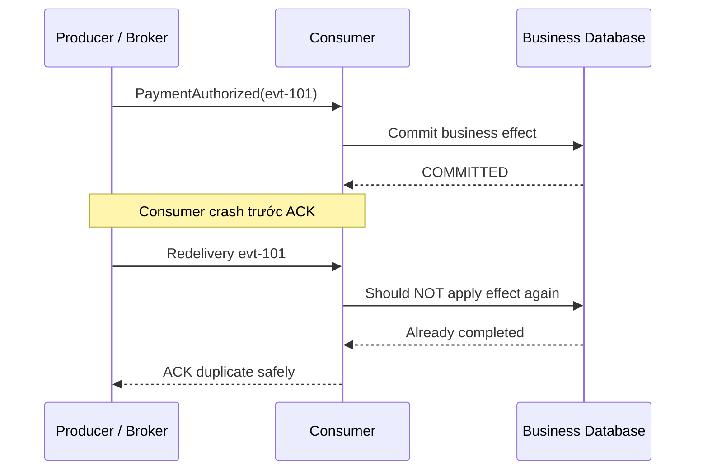
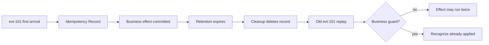
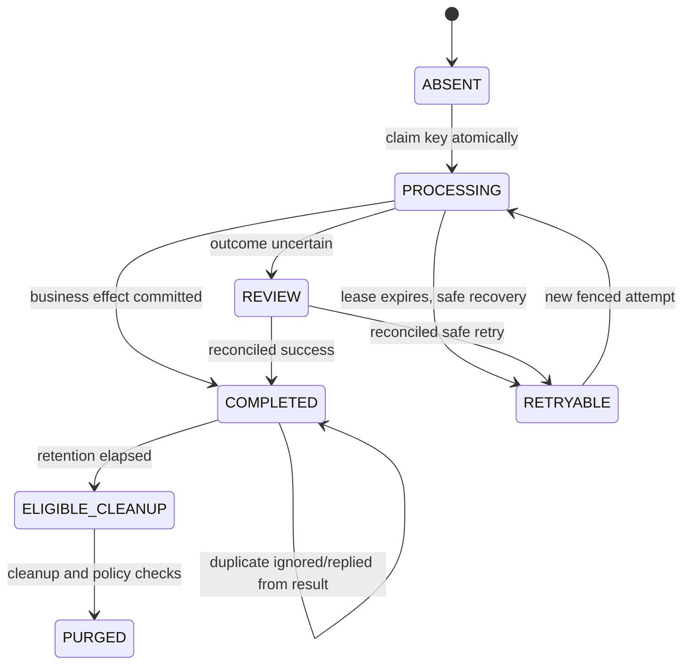
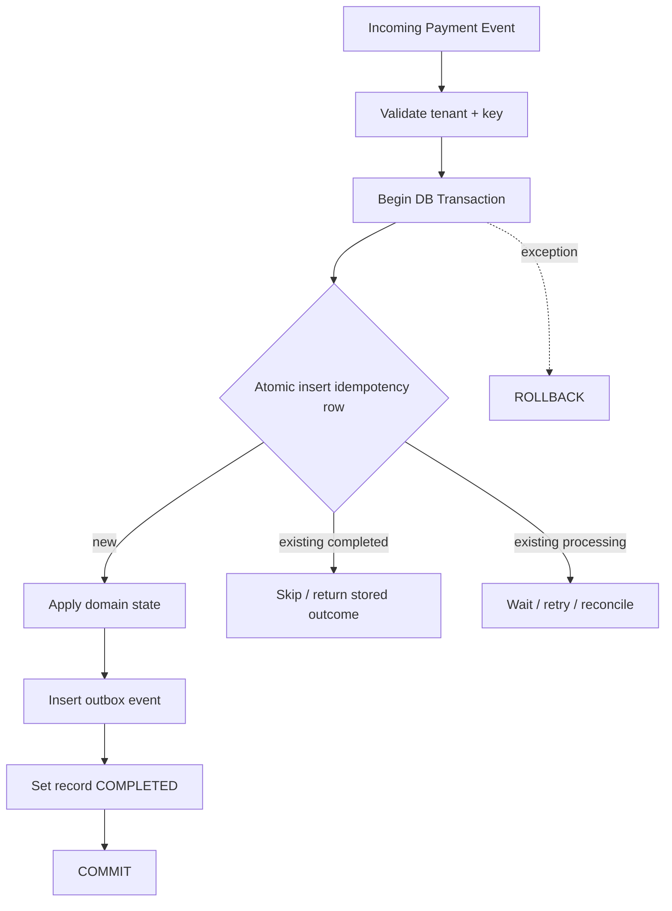
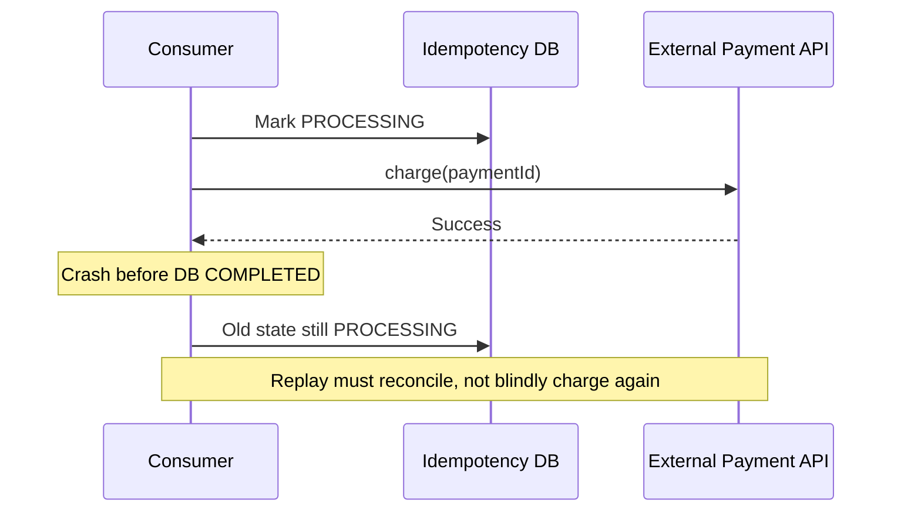
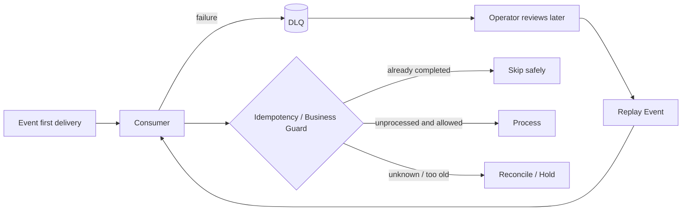
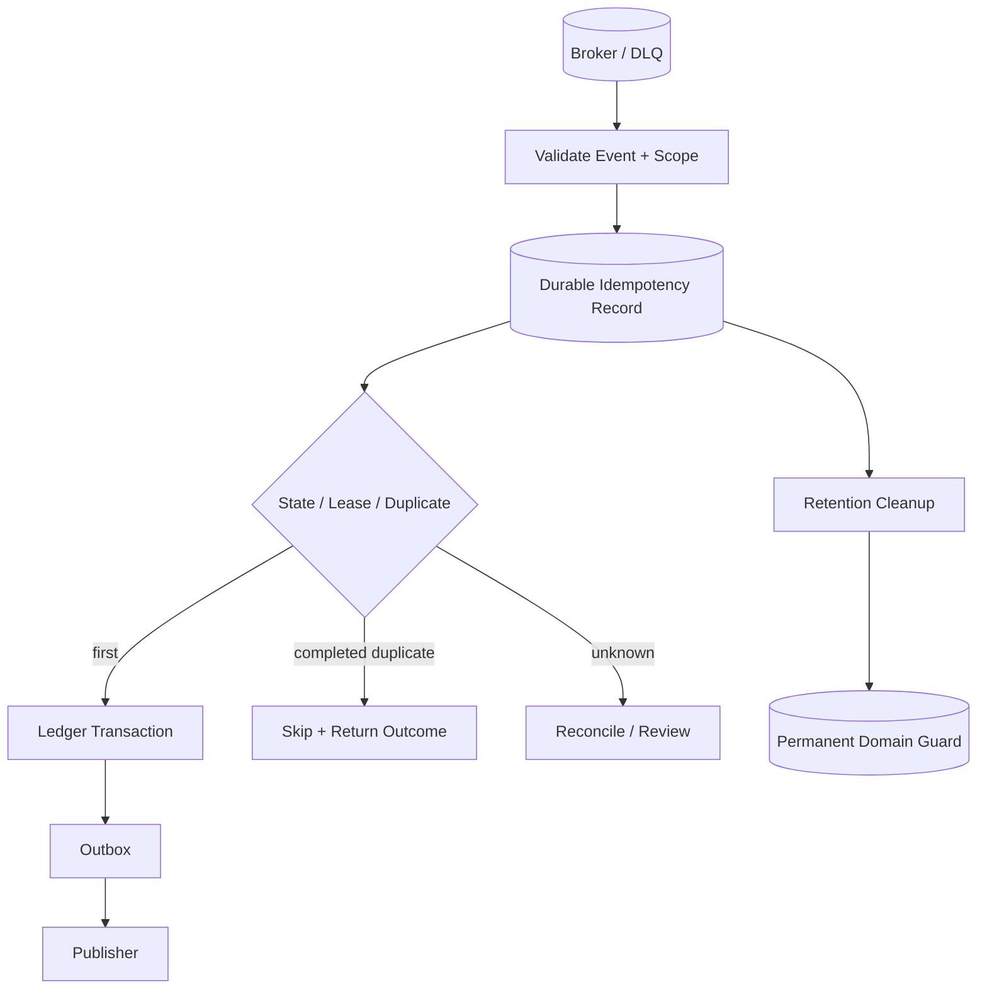

# Thời hạn giữ idempotency record

**Idempotent Receiver** là một Enterprise Integration Pattern (EIP) giúp một consumer **không thực hiện lặp lại tác động nghiệp vụ** khi cùng một message hoặc cùng một lệnh được giao nhiều lần. Trong một hệ thống dùng broker, retry, Gateway, Router và các worker bất đồng bộ, việc một message đến hơn một lần là tình huống bình thường: consumer có thể xử lý xong nhưng mất acknowledgment, broker redeliver sau restart, hoặc một người vận hành phát lại từ dead-letter queue (DLQ).

Để nhận biết một lần gửi đã được xử lý, Idempotent Receiver thường lưu một **idempotency record** theo một khóa ổn định, ví dụ `(tenantId, consumerScope, businessEventId)`. Nhưng record ấy phải giữ **bao lâu**? Nếu xóa quá sớm, một message cũ đến lại sau thời điểm dọn dữ liệu sẽ được xem như mới. Nếu giữ mọi record vĩnh viễn, kho lưu trữ có thể phình to, tốn chi phí và vượt yêu cầu retention.

Đó là vấn đề **“Thời hạn giữ idempotency record”**, thuộc chương **Idempotent receiver** của module **SPRING_INTEGRATION_PATTERN**. Module này hướng tới thực hành Enterprise Integration Patterns với Spring Integration để xây dựng các luồng thông điệp ít phụ thuộc, dễ mở rộng; kết hợp Router, Filter, Transformer, Splitter, Aggregator, Gateway, retry, error channel, correlation, kiểm thử và theo dõi các nhánh xử lý.

Bài này tập trung vào **thiết kế retention window**, phân biệt thời hạn chống trùng với timeout xử lý, xác định rủi ro redelivery/replay, chọn mô hình lưu bền, dọn record an toàn, và kiểm thử các tình huống xảy ra ngay trước/sau mốc hết hạn.

**Kết quả mong đợi:** Bạn có thể giải thích vì sao TTL ngắn hơn khoảng thời gian replay là không an toàn, lựa chọn khóa và scope đúng, định nghĩa state machine cho record, phối hợp idempotency với side effect và transactional outbox, triển khai một flow Spring Integration minh họa, rồi kiểm tra bằng test có đồng hồ và concurrency được kiểm soát.

## 1. Vì sao một message lại đến nhiều lần?

Những cơ chế thông dụng như **at-least-once delivery** ưu tiên không làm mất message, nên có thể giao lại cùng một sự kiện khi chưa nhận được xác nhận chắc chắn.



Các nguồn giao lặp thường gặp:

- Broker redelivery khi mất ACK hoặc session bị ngắt.
- Consumer restart sau khi business transaction commit.
- Retry advice chạy lại một chặng flow.
- HTTP client gửi lại cùng một idempotency key sau timeout.
- Outbox publisher phát lại event sau khi mất xác nhận publish.
- Người vận hành replay message từ DLQ hoặc kho lưu trữ.
- Một Router/Recipient List vô tình gửi message tới cùng consumer qua hai đường.
- Một callback từ hệ thống ngoài được gửi lại dù tác động đã xảy ra.
- Một job chạy lại sau khi deployment hoặc failover.

**Không phải mọi lần nhận trùng đều có thể tránh ở tầng transport.** Idempotent Receiver là lớp bảo vệ ở **điểm thực hiện tác động**, đặc biệt khi transport chỉ bảo đảm at-least-once.

Nhưng **idempotent không đồng nghĩa exactly-once end-to-end**. Tính đúng đắn còn phụ thuộc vào khóa nhận diện, giao dịch ghi record và side effect, recovery, cũng như khoảng thời gian record tồn tại.

## 2. Idempotency record lưu điều gì?

Một record không chỉ cần trả lời “key từng xuất hiện chưa”. Trong nhiều ứng dụng, nó còn phải cho biết một sự kiện đang xử lý, đã xử lý xong hay đang chờ đối soát.

| Field | Vai trò |
| --- | --- |
| `tenantId` | Tách biệt dữ liệu giữa các tenant |
| `consumerScope` | Xác định consumer/loại side effect áp dụng dedup |
| `idempotencyKey` hoặc digest | Nhận diện cùng một lệnh/event theo hợp đồng |
| `state` | PROCESSING, COMPLETED, FAILED/REVIEW... |
| `firstSeenAt` | Mốc lần đầu tiếp nhận |
| `completedAt` | Mốc tác động đã hoàn tất theo định nghĩa ứng dụng |
| `retainUntil` | Mốc sớm nhất có thể xem xét xóa record |
| `leaseUntil` | Thời hạn worker được quyền sở hữu một lần xử lý chưa hoàn tất |
| `attempt` | Số lần thử thực thi có kiểm soát |
| `resultReference` | Tham chiếu kết quả cần trả lại khi request bị lặp |
| `policyVersion` | Phiên bản chính sách dedup/retention |
| `generationId` | Phân biệt lần xử lý mới được cho phép một cách tường minh |

Không phải ứng dụng nào cũng cần mọi trường, nhưng **`retainUntil` và `leaseUntil` không được dùng thay nhau**.

### Record và trạng thái nghiệp vụ là hai nguồn thông tin khác nhau

Ví dụ một giao dịch thanh toán đã ghi `paymentId` và unique constraint ở bảng nghiệp vụ. Idempotency record giúp phát hiện các lần yêu cầu lặp tại receiver, nhưng **domain uniqueness** vẫn có thể là hàng rào cuối cùng chống thu tiền hai lần.

Nếu metadata store bị xóa nhưng database nghiệp vụ còn có dấu thanh toán, consumer nên kiểm tra ràng buộc domain và tránh thực hiện lại side effect. Không được tự tin rằng một cờ `processed=true` trong cache là hàng rào đủ chắc chắn cho mọi giao dịch tài chính.

## 3. Ba loại thời gian cần phân biệt

Đây là phần quan trọng nhất của thiết kế.

| Khái niệm | Ý nghĩa | Câu hỏi |
| --- | --- | --- |
| **Dedup/retention window** | Thời gian record phải tồn tại để nhận biết duplicate | Một event cũ còn có thể hợp lệ được phát lại đến khi nào? |
| **Processing lease/timeout** | Thời hạn một worker được quyền xử lý một record đang ở trạng thái PROCESSING | Nếu worker chết, khi nào được phép tiếp quản? |
| **Business/data retention** | Thời gian được/ phải lưu kết quả nghiệp vụ, chứng từ và audit | Quy định pháp lý/SLO yêu cầu dữ liệu tồn tại bao lâu? |

Ví dụ:

```text
Processing lease:       2 phút
Dedup retention window: 30 ngày
Business audit record:  7 năm (chỉ là ví dụ)
```

Một worker chết sau 2 phút có thể cần được thay thế để tiếp tục; **không được vì lease hết hạn mà xóa mọi dấu vết của sự kiện đã xử lý xong**.

Ngược lại, lưu idempotency record 30 ngày không đương nhiên cho phép worker giữ khóa xử lý 30 ngày. Lease cần cơ chế fencing/ownership, retry và trạng thái công việc.

### Retention phải dựa trên khả năng message đến lại

Điều cần hỏi không phải “có bao nhiêu bộ nhớ trống?” trước tiên, mà là:

> Trong thiết kế hiện tại, **muộn nhất khi nào một duplicate có thể tới receiver và vẫn có khả năng gây side effect?**

Khoảng thời gian đó có thể đến từ broker, DLQ, manual replay, client retry, callback hoặc các chặng xử lý bất đồng bộ.

## 4. Nguyên tắc chọn retention window

Một cách tư duy là lấy **cửa sổ duplicate tối đa hợp lý của từng nguồn**, rồi thêm biên an toàn:

\[
T_{\text{record}} \ge
\max(T_{\text{broker-redelivery}},
     T_{\text{queue-lag}},
     T_{\text{DLQ-replay}},
     T_{\text{client-retry}},
     T_{\text{callback}})
+ T_{\text{safety}}
\]

Đây là **công thức thiết kế**, không phải một API hay giá trị mặc định của Spring Integration. Các biến phải cùng được đo **từ mốc liên quan tới lần phát sinh sự kiện/record đầu tiên**; không thể cộng hoặc so sánh trực tiếp những khoảng thời gian có mốc gốc khác nhau mà không quy đổi.

Ví dụ, một hệ thống có chính sách:

| Nguồn duplicate | Cửa sổ được bảo đảm theo thiết kế |
| --- | ---: |
| HTTP client retry | Tối đa 24 giờ |
| Broker redelivery/backlog | Tối đa 3 ngày |
| DLQ replay thông thường | Tối đa 14 ngày |
| Callback đối tác | Tối đa 7 ngày |
| Biên an toàn sau khi đối soát | 2 ngày |

Nếu mọi duplicate thuộc các cửa sổ trên đều phải bị loại, **retention ít nhất 16 ngày kể từ mốc đã quy đổi** có thể là một điểm xuất phát. Nhưng phải xác minh rằng policy thật sự giới hạn DLQ replay ở 14 ngày. Nếu người vận hành vẫn có thể replay một event sáu tháng trước, 16 ngày **không thể** bảo vệ tình huống ấy.

**Không sử dụng bảng ví dụ như cấu hình mặc định.** Các giá trị retention phải được lấy từ hợp đồng retry, queue/broker retention, thời gian khôi phục sự cố, policy vận hành và yêu cầu nghiệp vụ thực tế.

### Một cửa sổ hữu hạn không bảo vệ được replay vô hạn

Nếu tổ chức cho phép **replay lịch sử không giới hạn**, không có TTL ngắn nào bảo đảm dedup tuyệt đối. Khi đó cần thêm một trong các cơ chế:

- **Domain uniqueness** tồn tại lâu hơn record TTL.
- Một **tombstone/minimal business marker** giữ đủ lâu theo hợp đồng.
- **Generation/version** mới cho một reprocess được cho phép.
- Replay job có **kiểm tra kết quả đã tồn tại** và không phát side effect cũ.
- Một kho outcome/audit có thể tra cứu được và quy trình đối soát.

Retention policy là một phần của **hợp đồng xử lý lại**, không chỉ là cấu hình xóa bản ghi.

## 5. Điều gì xảy ra khi record bị xóa sớm?

Giả sử:

```text
T0: Event evt-101 được xử lý thành công, record lưu 24 giờ.
T0 + 23h: Duplicate tới -> bị nhận diện, không charge lại.
T0 + 24h: Cleanup xóa record.
T0 + 36h: DLQ replay evt-101 -> record không còn.
```

Nếu receiver chỉ kiểm tra idempotency store, lần replay sau 36 giờ có thể bị xem như một yêu cầu **mới**.



Điểm cần nhớ: **TTL chỉ bảo vệ trong một khoảng thời gian đã định nghĩa**. Nếu message cũ được phép tồn tại và chạy sau khoảng ấy, ứng dụng phải có **hàng rào lâu dài hơn** hoặc một chính sách chặn replay theo tuổi/generation.

### Xóa record không giống “xóa sự kiện”

Broker, DLQ hoặc object storage vẫn có thể giữ bản sao của event. Việc dọn một hàng trong `idempotency_record` không xóa mọi bản sao được phát trước đó. Vì vậy, không thể suy ra “bản ghi đã hết hạn thì message cũ chắc chắn không thể đến”.

## 6. TTL: expire-after-write, sliding expiration và logical expiry

Một số store/cache có cơ chế TTL. Nhưng **cách TTL tính thời gian** ảnh hưởng đến ngữ nghĩa.

### Expire-after-write

Record hết hạn sau một khoảng cố định tính từ một lần ghi hoặc mốc được chọn. Đây thường là cách dễ liên hệ với **cửa sổ duplicate từ lần xuất hiện đầu tiên**.

Ví dụ: event xuất hiện ngày 1 và cần bảo vệ tới hết ngày 31; các duplicate trong khoảng đó **không tự kéo dài hạn** nếu policy không yêu cầu.

### Sliding expiration

Mỗi lần đọc hoặc nhận duplicate lại gia hạn hạn hết. Hệ thống có thể lưu record vô thời hạn nếu một nguồn cứ replay liên tục. Điều này đôi khi có ích, nhưng **không được mặc định chọn chỉ vì cache hỗ trợ**.

Cần hỏi: gia hạn vì duplicate có phải hành vi nghiệp vụ mong muốn không, hay attacker/bug có thể giữ hàng triệu record sống mãi?

### Logical expiry trước khi xóa vật lý

Một record có `retainUntil` đã qua hạn, nhưng job cleanup chưa chạy. Khi xử lý request mới, ứng dụng phải có một policy rõ:

- **Chặn/review event quá cũ** theo event age.
- **Cho phép tái xử lý generation mới** nếu có explicit authorization.
- **Tiếp tục coi record tồn tại là dedup marker** cho tới khi cleanup.
- **Không tự coi record hết hạn là “chưa từng xử lý”** nếu điều đó có thể tạo side effect trùng.

Với hệ thống nhạy cảm, không nên cho một duplicate bypass domain guard chỉ vì metadata có `retainUntil < now`. Cần tách điều kiện **hợp lệ để xử lý** khỏi điều kiện **đủ điều kiện dọn metadata**.

## 7. Retention tính từ mốc nào?

Những mốc có thể khác nhau:

| Mốc | Ưu điểm | Rủi ro nếu dùng sai |
| --- | --- | --- |
| Event created time | Gắn với tuổi sự kiện nguồn | Đồng hồ nguồn lệch; event tới muộn |
| First accepted time | Đơn giản, server kiểm soát | Một event đến trễ vẫn bắt đầu TTL mới |
| Business committed time | Đảm bảo dedup sau side effect | Trước commit phải quản lý PROCESSING riêng |
| Last legitimate replay allowed | Khớp policy vận hành | Cần registry và công thức deadline rõ |
| Last access time | Phục vụ cache liveness | Dễ bị kéo dài vô hạn bởi duplicate |

Một chiến lược phổ biến là tính `retainUntil` **từ một mốc server đáng tin** theo policy cụ thể. Nếu SLA yêu cầu bảo vệ 30 ngày **sau khi tác động đã commit**, hãy lưu `completedAt` và tính retention từ đó; không chỉ từ lúc message đến queue.

Nếu event được tạo rất lâu trước khi consumer đọc lần đầu, chính sách phải kiểm soát **event age** trước khi thực thi. Nếu không, một event cổ có thể được coi là “mới nhận” và gây tác động dù business không còn cho phép.

**Không tin tuyệt đối timestamp do client tự gửi.** Dùng đồng hồ/metadata đã xác thực và độ lệch cho phép được công bố trong hợp đồng.

## 8. Record lifecycle: PROCESSING không phải COMPLETED

Để tránh nhầm, hãy mô hình hóa trạng thái:



Đây là **state machine đề xuất của ứng dụng**, không phải các trạng thái framework tự cung cấp.

**Điểm mấu chốt:** Khi một worker chỉ mới **claim key** mà chưa có side effect, ghi `COMPLETED` là quá sớm. Nếu worker chết, duplicate sẽ bị bỏ vĩnh viễn dù công việc chưa hoàn tất.

Ngược lại, khi side effect đã commit nhưng dấu `COMPLETED` chưa được lưu, duplicate có thể thực hiện lại tác động. Vì thế cần **đồng bộ trạng thái record và nghiệp vụ** bằng transaction, outbox hoặc cơ chế idempotency riêng của downstream.

### Không được xóa PROCESSING chỉ vì quá TTL

Một hàng PROCESSING có thể biểu thị giao dịch chưa rõ kết quả. Dọn nó mà không đối soát có thể khiến worker khác chạy lại một thao tác đã thực hiện ngoài hệ thống.

Khi lease hết hạn, nên **chuyển quyền xử lý theo fencing/transaction và policy recovery**, không xóa record như cache thông thường.

## 9. Lease và retention phải được quản lý độc lập

Một `leaseUntil` ngắn giúp khôi phục khi worker bị treo. `retainUntil` dài giúp nhận diện duplicate sau khi hoàn tất.

```text
Event evt-101:
  t=00:00  PROCESSING lease until 00:02
  t=00:01  business commit + COMPLETED
  t=00:01  retainUntil = t + 30 days

Duplicate at t=00:03:
  -> COMPLETED record còn -> skip/reply existing outcome

A different event stuck PROCESSING beyond 00:02:
  -> reconcile/reacquire with fencing; not delete blindly
```

Nếu hai worker cố tiếp quản đồng thời, cần **atomic compare-and-set** hoặc transaction/unique constraint. Worker cũ có thể tỉnh lại sau khi lease hết hạn; nếu không có **fencing token/attempt generation**, hai worker có thể cùng thực hiện side effect.

**Đừng chỉ dựa vào timestamp trên một row để ngăn race.** Hãy bảo vệ nơi ghi side effect bằng transaction hoặc downstream idempotency key/expected version.

## 10. Thiết kế idempotency key ảnh hưởng retention

Một record chỉ hữu dụng nếu khóa được tạo đúng.

| Nguồn khóa | Ví dụ | Đánh giá |
| --- | --- | --- |
| `businessEventId` ổn định | `evt-101` | Phù hợp nếu cùng event ID không bị tái sử dụng |
| `tenantId + eventId + consumerScope` | `tenant-a/payment-ledger/evt-101` | Tách tenant và loại tác động |
| Spring `MessageHeaders.ID` | Message ID mới sau transform/redelivery | **Không phải** business idempotency key đáng tin xuyên mọi transport |
| Request ID mới ở mỗi retry | `req-200` rồi `req-201` | Không nhận ra retry của cùng command |
| Payload hash | SHA-256 của body | Không đủ nếu body có timestamp không ổn định hoặc hai lệnh hợp lệ cùng nội dung |
| `orderId` đơn lẻ | `ORD-42` | Có thể chặn nhầm lần thanh toán/hoàn tiền hợp lệ khác |
| `eventId + generation` | `evt-101/reprocess-v2` | Có thể dùng khi reprocess được phê duyệt rõ |
| Trace/span ID | Thay đổi theo instrumentation | Không đại diện tác động nghiệp vụ |

**Scope theo consumer** quan trọng vì cùng một event có thể cần được xử lý **một lần ở mỗi subscriber**, không phải một lần trên toàn hệ thống.

Ví dụ sự kiện `PaymentCaptured` phải cập nhật ledger **và** gửi email hóa đơn. Nếu hai handler dùng chung một key không phân scope, ledger xử lý trước có thể khiến email handler bị coi là duplicate và không chạy.

### Idempotency key không nhất thiết cần lưu raw PII

Nếu key chứa số giấy tờ, email hoặc thông tin riêng tư, nên xem xét token hóa/digest/HMAC theo threat model và có quy tắc canonicalization. Nhưng hash của một input dễ đoán **không làm input trở thành secret**. Quan trọng là tránh đưa dữ liệu nhạy cảm vào log, metrics hoặc bảng không được bảo vệ.

## 11. Spring Integration hỗ trợ Idempotent Receiver theo mô hình nào?

Spring Integration có thành phần **`IdempotentReceiverInterceptor`**, thường kết hợp **`MetadataStoreSelector`** và một `MetadataStore` để đánh dấu hoặc kiểm tra message đã được chấp nhận.

Các khái niệm liên quan:

- **MessageSelector:** quyết định một message có được xem là mới/hợp lệ theo policy.
- **MetadataStore:** lưu key/value metadata để nhận diện sự kiện đã thấy.
- **`ConcurrentMetadataStore`:** giao diện hỗ trợ các thao tác compare/put có ngữ nghĩa đồng thời khi implementation đáp ứng.
- **`SimpleMetadataStore`:** tiện cho thử nghiệm trong bộ nhớ, không tự bền vững qua restart.
- **`JdbcMetadataStore`:** lựa chọn có lưu bền trên database khi được cấu hình đúng.
- **`IdempotentReceiverInterceptor`:** advice áp dụng idempotent receiver semantics cho endpoint được bảo vệ.

**Điểm quan trọng:** Không phải mọi `MetadataStore` đều có một **TTL mặc định** hoặc bảo đảm tự xóa record đúng theo replay window. Khả năng expiration/cleanup còn phụ thuộc implementation và thiết kế store. Một bảng metadata có thể giữ row mãi nếu không có job dọn; một cache cục bộ có thể bỏ record quá sớm khi eviction.

Hãy kiểm tra API, cấu hình duplicate handling và semantics của `IdempotentReceiverInterceptor` theo **phiên bản Spring Integration mà ứng dụng dùng**. Nếu cần workflow PROCESSING/COMPLETED, lease, retention và audit rõ ràng, một **repository nghiệp vụ** có thể phù hợp hơn metadata key/value đơn giản.

### Tránh một giả định nguy hiểm

**“Có `IdempotentReceiverInterceptor` là mọi side effect được thực hiện exactly once.”** Không đúng. Nếu dấu “seen” được ghi trước khi side effect commit, crash có thể làm việc chưa hoàn tất bị bỏ qua. Nếu dấu được ghi sau side effect ngoài hệ thống, retry có thể làm side effect trùng.

Lựa chọn nơi đặt interceptor, transaction boundary, source ACK và logic recovery mới quyết định mức bảo đảm thực tế.

## 12. Thiết kế schema lưu bền trong PostgreSQL

Để tập trung vào retention, ta có thể dùng một bảng riêng cho idempotency thay vì dựa hoàn toàn vào cache.

```sql
-- PostgreSQL minh họa, không phải schema Spring Integration mặc định.
CREATE TABLE idempotency_record (
    tenant_id        varchar(80)  NOT NULL,
    consumer_scope   varchar(120) NOT NULL,
    dedup_key        varchar(160) NOT NULL,
    state            varchar(24)  NOT NULL,
    first_seen_at    timestamptz  NOT NULL DEFAULT now(),
    completed_at     timestamptz,
    retain_until     timestamptz  NOT NULL,
    lease_until      timestamptz,
    attempt          bigint       NOT NULL DEFAULT 1,
    result_reference varchar(160),
    policy_version   varchar(40)  NOT NULL,
    PRIMARY KEY (tenant_id, consumer_scope, dedup_key),
    CHECK (state IN ('PROCESSING', 'COMPLETED', 'REVIEW')),
    CHECK (retain_until >= first_seen_at)
);

CREATE INDEX idx_idempotency_cleanup
    ON idempotency_record (retain_until)
    WHERE state = 'COMPLETED';
```

**Giải thích thiết kế:**

- `PRIMARY KEY` bảo vệ tính duy nhất ở mức database, không phụ thuộc mỗi JVM.
- `tenant_id` và `consumer_scope` tránh một subscriber hoặc tenant “chiếm” khóa của bên khác.
- `dedup_key` có thể là event ID canonical hoặc digest, không dùng Spring Message ID một cách tùy tiện.
- `retain_until` quyết định thời điểm record **đủ điều kiện được xem xét dọn**.
- `lease_until` dành cho các hoạt động đang xử lý, **không phải hạn chống duplicate**.
- `state` và `completed_at` giúp phân biệt đã hoàn thành với chưa hoàn tất.
- `result_reference` giúp trả lại kết quả trước đó nếu giao thức cần reply nhất quán.
- Index hỗ trợ cleanup theo batch; cần đo hiệu năng với partitioning khi bảng lớn.

Đây chỉ là **schema học tập**: production cần thiết kế constraint, transaction, audit, encryption/PII, indexing, phân vùng, migration và state transitions cụ thể. Nếu `retain_until` có thể điều chỉnh bởi policy, việc ghi theo database clock và kiểm tra cùng transaction thường giảm lệch đồng hồ giữa các application node.

## 13. Atomic insert cho lần xử lý đầu tiên

Một kiểu triển khai không an toàn:

```text
if (!repository.exists(key)) {
    callPaymentGateway();
    repository.save(key);
}
```

Hai consumer có thể cùng đọc “chưa tồn tại” rồi cùng thực hiện side effect.

Một lệnh **atomic insert-if-absent** ở database:

```sql
-- PostgreSQL; chạy trong transaction có kiểm soát.
INSERT INTO idempotency_record (
    tenant_id, consumer_scope, dedup_key,
    state, first_seen_at, retain_until,
    lease_until, attempt, policy_version
)
VALUES (
    :tenant, :scope, :key,
    'PROCESSING', now(), :retain_until,
    :lease_until, 1, :policy_version
)
ON CONFLICT (tenant_id, consumer_scope, dedup_key)
DO NOTHING;
```

Consumer cần kiểm tra **số row được insert**:

- `1 row`: có quyền tiếp tục theo state machine của lần xử lý đầu tiên.
- `0 row`: key đã có, phải đọc trạng thái hiện tại để quyết định duplicate/đang xử lý/review.
- Lỗi database: **không** coi là key chưa tồn tại rồi bỏ qua guard; phải xử lý như lỗi hạ tầng.

**Có unique constraint không có nghĩa đã bảo đảm cả business side effect**. Nếu insert và side effect nằm ở hai resource không hỗ trợ transaction chung, một crash giữa chúng vẫn có thể khiến outcome chưa rõ.

## 14. Ghi record và business effect trong cùng transaction

Nếu record và tác động nghiệp vụ đều nằm trong **cùng một database**, có thể dùng một transaction để:

1. Atomic claim key.
2. Ghi side effect trong bảng nghiệp vụ.
3. Chuyển record sang `COMPLETED`.
4. Ghi outbox event nếu cần phát đi.
5. Commit tất cả hoặc rollback tất cả.



### Ví dụ Java service với Spring transaction

```java
import java.time.Instant;

record PaymentEvent(
    String tenantId,
    String eventId,
    String paymentId,
    long amountMinor
) {
    PaymentEvent {
        if (tenantId == null || tenantId.isBlank()
                || eventId == null || eventId.isBlank()
                || paymentId == null || paymentId.isBlank()
                || amountMinor <= 0) {
            throw new IllegalArgumentException("Invalid payment event");
        }
    }
}

interface IdempotencyRepository {
    // Atomic INSERT ... ON CONFLICT DO NOTHING trong cùng DB transaction.
    boolean tryInsertProcessing(
        String tenant, String scope, String eventId,
        Instant retainUntil);

    // UPDATE record cùng transaction, xác minh đúng ownership/state.
    void markCompleted(
        String tenant, String scope, String eventId);

    // Đọc trạng thái để xử lý duplicate vs in-progress/review.
    String findState(
        String tenant, String scope, String eventId);
}

interface PaymentLedger {
    // Ghi nghiệp vụ có unique/domain guard trong cùng database.
    void applyPayment(PaymentEvent event);
}

interface OutboxRepository {
    // Ghi event để publisher bất đồng bộ phát sau commit.
    void enqueuePaymentApplied(PaymentEvent event);
}
```

```java
import java.time.Clock;
import java.time.Duration;
import java.time.Instant;
import org.springframework.transaction.annotation.Transactional;

class PaymentEventApplicationService {
    private static final String SCOPE = "payment-ledger-v1";
    private static final Duration RETENTION =
        Duration.ofDays(45); // Ví dụ, không phải mặc định.

    private final IdempotencyRepository ids;
    private final PaymentLedger ledger;
    private final OutboxRepository outbox;
    private final Clock clock;

    PaymentEventApplicationService(
            IdempotencyRepository ids,
            PaymentLedger ledger,
            OutboxRepository outbox,
            Clock clock) {
        this.ids = ids;
        this.ledger = ledger;
        this.outbox = outbox;
        this.clock = clock;
    }

    @Transactional
    public void process(PaymentEvent event) {
        // Event đã được xác thực từ nguồn tin cậy.
        Instant retainUntil =
            Instant.now(clock).plus(RETENTION);

        boolean first = ids.tryInsertProcessing(
            event.tenantId(), SCOPE,
            event.eventId(), retainUntil);

        if (!first) {
            String state = ids.findState(
                event.tenantId(), SCOPE, event.eventId());

            if ("COMPLETED".equals(state)) {
                // Duplicate: bỏ qua side effect, có thể trả kết quả cũ.
                return;
            }

            // Không đánh đồng PROCESSING/REVIEW với COMPLETED.
            throw new IllegalStateException(
                "Payment event requires retry or reconciliation");
        }

        ledger.applyPayment(event);
        outbox.enqueuePaymentApplied(event);
        ids.markCompleted(
            event.tenantId(), SCOPE, event.eventId());

        // Commit DB transaction sau khi method kết thúc thành công.
    }
}
```

**Các điều kiện quan trọng của ví dụ:**

- `ids`, `ledger` và `outbox` **phải dùng cùng database/transaction manager** cho tính nguyên tử đã mô tả.
- `@Transactional` chỉ có hiệu lực khi method được gọi qua **Spring proxy** được quản lý; không tự có hiệu lực khi tự `new` object hoặc gọi self-invocation sai.
- `tryInsertProcessing` và `markCompleted` cần có triển khai thật, constraint và isolation phù hợp.
- `REVIEW`/`PROCESSING` được trả ra thành một nhánh recovery; trong code minh họa chưa có coordinator chờ hoặc lease takeover.
- Domain ledger vẫn nên có **unique constraint hoặc conditional update** theo payment ID/business operation để chặn duplicate vượt ra ngoài thời hạn record.
- 45 ngày ở đây là **giá trị giả định để giải thích code**, phải được chọn theo hợp đồng replay thực tế.
- Không đưa trực tiếp call API thanh toán **bên ngoài database** vào transaction này rồi cho rằng cả hai resource cùng rollback.

### Đặt retention sau completion

Trong ví dụ, `retainUntil` được đặt lúc nhận event. Nếu policy yêu cầu giữ **45 ngày sau thời điểm commit**, repository phải tính/lưu lại `retainUntil` theo thời điểm `markCompleted` (hoặc trong cùng transaction), không chỉ tính tại đầu vào.

Một khoảng lệch nhỏ đôi khi không quan trọng nhưng trong contract pháp lý/SLA phải xác định chính xác mốc. Đừng che sự khác biệt bằng tên biến `TTL` chung chung.

## 15. Luồng Spring Integration: receiver không làm lại side effect

Có thể gọi service transactional từ một Spring Integration flow đơn giản.

```java
import org.springframework.context.annotation.Bean;
import org.springframework.context.annotation.Configuration;
import org.springframework.integration.channel.DirectChannel;
import org.springframework.integration.config.EnableIntegration;
import org.springframework.integration.dsl.IntegrationFlow;
import org.springframework.messaging.MessageChannel;

@Configuration
@EnableIntegration
class IdempotentPaymentFlowConfiguration {

    @Bean
    PaymentEventApplicationService paymentEventApplicationService(
            IdempotencyRepository ids,
            PaymentLedger ledger,
            OutboxRepository outbox) {
        return new PaymentEventApplicationService(
            ids, ledger, outbox, java.time.Clock.systemUTC());
    }

    @Bean("payments.events.in")
    MessageChannel paymentEventsInput() {
        return new DirectChannel();
    }

    @Bean
    IntegrationFlow paymentEventsFlow(
            PaymentEventApplicationService applicationService) {
        return IntegrationFlow.from("payments.events.in")
            .handle(PaymentEvent.class, (event, headers) -> {
                // Delegates to @Transactional Spring-managed service.
                applicationService.process(event);
                return null; // One-way consumer: không yêu cầu reply.
            })
            .get();
    }
}
```

Flow trên **hiện thực Idempotent Receiver bằng business service**; nó không dùng trực tiếp `IdempotentReceiverInterceptor`, bởi vì bài đang cần quản lý trạng thái/retention và side effect trong cùng transaction.

Nếu muốn sử dụng interceptor và `MetadataStoreSelector` trong một bài toán không cần workflow trạng thái phức tạp, cần:

- Chọn key từ business event ID ổn định, không chỉ message ID.
- Chọn store bền vững và atomic đúng mức yêu cầu.
- Xác định duplicate có bị discard, gắn header đánh dấu hay đi sang một nhánh kiểm tra riêng theo cấu hình.
- Kiểm tra thời điểm selector ghi metadata so với thời điểm side effect commit.
- **Định nghĩa retention/cleanup độc lập**, không dựa vào giả định store luôn có TTL.
- Test redelivery trước/sau thời điểm xóa record và khi node restart.

**Không chạy cả hai cơ chế bảo vệ cùng một key mà không thiết kế ranh giới rõ**. Một interceptor đánh dấu “seen” trước service rồi service lại mong “mới” theo cùng store có thể chặn cả lần đầu hoặc tạo trạng thái không nhất quán.

## 16. External side effect: transaction database không đủ

Nếu consumer gọi một API thanh toán, vận chuyển hoặc gửi email bên ngoài, `@Transactional` của database **không rollback được API đó**.



Các cơ chế phối hợp:

1. **Provider idempotency key:** gửi một key ổn định để API ngoài nhận diện request trùng, nếu họ hỗ trợ và thời hạn lưu key đủ dài.
2. **Outcome reconciliation:** khi timeout/mất ACK, hỏi trạng thái giao dịch thay vì gọi lại mù quáng.
3. **Transactional outbox:** ghi lệnh cần phát trong cùng transaction với business state; publisher giao lại có key ổn định.
4. **Inbox/receiver dedup** ở consumer nhận lệnh.
5. **Tombstone/domain uniqueness** cho hành động có hậu quả lâu dài.
6. **Fencing/lease** để worker cũ không tạo thêm side effect sau khi mất quyền.

**Retention của receiver không bảo vệ được quá hạn idempotency ở provider.** Nếu provider chỉ giữ idempotency key 24 giờ mà replay có thể xảy ra sau 7 ngày, hệ thống phải có cơ chế đối soát hoặc một business key/constraint khác trước khi gọi lại.

## 17. Bảng outcome và result replay cho API Gateway

Đối với request-reply API, khi caller gửi lại cùng idempotency key, không phải lúc nào cũng nên trả một `200 OK` rỗng. Có thể cần trả lại **cùng kết quả đã commit**.

Ví dụ contract:

```json
{
  "idempotencyKey": "pay-evt-101",
  "operation": "CAPTURE_PAYMENT",
  "status": "COMPLETED",
  "paymentId": "PAY-101",
  "resultVersion": 1
}
```

Khi duplicate tới:

- Nếu `COMPLETED` và kết quả vẫn còn: trả outcome đã lưu, không charge lại.
- Nếu `PROCESSING`: trả `PENDING`/retry-after hoặc xử lý chờ có giới hạn theo hợp đồng.
- Nếu `REVIEW`: không báo thất bại chắc chắn; hướng caller tới status/reconciliation.
- Nếu khóa giống nhau nhưng **payload/operation khác**: từ chối như key reuse conflict, không trả kết quả của lệnh khác.
- Nếu record đã bị cleanup: vẫn kiểm tra domain uniqueness/event age để không thực hiện lại một giao dịch cũ.

Khi dùng TTL khác nhau cho **record chống trùng** và **cached response**, phải định nghĩa rõ: mất cached response không đồng nghĩa được thực hiện lại side effect. Có thể giữ một **minimal tombstone** cho tới hết replay window dù response body đã bị xóa sớm theo privacy policy.

## 18. TTL cache và MetadataStore: không phải thay thế cho record bền

Một cache cục bộ như `ConcurrentHashMap`, Caffeine hoặc một in-memory metadata store có thể giúp giảm số duplicate phải query database. Nhưng nó dễ mất trạng thái khi restart và có thể evict sớm khi thiếu bộ nhớ.

| Cơ chế | Vai trò phù hợp | Rủi ro |
| --- | --- | --- |
| In-memory set/cache | Fast path, test, best-effort duplicate reduction | Restart/eviction làm mất dấu |
| TTL distributed cache | Dedup bounded window khi hợp đồng cho phép | Eviction, failover, đồng bộ, TTL policy |
| JDBC metadata store | Key/value bền hơn, có atomic operations tùy implementation | Cần cleanup, transaction và sizing |
| Domain unique constraint | Chặn một số side effect trùng lâu dài | Không thay thế toàn bộ response/retry semantics |
| Dedicated idempotency table | Trạng thái/lease/retention rõ ràng | Phức tạp hơn, cần migration và vận hành |
| Business outcome store | Đối soát/reply khi replay dài hạn | Storage và privacy retention |

Một mô hình nhiều lớp có thể là:

```text
fast cache (optional)
  -> durable idempotency record
      -> domain uniqueness / outcome store
          -> side effect
```

**Cache hit** có thể giúp skip nhanh; **cache miss không được mặc định là “chưa xử lý”** khi có kho bền phía sau. Nếu cache lỗi, receiver phải fallback về kho đáng tin hoặc fail closed phù hợp, không tự bỏ guard rồi thực thi giao dịch.

## 19. Cleanup an toàn: dọn completed record, không xóa mọi hàng cũ

Một cleanup job có thể chạy theo batch để xóa những record đã hết thời hạn và **đủ điều kiện nghiệp vụ**.

Ví dụ PostgreSQL:

```sql
-- Chỉ minh họa cleanup khi đã xác nhận
-- không còn replay hợp lệ hay công việc cần đối soát.
WITH doomed AS (
    SELECT tenant_id, consumer_scope, dedup_key
    FROM idempotency_record
    WHERE state = 'COMPLETED'
      AND retain_until <= now()
    ORDER BY retain_until
    LIMIT 1000
    FOR UPDATE SKIP LOCKED
)
DELETE FROM idempotency_record AS r
USING doomed AS d
WHERE r.tenant_id = d.tenant_id
  AND r.consumer_scope = d.consumer_scope
  AND r.dedup_key = d.dedup_key;
```

Câu SQL này chỉ an toàn nếu **retention policy và các prerequisite đã được đảm bảo** ở hệ thống: không có outstanding replay hợp lệ, không cần giữ record cho correction, và domain guard vẫn chặn được những side effect không được lặp.

**Không xóa `PROCESSING`, `REVIEW` hoặc record có outcome chưa rõ chỉ vì `firstSeenAt` cũ.** Chúng cần quy trình recovery/lease/đối soát riêng.

### Vì sao dọn theo batch?

- Tránh một transaction xóa hàng triệu row và giữ lock lâu.
- Giới hạn I/O/redo log và ảnh hưởng latency.
- Có thể chạy định kỳ, quan sát số lượng backlog.
- Kết hợp partitioning/drop partition khi chính sách retention theo thời gian và dữ liệu cho phép.
- Có thể dừng hoặc giảm tốc cleanup khi hệ thống đang quá tải.

**Nếu nhiều instance cùng chạy cleanup**, cần cơ chế lock/claim phù hợp hoặc SQL bảo vệ để không dọn trùng gây sự cố. Job phải idempotent; chạy lại không được xóa record chưa đủ điều kiện.

## 20. Đồng hồ, chênh lệch thời gian và ranh giới đúng hạn

Thời hạn retention thường được tính bằng timestamp; ở hệ thống nhiều node, có thể có **clock skew**.

Ví dụ:

```text
Node A: 12:00:10
Node B: 11:59:55
DB    : 12:00:00
```

Nếu node A cho rằng record hết hạn trước node B, hành vi có thể không nhất quán. Nên dùng **database time hoặc clock thống nhất** cho thao tác điều kiện ở kho, và test boundary với so sánh rõ:

```text
now < retainUntil  -> chưa được cleanup
now >= retainUntil -> có thể xem xét cleanup, chưa tự đảm bảo an toàn
```

Không nên cài `Thread.sleep(86400000)` trong test để chờ một ngày. Dùng `Clock` được inject hoặc database test clock/điều khiển timestamp trong fixture.

### Cleanup schedule và expiry thực tế khác nhau

Một record có `retainUntil=00:00` và cleanup job chạy mỗi giờ có thể tồn tại tới 01:00. Đó là **độ trễ dọn vật lý**, không tự cho phép duplicate gây side effect trong khoảng này.

Đừng thiết kế code theo giả định “đúng 00:00 record sẽ biến mất”. Hành vi kiểm tra key và eligibility cleanup phải rõ ràng trước khi job chạy.

## 21. Manual replay, DLQ và sự kiện lịch sử

Một quy trình DLQ thường khiến record retention khó xác định hơn nhiều.



Cần có quy ước:

- **DLQ giữ tối đa bao lâu?**
- Người vận hành có quyền replay message **sau hạn mặc định** không?
- Replay có phải **cùng một lần xử lý** hay là **reprocess generation mới**?
- Nếu event đã hoàn thành, replay để sửa dữ liệu hay chỉ để điều tra?
- Nếu provider ngoài không còn lưu idempotency key, hệ thống đối soát thế nào?
- Khi record hết TTL, có minimal tombstone hoặc business outcome để chặn side effect trùng không?

### Reprocess không đồng nghĩa duplicate

Một yêu cầu **reprocess được phê duyệt** có thể cần chạy lại logic với policy mới, ví dụ tái tạo báo cáo analytics. Không nên né idempotency bằng cách sửa event ID tùy tiện rồi phát lại vào flow thanh toán.

Cần đặt **generation/version và purpose riêng**. Ví dụ:

```text
eventId       = evt-101
consumerScope = analytics-v1
generation    = original

approved reprocess:
eventId       = evt-101
consumerScope = analytics-v2
generation    = reprocess-2026-11
```

Việc đổi scope/generation phải được **ủy quyền và audit**, không được cho client tự ý thêm hậu tố để đi vòng guard. Các tác động không được lặp (như charge tiền) vẫn cần domain uniqueness độc lập với generation.

## 22. Retention theo loại sự kiện, không áp một TTL cho mọi flow

Một hệ thống có thể xử lý nhiều lớp công việc:

| Loại flow | Đặc điểm | Hướng retention |
| --- | --- | --- |
| Telemetry/analytics best-effort | Duplicate gây đếm trùng nhưng có thể tổng hợp lại | Bounded window + idempotent aggregation |
| Gửi thông báo | Có thể gửi trùng, cần kiểm soát UX | Theo event replay/notification policy |
| Đồng bộ CRM | Có thể dùng upsert/version | Tùy nguồn replay và state reconciliation |
| Thanh toán/hoàn tiền | Side effect nhạy cảm, không được lặp | Domain uniqueness dài hạn + record/outcome/reconciliation |
| Cấp quyền truy cập | Hệ quả an ninh, thay đổi theo trạng thái mới nhất | Version guard, current authorization, audit |
| Order fulfillment | Nhiều bước và callback chậm | Retention bao phủ toàn workflow và callback horizon |
| Batch xử lý lớn | Có thể mất nhiều ngày, nhiều retry | Bản ghi theo batch/generation và progress checkpoints |

**TTL nên có policy theo consumerScope hoặc loại nghiệp vụ**, không hardcode một con số chung cho toàn ứng dụng vì “dễ vận hành”.

Nếu chính sách mới **rút ngắn** retention, cần đánh giá các record đã tồn tại và những event có thể còn trong DLQ. Không chỉ sửa `Duration.ofDays(45)` thành `Duration.ofDays(7)` rồi dọn hàng loạt trong lần deploy tiếp theo.

## 23. Version hóa retention policy và thay đổi cấu hình

Một chính sách có thể thay đổi:

```text
policy v1: keep COMPLETED records 14 days
policy v2: keep COMPLETED records 45 days
```

Nếu rollout v2 trong lúc còn các record v1, hệ thống phải quyết định:

- Các record v1 giữ nguyên `retainUntil` đã chốt?
- Hay kéo dài theo policy mới?
- Nếu policy mới ngắn hơn, có được xóa sớm các record cũ không?
- Có cần thông báo cho vận hành DLQ/replay?
- Có nhiều instance dùng hai policy trong rolling deployment không?

Lưu `policyVersion` cùng record giúp giải thích quyết định ở quá khứ, nhưng **không tự thực thi migration**. Cleanup job cần hiểu chính sách được phê duyệt và ưu tiên an toàn.

### Đừng giảm retention bằng cách sửa giá trị trong cache

Nếu record đã bị cache evict thì đổi policy sau đó không thể khôi phục khả năng nhận diện duplicate. Với record bền, có thể gia hạn `retainUntil` có kiểm soát. Với store TTL thực sự đã xóa dữ liệu, không có cách nào “tăng TTL của hàng đã mất”.

Đây là lý do retention của side effect quan trọng nên được điều hành như một **đặc tính dữ liệu**, không phải một tham số performance tùy chỉnh tùy lúc.

## 24. Dung lượng và partitioning: retention càng dài thì store càng lớn

Ước lượng sơ bộ:

\[
N_{\text{records}} \approx
\text{events per day}
\times \text{retention days}
\]

Ví dụ, một consumer nhận **500.000 event/ngày** và giữ 45 ngày sẽ có khoảng **22,5 triệu record** ở trạng thái ổn định, trước khi tính các record đang xử lý, retry, audit, index overhead và dung lượng phụ.

Các yếu tố capacity:

- Kích thước khóa, index và số cột metadata.
- Số instance ghi đồng thời.
- Throughput của atomic inserts và unique index.
- Tốc độ cleanup theo batch/partition.
- Tuổi của `PROCESSING`/`REVIEW` và backlog.
- Bảo mật, sao lưu, khôi phục và data retention policy.
- Truy vấn outcome khi duplicate cần trả response cũ.
- Tần suất manual replay và các đợt backlog sau sự cố.

**Không nên giảm TTL chỉ để chữa việc bảng lớn** nếu điều đó mở ra rủi ro side effect trùng. Trước tiên hãy tối ưu schema, index, partition, purge schedule, minimal tombstone hoặc kiến trúc lưu trữ.

## 25. Observability cho retention và duplicate

Một Idempotent Receiver cần đo không chỉ “đã lọc bao nhiêu message trùng”, mà còn **khi nào record có nguy cơ hết hạn trước duplicate horizon**.

Các metric gợi ý:

```text
idempotency_first_seen_total{scope="payment-ledger"}
idempotency_duplicate_total{scope="payment-ledger",state="completed"}
idempotency_in_progress_total{scope="payment-ledger"}
idempotency_reconciliation_total{scope="payment-ledger"}
idempotency_cleanup_deleted_total{scope="payment-ledger"}
idempotency_cleanup_backlog{scope="payment-ledger"}
idempotency_old_replay_total{scope="payment-ledger"}
idempotency_record_age_seconds{scope="payment-ledger"}
idempotency_lease_expired_total{scope="payment-ledger"}
idempotency_store_errors_total{scope="payment-ledger"}
```

Đây là **metric do ứng dụng có thể tự instrument**, không phải danh sách metric Spring Integration tự sinh. Không đặt `eventId`, `paymentId` hoặc idempotency key làm metric label vì cardinality cao và nguy cơ lộ dữ liệu.

Một audit record tối thiểu:

```json
{
  "event": "idempotent_receiver_duplicate",
  "consumerScope": "payment-ledger-v1",
  "businessEventId": "evt-101",
  "recordState": "COMPLETED",
  "firstSeenAt": "2026-11-01T08:00:00Z",
  "retainUntil": "2026-12-16T08:00:00Z",
  "decision": "SKIP_EFFECT"
}
```

Ví dụ này minh họa structured log, không phải mặc định framework. Với ID nhạy cảm, áp dụng masking, access control và retention của audit log riêng.

### Cảnh báo hữu ích

- Đột biến duplicate đến sát hoặc **sau** retention horizon.
- Cleanup xóa nhiều record hơn dự kiến.
- Record PROCESSING tồn quá lâu, lease bị chiếm mà không recovery.
- Tỷ lệ store error tăng nhưng receiver vẫn xử lý side effect.
- Nhiều key khác nhau cho cùng business event do canonicalization hoặc source mismatch.
- Broker lag/DLQ replay age vượt giả định retention.
- Một domain unique constraint bắt duplicate **sau khi idempotency record đã bị purge**.

Đặc biệt, sự kiện cuối là tín hiệu quan trọng cho biết retention đã ngắn so với thực tế hoặc cần một cơ chế dedup bền hơn.

## 26. Kiểm thử retention bằng Clock thay vì đợi thời gian thật

Kiểm thử cần xác minh các mốc **trước hạn, đúng hạn và sau hạn**, cùng trạng thái record.

### 26.1. Unit test quyết định eligibility cleanup

```java
import java.time.Clock;
import java.time.Instant;

record IdempotencySnapshot(
    String state,
    Instant retainUntil,
    Instant leaseUntil
) {}

final class CleanupEligibilityPolicy {

    boolean canDelete(
            IdempotencySnapshot record,
            Clock clock) {
        if (record == null || record.retainUntil() == null) {
            return false;
        }

        // Chỉ là điều kiện thời gian + trạng thái.
        // Production còn cần policy replay, outcome/outbox,
        // transaction và những prerequisite khác.
        return "COMPLETED".equals(record.state())
            && !Instant.now(clock)
                .isBefore(record.retainUntil());
    }
}
```

```java
import static org.junit.jupiter.api.Assertions.*;
import java.time.Clock;
import java.time.Instant;
import java.time.ZoneOffset;
import org.junit.jupiter.api.Test;

class CleanupEligibilityPolicyTest {

    private final CleanupEligibilityPolicy policy =
        new CleanupEligibilityPolicy();

    @Test
    void onlyCompletedRecordsPastDeadlineAreEligible() {
        Instant deadline =
            Instant.parse("2026-12-16T08:00:00Z");

        Clock before = Clock.fixed(
            deadline.minusMillis(1), ZoneOffset.UTC);
        Clock at = Clock.fixed(deadline, ZoneOffset.UTC);
        Clock after = Clock.fixed(
            deadline.plusSeconds(1), ZoneOffset.UTC);

        var completed = new IdempotencySnapshot(
            "COMPLETED", deadline, null);

        var processing = new IdempotencySnapshot(
            "PROCESSING", deadline,
            deadline.minusSeconds(60));

        assertFalse(policy.canDelete(completed, before));
        assertTrue(policy.canDelete(completed, at));
        assertTrue(policy.canDelete(completed, after));
        assertFalse(policy.canDelete(processing, after));
    }
}
```

**Giới hạn:** `canDelete` chỉ kiểm tra trạng thái/thời gian. Một record `COMPLETED` đã qua hạn **chưa tự được phép xóa** nếu business còn yêu cầu replay protection hoặc audit. Cleanup job thật cần dùng thêm các điều kiện nghiệp vụ và đồng bộ với database.

### 26.2. Test record đã bị xóa rồi nhận old event

Một integration test quan trọng:

1. Gửi `evt-101`, assert business side effect xảy ra một lần.
2. Gửi duplicate trong retention, assert không có side effect mới.
3. Cho record đủ điều kiện cleanup, chạy job dọn trong test fixture.
4. Gửi lại **cùng event cũ** sau khi record đã bị xóa.
5. Assert **domain uniqueness hoặc event-age guard vẫn ngăn side effect cấm lặp** nếu hợp đồng yêu cầu.
6. Nếu business chủ đích cho phép xử lý lại, assert yêu cầu có generation/authorization hợp lệ.

**Đây là test của hợp đồng end-to-end**, không thể chỉ assert “bảng idempotency không còn row”.

## 27. Kiểm thử concurrency và crash recovery

### Ma trận kiểm thử

| Tình huống | Kết quả cần xác minh |
| --- | --- |
| Hai consumer cùng nhận key mới | Một claim thành công; không có hai side effect |
| Consumer crash trước transaction commit | Record/effect rollback hoặc recover nhất quán |
| Consumer crash sau business commit trước ACK | Redelivery không thực hiện side effect nữa |
| Insert idempotency thành công nhưng handler lỗi | Transaction rollback hoặc state recovery; không mark COMPLETED sai |
| External API thành công nhưng response mất | Đối soát/idempotency key, không gọi lại mù |
| Duplicate trong retention window | Skip/reply existing result |
| Duplicate đúng mốc `retainUntil` | Hành vi theo comparator/policy đã định |
| Duplicate sau cleanup | Domain guard hoặc authorized reprocess policy |
| PROCESSING lease hết hạn | Fenced takeover/reconcile; không xóa tùy tiện |
| Hai worker tranh lease hết hạn | Một owner hợp lệ, owner cũ không commit được |
| Store unavailable | Không chạy side effect khi không có bảo vệ cần thiết |
| Manual replay DLQ sau hạn | Hold/reconcile hoặc xử lý theo generation đã phê duyệt |
| Same event ở hai consumer scopes | Mỗi scope thực hiện một lần độc lập |
| Same eventId ở hai tenant | Không trộn record/permission |
| Key giống nhưng payload khác | Conflict, không silently reuse outcome |
| Cleanup đang chạy khi duplicate tới | Transaction/locking không làm mất guard |
| Restart với cache in-memory | Durable state vẫn nhận diện duplicate |
| Retention policy đổi khi rolling deployment | Không xóa hàng cũ sai ngoài ý muốn |

### Gợi ý test đồng thời

Dùng một database test thật có unique constraint, một `CountDownLatch` hoặc barrier để cho hai request cùng bắt đầu, rồi kiểm tra **số row insert thành công** và **số business side effect**. Không chỉ chạy hai thread rồi nhìn vào timestamp: test có thể tình cờ chạy tuần tự.

Với external API, dùng mock server có thể ghi nhận idempotency key và mô phỏng timeout **sau khi đã thực hiện side effect**. Khi retry, assert không có thao tác thứ hai trái hợp đồng.

### Đừng thử chứng minh exactly-once bằng một test đơn

Một lần test không xảy ra duplicate chỉ chứng minh fixture ấy chạy như kỳ vọng. Cần kiểm thử qua các ranh giới: transaction commit, broker ACK, replay, lease takeover, output publish và cleanup.

## 28. Khi phối hợp với Filter, Router, Splitter và Aggregator

### Filter trước Idempotent Receiver

Có thể kiểm tra schema/tenant ở một Filter trước khi ghi record, nhằm không chiếm key cho message không hợp lệ. Nhưng nếu một message đã qua Filter và thực hiện side effect, **idempotency phải bao quanh chính tác động đó**.

Nếu Filter discard message nghiệp vụ, cần quyết định có lưu **rejection outcome** để duplicate không bị xử lý khác khi policy thay đổi hay không. Không đồng nhất mọi message bị Filter loại với message đã hoàn tất xử lý.

### Router và Recipient List

Cùng event đi qua nhiều nhánh. Mỗi nhánh thường có `consumerScope` khác nhau:

```text
(tenant-a, ledger-consumer, evt-101)
(tenant-a, invoice-consumer, evt-101)
(tenant-a, notification-consumer, evt-101)
```

Không dùng một metadata key global cho tất cả subscriber trừ khi mục tiêu thật sự là một shared side effect duy nhất.

### Splitter và Aggregator

Splitter tạo N message con. Mỗi part có thể cần idempotency theo `(batchId, itemId)`; Aggregator cần correlation key để nhóm **unique results**. Nếu một part được xử lý hai lần, không được coi nó là hai kết quả độc lập khiến Aggregator release sớm.

**Retention của result-part record** phải bao phủ khoảng thời gian còn có thể redelivery từng part; retention của **batch-outcome record** có thể khác vì callback/reconciliation của batch còn tiếp tục sau khi các part hoàn tất.

### Transformer

Transformer có thể tạo message ID mới; business event ID/idempotency key phải giữ ổn định nếu vẫn biểu diễn cùng event. Nếu Transformer đổi schema hoặc tạo một **lệnh nghiệp vụ mới**, cần xác định idempotency scope riêng, không copy key cũ vô điều kiện.

### Gateway và error channel

Request-reply Gateway có thể timeout sau khi receiver đã commit. Retry từ caller phải trả outcome cũ hoặc trạng thái đã biết theo hợp đồng. Lỗi đồng bộ qua `DirectChannel` có thể ném về caller; lỗi async qua poller/executor/adapter đi theo cơ chế error handler được cấu hình. **Error channel không thay cho idempotent business guard**.

## 29. Sai lầm thường gặp

**“Idempotency record chỉ cần giữ 5 phút vì client thường retry trong 5 phút.”** Có thể còn DLQ/manual replay, broker backlog hoặc callback trễ hàng ngày.

**“TTL 30 ngày bảo đảm exactly-once.”** Không, event có thể bị replay ở ngày 31; cũng còn race và external side effect.

**“Lease hết hạn thì xóa idempotency record.”** Lease quản lý quyền xử lý, retention quản lý dedup đã hoàn tất; xóa có thể làm duplicate effect.

**“Đã insert key tức là nghiệp vụ đã thành công.”** Nếu crash trước commit, mark completed sớm sẽ làm mất công việc.

**“Xóa row là hết nguy cơ duplicate.”** Message có thể còn trong DLQ; cần kiểm soát old replay hoặc domain uniqueness.

**“Nhận duplicate thì luôn trả success.”** Nếu record ở PROCESSING/REVIEW hoặc payload conflict, cần trạng thái phù hợp.

**“Dùng Spring Message ID đủ để dedup.”** Message ID có thể đổi qua transform/transport; cần business key ổn định.

**“Cache cục bộ có TTL là kho chống trùng tin cậy.”** Cache có thể restart/evict, và nhiều instance không chia sẻ state.

**“Mọi consumer nên dùng chung key.”** Cùng event có thể cần tạo những side effect độc lập ở nhiều subscriber.

**“RetainUntil đã qua thì cứ delete tất cả.”** Chỉ delete khi state và business/replay prerequisites được thỏa mãn.

**“Gọi API ngoài trong `@Transactional` là atomic với database.”** Không; cần provider idempotency, outbox và reconciliation.

**“Gia hạn TTL ở mọi duplicate chắc chắn tốt hơn.”** Có thể gây retention vô hạn hoặc bị lạm dụng.

**“Chỉ giữ response body ngắn hạn thì được thực hiện lại lệnh sau khi body bị xóa.”** Dữ liệu trả lời và marker chống side effect có vòng đời khác nhau.

**“Tăng retention là đủ khi thay đổi replay policy.”** Nếu trước đó record đã bị xóa, không thể phục hồi bằng cấu hình mới.

## 30. Bài tập: thời hạn cho Idempotent Receiver của hệ thống thanh toán

Một hệ thống nhận `PaymentCaptured` từ broker và cập nhật sổ cái. Một sự kiện cũng gửi email hóa đơn qua consumer khác. Các điều kiện vận hành giả định:

- HTTP caller có thể retry trong 12 giờ.
- Broker có thể giữ backlog tới 5 ngày.
- DLQ thông thường có thể replay trong 21 ngày.
- Bộ phận vận hành được phép replay sự kiện lịch sử lâu hơn 21 ngày **chỉ qua quy trình phê duyệt**.
- Payment provider giữ idempotency key 7 ngày.
- Ledger phải không ghi trùng một khoản thanh toán, kể cả sau nhiều tháng.
- Thời gian xử lý bình thường dưới 30 giây; worker có thể chết giữa chừng.
- Dữ liệu phản hồi API có thể xóa sớm hơn marker chống trùng.
- Tất cả dịch vụ có nhiều instance.



Hãy trả lời:

1. Vì sao giữ record chỉ 12 giờ là không đủ?
2. Nếu DLQ replay window 21 ngày, phải cộng thêm các độ trễ/biên an toàn nào khi tính `retainUntil`?
3. Nếu manual replay sáu tháng sau được phê duyệt, có được thực hiện charge lại không? Vì sao?
4. Phân biệt `leaseUntil` và `retainUntil` của một event PROCESSING.
5. Thiết kế khóa cho ledger consumer và invoice consumer có khác không?
6. `MessageHeaders.ID` có phù hợp làm key cho broker redelivery không?
7. Khi payment provider chỉ giữ key bảy ngày, reconciliation cần giải quyết replay sau thời hạn ấy thế nào?
8. Khi record bị purge nhưng ledger vẫn có payment ID, ràng buộc nào ngăn ghi trùng?
9. Nếu hai instance cùng claim một key, cơ chế atomic nào bảo vệ?
10. Nếu API bên ngoài thành công nhưng DB không commit, làm sao tránh gọi lại mù quáng?
11. Record trạng thái REVIEW có được xóa chỉ vì đã quá 21 ngày không?
12. Nếu policy giảm từ 30 ngày xuống 7 ngày, cần kiểm tra những gì trước rollout?
13. Test nào phải gửi duplicate sau cleanup để phát hiện nguy cơ?
14. Cần metric nào giúp biết replay thực tế đang vượt dự kiến?
15. Nếu một batch có 100 part, idempotency key và retention của part-result khác batch-outcome thế nào?

**Tiêu chí hoàn thành:** Có công thức retention được suy ra từ các nguồn retry/replay, domain uniqueness lâu dài cho side effect quan trọng, lease và record lifecycle rõ ràng, stateful recovery/outbox, cleanup an toàn và ma trận kiểm thử tại mốc hết hạn.

## 31. Checklist trước khi triển khai retention policy

- [ ] Đã định nghĩa `consumerScope` và business idempotency key ổn định.
- [ ] Key bao gồm tenant/generation nếu business yêu cầu.
- [ ] Không dùng Message ID/trace ID thay business identity.
- [ ] Đã kiểm kê mọi nguồn duplicate: client retry, broker, DLQ, callback, manual replay.
- [ ] Retention bao phủ cửa sổ replay được phép, tính từ mốc thích hợp.
- [ ] Có policy khi replay xảy ra **sau retention**.
- [ ] Có domain unique constraint/tombstone cho side effect không được phép lặp lâu dài.
- [ ] Đã phân biệt PROCESSING lease với COMPLETED retention.
- [ ] Không mark COMPLETED trước khi business effect hoàn tất theo hợp đồng.
- [ ] Insert key là atomic và chống race giữa các instance.
- [ ] DB side effect và record commit cùng transaction khi có thể.
- [ ] External side effect dùng idempotency/reconciliation/outbox phù hợp.
- [ ] Store có durability đáp ứng restart/failover; cache chỉ là lớp tối ưu nếu cần.
- [ ] TTL semantics rõ: expire-after-write, sliding, logical và physical cleanup.
- [ ] Dùng mốc thời gian/clock đáng tin cậy, kiểm tra boundary đúng hạn.
- [ ] Chỉ dọn COMPLETED sau khi đủ điều kiện nghiệp vụ, không xóa REVIEW/PROCESSING bừa bãi.
- [ ] Cleanup theo batch, có metrics, throttling và concurrency guard.
- [ ] Retention policy có version/migration khi thay đổi.
- [ ] Response cache lifetime khác dedup marker nếu hợp đồng cho phép.
- [ ] Có test duplicate trước hạn, đúng hạn và sau cleanup.
- [ ] Có test concurrency, crash trước/sau commit, redelivery và DLQ replay.
- [ ] Có observability cho record age, cleanup backlog, duplicate age và store errors.
- [ ] Đã kiểm tra API `IdempotentReceiverInterceptor`/`MetadataStore` theo phiên bản Spring Integration thực tế.

## Ghi nhớ

**Thời hạn giữ idempotency record** là thời gian hệ thống cần nhớ rằng **một tác động đã được xử lý**, không phải thời gian worker được phép giữ khóa. Retention phải xuất phát từ **cửa sổ retry/redelivery/replay/callback thực tế** và có biên an toàn, trong khi lease phục vụ recovery cho công việc chưa hoàn tất.

Trong Spring Integration, `IdempotentReceiverInterceptor` và các `MetadataStore` giúp hiện thực pattern, nhưng **không tự lựa chọn TTL đúng, không tự dọn record an toàn và không biến side effect thành exactly-once end-to-end**. Hãy dùng business key đúng scope, lưu state/retention ở nơi bền vững khi cần, commit record cùng nghiệp vụ nếu cùng database, phối hợp outbox/reconciliation cho hệ thống ngoài, và giữ domain uniqueness lâu dài cho hành động không thể lặp.

**Một record chỉ được dọn khi đã hết khoảng thời gian cần chống duplicate *và* khi xóa nó không làm một message cũ trở thành lệnh nghiệp vụ mới nguy hiểm.** Đó là tiêu chí quan trọng nhất để Idempotent Receiver vừa đúng đắn vừa vận hành được lâu dài.

