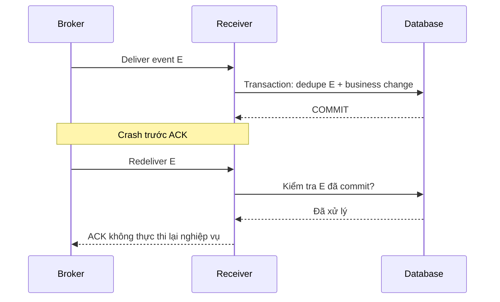
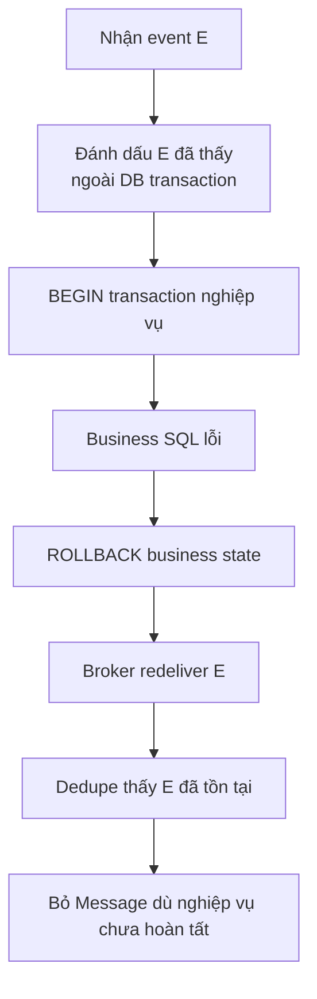
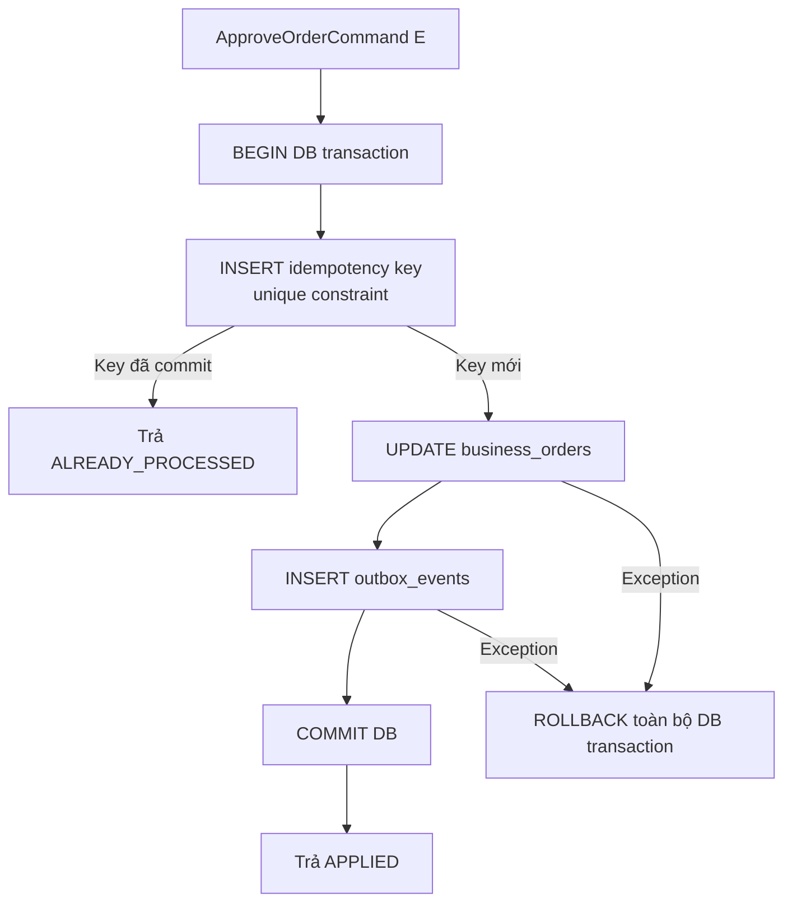
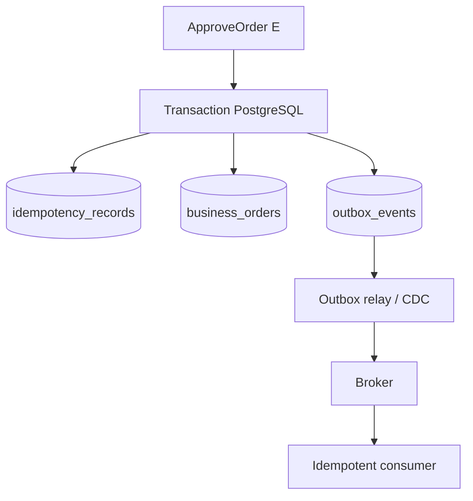
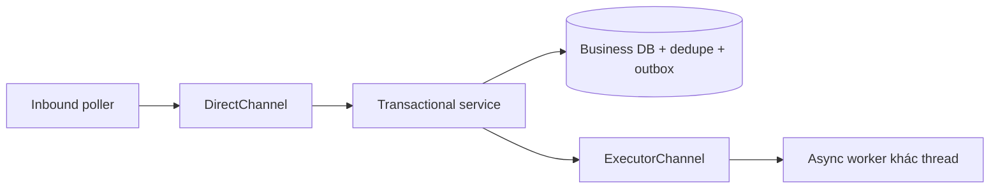
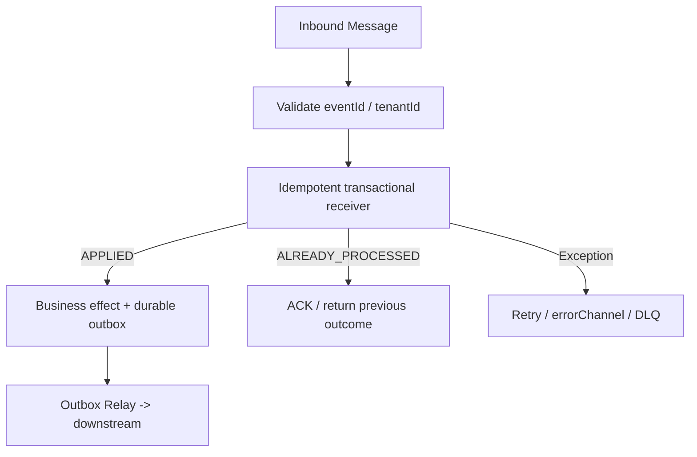

# Idempotency với transaction

Trong một hệ thống tích hợp, cùng một Message có thể đến nhiều lần vì consumer mất kết nối trước khi xác nhận, broker phát lại sau timeout, một bước retry chạy lại hoặc người gửi không chắc yêu cầu trước đã thành công. Nếu Message đại diện cho lệnh **duyệt đơn hàng**, **ghi nhận thanh toán** hoặc **đặt chỗ tồn kho**, việc thực hiện side effect hai lần có thể gây hậu quả nghiêm trọng.

**Idempotent Receiver** là mẫu Enterprise Integration Patterns (EIP) giúp receiver nhận diện một công việc đã được xử lý trước đó và bảo đảm việc nhận lại công việc tương đương không tạo thêm tác động nghiệp vụ ngoài ý định. Tuy nhiên, một bộ lọc Message trùng chưa đủ: nếu receiver ghi dấu “đã xử lý” rồi transaction nghiệp vụ rollback, lần phát lại sau đó có thể bị chặn sai và công việc **không bao giờ được hoàn tất**.

Bài **Idempotency với transaction** thuộc chương **Idempotent receiver** của module `SPRING_INTEGRATION_PATTERN`. Module hướng tới việc triển khai Router, Filter, Transformer, Splitter, Aggregator, Gateway, retry, error channel và correlation bằng Spring Integration, đồng thời kiểm thử, theo dõi các nhánh để xây dựng flow ít phụ thuộc, dễ mở rộng. Bài này tập trung vào **đặt khóa idempotency, cập nhật nghiệp vụ và ghi nhận kết quả trong một ranh giới transaction phù hợp**, từ đó xử lý đúng rollback, redelivery, concurrency và các bước phát output.

## 1. Bài toán: ACK đến muộn và cùng lệnh được giao hai lần

Giả sử hệ thống nhận lệnh:

```json
{
  "tenantId": "tenant-7",
  "orderId": "ORD-1001",
  "eventId": "evt-approve-1001",
  "operation": "APPROVE_ORDER"
}
```

Consumer duyệt đơn và cập nhật database. Trình tự:

```text
t1  Broker giao event evt-approve-1001
t2  Receiver duyệt ORD-1001, COMMIT thành công
t3  Receiver crash trước khi ACK broker
t4  Broker giao lại event evt-approve-1001
```

Lần giao thứ hai **không phải một yêu cầu duyệt mới**. Receiver cần nhận ra nó là bản phát lại của cùng *logical operation* và không lặp lại thay đổi nghiệp vụ hay gửi thông báo chấp thuận lần nữa.



**Mục tiêu không nhất thiết là chỉ nhận Message một lần.** Với hệ thống at-least-once, Message có thể được giao nhiều lần; điều cần bảo đảm là **cùng một công việc không tạo side effect nghiệp vụ trùng**.

## 2. Phân biệt at-least-once, idempotency và exactly-once

| Khái niệm | Ý nghĩa | Điều không nên suy ra |
| --- | --- | --- |
| **At-least-once delivery** | Message có thể được giao lại khi không có ACK | Mỗi Message chỉ xử lý một lần |
| **At-most-once delivery** | Có thể không phát lại | Không mất Message khi crash |
| **Idempotent operation** | Thực hiện lặp cùng lệnh vẫn có hiệu ứng nghiệp vụ tương đương một lần | Mọi nhánh, HTTP call và broker output đều atomic |
| **Deduplication** | Phát hiện một khóa công việc đã thấy | Nghiệp vụ của khóa đó đã commit thành công |
| **Database transaction** | Các thay đổi tham gia cùng transaction có thể commit/rollback nguyên tử | Bao được Kafka ACK hay email bên ngoài DB |
| **Exactly-once effect trong phạm vi DB** | Một khóa nghiệp vụ chỉ tạo một lần chuyển trạng thái đã commit, nếu thiết kế đúng | Toàn bộ hệ thống phân tán có exactly-once |

Một receiver có thể **at-least-once ở đầu vào** nhưng **idempotent ở database**. Đây là thiết kế phổ biến và thường thực tế hơn việc yêu cầu một transaction phân tán bao gồm tất cả hệ thống.

### 2.1. Tính idempotent là theo một thao tác có ý nghĩa

Ví dụ `SET order.status = APPROVED` có thể cho trạng thái cuối tương tự khi chạy lại, nhưng thao tác đi kèm như:

```text
INSERT audit event
SEND email
DECREMENT inventory
PUBLISH OrderApproved event
```

vẫn có thể xảy ra hai lần. **Idempotency cần bao phủ side effect và hợp đồng đầu ra**, không chỉ câu lệnh update chính.

## 3. Chọn idempotency key: đúng một logical operation

Một khóa hiệu quả thường bao gồm:

```text
idempotencyKey = tenantId + ":" + eventId + ":" + handlerId

tenantId = tenant-7
eventId  = evt-approve-1001
handlerId = APPROVE_ORDER
```

| Thành phần | Vì sao cần? |
| --- | --- |
| `tenantId` | Phân tách dữ liệu và quyền của tenant |
| `eventId` hoặc `commandId` | Ổn định qua retry/redelivery của cùng lệnh |
| `handlerId` / operation type | Tránh nhầm các tác vụ khác nhau phát sinh từ cùng event |
| `business aggregate ID` | Dùng để kiểm tra sự nhất quán của payload và trạng thái nghiệp vụ |
| `payload version/hash` (nếu cần) | Phát hiện cùng key được tái sử dụng với nội dung khác |

**Không nên chọn `MessageHeaders.ID` làm khóa duy nhất xuyên hệ thống** khi producer có thể tạo Message mới lúc retry. Message ID do framework tạo có thể thay đổi, trong khi `eventId` nghiệp vụ vẫn phải giữ nguyên.

### 3.1. Không dùng `orderId` đơn lẻ cho mọi thao tác

Cùng một đơn có thể trải qua:

```text
CREATE_ORDER
APPROVE_ORDER
SHIP_ORDER
CANCEL_ORDER
```

Nếu đánh dấu chỉ bằng `orderId`, lệnh `SHIP_ORDER` có thể bị xem là trùng của `APPROVE_ORDER`. Khóa phải xét **loại thao tác** hoặc vòng đời nghiệp vụ thích hợp.

### 3.2. Không tái sử dụng khóa cho payload khác

Nếu client gửi:

```text
eventId=E1, orderId=ORD-1001
eventId=E1, orderId=ORD-9999
```

không được lặng lẽ bỏ lệnh thứ hai như một duplicate bình thường. Cần trả lỗi **idempotency key reuse conflict** hoặc một trạng thái tương đương, vì cùng key nhưng ý định nghiệp vụ khác nhau.

## 4. Vì sao dedupe nằm ngoài transaction dễ làm mất công việc?

Hãy xét thiết kế sai:

```text
1. Lưu key E vào metadata store: PROCESSING
2. Bắt đầu database transaction
3. Cập nhật order
4. Lỗi SQL -> ROLLBACK
5. Broker redeliver E
6. Metadata store vẫn có E -> DROP
```



Đây là **poisoned idempotency key**: marker nói “đã xử lý” nhưng sự thật chưa có business commit.

Một vấn đề tương tự có thể xảy ra khi dùng bộ nhớ RAM hoặc cache để nhớ key: chúng không có cùng ranh giới transaction với business DB, có thể mất khi restart hoặc tồn tại sai sau rollback.

### Nguyên tắc cần đạt

Nếu khóa “đã hoàn tất” và business state đều nằm trong cùng database, hãy cố gắng bảo đảm:

\[
\text{Commit}(\text{dedupe record}) \iff
\text{Commit}(\text{business change})
\]

Với một transaction DB, **cả hai cùng commit hoặc cùng rollback**. Nếu có output cần phát ra broker, ta còn cần một bản ghi **outbox** trong cùng transaction để không mất ý định phát kết quả.

## 5. Ba trạng thái cần phân biệt: chưa xử lý, đang xử lý và đã commit

| Trạng thái logic | Ý nghĩa | Khi nhận duplicate |
| --- | --- | --- |
| **NOT_SEEN** | Chưa có bản ghi công việc hợp lệ | Có thể nhận xử lý |
| **IN_PROGRESS** | Một transaction/worker đang xử lý | Chờ, retry hoặc điều phối cạnh tranh; không kết luận thành công |
| **COMPLETED** | Side effect nghiệp vụ đã commit theo hợp đồng | Không xử lý lại; trả kết quả cũ hoặc ACK |
| **FAILED_RETRYABLE** | Công việc thất bại nhưng có thể thử lại | Cho retry theo chính sách |
| **FAILED_FINAL** | Không thể retry hoặc không được phép retry | Error/DLQ/audit theo hợp đồng |

Không phải ứng dụng nào cũng cần bảng có cột `status` cho tất cả trạng thái này. Trong mẫu transaction dùng **unique insert chưa commit**, một đối thủ có thể phải đợi transaction đầu tiên commit/rollback; sau commit, sự tồn tại của dedupe record chính là bằng chứng business change cùng transaction đã commit.

**Không được đánh đồng “key đang bị transaction khác giữ” với “key đã hoàn tất”.** Nếu transaction đầu tiên rollback, một consumer khác vẫn phải có cơ hội xử lý công việc.

## 6. Ranh giới transaction DB đúng: dedupe + state + outbox

Với một database PostgreSQL, thiết kế có thể gồm:



Ba bảng liên quan:

1. `idempotency_records`: một khóa duy nhất cho logical operation.
2. `business_orders`: trạng thái nghiệp vụ.
3. `outbox_events`: ý định phát sự kiện sau khi transaction commit.

Tất cả phải tham gia **cùng một transaction manager, cùng database/resource và cùng phạm vi thread** nếu muốn atomic theo mô hình này.

### 6.1. Các bất biến mong muốn

- Một `(tenantId, eventId, handlerId)` chỉ có tối đa **một record đã commit**.
- Nếu business change thất bại, record idempotency **không được commit**.
- Nếu outbox insert thất bại, business change và record idempotency cùng rollback.
- Nếu record đã commit và cùng key được gửi lại, receiver **không tạo side effect lần thứ hai**.
- Nếu key được dùng lại cho một order khác, receiver **báo conflict** chứ không giả đó là duplicate hợp lệ.

Trong các bước sau, ta dùng PostgreSQL `INSERT ... ON CONFLICT DO NOTHING` và primary key để xử lý cạnh tranh nguyên tử. Đây là cú pháp **PostgreSQL**, không nên copy nguyên sang mọi RDBMS.

## 7. SQL schema: unique constraint là hàng rào cuối cùng

```sql
-- Ví dụ PostgreSQL. Chạy qua migration có kiểm soát.
CREATE TABLE business_orders (
    tenant_id       VARCHAR(80)  NOT NULL,
    order_id        VARCHAR(120) NOT NULL,
    status          VARCHAR(24)  NOT NULL,
    PRIMARY KEY (tenant_id, order_id)
);

CREATE TABLE idempotency_records (
    tenant_id       VARCHAR(80)  NOT NULL,
    event_id        VARCHAR(120) NOT NULL,
    handler_id      VARCHAR(80)  NOT NULL,
    order_id        VARCHAR(120) NOT NULL,
    processed_at    TIMESTAMPTZ  NOT NULL DEFAULT CURRENT_TIMESTAMP,
    PRIMARY KEY (tenant_id, event_id, handler_id)
);

CREATE TABLE outbox_events (
    tenant_id       VARCHAR(80)  NOT NULL,
    event_id        VARCHAR(120) NOT NULL,
    event_type      VARCHAR(80)  NOT NULL,
    order_id        VARCHAR(120) NOT NULL,
    created_at      TIMESTAMPTZ  NOT NULL DEFAULT CURRENT_TIMESTAMP,
    published_at    TIMESTAMPTZ,
    PRIMARY KEY (tenant_id, event_id, event_type)
);
```

Sơ đồ trên cố ý tách:

- **Khóa command**: `(tenant_id, event_id, handler_id)`.
- **Khóa order**: `(tenant_id, order_id)`.
- **Khóa outbox event**: `(tenant_id, event_id, event_type)`.

Nếu có các handler khác nhau cùng tạo `event_type` giống nhau từ cùng `event_id`, cần đưa handler/operation vào khóa outbox để không collision. Trong ví dụ chỉ có handler `APPROVE_ORDER` phát `ORDER_APPROVED`.

### 7.1. Tại sao SELECT trước rồi INSERT chưa đủ?

Một cách viết dễ mắc race condition:

```text
Thread A: SELECT key E -> chưa có
Thread B: SELECT key E -> chưa có
Thread A: thực thi business
Thread B: thực thi business
Thread A: INSERT E
Thread B: INSERT E -> duplicate key
```

Ngay cả khi Thread B bị lỗi ở bước cuối, nó có thể đã gọi HTTP hoặc thực hiện side effect **không thể rollback** trước đó. Vì vậy hãy **đặt chỗ key bằng thao tác atomic/unique constraint trước side effect** trong cùng transaction, rồi mới thực hiện nghiệp vụ.

### 7.2. Unique constraint không thay business validation

Một key mới vẫn có thể là lệnh không hợp lệ. Receiver cần xác thực tenant, order ID, trạng thái đơn, quyền thực hiện và điều kiện chuyển trạng thái. Unique constraint chỉ giải quyết **tính duy nhất của logical operation**, không quyết định giao dịch nên được chấp nhận.

## 8. Java 17+: xử lý idempotent trong một TransactionTemplate

Ví dụ sau dùng `JdbcTemplate`, `PlatformTransactionManager` và `TransactionTemplate`. Cách dùng transaction tường minh giúp thấy chính xác **insert dedupe, update order và insert outbox cùng nằm trong một transaction**.

```java
package example.integration;

import java.util.Objects;

import org.springframework.jdbc.core.JdbcTemplate;
import org.springframework.transaction.PlatformTransactionManager;
import org.springframework.transaction.support.TransactionTemplate;

public final class TransactionalApproveOrderService {

    public record ApproveOrderCommand(
            String tenantId,
            String orderId,
            String eventId) {
        public ApproveOrderCommand {
            require(tenantId, "tenantId");
            require(orderId, "orderId");
            require(eventId, "eventId");
        }

        private static void require(String value, String field) {
            if (value == null || value.isBlank()) {
                throw new IllegalArgumentException(field + " is required");
            }
        }
    }

    public enum HandleOutcome {
        APPLIED, ALREADY_PROCESSED
    }

    private static final String HANDLER_ID = "APPROVE_ORDER";
    private final JdbcTemplate jdbc;
    private final TransactionTemplate transaction;

    public TransactionalApproveOrderService(
            JdbcTemplate jdbc,
            PlatformTransactionManager transactionManager) {
        this.jdbc = Objects.requireNonNull(jdbc);
        this.transaction = new TransactionTemplate(
                Objects.requireNonNull(transactionManager));
    }

    public HandleOutcome handle(ApproveOrderCommand command) {
        Objects.requireNonNull(command, "command");

        return transaction.execute(status -> {
            int inserted = jdbc.update(
                    """
                    INSERT INTO idempotency_records
                        (tenant_id, event_id, handler_id, order_id)
                    VALUES (?, ?, ?, ?)
                    ON CONFLICT DO NOTHING
                    """,
                    command.tenantId(),
                    command.eventId(),
                    HANDLER_ID,
                    command.orderId());

            if (inserted == 0) {
                // Key đã có: phải chắc rằng đây đúng cùng operation.
                String previousOrderId = jdbc.queryForObject(
                        """
                        SELECT order_id
                        FROM idempotency_records
                        WHERE tenant_id = ?
                          AND event_id = ?
                          AND handler_id = ?
                        """,
                        String.class,
                        command.tenantId(),
                        command.eventId(),
                        HANDLER_ID);

                if (!command.orderId().equals(previousOrderId)) {
                    throw new IllegalArgumentException(
                            "Idempotency key reused for another order");
                }
                return HandleOutcome.ALREADY_PROCESSED;
            }

            int updated = jdbc.update(
                    """
                    UPDATE business_orders
                    SET status = 'APPROVED'
                    WHERE tenant_id = ?
                      AND order_id = ?
                      AND status = 'PENDING'
                    """,
                    command.tenantId(),
                    command.orderId());

            if (updated != 1) {
                // Exception làm rollback cả idempotency INSERT mới.
                throw new IllegalStateException(
                        "Order not found or not PENDING");
            }

            jdbc.update(
                    """
                    INSERT INTO outbox_events
                        (tenant_id, event_id, event_type, order_id)
                    VALUES (?, ?, 'ORDER_APPROVED', ?)
                    """,
                    command.tenantId(),
                    command.eventId(),
                    command.orderId());

            return HandleOutcome.APPLIED;
        });
    }
}
```

### 8.1. Từng bước bảo vệ điều gì?

1. `INSERT ... ON CONFLICT DO NOTHING` đặt chỗ khóa dưới **unique constraint PostgreSQL**.
2. Nếu kết quả là `0`, transaction kiểm tra key trước đó trỏ tới đúng `orderId`; không chạy business update hay ghi outbox lần hai.
3. Nếu key mới, `UPDATE` yêu cầu đơn ở trạng thái `PENDING`. Không tìm thấy đúng một dòng → ném exception.
4. Tạo một bản ghi `outbox_events` trong **cùng transaction** với hai thay đổi trước.
5. Khi callback của `TransactionTemplate` kết thúc bình thường, transaction manager commit; khi một unchecked exception thoát ra, transaction rollback theo hành vi mặc định.

Với PostgreSQL và primary key ở mục 7, hai transaction cùng `INSERT` một key sẽ được database điều phối qua unique constraint. Transaction thứ hai có thể phải **chờ** transaction thứ nhất commit hoặc rollback. Nếu transaction đầu tiên rollback, transaction thứ hai có cơ hội insert và xử lý; nếu transaction đầu tiên commit, transaction thứ hai thấy conflict và trả `ALREADY_PROCESSED`.

**Giới hạn:** logic ở đây chỉ xử lý `APPROVE_ORDER`; một event ID thực sự mới cho order đã `APPROVED` sẽ gặp lỗi điều kiện trạng thái và rollback. Điều đó là **business rule**, không phải lỗi idempotency; nghiệp vụ muốn hỗ trợ những trạng thái khác phải định nghĩa riêng.

### 8.2. Vì sao không catch lỗi SQL rồi trả ALREADY_PROCESSED?

Nếu `UPDATE` bị deadlock, database mất kết nối hoặc outbox insert thất bại, đó **không phải** bằng chứng công việc đã hoàn tất. Cần để transaction rollback rồi áp dụng retry được giới hạn ở caller hoặc message adapter.

Chỉ nhánh `inserted == 0` với kiểm tra trùng key hợp lệ mới trả `ALREADY_PROCESSED` trong ví dụ.

### 8.3. Vì sao callback trả về vẫn cần phân biệt commit?

`TransactionTemplate.execute(...)` quản lý commit trước khi method `handle()` trả kết quả thành công cho caller. Trái lại, nếu sử dụng một transaction ngoài với propagation tham gia transaction đang có, lời gọi method có thể kết thúc **trước commit ngoài cùng**. Vì vậy trong hệ thống thực, cần xác định transaction bắt đầu/kết thúc ở đâu; không log `COMMITTED` chỉ vì một helper method vừa trả về.

## 9. Nối service transactional vào Spring Integration

Spring Integration điều phối Message; business service quyết định **khóa nào được áp dụng trong transaction**. Một `Service Activator` hoặc Java DSL `.handle(...)` có thể gọi service vừa xây.

```java
package example.integration;

import javax.sql.DataSource;

import org.springframework.context.annotation.Bean;
import org.springframework.context.annotation.Configuration;
import org.springframework.integration.channel.DirectChannel;
import org.springframework.integration.channel.QueueChannel;
import org.springframework.integration.config.EnableIntegration;
import org.springframework.integration.dsl.IntegrationFlow;
import org.springframework.jdbc.core.JdbcTemplate;
import org.springframework.jdbc.datasource.DataSourceTransactionManager;
import org.springframework.messaging.MessageChannel;
import org.springframework.messaging.PollableChannel;
import org.springframework.transaction.PlatformTransactionManager;

import example.integration.TransactionalApproveOrderService.ApproveOrderCommand;

@Configuration
@EnableIntegration
public class IdempotentOrderFlowConfiguration {

    // Chỉ khai báo manager này khi ứng dụng chưa có manager phù hợp.
    // Cùng DataSource phải được dùng bởi business JDBC và outbox.
    @Bean
    public PlatformTransactionManager transactionManager(
            DataSource dataSource) {
        return new DataSourceTransactionManager(dataSource);
    }

    @Bean
    public TransactionalApproveOrderService orderService(
            JdbcTemplate jdbcTemplate,
            PlatformTransactionManager transactionManager) {
        return new TransactionalApproveOrderService(
                jdbcTemplate, transactionManager);
    }

    @Bean
    public MessageChannel approveOrderInput() {
        return new DirectChannel();
    }

    @Bean
    public PollableChannel orderHandlingResults() {
        return new QueueChannel(20);
    }

    @Bean
    public IntegrationFlow approveOrderFlow(
            TransactionalApproveOrderService service) {
        return IntegrationFlow.from("approveOrderInput")
                .handle(ApproveOrderCommand.class,
                        (command, headers) -> service.handle(command))
                .channel("orderHandlingResults")
                .get();
    }
}
```

Ví dụ giả định ứng dụng đã có `DataSource`, `JdbcTemplate` và schema ở mục 7 (Spring Boot có thể cấu hình những bean này). Không đăng ký hai transaction manager cạnh tranh nếu dự án đã có một manager khác; hãy dùng manager **đúng với cùng datasource** và xác minh cấu hình Spring Integration theo phiên bản dependency.

### 9.1. Một Message vào, một kết quả xử lý

```text
ApproveOrderCommand(E)
    ↓
IntegrationFlow
    ↓
TransactionalApproveOrderService.handle(E)
    ↓
APPLIED hoặc ALREADY_PROCESSED
```

Một duplicate hợp lệ có thể được **ACK** và trả kết quả `ALREADY_PROCESSED` mà không chạy side effect. Đây là lựa chọn rõ ràng khi caller cần biết Message đã được bỏ qua vì đã xử lý. Trong một số flow, Idempotent Receiver có thể **drop** duplicate hoặc đánh dấu header và cho đi nhánh khác; cách chọn phải phù hợp hợp đồng Gateway/consumer.

### 9.2. `QueueChannel(20)` không tạo durability

`orderHandlingResults` chỉ là queue in-memory phục vụ demo. Kết quả `HandleOutcome.APPLIED` trên queue đó **không phải bản ghi durable business event**. Việc phát sự kiện nghiệp vụ ra broker được dựa trên **outbox row đã commit**, không dựa vào queue này để suy ra exactly-once publication.

## 10. Ma trận failure window: điều gì xảy ra trước và sau COMMIT?

| Điểm crash/lỗi | Dedupe record | Business state | Outbox record | Khi broker redeliver |
| --- | --- | --- | --- | --- |
| Trước transaction | Chưa có | Chưa đổi | Chưa có | Có thể xử lý mới |
| Sau INSERT, trước COMMIT | Rollback nếu transaction hủy | Rollback | Rollback | Retry có thể lấy key |
| Sau business UPDATE nhưng outbox INSERT lỗi | Rollback | Rollback | Không commit | Retry xử lý lại |
| COMMIT xong, chưa ACK input | Đã commit | Đã commit | Đã commit | Duplicate hợp lệ, bỏ side effect |
| COMMIT xong, broker output chưa nhận | Đã commit | Đã commit | Đã commit | Outbox relay phát sau |
| Outbox gửi thành công, chưa mark published | Đã commit | Đã commit | Có thể chưa mark | Relay có thể gửi trùng |
| ACK input trước COMMIT rồi crash | Có thể chưa commit | Có thể chưa commit | Có thể chưa commit | Nguy cơ **mất công việc** |

Các dòng này giả định **ba bảng cùng transaction PostgreSQL**. Chúng không khẳng định toàn bộ trình tự ack trên Kafka, AMQP, HTTP hoặc JDBC adapter là giống nhau.

```mermaid
sequenceDiagram
    participant B as Input Broker
    participant S as Integration Service
    participant D as PostgreSQL
    participant O as Outbox Relay
    S->>B: Receive E
    B-->>S: Deliver E
    S->>D: BEGIN, insert E, update order, insert outbox
    D-->>S: COMMIT
    Note over S,B: Crash hoặc ACK thất lạc
    B-->>S: Redeliver E
    S->>D: INSERT same key ON CONFLICT
    D-->>S: 0 rows; previously committed E
    S-->>B: ACK duplicate
    O->>D: Read pending outbox
    O-->>B: Publish OrderApproved(E)
```

**Khóa nghiệp vụ đã commit là bằng chứng DB change của transaction đó đã commit**, vì cùng một transaction bảo vệ cả marker và business update. Nó không chứng minh consumer ở xa đã nhận event; phần đó thuộc outbox và đích nhận.

## 11. Rollback phải cho phép retry thật

Một test quan trọng: Message E được nhận, marker E đã được insert tạm, nhưng business validation thất bại.

```text
BEGIN
  INSERT idempotency_records(E)  // chưa commit
  UPDATE business_orders        // 0 rows
  THROW
ROLLBACK

Sau rollback: idempotency_records(E) không tồn tại.
```

Khi điều kiện nghiệp vụ được sửa hoặc dữ liệu nguồn được đồng bộ, cùng E có thể được thử lại và xử lý.

### 11.1. Không phải mọi lỗi đều nên retry

| Loại lỗi | Ví dụ | Hướng xử lý |
| --- | --- | --- |
| Lỗi hạ tầng tạm thời | Connection timeout, deadlock | Retry có giới hạn/backoff |
| Lỗi nghiệp vụ có thể khắc phục | Order chưa được tạo khi event đến sớm | Retry hoặc đưa vào delay queue theo policy |
| Lỗi nghiệp vụ vĩnh viễn | Tenant sai, command không hợp lệ | Từ chối/DLQ, không retry vô hạn |
| Duplicate đã commit | Cùng event/operation tới lại | Không chạy side effect lần nữa |
| Reuse key với payload khác | Event ID trùng nhưng order khác | Báo conflict; không gọi là duplicate hợp lệ |

**Rollback giải phóng khả năng retry** nhưng không tự biết lỗi có nên retry hay không. Retry policy và dead-letter là các phần khác của flow.

### 11.2. Thứ tự advice và transaction interceptor

Nếu dùng Spring Integration retry advice, transaction advice và idempotent interceptor trên cùng endpoint, **thứ tự lồng nhau của advice** ảnh hưởng tới thời điểm ghi marker và rollback.

Ví dụ lỗi thiết kế:

```text
idempotent advice ghi key bằng store A
    -> transaction business DB B bắt đầu
        -> business exception / rollback B
    -> advice của A không rollback
```

Không nên nhìn thấy cả `@Transactional` và `IdempotentReceiverInterceptor` rồi mặc định marker của interceptor sẽ được rollback. Phải kiểm tra chúng **dùng transaction/resource nào và được gọi trong thứ tự nào**.

## 12. Hai Message đồng thời cùng key: cần atomic check-and-claim

Một check bằng cache như:

```java
if (!seenIds.contains(eventId)) {
    seenIds.add(eventId);
    applyBusinessChange();
}
```

không an toàn khi hai thread cùng chạy. Cả hai có thể nhìn thấy `contains=false` và đều thực hiện nghiệp vụ.

Với PostgreSQL unique constraint:

```text
Thread A: INSERT key E → thành công nhưng chưa COMMIT
Thread B: INSERT key E → đợi kết quả transaction A

Nếu A COMMIT:
    B nhận conflict → không chạy business

Nếu A ROLLBACK:
    B có thể INSERT thành công → chạy business
```

Điều này giúp ngăn side effect DB trùng trong một database, nhưng còn cần:

- Cấu hình **lock wait/statement timeout** phù hợp để tránh treo quá lâu.
- Xử lý deadlock/serialization failure bằng retry an toàn.
- Đảm bảo business state và marker trong cùng transaction.
- Không gọi service ngoài trước khi giành được quyền xử lý key.
- Xác định khóa theo tenant, operation và event ID chuẩn hóa.

### 12.1. “Select rồi update” không thay cho unique insert

`SELECT ... FOR UPDATE` trên một dòng **đã tồn tại** có thể hữu ích, nhưng khi key chưa có, không có dòng để khóa theo cách đơn giản. `INSERT` dưới unique constraint, atomic upsert hoặc một lock có phạm vi đúng mới giải quyết được **race khi tạo key mới**.

### 12.2. Nhiều instance vẫn cần cơ chế ở tầng dùng chung

Một `synchronized` method hoặc `ConcurrentHashMap` chỉ bảo vệ một JVM; hai replica độc lập vẫn có thể xử lý cùng event. Unique constraint trong database chung cung cấp một ranh giới phối hợp mà cả hai instance cùng nhìn thấy.

## 13. `IdempotentReceiverInterceptor` và `MetadataStore` trong Spring Integration

Spring Integration có các thành phần hỗ trợ mẫu Idempotent Receiver, bao gồm **`IdempotentReceiverInterceptor`** và cơ chế **`MetadataStoreSelector`** trên một `MetadataStore` phù hợp.

Ý tưởng:

```text
Message E
  ↓
Idempotent receiver advice / selector
  ↓
Tính key từ eventId + handlerId
  ↓
MetadataStore kiểm tra/ghi nhận key
  ↓
Đi tiếp, bỏ qua hoặc xử lý duplicate theo cấu hình
```

Một `ConcurrentMetadataStore` có khả năng thao tác atomic như `putIfAbsent` hữu ích hơn một map check-then-put không đồng bộ khi nhiều thread cùng nhận Message. Có thể dùng các triển khai lưu trong RAM hoặc persistent store phù hợp với yêu cầu.

**Nhưng tính atomic của `putIfAbsent` không đồng nghĩa atomic với business transaction.** Nếu key được ghi vào store khác, hoặc ghi và commit ngoài phạm vi cập nhật nghiệp vụ, lỗi rollback có thể để lại marker sai.

### 13.1. Chọn giữa interceptor và DB transaction pattern

| Cách | Ưu điểm | Điều cần kiểm tra |
| --- | --- | --- |
| `IdempotentReceiverInterceptor` + metadata store | Tích hợp với Message endpoint, dùng key strategy/advice | Thời điểm ghi key, xử lý duplicate, rollback resource, advice order |
| Unique key trong business DB transaction | Rõ ràng atomic với business state cùng DB | RDBMS/schema, concurrent insert, transaction manager |
| Redis/metadata CAS ngoài DB | Nhanh, dùng chung giữa instance | Marker và business commit không atomic nếu không có protocol bù |
| Idempotent domain service | Kiểm soát business rule và output | Phải được gọi qua mọi đường xử lý |
| Outbox + idempotent receiver | Giảm mất output và duplicate side effect | Relay vẫn có thể gửi lại, consumer phải dedupe |

Nếu dùng interceptor để **đánh dấu duplicate trong header**, downstream cần quyết định có bỏ, báo conflict hay trả kết quả cũ. Nếu dùng interceptor để **loại Message**, Gateway request-reply phải có chính sách tránh chờ một reply sẽ không xuất hiện.

Chi tiết constructor, DSL advice và chính sách duplicate phụ thuộc phiên bản Spring Integration; **cần kiểm tra API/thứ tự advice và viết test rollback thực tế** thay vì sao chép một cấu hình không đúng với phiên bản dự án.

## 14. Outbox: business commit và ý định phát output cùng transaction

Sau khi duyệt đơn, hệ thống cần phát `OrderApproved`. Nếu gửi broker trực tiếp trong handler:

```text
BEGIN DB
UPDATE order
SEND broker event
COMMIT DB
```

thì broker event có thể đã tới consumer nhưng DB rollback. Nếu đảo thứ tự:

```text
COMMIT DB
SEND broker event
```

thì ứng dụng có thể crash giữa hai bước, làm mất event. **Local database transaction không bao phủ broker độc lập**.

Giải pháp thường dùng là **Transactional Outbox**:



Trong ví dụ mục 8, `outbox_events` được insert **trước khi DB commit**. Nếu transaction rollback, không có event nào được lưu để relay phát. Nếu commit thành công mà relay chưa chạy, bản ghi vẫn còn để phát sau.

### 14.1. Relay vẫn có thể phát trùng

```text
Relay gửi E tới broker thành công.
Relay crash trước khi cập nhật published_at.
Relay khởi động lại và gửi E thêm lần nữa.
```

Vì thế consumer nhận `OrderApproved` cũng cần idempotency theo **event ID ổn định**. Outbox chủ yếu bảo vệ **durability của ý định phát**, không tự ban phát exactly-once effect trên mọi transport.

### 14.2. Không làm mất event khi chỉ có duplicate input

Lần nhận lại event E trả `ALREADY_PROCESSED`, không insert outbox mới. Nếu outbox E đang chờ, relay độc lập vẫn phải tiếp tục phát event ban đầu. Receiver không cần phát event lần hai chỉ vì input redelivered.

### 14.3. Khóa outbox phải nhất quán

Đối với một logical approval, outbox sử dụng `(tenantId, eventId, eventType)`. Khi thay đổi schema event hoặc thiết kế nhiều sự kiện cho một lệnh, phải mở rộng khóa/sequence cho phù hợp; không coi một event ID là duy nhất trong mọi ngữ cảnh nếu producer không bảo đảm điều đó.

## 15. HTTP, email, thanh toán và những side effect ngoài DB

Nếu handler gọi một dịch vụ thanh toán **trước khi commit marker**, cần thận trọng:

```text
BEGIN local DB transaction
  CALL paymentProvider.charge() → đã trừ tiền
  INSERT idempotency_records
  SQL exception
ROLLBACK local DB
```

Khoản trừ tiền ở provider không bị rollback theo local DB. Khi retry, khoản tiền có thể bị trừ lần hai.

Với side effect ngoài DB:

1. Dùng **idempotency key do external API hỗ trợ** nếu có.
2. Lưu một command/outbox/job intent bền vững trong DB transaction.
3. Để worker gửi lệnh với **key ổn định** và retry có giới hạn.
4. Theo dõi kết quả/lifecycle ở bảng trạng thái hoặc inbox.
5. Có reconciliation/compensation nếu một phía thành công mà phía kia không ghi nhận được.

Không thể tuyên bố exactly-once chỉ từ `@Transactional` nếu thao tác quan trọng nằm ngoài DB hoặc ở hệ thống độc lập.

### 15.1. Side effect “đặt trạng thái” và “tăng/giảm” có khác nhau

```text
SET order.status = APPROVED
```

có thể tự nhiên idempotent về trạng thái cuối, nhưng:

```text
UPDATE stock SET reserved = reserved + 1
```

không idempotent. Cần khóa command hoặc một unique reservation ID để đảm bảo không tăng lại khi redelivery.

## 16. Transaction context: thread, proxy và lời gọi tự thân

Trong Spring, transaction thường gắn với thread đang xử lý. Một flow:



Không được giả định transaction của service tự truyền qua `ExecutorChannel` sang worker ở thread khác. Nếu worker cần cập nhật state, nó phải có transaction riêng với bảo đảm tương ứng.

### 16.1. `@Transactional` chỉ hiệu quả khi được áp dụng thật

Khi dùng `@Transactional` thay `TransactionTemplate`, cần nhớ:

- Bean phải được quản lý bởi Spring và transaction management được bật.
- Lời gọi phải đi qua proxy/interceptor phù hợp; **self-invocation** có thể bỏ qua transaction proxy.
- Phải chọn `PlatformTransactionManager` đúng datasource.
- Runtime exception thường kích hoạt rollback mặc định; checked exception có thể cần `rollbackFor` tùy cấu hình.
- Nếu method tham gia transaction của caller, việc method trả về chưa chắc đồng nghĩa outer transaction đã commit.
- Khi qua executor/broker, cần xác định transaction boundary mới.

`TransactionTemplate` ở mục 8 giúp thể hiện phạm vi trực tiếp hơn nhưng cũng không thể điều khiển HTTP/broker từ xa như một resource của DB transaction.

## 17. JUnit 5 + PostgreSQL: test commit, duplicate và rollback

Để kiểm chứng `INSERT ... ON CONFLICT DO NOTHING` cùng transaction thật, nên dùng **PostgreSQL Testcontainers** (hoặc một môi trường PostgreSQL tương đương), thay vì suy ra semantics của PostgreSQL từ mock hay H2.

Ví dụ test dưới đây khởi tạo bảng qua SQL đúng như mục 7. Cần JUnit 5, Spring JDBC/Transaction, PostgreSQL JDBC driver và Testcontainers PostgreSQL trong test dependencies.

```java
package example.integration;

import static org.junit.jupiter.api.Assertions.*;

import org.junit.jupiter.api.AfterAll;
import org.junit.jupiter.api.BeforeAll;
import org.junit.jupiter.api.BeforeEach;
import org.junit.jupiter.api.Test;
import org.junit.jupiter.api.TestInstance;
import org.springframework.jdbc.core.JdbcTemplate;
import org.springframework.jdbc.datasource.DataSourceTransactionManager;
import org.springframework.jdbc.datasource.DriverManagerDataSource;
import org.testcontainers.containers.PostgreSQLContainer;

import example.integration.TransactionalApproveOrderService.*;

@TestInstance(TestInstance.Lifecycle.PER_CLASS)
class TransactionalApproveOrderServiceTest {

    private final PostgreSQLContainer<?> postgres =
            new PostgreSQLContainer<>("postgres:16-alpine");

    private JdbcTemplate jdbc;
    private TransactionalApproveOrderService service;

    @BeforeAll
    void setUpDatabase() {
        postgres.start();
        var dataSource = new DriverManagerDataSource();
        dataSource.setDriverClassName("org.postgresql.Driver");
        dataSource.setUrl(postgres.getJdbcUrl());
        dataSource.setUsername(postgres.getUsername());
        dataSource.setPassword(postgres.getPassword());

        jdbc = new JdbcTemplate(dataSource);
        service = new TransactionalApproveOrderService(
                jdbc, new DataSourceTransactionManager(dataSource));

        jdbc.execute("""
                CREATE TABLE business_orders (
                    tenant_id VARCHAR(80) NOT NULL,
                    order_id VARCHAR(120) NOT NULL,
                    status VARCHAR(24) NOT NULL,
                    PRIMARY KEY (tenant_id, order_id)
                )
                """);
        jdbc.execute("""
                CREATE TABLE idempotency_records (
                    tenant_id VARCHAR(80) NOT NULL,
                    event_id VARCHAR(120) NOT NULL,
                    handler_id VARCHAR(80) NOT NULL,
                    order_id VARCHAR(120) NOT NULL,
                    processed_at TIMESTAMPTZ NOT NULL DEFAULT CURRENT_TIMESTAMP,
                    PRIMARY KEY (tenant_id, event_id, handler_id)
                )
                """);
        jdbc.execute("""
                CREATE TABLE outbox_events (
                    tenant_id VARCHAR(80) NOT NULL,
                    event_id VARCHAR(120) NOT NULL,
                    event_type VARCHAR(80) NOT NULL,
                    order_id VARCHAR(120) NOT NULL,
                    created_at TIMESTAMPTZ NOT NULL DEFAULT CURRENT_TIMESTAMP,
                    published_at TIMESTAMPTZ,
                    PRIMARY KEY (tenant_id, event_id, event_type)
                )
                """);
    }

    @AfterAll
    void stopDatabase() {
        postgres.stop();
    }

    @BeforeEach
    void clearRows() {
        jdbc.execute("""
                TRUNCATE outbox_events,
                         idempotency_records,
                         business_orders
                """);
    }

    private void pendingOrder(String orderId) {
        jdbc.update("""
                INSERT INTO business_orders
                    (tenant_id, order_id, status)
                VALUES ('tenant-7', ?, 'PENDING')
                """, orderId);
    }

    private int count(String table) {
        // Bảng là hằng số chỉ do test gọi, không nhận từ user.
        return jdbc.queryForObject(
                "SELECT COUNT(*) FROM " + table, Integer.class);
    }

    @Test
    void firstDeliveryAppliesAndRedeliveryDoesNotRepeatEffects() {
        pendingOrder("ORD-1001");
        var command = new ApproveOrderCommand(
                "tenant-7", "ORD-1001", "evt-1001");

        assertEquals(HandleOutcome.APPLIED, service.handle(command));
        assertEquals(
                HandleOutcome.ALREADY_PROCESSED,
                service.handle(command));

        assertEquals(1, count("idempotency_records"));
        assertEquals(1, count("outbox_events"));
        assertEquals("APPROVED", jdbc.queryForObject(
                """
                SELECT status FROM business_orders
                WHERE tenant_id = 'tenant-7'
                  AND order_id = 'ORD-1001'
                """, String.class));
    }

    @Test
    void rollbackRemovesMarkerSoSameEventCanBeRetried() {
        // Đơn hàng chưa tồn tại, UPDATE trong transaction sẽ thất bại.
        var command = new ApproveOrderCommand(
                "tenant-7", "ORD-MISSING", "evt-missing");

        assertThrows(
                IllegalStateException.class,
                () -> service.handle(command));
        assertEquals(0, count("idempotency_records"));
        assertEquals(0, count("outbox_events"));

        pendingOrder("ORD-MISSING");
        assertEquals(HandleOutcome.APPLIED, service.handle(command));
        assertEquals(1, count("idempotency_records"));
        assertEquals(1, count("outbox_events"));
    }

    @Test
    void sameKeyWithDifferentOrderIsRejectedAsConflict() {
        pendingOrder("ORD-1001");
        pendingOrder("ORD-2002");
        service.handle(new ApproveOrderCommand(
                "tenant-7", "ORD-1001", "evt-shared"));

        assertThrows(IllegalArgumentException.class, () ->
                service.handle(new ApproveOrderCommand(
                        "tenant-7", "ORD-2002", "evt-shared")));

        assertEquals("PENDING", jdbc.queryForObject(
                """
                SELECT status FROM business_orders
                WHERE tenant_id = 'tenant-7'
                  AND order_id = 'ORD-2002'
                """, String.class));
        assertEquals(1, count("outbox_events"));
    }
}
```

**Những test này là ví dụ để triển khai và chạy trong STEP kiểm thử của dự án; tại bước viết bài chưa chạy Docker, Gradle hay JUnit.** Điều quan trọng là test dùng **PostgreSQL thật** cho unique constraint và `ON CONFLICT`, không chỉ mock `JdbcTemplate`.

### 17.1. Test thứ nhất chứng minh gì?

Cùng `eventId` đi vào hai lần nhưng chỉ có **một dedupe record, một outbox event và một lần chuyển trạng thái nghiệp vụ**.

### 17.2. Test thứ hai chứng minh gì?

Khi business UPDATE thất bại, transaction rollback cả marker E; sau khi dữ liệu đầu vào có thể xử lý, lần thử tiếp theo **không bị marker cũ chặn sai**.

### 17.3. Test thứ ba chứng minh gì?

Một key đã xử lý không được dùng như một “thẻ miễn kiểm tra” cho payload khác. Receiver từ chối việc tái sử dụng key với `orderId` không phù hợp.

## 18. Test concurrency và failure injection

Test tuần tự chưa đủ để chứng minh hai Message đồng thời cùng key an toàn.

### 18.1. Hai thread cùng gửi một command

Với database/test service đã khởi tạo ở mục 17, có thể bổ sung test:

```java
// Method đặt trong TransactionalApproveOrderServiceTest
@Test
void concurrentDuplicateDeliveryOnlyAppliesOnce() throws Exception {
    pendingOrder("ORD-CONCURRENT");
    var cmd = new ApproveOrderCommand(
            "tenant-7", "ORD-CONCURRENT", "evt-concurrent");

    var gate = new java.util.concurrent.CountDownLatch(1);
    var pool = java.util.concurrent.Executors.newFixedThreadPool(2);
    try {
        java.util.concurrent.Callable<HandleOutcome> task = () -> {
            gate.await();
            return service.handle(cmd);
        };

        var f1 = pool.submit(task);
        var f2 = pool.submit(task);
        gate.countDown();

        var first = f1.get(30, java.util.concurrent.TimeUnit.SECONDS);
        var second = f2.get(30, java.util.concurrent.TimeUnit.SECONDS);

        assertEquals(
                java.util.Set.of(
                        HandleOutcome.APPLIED,
                        HandleOutcome.ALREADY_PROCESSED),
                java.util.Set.of(first, second));
        assertEquals(1, count("idempotency_records"));
        assertEquals(1, count("outbox_events"));
    } finally {
        pool.shutdownNow();
    }
}
```

Phép thử dùng barrier để hai task bắt đầu gần nhau, nhưng **không bảo đảm mọi lịch lập thread đều trùng khớp**. Muốn kiểm tra failure window sâu, có thể dùng barrier/hook test tại điểm ngay sau INSERT chưa commit để ép transaction thứ hai cạnh tranh trên cùng key.

### 18.2. Những failure-injection test cần thêm

| Test | Chèn lỗi ở đâu? | Điều cần chứng minh |
| --- | --- | --- |
| Rollback sau dedupe INSERT | Ném exception trước business UPDATE | Marker không commit |
| Rollback sau business UPDATE | Ném exception trước outbox INSERT | Marker và business state cùng rollback |
| Commit xong, ACK thất lạc | Phát lại cùng event | Không tạo side effect lần hai |
| Hai consumer cùng key | Chạy đồng thời | Một lần APPLIED, lần còn lại duplicate |
| Deadlock hoặc DB timeout | Khi nhận/ghi key | Retry an toàn, không trả false success |
| Outbox relay crash sau publish | Trước khi mark published | Consumer đích dedupe event |
| Cùng key khác order | Thay payload | Conflict, không bỏ âm thầm |
| Hai tenant cùng event ID | Khác `tenantId` | Không trộn dữ liệu |
| TTL xóa marker, rồi old event tới | Sau retention window | Chính sách chống duplicate lâu dài phù hợp |
| `ExecutorChannel` tách transaction | Sau bàn giao thread | Ranh giới transaction thực tế được xác minh |

**Không có một JUnit test đơn lẻ nào chứng minh exactly-once toàn hệ thống.** Cần test transaction thực, transport redelivery, outbox và consumer đích theo từng ranh giới.

## 19. Filter, Router, Gateway và retry xung quanh Idempotent Receiver

Một flow có thể kết hợp nhiều EIP:



### 19.1. Filter trước receiver

Filter có thể loại những Message thiếu khóa bắt buộc hoặc vi phạm schema trước khi chạm database. Nhưng nếu Filter bỏ Message **không có error/reject response**, Gateway request-reply có thể chờ reply không tồn tại. Hãy xác định chính sách reject rõ ràng.

### 19.2. Router theo operation type

Router có thể chọn `APPROVE_ORDER`, `CANCEL_ORDER` hoặc `SHIP_ORDER`. Dedupe key cần phân biệt loại operation, tránh sự kiện của handler này chặn nhầm handler kia.

### 19.3. Retry có thể ở tầng poller, endpoint hoặc client

Nếu adapter redeliver hoặc retry advice chạy lại toàn handler, transaction đã rollback sẽ cho phép nhận lại key; transaction đã commit sẽ cho duplicate branch. Nhưng mỗi tầng retry có deadline/backoff riêng và có thể tạo nhiều lần gọi.

Không retry vô hạn với lỗi validation vĩnh viễn; cũng không “swallow” mọi exception để ACK khi chưa có business commit.

### 19.4. Gateway cần reply cho duplicate

Nếu consumer yêu cầu request-reply, một duplicate có thể cần **trả lại kết quả đã commit** thay vì bị drop và làm caller timeout. Ví dụ hiện trả enum `ALREADY_PROCESSED`; API thực có thể cần lookup kết quả nghiệp vụ hoặc lưu response snapshot theo idempotency key.

### 19.5. Splitter/Aggregator và idempotency theo phần tử

Khi Splitter tạo nhiều child Message, dedupe có thể cần key theo `(batchAttemptId, lineId, operationType)`. Nếu tất cả child dùng chung key của parent mà không phân biệt phần tử, child thứ hai có thể bị coi là duplicate của child thứ nhất.

Tương tự, Aggregator cần correlation key để gom nhóm, còn Idempotent Receiver cần key để phát hiện **cùng một logical input** bị lặp. Hai khóa này có thể liên quan nhưng **không đồng nhất**.

## 20. TTL, retention và khi nào được xóa dedupe record

Không thể giữ mọi idempotency record vĩnh viễn nếu lưu lượng lớn. Tuy nhiên, xóa quá sớm khiến Message cũ được phát lại và trông như mới.

```text
t0: event E đã commit, dedupe record tồn tại
t1: cleanup xóa key E sau 1 giờ
t2: broker redeliver E sau 2 giờ
t3: E có thể bị xử lý như event mới
```

Retention cần dựa trên:

- Thời gian broker có thể lưu/redeliver.
- Retry budget và khoảng backoff lớn nhất của producer.
- Thời gian workflow/outbox còn có thể chạy.
- Nhu cầu reconciliation/audit và yêu cầu pháp lý.
- Quy tắc xử lý sự kiện lịch sử quá hạn.

### 20.1. Tách trạng thái nghiệp vụ với dedupe ngắn hạn

Một cách tối ưu lưu trữ:

1. Dedupe record ngắn/trung hạn cho retry thông thường.
2. Trạng thái domain có khóa định danh duy nhất và precondition chuyển trạng thái.
3. Một completion/outbox history phù hợp với yêu cầu khôi phục lâu dài.
4. Quy tắc reject/archive cho event quá cũ.

Khi xóa dedupe record, **không được tự động đánh mất khả năng chống side effect trùng** nếu một event cũ vẫn có thể gây nguy hiểm.

### 20.2. Cleanup cần tránh xóa marker đang được transaction dùng

Không nên cleanup chỉ dựa vào `created_at < now()-TTL` mà không biết row đã commit, workflow còn active hay event vẫn có khả năng phát lại. Một job cleanup cần retention policy và coordination rõ, có metric theo số row và độ tuổi.

## 21. Multi-tenant, bảo mật và tính nhất quán của key

Một key không có tenant namespace có thể khiến:

```text
tenant-A / eventId=E1
tenant-B / eventId=E1
```

bị xem là cùng một công việc, đặc biệt khi producer các tenant dùng bộ đếm sự kiện riêng. Bảng ở mục 7 đưa `tenant_id` vào primary key để ngăn nhầm lẫn đó.

Ngoài ra cần:

- Xác thực tenant từ security context đáng tin cậy, không chỉ header mà client tự khai.
- Validate quyền thao tác trên `orderId` trước khi chấp thuận business change.
- Không ghi raw personal data vào idempotency key hoặc metric labels.
- Nếu lưu hash/fingerprint payload, chọn canonicalization và thuật toán phù hợp.
- Kiểm soát quyền đọc/xóa dedupe record vì xóa key có thể kích hoạt duplicate effect về sau.
- Có audit khi một key được dùng lại với payload khác.

**Idempotency không thay thế authentication/authorization.** Một kẻ gửi lại khóa của người khác không được coi là đã có quyền xem kết quả nghiệp vụ của họ.

## 22. Observability: phân biệt duplicate hợp lệ và lỗi transaction

Log ở receiver cần cho biết chuyện gì xảy ra mà không ghi quá nhiều thông tin nhạy cảm.

Ví dụ structured log do ứng dụng thiết kế:

```json
{
  "stage": "idempotent-order-receiver",
  "tenantId": "tenant-7",
  "eventId": "evt-approve-1001",
  "operation": "APPROVE_ORDER",
  "orderId": "ORD-1001",
  "outcome": "ALREADY_PROCESSED",
  "businessMutationApplied": false,
  "databaseCommitConfirmed": true
}
```

Giá trị `databaseCommitConfirmed=true` ở đây chỉ hợp lệ nếu ứng dụng **đã xác minh** marker thuộc một transaction đã commit; không log `COMMITTED` dựa vào việc một method còn đang ở trong transaction.

| Metric đề xuất | Ý nghĩa |
| --- | --- |
| `idempotency.received.count` | Tổng Message nhận vào |
| `idempotency.applied.count` | Lệnh được commit mới |
| `idempotency.duplicate.count` | Duplicate hợp lệ đã commit |
| `idempotency.key_conflict.count` | Cùng key, payload/operation khác |
| `idempotency.transaction.rollback.count` | Transaction rollback |
| `idempotency.insert.conflict.count` | Lượt bị unique conflict |
| `idempotency.lock.wait` | Độ trễ chờ cùng key |
| `idempotency.retry.count` | Số lần retry |
| `outbox.pending.count` | Event chưa được phát |
| `outbox.publish.retry.count` | Lần relay phải thử lại |
| `idempotency.record.age` | Tuổi marker còn được giữ |

Những tên này là **đề xuất instrumentation**, không phải metric mặc định chắc chắn có sẵn trong Micrometer hoặc Spring Integration. Không dùng `eventId` hay `orderId` làm metric tags cardinality cao; dùng chúng trong log/tracing theo chính sách bảo mật.

### 22.1. Khi tỷ lệ duplicate tăng

Hãy điều tra:

1. Broker có đang redeliver vì ACK chậm không?
2. Consumer có crash sau commit không?
3. Producer có retry quá sớm mà không giữ cùng event ID không?
4. Một event có bị publish nhiều lần từ outbox không?
5. Có thể nhiều replica cùng nhận một logical command không?
6. Có sự kiện cũ vượt retention window không?

Duplicate tăng **không luôn là bug ở receiver**; nó có thể là dấu hiệu của một vấn đề ở transport, ACK, retry hoặc publisher.

## 23. Những lỗi triển khai thường gặp

| Biểu hiện | Nguyên nhân | Cách khắc phục |
| --- | --- | --- |
| Event lỗi một lần rồi retry luôn bị bỏ | Marker đã commit ngoài business transaction | Cùng transaction hoặc state machine/recovery phù hợp |
| Hai consumer cùng thực thi lệnh | Check-then-insert không atomic | Unique key/atomic claim trước business |
| DB đã commit nhưng broker event bị mất | Publish trực tiếp sau DB commit, crash giữa chừng | Transactional outbox |
| Outbox gửi hai lần | Relay crash trước mark published | Consumer đích idempotent |
| `@Transactional` có nhưng SQL không rollback | Sai manager, self-invocation, async boundary | Kiểm tra proxy/thread/resource và test rollback |
| Catch mọi SQL error rồi báo DUPLICATE | Nhầm DB outage với key conflict | Chỉ nhận diện duplicate bằng kết quả atomic/constraint |
| Dedupe chặn nhầm thao tác khác | Key chỉ có `orderId` | Thêm event ID + operation/handler ID |
| Duplicate cùng key nhưng payload khác bị bỏ | Không kiểm tra fingerprint/order ID | Trả key-reuse conflict |
| Restart mất dedupe marker | Store chỉ trong RAM | Persistent store phù hợp |
| TTL ngắn làm event cũ chạy lại | Dedupe record bị xóa quá sớm | Retention/archival + domain idempotency |
| Hai tenant cùng event ID bị trộn | Khóa thiếu `tenantId` | Namespace theo tenant |
| Gateway chờ mãi trên duplicate | Filter/advice drop Message không reply | Trả kết quả cũ/trạng thái duplicate rõ ràng |
| Một child Message làm child khác bị bỏ | Dùng key batch chung cho mọi child | Key theo batch + child/operation |
| Retry HTTP bên ngoài tạo side effect trùng | Local DB transaction không rollback HTTP | Provider idempotency key, outbox/saga |
| Side effect commit rồi log “thất bại” | Log trước khi xác nhận commit/output | Instrument theo commit/outbox/ACK boundary thật |

## 24. Checklist thiết kế idempotency đi cùng transaction

- **Định nghĩa logical operation:** event/command nào được xem là một công việc?
- **Chọn idempotency key ổn định:** tenant, event ID, handler/operation; giữ nguyên qua retry.
- **Không dùng Message ID do framework tạo làm khóa chính** nếu producer có thể tái tạo Message.
- **Đặt unique constraint/atomic insert:** tránh check-then-act race.
- **Dùng cùng transaction cho marker + business update:** thất bại phải rollback cả hai.
- **Lưu outbox trong cùng transaction nếu cần phát event bền vững.**
- **Phân biệt duplicate đã commit và một xử lý đang chạy:** không báo thành công khi chưa commit.
- **Kiểm tra cùng key có cùng ý nghĩa:** nếu order/payload khác, trả conflict.
- **Không nuốt lỗi hạ tầng:** retry có giới hạn, dead-letter khi phù hợp.
- **Chỉ ACK theo hợp đồng durability:** không ACK trước khi công việc được tiếp nhận/commit an toàn.
- **Thiết kế idempotency ở consumer ngoài DB:** HTTP/payment provider và subscriber cần key riêng.
- **Kiểm soát advice order, proxy và async boundary** khi dùng Spring Integration/Spring Transaction.
- **Tách group correlation khỏi idempotency key** trong Splitter/Aggregator.
- **Đặt retention thực tế:** không xóa marker trước mọi khả năng redelivery quan trọng.
- **Kiểm thử rollback và concurrency với DB thật:** không chỉ mock repository.
- **Giám sát duplicate, rollback, lock wait, outbox backlog và key reuse conflict.**

## 25. Bài tập: cùng event, ba điểm crash

Một service nhận `ReserveInventory(eventId=E42, sku=BOOK-01, quantity=3)`. Sau khi nhận, service cần trừ tồn kho, ghi record idempotency và phát `InventoryReserved` cho service vận chuyển.

Hãy phân tích ba tình huống:

```text
A. Dedupe marker đã được ghi ra store ngoài DB,
   sau đó transaction trừ tồn kho rollback.

B. Transaction DB chứa marker + trừ tồn kho + outbox COMMIT;
   consumer crash trước khi ACK broker input.

C. Outbox relay gửi InventoryReserved thành công;
   relay crash trước khi đánh dấu outbox row đã gửi.
```

Các câu hỏi:

1. Ở A, điều gì có thể xảy ra khi broker redeliver E42?
2. Ở B, receiver cần trả lời gì và có được trừ tồn kho lần nữa không?
3. Ở C, event có thể được broker nhận thêm lần nữa không?
4. Key nào nên được dùng cho `ReserveInventory` nếu một đơn có nhiều dòng cùng SKU?
5. Nếu hai replica cùng nhận E42, cơ chế nào ngăn chúng cùng giảm tồn kho?

Hướng trả lời: A có thể tạo **poisoned key** khiến công việc bị mất; B phải nhận diện duplicate đã commit và **không lặp side effect**; C có thể phát event trùng, nên consumer đích cũng cần idempotency. Key nên gắn với **event/operation/line identity ổn định**, không chỉ SKU. Unique constraint và transaction DB chung xử lý cạnh tranh của cùng key, trong khi broker và outbox cần các bảo đảm riêng.

---

**Idempotency với transaction không chỉ là nhớ một Message đã từng xuất hiện.** Để một receiver đáng tin cậy, bản ghi chống trùng và thay đổi nghiệp vụ phải được commit/rollback đúng cùng phạm vi; output cần được lưu bền vững khi có nguy cơ crash giữa database và broker; và mọi lần phát lại phải được đối chiếu theo một logical operation ổn định. Kết hợp **atomic uniqueness, transaction boundary, outbox, retry policy và kiểm thử failure window** giúp Spring Integration xử lý Message lặp mà không đánh mất công việc hoặc tạo side effect trùng.
