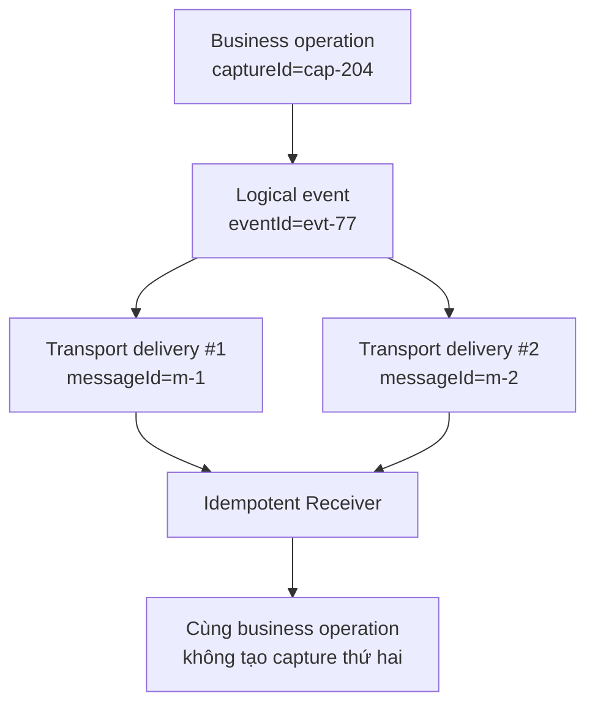
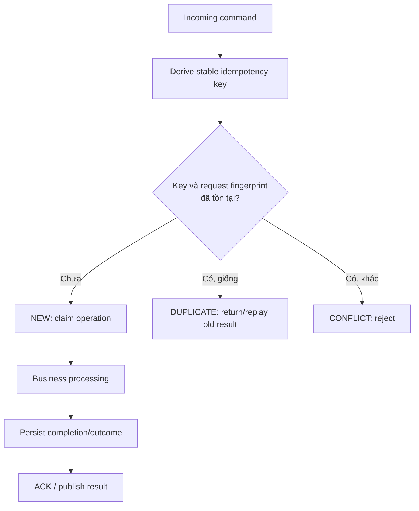
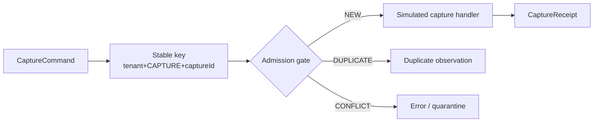
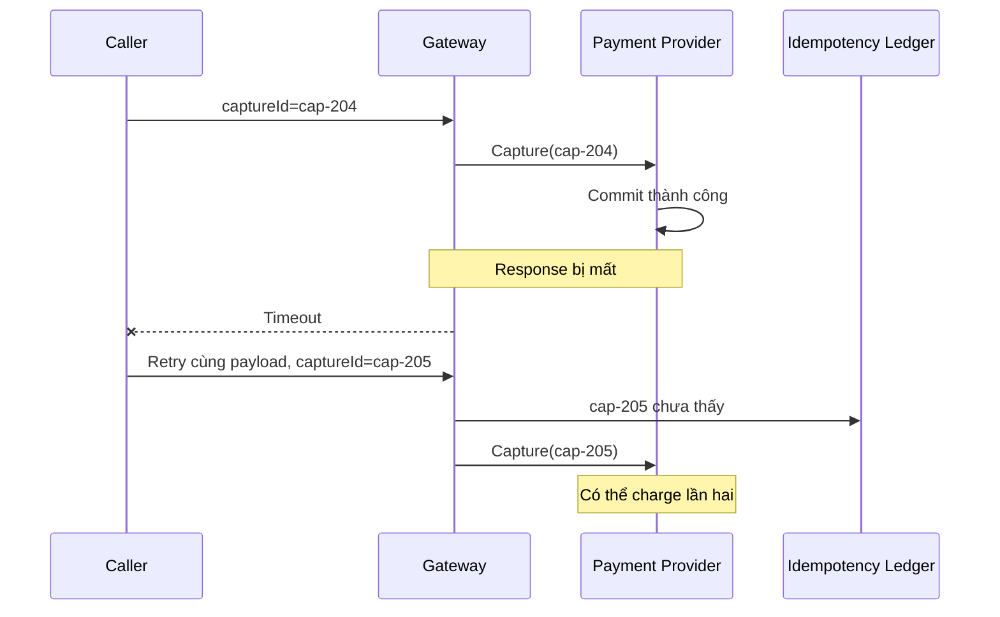
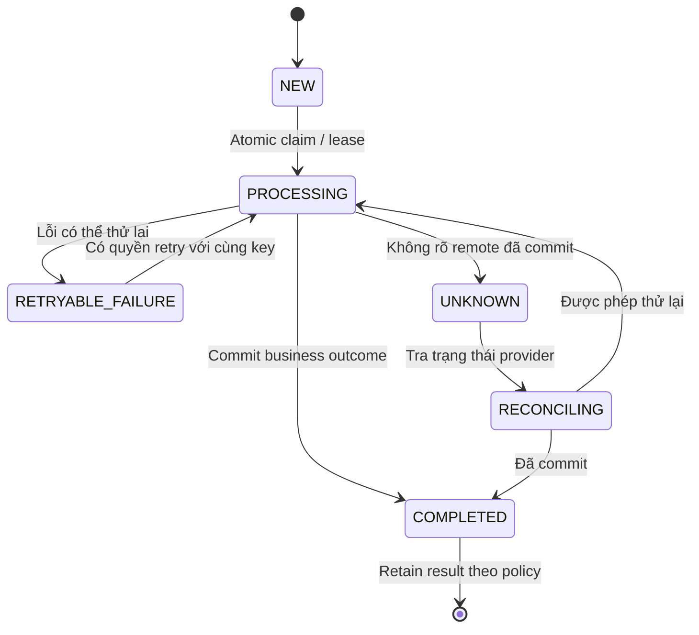
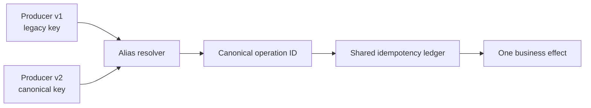
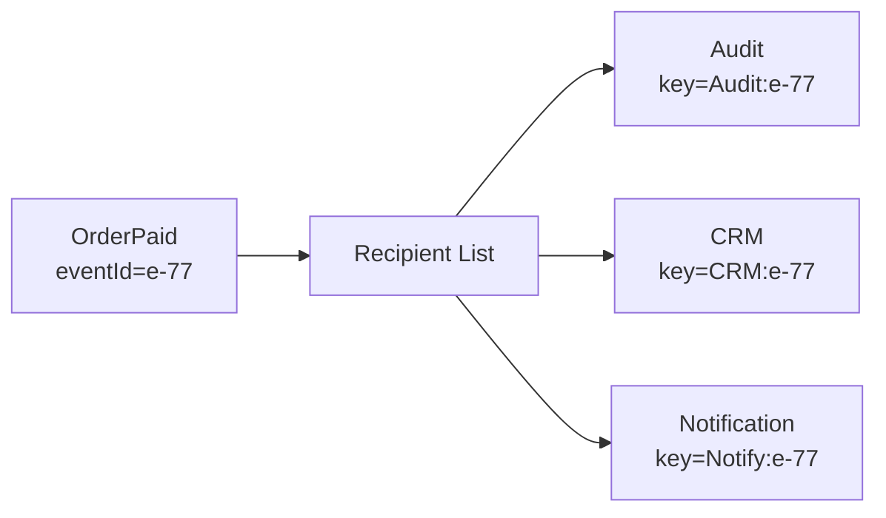
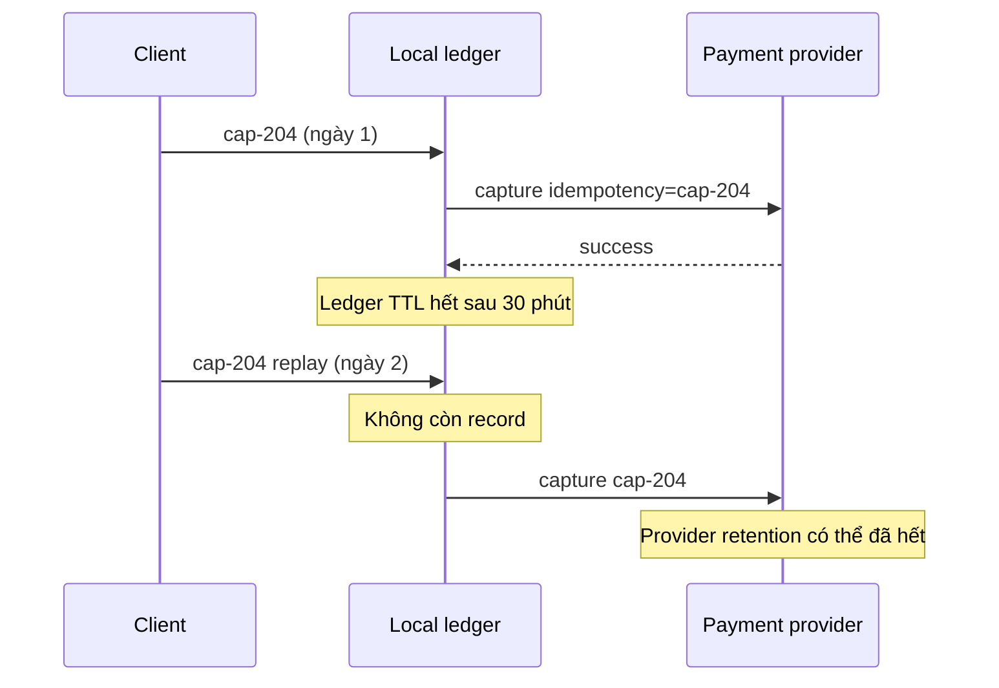

# Key khác nhau cho cùng payload

## 1. Bài toán: payload giống nhau nhưng Idempotent Receiver vẫn xử lý hai lần

Một hệ thống thanh toán nhận yêu cầu capture:

```json
{
  "tenantId": "tenant-A",
  "captureRequestId": "cap-204",
  "orderId": "O-204",
  "amount": 199500,
  "currency": "VND"
}
```

Message đầu tiên tới consumer với header:

```text
brokerDeliveryId = delivery-101
traceId          = trace-a
retryAttempt     = 1
```

Consumer gửi lệnh tới cổng thanh toán, cổng đã tạo capture thành công, nhưng ACK từ broker bị mất. Broker phát lại **cùng payload nghiệp vụ**, lần này với:

```text
brokerDeliveryId = delivery-205
traceId          = trace-b
retryAttempt     = 2
```

Nếu Idempotent Receiver dùng khóa:

```java
// Không ổn định giữa các lần giao cùng một business command.
message -> message.getHeaders().getId().toString()
```

hoặc:

```java
// Mỗi lần broker redeliver có thể nhận delivery ID mới.
message -> message.getHeaders().get("brokerDeliveryId").toString()
```

thì hai lần giao được xem là **hai thông điệp chưa từng xử lý**. Consumer có thể tạo **hai capture** dù payload hiển thị giống nhau.

Ngược lại, không thể đơn giản băm toàn bộ payload để bỏ những bản giống nhau: hai người dùng có thể đặt **hai lệnh thanh toán độc lập** cùng số tiền, cùng order và currency. Nếu hai lệnh có **business operation ID khác nhau**, chúng phải được xử lý riêng dù những trường dữ liệu còn lại trùng nhau.

Bài **“Key khác nhau cho cùng payload”** thuộc chương **Idempotent receiver**, module **SPRING_INTEGRATION_PATTERN**. Module tập trung thực hành Enterprise Integration Patterns với Spring Integration để xây dựng luồng message ít phụ thuộc, dễ mở rộng; phối hợp Router, Filter, Transformer, Splitter, Aggregator, Gateway, retry, error channel, correlation và kiểm thử/quan sát các nhánh xử lý.

Sau bài này, bạn có thể:

1. Phân biệt **same payload**, **same logical event**, **same business operation** và **same delivery attempt**.
2. Giải thích tại sao idempotency key dựa vào header kỹ thuật, timestamp hoặc UUID mới sinh khiến retry lọt qua.
3. Thiết kế key ổn định theo tenant, loại thao tác và ID nghiệp vụ do nguồn có thẩm quyền cấp.
4. Phân biệt duplicate hợp lệ với **conflict: cùng key nhưng nội dung nghiệp vụ khác**.
5. Viết ví dụ Spring Integration Java DSL và JUnit bảo vệ một capture khỏi được thực hiện hai lần.
6. Hiểu giới hạn của Map/MetadataStore và các crash window trước/sau side effect.
7. Thiết kế state machine, transaction, outbox và idempotency ở downstream phù hợp.
8. Xử lý migration định dạng key, replay, multi-instance, fan-out, TTL và các trường hợp không thể suy ra identity từ payload.

## 2. Tính bằng nhau của payload không phải danh tính nghiệp vụ

Có hai câu hỏi khác nhau:

**A. Hai message có cùng giá trị dữ liệu không?** Đây là so sánh biểu diễn nội dung.

**B. Hai message có đại diện cho cùng một thao tác nghiệp vụ cần áp dụng đúng một lần không?** Đây là **business identity** và hợp đồng idempotency.

Hai câu hỏi có thể cho kết quả khác nhau:

| Trường hợp | Payload trùng? | Business operation trùng? | Hành vi mong muốn |
| --- | --- | --- | --- |
| Broker redeliver cùng capture | Có | Có | Không capture lần hai |
| HTTP client retry, dùng nguyên `captureRequestId` | Có | Có | Trả kết quả cũ/đang xử lý |
| HTTP retry nhưng gateway sinh `captureRequestId` mới | Giá trị khác ở trường ID, nội dung kinh tế giống | **Có**, nếu vẫn là lần thử của cùng lệnh | Đầu tiên phải sửa contract tạo ID ổn định |
| Hai yêu cầu mua hàng độc lập cùng giá trị | Có thể giống hệt các field kinh tế | Không | Xử lý cả hai |
| Producer sửa metadata/tracing rồi phát lại | Byte JSON/header khác | Có | Không xử lý business side effect lần nữa |
| Cùng operation ID nhưng amount thay đổi | Khác | Đáng lẽ vẫn là cùng ID; có **conflict** | Reject/điều tra, không âm thầm coi là retry |
| Replay một event lịch sử | Có | Có | Không tạo side effect trùng; có thể tái dựng projection theo policy |
| Chạy lại có chủ đích bằng operation/revision mới | Có thể giống | Không, nếu business cho phép lần thực hiện mới | Xử lý một lần cho revision mới |

Không có thuật toán hash thuần túy nào có thể suy ra chắc chắn **ý định của người gọi** nếu contract không cấp một định danh ổn định. Đó là giới hạn nghiệp vụ, không phải lỗi riêng của Spring Integration.

### Ba lớp danh tính



- **Business operation ID:** một lệnh có ý nghĩa nghiệp vụ; quan trọng để chống side effect lặp.
- **Logical event ID:** một sự kiện được phát bởi producer; ổn định qua redelivery của **cùng event**.
- **Transport delivery/message ID:** định danh một lần giao hoặc một instance message kỹ thuật; có thể thay đổi giữa các lần thử.

Không phải hệ thống nào cũng có đủ ba lớp. Nếu API business tạo một event cho mỗi command, operation ID và event ID có thể có quan hệ một-một. Nhưng **đừng suy** rằng chúng luôn là một.

## 3. Idempotent Receiver trong EIP làm gì?

Theo Enterprise Integration Patterns, **Idempotent Receiver** cho phép receiver xử lý những message lặp mà **không tạo thêm tác động nghiệp vụ ngoài ý muốn**. Ý tưởng là nhận biết thao tác đã được áp dụng, bỏ qua hoặc trả lại outcome phù hợp khi message bị giao lại.



Trong Spring Integration, có thể áp dụng pattern bằng:

- **Idempotent Receiver advice/interceptor** quanh một endpoint, ví dụ `IdempotentReceiverInterceptor` kết hợp `MetadataStoreSelector`.
- **Filter/Service Activator** với một admission policy và store do ứng dụng quản lý.
- Một **transactional idempotency ledger** ở tầng business, khi thao tác có side effect và cần phục hồi đáng tin.
- Idempotency do **downstream API** hỗ trợ, ví dụ truyền cùng business idempotency key tới payment provider.

Điều cốt lõi là **key và thời điểm ghi trạng thái**; lựa chọn annotation, DSL hay interceptor không thể thay thế hợp đồng này.

### Idempotency không đồng nghĩa với deduplication kỹ thuật

“Bỏ message lặp” là một cách triển khai, nhưng nếu lần xử lý trước đã thất bại **trước khi commit**, bỏ message có thể khiến nghiệp vụ không bao giờ hoàn thành.

Một receiver đúng phải trả lời:

- Lần trước **đã hoàn tất**, **đang thực hiện**, hay chỉ **được claim**?
- Nội dung của lần thử hiện tại có giống nội dung đã chấp nhận không?
- Nếu đã hoàn tất, trả kết quả cũ hay chỉ ACK?
- Nếu đang thực hiện, chờ, trả `IN_PROGRESS` hay retry sau?
- Nếu owner crash, có lease/recovery để tiếp tục không?

Vì vậy **same key** mới chỉ là bước đầu; xử lý trạng thái mới quyết định tính đúng end-to-end.

## 4. Tại sao key bị thay dù payload giống nhau?

Các anti-pattern thường gặp:

### 4.1. Dùng Message ID của Spring

```java
String key = message.getHeaders().getId().toString();
```

Framework message có thể được tạo lại sau Transformer/adapter hoặc sau broker redelivery. Lặp lại payload không buộc Message ID giống cũ.

### 4.2. Dùng ID của từng lần giao

```java
String key = String.valueOf(
    message.getHeaders().get("brokerDeliveryId"));
```

Delivery ID/offset có semantics của transport. Một logical event có thể được chuyển qua nhiều topic, partition, connector hoặc được publish lại thành record mới với ID mới.

### 4.3. Sinh UUID tại receiver

```java
String key = UUID.randomUUID().toString(); // Mỗi lần một key.
```

Mọi retry đều trở thành “mới”, làm idempotency hoàn toàn mất tác dụng.

### 4.4. Đưa timestamp, attempt hoặc traceId vào key

```text
cap-204|attempt-1
cap-204|attempt-2
```

Hai key khác nhau nhưng cùng command. `attemptId` chỉ dùng để chẩn đoán, **không dùng để phân biệt business operation**.

### 4.5. Mỗi service tự chế key

```text
Producer: tenant-A/capture/cap-204
Gateway:  cap-204
Receiver: tenant-A/O-204/199500
```

Không có một identity contract chung, hệ thống có thể nhận cùng operation ở hai namespace khác nhau hoặc coi hai operation khác nhau là một.

### 4.6. Thay key khi nâng schema

```text
idempotency-v1|tenant-A|cap-204
idempotency-v2|tenant-A|cap-204
```

Nếu hai format trỏ đến **cùng logical operation**, việc đổi prefix một cách thiếu migration sẽ mở một “slot” mới và cho phép xử lý lại. Key version cần được quản lý như một migration dữ liệu, không chỉ là thay string.

### 4.7. Key hóa theo JSON chưa canonicalize

```json
{"amount":19.50,"currency":"USD"}
```

và:

```json
{"currency":"USD","amount":19.5}
```

có thể đại diện cùng giá trị nhưng bytes/field order khác nhau. Băm raw bytes cho hai key khác nhau. Ngược lại, nếu hash bỏ quá nhiều trường, hai lệnh hợp lệ khác nhau có thể bị gộp nhầm.

### 4.8. Chỉ dùng một business ID quá rộng

```text
orderId=O-204
```

Nếu cùng đơn có thể có `AUTHORIZE`, `CAPTURE`, `REFUND` hoặc hai lần partial capture, key chỉ bằng `orderId` sẽ làm **mất thao tác hợp lệ**. Phạm vi của key phải khớp **đơn vị tác động nghiệp vụ**.

## 5. Chọn đơn vị idempotency trước khi chọn công thức key

Trong thanh toán, có thể có:

| Thao tác | ID khuyến nghị | Vì sao |
| --- | --- | --- |
| Authorize | `authorizationRequestId` | Một đơn có thể cần authorize khác nhau |
| Capture | `captureRequestId` | Một authorization có thể capture từng phần |
| Refund | `refundRequestId` | Nhiều refund hợp lệ có thể cùng giá trị |
| Payment webhook | `providerEventId` để dedup ingestion, kèm payment state | Webhook có thể redeliver, nhưng không tự tạo payment mới |
| Ledger projection | `eventId + projectionName/version` | Một event có thể được tiêu thụ bởi nhiều projection |
| Notification | `eventId + recipientId + notificationType` | Một event có thể cần gửi tới nhiều recipient |

Một key nên gắn với **một hành động được phép xảy ra một lần**, không đơn thuần một thực thể có thể có nhiều hành động.

Ví dụ `O-204` có hai lần capture hợp lệ:

```text
captureRequestId=cap-204-A, amount=100.00
captureRequestId=cap-204-B, amount= 99.50
```

Key chỉ dùng `orderId` sẽ chặn nhầm capture B. Hai capture có amount bằng nhau vẫn có thể hợp lệ nếu business đã tạo hai `captureRequestId` khác nhau.

### Phân biệt correlation key và idempotency key

| Khóa | Công dụng | Ví dụ |
| --- | --- | --- |
| Correlation | Gom nhiều message vào một workflow/group | `tenant-A/O-204/settlement-r1` |
| Message/event dedup | Nhận diện event logic bị giao lại | `tenant-A/provider/evt-77` |
| Business operation idempotency | Không apply command nhiều lần | `tenant-A/CAPTURE/cap-204` |
| Per-recipient idempotency | Chống xử lý trùng ở từng đích fan-out | `tenant-A/evt-77/audit` |
| Output summary idempotency | Chặn ghi trùng kết quả Aggregator | `tenant-A/O-204/settlement-r1/v1` |

Cùng một chuỗi ID có thể được dùng trong nhiều hợp đồng nếu semantics khớp, nhưng **đừng mặc định** correlation và idempotency tương đương.

## 6. Công thức key ổn định và những yêu cầu của nó

Trong ví dụ thanh toán, dùng:

```text
key = (tenantId, operationType=CAPTURE, captureRequestId)
```

Trong đó:

- `tenantId` do lớp ingress đã xác thực cấp, không tin header tự khai.
- `CAPTURE` là namespace thao tác, tránh trùng với `REFUND`.
- `captureRequestId` được cấp **một lần khi command được tạo**, được giữ nguyên qua retry/replay.
- Không đưa `traceId`, `attemptNumber`, broker offset hoặc timestamp delivery vào key.
- Không thay `captureRequestId` nếu command chưa thành công và client chỉ đang thử lại.

Một key muốn dùng bền vững phải:

1. **Ổn định:** cùng logical operation luôn cùng key.
2. **Phân biệt:** hai operation thực sự độc lập có key khác nhau.
3. **Có scope:** bao gồm tenant, action, logical stream khi cần.
4. **Có nguồn đáng tin:** key không thể bị client dùng để truy cập tenant khác.
5. **Có encoding đơn trị:** không hai bộ trường khác nhau encode thành một chuỗi.
6. **Có tuổi thọ phù hợp:** ledger retention bao phủ retry/replay window.
7. **Có chính sách version/migration:** đổi thuật toán không làm xử lý lại operation cũ.
8. **Có kiểm tra conflict:** cùng key nhưng content đổi phải báo lỗi, không trả success giả.

**Nếu producer không có stable operation ID**, receiver không thể tự phân biệt chắc chắn retry với một lệnh mới có payload giống hệt. Khi đó phải **sửa protocol ở ingress** hoặc định nghĩa business uniqueness constraint, không “chữa” bằng một hash tùy tiện.

## 7. Ví dụ dữ liệu và luồng xử lý

Chúng ta sử dụng `CaptureCommand` với hai trường định danh và ba trường nội dung cốt lõi:

```java
import java.math.BigDecimal;

record CaptureCommand(
    String tenantId,
    String captureRequestId,
    String orderId,
    BigDecimal amount,
    String currencyCode) {}

record CaptureReceipt(
    String tenantId,
    String captureRequestId,
    String providerReference,
    String resultStatus) {}
```

**Giả định của ví dụ:**

- Chỉ xử lý `USD`, cho phép số tiền dương có nhiều nhất hai chữ số thập phân có nghĩa.
- `captureRequestId` được tạo bởi lớp ứng dụng/producer có thẩm quyền và giữ ổn định qua retry.
- Hai command cùng `captureRequestId` phải có cùng thông tin kinh tế sau chuẩn hóa, nếu không là conflict.
- `tenantId` được lấy từ ngữ cảnh xác thực và được đưa vào command nội bộ.
- Demo không gọi cổng thanh toán thật, không tạo side effect có giá trị tiền.
- `CaptureReceipt` chỉ là kết quả mô phỏng, không được xem là xác nhận thanh toán production.

Topology:



Việc tách duplicate ra một nhánh giúp nhìn thấy hành vi bằng JUnit mà không phải thực hiện một payment thật.

## 8. Java: tạo key không va chạm khi ID có delimiter

Không nên ghép `tenantId + ":" + captureRequestId` nếu hai trường có thể chứa dấu phân cách. Một cách đơn giản trong JVM là encode thành một chuỗi với length-prefix.

```java
import java.math.BigDecimal;
import java.math.RoundingMode;
import java.util.Locale;

final class CaptureIdentity {

    private CaptureIdentity() {}

    static String key(CaptureCommand command) {
        validate(command);

        return "capture-key-v1|"
            + part(command.tenantId())
            + part("CAPTURE")
            + part(command.captureRequestId());
    }

    static CaptureSignature signature(CaptureCommand command) {
        validate(command);

        return new CaptureSignature(
            command.orderId(),
            command.amount().setScale(
                2, RoundingMode.UNNECESSARY),
            command.currencyCode()
                .toUpperCase(Locale.ROOT));
    }

    static void validate(CaptureCommand command) {
        if (command == null
                || blank(command.tenantId())
                || blank(command.captureRequestId())
                || blank(command.orderId())
                || blank(command.currencyCode())
                || command.amount() == null
                || command.amount().signum() <= 0) {
            throw new IllegalArgumentException(
                "Invalid capture command");
        }

        if (!"USD".equals(
                command.currencyCode().toUpperCase(
                    Locale.ROOT))) {
            throw new IllegalArgumentException(
                "Unsupported currency");
        }

        try {
            command.amount().setScale(
                2, RoundingMode.UNNECESSARY);
        } catch (ArithmeticException ex) {
            throw new IllegalArgumentException(
                "Amount cannot be represented in exact cents",
                ex);
        }
    }

    private static String part(String value) {
        return value.length() + "#" + value;
    }

    private static boolean blank(String value) {
        return value == null || value.isBlank();
    }
}

record CaptureSignature(
    String orderId,
    BigDecimal amount,
    String currencyCode) {}
```

Ví dụ hai chuỗi key khác nhau dù component có chứa `#` hoặc `|`:

```text
("tenant-A", CAPTURE, "cap-204")
("tenant-A", CAPTURE, "cap|204")
```

Length prefix thể hiện ranh giới các component. Tuy nhiên **encoding Java `String.length()` đếm UTF-16 code units**, không phải UTF-8 bytes. Nếu nhiều ngôn ngữ cùng tạo key, phải chuẩn hóa giao thức encoding và có golden test vectors; không sao chép thuật toán độ dài mà không xác minh.

### Không tự chuẩn hóa business ID tùy tiện

Trong code, `tenantId`, `captureRequestId` và `orderId` được coi là **đã canonicalize tại trusted ingress**. Nếu miền dữ liệu coi `CAP-1` và `cap-1` là cùng ID, quy tắc case folding phải được định nghĩa tại nguồn. Nếu ID phân biệt hoa/thường, tự lowercase ở receiver sẽ gộp nhầm hai operation.

Tương tự, Unicode normalization, leading zeros, dấu cách hay UUID dạng text phải có hợp đồng trước khi tạo key. **Canonicalize không có nghĩa là xóa thông tin nghiệp vụ.**

## 9. Fingerprint giúp phát hiện conflict, không thay thế identity

Cùng key nhưng hai bản mang amount khác nhau:

```text
key=tenant-A/CAPTURE/cap-204
attempt 1: order O-204, USD 19.95
attempt 2: order O-204, USD 29.95
```

Không nên làm:

```java
if (seenKeys.contains(key)) {
    return previousSuccess;  // Che mất content conflict.
}
```

Thay vào đó lưu kèm **canonical signature/fingerprint** của nội dung ảnh hưởng kết quả. Khi gặp cùng key:

- Signature giống → duplicate hợp lệ của cùng request.
- Signature khác → **IDEMPOTENCY_KEY_CONFLICT**.
- Không tìm thấy key → command mới, nếu đúng quyền và hợp đồng.
- Có key đang xử lý → xem state/lease, không đánh dấu đã thành công trước khi commit.

```text
Key  = (tenantId, CAPTURE, captureRequestId)
Data = (orderId, amount chính xác, currencyCode)

Business identity khác fingerprint nội dung:
  - Key nói "đây là thao tác nào?"
  - Fingerprint nói "thao tác đó có bị đổi nội dung không?"
```

**Vì sao dùng `BigDecimal`?** `new BigDecimal("19.5")` và `new BigDecimal("19.50")` có thể không bằng nhau theo `equals` vì scale khác nhau. Quy tắc `setScale(2, UNNECESSARY)` cho cùng signature mà không làm tròn, còn `19.999` bị reject.

**Không coi việc hash toàn payload là đủ.** Fingerprint phải dựa trên các **trường có ý nghĩa nghiệp vụ**; không bao gồm delivery timestamp, retry count hoặc trace ID. Nếu cùng key nhưng amount thay đổi, đó là conflict dù producer cố giữ ID.

## 10. Java: gate in-memory minh họa duplicate và conflict

Gate dưới đây dùng `ConcurrentHashMap.putIfAbsent` để một JVM ghi nhận key đầu tiên một cách nguyên tử. Nó chỉ phục vụ **minh họa cơ chế lựa chọn key**, không bảo đảm giao dịch kinh doanh.

```java
import java.util.concurrent.ConcurrentHashMap;
import java.util.concurrent.ConcurrentMap;

enum Admission {
    NEW,
    DUPLICATE
}

final class InMemoryCaptureGate {

    private final ConcurrentMap<String, CaptureSignature> seen =
        new ConcurrentHashMap<>();

    Admission register(CaptureCommand command) {
        String key = CaptureIdentity.key(command);
        CaptureSignature candidate =
            CaptureIdentity.signature(command);

        CaptureSignature previous =
            seen.putIfAbsent(key, candidate);

        if (previous == null) {
            return Admission.NEW;
        }

        if (previous.equals(candidate)) {
            return Admission.DUPLICATE;
        }

        throw new IllegalStateException(
            "IDEMPOTENCY_KEY_CONFLICT: " + key);
    }
}
```

Ví dụ:

```text
1. cap-204 / USD 19.95 → NEW
2. cap-204 / USD 19.95 → DUPLICATE
3. cap-204 / USD 29.95 → CONFLICT
4. cap-205 / USD 19.95 → NEW (lệnh hợp lệ khác)
```

### Những gì Map làm được

- Chặn các lần gửi trùng trong **một JVM đang sống**.
- Phân biệt same-key/same-signature với same-key/different-signature.
- Không lấy `MessageHeaders.ID` hoặc ID delivery làm khóa.
- `putIfAbsent` ngăn hai thread cùng chấp nhận một key mới trong Map đó.

### Những gì Map không làm được

- Không bền vững qua restart.
- Không chia sẻ giữa hai pod.
- Không đồng bộ transaction với một payment API, database hay broker.
- Không biết operation mới chỉ **được claim**, chưa thực thi xong.
- Có thể chặn một retry hợp lệ nếu handler lỗi sau khi Map đã ghi key.
- Không có TTL/cleanup, có thể tăng bộ nhớ không giới hạn.
- Không trả được result trước đó theo business contract.
- Không bảo đảm exactly-once end-to-end.

**Lưu ý đặc biệt:** Map ví dụ **cố ý đánh dấu key trước khi handler chạy**. Đây là điểm dễ làm mất công việc khi handler thất bại; phần transaction và recovery ở các mục sau giải thích cách sửa cho production.

## 11. Spring Integration Java DSL: Filter trước handler

Ví dụ Spring Integration dùng hai channel:

- `capture.commands.in` nhận command.
- `capture.receipts.out` nhận kết quả của command mới.
- `capture.duplicates.out` giúp quan sát message bị lọc là duplicate.

Một handler mô phỏng đếm số lần thực thi:

```java
import java.util.concurrent.atomic.AtomicInteger;

final class SimulatedCaptureHandler {

    private final AtomicInteger executions =
        new AtomicInteger();

    CaptureReceipt capture(CaptureCommand command) {
        executions.incrementAndGet();

        return new CaptureReceipt(
            command.tenantId(),
            command.captureRequestId(),
            "demo-" + command.captureRequestId(),
            "SIMULATED_SUCCESS");
    }

    int executions() {
        return executions.get();
    }
}
```

Cấu hình flow:

```java
import org.springframework.context.annotation.Bean;
import org.springframework.context.annotation.Configuration;
import org.springframework.integration.channel.DirectChannel;
import org.springframework.integration.channel.QueueChannel;
import org.springframework.integration.config.EnableIntegration;
import org.springframework.integration.dsl.IntegrationFlow;

@Configuration
@EnableIntegration
public class CaptureIdempotencyDemoConfig {

    @Bean
    InMemoryCaptureGate captureGate() {
        return new InMemoryCaptureGate();
    }

    @Bean
    SimulatedCaptureHandler captureHandler() {
        return new SimulatedCaptureHandler();
    }

    @Bean("capture.commands.in")
    DirectChannel captureCommands() {
        return new DirectChannel();
    }

    @Bean("capture.receipts.out")
    QueueChannel captureReceipts() {
        return new QueueChannel();
    }

    @Bean("capture.duplicates.out")
    QueueChannel duplicateCaptures() {
        return new QueueChannel();
    }

    @Bean
    IntegrationFlow captureFlow(
            InMemoryCaptureGate gate,
            SimulatedCaptureHandler handler) {

        return IntegrationFlow.from("capture.commands.in")
            .filter(CaptureCommand.class,
                command ->
                    gate.register(command) == Admission.NEW,
                spec -> spec.discardChannel(
                    "capture.duplicates.out"))
            .handle(CaptureCommand.class,
                (command, headers) ->
                    handler.capture(command))
            .channel("capture.receipts.out")
            .get();
    }
}
```

Flow này là **ví dụ Filter + Service Activator** thực hành Idempotent Receiver, không phải production payment pipeline. Các command được lọc vì duplicate sẽ tới discard channel; **không tự gửi lại receipt trước đó**. Nếu caller dùng Gateway request–reply, chỉ discard có thể làm Gateway chờ rồi timeout. Cần thiết kế explicit duplicate response hoặc tra outcome đã lưu trong ledger khi hợp đồng là “retry trả lại kết quả ban đầu”.

### Vì sao dùng DirectChannel?

Demo cần test đồng bộ và ít phụ thuộc. Với `DirectChannel`, lỗi từ gate hoặc handler có thể lan về sender (Spring có thể bọc exception). Nếu dùng `ExecutorChannel`, `QueueChannel` có poller hoặc broker listener, lỗi chạy ở thread khác và cần error flow/ACK policy phù hợp.

### Có nên dùng PublishSubscribeChannel để fan-out?

Không cần cho demo một consumer. Nếu fan-out thật đến Audit, CRM và Notification, **mỗi recipient có đơn vị idempotency riêng**. Không nên dùng một marker toàn cục để chặn recipient còn lại chỉ vì recipient đầu tiên đã xử lý.

## 12. JUnit 5: cùng payload, delivery ID khác vẫn không xử lý lại

Các test dưới đây chạy trong Spring Test context và chỉ kiểm tra **flow mô phỏng trong một JVM**.

```java
import static org.assertj.core.api.Assertions.assertThat;
import static org.assertj.core.api.Assertions.assertThatThrownBy;

import java.math.BigDecimal;

import org.junit.jupiter.api.Test;
import org.springframework.beans.factory.annotation.Autowired;
import org.springframework.beans.factory.annotation.Qualifier;
import org.springframework.integration.channel.QueueChannel;
import org.springframework.messaging.Message;
import org.springframework.messaging.MessageChannel;
import org.springframework.messaging.support.MessageBuilder;
import org.springframework.test.context.junit.jupiter.SpringJUnitConfig;

@SpringJUnitConfig(CaptureIdempotencyDemoConfig.class)
class CaptureIdempotencyFlowTest {

    @Autowired
    @Qualifier("capture.commands.in")
    MessageChannel input;

    @Autowired
    @Qualifier("capture.receipts.out")
    QueueChannel receipts;

    @Autowired
    @Qualifier("capture.duplicates.out")
    QueueChannel duplicates;

    @Autowired
    SimulatedCaptureHandler handler;

    private CaptureCommand command(
            String tenant, String id, String amount) {
        return new CaptureCommand(
            tenant, id, "O-204",
            new BigDecimal(amount), "USD");
    }

    private void send(CaptureCommand command, String deliveryId) {
        Message<CaptureCommand> message = MessageBuilder
            .withPayload(command)
            .setHeader("brokerDeliveryId", deliveryId)
            .setHeader("traceId", "trace-" + deliveryId)
            .build();

        assertThat(input.send(message)).isTrue();
    }

    @Test
    void repeatedLogicalCommandWithDifferentDeliveryIdsIsDeduped() {
        int before = handler.executions();
        CaptureCommand c =
            command("tenant-A", "cap-repeated", "19.95");

        send(c, "delivery-1");
        send(c, "delivery-2");

        Message<?> receipt = receipts.receive(1_000);
        assertThat(receipt).isNotNull();
        assertThat(receipt.getPayload())
            .isInstanceOf(CaptureReceipt.class);

        Message<?> duplicate = duplicates.receive(1_000);
        assertThat(duplicate).isNotNull();
        assertThat(duplicate.getPayload()).isEqualTo(c);

        assertThat(receipts.receive(0)).isNull();
        assertThat(handler.executions() - before).isEqualTo(1);
    }

    @Test
    void differentBusinessIdsWithSameEconomicFieldsAreIndependent() {
        int before = handler.executions();

        send(command("tenant-A", "cap-new-1", "19.95"),
            "delivery-3");
        send(command("tenant-A", "cap-new-2", "19.95"),
            "delivery-4");

        CaptureReceipt first =
            (CaptureReceipt) receipts.receive(1_000)
                .getPayload();
        CaptureReceipt second =
            (CaptureReceipt) receipts.receive(1_000)
                .getPayload();

        assertThat(first.captureRequestId())
            .isEqualTo("cap-new-1");
        assertThat(second.captureRequestId())
            .isEqualTo("cap-new-2");
        assertThat(handler.executions() - before).isEqualTo(2);
        assertThat(duplicates.receive(0)).isNull();
    }

    @Test
    void sameKeyWithDifferentAmountIsConflict() {
        send(command("tenant-A", "cap-conflict", "19.95"),
            "delivery-5");
        assertThat(receipts.receive(1_000)).isNotNull();

        assertThatThrownBy(() ->
            send(command("tenant-A", "cap-conflict", "29.95"),
                "delivery-6"))
            .isInstanceOf(RuntimeException.class);

        assertThat(receipts.receive(0)).isNull();
    }

    @Test
    void tenantNamespacePreventsCrossTenantCollapse() {
        int before = handler.executions();

        send(command("tenant-A", "cap-same-id", "19.95"),
            "delivery-7");
        send(command("tenant-B", "cap-same-id", "19.95"),
            "delivery-8");

        assertThat(receipts.receive(1_000)).isNotNull();
        assertThat(receipts.receive(1_000)).isNotNull();
        assertThat(handler.executions() - before).isEqualTo(2);
    }
}
```

**Lưu ý về fixture:** các test dùng ID khác nhau để tránh một `InMemoryCaptureGate` singleton ghi state giữa các test. Chúng cần chạy không song song hoặc có fixture isolation; queue phải được tiêu thụ hết theo từng test. Test production không nên dựa vào thứ tự thực thi của JUnit.

### Test nào còn thiếu?

Mặc dù test chứng minh stable key hoạt động, nó **chưa chứng minh** rằng một payment không bị ghi hai lần khi:

- Consumer crash sau khi provider chấp nhận capture.
- Hai pod có Map riêng.
- Broker redeliver sau khi TTL marker hết.
- Một command chờ trong trạng thái PROCESSING.
- Có conflicting duplicate tới sau khi outcome đã được commit.
- Gateway timeout rồi client phát lại nhưng đổi operation ID.
- Kho idempotency unavailable.
- API thanh toán từ xa không hỗ trợ idempotency.

Những trường hợp này cần integration/failure tests và contract với provider thực.

## 13. Unit test key và fingerprint

Không cần dựng Spring context để kiểm tra luật định danh.

```java
import static org.assertj.core.api.Assertions.assertThat;
import static org.assertj.core.api.Assertions.assertThatThrownBy;

import java.math.BigDecimal;

import org.junit.jupiter.api.Test;

class CaptureIdentityTest {

    private CaptureCommand command(
            String tenant, String id, String amount) {
        return new CaptureCommand(
            tenant, id, "O-204",
            new BigDecimal(amount), "USD");
    }

    @Test
    void deliveryHeadersNeverAffectStableBusinessKey() {
        CaptureCommand c =
            command("tenant-A", "cap-204", "19.95");

        assertThat(CaptureIdentity.key(c))
            .isEqualTo(CaptureIdentity.key(c));
        // Header kỹ thuật không tham gia hàm key().
    }

    @Test
    void twoTenantsAndTwoCaptureIdsHaveDifferentKeys() {
        String base = CaptureIdentity.key(
            command("tenant-A", "cap-204", "19.95"));

        assertThat(base)
            .isNotEqualTo(CaptureIdentity.key(
                command("tenant-B", "cap-204", "19.95")))
            .isNotEqualTo(CaptureIdentity.key(
                command("tenant-A", "cap-205", "19.95")));
    }

    @Test
    void equivalentDecimalRepresentationsShareSignature() {
        CaptureSignature a = CaptureIdentity.signature(
            command("tenant-A", "cap-204", "19.5"));
        CaptureSignature b = CaptureIdentity.signature(
            command("tenant-A", "cap-204", "19.50"));

        assertThat(a).isEqualTo(b);
    }

    @Test
    void anActualAmountChangeIsAConflict() {
        InMemoryCaptureGate gate = new InMemoryCaptureGate();

        assertThat(gate.register(command(
            "tenant-A", "cap-204", "19.95")))
            .isEqualTo(Admission.NEW);

        assertThatThrownBy(() ->
            gate.register(command(
                "tenant-A", "cap-204", "29.95")))
            .isInstanceOf(IllegalStateException.class)
            .hasMessageContaining("IDEMPOTENCY_KEY_CONFLICT");
    }

    @Test
    void amountThatRequiresRoundingIsRejected() {
        assertThatThrownBy(() ->
            CaptureIdentity.key(
                command("tenant-A", "cap-204", "19.999")))
            .isInstanceOf(IllegalArgumentException.class);
    }
}
```

Một cải tiến trong project thật là test **bộ vector cố định** của key encoding, canonical decimal, currency, Unicode và schema version. Điều đó cần thiết khi nhiều service/ngôn ngữ có nhiệm vụ tạo cùng key.

## 14. Spring Integration IdempotentReceiverInterceptor và MetadataStoreSelector

Spring Integration có các thành phần được thiết kế riêng cho Idempotent Receiver:

- `IdempotentReceiverInterceptor`: advice gắn với message handler endpoint để thực hiện logic nhận diện duplicate.
- `MetadataStoreSelector`: dùng một chiến lược chọn key/value và `MetadataStore` để kiểm tra/gắn metadata nhận diện message.
- `MetadataStore`: có các implementation local/shared/durable khác nhau tùy dependency và cấu hình.
- Header hoặc discard behavior khi duplicate: phụ thuộc cấu hình interceptor và phiên bản; cần xác định rõ message trùng được **gắn cờ, bỏ qua, gửi discard channel hay ném lỗi**.

Ý tưởng cấu hình key selector:

```java
// Sơ đồ cấu hình: dùng đúng overload/import/endpoint advice
// của phiên bản Spring Integration mà dự án phụ thuộc.
MetadataStoreSelector selector = new MetadataStoreSelector(
    message -> CaptureIdentity.key(
        (CaptureCommand) message.getPayload()),
    metadataStore);

IdempotentReceiverInterceptor interceptor =
    new IdempotentReceiverInterceptor(selector);
```

Hai dòng trên minh họa cách gắn **business key function** vào một selector/receiver advice; khi đưa vào Spring bean cần cấu hình MetadataStore, endpoint advice và đường xử lý duplicate theo API/phiên bản thực tế.

**Quan trọng:** `IdempotentReceiverInterceptor` là một interceptor/advice, không phải một cơ chế commit remote payment nguyên tử. Khi marker metadata được ghi trước side effect, những crash window tương tự Map demo vẫn có thể xảy ra. Cần kiểm tra semantics của selector/metadata store trước khi chọn hành vi reject/discard.

### Vì sao không nên coi marker là business success?

Giả sử:

```text
1. Receiver thêm key=cap-204 vào MetadataStore.
2. Payment provider timeout hoặc service crash.
3. Broker redeliver cap-204.
4. Selector thấy key tồn tại → coi message đã nhận.
5. Nếu discard luôn → không ai thực hiện capture tiếp.
```

Lúc này **“đã thấy key”** khác **“capture đã hoàn tất”**. Một policy production cần trạng thái PROCESSING/COMPLETED, lease, result persistence hoặc remote idempotency; chỉ một marker boolean không đủ.

## 15. Tại sao lỗi nguy hiểm nhất là đổi key ngay sau timeout?



Khi không biết provider đã commit chưa, tạo key mới nghĩa là **yêu cầu một thao tác mới** đối với phần lớn API có idempotency key.

Cách xử lý đúng hơn:

1. Retry **cùng business operation ID** sau timeout.
2. Nếu provider hỗ trợ idempotency key, truyền **cùng key** tới provider.
3. Nếu provider có API tra trạng thái, reconcile theo merchant operation reference.
4. Nếu outcome cũ đã được commit, trả lại kết quả đó cho caller.
5. Nếu chưa có outcome và có bằng chứng chưa xử lý, tiếp tục theo workflow/recovery.
6. Nếu không thể biết trạng thái, chuyển `UNKNOWN_REQUIRES_RECONCILIATION`, không tự tạo capture mới.

Một retry với key cũ **không bao giờ bảo đảm provider tự idempotent**; phải dựa vào hợp đồng API và retention của provider.

### Khi nào được tạo key mới?

Khi **người gọi chủ động tạo một operation mới** và business cho phép, ví dụ một partial capture thứ hai, hoặc một revision/replacement workflow sau khi quyết định hủy kết quả cũ. Phải có audit và trạng thái liên kết giữa operation cũ và mới.

Đừng gán UUID mới chỉ vì `attemptNumber++`.

## 16. State machine: key đã thấy, đang xử lý, đã hoàn tất

Một idempotency ledger production có thể dùng:



Đây là **state machine ứng dụng đề xuất**. Các enum/status này không mặc nhiên do `MetadataStoreSelector` cung cấp.

Bảng phản hồi cho một lần nhận message:

| Trạng thái key hiện tại | Signature | Phản ứng |
| --- | --- | --- |
| Không có record | Hợp lệ | Atomic insert/claim `PROCESSING` |
| `PROCESSING` với lease còn hiệu lực | Giống | Trả `IN_PROGRESS`, chờ hoặc retry sau |
| `PROCESSING` đã quá lease | Giống | Recovery/fencing, không tự assume chưa commit |
| `COMPLETED` | Giống | Trả persisted outcome hoặc ACK duplicate |
| `COMPLETED` | Khác | `IDEMPOTENCY_KEY_CONFLICT` |
| `RETRYABLE_FAILURE` | Giống | Retry cùng key theo budget |
| `UNKNOWN` | Giống | Reconcile trước khi thực hiện lại |
| Mọi trạng thái | Khác | Reject conflict, ghi audit |
| Store unavailable | Không biết | Fail/retry bounded; **không** tạo operation mới “cho chắc” |

Điểm khó là bước chuyển `PROCESSING → COMPLETED` phải tương thích với side effect. Nếu payment provider là một hệ thống độc lập, database transaction ở receiver không thể bao trùm HTTP request; cần provider idempotency + reconciliation.

## 17. Transactional ledger: một key chưa đủ

Một bảng logic:

```sql
CREATE TABLE capture_idempotency (
    scope_key           VARCHAR(512) PRIMARY KEY,
    request_fingerprint VARCHAR(128) NOT NULL,
    state               VARCHAR(40) NOT NULL,
    owner_token         VARCHAR(128),
    lease_until         TIMESTAMP,
    provider_reference  VARCHAR(200),
    result_json         TEXT,
    created_at          TIMESTAMP NOT NULL,
    updated_at          TIMESTAMP NOT NULL
);
```

Đây là **schema gợi ý**, cần điều chỉnh theo DB, timezone, encryption và retention. Quy trình:

1. Validate/authorize tenant và operation.
2. Tính stable key và canonical fingerprint.
3. Atomic insert key/state nếu chưa tồn tại (unique constraint).
4. Nếu key có, so fingerprint trước khi hành động.
5. Với owner hợp lệ, thực hiện nghiệp vụ hoặc gọi provider bằng **cùng idempotency key**.
6. Lưu outcome/remote reference và đánh dấu `COMPLETED` theo hợp đồng.
7. Publish result/ACK với cơ chế phục hồi nếu process crash.
8. Duplicate đến sau có thể tra outcome đã lưu, không thực hiện side effect thêm lần nữa.

### Tại sao check-then-insert không an toàn?

```text
Thread A: SELECT key → not found
Thread B: SELECT key → not found
Thread A: gọi payment API
Thread B: gọi payment API
Thread A: INSERT key
Thread B: INSERT key bị lỗi unique
```

Đến lúc database phát hiện unique conflict thì **hai lời gọi bên ngoài đã được gửi**.

Đúng hơn là **claim key bằng thao tác nguyên tử trước khi side effect**, và có lease/fencing/recovery cho owner chết. Atomic claim trong DB cũng không bảo đảm remote operation đúng một lần nếu không có idempotency ở API phía xa.

### Fencing token

Khi một lease `PROCESSING` hết hạn, worker mới có thể claim lại. Worker cũ có thể sống lại và tiếp tục xử lý. Một số hệ thống dùng **fencing token tăng dần** để downstream hoặc database từ chối owner cũ. Fencing chỉ hiệu quả nếu tài nguyên chịu side effect **thực sự kiểm tra token**, không phải một số được sinh rồi chỉ ghi log.

## 18. Crash windows và yêu cầu phục hồi

Ba khoảng lỗi phổ biến:

**A. Marker trước processing**

```text
WRITE seen(key) thành công
CRASH
Business side effect chưa chạy
Retry → bị discard nếu chỉ dựa vào marker
```

Hậu quả: công việc bị mất.

**B. Side effect trước marker hoàn tất**

```text
Payment provider commit thành công
CRASH trước khi lưu COMPLETED
Retry → receiver không biết outcome
```

Hậu quả: có nguy cơ tạo side effect trùng nếu provider không idempotent.

**C. Kết quả đã lưu, nhưng response/ACK mất**

```text
Lưu COMPLETED + result thành công
ACK/HTTP reply bị mất
Caller/broker retry
```

Hành vi đúng: **trả result cũ hoặc ACK hợp lệ**, không gửi lệnh payment mới.

Một hệ thống cần xử lý cả ba trường hợp; chỉ test `duplicate → discard` chưa đủ.

### Transactional outbox giúp ở ranh giới nào?

Nếu ledger và outbox dùng cùng database, có thể lưu transition + event phát đi trong một transaction. Publisher retry gửi event khi broker lỗi.

Tuy nhiên transactional outbox **không biến external HTTP payment API thành một phần của database transaction** và không đảm bảo consumer chỉ nhận event một lần. Cần kết hợp idempotency ở provider/consumer và lưu outcome.

## 19. Multi-instance: một Map trên mỗi pod không phải dedup toàn hệ thống

Ví dụ:

```text
Pod A nhận cap-204 → seen A = {cap-204}
Pod B nhận cap-204 → seen B = {}
Pod B gọi provider lần nữa
```

Một Map local chỉ có tính nguyên tử trong một process. Để xử lý đúng khi scale ngang:

- Dùng database với unique constraint và state transition có transaction.
- Hoặc shared metadata store có atomic put/compare-and-set theo key.
- Cấu hình broker partition/ordering để các event cùng operation tới một consumer khi thích hợp.
- Vẫn có recovery khi partition được reassign và owner crash.
- Đảm bảo TTL/cleanup giống nhau trên các instance.
- Có idempotency ở downstream nếu side effect có nguy cơ phát lại.

**Co-locate message theo partition không thay thế business idempotency.** Rebalance, retry, DLQ replay và multiple producers vẫn có thể gửi lại cùng logical command.

### Redis có đủ không?

Redis atomic operations có thể hỗ trợ admission, nhưng:

- Redis marker có thể được ghi trước khi business commit.
- Redis và payment/database không mặc nhiên cùng transaction.
- TTL có thể hết trước khi retry hoặc DLQ replay.
- Eviction/failover có thể ảnh hưởng marker.
- Lease/fencing/recovery vẫn phải thiết kế.

Redis phù hợp khi chính sách độ bền và thất bại của nó đáp ứng yêu cầu, không phải chỉ vì latency thấp.

## 20. Khi payload giống nhau nhưng business operation khác: tránh chặn nhầm

Đây là mặt còn lại của vấn đề.

Hai command:

```json
{
  "tenantId": "tenant-A",
  "captureRequestId": "cap-301",
  "orderId": "O-204",
  "amount": 19.95,
  "currencyCode": "USD"
}
```

và:

```json
{
  "tenantId": "tenant-A",
  "captureRequestId": "cap-302",
  "orderId": "O-204",
  "amount": 19.95,
  "currencyCode": "USD"
}
```

Chúng có cùng số tiền, order và currency, nhưng là **hai capture request ID khác nhau**. Có thể là hai lần partial capture đã được cho phép. Nếu key chỉ là hash của `orderId + amount + currency`, receiver sẽ chặn nhầm lệnh thứ hai.

**Không suy rằng mọi capture request ID khác nhau đều hợp lệ.** Business domain vẫn cần validation về số tiền còn được capture, authorization, trạng thái đơn, maximum amount và chống gian lận. Idempotency chỉ đảm bảo **không xử lý lặp cùng operation**, không thay thế toàn bộ business constraint.

### Vì sao “hash toàn payload” vẫn có thể sai ở cả hai phía?

- **False negative:** cùng operation nhưng JSON field order/trace timestamp khác → hash khác, duplicate lọt.
- **False positive:** hai operation độc lập có payload kinh tế giống nhau → hash giống, lệnh hợp lệ bị chặn.
- **Semantic conflict:** cùng operation ID, amount khác → hash khác; nếu hash là key, cả hai được coi như hai operation mới thay vì báo conflict.

Thiết kế đúng: **identity key độc lập với request fingerprint**, rồi so fingerprint khi cùng key.

## 21. Migration key giữa phiên bản và alias mapping

Giả sử producer cũ dùng:

```text
legacy-key = "CAPTURE/O-204/204-1"
```

Producer mới dùng:

```text
canonical-key = "tenant-A/CAPTURE/cap-204"
```

Nếu cả hai đại diện cho cùng capture, chúng phải **quy về một operation record**. Đừng chỉ ghi song song hai row và hy vọng consumer biết chúng giống nhau.

Một chiến lược:

1. Xác định **canonical operation identity** trong database nguồn có thẩm quyền.
2. Lưu mapping `(producerNamespace, legacyEventId) → canonicalOperationId`.
3. Khi nhận event từ producer cũ, resolve alias trước khi làm dedup.
4. Dùng unique constraint ngăn hai alias trỏ tới hai operation khác nhau trái hợp đồng.
5. Với message đang chờ hoặc DLQ replay, giữ backward-compatible resolver đủ lâu.
6. Tách việc đổi key format khỏi thay đổi nghiệp vụ/revision.
7. Ghi metric số lần phải dùng legacy resolver và lên kế hoạch ngừng hỗ trợ.



**Không tự dùng amount/order để map hai key** nếu không có bằng chứng chúng là cùng operation. Với dữ liệu tài chính, một heuristic như vậy có thể gộp nhầm hai lệnh hợp lệ.

### Version trong key có luôn cần không?

Không phải lúc nào cũng cần. Nếu `captureRequestId` được cấp trong một namespace có phạm vi rõ và bất biến, đơn vị business key ổn định qua schema upgrades thường tốt hơn. Prefix version chỉ cần khi **encoding contract** thật sự thay đổi; nhưng đổi prefix phải đi cùng migration để không reset dedup.

## 22. Fan-out: một event, nhiều receiver hợp lệ

Một event `OrderPaid(eventId=e-77)` được Recipient List gửi tới:

- Audit service.
- CRM service.
- Notification service.

Cả ba đều phải xử lý, dù payload và event ID giống nhau:



Nếu ba service dùng chung một metadata store với key chỉ là `e-77`, service Audit có thể ghi marker trước, khiến CRM/Notification coi event đã xử lý và bỏ qua. Đây là **false positive của idempotency scope**.

Key nên bao gồm **receiver operation/recipient namespace**, chẳng hạn:

```text
(tenantId, eventId, recipientId, handlerOperation)
```

Nếu một recipient cần gửi email cho hai địa chỉ, key có thể cần `recipientAddressId` hoặc `notificationIntentId`. Nhưng tránh dùng một key mới mỗi lần retry email.

### Fan-out và shared mutable payload

Nếu các recipient dùng chung object Java mutable rồi ghi thêm trường/đổi metadata, fingerprint ở receiver có thể khác nhau. Nên dùng immutable event DTO, copy/transform theo hợp đồng và fingerprint từ **semantic fields ổn định**. Không lấy mutable `toString()` của object làm canonical key.

## 23. Kết hợp Router, Splitter, Aggregator, Gateway và error channel

| EIP | Hợp đồng idempotency liên quan | Sai lầm cần tránh |
| --- | --- | --- |
| **Router** | Một event có thể đi nhánh khác tùy policy/version | Ghi marker trước khi xác định đúng consumer/operation |
| **Filter** | Duplicate gate có thể đưa message sang discard flow | Coi discard là business success dù processing chưa commit |
| **Transformer** | Thay biểu diễn dữ liệu nhưng giữ business event ID | Hash raw payload trước/sau transform thành key khác |
| **Recipient List** | Mỗi recipient có operation riêng | Dùng shared key chỉ theo event ID, chặn những recipient còn lại |
| **Splitter** | Nhiều part thuộc một event | Dùng event ID chung làm key khiến chỉ part đầu được xử lý |
| **Aggregator** | Output là operation/summary mới | Không tách part dedup và summary output idempotency |
| **Resequencer** | Cùng part có thể được phát lại | Dùng sequence number trơ trọi không kèm group ID |
| **Scatter-Gather** | Mỗi responder có identity | Đếm duplicate reply như responder mới |
| **Gateway** | Caller retry sau timeout | Mỗi attempt sinh captureRequestId mới |
| **Claim Check** | Token có thể được restore nhiều lần | Dùng claim token thay business operation ID không có semantics |
| **Retry/Error Channel** | Permanent conflict không retry; transient lỗi có thể retry cùng key | Retry đổi key hoặc swallow lỗi store |

### Ví dụ với Splitter

```text
Batch eventId=e-77
  part line-1
  part line-2
  part line-3
```

Một key chỉ bằng `eventId=e-77` sẽ cho qua line-1 rồi chặn line-2/line-3. Nên dùng:

```text
(tenantId, eventId, lineId, handlerOperation)
```

Trong khi đó Aggregator cần correlation key ở cấp batch và release theo expected unique parts. **Correlation và idempotency cùng dùng một số trường, nhưng xử lý bài toán khác.**

## 24. Retry và phân loại lỗi

Có những lỗi không nên xử lý giống nhau:

| Trường hợp | Retry cùng key? | Phản ứng phù hợp |
| --- | --- | --- |
| Duplicate đã COMPLETED | Không chạy lại effect | Trả stored result/ACK |
| Duplicate đang PROCESSING | Có thể retry sau/wait theo deadline | Trả IN_PROGRESS |
| Cùng key, fingerprint khác | Không | CONFLICT + audit |
| Database ledger timeout | Có, bounded | Không coi như key chưa tồn tại |
| Payment provider HTTP 503 | Có thể, với cùng idempotency key | Backoff/deadline/reconcile |
| Payment provider timeout, không rõ commit | Không tự tạo key mới | UNKNOWN + reconciliation |
| Payload sai currency/schema | Không retry vô hạn | Validate/reject |
| ID thiếu hoặc client tạo mới mỗi attempt | Không thể dedup tin cậy | Sửa producer/ingress contract |
| TTL ledger marker đã xóa | Cần xác định retry horizon | Không tự assume operation chưa từng tồn tại |
| Fraud/authorization denied | Không | Security/error flow |

Không phải mọi exception đều tự vào global `errorChannel`. Trong flow đồng bộ qua `DirectChannel`, lỗi có thể lan về sender; trong flow có executor/poller/broker, lỗi được quan sát qua error handler, recovery callback hoặc channel đã cấu hình.

**Dừng retry không đồng nghĩa tự động xóa command.** Với trạng thái permanent, cần failure record/DLQ/manual review đủ context; với transient, cần retry có giới hạn và bảo đảm marker không khiến công việc bị mất.

## 25. Retention của idempotency key là một phần hợp đồng

Giả sử marker được giữ 30 phút nhưng:

- Broker giữ message 7 ngày.
- Operator có thể replay DLQ sau 14 ngày.
- Client có thể retry payment sau 24 giờ.
- Provider duy trì idempotency key chỉ 12 giờ.

Khi marker hết hạn, cùng một command có thể bị coi là mới dù trước đó đã hoàn tất.



**Không chọn TTL theo cảm tính.** Cần tính cửa sổ retry/replay và thời gian provider còn đảm bảo idempotency.

Một số lựa chọn:

- Giữ result/operation ledger lâu hơn TTL của transient metadata.
- Giữ tombstone bền vững sau khi xóa payload nhạy cảm.
- Tra trạng thái provider trước khi tái thực hiện operation cũ.
- Cấm replay sau một deadline nghiệp vụ, hoặc yêu cầu recovery flow.
- Gắn version/revision nếu chủ động tạo lệnh mới.
- Có chính sách xóa dữ liệu phù hợp privacy/retention laws.

Không nên giữ toàn bộ payload/PII vĩnh viễn chỉ để dedup. Có thể lưu opaque key, fingerprint an toàn, trạng thái và reference cần thiết trong retention policy.

## 26. Bảo mật: key cũng là biên giới tenant và quyền

Một key kiểu `(tenantId, captureRequestId)` chỉ an toàn nếu tenant được xác thực.

Rủi ro:

- Client tự gửi header `tenantId=tenant-B` và đọc outcome đã xử lý của B.
- API cho phép client đoán captureRequestId rồi nhận response cũ.
- Log in thẳng key chứa email, số tài khoản hoặc token.
- Cùng key trong shared store nhưng không tách namespace service.
- Dùng hash raw payload như mã công khai, có thể làm lộ sự tồn tại của giao dịch qua dictionary attack.
- Producer giả mạo business event ID của nguồn khác, chiếm slot trước.
- Header từ broker không được kiểm chứng publisher identity.

Biện pháp:

1. Xác thực service/user từ trusted ingress.
2. Gắn tenant và operation namespace server-side.
3. Authorize caller trước khi trả cached result của key đã hoàn tất.
4. Không lộ chi tiết tồn tại của key khác tenant.
5. Dùng opaque IDs và tránh PII trong keys/logs.
6. Kiểm tra schema, amount, currency, order ownership và business invariants.
7. Dùng hash/HMAC có quản lý bí mật khi cần fingerprint nhạy cảm; chọn canonical fields rõ.
8. Rate limit và giám sát conflict/dedup floods.
9. Bảo vệ idempotency ledger bằng ACL, encryption, retention và audit.
10. Không cho external client tự cung cấp namespace tạo ra collision với subsystem nội bộ.

**Đặc biệt:** trả kết quả đã lưu từ một key trùng chỉ sau khi chứng minh người gọi có quyền xem outcome đó. Idempotency không cho phép bỏ qua authorization.

## 27. Observability: đo duplicate, key churn và conflict

Nếu cùng logical operation bị gán nhiều key, số lần *accepted new* tăng bất thường nhưng duplicate rate có thể **không tăng**. Vì vậy monitoring chỉ dựa trên “số message bị drop là duplicate” không phát hiện đầy đủ lỗi này.

Log ví dụ:

```text
event=idempotency_admission
tenantScope=tenant-A
operation=CAPTURE
operationRef=cap-204
keySchema=capture-key-v1
deliveryAttempt=2
decision=DUPLICATE_COMPLETED
fingerprintMatch=true
resultReference=provider-783
```

Đây là **structured log gợi ý**, không phải log tự động từ Spring Integration. Không in token/PII hoặc full payload nếu không được phép.

Metric gợi ý:

| Metric | Ý nghĩa |
| --- | --- |
| `idempotency.admission.total{decision}` | NEW/DUPLICATE/CONFLICT/IN_PROGRESS |
| `idempotency.key.conflict.total` | Cùng key, nội dung thay đổi |
| `idempotency.duplicate.delivery.total{source}` | Redelivery từ nguồn nào |
| `idempotency.handler.execute.total{operation}` | Số lần thật sự gọi handler |
| `idempotency.stored_result.reused.total` | Số lần trả lại outcome cũ |
| `idempotency.lease.expired.total` | PROCESSING bị bỏ dở |
| `idempotency.reconciliation.total{result}` | Kết quả tra trạng thái provider |
| `idempotency.ledger.error.total` | Lỗi store/transaction |
| `idempotency.key.schema.usage{version}` | Phân bố v1/v2 khi migration |
| `idempotency.unknown.outcome.total` | Remote commit chưa rõ |
| `idempotency.consumer.replay.total` | Số lần command đến từ replay |

Các metric là **đề xuất ứng dụng**, không khẳng định framework phát sẵn tất cả. Không đặt `captureId`, `orderId`, `eventId` hoặc raw key làm metric label cardinality cao.

### Nhận diện key churn

Một tín hiệu đáng điều tra: cùng `orderId + operationType + amount` xuất hiện nhiều `captureRequestId` trong thời gian ngắn. Tín hiệu này có thể phát hiện client tạo UUID mới sau timeout, nhưng **không đủ căn cứ để tự gộp hai operation**. Nên cảnh báo và reconcile theo business context.

## 28. Troubleshooting

| Triệu chứng | Nguyên nhân có thể | Cách xử lý |
| --- | --- | --- |
| Cùng payload nhưng side effect chạy hai lần | Key dựa trên delivery ID/UUID per attempt | Dùng stable business operation ID |
| Retry HTTP tạo capture mới | Client sinh key mới sau timeout | Tái sử dụng key; tra trạng thái payment |
| Hai capture hợp lệ bị chặn | Key chỉ gồm orderId/amount | Thêm operation scope và captureRequestId |
| Sau deploy v2 số NEW tăng đột ngột | Key encoding/prefix đổi | Alias/migration, dual-read hợp đồng |
| Một recipient không nhận event | Shared key quá rộng giữa Audit/CRM | Scope key theo recipient/handler |
| Splitter chỉ xử lý phần đầu | Key chỉ gồm batch eventId | Thêm part ID |
| Same key nhưng amount đổi vẫn trả success | Không kiểm tra fingerprint | Conflict detection |
| Decimal 19.5 và 19.50 bị coi khác | So BigDecimal raw equals | Canonical scale theo contract |
| Duplicate bị drop khi handler chưa chạy | Marker ghi trước side effect | State machine/lease/recovery |
| Hai pod cùng thực hiện | Local Map riêng | Shared transactional ledger/partitioning |
| Sau TTL capture bị chạy lại | Marker retention ngắn | Durable ledger/tombstone/reconcile |
| Payment API timeout gây charge trùng | Retry với key khác hoặc provider không idempotent | Same key + provider contract + status lookup |
| Không nhận kết quả Gateway khi duplicate | Filter discard không trả reply | Persist/replay old result hoặc explicit duplicate response |
| Lỗi không xuất hiện ở errorChannel | Lỗi trong DirectChannel đồng bộ | Kiểm tra thread, endpoint, adapter |
| Không thể biết đã commit hay chưa | Không lưu provider reference/state | UNKNOWN + reconciliation workflow |
| Chỉ lỗi trong DLQ replay | Old event thiếu stable ID hoặc key v1 | Alias, migration và retention |
| Authorization bị bỏ qua khi trả cached result | “Key match” được xem là đủ quyền | Authorize trước khi replay outcome |

## 29. Ma trận kiểm thử quan trọng

| Case | Kỳ vọng |
| --- | --- |
| Cùng command, delivery header khác | Một business execution |
| Cùng command, MessageHeaders.ID khác | Một business execution |
| Cùng command, retryAttempt khác | Một business execution |
| Cùng key, amount khác | CONFLICT |
| Cùng key, amount 19.5/19.50 | Tương đương theo hợp đồng cent |
| Cùng amount/order, capture ID khác | Hai operation độc lập nếu business cho phép |
| Cùng capture ID, tenant khác | Hai namespace riêng |
| Cùng order, CAPTURE và REFUND | Không chặn lẫn nhau |
| Fan-out một event tới Audit/CRM | Mỗi recipient xử lý một lần |
| Splitter một event thành 3 parts | Cả 3 parts hợp lệ, duplicate từng part bị chặn |
| Cùng logical event ID, payload thay | Conflict/snapshot/version policy |
| Producer v1/v2 key khác format | Resolve về canonical operation ID |
| Ledger timeout | Không thực thi như thể key chưa tồn tại |
| Hai worker claim cùng key đồng thời | Chỉ một owner active theo policy |
| Owner crash sau khi claim | Recovery không làm mất job |
| Provider commit rồi response mất | Reconcile/cùng provider idempotency key |
| COMPLETED rồi broker redeliver | Trả outcome cũ/ACK, không chạy lại |
| Ledger TTL hết rồi DLQ replay | Không tự tạo side effect trùng |
| Sender đổi key giữa retry | Cảnh báo/protocol error; không tự suy đoán |
| Client giả mạo tenant | Từ chối trước khi đọc outcome |
| Schema migration khi group/command đang chờ | Không reset danh tính thao tác |

## 30. Bài tập thực hành

### Bài 1 — Tìm key không ổn định

Cho ba lần giao cùng command `cap-204` với `MessageHeaders.ID`, `brokerDeliveryId` và `traceId` khác nhau. Thiết kế key theo `(tenantId,CAPTURE,captureRequestId)`. Tính số lần handler chạy theo hai chiến lược và giải thích vì sao.

### Bài 2 — Chống false positive

Tạo hai partial capture hợp lệ có cùng order ID và amount nhưng `captureRequestId` khác nhau. Chứng minh key chỉ theo order/amount sẽ chặn sai, còn key theo operation ID cho phép hai request. Bổ sung validation không vượt authorized amount để thấy idempotency và business constraint là hai lớp riêng.

### Bài 3 — Key conflict

Gửi `cap-204/USD19.95` hai lần, sau đó dùng cùng ID nhưng `USD29.95`. Viết test bảo đảm lần ba báo conflict; không đổi key theo amount để cho lệnh mới lọt qua.

### Bài 4 — Java DSL

Chạy `CaptureIdempotencyDemoConfig`. Gửi hai message có payload y hệt nhưng hai `brokerDeliveryId` khác nhau. Assert chỉ một receipt và một duplicate observation. Dùng `SimulatedCaptureHandler.executions()` để kiểm tra handler thực thi một lần.

### Bài 5 — Thay Filter bằng IdempotentReceiverInterceptor

Tạo `MetadataStoreSelector` dựa trên `CaptureIdentity.key(...)`, gắn `IdempotentReceiverInterceptor` lên handler theo phiên bản dự án. Kiểm tra rõ duplicate sẽ bị discard, gắn header hay đi discard channel; không dựa vào default chưa đọc. Test sự khác biệt giữa message “đã nhận” và side effect “đã commit”.

### Bài 6 — Crash sau claim

Mô phỏng `NEW → PROCESSING` ghi vào ledger, rồi kill worker trước khi gọi provider. Broker redeliver command. Thiết kế lease/recovery để không bỏ vĩnh viễn command, đồng thời không cho hai worker cùng owner không có fencing.

### Bài 7 — Unknown remote outcome

Payment provider đã commit nhưng HTTP response bị mất. Caller retry. Thiết kế quy trình lưu provider reference, tra trạng thái, tiếp tục bằng **cùng operation ID** và trả lại outcome cũ. Giải thích vì sao tự sinh ID mới có thể charge hai lần.

### Bài 8 — Schema migration

Producer v1 dùng `legacyCaptureId`, v2 dùng `captureRequestId`. Viết alias resolver với mapping có authority; tạo test v1/v2 quy về một canonical key. Thử một alias mâu thuẫn và yêu cầu quarantine thay vì tự hợp nhất theo số tiền.

### Bài 9 — Fan-out và Splitter

Cùng event ID `e-77` đi tới Audit, CRM, Notification; đồng thời Splitter tạo ba line messages. Thiết kế key theo receiver/part namespace để mỗi công việc hợp lệ được xử lý, nhưng duplicate của riêng từng recipient/part không chạy thêm.

### Bài 10 — Multi-instance và TTL

Hai pod nhận cùng capture trong cùng một giây. So sánh ConcurrentHashMap, shared metadata store và transactional ledger. Thiết kế retention bao phủ broker redelivery, DLQ replay và provider idempotency window.

### Bài 11 — Test canonical fingerprint

Viết test cho `19.5`, `19.50`, `19.500` và `19.501`; chính sách cent phải không âm thầm làm tròn. Thử `usd` và `USD` theo contract, Unicode/delimiter trong IDs và key encoding liên ngôn ngữ.

### Bài 12 — Observability và runbook

Xây dựng dashboard cho NEW/DUPLICATE/CONFLICT/PROCESSING/COMPLETED, key schema version, ledger failures và unknown remote outcomes. Viết runbook cho tình huống số lệnh capture thành công tăng gấp đôi ngay sau một lần deploy Gateway.

**Tiêu chí hoàn thành:** người học chứng minh được **vì sao hai lần giao là cùng operation dù metadata khác**, **vì sao hai operation hợp lệ có payload giống nhau vẫn khác**, **cách xử lý cùng key nhưng payload đổi**, và **cách không làm mất/nhân đôi side effect sau crash**.

## 31. Checklist triển khai production

- [ ] Đơn vị operation được định nghĩa theo nghiệp vụ, không theo delivery attempt.
- [ ] Stable business operation ID được tạo một lần ở ingress/producer.
- [ ] Retry/replay giữ cùng operation ID; không sinh UUID mới theo attempt.
- [ ] Key có namespace tenant/operation/recipient/part khi cần.
- [ ] Tenant được xác thực; key không thay thế authorization.
- [ ] Không dùng MessageHeaders.ID, broker offset, traceId hoặc timestamp delivery làm business key.
- [ ] Có canonical fingerprint phân biệt conflict và duplicate.
- [ ] Không dùng hash payload làm business identity mặc định.
- [ ] Có unique constraint/atomic claim cho concurrent workers.
- [ ] Có trạng thái PROCESSING, COMPLETED, UNKNOWN/RECOVERY, không chỉ boolean seen.
- [ ] Có result/reference lưu bền vững để duplicate có thể nhận old outcome.
- [ ] Remote API nhận idempotency key ổn định hoặc có reconciliation.
- [ ] Có giải pháp crash window trước và sau side effect.
- [ ] Retention đủ dài cho retry, broker/DLQ replay và yêu cầu pháp lý.
- [ ] Có policy key schema migration, alias và compatibility.
- [ ] Fan-out và Splitter không dùng key quá rộng chặn việc hợp lệ.
- [ ] Exception được phân loại permanent/transient; error flow và bounded retry rõ.
- [ ] Có unit/integration/failure tests cho redelivery, conflict, crash, multi-instance.
- [ ] Có observability theo decision và schema version, không log PII.
- [ ] Không khẳng định exactly-once chỉ vì đã có Idempotent Receiver advice.

## 32. Tổng kết

**Key khác nhau cho cùng payload** có thể khiến Idempotent Receiver coi retry/redelivery là một command mới và lặp side effect. Nhưng chỉ so payload giống nhau cũng có thể **chặn nhầm hai operation hợp lệ**.

Hợp đồng cần phân biệt:

- **Business operation identity:** việc nào được phép thực hiện một lần.
- **Logical event identity:** sự kiện nào có thể bị redeliver.
- **Transport delivery identity:** lần giao nào đang diễn ra.
- **Canonical fingerprint:** nội dung của cùng một operation có bị thay đổi không.
- **Processing state:** operation đã được nhận, đang xử lý, đã commit hay cần reconcile.

Một chiến lược key ổn định như:

```text
(tenantId, CAPTURE, captureRequestId)
```

là điểm khởi đầu, nhưng không đủ một mình. Với side effect quan trọng, cần **ledger có trạng thái, atomic claim, idempotency downstream, recovery, retention và test các crash window**.

**Không đổi ID nghiệp vụ chỉ vì message được gửi lại — và không đồng nhất hai hành động độc lập chỉ vì payload kinh tế giống nhau.**

## Tài liệu tham khảo

- [Enterprise Integration Patterns — Idempotent Receiver](https://www.enterpriseintegrationpatterns.com/patterns/messaging/IdempotentReceiver.html)
- [Enterprise Integration Patterns — Correlation Identifier](https://www.enterpriseintegrationpatterns.com/patterns/messaging/CorrelationIdentifier.html)
- [Enterprise Integration Patterns — Message Sequence](https://www.enterpriseintegrationpatterns.com/patterns/messaging/MessageSequence.html)
- [Spring Integration Reference — Idempotent Receiver](https://docs.spring.io/spring-integration/reference/handler-advice/idempotent-receiver.html)
- [Spring Integration Reference — Message Filtering](https://docs.spring.io/spring-integration/reference/filter.html)
- [Spring Integration Reference — Java DSL](https://docs.spring.io/spring-integration/reference/dsl.html)
- [Spring Integration Reference — Metadata Store](https://docs.spring.io/spring-integration/reference/meta-data-store.html)
- [Spring Integration Reference — Error Handling](https://docs.spring.io/spring-integration/reference/error-handling.html)
- [Spring Integration Reference — Message Routing](https://docs.spring.io/spring-integration/reference/router.html)
- [Spring Integration Reference — Gateway](https://docs.spring.io/spring-integration/reference/gateway.html)

Các ví dụ sử dụng Java 17+ (records), Spring Integration Java DSL và JUnit 5/AssertJ để minh họa cơ chế. Chúng **không thực hiện capture tiền thật**. Khi đưa vào dự án thực, cần đối chiếu API/overload với dependency, kiểm tra transaction/locking/expiry của store, provider idempotency contract, failure recovery và transport ACK. Bài thuộc STEP 4 NEW; biên dịch, chạy test hạ tầng và vòng Content QA chuyên môn được thực hiện ở giai đoạn riêng.
