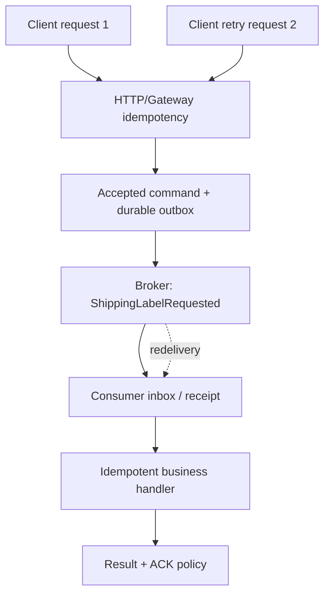
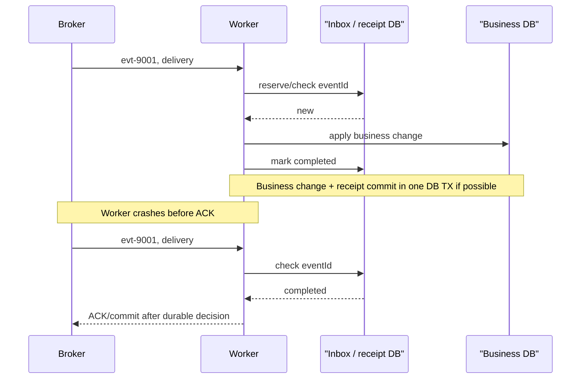
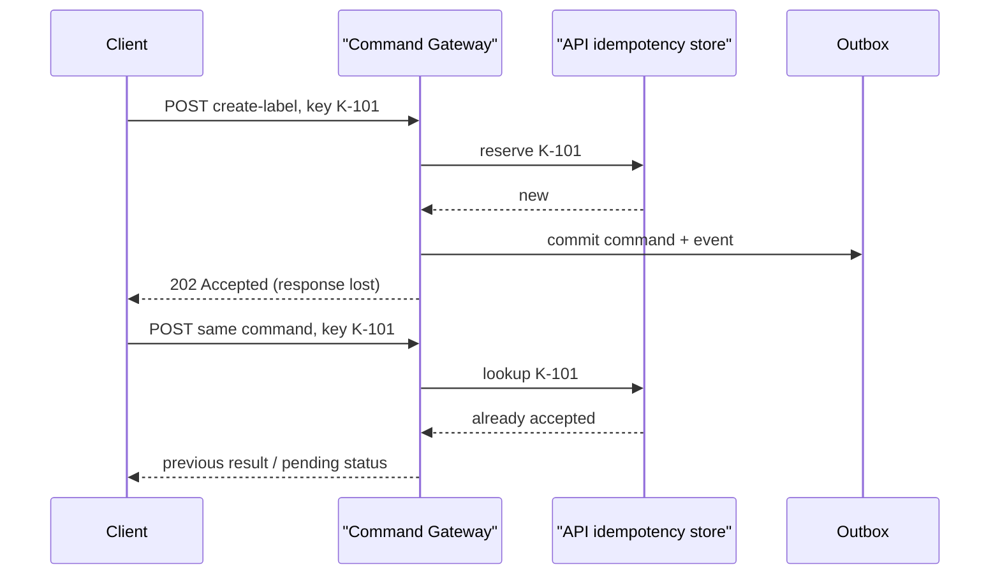
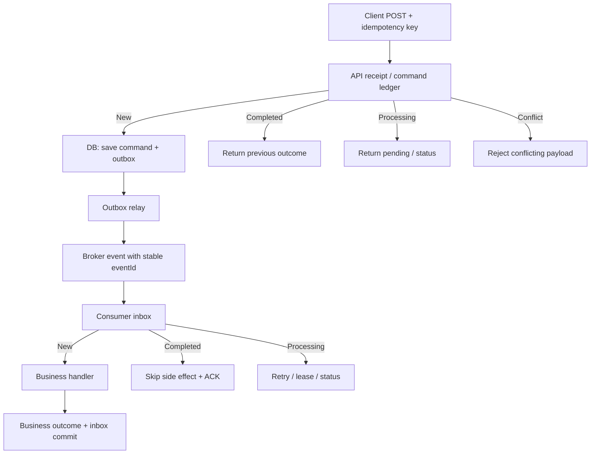
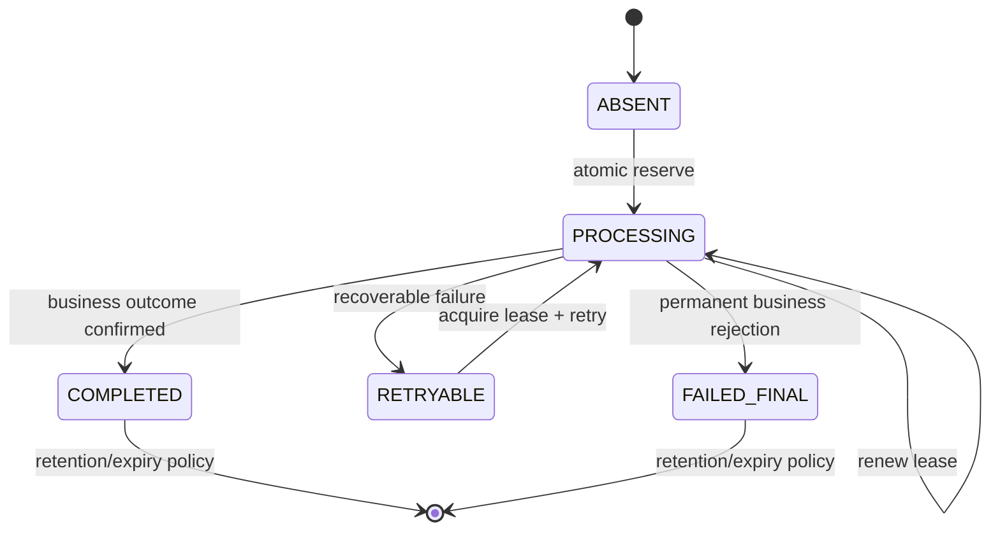
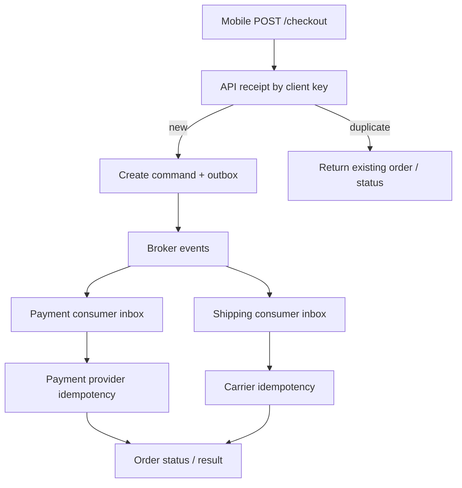

# Duplicate do broker và duplicate do client

Trong các hệ thống dùng **Spring Integration**, một lệnh nghiệp vụ có thể xuất hiện nhiều lần ở hai điểm rất khác nhau: **broker giao lại message đã tồn tại** hoặc **client gửi lại một yêu cầu** vì timeout, mất mạng hay thao tác lặp. Bề ngoài cả hai đều giống “cùng một việc được yêu cầu hai lần”, nhưng **nguồn phát sinh, định danh có thể tin cậy, cửa sổ xử lý và cách trả kết quả không giống nhau**.

Ví dụ người dùng bấm **Tạo vận đơn** trên điện thoại. HTTP request đầu tiên đã được server nhận nhưng mạng đứt trước khi client nhận reply. Ứng dụng điện thoại retry, có thể tạo **hai HTTP requests**. Backend phát một event sang Kafka; consumer tạo nhãn thành công nhưng crash trước khi commit offset, nên **cùng event** được broker giao lại. Nếu chỉ xử lý một tầng duplicate, hệ thống vẫn có thể tạo hai nhãn hoặc trả hai kết quả thiếu nhất quán.

**Idempotent Receiver** là mẫu Enterprise Integration Patterns (EIP) cho phép bên nhận xử lý việc **cùng một thao tác nghiệp vụ được yêu cầu hoặc giao nhiều lần** mà không tạo thêm tác dụng phụ không được phép. Bài **“Duplicate do broker và duplicate do client”** thuộc chương **Idempotent receiver** của module `SPRING_INTEGRATION_PATTERN`: học triển khai EIP bằng Spring Integration, xây dựng luồng thông điệp ít phụ thuộc và dễ mở rộng, kết hợp Router, Filter, Transformer, Splitter, Aggregator, Gateway, retry, error channel, correlation, đồng thời kiểm thử và theo dõi các nhánh xử lý.

Bài học giúp bạn:

- Phân biệt **broker redelivery**, **producer retry** và **client retry/double submit**.
- Xác định đúng **idempotency key** tại HTTP/Gateway và **event/command ID** tại message consumer.
- Thiết kế **hai lớp chống trùng**: ingress command receipt và consumer event inbox/receipt.
- Hiểu mốc **ACK/commit offset** và mốc **nghiệp vụ hoàn thành** không đồng nghĩa.
- Trả kết quả cho duplicate `COMPLETED`, xử lý `PROCESSING`, phát hiện **cùng key nhưng payload khác**.
- Triển khai ví dụ Java/Spring Integration và kiểm thử restart, concurrency, timeout, duplicate, retry, error channel.
- Nhận diện giới hạn của “exactly once” khi phải gọi cơ sở dữ liệu hoặc dịch vụ bên ngoài.

## 1. Cùng một lệnh nghiệp vụ, hai con đường tạo duplicate

Giả sử ứng dụng có API `POST /shipping-labels`:

```text
HTTP request:
  tenantId = T-1
  idempotencyKey = ship-req-2026-001
  orderId = ORD-42
  parcelId = P-7

Domain command:
  CreateShippingLabel(orderId=ORD-42, parcelId=P-7)

Broker event:
  eventId = evt-9001
  commandId = ship-req-2026-001
  type = ShippingLabelRequested
```

Có ít nhất hai tình huống:

**Tình huống A — Duplicate từ client**

```text
Mobile app -> HTTP request #1 -> API accepted
Mobile app <- response bị mất
Mobile app -> HTTP request #2 (retry same action)
```

Server phải biết **hai lần HTTP có đại diện cho một lệnh nghiệp vụ không**. Client có thể giữ cùng idempotency key hoặc tạo key mới; nếu tạo key mới, một bộ lọc theo key cũ không thể tự suy luận rằng hai lệnh là cùng ý định.

**Tình huống B — Duplicate từ broker**

```text
Kafka -> delivery event evt-9001 -> consumer processes
Consumer -> DB write completed
Consumer crashes before offset commit
Kafka -> delivers event evt-9001 again
```

Consumer cần biết **event `evt-9001` đã tạo side effect hay chưa**. Hai lần delivery có thể dùng các Spring `MessageHeaders.id` khác nhau, dù cùng domain `eventId`.



**Cốt lõi:** tầng phía trên ngăn **nhân đôi lệnh do client**, tầng phía dưới ngăn **thực thi lại event do broker**. Cả hai thường cùng cần thiết.

## 2. Định nghĩa: “duplicate” phụ thuộc đơn vị công việc

Một message mới nhận được **chưa đủ để kết luận nó trùng**. Hệ thống phải xác định một **đơn vị idempotency**.

| Đơn vị | Câu hỏi | Khóa thường dùng |
| --- | --- | --- |
| HTTP/API command | Có phải người dùng đang gửi lại **cùng lệnh**? | `(tenant, operation, clientIdempotencyKey)` |
| Domain command | Có phải cùng yêu cầu tạo vận đơn? | `(tenant, commandId, operation)` |
| Event consumer | Event này đã được consumer này xử lý chưa? | `(consumerName, eventId)` hoặc khóa domain tương đương |
| Split item | Dòng hàng/kiện này đã xử lý rồi chưa? | `(batchId, itemId, operation)` |
| External side effect | API tạo nhãn đã tạo nhãn cho **lệnh này** chưa? | Idempotency key được API đích hỗ trợ |
| Aggregator result | Kết quả này đã được tổng hợp/công bố chưa? | `(groupRunId, resultVersion)` |

Chẳng hạn hai yêu cầu **cùng `orderId` nhưng khác `parcelId`** là hai thao tác có thể đều hợp lệ. Chỉ dùng `orderId` làm dedup key sẽ loại nhầm một kiện. Ngược lại, nếu một người dùng gọi lại cùng thao tác nhưng mỗi lần sinh `requestId` mới, dedup theo request ID có thể bỏ lọt nghiệp vụ trùng.

### Ba trạng thái thường bị gộp nhầm

- **Đã nhìn thấy key (`SEEN`)**: store có một marker. Điều này **không chứng minh tác vụ hoàn thành**.
- **Đang xử lý (`PROCESSING`)**: một worker sở hữu hoặc đang thực hiện công việc; chưa chắc có kết quả.
- **Đã hoàn thành (`COMPLETED`)**: kết quả nghiệp vụ đã được xác nhận/lưu theo contract.

Một idempotent receiver phải chọn phản ứng **theo state**, không chỉ hỏi `containsKey`.

## 3. So sánh duplicate do broker và duplicate do client

| Khía cạnh | Broker duplicate | Client duplicate |
| --- | --- | --- |
| Nguồn | Redelivery, mất ACK/commit, rebalance, replay, producer retry. | HTTP retry, double-click, refresh, mobile offline replay, API timeout. |
| Đối tượng trùng | Thường cùng **domain event/command**, nhưng có thể là hai record vật lý. | Có thể cùng HTTP operation, cùng intent, hoặc **hai lệnh hợp lệ khác nhau**. |
| ID ổn định mong muốn | `eventId`/`commandId` nằm trong payload/envelope. | `Idempotency-Key`/`commandId` được client giữ ổn định cho cùng thao tác. |
| ID không nên dùng một mình | Kafka offset, Rabbit delivery tag, Spring message ID. | TCP connection, HTTP request ID sinh mới mỗi retry, timestamp. |
| Điểm phát hiện | Consumer inbound trước business side effect. | API/Gateway hoặc command intake **trước khi phát event mới**. |
| Khi đã hoàn thành | ACK delivery; bỏ side effect lặp, có thể ghi nhận duplicate. | Trả **cùng business outcome** hoặc status/cached response theo API contract. |
| Khi đang xử lý | Delay/requeue/lease/status, tránh xử lý song song. | `PENDING`/`202`, status query hoặc bounded wait. |
| Khi payload xung đột | Quarantine/reject event với cùng ID nhưng dữ liệu khác. | Trả conflict theo API contract, không ghi đè yêu cầu cũ. |
| Cửa sổ dedup | Broker retention, retry, DLQ/manual replay. | Client retry window và thời hạn nghĩa vụ trả lại outcome. |
| Mục tiêu | Không thực thi lại event đã nhận/xử lý. | Không tạo lệnh nghiệp vụ thứ hai vì retry cùng thao tác. |

**Lưu ý về producer duplicate:** broker không nhất thiết đang giao **cùng record lần thứ hai**. Producer có thể publish **hai records** chứa cùng `eventId` do không chắc lần đầu được broker ACK. Consumer phải nhận ra chúng theo **event identity**, không chỉ topic/partition/offset.

## 4. Duplicate do broker: diễn tiến một lần xử lý bị giao lại



**Điều xảy ra tùy loại broker:**

- Với **Kafka**, consumer có thể xử lý record xong nhưng **chưa commit offset**; sau rebalance/restart, record có thể được đọc lại. Offset xác định vị trí record vật lý, **không phải business event ID**.
- Với **RabbitMQ/AMQP**, message có thể được **requeue/redeliver** khi consumer/channel/connection bị đóng trước ACK hoặc theo chính sách requeue. `deliveryTag` có phạm vi channel, **không phải khóa idempotency lâu dài**.
- Với transport/poller khác, cũng cần xác định rõ mốc tiến độ và redelivery contract.

**Không phải broker nào cũng tự duplicate mỗi lần**, nhưng ứng dụng không nên xây tính đúng đắn trên giả định **“message được giao chính xác một lần trong mọi lỗi”**.

### Producer retry và consumer redelivery khác nhau

**Producer retry**: Một producer gửi event, mất ACK và gửi lại. Broker có thể lưu **hai records có event payload tương đương**. Tùy cơ chế idempotent producer, duplicate vật lý có thể được giảm trong phạm vi bảo đảm cụ thể, nhưng consumer vẫn nên có **business idempotency** khi có replay hoặc gửi lại từ cấp ứng dụng.

**Consumer redelivery**: Broker đã có một record nhưng consumer **đọc lại** sau mất tiến độ/ACK. Hai lần có thể cùng topic/partition/offset trong Kafka hoặc dùng delivery metadata khác ở AMQP. Vẫn cần kiểm tra event identity và outcome.

### Không lạm dụng từ “exactly once”

Một số hạ tầng có cơ chế **exactly-once** trong phạm vi giao dịch/stream processing nhất định. Điều đó **không tự bao gồm** HTTP payment API, database khác, email service, object store và nghiệp vụ của bạn. Hãy mô tả chính xác **ranh giới bảo đảm**, không kết luận “dùng Kafka transaction nên không thể trừ tiền hai lần”.

## 5. Duplicate do client: server đã xử lý nhưng client chưa biết

Một lệnh API có thể được xử lý **mặc dù client thấy timeout**:



Server **không thể biết** client nhận được response chưa. Vì vậy khi nhận lại cùng `Idempotency-Key`, tốt nhất là **không phát lệnh mới**, mà trả trạng thái/lời đáp tương ứng với lần xử lý ban đầu.

Các nguyên nhân phổ biến:

- Người dùng nhấn nút **hai lần** khi UI chưa khóa hoặc khi mạng chậm.
- Ứng dụng mobile tự retry sau timeout.
- HTTP client/proxy/gateway retry một request không có kết quả rõ ràng.
- Job offline đồng bộ lại các request sau khi mạng có lại.
- Người dùng refresh trang sau khi form đã submit.
- Lần gửi đầu được nhận nhưng reply bị mất trước khi tới client.

### `Idempotency-Key` chỉ hữu ích nếu client tái sử dụng đúng

Đối với **cùng một ý định thao tác**, client nên giữ **một key ổn định** cho toàn bộ retry. Khi tạo **một thao tác mới hợp lệ**, client cần dùng key mới. Tự động tạo random key **cho mỗi HTTP retry** có thể vô hiệu hóa cơ chế chống trùng của server.

Tuy nhiên, một client không đáng tin cậy có thể gửi key bị trùng hoặc cố ý khác đi. API phải **xác thực principal/tenant, giới hạn phạm vi key, so fingerprint và áp dụng business constraints**. Key do client gửi **không phải bằng chứng cấp quyền**.

## 6. Hai lần bấm nút: có phải luôn là duplicate không?

Không. Cần phân biệt **lặp lại cùng tác vụ** và **hai tác vụ được phép cùng tồn tại**.

| Hành vi | Ví dụ | Quyết định hợp lý |
| --- | --- | --- |
| Retry sau timeout | Cùng parcel, cùng operation, giữ cùng key. | Trả trạng thái/outcome của request trước. |
| Double-click tạo hai HTTP requests | Cùng thao tác UI trong thời gian rất ngắn. | Client giữ cùng key cho action đó; server dedup theo contract. |
| Người dùng thật sự mua hai món giống nhau | Hai checkout độc lập, mỗi lần có command ID mới. | Không chặn chỉ vì payload giống. |
| Sửa địa chỉ và tạo lại nhãn | Cùng parcel nhưng operation/revision mới hợp lệ. | Tạo command/version mới, tuân thủ business rule. |
| Cùng key nhưng payload thay đổi | Request #1 `amount=100`, #2 `amount=200`. | `IDEMPOTENCY_CONFLICT`, không trả kết quả của payload cũ như thể tương đương. |
| Client không gửi key | POST nhạy cảm không có idempotency contract. | Có thể reject/require key hoặc dựa vào business uniqueness có chủ đích. |

**Không dedup đơn giản bằng cách so nội dung JSON giống nhau trong một vài giây.** Hai lệnh với payload trùng có thể đều hợp lệ. Nếu muốn ngăn duplicate do UI, kết hợp **client action identity** và ràng buộc nghiệp vụ, không thay bằng heuristic timestamp.

## 7. Định danh qua nhiều ranh giới

Một lượt tạo vận đơn có thể có những ID khác nhau:

```text
tenantId             = TENANT-A
clientIdempotencyKey = ship-intent-101
commandId            = cmd-101
eventId              = evt-9001
brokerRecordId       = topic/partition/offset (transport)
springMessageId      = a UUID generated for this message instance
correlationId        = group/run key for aggregation
traceId              = observability context
```

| ID | Vòng đời/ý nghĩa | Có nên dùng chống trùng không? |
| --- | --- | --- |
| **Client idempotency key** | Một lần API command và các HTTP retry của nó. | Có, tại API/Gateway khi đã scoped/validated. |
| **Command ID** | Định danh lệnh nghiệp vụ được chấp nhận. | Có, cho các hành động theo command. |
| **Event ID** | Định danh một domain/integration event bền vững. | Có, ở consumer inbox cho từng subscriber. |
| **Broker offset/delivery tag** | Định danh/chỉ vị trí delivery/record trong transport. | Không dùng thay event identity. |
| **Spring `MessageHeaders.id`** | Một Spring message object cụ thể. | Không ổn định khi reconstruct/redeliver. |
| **`correlationId`** | Gom message liên quan cho Splitter/Aggregator/Gateway. | Không mặc định phù hợp cho dedup nghiệp vụ. |
| **`traceId`** | Phục vụ quan sát và liên kết span. | Không, nhiều operation có thể cùng trace. |

**Khác biệt quan trọng:** HTTP request #2 có thể có **request ID kỹ thuật mới**, nhưng **client idempotency key cũ**. Kafka redelivery có thể tạo **Spring message mới**, nhưng **event ID nghiệp vụ không đổi**. Do đó **không chọn khóa theo thông tin kỹ thuật chắc chắn thay đổi theo lần truyền**.

### Một command có thể phát nhiều event

Ví dụ command `cmd-101` có thể sinh:

```text
evt-9001: ShippingLabelRequested
evt-9002: ShippingLabelCreated
evt-9003: ShippingNotificationQueued
```

Nếu consumer dedup tất cả bằng `commandId`, nó có thể loại nhầm các **event khác nhau**. Inbox key nên gắn với **event identity và consumer context** hoặc operation mà consumer xử lý, không chỉ command ID chung.

## 8. Kiến trúc hai lớp: API receipt và consumer inbox

Một thiết kế thực tế thường có:



**Lớp 1 — API receipt** ngăn cùng thao tác client tạo hai command mới. Nó có thể lưu **response/status** để client retry nhận thông tin nhất quán.

**Lớp 2 — consumer inbox** ngăn cùng event (do broker retry/redelivery) kích hoạt side effect thêm lần nữa. Nó thường được chia theo **consumer/subscriber**, vì **cùng một event có thể cần được xử lý độc lập bởi nhiều consumer khác nhau**.

Nếu chỉ có API idempotency nhưng consumer không có inbox, broker redelivery vẫn có thể gọi side effect hai lần. Nếu chỉ có consumer inbox nhưng mỗi client retry tạo một `eventId` mới, consumer có thể coi cả hai event là hợp lệ và làm side effect hai lần.

### Cẩn thận khi đặt inbox chung giữa nhiều service

Cùng `eventId=evt-9001` có thể được service **Inventory**, **Billing** và **Notification** xử lý **mỗi nơi một lần**. Nếu cả ba dùng chung key `eventId` mà không có phạm vi `consumerName`/`operation`, worker đầu có thể chặn hai worker còn lại. Vì vậy:

```text
consumerInboxKey = consumerName + eventId
```

và bên trong mỗi service, nếu một event làm nhiều side effects độc lập, có thể cần phân biệt operation tương ứng.

## 9. Hợp đồng request và receipt có kiểu

Một ví dụ Java 17+:

```java
record CreateLabelRequest(
        String tenantId,
        String idempotencyKey,
        String orderId,
        String parcelId,
        String addressFingerprint
) {}

record ShippingLabelRequested(
        String eventId,
        String commandId,
        String tenantId,
        String orderId,
        String parcelId,
        String addressFingerprint
) {}

enum ReceiptStatus {
    PROCESSING,
    COMPLETED,
    FAILED_FINAL,
    RETRYABLE
}

record ApiReceipt(
        String tenantId,
        String operation,
        String idempotencyKey,
        String payloadHash,
        ReceiptStatus status,
        String resultReference
) {}
```

Đây là **các kiểu ứng dụng**, không phải class có sẵn của Spring Integration. Một API receipt có thể lưu JSON response/HTTP status sau khi hoàn thành, hoặc chỉ lưu `resultReference` để lấy lại outcome từ business DB.

### Fingerprint và canonicalization

Một request cùng `Idempotency-Key` nhưng khác `parcelId` hoặc địa chỉ có thể là **xung đột**. Nên tính fingerprint từ những trường ảnh hưởng đến thao tác sau khi chuẩn hóa có chủ đích:

```text
canonical = {
  operation: CREATE_LABEL,
  tenant: TENANT-A,
  order: ORD-42,
  parcel: P-7,
  addressRevision: addr-v3
}
payloadHash = SHA-256(canonical bytes)
```

Không dùng hash của **JSON raw** nếu thứ tự field/whitespace không có ý nghĩa nhưng có thể khác giữa retries. Đừng dùng hash như chứng cứ xác thực hoặc để bỏ qua kiểm tra quyền.

### Key phải được scoped đúng

Một key đơn như `ship-101` có thể do hai tenant cùng đặt. Khóa receipt thường nên là:

```text
(tenantId, operation, idempotencyKey, apiContractVersion)
```

Với consumer inbox:

```text
(consumerName, eventId)
```

Nếu sự kiện có thể sinh nhiều operation độc lập trong cùng consumer, có thể mở rộng thêm `operation`/`processingVersion`. Mỗi mở rộng cần được giải thích bằng business contract, không thêm trường chỉ để “chắc ăn”.

## 10. Vòng đời receipt: đã thấy không có nghĩa đã hoàn thành

Một state machine tối thiểu:



| Receipt state | Client retry | Broker redelivery |
| --- | --- | --- |
| `ABSENT` | Tạo command nếu hợp lệ; reserve atomic. | Xử lý event lần đầu nếu hợp lệ. |
| `PROCESSING` | Trả `PENDING`/`202`, có thể status query/bounded wait. | Không thực thi song song; retry có delay/lease ownership. |
| `COMPLETED` | Trả cached result/biên nhận cũ. | Bỏ side effect lặp; ACK theo chính sách giao nhận. |
| `FAILED_FINAL` | Trả business rejection nhất quán. | Không retry vô hạn cùng một lỗi vĩnh viễn. |
| `RETRYABLE` | Trả status/retry command theo policy, giữ cùng key. | Acquire lease rồi thử lại với backoff/giới hạn. |
| `UNKNOWN_REMOTE_OUTCOME` (nếu bổ sung) | Status chưa chắc chắn; không tạo lệnh mới. | Đối soát API ngoài trước khi gọi lại. |

**Không đánh dấu `COMPLETED` tại thời điểm nhận request** nếu nghiệp vụ còn đang chờ worker. API có thể trả `202 Accepted` vì command và outbox đã được lưu bền vững, nhưng đó là **đã chấp nhận xử lý**, không phải **đã tạo vận đơn thành công**.

## 11. Nguyên tử trong kho receipt: `get` rồi `put` không an toàn

Khi hai HTTP requests hoặc hai broker consumers cùng key đến đồng thời:

```text
Worker A: get(key) -> missing
Worker B: get(key) -> missing
Worker A: put(key, PROCESSING)
Worker B: put(key, PROCESSING)
Worker A: create label
Worker B: create label
```

Phải có **atomic reserve** ở storage được chia sẻ:

- `INSERT ... ON CONFLICT DO NOTHING` + unique constraint trong database.
- `putIfAbsent` của `ConcurrentMetadataStore` với semantics atomic phù hợp.
- CAS/conditional update có version nếu một record chuyển trạng thái.
- Redis atomic command với chính sách persistence/TTL/eviction rõ ràng.
- Transaction/lock đúng phạm vi khi nhiều instance cùng tranh chấp.

**`synchronized` trong một JVM không bảo vệ được các replica khác.** Cũng không nên dùng `SELECT` trước `INSERT` như cơ chế duy nhất để chống race.

### Cần xem xét atomicity với business DB

Nếu receipt insert và business result update nằm trong **cùng database/transaction**, có thể rollback cả hai khi handler thất bại. Nếu receipt ghi trong cache riêng trước khi ghi business DB, business DB rollback **không tự xóa key cache** và lần retry dễ bị chặn nhầm như duplicate.

## 12. PostgreSQL schema minh họa: tách API receipt và consumer inbox

```sql
CREATE TABLE api_idempotency_receipts (
    tenant_id        VARCHAR(80) NOT NULL,
    operation        VARCHAR(80) NOT NULL,
    idempotency_key  VARCHAR(180) NOT NULL,
    contract_version VARCHAR(32) NOT NULL,
    payload_hash     CHAR(64) NOT NULL,
    status           VARCHAR(32) NOT NULL,
    command_id       VARCHAR(160),
    result_ref       VARCHAR(200),
    lease_owner      VARCHAR(120),
    lease_until      TIMESTAMPTZ,
    created_at       TIMESTAMPTZ NOT NULL,
    updated_at       TIMESTAMPTZ NOT NULL,
    PRIMARY KEY (
        tenant_id, operation, idempotency_key, contract_version
    )
);

CREATE TABLE consumer_inbox (
    consumer_name    VARCHAR(120) NOT NULL,
    event_id         VARCHAR(180) NOT NULL,
    payload_hash     CHAR(64) NOT NULL,
    status           VARCHAR(32) NOT NULL,
    result_ref       VARCHAR(200),
    lease_owner      VARCHAR(120),
    lease_until      TIMESTAMPTZ,
    created_at       TIMESTAMPTZ NOT NULL,
    updated_at       TIMESTAMPTZ NOT NULL,
    PRIMARY KEY (consumer_name, event_id)
);
```

Đây là **schema thiết kế**, cần bổ sung retention, index, migration, retry attempt/version/fencing token tùy hệ thống. Không có ràng buộc nội tại rằng event của cùng command luôn có một consumer outcome: đó là responsibility của service.

### Atomic reserve

```sql
INSERT INTO consumer_inbox (
    consumer_name, event_id, payload_hash, status,
    created_at, updated_at
) VALUES (
    :consumer_name, :event_id, :payload_hash,
    'PROCESSING', NOW(), NOW()
)
ON CONFLICT (consumer_name, event_id) DO NOTHING;
```

Khi `rowCount=1`, một consumer đã reserve được event. Khi `rowCount=0`, đọc receipt đang tồn tại, kiểm tra fingerprint và state; **không tự động ACK vì key đã có** nếu state là `PROCESSING` chưa hoàn thành.

### Một client retry có thể có command/event mới không?

Nếu API xử lý duplicate đúng, **cùng idempotency key** nên tham chiếu tới **cùng accepted command** và không phát thêm outbox event nghiệp vụ ngoài ý muốn. Nếu client cố ý tạo key mới, database chỉ biết đó là một command khác, trừ khi có **business unique constraint** (ví dụ một parcel chỉ được có một nhãn còn hiệu lực) hoặc logic chống double-submit ở domain.

## 13. Spring Integration: Idempotent Receiver ở consumer inbound

Spring Integration có cơ chế **`IdempotentReceiverInterceptor`**, `MetadataStoreSelector` và các implementation của `ConcurrentMetadataStore` để hỗ trợ lọc/đánh dấu message theo key.

Điểm cần hiểu:

1. **`MetadataStoreSelector`** có thể quyết định một message có phải lần đầu dựa trên key extractor và metadata store.
2. **`IdempotentReceiverInterceptor`** gắn selector vào handler theo cơ chế advice; cần cấu hình chính sách cho duplicate.
3. Một metadata key dạng “seen” **không tự là receipt `COMPLETED`** có đầy đủ outcome và transaction.
4. Chỉ thêm interceptor **không mặc định** giải quyết trả cached API response hoặc remote side effects.

Ví dụ phần cấu hình metadata selector **minh họa**, cần đối chiếu overload và package theo version Spring Integration trong dự án:

```java
import org.springframework.context.annotation.Bean;
import org.springframework.context.annotation.Configuration;
import org.springframework.integration.handler.advice.IdempotentReceiverInterceptor;
import org.springframework.integration.metadata.ConcurrentMetadataStore;
import org.springframework.integration.metadata.SimpleMetadataStore;
import org.springframework.integration.selector.MetadataStoreSelector;

@Configuration
class BrokerDedupConfig {

    @Bean
    ConcurrentMetadataStore eventSeenStore() {
        return new SimpleMetadataStore();
    }

    @Bean
    IdempotentReceiverInterceptor idempotentAdvice(
            ConcurrentMetadataStore store) {

        MetadataStoreSelector selector = new MetadataStoreSelector(
                message -> {
                    ShippingLabelRequested event =
                            (ShippingLabelRequested) message.getPayload();
                    return "shipping-label-worker|" + event.eventId();
                },
                store
        );
        return new IdempotentReceiverInterceptor(selector);
    }
}
```

**Cảnh báo triển khai:** `SimpleMetadataStore` ở ví dụ là **in-memory**, không phù hợp nếu cần khôi phục dedup qua restart hoặc chia sẻ giữa nhiều worker. `MetadataStoreSelector` có semantics **đánh dấu key** chứ không thay business transaction; không dùng code trên như bảo đảm mỗi nhãn chỉ được tạo một lần.

### Tại sao không chỉ dùng `Filter`?

Một `Filter` với predicate “chưa thấy event ID” có thể loại duplicate khỏi luồng, nhưng duplicate khi handler lần đầu **đang `PROCESSING` hoặc đã thất bại** không phải lúc nào cũng được phép drop. Hơn nữa, Filter loại message không tự tạo reply cho Gateway và không tự sửa group release của Aggregator. Một receipt có state và policy rõ ràng có thể cần thiết hơn một Boolean selector.

## 14. Ví dụ Java chạy trong JVM: hai nguồn duplicate, hai cửa kiểm tra

Ta xây một **mô hình thực hành** dùng Java 17+, Spring Integration Java DSL và `ConcurrentHashMap` để minh họa hai ranh giới. Ví dụ **không có side effect bên ngoài** nên không đánh đồng nó với exactly-once ở production.

### 14.1. Hợp đồng và bộ guard nguyên tử

```java
import java.util.concurrent.ConcurrentHashMap;
import java.util.concurrent.ConcurrentMap;

record ClientCommand(
        String tenantId,
        String idempotencyKey,
        String parcelId
) {}

record BrokerEvent(
        String eventId,
        String commandId,
        String parcelId
) {}

record ReceiptDecision(
        String identity,
        String source,
        String status
) {}

final class TwoBoundaryDedup {
    private final ConcurrentMap<String, Boolean> clientKeys =
            new ConcurrentHashMap<>();
    private final ConcurrentMap<String, Boolean> eventKeys =
            new ConcurrentHashMap<>();

    ReceiptDecision onClient(ClientCommand command) {
        String key = checked(command.tenantId())
                + "|" + checked(command.idempotencyKey());
        boolean first = clientKeys.putIfAbsent(key, true) == null;
        return new ReceiptDecision(
                command.idempotencyKey(),
                "CLIENT",
                first ? "FIRST_ACCEPTED" : "DUPLICATE_CLIENT");
    }

    ReceiptDecision onBroker(BrokerEvent event) {
        String eventId = checked(event.eventId());
        boolean first = eventKeys.putIfAbsent(eventId, true) == null;
        return new ReceiptDecision(
                eventId,
                "BROKER",
                first ? "FIRST_DELIVERY" : "DUPLICATE_BROKER");
    }

    private static String checked(String value) {
        if (value == null || value.isBlank() || value.contains("|")) {
            throw new IllegalArgumentException("INVALID_IDENTITY");
        }
        return value;
    }
}
```

**Hạn chế có chủ đích:**

- Guard chỉ đánh dấu **first-seen**, không thể biết `PROCESSING` hay `COMPLETED`.
- Chưa kiểm tra payload fingerprint, operation/version, tenant của event hoặc transaction.
- Không lưu bền vững, không chạy chung được trên nhiều JVM.
- Dùng delimiter `|` kèm validation cho demo; production nên có key có cấu trúc/encoding không mơ hồ và chính sách normalization rõ.
- Không tự kiểm tra quyền của client hay broker producer.
- **Không sử dụng guard này để thực thi thanh toán/đặt hàng thực**; khi business call thất bại, retry có thể bị đánh dấu duplicate và bị bỏ nhầm.

### 14.2. Spring Integration DSL cho hai channel đầu vào

```java
import org.springframework.context.annotation.Bean;
import org.springframework.context.annotation.Configuration;
import org.springframework.integration.channel.DirectChannel;
import org.springframework.integration.channel.QueueChannel;
import org.springframework.integration.config.EnableIntegration;
import org.springframework.integration.dsl.IntegrationFlow;

@Configuration
@EnableIntegration
class TwoBoundaryDedupFlowConfig {

    @Bean
    TwoBoundaryDedup twoBoundaryDedup() {
        return new TwoBoundaryDedup();
    }

    @Bean
    DirectChannel apiCommandInput() {
        return new DirectChannel();
    }

    @Bean
    DirectChannel brokerEventInput() {
        return new DirectChannel();
    }

    @Bean
    QueueChannel apiDecisions() {
        return new QueueChannel();
    }

    @Bean
    QueueChannel brokerDecisions() {
        return new QueueChannel();
    }

    @Bean
    IntegrationFlow apiIntakeFlow(TwoBoundaryDedup guard) {
        return IntegrationFlow.from("apiCommandInput")
                .handle(ClientCommand.class,
                        (command, headers) -> guard.onClient(command))
                .channel("apiDecisions")
                .get();
    }

    @Bean
    IntegrationFlow brokerConsumerFlow(TwoBoundaryDedup guard) {
        return IntegrationFlow.from("brokerEventInput")
                .handle(BrokerEvent.class,
                        (event, headers) -> guard.onBroker(event))
                .channel("brokerDecisions")
                .get();
    }
}
```

Đây là **hai flow nội bộ** để kiểm thử việc phân loại duplicate theo **hai identity namespaces**. Không có HTTP/Kafka adapter thực hoặc offset commit; channel `brokerEventInput` chỉ giả lập **event đã đi vào consumer sau adapter**.

Trong một ứng dụng thực, adapter nên ánh xạ `eventId` ổn định từ trusted payload/envelope vào message, rồi gọi service xử lý có receipt bền vững. `QueueChannel` chỉ dùng để đọc quyết định trong test.

## 15. JUnit 5 integration test: phân biệt hai tầng duplicate

Kiểm thử phải cho thấy:

- Hai lần client gửi cùng key được ghi nhận là duplicate ở **client boundary**.
- Hai lần broker giao cùng event ID được ghi nhận là duplicate ở **broker boundary**.
- Broker redelivery của `evt-1` không tự làm `clientKeys` tăng.
- Hai event khác nhau vẫn là **hai sự kiện riêng**, dù cùng `commandId` — tùy domain contract.

```java
import static org.junit.jupiter.api.Assertions.assertEquals;
import static org.junit.jupiter.api.Assertions.assertNotNull;
import static org.junit.jupiter.api.Assertions.assertTrue;

import org.junit.jupiter.api.Test;
import org.springframework.beans.factory.annotation.Autowired;
import org.springframework.beans.factory.annotation.Qualifier;
import org.springframework.integration.channel.QueueChannel;
import org.springframework.messaging.MessageChannel;
import org.springframework.messaging.support.MessageBuilder;
import org.springframework.test.annotation.DirtiesContext;
import org.springframework.test.context.junit.jupiter.SpringJUnitConfig;

@SpringJUnitConfig(TwoBoundaryDedupFlowConfig.class)
@DirtiesContext(classMode = DirtiesContext.ClassMode.AFTER_EACH_TEST_METHOD)
class TwoBoundaryDedupFlowTest {

    @Autowired @Qualifier("apiCommandInput")
    MessageChannel apiInput;

    @Autowired @Qualifier("brokerEventInput")
    MessageChannel brokerInput;

    @Autowired @Qualifier("apiDecisions")
    QueueChannel apiOutput;

    @Autowired @Qualifier("brokerDecisions")
    QueueChannel brokerOutput;

    private static String status(QueueChannel output) {
        var message = output.receive(1_000);
        assertNotNull(message);
        return ((ReceiptDecision) message.getPayload()).status();
    }

    @Test
    void clientRetriesSameKeyButDoesNotCreateNewIntent() {
        var request = new ClientCommand(
                "TENANT-A", "ship-action-1", "P-1");

        assertTrue(apiInput.send(
                MessageBuilder.withPayload(request).build()));
        assertTrue(apiInput.send(
                MessageBuilder.withPayload(request).build()));

        assertEquals("FIRST_ACCEPTED", status(apiOutput));
        assertEquals("DUPLICATE_CLIENT", status(apiOutput));
    }

    @Test
    void brokerRedeliversSameEventIndependentlyOfClientRequests() {
        var event = new BrokerEvent("evt-1", "cmd-1", "P-1");

        assertTrue(brokerInput.send(
                MessageBuilder.withPayload(event).build()));
        assertTrue(brokerInput.send(
                MessageBuilder.withPayload(event).build()));

        assertEquals("FIRST_DELIVERY", status(brokerOutput));
        assertEquals("DUPLICATE_BROKER", status(brokerOutput));
    }

    @Test
    void differentEventIdsAreDifferentEventsEvenWithSameCommandId() {
        brokerInput.send(MessageBuilder.withPayload(
                new BrokerEvent("evt-requested", "cmd-1", "P-1")).build());
        brokerInput.send(MessageBuilder.withPayload(
                new BrokerEvent("evt-completed", "cmd-1", "P-1")).build());

        assertEquals("FIRST_DELIVERY", status(brokerOutput));
        assertEquals("FIRST_DELIVERY", status(brokerOutput));
    }
}
```

`@DirtiesContext` giúp từng test có `ConcurrentHashMap` riêng, không bị ảnh hưởng từ key của test trước. Test kiểm tra **Spring Integration wiring và first-seen behavior**, chưa chứng minh output nghiệp vụ thực hoặc persistence.

**Câu hỏi cần nhớ:** `eventId` khác nhau không có nghĩa chắc chắn là hai tác vụ độc lập. Ví dụ test thứ ba chỉ minh họa rằng hai **event identity** khác nhau không được gộp máy móc vì cùng `commandId`. Nếu producer vô tình tạo **hai `ShippingLabelRequested` events có hai IDs cho cùng lệnh**, domain/business idempotency tại handler vẫn phải ngăn hai nhãn.

## 16. Case đặc biệt: client retry tạo event mới nên inbox không nhận ra

Xét luồng sai:

```text
HTTP #1 (no stable client key)
   -> cmd-A -> event evt-A -> broker -> consumer

HTTP #2 retry of same user action
   -> cmd-B -> event evt-B -> broker -> consumer
```

Consumer inbox thấy `evt-A` và `evt-B` là **hai events khác nhau**, nên cả hai đều được xử lý lần đầu. Điều này **không phải lỗi của inbox**: ingress đã tạo hai business commands khác nhau từ cùng một user intent.

Khắc phục ở **điểm sớm nhất biết ý nghĩa nghiệp vụ**:

1. API yêu cầu hoặc cấp một **client action/idempotency key** ổn định.
2. Receipt store reserve key nguyên tử.
3. API gắn key với **một command ID** và một eventual result.
4. Event được phát từ outbox với **eventId ổn định** cho cùng accepted command.
5. Consumer vẫn giữ inbox vì broker có thể redeliver dù API chỉ phát một command.

Nếu client không thể giữ key sau khi app restart, một business uniqueness constraint có thể hỗ trợ (ví dụ “mỗi parcel có tối đa một nhãn ACTIVE cho operation/version”). Nhưng đó là **quy tắc domain**, không phải dedup mọi request có `orderId` giống nhau.

## 17. Case ngược lại: API idempotent nhưng broker giao lại

Xét ingress đúng:

```text
HTTP #1 -> idempotencyKey K-1 -> command C-1
HTTP #2 -> idempotencyKey K-1 -> same command C-1
Outbox emits event E-1
```

Nhưng consumer:

```text
Broker E-1 delivery #1 -> create label -> DB commit
Crash before offset commit
Broker E-1 delivery #2 -> create label AGAIN (if no inbox/idempotency)
```

Vì vậy **API receipt không thay consumer inbox**. Nếu side effect là ghi cùng DB với inbox, dùng **transaction** để lưu receipt/processed marker và business result cùng nhau. Nếu side effect là API Carrier ngoài, cần **downstream idempotency key** hoặc khả năng tra cứu trạng thái.

## 18. ACK/commit: mốc nào an toàn cho duplicate?

Các hệ thống có nhiều loại xác nhận:

| Mốc | Ý nghĩa | Không chứng minh |
| --- | --- | --- |
| HTTP response `202` | Server đã chấp nhận request theo contract. | Worker đã tạo nhãn/hoàn tất nghiệp vụ. |
| Outbox commit | Command/event intention đã được lưu bền vững trong DB. | Broker đã nhận message. |
| Broker producer ACK | Broker đã nhận publish theo cấu hình xác nhận. | Consumer đã xử lý. |
| Consumer ACK/offset commit | Consumer báo tiến độ nhận/đã xử lý theo policy. | Remote side effect tự atomic với offset. |
| Business result commit | Outcome đã được lưu theo transaction của business DB. | Caller đã nhìn thấy reply; hệ thống ngoài đã chắc chắn ACK. |

### Một ma trận crash nhỏ

| Điểm crash | Điều có thể xảy ra | Cách hạn chế |
| --- | --- | --- |
| Trước reserve API key | Retry HTTP như yêu cầu mới. | Atomic reserve. |
| Sau reserve API key, trước lưu command | Key ở `PROCESSING` nhưng chưa có work. | Cùng DB transaction hoặc lease/recovery. |
| Sau commit command/outbox, trước HTTP response | Client retry same key. | Trả cached accepted command/status. |
| Sau broker publish, trước producer nhận ACK | Event có thể publish lại. | Event ID ổn định, outbox relay, inbox. |
| Sau business DB commit, trước consumer offset commit | Broker redeliver. | Inbox/receipt cùng DB transaction. |
| Sau external side effect, trước local result commit | Không biết remote đã thực hiện chưa. | Idempotency key ở remote/reconciliation. |

**Đừng ACK/commit offset trước khi dữ liệu cần recovery được lưu bền vững**, trừ khi business contract chủ động chấp nhận mất công việc. Ngược lại, giữ message không ACK vô hạn vì duplicate `PROCESSING` cũng có thể gây retry storm; phải có retry, backoff và lease policy.

## 19. PostgreSQL: transaction gắn inbox với business row

Khi inbox và kết quả nghiệp vụ nằm trong cùng database, logic có thể như sau:

```text
BEGIN;
  INSERT INTO consumer_inbox(eventId, consumerName, status=PROCESSING)
    ON CONFLICT DO NOTHING;

  IF new:
      INSERT business result (unique business key)
      UPDATE consumer_inbox SET status=COMPLETED, result_ref=...
  ELSE:
      read current receipt
      compare payloadHash
      if COMPLETED: return old result
      if PROCESSING: wait/retry later, do not duplicate side effect
COMMIT;
```

**Cần có unique constraint ở cả nơi phù hợp**. Inbox unique key bảo vệ **event delivery**, còn business unique key có thể bảo vệ một nghiệp vụ khi hai events khác nhau đại diện cho cùng action.

Nếu insert business row thất bại và transaction rollback, inbox record cũng phải rollback nếu yêu cầu retry như lần đầu. Nếu `INSERT inbox` nằm trong cache khác DB, transaction không tự kéo cache key quay lại trạng thái chưa seen.

### Outbox xử lý client retry

Với request HTTP, một transaction có thể:

```text
BEGIN;
  reserve/read api_receipt by stable key
  if new:
      insert accepted_command
      insert outbox_event
      mark api_receipt ACCEPTED with command ID
COMMIT;
```

Lần HTTP retry tiếp theo cùng key chỉ đọc lại `api_receipt`, **không insert command/outbox mới**. Outbox relay có thể phát event lặp vì ACK không chắc chắn; consumer inbox sẽ chặn xử lý trùng tại downstream.

**Không gộp status API receipt và status consumer inbox** thành một Boolean “seen” vì chúng trả lời hai câu hỏi khác nhau.

## 20. Nếu có HTTP Gateway đồng bộ thì duplicate nên nhận reply nào?

Một API có thể chọn trả kết quả cuối đồng bộ hoặc xử lý bất đồng bộ. Cần có **hợp đồng response nhất quán** cho duplicate.

| API receipt state | Phản ứng có thể phù hợp |
| --- | --- |
| Key mới, accepted async | `202 Accepted` + `commandId`/status URL. |
| Key cũ, vẫn đang xử lý | Trả `202/PENDING`, cùng command ID; có thể đợi bounded theo policy. |
| Key cũ, hoàn tất | Trả cached business result/status, có cùng resource ID. |
| Key cũ, business rejected cuối | Trả kết quả từ chối nhất quán. |
| Key cũ, payload khác | Trả `409 Conflict` hoặc mã lỗi idempotency được API quy định. |
| Key cũ, receipt hết retention | Theo contract: reject replay/require action mới hoặc coi là fresh request nếu an toàn. |

**HTTP status chính xác không có một chuẩn duy nhất cho mọi API**, vì còn tùy synchronous/asynchronous semantics. Quan trọng hơn là không phát **hai commands** khi cùng key hợp lệ và không trả `SUCCESS` cho tác vụ chưa hoàn tất.

### Một lỗi thường gặp với `Filter` hoặc interceptor

Nếu Gateway gửi message vào Spring Integration flow và Idempotent Receiver **drop** duplicate mà không phát reply, caller có thể timeout dù outcome cũ đang nằm trong receipt. Với API cần trả lời, hãy route duplicate về **cached-result handler/status lookup** thay vì bỏ mất message.

## 21. `PROCESSING` và retry: đừng biến duplicate thành mất việc

Giả sử worker A reserve key, sau đó gặp lỗi tạm thời:

```text
A: reserve eventId=evt-7 -> PROCESSING
A: call remote API -> timeout
B: receives evt-7 again
B: finds PROCESSING
```

Nếu B ACK và drop vĩnh viễn, công việc có thể bị mất. Nếu B lập tức gọi remote API, có thể tạo side effect trùng.

Cần một chính sách:

- Receipt lưu `leaseOwner`, `leaseUntil`, `attemptCount`, `lastErrorCode`.
- Worker A renew lease hoặc chuyển `RETRYABLE` khi biết xử lý chưa hoàn thành.
- Worker B chỉ acquire lease khi CAS/expiry và policy cho phép.
- Với remote API có outcome không rõ, **reconcile theo idempotency key** trước khi thực hiện lại.
- Dùng backoff, jitter, max attempts và dead-letter/quarantine khi vượt giới hạn.

### Lease không chặn remote side effect đến muộn

Worker A mất lease rồi vẫn có thể nhận response HTTP muộn. Worker B được lease mới và cùng gọi remote service. Để chống hai side effects, cần downstream idempotency hoặc **fencing token** được nơi ghi nhận/thực thi tôn trọng. Một `leaseUntil` trong DB **không tự hủy** các lời gọi đã gửi.

## 22. Client-side biện pháp hỗ trợ, không thay server idempotency

Ở UI/mobile, có thể giảm duplicate bằng:

- Disable nút submit trong lúc request đang pending.
- Giữ cùng `Idempotency-Key` cho retry của **một action** kể cả sau app restart.
- Không tự retry POST nhạy cảm khi thiếu hợp đồng idempotency.
- Hiển thị `PENDING` và status query thay vì tạo action mới khi mạng mất.
- Hạn chế gửi cùng outbox job offline nhiều lần nếu client queue được replay.

Nhưng **client có thể crash, bị nhân bản, chạy nhiều thiết bị hoặc bị điều chỉnh**. Do đó server vẫn phải là nơi thực thi ràng buộc nghiệp vụ và receipt atomic. UI debounce chỉ giảm lưu lượng; nó không đảm bảo không tạo hai payment hoặc hai shipment.

## 23. Router, Filter, Splitter, Aggregator và Claim Check

### Router

Một command có thể được định tuyến đến các service khác nhau. Key dedup tại mỗi service cần scoped theo **operation/consumer**; đừng dùng chung key `orderId` cho nhánh tạo nhãn và nhánh hủy nhãn. Route metadata không tự chứng minh quyền của một tenant.

### Filter

Filter có thể loại duplicate delivery nhưng cần hiểu nhánh `discardChannel`. **Discard** khác **error** và khác **trả kết quả cũ**. Nếu reply cần thiết, route tới cached result/status handler. Nếu Aggregator đang đợi một result, drop message có thể gây group thiếu.

### Splitter

Khi một batch gồm ba kiện được tách thành ba messages, các item không nên có cùng idempotency key chỉ là `batchId`:

```text
key item 1: (batchId=B-1, parcelId=P-1, operation=CREATE_LABEL)
key item 2: (batchId=B-1, parcelId=P-2, operation=CREATE_LABEL)
key item 3: (batchId=B-1, parcelId=P-3, operation=CREATE_LABEL)
```

Giữ `correlationId`/`sequenceNumber` để Aggregator gom kết quả; **correlation không thay idempotency**. Nếu mỗi item đã được xử lý và redeliver, nên trả **cached ItemResult** về group khi cần, không chỉ drop mà khiến release strategy đợi mãi.

### Aggregator

Duplicate reply có thể làm một group release sớm nếu release strategy chỉ đếm số message. Dùng recipient/item identity để deduplicate và kiểm tra cardinality đúng contract. Sau khi group đã release, late duplicate cần policy để không tạo summary thứ hai.

### Gateway

Lần gọi Gateway sau timeout với cùng command ID có thể cần trả cached response hoặc trạng thái `PENDING`. Chỉ dựa vào `replyChannel` của lần đầu không giúp lần gọi thứ hai nhận kết quả: reply channel có thể gắn với một caller đã hết hạn.

### Claim Check

Một nghiệp vụ có thể được Claim Check In hai lần và tạo **hai ticket khác nhau**. Nếu chỉ dùng `claimId` chống trùng, cùng event/action vẫn có thể xử lý hai lần. Cần event/command identity ổn định ngoài ticket và retention/expiry phù hợp redelivery.

## 24. Test concurrency: hai client requests và hai broker deliveries

**Đừng chỉ test gửi tuần tự.** Hai request có thể đến đồng thời ở hai replica; `SELECT` rồi `INSERT` không đủ để chống race. Trong JVM, có thể kiểm tra tính nguyên tử của guard; trong production phải kiểm tra unique constraint và transaction thật.

```java
import static org.junit.jupiter.api.Assertions.assertEquals;

import java.util.ArrayList;
import java.util.List;
import java.util.concurrent.Callable;
import java.util.concurrent.CountDownLatch;
import java.util.concurrent.ExecutorService;
import java.util.concurrent.Executors;
import java.util.concurrent.Future;
import java.util.concurrent.TimeUnit;

import org.junit.jupiter.api.Test;

class TwoBoundaryDedupConcurrencyTest {

    @Test
    void exactlyOneWinnerForEightConcurrentClientRetries()
            throws Exception {

        TwoBoundaryDedup guard = new TwoBoundaryDedup();
        var command = new ClientCommand("TENANT-A", "same-action", "P-1");
        int total = 8;
        ExecutorService pool = Executors.newFixedThreadPool(total);
        CountDownLatch start = new CountDownLatch(1);

        try {
            List<Callable<String>> calls = new ArrayList<>();
            for (int i = 0; i < total; i++) {
                calls.add(() -> {
                    start.await();
                    return guard.onClient(command).status();
                });
            }

            List<Future<String>> futures = new ArrayList<>();
            for (Callable<String> call : calls) {
                futures.add(pool.submit(call));
            }
            start.countDown();

            int firstAccepted = 0;
            for (Future<String> future : futures) {
                if ("FIRST_ACCEPTED".equals(
                        future.get(2, TimeUnit.SECONDS))) {
                    firstAccepted++;
                }
            }
            assertEquals(1, firstAccepted);
        } finally {
            start.countDown();
            pool.shutdownNow();
        }
    }
}
```

Test này chỉ chứng minh **một `ConcurrentHashMap` trong một JVM** cho ra đúng một winner. Test production cần hai service instances cùng DB, hai concurrent HTTP requests có same key, cùng fingerprint và các lệnh event publish có tính đến outbox. Với broker, cần mô phỏng redelivery song song hoặc rebalances tùy transport, không giả định các consumer group tự bảo vệ toàn bộ side effects.

## 25. Ma trận kiểm thử phân biệt broker và client duplicate

| ID | Tình huống | Kỳ vọng |
| --- | --- | --- |
| CLIENT-01 | Retry HTTP cùng key, cùng payload. | Một accepted command; lần sau trả cached status/outcome. |
| CLIENT-02 | Double-click cùng action/key. | Không tạo hai commands/outbox events. |
| CLIENT-03 | Cùng key, payload khác. | `IDEMPOTENCY_CONFLICT`; không ghi đè công việc cũ. |
| CLIENT-04 | Cùng payload nhưng key mới có chủ ý. | Theo business constraints, không tự coi là duplicate vì giống JSON. |
| CLIENT-05 | Retry sau response timeout nhưng command đã commit. | Lấy lại command/result cũ, không phát command mới. |
| CLIENT-06 | Hai tenant dùng cùng key. | Receipt độc lập; không rò rỉ kết quả chéo tenant. |
| CLIENT-07 | Key hết hạn, client retry rất muộn. | Theo replay/retention contract, không nhân đôi tác vụ nhạy cảm. |
| CLIENT-08 | Hai HTTP requests song song cùng key. | Một atomic reserve winner; các requests còn lại nhận trạng thái đúng. |
| BROKER-01 | Redelivery cùng `eventId` sau consumer crash. | Không thực thi side effect lần hai. |
| BROKER-02 | Hai records cùng `eventId` do producer retry. | Inbox nhận diện duplicate qua event ID, không phụ thuộc offset. |
| BROKER-03 | Cùng `commandId` nhưng hai event types/IDs khác. | Consumer xử lý theo contract từng event, không loại nhầm. |
| BROKER-04 | Business DB commit xong, offset chưa commit. | Redelivery thấy COMPLETED; ACK theo policy. |
| BROKER-05 | Receipt reserve xong, worker crash trước business effect. | Lease/recovery cho phép retry, không mất work. |
| BROKER-06 | External API success, local reply mất. | Query/idempotency downstream; không tạo effect mới mù quáng. |
| BROKER-07 | Redis/cache receipt mất do restart. | Test phát hiện giới hạn; không tuyên bố durability. |
| BROKER-08 | Hai instances xử lý cùng event. | Shared atomic receipt/unique key; không race side effects. |
| CROSS-01 | Client retry đúng key nhưng broker cũng redeliver. | Một accepted command, một business effect; cả hai tầng dedup hoạt động. |
| CROSS-02 | Client retry tạo key mới nhưng cùng parcel. | Business uniqueness/command ID kiểm soát nếu đây là duplicate thực. |
| CROSS-03 | Filter drop duplicate item trước Aggregator. | Không làm group kẹt; trả cached ItemResult hoặc policy thích hợp. |
| CROSS-04 | Gateway retry khi result đã hoàn thành. | Lần retry không bị timeout vì message bị drop vô phản hồi. |
| SECURITY-01 | Client sửa tenant/operation trong headers. | Không dùng để vượt quyền hoặc chọc vào receipt của tenant khác. |
| RETENTION-01 | Broker replay sau TTL. | Outcome đúng theo retention contract, không bất ngờ lặp payment. |

**Test end-to-end quan trọng nhất** thường là: *client gửi lại cùng key, outbox relay có thể publish trùng, broker redeliver, worker crash ở nhiều mốc — kết quả nghiệp vụ vẫn đúng một lần theo contract*.

## 26. Quan sát và runbook khi duplicate tăng mạnh

Nếu chỉ đếm số request ở API, hệ thống có thể trông như tăng trưởng tốt trong khi **80% là retries** do một outage downstream. Ngược lại, nếu chỉ đếm duplicate ở inbox, bạn có thể bỏ sót việc API tạo hai command khác IDs từ một double-click.

Nên đo riêng:

| Metric minh họa | Cần trả lời |
| --- | --- |
| `api_idempotency_first_total` | Bao nhiêu key API mới được chấp nhận? |
| `api_idempotency_duplicate_total{status}` | Bao nhiêu HTTP retries nhận state cũ? |
| `api_idempotency_conflict_total` | Có bao nhiêu cùng key nhưng payload khác? |
| `broker_event_received_total` | Consumer nhận bao nhiêu delivery/records? |
| `consumer_inbox_duplicate_total{status}` | Bao nhiêu events trùng do redelivery/replay? |
| `consumer_inbox_processing_age_seconds` | Receipt nào kẹt `PROCESSING` quá lâu? |
| `consumer_inbox_lease_expired_total` | Bao nhiêu work cần recovery? |
| `outbox_publish_retry_total` | Relay mất ACK và publish lại bao nhiêu lần? |
| `business_effect_confirmed_total` | Bao nhiêu side effects được xác nhận? |
| `idempotency_conflict_total{boundary}` | Xung đột ở API hay consumer? |
| `duplicate_after_retention_total` | Bao nhiêu replay tới sau cửa sổ dedup? |

Tên metric là **gợi ý do ứng dụng tự instrument**, không phải bảo đảm Spring Integration tự cung cấp. Không dùng `idempotencyKey`, `eventId`, `commandId`, customer ID hoặc raw payload làm metric labels vì high cardinality và rủi ro lộ dữ liệu.

Một event log có cấu trúc:

```text
boundary=API
action=CREATE_LABEL
decision=DUPLICATE_COMPLETED
commandRef=cmd-101
traceId=trace-11

boundary=BROKER
consumer=shipping-label-worker
decision=EVENT_ALREADY_APPLIED
eventRef=evt-9001
traceId=trace-12
```

Chỉ log những định danh đã được chấp thuận cho audit; nếu client idempotency key được coi là bearer token, **không log nguyên văn**.

### Runbook phân loại sự cố

- **Duplicate API tăng:** kiểm tra client retry policy, network timeouts, UI double-submit và response latency.
- **Duplicate inbox tăng:** kiểm tra consumer crashes, offset/ACK timing, producer retries, broker rebalances và outbox relay.
- **Cả hai cùng tăng:** có thể downstream latency tăng làm client retry và broker redeliver, cần điều tra nguyên nhân chung.
- **Receipt `PROCESSING` lâu:** kiểm tra lease owner, dead workers, retry queues, remote unknown outcomes.
- **Xung đột fingerprint tăng:** producer/client có thể dùng lại key sai; không xóa receipt chỉ để giảm cảnh báo.
- **Side effect count tăng dù duplicate bị chặn:** kiểm tra key scope sai, external API không idempotent hoặc side effect ngoài transaction.

## 27. Tình huống thực hành: đơn hàng, thanh toán và vận chuyển

**Bối cảnh:** Ứng dụng thương mại điện tử nhận `POST /checkout`. Client mobile có mạng không ổn định. Backend phát các events `OrderAccepted`, `PaymentRequested`, `ShippingRequested` lên broker. Consumer Payment và Shipping chạy nhiều replica, có thể restart và nhận redelivery. Người dùng có thể mua hai lần hợp lệ hoặc gửi lại đúng một checkout do timeout.



### Bài tập thiết kế

1. **Client key:** định nghĩa mỗi lần nhấn “Thanh toán” có key nào, được lưu ở đâu khi app restart và khi nào tạo key mới cho lần mua thứ hai.
2. **Payload conflict:** nếu cùng key nhưng giỏ hàng/địa chỉ/số tiền thay đổi, trả lỗi nào? Cần canonical hash và policy rõ.
3. **Command/outbox:** làm sao một HTTP retry chỉ có **một accepted order command**, dù API node khác nhận lần retry.
4. **Event identity:** mỗi event `PaymentRequested`/`ShippingRequested` có ID ổn định nào? Vì sao hai event chung order ID không bị coi là một?
5. **Consumer inbox:** Payment/Shipping cần unique key theo consumer/event; đặt transaction boundary ở đâu?
6. **External provider:** khi payment timeout sau khi provider có thể đã charge, làm sao đối soát trước retry?
7. **Gateway response:** nếu checkout cần hàng phút, có nên giữ HTTP request đồng bộ? Chọn `202`/status query hay final reply theo contract.
8. **Broker ACK:** khi nào commit offset/ACK an toàn nếu receipt đã `COMPLETED` hoặc vẫn `PROCESSING`?
9. **Lease/recovery:** worker Payment crash, lease hết hạn; ngăn stale worker và worker mới cùng charge thế nào?
10. **Splitter:** mỗi đơn có nhiều kiện, idempotency theo từng parcel nhưng vẫn có correlation để Aggregator gom.
11. **Retention:** thời gian giữ API receipt và inbox có đủ cho retry/mobile offline/broker manual replay không?
12. **Observability:** phân biệt tỉ lệ retry HTTP, redelivery broker, outbox publish retry và business effect đã xác nhận.

### Câu hỏi tự đánh giá

**Câu 1:** Client retry cùng POST nhưng tạo HTTP request ID mới. Đây có phải lệnh mới không? **Chưa chắc.** Phải xem client idempotency key và hợp đồng nghiệp vụ, không dựa vào HTTP request ID.

**Câu 2:** Kafka giao lại cùng event khi consumer chưa commit offset. Nếu `MessageHeaders.id` mới, có phải event nghiệp vụ mới không? **Không.** Dựa vào `eventId` bền vững của domain/envelope.

**Câu 3:** API đã chống trùng tốt, có cần consumer inbox không? **Có thể vẫn cần.** Broker redelivery hoặc producer retry có thể lặp event dù API chỉ chấp nhận một command.

**Câu 4:** Consumer inbox đã có record `PROCESSING`, có thể ACK và bỏ event vì “đã thấy” không? **Không nên mặc định.** Work có thể chưa hoàn tất; cần lease/status/recovery.

**Câu 5:** Hai `PaymentRequested` events có IDs khác nhưng cùng order/payment intent, inbox theo event ID có đủ chống double-charge không? **Không nhất thiết.** Cần business uniqueness hoặc downstream payment idempotency theo payment intent/operation.

**Câu 6:** Broker offset khác nhau có bảo đảm hai business events khác nhau không? **Không.** Producer có thể publish duplicate records cùng event ID.

**Câu 7:** Một người dùng mua cùng giỏ hàng hai lần nhưng dùng hai idempotency keys mới, có nên chặn mọi trường hợp không? **Không.** Hai giao dịch có thể hợp lệ; business rules quyết định.

**Câu 8:** Dùng `IdempotentReceiverInterceptor` có nghĩa handler không bao giờ chạy lại với duplicate và side effect exactly once? **Không.** Cần hiểu cấu hình duplicate behavior, receipt transaction và ranh giới external service.

## 28. Checklist triển khai và review

- [ ] Phân biệt **client intent**, accepted command, emitted event và broker delivery.
- [ ] Client dùng **idempotency key ổn định** cho retry của cùng action; key mới cho action mới.
- [ ] API key được scoped theo tenant, operation, version; không tin client tự khai quyền.
- [ ] Cùng key nhưng payload khác được phát hiện bằng fingerprint/canonicalization và xử lý conflict.
- [ ] API receipt có `PROCESSING/COMPLETED/FAILED` và cached result/status phù hợp.
- [ ] Accepted command và outbox được commit cùng transaction khi dùng cùng DB.
- [ ] Outbox event có **eventId ổn định** khi relay publish lại sau mất ACK.
- [ ] Consumer inbox tách theo `consumerName + eventId` hoặc business operation đúng hợp đồng.
- [ ] Atomic insert/CAS/unique constraint ngăn concurrent consumers xử lý cùng key.
- [ ] Receipt và business result được commit cùng transaction nếu cùng database.
- [ ] External side effect có provider idempotency key hoặc reconciliation khi response không chắc chắn.
- [ ] `PROCESSING` không bị drop như `COMPLETED`; có lease, backoff và recovery.
- [ ] Broker ACK/offset commit được gắn với trạng thái có thể khôi phục, không chỉ `send()` thành công.
- [ ] Gateway/HTTP duplicate nhận cached result/status, không timeout chỉ vì bị Filter drop.
- [ ] Splitter/Aggregator giữ correlation, item identity và xử lý duplicate message con đúng.
- [ ] Kho dedup đủ bền, dùng chung giữa replicas và có TTL/retention phù hợp replay window.
- [ ] Kiểm thử client retry, broker redelivery, producer publish retry, concurrency, restart và lost ACK.
- [ ] Metrics phân biệt duplicate API với duplicate consumer, có cảnh báo stuck receipts.
- [ ] Không dùng một tuyên bố “exactly once” vượt quá transaction/transport thực sự bảo đảm.

## Tổng kết

- **Duplicate do client** xuất hiện khi **một ý định API được gửi lại**; cần idempotency key ổn định ở ingress, receipt có trạng thái và cached result/command ID. Cùng payload không tự có nghĩa cùng ý định, và cùng key nhưng payload khác phải được xử lý như xung đột.
- **Duplicate do broker** xuất hiện khi event/record được publish hoặc giao lại; consumer phải dùng **event ID bền vững và inbox/receipt** để tránh side effect lặp, không dựa vào offset, delivery tag, Spring message ID hoặc trace ID.
- **Hai tầng idempotency không thay thế nhau**: API receipt ngăn tạo lệnh mới khi client retry; consumer inbox ngăn xử lý lại event khi broker redeliver. Một lần client retry vẫn có thể tạo events khác IDs nếu tầng API thiết kế sai.
- **`PROCESSING` khác `COMPLETED`**. Chỉ biết key đã tồn tại là chưa đủ để ACK/drop; cần transaction, lease, retry/recovery và policy trả kết quả cho duplicate.
- Với side effects ở DB, **unique constraint và transaction** giúp đồng bộ receipt và business result; với external API, cần downstream idempotency key, trạng thái `UNKNOWN` và đối soát. Không có bảo đảm exactly-once end-to-end chỉ từ broker, interceptor hoặc cache.
- Test cả **hai nguồn duplicate riêng và kết hợp**, đặc biệt timeout, mất ACK, producer publish retry, concurrency, restart và payload conflict; theo dõi metrics tại từng ranh giới để nhận diện đúng nguyên nhân.
