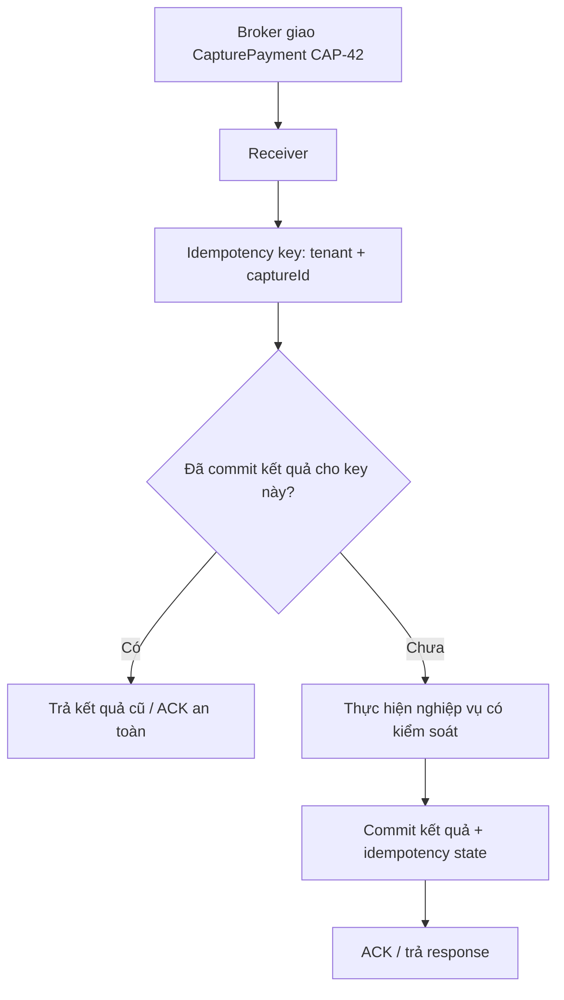
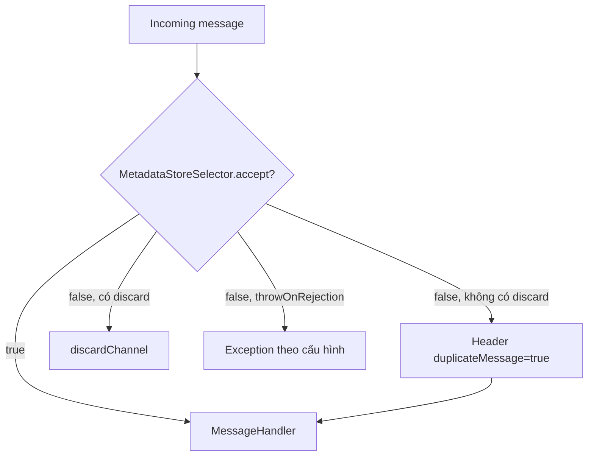
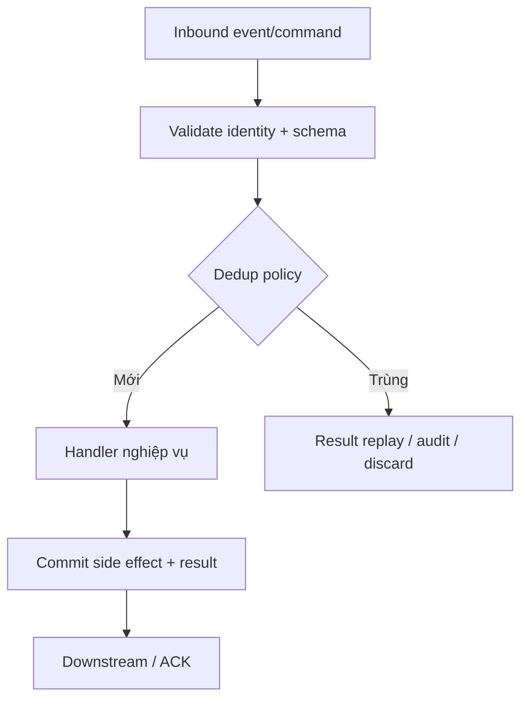
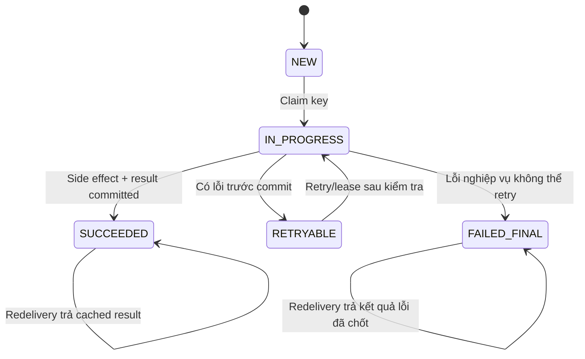

# Khác biệt idempotency với deduplication trong Spring Integration

## Mục tiêu bài học

Một hệ thống thanh toán nhận command `CapturePayment` qua broker. Broker đã chuyển message đến worker, worker gọi dịch vụ thanh toán, nhưng ACK bị mất. Broker gửi **lại cùng một command**. Nếu worker thu tiền hai lần, hệ thống vi phạm nghiệp vụ. Một phản ứng tự nhiên là “chỉ cần lọc message trùng”. Tuy nhiên, nếu worker **ghi dấu đã thấy message trước khi thu tiền**, rồi crash trước khi gọi thanh toán, lần giao lại có thể bị lọc mất; khách **chưa được thu tiền nhưng hệ thống lại coi là đã xử lý**.

Đây là lý do cần phân biệt hai khái niệm thường bị dùng lẫn:

- **Deduplication (loại bản trùng):** nhận diện nhiều lần xuất hiện của cùng một đơn vị thông tin theo một khóa/quy tắc, rồi giữ, đánh dấu, bỏ qua hoặc hợp nhất các bản trùng.
- **Idempotency (tính lũy đẳng của thao tác):** áp dụng **cùng một yêu cầu logic nhiều lần** vẫn dẫn tới **cùng trạng thái/tác động nghiệp vụ mong muốn** như thực hiện một lần, trong phạm vi và thời hạn hợp đồng đã định.

Deduplication có thể **hỗ trợ** một Idempotent Receiver, nhưng không tự chứng minh rằng các side effect đã được commit đúng một lần. Ngược lại, một nghiệp vụ có thể idempotent mà không cần loại bỏ mọi message trùng ở tầng vận chuyển.

Bài thuộc chương **Idempotent receiver** của module **SPRING_INTEGRATION_PATTERN**. Lộ trình học áp dụng Enterprise Integration Patterns bằng Spring Integration để xây dựng flow ít phụ thuộc, dễ mở rộng; thực hành Router, Filter, Transformer, Splitter, Aggregator, Gateway, retry, error channel, correlation và theo dõi các nhánh xử lý.

Sau bài học, bạn có thể:

1. Giải thích rõ **message duplicate**, **business command duplicate**, **idempotent operation** và **exactly-once effect**.
2. Chọn idempotency key bền vững theo tenant, operation và business request thay vì chỉ theo `MessageHeaders.ID` hoặc nội dung payload.
3. Dùng `MetadataStoreSelector` cùng `ConcurrentMetadataStore` để phát hiện một khóa đã thấy.
4. Dùng `IdempotentReceiverInterceptor` trong Java DSL và hiểu sự khác biệt giữa **đánh dấu `duplicateMessage`** với **gửi tới discard channel**.
5. Viết JUnit kiểm tra first delivery, redelivery với message ID mới, request khác key và trường hợp dữ liệu đầu vào không hợp lệ.
6. Phân tích race/crash giữa **claim key → gọi handler → commit → ACK**, kể cả nhiều worker/instance.
7. Thiết kế idempotency nghiệp vụ bằng unique constraint, transaction, result replay, transactional outbox và idempotency key của dịch vụ ngoài.
8. Biết khi nào **không được deduplicate**: sự kiện cập nhật có version mới, command mới có nội dung giống nhau, correction/reversal hoặc nhiều nhánh của một Scatter-Gather.

---

## 1. Ví dụ mở đầu: hai lần giao không nhất thiết là hai lần thực hiện

Giả sử command:

```text
tenantId   = shop-a
orderId    = ORD-42
captureId  = CAP-42
amount     = 125000 VND
```

Broker có thể giao:

```text
T1 broker -> Worker: Message ID=m-101, captureId=CAP-42
T2 Worker bắt đầu xử lý
T3 Worker ghi thanh toán hoặc gửi request tới provider
T4 Worker mất kết nối trước khi ACK
T5 broker -> Worker: Message ID=m-102, captureId=CAP-42
```

Hai Spring `Message<?>` có ID kỹ thuật **khác nhau** nhưng biểu diễn **cùng một yêu cầu thu tiền**. Chọn khóa dedup bằng message ID sẽ **không** ngăn lần xử lý thứ hai.

Điều cần bảo vệ là **tác động “capture CAP-42”**, không chỉ một gói dữ liệu.



Đây là **mô hình nghiệp vụ mong muốn**, chưa phải hành vi tự động của một `MetadataStoreSelector`.

## 2. Định nghĩa chính xác: deduplication và idempotency

### Deduplication

Một hàm nhận dạng bản trùng có thể là:

\[
D(m) = \mathrm{key}(m)
\]

Nếu hai message `m1` và `m2` có `D(m1)=D(m2)`, hệ thống **có thể** coi chúng là bản trùng theo một chính sách cụ thể. Chính sách ấy còn phải xét:

- Key có còn hiệu lực trong cửa sổ dedup không?
- Hai message có thật sự đại diện cùng **business command**?
- Nếu có cùng key nhưng **payload khác**, đó là retry hợp lệ hay conflict?
- Message trước đã **xử lý xong** hay chỉ **được nhận/đánh dấu**?
- Bản trùng cần bỏ, trả kết quả cũ, gửi về quarantine hay vẫn đi tiếp với cờ duplicate?

**Deduplication là quyết định về bản ghi/message**, không tự là quyết định đã hoàn thành side effect.

### Idempotency

Với một thao tác `f` lên trạng thái nghiệp vụ, cách diễn đạt khái quát:

\[
f(f(s)) = f(s)
\]

Ví dụ:

- `setOrderStatus(orderId, "PAID")` thường có thể thiết kế idempotent khi trạng thái đã là PAID và contract không phát side effect thêm.
- `incrementBalance(accountId, 100)` **không tự idempotent**: gọi hai lần tăng 200.
- `sendEmail(...)` không tự idempotent: gọi hai lần có thể gửi hai email.
- `capturePayment(captureId, ...)` có thể **được làm idempotent** bằng một khóa ổn định và sự hỗ trợ phù hợp của ledger/provider.

Tính lũy đẳng cần nêu rõ **quan sát nào phải giống nhau**. Ví dụ “đặt status=PAID” có thể không đổi DB sau lần đầu nhưng nếu vẫn phát email mỗi lần, **toàn bộ thao tác** vẫn tạo side effect trùng.

### So sánh nhanh

| Tiêu chí | Deduplication | Idempotency |
| --- | --- | --- |
| Đơn vị chính | Message/event/request record | Thao tác và tác động nghiệp vụ |
| Câu hỏi | “Đã thấy khóa/bản ghi này chưa?” | “Thực hiện lại có làm thay đổi kết quả đã commit không?” |
| Cơ chế phổ biến | Metadata store, cache, hash, unique event key | Unique command key, transaction, state machine, result replay |
| Có thể bỏ message? | Có, tùy policy | Không bắt buộc; có thể trả kết quả cũ |
| Sau crash trước xử lý | Có nguy cơ bỏ nhầm message retry | Cần phục hồi claim/trạng thái để retry an toàn |
| Sau crash sau commit | Có thể không biết commit đã xảy ra | Phải đối chiếu business ledger/result |
| Nhiều instance | Cần key store/claim atomically | Cần bảo đảm commit và idempotency xuyên instance |
| Phạm vi thời gian | Cửa sổ dedup/retention | Thời hạn được định nghĩa theo hợp đồng nghiệp vụ |

**Kết luận:** dedup có thể là một phần của Idempotent Receiver, nhưng **idempotency mạnh hơn** ở chỗ ràng buộc với kết quả/side effect.

## 3. Bốn tình huống dễ nhầm

### Tình huống A — Dedup thành công nhưng nghiệp vụ vẫn sai

```text
T1 nhận CAP-42
T2 selector putIfAbsent(CAP-42) -> SUCCESS
T3 crash trước khi thu tiền
T4 broker redeliver CAP-42
T5 selector thấy key tồn tại -> DROP
```

Kết quả: chỉ một message được nhận qua filter, nhưng **không lần nào thu tiền thành công**.

### Tình huống B — Không dedup nhưng thao tác vẫn idempotent

```text
T1 CAP-42 -> DB transaction tạo capture, status=SUCCEEDED
T2 CAP-42 redelivery -> DB đọc capture đã SUCCEEDED
T3 trả cùng captureResult; không ghi side effect thêm
```

Có hai lần xử lý inbound, nhưng **một kết quả nghiệp vụ**.

### Tình huống C — Nội dung giống nhau nhưng không phải duplicate

Hai đơn khác nhau có cùng số tiền:

```text
Capture CAP-42 amount=125000
Capture CAP-43 amount=125000
```

Hash payload chỉ theo `amount` có thể làm mất một giao dịch hợp lệ. Phải chọn key theo **business operation identity**, không theo một thuộc tính tình cờ bằng nhau.

### Tình huống D — Cùng key nhưng nội dung khác nhau

```text
CAP-42 lần 1: amount=125000
CAP-42 lần 2: amount=999000
```

Không được âm thầm coi bản thứ hai là một retry bình thường hoặc xử lý như giao dịch mới. Đây là **KEY_REUSE_CONFLICT** nếu contract nói `captureId` chỉ gắn với một nội dung command. Cần fingerprint các trường bất biến của request và trả lỗi/audit theo chính sách.

## 4. Mô hình delivery: at-most-once, at-least-once và exactly-once

| Cách giao message | Có thể mất message? | Có thể giao lặp? | Hệ quả |
| --- | --- | --- | --- |
| At-most-once | Có | Thường tránh giao lặp theo contract | Có thể mất việc khi crash |
| At-least-once | Cố gắng giao lại đến khi ack | **Có** | Consumer phải chịu được redelivery |
| Exactly-once delivery trong một phạm vi cụ thể | Tùy giao thức/cơ chế | Có thể có bảo đảm trong phạm vi đã nêu | Không suy ra external DB/API effect exactly once |

Một broker hoặc stream processor có cơ chế “exactly-once” **không mặc nhiên bao trùm** API thanh toán, hệ quản trị dữ liệu khác hoặc email server. Cần xác định **transaction boundary**.

### Một điểm lỗi kinh điển

```text
Consumer thực hiện DB COMMIT thành công.
ACK tới broker bị mất.
Broker redeliver.
```

Nếu consumer lặp lại `UPDATE balance = balance + amount` mà không có command ledger, số dư sẽ sai. Dedup trong RAM có thể chặn tạm thời nhưng mất tác dụng khi ứng dụng restart hoặc chuyển replica.

Idempotency nghiệp vụ phải đặt **ở nơi bảo vệ side effect**.

## 5. Spring Integration cung cấp gì?

Spring Integration triển khai mẫu **Idempotent Receiver** bằng `IdempotentReceiverInterceptor` — một **HandleMessageAdvice**, không phải một endpoint độc lập. Nó dùng `MessageSelector` để quyết định message được chấp nhận hay bị nhận diện là duplicate.

Các thành phần:

| Thành phần | Nhiệm vụ |
| --- | --- |
| `MessageSelector` | Hàm quyết định message mới/cũ theo policy |
| `MetadataStoreSelector` | Selector dùng khóa/giá trị trong `ConcurrentMetadataStore` |
| `ConcurrentMetadataStore` | Cung cấp thao tác atomic như `putIfAbsent` |
| `SimpleMetadataStore` | Store trong bộ nhớ, phù hợp demo/test, không giữ qua restart |
| `IdempotentReceiverInterceptor` | Advice gắn vào `MessageHandler.handleMessage(...)` |
| `IntegrationMessageHeaderAccessor.DUPLICATE_MESSAGE` | Header đánh dấu bản trùng |
| `discardChannel` | Đích nhận message bị loại nếu được cấu hình |
| `throwExceptionOnRejection` | Chuyển rejection thành `MessageRejectedException` nếu bật |

### Hành vi mặc định **không phải DROP**

Theo Spring Integration Reference:

- Nếu selector chấp nhận message → handler nhận như bình thường.
- Nếu selector không chấp nhận, **không có discard channel và không cấu hình ném lỗi** → handler **vẫn được gọi** với header `duplicateMessage=true`.
- Nếu có `discardChannel` → message trùng được gửi tới kênh ấy và không vào target handler.
- Nếu bật `throwExceptionOnRejection(true)` → duplicate bị từ chối và exception được ném theo chính sách; nếu đồng thời có discard channel, nó có thể đã được gửi tới discard trước khi ném.
- Nếu muốn bỏ im lặng, dùng `nullChannel` làm discard destination.

**Không thêm `IdempotentReceiverInterceptor` rồi giả định mọi duplicate tự động biến mất.**



Đây là flow logic, không biểu diễn thứ tự chính xác mọi callback khi kết hợp discard và throw. Hãy test đường cấu hình thực tế của ứng dụng.

## 6. Cách `MetadataStoreSelector` nhận diện duplicate

Giả sử selector dùng key:

```text
key = shop-a|capture|CAP-42
```

Lần đầu:

```text
ConcurrentMetadataStore.putIfAbsent(key, value)
  -> trả null, đã đặt giá trị
  -> selector.accept(message) == true
```

Lần tiếp theo:

```text
ConcurrentMetadataStore.putIfAbsent(key, value)
  -> trả giá trị cũ
  -> selector.accept(message) == false
```

**Lưu ý quan trọng:** selector đặt key **trong quá trình quyết định chấp nhận**, tức là **trước khi handler thực hiện xong nghiệp vụ**. Không thể coi key trong metadata store là bằng chứng `COMMITTED`.

### Giá trị của metadata key là gì?

Mặc định `MetadataStoreSelector` dùng header `timestamp` của message để tạo metadata value. Có thể truyền thêm `valueStrategy` nếu muốn lưu version/offset/sequence number.

Ví dụ ứng dụng:

```text
key   = file-import|doc-42
value = highest-processed-line-number
```

Khi dùng `compareValues`, selector có thể chấp nhận message nếu giá trị mới được coi là tiến bộ so với giá trị cũ. `BiPredicate<String,String>` nhận **old value trước, new value sau**; nếu trả `true` thì giá trị mới được ghi và message được chấp nhận.

Đây là một **chính sách cập nhật high-water mark**, không đồng nghĩa mọi dòng nhỏ hơn đều đã được xử lý thành công; nếu có xử lý song song hoặc gap, chỉ một số lớn nhất có thể làm mất các phần chưa commit.

## 7. Thiết kế idempotency key đúng phạm vi

Một key điển hình cho command thu tiền:

```text
tenantId + "|" + operation + "|" + captureId
```

Ví dụ:

```text
shop-a|CAPTURE|CAP-42
shop-a|REFUND|CAP-42
shop-b|CAPTURE|CAP-42
```

Ba key này **khác nhau**. Một mã capture ID có thể trùng giữa tenant hoặc được tham chiếu trong một thao tác hoàn tiền hoàn toàn khác.

### Các key nên tránh

| Key | Vì sao không phù hợp trong nhiều trường hợp |
| --- | --- |
| `MessageHeaders.ID` | Retry có thể tạo message ID mới |
| `traceId` | Có thể thay giữa các lần chạy/retry; một trace có nhiều command |
| `timestamp` | Mỗi lần giao có timestamp khác |
| Hash toàn payload | Trường metadata không ổn định, hai command hợp lệ giống nhau |
| `orderId` đơn lẻ | Một order có nhiều capture/refund/generation |
| `tenantId` đơn lẻ | Chặn nhầm mọi command khác trong cùng tenant |
| `correlationId` đơn lẻ | Một group có nhiều branch hoặc side effects khác nhau |

### Khóa ở mức nào?

- **Event dedup:** `eventId` do nguồn phát cấp, kèm namespace/source.
- **Command idempotency:** `tenant + operation + commandId`.
- **Per-branch result:** `workflowId + branchId + resultVersion`.
- **Per-line import:** `sourceId + sourceVersion + physicalLineNumber`.
- **Summary consumer:** `workflowId + generation + "final"`.

Không phải hệ thống nào cũng cần cùng một khóa ở mọi tầng. Chọn key theo **tác động cần bảo vệ**.

### Payload fingerprint

Khi một idempotency key phải tương ứng với một nội dung command duy nhất, lưu fingerprint của các trường có ý nghĩa:

```text
key = shop-a|CAPTURE|CAP-42
fingerprint = SHA-256(canonical amountMinor + currency + account + ...)
```

Fingerprint dùng để phát hiện **cùng key nhưng request khác**. Nó **không thay thế key** vì hai command hợp lệ khác ID vẫn có thể có payload giống nhau.

Cần canonicalization, schema version, encoding và chính sách bảo vệ dữ liệu cá nhân cho fingerprint.

## 8. Java DSL hoàn chỉnh: nhận diện duplicate và đưa vào discard channel

Ví dụ này trình bày **message-level deduplication** bằng `IdempotentReceiverInterceptor`, không giả vờ đây là một payment processor production. Handler chỉ chuyển message được nhận vào một `QueueChannel` kiểm thử để quan sát **không có tác động lặp trong một Spring context**.

### Dữ liệu đầu vào

```java
public record CaptureCommand(
    String tenantId,
    String orderId,
    String captureId,
    long amountMinor
) {}
```

`amountMinor` là số tiền ở đơn vị nhỏ nhất theo contract; trong ví dụ giả định không có phép chuyển đổi currency. Hệ thống thực cần `currency` và quy tắc làm tròn rõ ràng.

### Cấu hình Java 17+ / Spring Integration 6.x

```java
import java.util.regex.Pattern;

import org.springframework.beans.factory.annotation.Qualifier;
import org.springframework.context.annotation.Bean;
import org.springframework.context.annotation.Configuration;
import org.springframework.integration.channel.DirectChannel;
import org.springframework.integration.channel.QueueChannel;
import org.springframework.integration.config.EnableIntegration;
import org.springframework.integration.dsl.IntegrationFlow;
import org.springframework.integration.handler.advice.IdempotentReceiverInterceptor;
import org.springframework.integration.metadata.ConcurrentMetadataStore;
import org.springframework.integration.metadata.SimpleMetadataStore;
import org.springframework.integration.selector.MetadataStoreSelector;
import org.springframework.messaging.MessageChannel;
import org.springframework.messaging.MessageHandler;
import org.springframework.messaging.PollableChannel;

@Configuration
@EnableIntegration
public class DemoDedupConfig {

    public record CaptureCommand(
        String tenantId,
        String orderId,
        String captureId,
        long amountMinor
    ) {}

    private static final Pattern SAFE =
        Pattern.compile("[A-Za-z0-9_-]+");

    static String key(CaptureCommand command) {
        if (command == null
                || !valid(command.tenantId())
                || !valid(command.orderId())
                || !valid(command.captureId())
                || command.amountMinor() <= 0) {
            throw new IllegalArgumentException("INVALID_COMMAND");
        }

        // ID đã giới hạn ký tự nên dấu | không va chạm.
        return command.tenantId() + "|CAPTURE|"
            + command.captureId();
    }

    private static boolean valid(String value) {
        return value != null && SAFE.matcher(value).matches();
    }

    @Bean("capture.in")
    MessageChannel input() {
        return new DirectChannel();
    }

    @Bean("capture.accepted")
    PollableChannel accepted() {
        // Test sink cho message được phép xử lý.
        return new QueueChannel();
    }

    @Bean("capture.duplicates")
    PollableChannel duplicates() {
        // Test sink / nơi quan sát message bị loại.
        return new QueueChannel();
    }

    @Bean
    ConcurrentMetadataStore dedupMetadataStore() {
        // Chỉ dùng trong RAM cho demo; không bền qua restart.
        return new SimpleMetadataStore();
    }

    @Bean
    IdempotentReceiverInterceptor dedupAdvice(
        ConcurrentMetadataStore dedupMetadataStore
    ) {
        var selector = new MetadataStoreSelector(
            message -> key((CaptureCommand) message.getPayload()),
            dedupMetadataStore);

        var advice = new IdempotentReceiverInterceptor(selector);
        advice.setDiscardChannelName("capture.duplicates");
        return advice;
    }

    @Bean("captureHandler")
    MessageHandler captureHandler(
        @Qualifier("capture.accepted") MessageChannel accepted
    ) {
        // Mô phỏng handler: chỉ đưa message vào test sink.
        return message -> accepted.send(message);
    }

    @Bean
    IntegrationFlow dedupFlow(
        @Qualifier("captureHandler") MessageHandler handler,
        IdempotentReceiverInterceptor dedupAdvice
    ) {
        return IntegrationFlow.from("capture.in")
            .handle(handler, endpoint -> endpoint.advice(dedupAdvice))
            .get();
    }
}
```

### Phân tích flow

1. `capture.in` nhận `CaptureCommand`.
2. `IdempotentReceiverInterceptor` gọi `MetadataStoreSelector` để tính key.
3. Với key chưa thấy, `ConcurrentMetadataStore.putIfAbsent` thành công; message được chuyển đến `captureHandler`.
4. Handler đặt message vào `capture.accepted` — **đó chỉ là test sink**, chưa có lệnh thu tiền thực.
5. Với key đã tồn tại, advice gửi message tới `capture.duplicates`; handler không được gọi lại.
6. Hai `QueueChannel` giúp test quan sát rõ message nào được chấp nhận và message nào bị nhận diện là trùng.

**Giới hạn:** ở bước 3, key được ghi **trước** việc handler hoàn tất. Nếu thay test sink bằng API thanh toán mà không có business ledger và retry/recovery, flow này vẫn có thể **mất tác động** hoặc lệch trạng thái khi lỗi.

### Tại sao không chọn `MessageHeaders.ID` làm key?

Mỗi lần `MessageBuilder.withPayload(...)` tạo message mới có thể tạo một ID mới, dù payload `captureId` giống nhau. Key nghiệp vụ giúp nhận ra redelivery **của cùng command**, trong khi một command khác có capture ID khác vẫn được chấp nhận.

## 9. Kiểm thử tích hợp bằng JUnit 5 và AssertJ

```java
import static org.assertj.core.api.Assertions.assertThat;
import static org.assertj.core.api.Assertions.assertThatThrownBy;

import org.junit.jupiter.api.Test;
import org.springframework.beans.factory.annotation.Autowired;
import org.springframework.beans.factory.annotation.Qualifier;
import org.springframework.messaging.Message;
import org.springframework.messaging.MessageChannel;
import org.springframework.messaging.PollableChannel;
import org.springframework.messaging.support.MessageBuilder;
import org.springframework.test.context.junit.jupiter.SpringJUnitConfig;

@SpringJUnitConfig(DemoDedupConfig.class)
class DemoDedupFlowTest {

    @Autowired
    @Qualifier("capture.in")
    MessageChannel input;

    @Autowired
    @Qualifier("capture.accepted")
    PollableChannel accepted;

    @Autowired
    @Qualifier("capture.duplicates")
    PollableChannel duplicates;

    private void send(String tenant, String order, String capture) {
        var command = new DemoDedupConfig.CaptureCommand(
            tenant, order, capture, 125_000L);

        assertThat(input.send(
            MessageBuilder.withPayload(command).build()
        )).isTrue();
    }

    @Test
    void firstCommandAcceptedButRedeliveryDiscarded() {
        send("shop-a", "ORD-42", "CAP-42");

        Message<?> first = accepted.receive(2_000);
        assertThat(first).isNotNull();
        assertThat(
            ((DemoDedupConfig.CaptureCommand)
                first.getPayload()).captureId()
        ).isEqualTo("CAP-42");

        // MessageBuilder tạo message khác nhưng cùng captureId.
        send("shop-a", "ORD-42", "CAP-42");

        Message<?> duplicate = duplicates.receive(2_000);
        assertThat(duplicate).isNotNull();
        assertThat(
            ((DemoDedupConfig.CaptureCommand)
                duplicate.getPayload()).captureId()
        ).isEqualTo("CAP-42");

        assertThat(accepted.receive(0)).isNull();
        assertThat(duplicates.receive(0)).isNull();
    }

    @Test
    void sameCaptureIdInDifferentTenantIsNotDuplicate() {
        send("shop-a", "ORD-55", "CAP-55");
        send("shop-b", "ORD-55", "CAP-55");

        Message<?> a = accepted.receive(2_000);
        Message<?> b = accepted.receive(2_000);

        assertThat(a).isNotNull();
        assertThat(b).isNotNull();
        assertThat(accepted.receive(0)).isNull();
        assertThat(duplicates.receive(0)).isNull();
    }

    @Test
    void differentCaptureIdIsASeparateCommand() {
        send("shop-a", "ORD-66", "CAP-66-A");
        send("shop-a", "ORD-66", "CAP-66-B");

        assertThat(accepted.receive(2_000)).isNotNull();
        assertThat(accepted.receive(2_000)).isNotNull();
        assertThat(accepted.receive(0)).isNull();
    }

    @Test
    void invalidCommandFailsBeforeHandler() {
        var invalid = new DemoDedupConfig.CaptureCommand(
            "shop-a", "ORD-77", "", 125_000L);

        assertThatThrownBy(() ->
            input.send(MessageBuilder.withPayload(invalid).build())
        ).isInstanceOf(RuntimeException.class);

        assertThat(accepted.receive(0)).isNull();
        assertThat(duplicates.receive(0)).isNull();
    }
}
```

**Vì sao test vẫn chưa chứng minh idempotency?** Nó chỉ thấy **lượt được đưa tới test handler** trong **một JVM**, không thấy payment commit, broker ACK, process crash, external API retry hoặc đồng thời hai instance.

**Lưu ý cách ly state:** `SimpleMetadataStore` và các queue tồn tại trong Spring context; các test dùng key riêng, không chạy song song trên cùng queue. Nếu test cần dùng lại key giữa nhiều method, dùng context/store riêng hoặc dọn state có kiểm soát.

## 10. Chế độ đánh dấu duplicate thay vì loại bỏ

`IdempotentReceiverInterceptor` không có `discardChannel` có thể **cho duplicate đi qua handler** nhưng thêm header:

```java
import org.springframework.integration.IntegrationMessageHeaderAccessor;
import org.springframework.messaging.Message;

void handle(Message<?> message) {
    boolean duplicate = Boolean.TRUE.equals(
        message.getHeaders().get(
            IntegrationMessageHeaderAccessor.DUPLICATE_MESSAGE));

    if (duplicate) {
        // Có thể đọc kết quả đã xử lý và trả lại cho caller.
        return;
    }

    // Xử lý lần đầu theo contract.
}
```

Đây là **snippet minh họa**, chưa được nối vào một flow đầy đủ. Điểm chính: `duplicateMessage=true` là **thông tin bổ sung**, không tự bảo đảm handler sẽ bỏ qua logic nghiệp vụ.

### Ba chính sách khi thấy duplicate

| Chính sách | Ý nghĩa | Hợp đồng với caller |
| --- | --- | --- |
| **Mark and continue** | Handler nhận duplicate flag | Handler phải tự quyết định side effect/response |
| **Discard** | Duplicate không tới handler chính | Có thể không có reply nếu caller đang chờ |
| **Throw** | Duplicate bị reject bằng exception | Caller cần hiểu lỗi/điều kiện retry |

Nếu client gửi HTTP/Gateway request với cùng idempotency key, việc bỏ im lặng **có thể làm Gateway timeout** dù request cũ đã xử lý. Nhiều nghiệp vụ nên **trả lại kết quả cũ** thay vì chỉ drop.

### Tại sao cần result replay?

Giả sử request đầu tạo:

```json
{
  "captureId": "CAP-42",
  "status": "SUCCEEDED",
  "providerReference": "PROV-777"
}
```

Request trùng với cùng key nên trả **chính kết quả nghiệp vụ đã lưu** (hoặc một response tương đương theo hợp đồng), không nhất thiết gửi `409 Duplicate` hoặc im lặng.

`duplicateMessage` chỉ giúp nhận diện ở tầng message; để trả result phải có **business result store**.

## 11. Deduplication có thể đặt ở đâu trong pipeline?



### Filter trước handler

Có thể dùng `MessageFilter` + `MetadataStoreSelector`:

```java
.filter(
    new MetadataStoreSelector(
        message -> (String) message.getHeaders().get("eventKey"),
        metadataStore),
    spec -> spec.discardChannel("events.duplicates"))
```

Đây là **đoạn trích**, cần channel và `ConcurrentMetadataStore` được định nghĩa. Nó hữu ích cho message-level dedup, nhưng giống advice, việc đánh dấu key trước business commit vẫn có nguy cơ **drop retry sau crash**.

### Advice trên handler

```java
.handle(handler, endpoint -> endpoint.advice(dedupAdvice))
```

Cách này đặt Idempotent Receiver **ở đúng consumer endpoint cần bảo vệ**, thay vì áp một filter chung lên tất cả nhánh mà một số nhánh vẫn cần nhận message.

### Broker-side dedup

Một số broker/adapter có chức năng loại các bản ghi với producer sequence hoặc event ID trong một phạm vi cụ thể. Dù vậy, ứng dụng vẫn phải kiểm soát idempotency của DB/provider vì broker không nhìn thấy mọi side effect.

### DB-side idempotency

Với thao tác sửa dữ liệu, transaction và unique business key thường là lớp bảo vệ quan trọng nhất. Có thể dùng inbound dedup để **giảm tải**, nhưng không coi nó là bảo vệ duy nhất cho tiền, quota, tồn kho hoặc thông báo.

## 12. Khoảng trống crash: tại sao “đã thấy key” không phải “đã xử lý xong”

Một state machine lý tưởng cho command:



**Đây là state machine do ứng dụng thiết kế**, không phải các trạng thái được `MetadataStoreSelector` tự lưu.

### Bảng phân tích thời điểm lỗi

| Thời điểm crash | Những gì có thể đã xảy ra | Cần làm khi retry |
| --- | --- | --- |
| Trước claim key | Chưa tạo state | Có thể nhận command như mới |
| Sau claim, trước side effect | Chưa xử lý nhưng key đã tồn tại | Kiểm tra `IN_PROGRESS` timeout/lease rồi retry |
| Sau side effect DB, trước commit | Transaction DB có thể rollback | Dựa trên trạng thái commit thật, không đoán |
| Sau commit DB, trước ACK | Side effect đã xảy ra, broker giao lại | Đọc ledger và trả result cũ |
| Sau external API thành công, trước lưu local result | Provider có thể đã thực hiện giao dịch | Reconcile/query provider bằng same idempotency key |
| Sau outbox commit, trước publish ACK | Event có thể được phát lại | Consumer downstream vẫn cần idempotency |

Một `ConcurrentMetadataStore.putIfAbsent` giải quyết **tranh chấp tạo key**, không tự gói side effect, store update và broker ACK trong cùng transaction.

### Tại sao không nên xóa key ngay khi exception?

Nếu handler throw sau khi **provider đã thu tiền** nhưng local không biết, xóa key rồi retry có thể thu lại lần nữa. Cần phân loại:

- Chắc chắn chưa có side effect → retry có thể an toàn.
- Side effect có thể đã xảy ra → reconcile trước.
- Side effect đã commit → trả kết quả đã lưu.
- Dữ liệu request conflict → từ chối.

Không để một catch-all `catch(Exception e) { metadataStore.remove(key); }` quyết định thanh toán có thể lặp lại.

## 13. Thiết kế idempotency ở tầng cơ sở dữ liệu

Ví dụ PostgreSQL:

```sql
CREATE TABLE capture_request (
    tenant_id       VARCHAR(100) NOT NULL,
    capture_id      VARCHAR(150) NOT NULL,
    request_hash    VARCHAR(128) NOT NULL,
    state           VARCHAR(32) NOT NULL,
    result_ref      VARCHAR(200),
    created_at      TIMESTAMPTZ NOT NULL DEFAULT now(),
    updated_at      TIMESTAMPTZ NOT NULL DEFAULT now(),
    PRIMARY KEY (tenant_id, capture_id)
);
```

Key thật có thể cần thêm `operation` trong unique constraint nếu CAPTURE và REFUND dùng chung không gian ID.

### Pseudocode transaction cho side effect nằm trong cùng DB

```text
BEGIN TRANSACTION

  INSERT capture_request(tenant, capture, hash, IN_PROGRESS)
    ... ON CONFLICT DO NOTHING

  Nếu key đã tồn tại:
      SELECT state, request_hash, result_ref
      Nếu hash khác -> KEY_REUSE_CONFLICT
      Nếu SUCCEEDED -> trả result đã lưu
      Nếu IN_PROGRESS -> theo policy wait / lease / retry later
      Nếu FAILED_FINAL -> trả kết quả lỗi đã chốt
  Nếu claim mới:
      Thực hiện thay đổi nghiệp vụ trong DB
      Lưu result_ref và state=SUCCEEDED
      Ghi outbox event nếu cần publish
      COMMIT

ACK / trả result
```

Đây là **pseudocode có tính định hướng**, không phải script SQL có thể chạy ngay. Production cần xử lý thứ tự lock/unique violation, transaction isolation, timeout, rollback và trường hợp hai request đồng thời.

### Điểm mấu chốt

Nếu **idempotency state**, **business write** và **outbox event** nằm trong **cùng một DB transaction**, ta có thể tránh một số khoảng trống “đánh dấu đã thấy nhưng chưa thực hiện” hoặc “đã thực hiện nhưng chưa lưu kết quả”. Cách này không tự bao trùm side effect ngoài DB.

### Không dùng `SELECT rồi INSERT` không khóa

Hai worker:

```text
Worker A: SELECT key -> absent
Worker B: SELECT key -> absent
Worker A: INSERT + side effect
Worker B: INSERT + side effect
```

Nếu nghiệp vụ thực thi **trước** khi unique constraint/transaction claim thắng, cả hai có thể tạo side effect. Dùng unique constraint/atomic insert/lock rồi mới cho một worker nhận quyền thực hiện; test race dưới tải.

## 14. Tác động nằm ngoài DB: payment provider, email và HTTP

Một service bên ngoài không tham gia transaction local. Ví dụ:

```text
T1 local DB ghi IN_PROGRESS
T2 gửi capture tới payment provider
T3 provider thu tiền thành công
T4 network timeout, local không nhận kết quả
```

Nếu retry bằng **idempotency key mới**, provider có thể tạo lần thu thứ hai. Để tránh:

1. Chọn một **provider idempotency key ổn định** cho cùng command.
2. Gửi cùng key và cùng payload theo contract của provider.
3. Nếu mất response, dùng API query/reconcile của provider nếu có.
4. Không tự tạo key mới cho mọi retry kỹ thuật.
5. Lưu provider reference/result và state local khi xác minh.
6. Áp dụng business reconciliation nếu provider không có tính năng idempotency đủ mạnh.

**Mỗi nhà cung cấp có chính sách thời hạn, lưu request hash và xử lý trạng thái khác nhau.** Không khẳng định mọi API thanh toán đều hỗ trợ một idempotency key vĩnh viễn.

### Email và thông báo

Nếu gửi email hai lần không gây thiệt hại tiền bạc nhưng gây phiền hà, vẫn cần key như `notificationId` hoặc `workflowId + template + recipient + generation`. Có thể lưu trạng thái gửi, dùng outbox và kiểm soát retry, nhưng “server trả 200” không luôn chứng minh email đã được chuyển đến đúng một lần.

### Inventory reservation

`reserve(orderId, sku, quantity)` có thể dùng unique reservation key và trạng thái để tránh giữ tồn kho hai lần. Nếu cho phép bổ sung quantity, đó là **command mới có version** chứ không phải duplicate cũ; đừng lọc chỉ theo `orderId`.

## 15. Dedupe không đồng nghĩa business uniqueness

Giả sử hai đơn hàng khác nhau mua cùng sản phẩm và số lượng:

```text
event-101: order ORD-101, sku=SKU-5, qty=1
event-102: order ORD-102, sku=SKU-5, qty=1
```

Hash nội dung sau khi bỏ `orderId` cho ra cùng fingerprint, nhưng **hai event đều hợp lệ**.

Ngược lại:

```text
event-101 delivery #1: messageId=UUID-A
event-101 delivery #2: messageId=UUID-B
```

Hai message có ID khác nhưng cùng business event. Lựa chọn dedup key sai có thể gây:

- **False positive:** loại mất công việc hợp lệ.
- **False negative:** không nhận diện bản trùng.
- **Scope collision:** trộn tenant/operation/generation.
- **Expiry mismatch:** key cũ bị dọn trong khi broker vẫn redeliver.
- **Version conflict:** bỏ nhầm update mới của cùng entity.

### Chọn theo semantics của event

| Kiểu message | Key khuyến nghị | Rủi ro nếu dùng sai |
| --- | --- | --- |
| Event bất biến | Source + eventId | Mất event nếu key chỉ là entityId |
| Command thu tiền | Tenant + CAPTURE + captureId | Thu tiền hai lần nếu key là messageId |
| Status update có version | Tenant + entityId + version | Bỏ bản update v2 nếu key chỉ là entityId |
| Import từng dòng | SourceVersion + physicalLineNo | Skip nhầm dòng khác lần import |
| Result nhánh | WorkflowRun + branchId + terminalVersion | Aggregator release sớm do duplicate |
| Notification | Business notificationId | Gửi nhiều email vì retry |

## 16. `compareValues`: dedup theo phiên bản/tiến độ khác với nhận một lần

Có bài toán không muốn lưu một key cho **mỗi message**. Ví dụ file import có hàng triệu dòng, muốn lưu offset đã xử lý cao nhất.

```java
import org.springframework.integration.selector.MetadataStoreSelector;

// keyStrategy chọn cùng key cho các dòng của cùng file.
// valueStrategy lấy sequence/offset dưới dạng String.
// metadataStore cần hỗ trợ ConcurrentMetadataStore.
var selector = new MetadataStoreSelector(
    message -> (String) message.getHeaders().get("sourceId"),
    message -> String.valueOf(
        message.getHeaders().get("lineNumber")),
    metadataStore);

selector.compareValues((oldValue, newValue) ->
    Long.parseLong(newValue) > Long.parseLong(oldValue));
```

Với `compareValues`:

- Giá trị cũ và mới được so sánh.
- Nếu mới lớn hơn cũ, selector có thể chấp nhận và cập nhật metadata.
- Nếu mới bằng hoặc nhỏ hơn cũ, selector từ chối.

**Đây chỉ là minh họa high-water mark, không phù hợp nếu các dòng hoàn thành lệch thứ tự.** Ví dụ dòng #20 thành công trước #19, đánh dấu offset cao nhất là 20 có thể khiến #19 bị bỏ dù chưa commit. Với parallel processing, cần tracker về các vị trí đã hoàn tất hoặc watermark **liên tục**.

### Phạm vi an toàn của high-water mark

Chỉ dùng “max offset đã thấy” làm tiến độ xử lý khi:

1. Thứ tự xử lý/commit được bảo đảm hoặc
2. Giá trị metadata phản ánh **đã hoàn tất liên tục từ đầu tới vị trí đó**, không chỉ vị trí cao nhất đã nhận.

Và phải giải quyết riêng khoảng trống transaction giữa cập nhật watermark và commit của business write.

## 17. Duplicate message có nên vào Aggregator không?

Nếu một Splitter phát ba phần với `sequenceSize=3`:

```text
Part #1
Part #2
Part #2 (redelivery)
Part #3
```

Một release strategy **chỉ dựa vào số message** có thể xem ba phần đầu là đủ và phát summary **thiếu #3**. Đó là rủi ro từ duplicate trước khi Aggregator release.

Giải pháp:

- Dedup theo `groupKey + sequenceNumber` nếu một vị trí chỉ được phép có một kết quả terminal.
- Hoặc release strategy kiểm tra **tập sequenceNumber/branchId duy nhất**.
- Với result thay đổi qua retry, dùng terminal version và conflict policy.
- Giữ completed-group metadata để xử lý late arrivals.
- Làm idempotent consumer nhận summary theo summary ID.

### Resequencer

Resequencer cần các phần theo thứ tự; nếu cùng `sequenceNumber` có hai bản khác message ID, không có quy tắc xử lý duplicate thì có thể sai group semantics. Thứ tự đúng **không đồng nghĩa** mỗi position chỉ có một side effect.

### Scatter-Gather

Một supplier reply hai lần trong khi supplier khác chưa trả lời, group có thể đủ *count* nhưng chưa có đủ supplier. Tách:

- `requestId`: một đợt scatter.
- `supplierId`: một nhánh.
- `quoteVersion`: phiên bản cuối hợp lệ.

Dedup/unique-branch release trước ranking, thay vì chọn quote theo thứ tự đến.

## 18. Duplicate và Gateway: bỏ request trùng có thể làm caller timeout

Đây là một bẫy thường gặp khi đặt Idempotent Receiver trước một `Gateway` request-reply:

```text
Caller -> Gateway -> IdempotentReceiver
                        |
                        +-- first command -> Handler -> reply
                        |
                        +-- duplicate -> discard (không reply)
```

Nếu client đang retry vì response đầu bị mất, nó cần một phản hồi nhất quán. Nếu duplicate bị discard trước khi tạo reply, Gateway có thể **chờ đến timeout**.

### Chính sách gợi ý

| Trạng thái key trong business ledger | Phản hồi cho duplicate |
| --- | --- |
| `SUCCEEDED` | Trả lại cached result/response được phép |
| `FAILED_FINAL` | Trả cùng lỗi nghiệp vụ đã chốt |
| `IN_PROGRESS` | Trả 202/409/wait theo hợp đồng; không chạy command lần hai |
| `RETRYABLE` | Tiếp nhận retry theo claim/lease policy |
| Cùng key, payload fingerprint khác | Trả lỗi key conflict |
| Key đã hết retention | Theo chính sách key reuse/reconciliation; không tự phỏng đoán |

Khi mục tiêu là **idempotency API**, cân nhắc một handler trung tâm đọc business ledger và trả reply cho cả lượt đầu lẫn lượt trùng. `MetadataStoreSelector` ở ingress có thể giảm tải nhưng không tự đủ để đáp ứng hợp đồng response.

## 19. Retry, error channel và chính sách hoàn tác

Với Spring Integration:

- `RequestHandlerRetryAdvice` có thể retry handler theo cấu hình.
- Error flow dùng `errorChannel`/`ErrorMessage` trong những topology phù hợp.
- Broker adapter có cơ chế ack/nack/redelivery riêng.
- `IdempotentReceiverInterceptor` có thể được gắn trong advice chain của handler.

### Thứ tự advice có thể ảnh hưởng semantics

Nếu RetryAdvice nằm ngoài IdempotentReceiverInterceptor, mỗi lần retry có thể gặp selector đã claim key ở lượt đầu. Nếu IdempotentReceiverInterceptor nằm ngoài RetryAdvice, selector có thể chỉ được gọi một lần cho một lượt nhận mà các lần retry bên trong dùng cùng claim. **Không đoán mặc định**: hãy kiểm thử thứ tự advice và cách Spring Integration áp dụng interceptor với endpoint thực tế.

### Không xóa key mù quáng trên mọi lỗi

- Lỗi validation trước side effect → có thể reject ngay, không claim.
- Lỗi hạ tầng chắc chắn chưa commit → có thể cho retry sau cleanup có kiểm soát.
- Timeout sau request tới provider → trạng thái **không xác định**, cần reconcile.
- Lỗi nghiệp vụ terminal → nên lưu kết quả lỗi theo idempotency key.
- Lỗi khi publish event sau DB commit → dùng outbox/retry publish, không chạy lại business write.

Một ErrorMessage có thể chứa original message và exception; khi log, cần redact dữ liệu nhạy cảm. Khi exception xảy ra **trước khi gắn business key**, dùng ingress request ID/transport offset để điều tra.

## 20. Multi-instance và tính atomic

Một `SimpleMetadataStore` ở mỗi instance:

```text
Instance A: key CAP-42 chưa thấy -> nhận
Instance B: key CAP-42 chưa thấy -> nhận
```

Cả hai có thể xử lý cùng command. Muốn dedup xuyên instance, cần:

- Một `ConcurrentMetadataStore` dùng chung với **atomic `putIfAbsent`** đúng semantics trên storage.
- Hoặc partition/routing mọi message cùng key tới một owner.
- Và quan trọng hơn, **business ledger** có unique constraint + transaction tại nơi ghi side effect.

`ConcurrentMetadataStore` là **hợp đồng thao tác metadata atomic**, không tự có tính bền vững hoặc tính nhất quán giữa process nếu bạn dùng implementation chỉ nằm trong RAM.

### Race trong DB

```text
Worker A: claim key CAP-42
Worker B: claim key CAP-42
```

Một unique constraint và transaction/lease giúp chỉ một worker được thực thi, hoặc khiến worker thua biết phải đợi/trả kết quả cũ. Dùng câu `SELECT key` trước khi `INSERT` mà không có bảo vệ concurrency sẽ có race.

### Crash và lease

Nếu worker thắng claim bị crash ở trạng thái `IN_PROGRESS`, cần cơ chế:

- Timeout/lease với owner và fencing/version.
- Recovery job hoặc retry có điều kiện.
- Reconciliation nếu side effect ngoài DB có thể đã xảy ra.
- Quy tắc chuyển trạng thái không cho hai worker cùng commit một command.

Một `ConcurrentHashMap.newKeySet()` không thay thế giải pháp này, ngay cả khi mọi unit test đơn luồng đều pass.

## 21. Retention, TTL và tái sử dụng key

Một dedup cache chỉ nhớ key trong một cửa sổ thời gian; một idempotency ledger có thể cần giữ theo thời hạn business.

```text
T1 command CAP-42 đã xử lý.
T2 sau 5 phút dedup cache hết TTL.
T3 sau 6 phút broker redelivery CAP-42.
```

Nếu không còn business ledger, CAP-42 có thể bị xử lý lần hai.

### Chọn retention

| Yếu tố | Cần hỏi |
| --- | --- |
| Broker redelivery window | Message có thể được gửi lại trong bao lâu? |
| Client retry policy | Client có thể retry sau vài giờ/ngày không? |
| Business reversal/chargeback | Cần tra cứu kết quả bao lâu? |
| Audit/legal | Có yêu cầu lưu dấu vết giao dịch không? |
| Key reuse policy | Bao giờ được phép tái sử dụng cùng key? |
| Storage cleanup | Dọn key xong cần bảo vệ bằng gì khác? |

Đừng gắn TTL 10 phút vì “tiết kiệm RAM” khi broker có thể redeliver sau vài ngày.

### Key reuse có thể hợp lệ nhưng phải version hóa

Nếu một đơn được xử lý lần hai theo yêu cầu mới, hãy cấp **commandId mới** hoặc `generation` mới. Đừng xóa record cũ rồi dùng cùng key và cùng ý nghĩa cho một tác động khác nếu downstream vẫn có thể replay dữ liệu cũ.

## 22. Idempotency và update có version

Không phải mọi message cùng entity ID đều là duplicate.

```text
Order ORD-42 version 1 -> status=CREATED
Order ORD-42 version 2 -> status=PAID
Order ORD-42 version 3 -> status=SHIPPED
```

Nếu lọc mọi event bằng `orderId`, chỉ event đầu được nhận; các update hợp lệ tiếp theo bị mất.

### Policy tốt hơn

- Dedup theo `eventId` nếu event bất biến.
- Theo `(entityId, version)` nếu mỗi version là một sự kiện logic.
- Kiểm tra `expectedVersion` và optimistic locking ở DB.
- Nếu event đến sai thứ tự, dùng Resequencer/partition ordering hoặc pending state rõ.
- Nếu phiên bản mới có thể thay thế bản cũ, dùng upsert với version check (chỉ áp dụng bản mới hơn), không chấp nhận dữ liệu cũ overwrite state mới.

Ví dụ SQL nguyên tắc:

```sql
UPDATE order_projection
SET status = :new_status, version = :new_version
WHERE order_id = :order_id
  AND version < :new_version;
```

Đây là **minh họa một policy monotonic update**, chưa xử lý trường hợp nhảy version, out-of-order với gap hoặc transaction side effect khác. Trong nhiều nghiệp vụ cần `version = :new_version - 1` để không bỏ qua thay đổi trung gian.

## 23. Security: đừng để idempotency key bị giả mạo

Idempotency key ảnh hưởng tới khả năng một command được chấp nhận hay bị từ chối. Một attacker có thể:

- Gửi key của tenant khác nhằm chặn giao dịch hợp lệ.
- Replay cùng request nhiều lần để làm quá tải selector/store.
- Thử nhiều key để gây phình metadata/DB.
- Gửi cùng key với số tiền khác để khai thác logic “trả result cũ”.
- Lộ key nhạy cảm trong URL/log/trace.

Các kiểm soát:

1. Tính namespace từ **principal/tenant đã xác thực**, không từ một header tùy ý.
2. Gắn key với operation và business identity đúng mức.
3. Lưu request fingerprint hoặc dữ liệu bất biến để phát hiện key conflict.
4. Phân quyền xem cached result; biết key **không tự cho quyền đọc kết quả**.
5. Rate limit, quota, payload size limits và retention.
6. Không log raw payload/thẻ thanh toán/API token; hạn chế log key chứa PII.
7. Dùng hash/HMAC/surrogate ID khi phải phát key ra logs công khai.
8. Kiểm tra policy của adapter khi truyền key qua HTTP/Kafka/JMS.

### Correlation ID không phải idempotency key

`correlationId` có thể liên kết INVENTORY, PAYMENT, SHIPPING trong cùng workflow. Nếu dùng một key đó để dedup cả ba nhánh, sau khi nhận INVENTORY các kết quả PAYMENT và SHIPPING có thể bị lọc. Key cho mỗi side effect cần phân biệt **nhánh/operation** phù hợp.

## 24. Observability: phân biệt ba tỷ lệ

Một dashboard chỉ có “duplicate messages” là không đủ. Cần phân biệt:

- **Detected duplicate rate:** bao nhiêu message bị selector nhận diện là trùng.
- **Business replay rate:** bao nhiêu request dùng lại kết quả đã commit.
- **Effect duplication rate:** có xảy ra side effect thực tế lặp ngoài ý muốn không (đối soát).

Ví dụ metric ứng dụng:

| Metric minh họa | Ý nghĩa |
| --- | --- |
| `idempotency_message_received_total{source}` | Tổng inbound |
| `idempotency_key_invalid_total{reason}` | Key sai/thiếu |
| `idempotency_first_seen_total{operation}` | Selector nhận key mới |
| `idempotency_duplicate_detected_total{operation}` | Selector thấy key đã tồn tại |
| `idempotency_discarded_total{operation}` | Message bị chuyển discard |
| `idempotency_in_progress_total` | Số command đang chờ commit |
| `idempotency_result_replayed_total` | Số request được trả cached result |
| `idempotency_key_conflict_total` | Cùng key nhưng request khác |
| `idempotency_recovery_total` | Số claim được phục hồi sau crash/lease |
| `idempotency_provider_reconciled_total` | Số tác động ngoài hệ thống đã đối soát |
| `idempotency_store_error_total` | Lỗi metadata/ledger storage |
| `idempotency_effect_duplicate_total` | Số side effect trùng phát hiện qua audit |

Đây là **tên metric gợi ý**, không phải tên Spring Integration tự động xuất cho mọi ứng dụng. Không gắn raw commandId/captureId làm label cardinality cao; đưa vào log/trace được kiểm soát.

### Log có ích

```text
traceId=trace-42 tenant=shop-a operation=CAPTURE
commandRef=CAP-42 event=command_accepted state=IN_PROGRESS

traceId=trace-43 tenant=shop-a operation=CAPTURE
commandRef=CAP-42 event=duplicate_detected
action=RESULT_REPLAY state=SUCCEEDED

traceId=trace-44 tenant=shop-a operation=CAPTURE
commandRef=CAP-43 event=key_reuse_conflict
reason=PAYLOAD_FINGERPRINT_MISMATCH
```

Đây là log minh họa; nếu command ID chứa định danh nhạy cảm, phải redact/pseudonymize. Truy vấn thêm `correlationId`, `messageId` và `attempt` để phân biệt redelivery trong một workflow.

## 25. Bảng sự cố điển hình

| Triệu chứng | Nguyên nhân thường gặp | Hướng khắc phục |
| --- | --- | --- |
| Gắn IdempotentReceiver nhưng vẫn xử lý duplicate | Mặc định advice chỉ đánh dấu `duplicateMessage` | Handler phải kiểm tra header hoặc cấu hình discard |
| Duplicate bị bỏ nhưng nghiệp vụ không chạy | Key được claim trước handler, crash trước commit | Transactional ledger/lease/recovery |
| Một lệnh thu tiền chạy hai lần sau restart | Store trong RAM mất state | Durable ledger + provider idempotency |
| Hai pod cùng xử lý một key | Hai `SimpleMetadataStore` độc lập | Shared atomic store và business constraint |
| Gateway timeout trên request trùng | Discard mà không trả reply | Cached result/appropriate response |
| Event cập nhật version 2 bị drop | Dedup chỉ theo entityId | Event ID hoặc entityId+version |
| Hai command hợp lệ giống payload bị gộp | Key là hash payload không có command identity | Stable business command ID |
| Cùng key nhưng amount khác vẫn được xử lý | Không lưu fingerprint/conflict policy | Validate request hash, reject conflict |
| Một dòng file bị bỏ khi xử lý song song | High-water mark tăng vượt gap | Contiguous committed watermark / per-line ledger |
| RetryAdvice không retry như mong muốn | Advice order/metadata key đã claim | Test thứ tự advice và retry boundary |
| External payment timeout rồi bị gọi lần hai | Lần retry dùng key mới / thiếu reconcile | Same provider idempotency key + query status |
| Một summary thiếu nhánh | Duplicate trong Aggregator làm count đủ sớm | Unique branch release + dedup |
| Quá nhiều key trong store | Không có retention/cleanup | TTL/partition/quota + ledger |
| Key khác giữa producer và consumer | Canonicalization/tenant/operation không nhất quán | Shared key contract và integration tests |
| Log nói “duplicate=0” nhưng DB vẫn có hai giao dịch | Metric chỉ đo selector, không đo business effect | Unique business ledger và reconciliation |

## 26. Bài tập thực hành

### Bài 1 — Dedup khác idempotency

Viết timeline “ghi metadata trước → crash → redelivery → drop”. Giải thích vì sao số lượng message xử lý nhỏ hơn không chứng minh nghiệp vụ đã hoàn tất.

### Bài 2 — Chạy Java DSL mẫu

Dùng `DemoDedupConfig`. Gửi hai message khác ID nhưng cùng `captureId`; assert accepted queue có một message và duplicate queue có một message.

### Bài 3 — So sánh tenant

Gửi `CAP-42` thuộc `shop-a` và `shop-b`. Xác minh cả hai được chấp nhận vì business key có tenant đã xác thực.

### Bài 4 — Chế độ mark-and-continue

Bỏ discard channel khỏi `IdempotentReceiverInterceptor`. Trong handler kiểm tra `IntegrationMessageHeaderAccessor.DUPLICATE_MESSAGE`. Khi duplicate, thay vì thực thi, trả cached result minh họa.

### Bài 5 — Key conflict

Gửi cùng `captureId` với amount khác. Thiết kế request fingerprint và một error outcome `KEY_REUSE_CONFLICT` để không âm thầm trả kết quả của request sai.

### Bài 6 — Failed before commit

Giả lập handler ném exception sau khi selector chấp nhận key. Gửi lại command và kiểm tra bản retry sẽ bị đánh dấu duplicate/loại. Đề xuất recovery/ledger theo state.

### Bài 7 — Race giữa hai worker

Dùng hai thread/instance cùng claim key. Chứng minh vì sao `SELECT then INSERT` không an toàn; bổ sung unique constraint và chỉ một worker được claim.

### Bài 8 — Result replay cho Gateway

Một request thành công nhưng response bị mất. Gửi lại cùng idempotency key; thiết kế response trả cùng resultRef, không tạo side effect mới và không timeout vô ích.

### Bài 9 — Import file theo dòng

Dùng `MetadataStoreSelector.compareValues` với file ID và line number. Cho xử lý #20 trước #19; chứng minh high-water mark lớn nhất có thể khiến #19 bị bỏ. Sửa bằng committed contiguous watermark.

### Bài 10 — Event có version

Gửi entity ORD-42 với version 1, 2, 3; thử dedup chỉ theo `orderId`. Sửa bằng `(orderId, version)` và optimistic locking; xác nhận các update hợp lệ không bị mất.

### Bài 11 — External payment uncertainty

Giả lập provider đã thu tiền rồi trả timeout. Retry cùng key, query provider và reconcile; so sánh với retry bằng key mới. Nêu giới hạn thời hạn hỗ trợ idempotency của provider.

### Bài 12 — Splitter/Aggregator

Tạo ba branch results, trong đó PAYMENT bị redelivery. Kiểm tra release strategy chỉ tính unique branches và idempotent consumer nhận summary không ghi kết quả hai lần.

### Bài 13 — Store restart/TTL

Chạy demo với in-memory store, restart và gửi lại key để thấy selector quên dấu. Sau đó cấu hình persistent `ConcurrentMetadataStore` phù hợp, đặt retention và test redelivery sau TTL.

### Bài 14 — Observability và audit

Tạo log/metric cho first-seen, duplicate, result replay, key conflict, recovery và effect duplicates. Truy dấu một capture theo business idempotency key mà không log raw payload thanh toán.

## 27. Checklist triển khai

1. “Duplicate” đang được định nghĩa theo **message ID, event ID hay business command**?
2. Side effect cần bảo vệ là **DB update, payment, email, inventory** hay một thao tác khác?
3. Idempotency key có tenant/operation/generation phù hợp, ổn định qua retry?
4. Key có được sinh từ identity đáng tin, không chỉ header client tự khai?
5. Cùng key nhưng payload khác có được phát hiện như conflict?
6. Đã hiểu `IdempotentReceiverInterceptor` mặc định **đánh dấu duplicate**, không tự drop?
7. Nếu dùng discard channel, Gateway/caller có nhận response phù hợp?
8. `MetadataStoreSelector` có thể claim key **trước** handler commit; đã xử lý crash window?
9. Metadata store có atomic putIfAbsent và bền/chung giữa các replica khi cần?
10. Có business ledger theo `NEW/IN_PROGRESS/SUCCEEDED/FAILED_FINAL` hoặc policy tương đương?
11. Idempotency marker và business write có được commit cùng transaction khi có thể?
12. Với side effect ngoài DB, có stable provider idempotency key + reconciliation?
13. RetryAdvice, discard, error flow và broker ack có được kiểm thử theo topology?
14. Dedup không chặn các event version mới, command mới hay nhánh khác?
15. Có kế hoạch xử lý message trùng **trước Aggregator release** và summary trùng ở consumer?
16. Có TTL/retention tương thích với cửa sổ redelivery và yêu cầu audit?
17. Có kiểm thử concurrency, restart, crash trước/sau commit, duplicate sau TTL?
18. Có phân biệt message-level dedup metrics với business effect correctness?
19. Có log/tracing an toàn, không biến idempotency key thành credential để xem kết quả?
20. Đã ghi rõ phạm vi bảo đảm thay vì tuyên bố “exactly once” chung chung?

### Ghi nhớ

**Deduplication** trả lời “đã thấy message/key này chưa, có nên chặn/đánh dấu bản sao không?”. **Idempotency** trả lời “nếu cùng yêu cầu nghiệp vụ được thực hiện lại, tác động cuối có giống thực hiện một lần không?”. **Một selector lọc trùng thành công không tự chứng minh side effect đã commit**, đặc biệt khi nó ghi dấu key trước khi handler hoàn tất hoặc khi store/ACK không cùng transaction.

Trong Spring Integration, `MetadataStoreSelector` và `IdempotentReceiverInterceptor` giúp nhận diện và xử lý duplicate ở consumer endpoint. Mặc định, interceptor **thêm `duplicateMessage=true` rồi cho handler tiếp tục**, trừ khi cấu hình discard/throw theo chính sách. Để thực thi nghiệp vụ an toàn trước retry và redelivery, cần bổ sung **khóa nghiệp vụ ổn định, transaction/unique constraint, state/result ledger, outbox, provider idempotency và recovery**.

Mục tiêu đúng không chỉ là **giảm số lần nhận message** mà là **bảo vệ kết quả nghiệp vụ không bị thực hiện sai hoặc nhân đôi** trong điều kiện thực tế có concurrency, timeout, broker redelivery và process crash.

### Tài liệu tham khảo

- [Spring Integration Reference — Idempotent Receiver](https://docs.spring.io/spring-integration/reference/handler-advice/idempotent-receiver.html)
- [Spring Integration Reference — Metadata Store](https://docs.spring.io/spring-integration/reference/meta-data-store.html)
- [Spring Integration Reference — Handling Message Advice](https://docs.spring.io/spring-integration/reference/handler-advice.html)
- [Spring Integration API — IdempotentReceiverInterceptor](https://docs.spring.io/spring-integration/api/org/springframework/integration/handler/advice/IdempotentReceiverInterceptor.html)
- [Spring Integration API — MetadataStoreSelector](https://docs.spring.io/spring-integration/api/org/springframework/integration/selector/MetadataStoreSelector.html)
- [Spring Integration API — ConcurrentMetadataStore](https://docs.spring.io/spring-integration/api/org/springframework/integration/metadata/ConcurrentMetadataStore.html)
