# Kiểm thử message lặp và xử lý đồng thời với Idempotent Receiver trong Spring Integration

> **Chương:** Idempotent receiver  
> **Bài học:** Kiểm thử message lặp và xử lý đồng thời  
> **Module:** `SPRING_INTEGRATION_PATTERN` — học triển khai Enterprise Integration Patterns với Spring Integration để xây dựng luồng thông điệp ít phụ thuộc và dễ mở rộng; thực hành Router, Filter, Transformer, Splitter, Aggregator, Gateway, retry, error channel, correlation, đồng thời kiểm thử và theo dõi các nhánh xử lý.

## 1. Vì sao một message có thể được giao nhiều lần?

Trong một pipeline bất đồng bộ, một producer gửi `PaymentCaptured` tới broker. Consumer nhận message, ghi dữ liệu và ack. Giữa hai bước đó có thể xảy ra lỗi:

```text
Producer              Broker                 Consumer
   |                     |                       |
   | -- Payment E-101 -->|                       |
   |                     | -- E-101 -----------> | 
   |                     |                       |-- ghi database
   |                     |                       |-- crash trước ACK
   |                     | -- E-101 -----------> | (redelivery)
   |                     |                       |-- ghi database lần nữa?
```

Đây là tình huống bình thường của hệ thống có **at-least-once delivery**: broker có thể gửi lại một logical event nếu không xác nhận được rằng nó đã hoàn tất. Retry ở Spring Integration, retry tại HTTP client, lịch chạy lại job, hoặc user gửi lại cùng một request cũng tạo ra hành vi tương tự.

Nếu một side effect bị lặp, hậu quả có thể nghiêm trọng:

- Ghi hai bản ghi kế toán thay vì một.
- Gửi hai email/thông báo.
- Trừ tồn kho hai lần.
- Gọi API thanh toán hoặc tạo đơn giao hàng hai lần.
- Gửi hai contribution giống nhau vào Aggregator, khiến release strategy đếm sai.
- Khởi chạy hai workflow cho cùng một yêu cầu.

**Idempotent Receiver** là EIP giúp nhận diện logical messages đã xử lý và giảm nguy cơ thực thi lặp tác vụ. Nhưng chỉ đặt một bộ lọc duplicate ở đầu luồng **không tự bảo đảm exactly-once side effect**, đặc biệt khi worker có thể crash giữa bước đánh dấu và commit.

### Mục tiêu học tập

Sau bài này, bạn có thể:

1. Phân biệt duplicate delivery, retry, replay và request hợp lệ mới.
2. Xác định **idempotency key** từ identity nghiệp vụ đã xác minh.
3. Hiểu `IdempotentReceiverInterceptor`, `MessageSelector` và `MetadataStoreSelector` của Spring Integration.
4. Tự tạo gate dựa trên thao tác atomic `putIfAbsent`/`add` để minh họa idempotent receiver.
5. Kiểm thử cùng một logical message gửi nhiều lần, kể cả khi `MessageHeaders.id` khác nhau.
6. Kiểm thử nhiều thread cùng tranh chấp một khóa với `CountDownLatch`, không dùng `Thread.sleep`.
7. Phân biệt sự an toàn **trong một JVM** với concurrency **giữa nhiều pod**.
8. Xử lý lỗi giữa bước claim key và thực thi side effect.
9. Thiết kế state machine `PROCESSING/COMPLETED/FAILED`, retry lease, outbox, transaction và API response replay.
10. Gắn idempotency vào Router, Filter, Splitter, Aggregator, Gateway, error channel và observability.

## 2. Idempotent nghĩa chính xác là gì?

Một operation `f` được gọi là idempotent nếu áp dụng nhiều lần với cùng ngữ nghĩa yêu cầu có kết quả nghiệp vụ tương đương áp dụng một lần:

\[
f(f(x)) = f(x)
\]

Ví dụ cập nhật trạng thái đơn hàng:

```text
setOrderStatus("ORD-101", "SHIPPED")
setOrderStatus("ORD-101", "SHIPPED")
  -> trạng thái cuối vẫn SHIPPED
```

Ngược lại:

```text
decrementInventory("SKU-1", 1)
decrementInventory("SKU-1", 1)
  -> tồn kho bị trừ 2
```

Tuy nhiên, **kết quả cuối giống nhau** chưa chắc có nghĩa tất cả side effect giống nhau. Ví dụ một endpoint gọi `setStatus` hai lần nhưng mỗi lần đều gửi email: trạng thái DB giống nhau, nhưng người dùng vẫn nhận hai email.

Trong một pipeline thực tế, cần xác định **idempotency của toàn bộ effect quan trọng**, không chỉ so sánh payload output.

### Phân biệt thuật ngữ

| Thuật ngữ | Ý nghĩa | Ví dụ |
| --- | --- | --- |
| **Duplicate delivery** | Cùng logical event được gửi tới consumer hơn một lần | Broker redeliver E-101 |
| **Retry** | Thử lại sau lỗi, thường dùng cùng logical identity | Gọi lại API tồn kho |
| **Replay** | Phát lại dữ liệu cũ để dựng state hoặc khôi phục | Reprocess log tháng trước |
| **New business operation** | Một hành động mới hợp lệ dù payload tương tự | Hai đơn mua cùng sản phẩm |
| **Deduplication** | Loại/đánh dấu các message có cùng logical key | Bỏ E-101 lần 2 |
| **Idempotent effect** | Side effect không bị nhân đôi khi operation lặp | Chỉ tạo một payment ledger entry |
| **Exactly-once delivery** | Mỗi message được chuyển đúng một lần ở phạm vi định nghĩa | Không thể suy ra chỉ từ filter |
| **Exactly-once effect** | Business effect quan trọng chỉ được commit một lần | Một captureId ghi sổ một lần |

**Cần tách mục tiêu:** Idempotent Receiver thường giúp lọc/chuyển hướng duplicate ở một endpoint. Việc không lặp **business effect** còn phụ thuộc transaction, key ownership, đồng bộ concurrency và recovery.

## 3. Spring Integration Idempotent Receiver hoạt động ở đâu?

Trong Spring Integration, Idempotent Receiver có thể được cài bằng **advice** trên một `MessageHandler`. Các thành phần quan trọng gồm:

- `IdempotentReceiverInterceptor`: advice áp dụng vào message-handling endpoint.
- `MessageSelector`: logic chấp nhận hoặc đánh dấu message.
- `MetadataStoreSelector`: selector dựa trên một `MetadataStore` và key/value strategy.
- `MetadataStore` / `ConcurrentMetadataStore`: kho lưu metadata phục vụ quyết định message đã thấy chưa.
- `SimpleMetadataStore`: triển khai đơn giản, hữu ích cho test/cùng JVM; không phải shared persistent store.
- Các backend `JdbcMetadataStore`, `RedisMetadataStore` hoặc custom store: phục vụ bài toán nhiều instance/persistence theo cấu hình phù hợp.

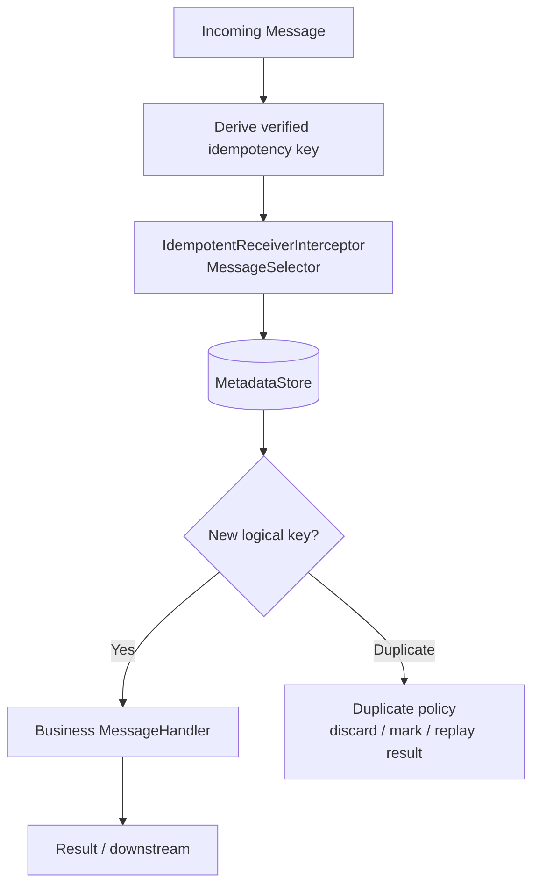

### Hai quyết định cần tách

1. **Message có được xử lý như một đóng góp mới không?** Đây là quyết định dedup/selection.
2. **Nếu message bị coi là trùng, caller hoặc hệ thống phải làm gì?** Có thể drop, đưa vào discard channel, gắn marker hoặc trả lại kết quả đã hoàn tất.

Hành vi trên duplicate của `IdempotentReceiverInterceptor` còn phụ thuộc cấu hình endpoint/advice. Đừng giả định rằng chỉ thêm interceptor sẽ luôn **drop** duplicate. Spring Integration có cơ chế header `duplicateMessage` và các tùy chọn discard/rejection; phải kiểm thử đúng cấu hình và phiên bản đang dùng.

### Advice không tự bao trùm toàn bộ pipeline

Nếu advice chỉ bao quanh **một** handler, những side effect đã xảy ra **trước handler đó** không được bảo vệ. Ví dụ:

```text
Incoming
  -> send welcome email          (chưa idempotent)
  -> IdempotentReceiver advice
  -> write business record
```

Ngay cả khi write record không trùng, welcome email đã có thể gửi hai lần. Đặt idempotency boundary **trước side effect cần bảo vệ**, hoặc cho mỗi operation có key riêng.

## 4. MessageHeaders.id không phải idempotency key nghiệp vụ

Một bản ghi có thể được redeliver qua nhiều hop và được xây thành nhiều Spring `Message<?>`. ID của các message mới có thể khác nhau:

```text
First attempt:
  payload.eventId = CAP-701
  headers.id      = 1d2a-...

Redelivery:
  payload.eventId = CAP-701
  headers.id      = 9a43-...
```

Nếu dùng `MessageHeaders.id` làm dedup key, cùng logical event có thể bị coi là hai message khác nhau.

**Khóa đúng** phụ thuộc nghiệp vụ, chẳng hạn:

```text
tenantId=merchant-42
captureId=CAP-701
operationType=POST_CAPTURE_LEDGER

IdempotencyKey =
  (tenantId, captureId, operationType)
```

Khóa này phải:

- Ổn định qua retry/redelivery của cùng operation.
- Khác nhau cho hai operation hợp lệ.
- Có namespace/tenant khi ID không duy nhất toàn hệ thống.
- Có stage/operation type nếu cùng event đi qua nhiều side effect độc lập.
- Không lệ thuộc vào thời gian nhận, số lần thử hoặc thread ID.
- Được tạo từ nguồn đáng tin, không cho client chiếm key của tenant khác.
- Có canonical representation nếu cần lưu qua Redis/JDBC/broker.

### Không dùng mỗi orderId cho mọi thao tác

Cùng một đơn hàng có thể có nhiều bước:

```text
PAYMENT_CAPTURE
RESERVE_INVENTORY
SEND_CONFIRMATION
CREATE_SHIPMENT
```

Nếu tất cả dùng key `ORD-101`, sau khi bước capture lưu key, bước reserve có thể bị coi là duplicate dù đó là operation khác. Thêm `operationType` vào idempotency namespace hoặc dùng key riêng theo command.

## 5. Atomic key registration: vì sao contains rồi add là sai?

Phản mẫu với hai worker:

```java
if (!processedIds.contains(key)) {
    processedIds.add(key);
    performBusinessEffect();
}
```

Hai thread có thể đồng thời thấy `contains(key)==false`:

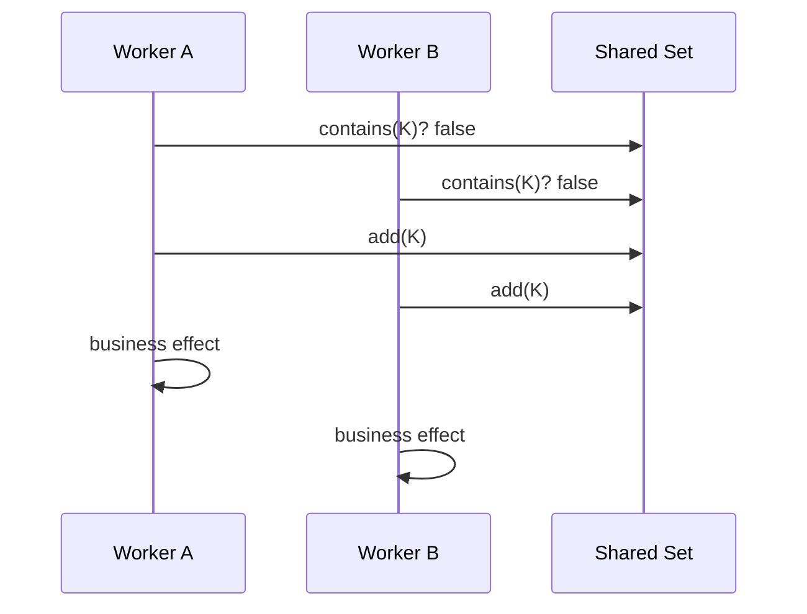

Dù tập hợp thread-safe ở từng thao tác, cặp thao tác **check-then-act** không atomically quyết định quyền xử lý.

### Dùng putIfAbsent/add atomic cho một JVM

```java
Set<String> seen = ConcurrentHashMap.newKeySet();

boolean firstArrival = seen.add(key);
if (firstArrival) {
    performBusinessEffect();
}
```

`ConcurrentHashMap.newKeySet().add(key)` giúp **chỉ một thread thắng cuộc** cho cùng key trong cùng JVM.

Nhưng vẫn có một vấn đề nghiêm trọng:

1. Worker A thêm key thành công.
2. Worker A crash **trước khi thực hiện business effect**.
3. Message redeliver; Worker B thấy key đã tồn tại.
4. Worker B bỏ message, business effect **chưa bao giờ xảy ra**.

Vì vậy, thao tác atomic `add` chỉ bảo đảm **một lần vào nhánh xử lý trong điều kiện bình thường của demo**, chưa bảo đảm **ít nhất một lần hoàn tất nghiệp vụ** khi có lỗi.

## 6. Mô hình khóa chứa namespace thay vì nối chuỗi không kiểm soát

Một key có thể là value object:

```java
package example.integration;

public record IdempotencyKey(
    String tenantId,
    String eventId,
    String operationType
) {
    public IdempotencyKey {
        if (tenantId == null || tenantId.isBlank()
                || eventId == null || eventId.isBlank()
                || operationType == null
                || operationType.isBlank()) {
            throw new IllegalArgumentException(
                "Thiếu thành phần idempotency key");
        }
    }
}
```

Dùng record giúp phân biệt tuple:

```text
("tenant:a", "event-1", "CAPTURE")
("tenant", "a:event-1", "CAPTURE")
```

Nếu nối ba field bằng dấu `:` không escape, hai tuple có thể sinh cùng string. Khi lưu trong MetadataStore dạng key string, dùng encoding canonical hoặc một internal operation ID từ registry, **không** dùng `Object.hashCode()` làm persistent identity.

### Với persistent metadata store

Nhiều triển khai `MetadataStore` nhận key/value là string. Một encoding đơn giản có kiểm soát có thể là **length-prefixed fields**:

```text
tenant="merchant-42"
event="CAP-701"
operation="POST_CAPTURE_LEDGER"

key:
  11:merchant-42|7:CAP-701|19:POST_CAPTURE_LEDGER
```

Con số độ dài trong ví dụ chỉ mang tính minh họa; code production nên sinh length-prefix tự động, không viết tay. Nếu ID có Unicode, phải quy định độ dài theo bytes hay ký tự để các service đa ngôn ngữ cùng tính key.

Một lựa chọn khác là dùng key token ngẫu nhiên do server/coordinator cấp, map tới một tuple đã được xác thực. Điều đó phù hợp khi muốn tránh lộ business identifiers qua metadata storage/logs.

## 7. Use case kiểm thử: ghi nhận payment capture event

Ta xây ví dụ tối giản:

- Producer có thể gửi cùng `PaymentCaptured` nhiều lần.
- Side effect demo là tăng counter và tạo `ProcessingReceipt`.
- Nhiều event hợp lệ khác nhau vẫn phải được xử lý.
- Cùng `eventId` ở **hai tenant khác nhau** là hai operation độc lập.
- Cùng event có thể được dùng bởi **hai loại operation** khác nhau: mỗi stage cần key riêng.
- Trong test concurrency, 20 thread gửi cùng một event; chỉ **một** được chấp nhận.

### Domain records

```java
package example.integration;

public record PaymentCaptured(
    String tenantId,
    String eventId,
    String captureId,
    long amountMinorUnits
) {
    public PaymentCaptured {
        if (tenantId == null || tenantId.isBlank()
                || eventId == null || eventId.isBlank()
                || captureId == null || captureId.isBlank()
                || amountMinorUnits <= 0L) {
            throw new IllegalArgumentException(
                "PaymentCaptured không hợp lệ");
        }
    }
}

public record ProcessingReceipt(
    String tenantId,
    String eventId,
    String status,
    long amountMinorUnits
) {}
```

Hai `public record` ở trên dùng file `.java` riêng trong project thực; chúng được trình bày cạnh nhau để dễ đọc.

### Nguồn identity đáng tin

Trong production, `tenantId` và `eventId` phải đến từ một nguồn được xác minh: JWT/service identity, signature của event, mapping merchant account, webhook authorization hoặc ingress normalization. Không dùng payload do user tùy ý gửi để **chiếm khóa của tenant khác**.

Đối với thanh toán, cần phân biệt `eventId` và `captureId`:

- `eventId` nhận diện một event/message logic do nguồn phát.
- `captureId` nhận diện capture transaction nghiệp vụ.
- Một capture có thể sinh nhiều event version hoặc trạng thái khác nhau.
- Idempotency key phải dùng entity/operation phù hợp yêu cầu side effect.

Trong demo, ta dùng `eventId` làm identity của thao tác ghi nhận event; với sổ cái thanh toán, có thể cần khóa `captureId + ledgerEntryType` để chống cả trường hợp upstream gửi **hai eventId khác nhau cho cùng một capture**.

## 8. Gate trong RAM dùng cho bài kiểm thử đồng thời

Ta sử dụng một `ConcurrentHashMap.newKeySet()` để minh họa atomic acceptance. Đây **không phải** cấu hình production có durability.

```java
package example.integration;

import java.util.Set;
import java.util.concurrent.ConcurrentHashMap;

public final class InMemoryIdempotencyGate {

    private static final String OPERATION =
        "RECORD_CAPTURE_EVENT";

    private final Set<IdempotencyKey> acceptedKeys =
        ConcurrentHashMap.newKeySet();

    public boolean accept(PaymentCaptured event) {
        IdempotencyKey key = new IdempotencyKey(
            event.tenantId(),
            event.eventId(),
            OPERATION);

        // Atomic trong phạm vi set của một JVM.
        return acceptedKeys.add(key);
    }

    public int seenKeyCount() {
        return acceptedKeys.size();
    }
}
```

### Những bảo đảm đúng của demo

- Hai thread tranh chấp **cùng key** trong một JVM: tối đa một lần `add` trả true.
- Hai key khác nhau: có thể được chấp nhận độc lập.
- Không cần một biến `currentEventId` mutable toàn cục.

### Những điều demo không bảo đảm

- Không giữ được keys qua restart.
- Không chia sẻ keys giữa hai JVM/pod.
- Không phân biệt `PROCESSING` và `COMPLETED`.
- Không rollback key khi handler sau Filter thất bại.
- Không phát lại business result cho duplicate request.
- Không có TTL, quota, encryption hoặc audit bền vững.
- Không có transaction giữa dedup mark và side effect.

**Mục tiêu của gate là làm bài toán duplicate/concurrency có thể kiểm thử**, sau đó chỉ ra các yêu cầu kiến trúc để làm đúng trong production.

## 9. Business processor demo: đo số lần side effect thực thi

```java
package example.integration;

import java.util.concurrent.atomic.AtomicInteger;

public final class CaptureEventProcessor {

    private final AtomicInteger invocationCount =
        new AtomicInteger();

    public ProcessingReceipt process(PaymentCaptured event) {
        invocationCount.incrementAndGet();

        return new ProcessingReceipt(
            event.tenantId(),
            event.eventId(),
            "RECORDED",
            event.amountMinorUnits());
    }

    public int invocationCount() {
        return invocationCount.get();
    }
}
```

`AtomicInteger` giúp test đếm thread-safe. Nó chỉ mô phỏng effect; không ghi DB, không gọi PSP, không gửi email và không có transaction.

**Không suy luận:** Nếu processor chạy đúng một lần trong test này thì toàn hệ thống sẽ thực thi đúng một lần khi crash, retry hoặc deploy nhiều instance. Ở production, phải kiểm thử failure windows, DB uniqueness, outbox và replay.

## 10. Spring Integration Java DSL: filter duplicate rồi xử lý một lần

Để test trọn flow, kết nối:

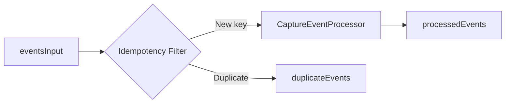

Ví dụ dưới đây dùng `filter(...)` với một gate atomic để hành vi duplicate **tường minh và dễ assert**. Đây là một cách thể hiện **Idempotent Receiver semantics** bằng các thành phần Spring Integration; mục sau sẽ giải thích việc dùng `IdempotentReceiverInterceptor` chuyên dụng.

### 10.1. Cấu hình channel và IntegrationFlow

```java
package example.integration;

import org.springframework.context.annotation.Bean;
import org.springframework.context.annotation.Configuration;
import org.springframework.integration.channel.DirectChannel;
import org.springframework.integration.channel.QueueChannel;
import org.springframework.integration.config.EnableIntegration;
import org.springframework.integration.dsl.IntegrationFlow;
import org.springframework.messaging.MessageChannel;

@Configuration
@EnableIntegration
public class IdempotentReceiverDemoConfiguration {

    @Bean
    public MessageChannel eventsInput() {
        return new DirectChannel();
    }

    @Bean
    public QueueChannel duplicateEvents() {
        return new QueueChannel();
    }

    @Bean
    public QueueChannel processedEvents() {
        return new QueueChannel();
    }

    @Bean
    public InMemoryIdempotencyGate gate() {
        return new InMemoryIdempotencyGate();
    }

    @Bean
    public CaptureEventProcessor processor() {
        return new CaptureEventProcessor();
    }

    @Bean
    public IntegrationFlow paymentEventFlow(
            InMemoryIdempotencyGate gate,
            CaptureEventProcessor processor) {

        return IntegrationFlow.from("eventsInput")
            .filter(PaymentCaptured.class, gate::accept,
                spec -> spec.discardChannel("duplicateEvents"))
            .transform(PaymentCaptured.class, processor::process)
            .channel("processedEvents")
            .get();
    }
}
```

### 10.2. Mỗi phần làm gì?

- `eventsInput` nhận `Message<PaymentCaptured>`.
- `gate.accept(...)` dùng `Set.add` atomic trong JVM để xác định key mới.
- `filter(...)` cho qua message có key lần đầu.
- `duplicateEvents` nhận message bị loại để test/audit; thực tế không nên biến queue này thành kho chứa duplicate vô hạn.
- `processor.process(...)` thực thi effect giả, tăng counter và trả `ProcessingReceipt`.
- `processedEvents` nhận một receipt của lần xử lý được phép.

### 10.3. Bảo đảm của cấu hình này có giới hạn

Nếu `processor.process(...)` throw exception **sau khi gate đã lưu key**, retry cùng event bị filter loại. Đây là cửa sổ lỗi cố hữu của thiết kế `check-in-memory-before-effect`.

Vì vậy, code phù hợp minh họa **duplicate delivery và concurrent acceptance**, chưa phù hợp sổ cái thanh toán production. Ở phần 23–27, ta sẽ thiết kế transactional idempotent processing và trạng thái `IN_PROGRESS/COMPLETED`.

### 10.4. Filter khác IdempotentReceiverInterceptor thế nào?

`Filter` là endpoint sàng lọc message. `IdempotentReceiverInterceptor` là **advice quanh handler** và có thể dùng `MetadataStoreSelector` để quyết định duplicate. Cùng thực hiện được mục tiêu nhận diện key đã gặp, nhưng:

- Vị trí áp dụng khác nhau: filter như một bước luồng, advice gắn với handler.
- Cách đánh dấu/reject/discard duplicate cần được cấu hình.
- Thứ tự advice, transaction, retry có thể ảnh hưởng semantics.
- Scope của side effect cần bảo vệ phải được xác định trước.

Khi dùng interceptor chuyên dụng, không được bỏ qua test duplicate vì giả định framework tự drop mọi message trùng.

## 11. JUnit 5 fixture: tách danh tính message và event

Tạo một test Spring context có queue đầu ra và Processor injectable.

```java
package example.integration;

import static org.junit.jupiter.api.Assertions.*;

import java.util.ArrayList;
import java.util.List;
import java.util.Set;
import java.util.concurrent.CountDownLatch;
import java.util.concurrent.Executors;
import java.util.concurrent.Future;
import java.util.concurrent.TimeUnit;

import org.junit.jupiter.api.Test;
import org.springframework.beans.factory.annotation.Autowired;
import org.springframework.beans.factory.annotation.Qualifier;
import org.springframework.integration.channel.QueueChannel;
import org.springframework.messaging.Message;
import org.springframework.messaging.MessageChannel;
import org.springframework.messaging.support.MessageBuilder;
import org.springframework.test.annotation.DirtiesContext;
import org.springframework.test.context.junit.jupiter.SpringJUnitConfig;

@SpringJUnitConfig(IdempotentReceiverDemoConfiguration.class)
@DirtiesContext(
    classMode = DirtiesContext.ClassMode.AFTER_EACH_TEST_METHOD)
class IdempotentReceiverDemoTest {

    @Autowired
    @Qualifier("eventsInput")
    MessageChannel input;

    @Autowired
    @Qualifier("processedEvents")
    QueueChannel processed;

    @Autowired
    @Qualifier("duplicateEvents")
    QueueChannel duplicates;

    @Autowired
    CaptureEventProcessor processor;

    @Autowired
    InMemoryIdempotencyGate gate;

    private PaymentCaptured event(
            String tenant,
            String eventId,
            String captureId) {

        return new PaymentCaptured(
            tenant, eventId, captureId, 125_000L);
    }

    private Message<PaymentCaptured> message(
            PaymentCaptured payload) {

        return MessageBuilder.withPayload(payload)
            .setHeader(
                "businessCorrelationId",
                "capture:" + payload.captureId())
            .build();
    }

    private void send(PaymentCaptured payload) {
        assertTrue(input.send(message(payload)));
    }

    // Các @Test bên dưới đặt trong cùng class.
}
```

### Tại sao dùng @DirtiesContext?

Gate của ví dụ giữ state trong RAM, và một số test cố ý gửi duplicates vào queue. `@DirtiesContext(AFTER_EACH_TEST_METHOD)` giúp mỗi test có gate và queues mới, tránh kết quả phụ thuộc test chạy trước.

Trong một test suite lớn, có thể dùng test fixture tạo store riêng và reset một cách kiểm soát để giảm chi phí khởi tạo context. Nhưng tuyệt đối không reset shared production idempotency state như một cách “sửa” test.

## 12. Test 1: cùng logical event gửi hai lần tuần tự

Đây là baseline:

```java
@Test
void duplicateEventIsProcessedOnlyOnce() {
    PaymentCaptured same =
        event("merchant-42", "E-101", "CAP-101");

    send(same);
    send(same);

    Message<?> first = processed.receive(1_000);
    assertNotNull(first);
    assertInstanceOf(
        ProcessingReceipt.class, first.getPayload());

    ProcessingReceipt receipt =
        (ProcessingReceipt) first.getPayload();

    assertEquals("E-101", receipt.eventId());
    assertEquals("RECORDED", receipt.status());

    // Không có business output thứ hai.
    assertNull(processed.receive(0));

    // Duplicate được route sang discard channel.
    Message<?> duplicate = duplicates.receive(1_000);
    assertNotNull(duplicate);
    assertEquals(same, duplicate.getPayload());
    assertNull(duplicates.receive(0));

    // Side effect giả được gọi một lần.
    assertEquals(1, processor.invocationCount());
    assertEquals(1, gate.seenKeyCount());
}
```

### Tại sao cần cả ba assertions?

1. **Output count = 1** chứng minh flow không phát hai receipt.
2. **Duplicate queue có message** chứng minh lần gửi thứ hai được xử lý theo chính sách discard, không biến mất vì lỗi send.
3. **Processor count = 1** chứng minh handler protected thực sự chỉ chạy một lần.

Nếu chỉ assert `processed.receive()` có một receipt, có thể đã có hai lần gọi processor nhưng một lần fail và không có output. Đếm invocation giúp phát hiện trường hợp đó ở demo.

### Ghi nhớ: MessageChannel.send(...) thành công không đồng nghĩa effect thành công

Lệnh `send` thành công chỉ nói message đã được chấp nhận vào channel/dispatch theo semantics của channel. Nó **không** chứng minh side effect downstream đã commit DB hoặc ack broker. Test trong `DirectChannel` đồng bộ có lợi vì phạm vi nhỏ, nhưng production cần thêm transaction/recovery test.

## 13. Test 2: Spring Message IDs khác nhau nhưng logical key vẫn trùng

Một thử nghiệm rất quan trọng là tạo **hai message mới**, không chỉ gửi lại cùng Java object:

```java
@Test
void differentSpringMessageIdsDoNotBypassDeduplication() {
    PaymentCaptured payload =
        event("merchant-42", "E-102", "CAP-102");

    Message<PaymentCaptured> m1 = message(payload);
    Message<PaymentCaptured> m2 = message(payload);

    assertNotEquals(
        m1.getHeaders().getId(),
        m2.getHeaders().getId());

    assertTrue(input.send(m1));
    assertTrue(input.send(m2));

    assertNotNull(processed.receive(1_000));
    assertNull(processed.receive(0));
    assertNotNull(duplicates.receive(1_000));

    assertEquals(1, processor.invocationCount());
}
```

Đây là cách bắt một lỗi thường gặp: dùng `MessageHeaders.id` thay cho business event ID làm idempotency key. Một consumer có thể nhận cùng event trong các Spring Message instances khác nhau và vẫn phải nhận diện là một logical contribution.

### Test bổ sung: payload giống nhau nhưng eventId khác

Hai event mua hàng có thể mang cùng số tiền và captureId? Trường hợp đó cần business rule riêng. Nếu hai **eventId khác nhau** được thiết kế là hai events hợp lệ, gate theo event ID sẽ cho qua cả hai. Ngược lại, nếu hai event IDs khác nhau nhưng cùng capture thực chất là một business operation, gate theo event ID **không đủ** để tránh double ledger entry.

Hãy phân biệt:

- *Dedupe transport event:* `(tenantId, eventId)`.
- *Idempotency business action:* `(tenantId, captureId, ledgerEntryType)`.

Chọn khóa theo effect cần bảo vệ, không chỉ theo độ tiện của payload.

## 14. Test 3: cùng eventId khác tenant không bị chặn nhầm

Trong một hệ thống nhiều tenant, event IDs có thể trùng nhưng không thuộc cùng nghiệp vụ.

```java
@Test
void sameExternalEventIdInDifferentTenantsIsIndependent() {
    send(event("merchant-42", "E-200", "CAP-A"));
    send(event("merchant-99", "E-200", "CAP-B"));

    Message<?> first = processed.receive(1_000);
    Message<?> second = processed.receive(1_000);

    assertNotNull(first);
    assertNotNull(second);

    Set<String> tenants = Set.of(
        ((ProcessingReceipt) first.getPayload()).tenantId(),
        ((ProcessingReceipt) second.getPayload()).tenantId());

    assertEquals(
        Set.of("merchant-42", "merchant-99"),
        tenants);

    assertEquals(2, processor.invocationCount());
    assertEquals(2, gate.seenKeyCount());
    assertNull(duplicates.receive(0));
}
```

**Idempotency namespace nên bao gồm tenant nếu event IDs không có tính duy nhất toàn cục.**

Tuy nhiên, hãy lưu ý `tenantId` chỉ là một field. Hệ thống phải lấy/kiểm tra nó từ identity đáng tin tại ingress; nếu không, attacker có thể cố tình đổi tenantId để bỏ qua deduplication hoặc chạm key của tenant khác.

## 15. Test 4: nhiều thread gửi cùng một logical event đồng thời

Một test tuần tự không phát hiện lỗi **check-then-act**. Cần một test khiến nhiều thread tranh chấp cùng key gần như đồng thời.

### Thiết kế deterministic

- Tạo 20 task dùng chung một `PaymentCaptured`.
- Mỗi task báo đã sẵn sàng qua `ready.countDown()`.
- Các task chờ cùng `startGate`.
- Khi mọi task sẵn sàng, test mở gate để tất cả `input.send(...)`.
- Chờ từng `Future` kết thúc có timeout.
- Chỉ một task được gate `add(key)` trả true.
- Còn lại 19 message đi vào `duplicateEvents`.

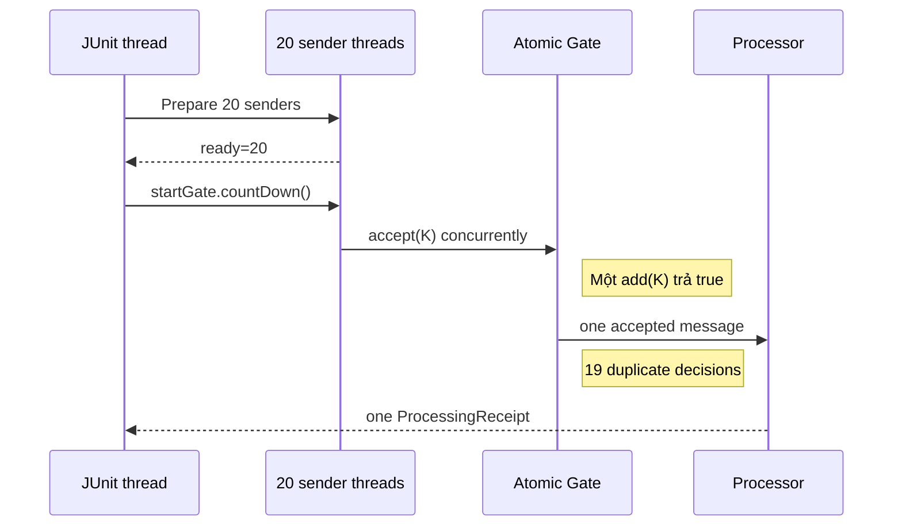

### Test JUnit 5

Bổ sung method sau vào `IdempotentReceiverDemoTest`:

```java
@Test
void concurrentDuplicateSendsInvokeProcessorOnce()
        throws Exception {

    final int senderCount = 20;
    PaymentCaptured same =
        event("merchant-42", "E-RACE", "CAP-RACE");

    var executor = Executors.newFixedThreadPool(senderCount);
    var ready = new CountDownLatch(senderCount);
    var startGate = new CountDownLatch(1);
    List<Future<?>> futures = new ArrayList<>();

    try {
        for (int i = 0; i < senderCount; i++) {
            futures.add(executor.submit(() -> {
                ready.countDown();

                if (!startGate.await(5, TimeUnit.SECONDS)) {
                    throw new IllegalStateException(
                        "Start gate timeout");
                }

                send(same);
                return null;
            }));
        }

        assertTrue(
            ready.await(5, TimeUnit.SECONDS),
            "Tất cả sender phải ready");

        startGate.countDown();

        for (Future<?> future : futures) {
            future.get(5, TimeUnit.SECONDS);
        }

        Message<?> winner = processed.receive(2_000);
        assertNotNull(winner);
        assertEquals(
            "E-RACE",
            ((ProcessingReceipt) winner.getPayload()).eventId());

        assertNull(processed.receive(0));
        assertEquals(1, processor.invocationCount());
        assertEquals(1, gate.seenKeyCount());

        // 19 duplicates, không có output business thứ hai.
        for (int i = 0; i < senderCount - 1; i++) {
            Message<?> rejected =
                duplicates.receive(2_000);
            assertNotNull(rejected);
            assertEquals(
                "E-RACE",
                ((PaymentCaptured) rejected.getPayload()).eventId());
        }

        assertNull(duplicates.receive(0));
    } finally {
        startGate.countDown(); // tránh strand worker nếu assert fail
        executor.shutdownNow();
    }
}
```

### Test chứng minh điều gì?

- `Set.add(key)` atomic giúp một key chỉ có một winner trong JVM.
- Tranh chấp đồng thời không làm Processor chạy 20 lần.
- Duplicate không bị mất dấu khi có `discardChannel`.
- Nhiều thread cùng gửi tới một `DirectChannel` có thể được xử lý cạnh tranh, nên store/gate cần thread-safe.

### Điều test không chứng minh

- Không có crash giữa gate và business effect.
- Không có nhiều pod với store khác nhau.
- Không có broker acknowledgement hay redelivery qua restart.
- Không có DB transaction hoặc exactly-once ledger entry.
- Không chứng minh code không có race ở mọi interleaving khác chỉ từ một lần chạy.

Có thể chạy stress lặp với nhiều rounds, test fault injection và transaction-level tests để tăng độ tin cậy. **Không dựa vào `Thread.sleep(...)` để “tạo race”**: sleep phụ thuộc scheduler và có thể khiến test vừa chậm vừa không kiểm soát được.

## 16. Test 5: nhiều khóa hợp lệ đồng thời đều được xử lý

Một gate quá thô, ví dụ chỉ dùng tenantId làm key, có thể chặn nhầm nhiều events thuộc cùng merchant.

```java
@Test
void independentEventsInSameTenantAllPass() {
    send(event("merchant-42", "E-301", "CAP-301"));
    send(event("merchant-42", "E-302", "CAP-302"));
    send(event("merchant-42", "E-303", "CAP-303"));

    assertNotNull(processed.receive(1_000));
    assertNotNull(processed.receive(1_000));
    assertNotNull(processed.receive(1_000));

    assertEquals(3, processor.invocationCount());
    assertEquals(3, gate.seenKeyCount());
    assertNull(processed.receive(0));
    assertNull(duplicates.receive(0));
}
```

Đây là bài test **không chặn sai**. Một hệ thống idempotent phải đồng thời thỏa:

1. **Safety:** không thực thi cùng effect trùng.
2. **Liveness:** vẫn cho các operation hợp lệ, khác key, được tiến hành.

Chỉ tối ưu “ít effect nhất” có thể dẫn đến gate khóa quá rộng và mất dữ liệu hợp lệ.

## 17. Bổ sung test cho key đúng ở đúng stage

Một event `PaymentCaptured` có thể cần hai operation độc lập:

```text
Event E-401:
   RECORD_LEDGER_ENTRY
   SEND_PAYMENT_NOTIFICATION
```

Nếu hai receiver dùng chung một key `tenantId + eventId` trong một metadata store, receiver notification có thể bị chặn vì ledger đã đánh dấu key.

Hợp đồng nên là:

```text
(merchant-42, E-401, RECORD_LEDGER_ENTRY)
(merchant-42, E-401, SEND_PAYMENT_NOTIFICATION)
```

Chúng là hai keys khác nhau. Mỗi stage có thể xử lý **một lần riêng** mà không làm trùng effect của stage khác.

### Không nhầm key theo stage với retry attempt

`retryAttempt=1`, `retryAttempt=2` là hai lần thực hiện của **cùng operation**, không được dùng làm phần khác nhau của idempotency key nếu muốn chặn trùng.

```text
Sai:
  eventId + ":" + retryAttempt

Đúng nếu là cùng logical operation:
  tenantId + eventId + operationType
```

Test cho stage-specific key có thể là unit test `assertNotEquals` trên hai `IdempotencyKey`, rồi integration test hai processing flows chia sẻ metadata store nhưng có namespace khác nhau.

## 18. Spring Integration IdempotentReceiverInterceptor chuyên dụng

Cách dùng `filter` ở mục 10 giúp test luồng minh bạch. Với endpoint có sẵn `MessageHandler`, có thể áp dụng advice:

```java
import org.springframework.integration.handler.advice
    .IdempotentReceiverInterceptor;
import org.springframework.integration.selector
    .MetadataStoreSelector;
import org.springframework.integration.metadata
    .ConcurrentMetadataStore;

// Phác họa cấu hình bean; cần import/đối chiếu API
// theo phiên bản Spring Integration trong project.

@Bean
IdempotentReceiverInterceptor idempotentAdvice(
        ConcurrentMetadataStore store) {

    var selector = new MetadataStoreSelector(
        store,
        message -> {
            PaymentCaptured event =
                (PaymentCaptured) message.getPayload();

            return canonicalIdempotencyKey(
                event.tenantId(),
                event.eventId(),
                "RECORD_CAPTURE_EVENT");
        });

    return new IdempotentReceiverInterceptor(selector);
}
```

`canonicalIdempotencyKey(...)` là hàm encode/normalize key **do ứng dụng định nghĩa**, không phải API mặc định của Spring Integration. Đoạn trên cố ý trình bày cách tổ chức selector/store/advice; bạn cần đặt bean vào advice chain của đúng handler và xác định duplicate policy.

### Cơ chế MetadataStoreSelector

`MetadataStoreSelector` có thể dùng metadata store để xác định key đã được chọn trước đó hay chưa, thường dựa vào khả năng conditional put của `ConcurrentMetadataStore`. Cách so sánh giá trị hoặc cho phép cập nhật giá trị cần được quy định riêng nếu sử dụng state/version thay đổi.

**Đừng dùng `SimpleMetadataStore` để tuyên bố an toàn giữa nhiều pod.** Nó phục vụ demo hoặc trạng thái của một application instance; production cần một store dùng chung có concurrency semantics đủ mạnh.

### Chọn duplicate policy có chủ đích

Các lựa chọn cần được cấu hình/kiểm thử với phiên bản Spring Integration đang sử dụng:

| Chính sách | Hành vi mong muốn | Khi phù hợp |
| --- | --- | --- |
| Discard duplicate | Không gọi business handler, route duplicate sang kênh audit nếu cần | Event fire-and-forget |
| Mark duplicate header | Vẫn truyền message nhưng đánh dấu để handler tự quyết định | Handler cần đọc status/return cached result |
| Throw rejection exception | Báo lỗi có cấu trúc | Contract coi duplicate là lỗi |
| Replay stored result | Trả lại kết quả business đã commit, không chạy effect | HTTP/Gateway request-response |

Spring Integration có header `duplicateMessage` cho việc đánh dấu duplicate và các tùy chọn discard/rejection trong Idempotent Receiver support. **Không xem việc gắn header là bằng chứng handler chắc chắn đã bị skip**. Test phải đếm invocation của handler thật và kiểm tra output/discard/error path.

### Advice order có thể làm đổi semantics

Ví dụ:

```text
Option A:
   RetryAdvice
      -> IdempotentReceiverAdvice
          -> Handler

Option B:
   IdempotentReceiverAdvice
      -> RetryAdvice
          -> Handler
```

Nếu một retry làm selector chạy lại sau khi key đã được claim, nó có thể bị coi là duplicate và **ngăn retry mà nghiệp vụ cần**. Ngược lại, nếu selector chỉ chạy một lần rồi retry handler phía trong, cần bảo đảm handler idempotent đối với side effect từng attempt.

Không chọn advice order theo thói quen; hãy viết **fault injection test** cho handler throw ở attempt đầu và thành công ở attempt sau.

## 19. Test retry thực tế: key được lưu trước effect thì sao?

Đây là một trong những tình huống quan trọng nhất:

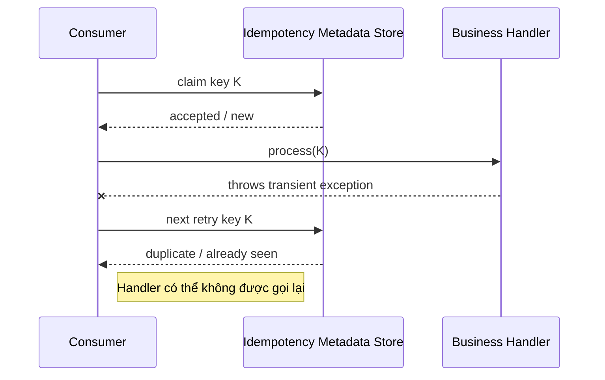

Trong demo ở mục 10, khi `gate.accept(...)` trả true, key nằm trong RAM ngay cả khi `processor.process(...)` thất bại. Retry sau đó sẽ bị discard. **Đó là lỗi liveness**: hệ thống ghi nhận đã thấy message nhưng chưa hoàn tất effect.

### Test nên chỉ ra giới hạn, không che giấu nó

Một fault injection test (tách khỏi flow demo) có thể:

1. Dùng processor ném exception ở attempt đầu.
2. Gửi logical event E-501.
3. Assert exception/đường lỗi.
4. Gửi lại E-501.
5. Xác nhận gate đã lưu key và retry bị chặn.
6. Ghi test này là **minh chứng giới hạn** của gate `seen-set`, không là expected production behavior.

Không nên sửa bằng cách **xóa key vô điều kiện khi catch exception**, vì effect có thể đã commit trước khi exception phát sinh:

```text
Handler:
  DB commit OK
  Network reply fails
Catch:
  remove(K)
Retry:
  DB commit again
```

Giải pháp phụ thuộc khả năng xác nhận trạng thái effect, transaction và idempotency của downstream.

## 20. Ba cửa sổ crash phải phân tích

Đặt hai thao tác:

- `R`: reserve/dedup key.
- `E`: business effect.
- `C`: mark completed.

### Crash trước R

```text
Message nhận nhưng chưa reserve key.
Consumer crash.
Broker redeliver.
```

Nếu broker và consumer cấu hình ack đúng, retry có thể thực hiện lại operation. Không có effect trước đó nên đây thường là trường hợp phục hồi đơn giản.

### Crash sau R, trước E

```text
Reserved(K)
    |
    X crash
Business effect chưa chạy
```

Nếu gate coi mọi key có mặt là completed, redelivery bị bỏ và **effect bị mất**. Cần phân biệt `PROCESSING` và `COMPLETED` hoặc transaction rollback reserve cùng với business effect.

### Crash sau E, trước C

```text
Reserved(K)
Business effect committed
    |
    X crash
Completed marker chưa ghi
```

Nếu hệ thống cho phép retry vì chưa thấy completed, nó có thể thực thi effect hai lần. Cần idempotency ở effect layer, outbox hoặc transaction đồng nhất giữa business write và completion marker nếu có thể.

### Crash sau C, trước broker ACK

```text
Business effect committed
Completed(K)
    |
    X crash before ACK
Broker redeliver
```

Idempotency store phát hiện `COMPLETED` và consumer nên không chạy lại effect. Với một request-response workflow, có thể đọc lại **stored result** để trả cho caller.

## 21. Những state nào cần có cho reliable processing?

Một registry idempotency production thường cần nhiều hơn một cờ “seen”:

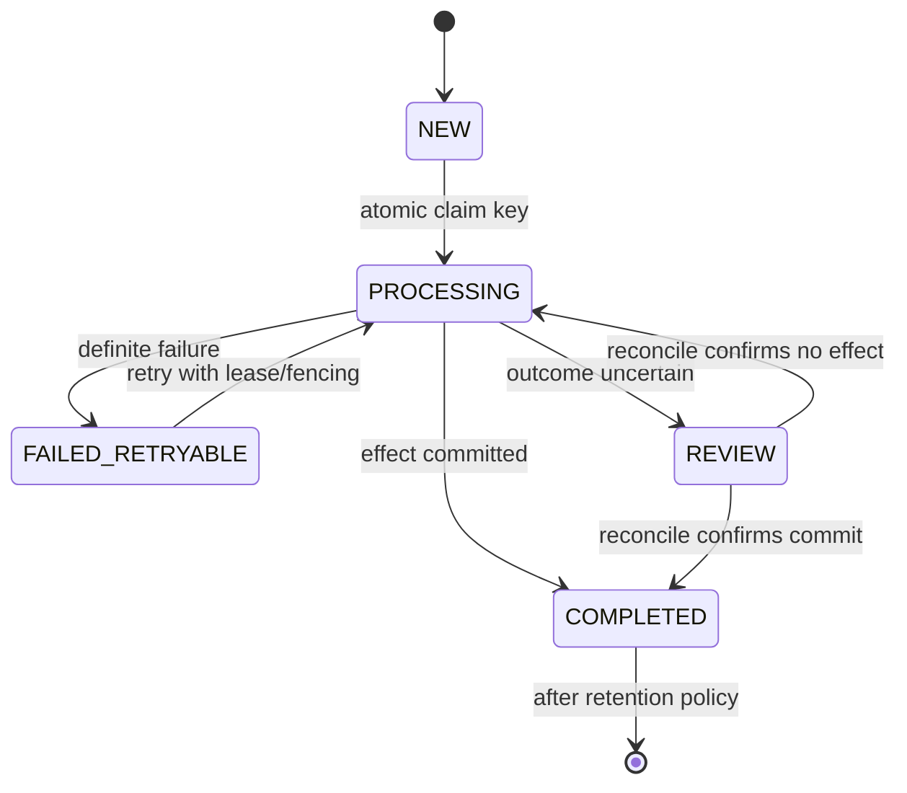

Một record gợi ý:

```java
public record IdempotencyRecord(
    String key,
    String payloadFingerprint,
    String status,
    String ownerId,
    long fencingToken,
    java.time.Instant leaseUntil,
    java.time.Instant completedAt,
    String resultReference
) {}
```

Đây là **domain design**, không phải record framework cung cấp sẵn.

### Lý do cần payload fingerprint

Nếu một client sử dụng lại cùng `idempotencyKey` nhưng gửi **payload khác**:

```text
Request 1:
  key=K, amount=100

Request 2:
  key=K, amount=999
```

Bỏ qua request 2 như một duplicate bình thường có thể che giấu bug hoặc abuse. Nên có chính sách:

- Key trùng + **cùng canonical request fingerprint**: duplicate/replay result.
- Key trùng + **fingerprint khác**: conflict (ví dụ HTTP 409), không thực hiện effect.
- Key mới: được phép tạo operation mới.

Fingerprint phải được tính từ **các field nghiệp vụ có ý nghĩa**, không từ header delivery attempt/timestamp thay đổi. Với dữ liệu nhạy cảm, lưu hash có kiểm soát và không log raw payload.

## 22. Xử lý stale PROCESSING: lease và fencing token

Nếu một worker giữ key ở trạng thái `PROCESSING` rồi chết, key có thể bị kẹt mãi.

Một giải pháp là lease có hạn:

```text
Claim K:
  status=PROCESSING
  owner=worker-A
  leaseUntil=T+30s
  fencingToken=7
```

Sau khi lease hết hạn, worker B có thể atomically giành quyền xử lý với token 8.

**Chỉ có lease là chưa đủ.** Worker A có thể bị pause dài rồi sống lại và tiếp tục thực hiện effect trong khi worker B cũng đang chạy. Phải có **fencing** hoặc business-side idempotency để worker cũ không commit stale work.

```text
Worker A: token=7, bị pause
Worker B: token=8, giành lease
Worker A: tiếp tục ghi với token=7
Database: reject stale token hoặc unique business operation
```

### Tránh xoá key khi lease hết hạn mà không có kiểm tra

Nếu record đã có effect COMMITTED nhưng trạng thái chưa update do crash, xóa key khi lease hết hạn sẽ mở cửa cho duplicate effect. Phải **reconcile** outcome hoặc dựa trên một transaction/unique constraint cho operation trước khi cho retry.

## 23. Idempotency production với database unique constraint

Nếu business effect là ghi database, một phương án mạnh là dùng **unique constraint** cùng transaction cho cả việc ghi idempotency record và business data.

### Schema minh họa

```sql
CREATE TABLE processed_operations (
    idempotency_key VARCHAR(300) PRIMARY KEY,
    payload_fingerprint VARCHAR(128) NOT NULL,
    status VARCHAR(30) NOT NULL,
    result_reference VARCHAR(300),
    completed_at TIMESTAMP
);

CREATE TABLE ledger_entries (
    ledger_entry_id VARCHAR(100) PRIMARY KEY,
    capture_id VARCHAR(100) NOT NULL,
    entry_type VARCHAR(40) NOT NULL,
    amount_minor_units BIGINT NOT NULL,
    UNIQUE (capture_id, entry_type)
);

CREATE TABLE outbox_events (
    outbox_id VARCHAR(100) PRIMARY KEY,
    event_type VARCHAR(100) NOT NULL,
    payload TEXT NOT NULL,
    published_at TIMESTAMP
);
```

Schema chỉ minh họa; trong hệ thống nhiều tenant cần đưa `tenant_id` vào unique constraints/business keys phù hợp, và lựa chọn kiểu dữ liệu/SQL theo database thực tế.

### Atomic transaction pattern

```text
BEGIN TRANSACTION

  INSERT idempotency_key K
  IF KEY ALREADY COMMITTED:
      validate fingerprint
      return stored result (không chạy effect)

  INSERT ledger entry
      với UNIQUE (tenant, captureId, entryType)

  UPDATE idempotency record:
      status = COMPLETED
      result = ledgerEntryId

  INSERT outbox event:
      LEDGER_ENTRY_POSTED

COMMIT
```

Nếu mọi write quan trọng nằm **trong cùng DB transaction**, crash trước commit có thể rollback toàn bộ: retry được phép làm lại. Nếu commit thành công rồi broker redeliver, record/unique constraint cho phép phát hiện operation đã hoàn tất và **không nhân đôi ledger entry**.

### Một skeleton SQL minh họa

```sql
BEGIN;

INSERT INTO processed_operations (
    idempotency_key,
    payload_fingerprint,
    status
)
VALUES (
    :key,
    :fingerprint,
    'PROCESSING'
)
ON CONFLICT (idempotency_key) DO NOTHING;

-- Ứng dụng phải kiểm tra số row inserted.
-- Nếu 0 row: đọc record cũ và xử lý completed/conflict
-- theo chính sách riêng; không chèn ledger entry lần nữa.
-- Nếu 1 row: thực hiện các write thuộc cùng transaction.

INSERT INTO ledger_entries (
    ledger_entry_id,
    capture_id,
    entry_type,
    amount_minor_units
)
VALUES (
    :entryId,
    :captureId,
    'CAPTURE',
    :amount
)
ON CONFLICT (capture_id, entry_type) DO NOTHING;

UPDATE processed_operations
SET status = 'COMPLETED',
    result_reference = :entryId,
    completed_at = CURRENT_TIMESTAMP
WHERE idempotency_key = :key;

INSERT INTO outbox_events (
    outbox_id,
    event_type,
    payload
)
VALUES (
    :outboxId,
    'LEDGER_ENTRY_POSTED',
    :outboxPayload
);

COMMIT;
```

**Đây là skeleton để giảng giải**, không phải stored procedure tự chạy và chưa bao gồm tenant scope, kiểm tra ownership, result consistency, row counts hoặc exception mapping. Cú pháp `ON CONFLICT` là ví dụ theo PostgreSQL; database khác có cách thực hiện khác.

### Vì sao có hai unique constraints?

- `processed_operations.idempotency_key` chặn lặp của cùng request/event stage.
- `ledger_entries(capture_id,entry_type)` bảo vệ **business effect** ngay cả khi upstream tạo một event ID khác cho cùng capture.

Chỉ có idempotency key theo `eventId` không chặn được trường hợp nguồn phát hai event IDs khác nhau cho một capture nghiệp vụ nếu contract cho rằng chúng là cùng operation.

### Concurrency giữa hai DB transactions

Hai pods cùng chạy `INSERT idempotency_key=K`. Database unique constraint và transaction isolation/locking phải đảm bảo tối đa một transaction có thể commit record K ở trạng thái phù hợp. Transaction còn lại cần đọc kết quả đã commit hoặc chờ/retry theo database behavior.

**Không thực hiện logic `SELECT exists → INSERT` không có unique constraint**: hai DB transactions vẫn có thể cùng thấy không tồn tại. Việc có unique constraint, transaction boundary đúng và xử lý conflict/retry mới tạo bảo đảm cần thiết.

## 24. Nếu side effect là HTTP API ngoài database thì sao?

Không thể gộp tùy tiện một lời gọi HTTP bên ngoài vào transaction DB nội bộ. Ví dụ:

```text
BEGIN DB transaction
  reserve K
  call external payment API
  mark K completed
COMMIT
```

Nếu external API đã capture thành công rồi consumer crash trước DB commit, retry có thể gọi capture lần nữa.

### Các cách giải quyết phù hợp

1. **External API cung cấp idempotency key:** gửi cùng một key ổn định khi retry, và xác minh guarantee/retention của provider.
2. **Query/reconciliation:** khi outcome không chắc chắn, tra trạng thái operation ở provider bằng business reference trước khi gọi lại.
3. **Outbox + dedicated dispatcher:** trong DB transaction ghi intent, sau commit dispatcher thực hiện external request và lưu outcome/idempotency state.
4. **Saga/compensation:** nếu không thể bảo đảm atomic effect, cần business compensation khi phát hiện duplicate hoặc thất bại nửa chừng.
5. **Quarantine/manual review:** với thao tác tiền có trạng thái không xác định, tránh retry mù.

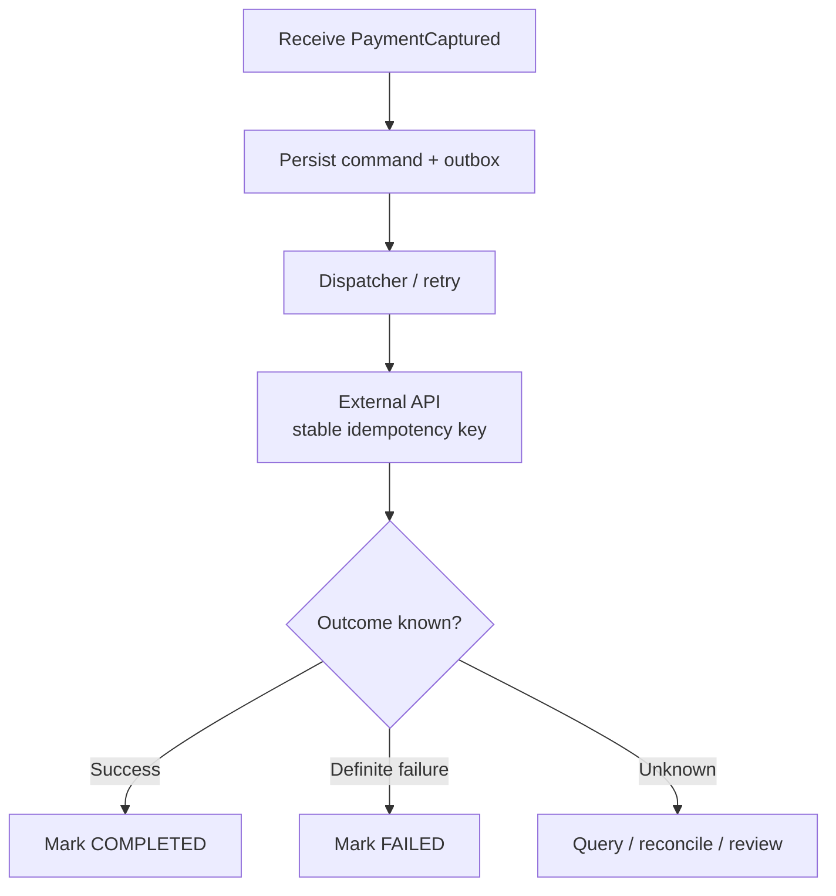

**Không tuyên bố** một Redis key hay một Spring advice tự tạo exactly-once effect xuyên HTTP, DB và broker. Đó là bài toán transaction/reconciliation nhiều hệ thống.

## 25. Test crash sau commit, trước ACK: quan trọng hơn chỉ gửi message hai lần

Một integration test production cần mô phỏng:

1. Consumer xử lý E-601 và commit DB entry.
2. Chưa ack broker, giả lập crash/network error.
3. Broker redeliver E-601 trong một Spring Message khác.
4. Consumer đọc idempotency record `COMPLETED`.
5. Không có thêm ledger entry.
6. Nếu API contract cần reply, trả lại result đã lưu.
7. Broker có thể ack redelivery khi xử lý đã được xác nhận.

### Assertion cốt lõi

```java
// Pseudo-test dùng DB test container / adapter thật.
@Test
void redeliveryAfterCommitDoesNotDuplicateLedgerEntry() {
    PaymentCaptured event =
        event("merchant-42", "E-601", "CAP-601");

    consumeAndCommitWithoutAck(event);
    redeliverSameBusinessEvent(event);

    assertEquals(1,
        ledgerRepository.countByCaptureId("CAP-601"));

    assertEquals("COMPLETED",
        idempotencyRepository
            .findStatusFor(event, "RECORD_CAPTURE_EVENT"));
}
```

Đây là **test fragment mô tả hợp đồng**, không thể chạy độc lập nếu chưa có `ledgerRepository`, `idempotencyRepository`, `consumeAndCommitWithoutAck` và broker test fixture.

### Những trường hợp khác cần fault injection

| Vị trí lỗi | Dữ liệu có thể còn | Kỳ vọng |
| --- | --- | --- |
| Trước reserve | Chưa có key/effect | Redelivery được xử lý |
| Sau reserve nhưng trước effect (cùng transaction chưa commit) | Transaction rollback | Retry được phép |
| Effect DB và marker cùng transaction commit | Cả hai bền | Retry thấy completed |
| External effect thành công nhưng response mất | Outcome chưa chắc | Reconcile hoặc API idempotency |
| Mark completed trước broker ack | Record completed | Redelivery không nhân đôi effect |
| Metadata store tạm mất kết nối | Không quyết định an toàn | Fail closed / retry sau |
| Lease hết hạn nhưng worker cũ còn sống | Hai worker có thể tranh | Fencing/unique effect |
| Key bị xóa do TTL | Không còn bằng chứng | Duplicate có thể bị coi là new |

## 26. Kiểm thử đồng thời trên hai pod khác với 20 threads trong một JVM

Ví dụ test mục 15 dùng một `InMemoryIdempotencyGate` và một Java process. Hai pods mỗi pod có một gate độc lập sẽ cùng accept key K:

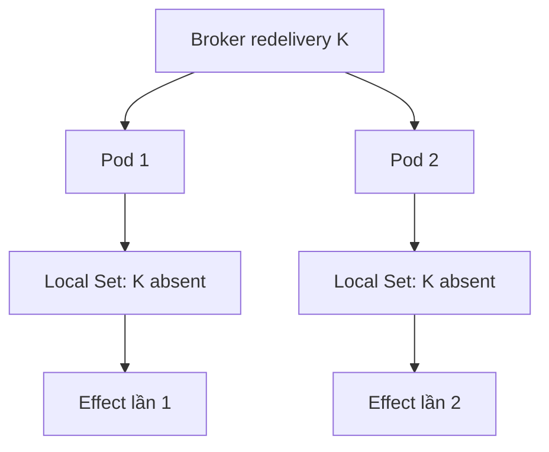

Muốn an toàn cross-process:

- Dùng shared `ConcurrentMetadataStore` có **conditional insert** atomic phù hợp.
- Hoặc dùng database unique constraint/transaction cho operation.
- Hoặc partition ownership đúng để một key chỉ tới một consumer, nhưng vẫn cần chống replay sau restart/rebalance.
- Với stateful workflow, có thể dùng coordinator/lease với fencing và business idempotency.

### Test hai pods nên làm gì?

1. Khởi chạy hai consumer instances trỏ tới **cùng backend store**.
2. Đồng bộ cùng lúc gửi/event replay cùng `key=K`.
3. Quan sát kết quả claim key ở cả hai.
4. Đếm số business effect đã commit tại DB (không chỉ invocation count).
5. Giả lập một pod mất kết nối hoặc crash trong khi xử lý.
6. Kiểm tra lease, retry, kết quả và không mất operation.
7. Lặp lại test sau restart của từng pod và cả backend store.

Đừng coi `SimpleMetadataStore` thread-safe trong một JVM là bằng chứng rằng nó đồng bộ được giữa nhiều pods.

### Shared store cũng phải có atomic semantics

Nếu nhiều nodes cùng dùng một database nhưng ứng dụng vẫn chạy `SELECT exists` rồi `INSERT` không có unique constraint, race vẫn tồn tại. Shared storage **không tự đồng nghĩa** with atomic claim. Phải có compare-and-set, `putIfAbsent` thật sự atomic của backend hoặc transaction/unique key.

## 27. MetadataStoreSelector và cửa sổ TTL

Metadata store thường giữ các keys đã được chấp nhận. Nếu dữ liệu tồn tại mãi, dung lượng tăng. Nếu xóa quá sớm, duplicate cũ có thể được coi như mới.

```text
Day 1:  process K -> COMPLETED
Day 2:  metadata TTL expires -> K removed
Day 3:  broker/event replay K
        -> system accepts as NEW
```

### Cách chọn retention

Thời gian giữ record phải xét:

- Broker retry/redelivery window.
- Thời gian job có thể replay.
- TTL idempotency key của upstream provider.
- Thời gian cần reconcile tranh chấp/chargeback.
- Thời gian business operation có thể hợp pháp bị gọi lại.
- Quy định retention và data minimization.

Nếu hệ thống có thể replay một event sau 90 ngày nhưng metadata chỉ tồn tại 24 giờ, không được quảng bá dedup guarantee 90 ngày. Hoặc phải có business unique constraint bền vững khác bảo vệ effect.

### Phân biệt TTL của metadata với expiry của workflow

Một group Aggregator có thể expire sau 10 phút; idempotency record của từng child có thể cần giữ lâu hơn để tránh late duplicate. Hai vòng đời khác nhau, không được dùng chung TTL theo thói quen.

### Eviction khi đang PROCESSING

Không xóa tùy tiện một PROCESSING record chỉ vì TTL. Nếu worker còn chạy, key có thể bị claim lại và gây xử lý đồng thời. Cần lease/fencing và heartbeat/policy phục hồi rõ.

## 28. Gateway request-reply: duplicate không nên tự động bị drop rồi timeout

Một API client gửi request với `Idempotency-Key: K`, sau đó mất kết nối và gửi lại cùng request. Nếu pipeline dùng Filter drop duplicate, Gateway lần 2 có thể không nhận reply và timeout.

Đó là trải nghiệm không tốt, dù effect không bị lặp.

### Kết quả mong muốn cho request-response

| Trạng thái key | Hành vi API hợp lý |
| --- | --- |
| Chưa từng thấy | Reserve, xử lý và trả result |
| `PROCESSING` | Trả trạng thái pending hoặc cho chờ trong giới hạn |
| `COMPLETED`, fingerprint trùng | Trả lại **stored result** mà không chạy effect |
| `COMPLETED`, fingerprint khác | Trả conflict, không chạy effect |
| `FAILED_RETRYABLE` | Retry theo policy và lease |
| `UNKNOWN/REVIEW` | Trả trạng thái để reconcile, không làm effect mù |

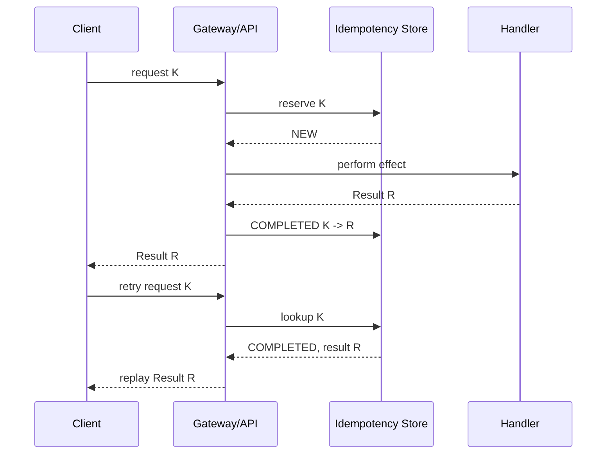

### Vì sao không thể chỉ dùng `duplicateMessage=true`?

Một header duplicate cho handler biết đây là message lặp. Nó không chứa kết quả business đã commit, không xác định claimant, không cung cấp response cache và không chứng minh payload giống request trước. Muốn replay response, phải có **result store** và input fingerprint.

### Correlation không thay idempotency

Gateway có thể dùng request correlation để đưa reply tới đúng caller. Nhưng hai HTTP requests retry cùng operation có thể có **hai reply channels khác nhau** trong khi dùng cùng idempotency key.

- `requestCorrelationId`: ánh xạ **reply về đúng lời gọi**.
- `idempotencyKey`: nhận diện **business effect không được lặp**.
- `businessCorrelationId`: theo dõi luồng nghiệp vụ.
- `MessageHeaders.id`: ID một Spring Message.

Đừng dùng stale `replyChannel` của request đầu tiên để trả reply cho request retry sau khi Gateway cũ đã timeout.

## 29. Idempotent Receiver với Filter, Router và Publish-Subscribe

### Đặt gate trước hay sau Router?

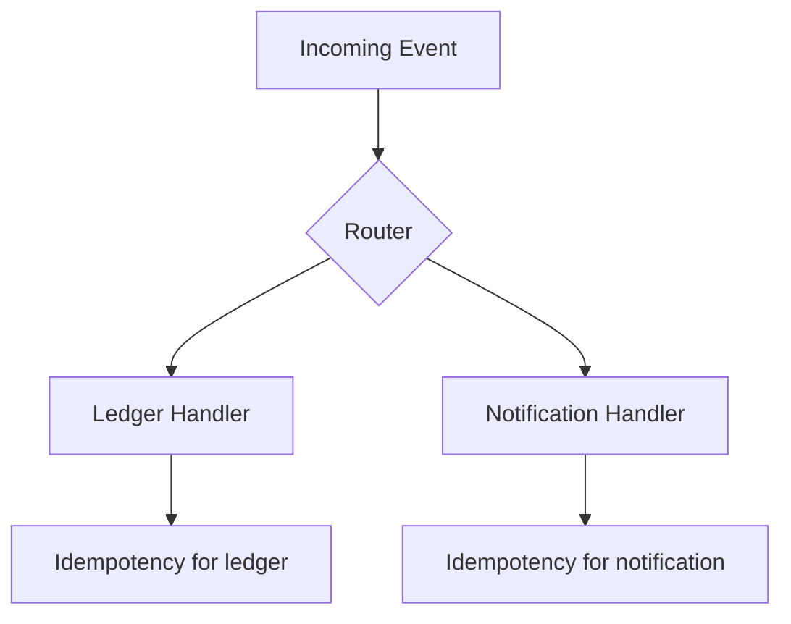

Nếu một event đi vào **chỉ một nhánh** để xử lý một effect, có thể đặt gate ở ingress trước Router.

Nếu một event được đưa tới **nhiều nhánh có effect độc lập** (Recipient List/Publish-Subscribe), cần chọn idempotency key theo **từng operation/subscriber**:

```text
(merchant-42, E-701, WRITE_LEDGER)
(merchant-42, E-701, SEND_NOTIFICATION)
(merchant-42, E-701, UPDATE_METRICS)
```

Một gate duy nhất trước fan-out có thể chặn toàn event khi retry, dù một subscriber trước đó đã thất bại còn những subscriber khác thành công. Với luồng cần retry độc lập từng subscriber, mỗi nhánh nên có ownership/idempotency record riêng.

### Filter khác duplicate

Filter có thể loại event vì business rule, ví dụ đơn dưới một ngưỡng hoặc schema không được chấp nhận. Idempotency Gate loại event vì **logical operation đã được xử lý/được claim**. Không gộp cả hai vào một lý do `FILTERED` vì đường khôi phục khác nhau.

### Router không được làm thay đổi logical key tùy tiện

Nếu cùng một effect bị route tới handler khác do config thay đổi, nó vẫn cần một idempotency identity bền vững hoặc rule migration. Không dùng tên channel hiện tại như duy nhất một phần của key nếu đổi topology có thể làm cùng business effect bị chạy lại.

## 30. Splitter/Aggregator: dedup theo từng child, không theo group

Một batch có ba child:

```text
Batch B-101
  -> Child 1: event=E-1
  -> Child 2: event=E-2
  -> Child 3: event=E-3
```

Nếu tất cả child dùng chung `correlationId=G` và gate dedup chỉ theo G:

```text
Receive Child 1 -> key=G accepted
Receive Child 2 -> key=G duplicate (bị drop sai)
Receive Child 3 -> key=G duplicate (bị drop sai)

Aggregator chỉ còn Child 1 và không đủ group.
```

Khóa đúng ở child boundary nên gồm:

```text
Child key:
  (groupRunId, partIndex, operationType)

Group completion key:
  (groupRunId, AGGREGATE_RESULT)
```

Correlation ID và idempotency key **có thể liên quan nhưng phục vụ hai mục tiêu khác nhau**.

### Với Aggregator

Một duplicate child có thể làm `group.size()` đạt expected dù thiếu logical child khác, hoặc khiến release rule chặt bị kẹt vì group chứa duplicate. Vì vậy:

1. Deduplicate logical child trước khi đưa vào Aggregator.
2. Release strategy kiểm tra unique part/sequence khi nghiệp vụ yêu cầu.
3. Có recovery cho dữ liệu mâu thuẫn, không chờ vô hạn.
4. Output processor chỉ tạo kết quả đúng khi group đã đủ.
5. Group completion result có idempotency riêng ở downstream.

### Với Resequencer

Duplicate có cùng `sequenceNumber` có thể phá contract sắp thứ tự hoặc gây late/replayed message sau khi nhóm đã đóng. Dùng logical event/window/sequence key; không lấy toàn `correlationId` làm key cho tất cả phần tử của chuỗi.

## 31. Retry và error channel: bảo đảm không bị mất operation

Một nguyên tắc quan trọng: **duplicate và failure không phải cùng một sự kiện**.

- Duplicate: key đã xuất hiện; cần xác định completed/in-progress/conflict.
- Business failure: effect trả kết quả thất bại có thể là terminal.
- Transient failure: service không sẵn sàng, có thể retry.
- Unknown outcome: đã gọi external API nhưng không biết effect commit hay chưa.
- Invalid input: schema/permission sai, thường không nên retry cùng message.

### Error channel giúp quan sát lỗi, không tự khôi phục state

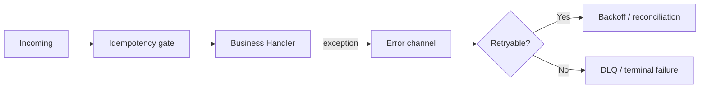

Nếu gate đã lưu key K trước handler, một retry quay lại **qua gate** có thể bị chặn. Error handler không tự sửa điều đó. Cần thiết kế state machine/transaction và lời gọi retry đúng scope.

### Dùng retry advice quanh endpoint

Thứ tự giữa retry advice, transaction advice và idempotent advice có thể thay đổi lần nào được đánh giá selector. Hãy kiểm thử một handler giả:

```text
Attempt 1: throws retryable exception
Attempt 2: succeeds
Expected:
  business effect committed once
  idempotency state COMPLETED
  no permanent lost event
```

Đừng tuyên bố “dùng `RequestHandlerRetryAdvice` và `IdempotentReceiverInterceptor` là tự ổn” nếu chưa kiểm tra thứ tự advice và transactional boundaries.

### Khi nào gửi DLQ?

- Input không hợp lệ và không thể tự sửa.
- Key trùng nhưng payload fingerprint mâu thuẫn.
- Retry hết ngân sách, outcome vẫn không chắc chắn.
- Payload/schema không tương thích sau upgrade.
- Sự cố quyền tenant/authorization.
- Idempotency metadata bị corrupt.

DLQ record phải có event ID, tenant, operation, reason và retry/reconciliation state; không log thông tin thẻ/tokens nhạy cảm.

## 32. Observability: đo duplicate và effect, không chỉ inbound traffic

Một hệ thống có thể nhận 100.000 messages nhưng chỉ có 90.000 unique operations. Nếu metric chỉ đếm inbound, dễ nhầm traffic với throughput nghiệp vụ.

### Các metric gợi ý

| Metric | Ý nghĩa |
| --- | --- |
| `receiver.messages.received` | Tổng message đã đến |
| `receiver.keys.new` | Số key được reserve lần đầu |
| `receiver.messages.duplicates` | Số message có key đã biết |
| `receiver.keys.conflict` | Key trùng nhưng fingerprint khác |
| `receiver.keys.processing` | Số operation đang xử lý |
| `receiver.keys.completed` | Số operation hoàn tất |
| `receiver.keys.stale_lease` | Số lease quá hạn |
| `receiver.reconciliations` | Số lần xác minh outcome không chắc chắn |
| `receiver.effect.commits` | Số business effects commit thật |
| `receiver.effect.retries` | Số retry thực tế |
| `receiver.replay_results` | Số lần trả lại stored result |
| `receiver.store.errors` | Số lỗi metadata store |
| `receiver.outbox.backlog` | Số pending outbound effects/events |

### Log có cấu trúc

```text
eventId=E-101 tenant=merchant-42
operation=RECORD_CAPTURE_EVENT
state=NEW
action=RESERVED

eventId=E-101 tenant=merchant-42
operation=RECORD_CAPTURE_EVENT
state=COMPLETED
resultRef=LEDGER-401

eventId=E-101 tenant=merchant-42
operation=RECORD_CAPTURE_EVENT
state=COMPLETED
action=DUPLICATE_REPLAYED
```

Đây là log minh họa, không phải output mặc định của Spring Integration.

Tránh đưa từng `eventId`/`idempotencyKey` làm metric label có cardinality cao. Dùng logs/traces để tra một event; với key nhạy cảm, log hash hoặc reference đã được sanitize.

### Phân biệt ba loại thành công

```text
MESSAGE_ACCEPTED:
    Channel nhận message.

IDEMPOTENCY_RESERVED:
    Một worker đã claim logical key.

BUSINESS_COMPLETED:
    Effect đã commit và trạng thái có thể truy xuất.
```

Một record `RESERVED` không chứng minh effect hoàn tất. Dashboard nên thể hiện các trạng thái này riêng.

## 33. Những lỗi thiết kế thường gặp

### 33.1. Dùng MessageHeaders.id để dedup

Message mới khi redelivery có ID khác. Dùng stable event/business ID.

### 33.2. Check rồi add bằng hai thao tác

Hai thread có thể cùng qua được. Dùng atomic `putIfAbsent` hoặc DB uniqueness/transaction.

### 33.3. Dùng metadata store RAM trên nhiều pod

Mỗi pod nhận cùng key là lần đầu. Dùng shared/atomic store hoặc DB business uniqueness.

### 33.4. Đánh dấu seen trước effect rồi không xử lý failure

Crash giữa hai bước làm mất operation. Dùng transaction hoặc state machine/recovery.

### 33.5. Xóa key vô điều kiện khi handler throw

Effect có thể đã commit nhưng response thất bại. Retry sau xóa có thể nhân đôi effect. Reconcile outcome trước.

### 33.6. Coi duplicateMessage header là đã skip handler

Tùy cấu hình interceptor; phải kiểm tra invocation/discard/throw behavior thực tế.

### 33.7. Dùng cùng key cho các subscriber độc lập

Ledger được xử lý rồi notification bị chặn. Namespace theo operation/subscriber.

### 33.8. Chặn các child vì dùng correlationId làm dedup key

Mọi child trong cùng group chia sẻ correlation ID. Key phải định danh từng logical child/effect.

### 33.9. Trả Gateway timeout khi request trùng

Nếu effect đã completed, trả lại stored result; nếu đang processing, trả pending/wait theo contract.

### 33.10. Không kiểm tra payload fingerprint

Cùng key nhưng amount khác phải là conflict, không tự coi request thứ hai hợp lệ hoặc silently ignored.

### 33.11. TTL quá ngắn

Key hết hạn trước cửa sổ replay/redelivery và duplicate cũ đi qua. Retention phải phù hợp SLA.

### 33.12. Dùng lease mà không có fencing

Worker cũ sống lại có thể commit khi worker mới đã chiếm lease. Cần fencing/unique effect.

### 33.13. Coi MetadataStore tồn tại là exactly-once

Selector chỉ là một thành phần. Exactly-once business effect cần transaction/idempotency/reconciliation.

### 33.14. Chỉ test duplicate tuần tự

Test không phát hiện check-then-act race. Phải có test concurrent keys, multi-instance và crash.

## 34. Bài thực hành: receiver xử lý sự kiện đặt hàng

**Bối cảnh:** ứng dụng nhận `OrderPaid` từ hai merchants. Mỗi event được gửi qua broker, có thể redeliver. Mỗi đơn cần thực hiện hai effects: ghi sổ thanh toán và gửi xác nhận.

### Phần A — Gate trong JVM

1. Tạo immutable `OrderPaid(merchantId,eventId,orderId,amount)`.
2. Chọn `IdempotencyKey(merchantId,eventId,operationType)`.
3. Tạo gate với `ConcurrentHashMap.newKeySet().add`.
4. Dùng Spring Integration Java DSL lọc key đã xử lý.
5. Gửi cùng event hai lần với **hai Message IDs khác nhau**.
6. Assert processor chỉ chạy một lần, duplicate được đưa vào queue riêng.
7. Gửi nhiều events khác nhau cùng merchant, xác nhận tất cả được xử lý.
8. Gửi cùng eventId khác merchant, xác nhận không bị chặn nhầm.
9. Dùng 20 threads và `CountDownLatch` gửi cùng key, assert một winner.
10. Giải thích tại sao test chưa chứng minh an toàn qua restart.

### Phần B — Kiểm thử thất bại và recovery

11. Giả lập handler throw sau khi gate đã nhận key.
12. Đưa ra test chứng minh retry bị chặn nếu gate chỉ có trạng thái “seen”.
13. Thiết kế `PROCESSING`, `COMPLETED` và `FAILED_RETRYABLE`.
14. Dùng DB unique constraint trên operation key.
15. Đặt idempotency marker, business write và outbox trong một DB transaction khi có thể.
16. Giả lập crash sau DB commit trước broker ACK.
17. Redeliver và assert chỉ một ledger entry tồn tại.
18. Giả lập external API trả timeout sau khi thực hiện effect; reconcile trước khi retry.
19. Test reused idempotency key với amount khác phải báo conflict.
20. Thiết kế lease/fencing cho worker chết khi đang PROCESSING.

### Phần C — Multi-service và EIP

21. Tạo nhánh ledger và notification với **operation namespaces riêng**.
22. Nếu Splitter phát N child, gắn idempotency key riêng theo child index/event ID.
23. Đưa result vào Aggregator và test duplicate child không làm release sai.
24. Thêm Gateway trả cached result cho request trùng đã hoàn tất.
25. Giả lập error channel/retry advice, kiểm tra state không kẹt.
26. Thử hai instances cùng shared store, không dùng hai independent RAM sets.
27. Đặt retention key dài đủ với replay window.
28. Bổ sung metric `new/duplicate/completed/conflict/stale` và structured logs.

### Bảng test cần đạt

| Tình huống | Kết quả mong đợi |
| --- | --- |
| Cùng event gửi hai lần tuần tự | Một effect, một duplicate |
| Cùng logical event nhưng Message ID khác | Vẫn được coi là duplicate |
| Hai keys khác nhau | Hai effects hợp lệ |
| Cùng eventId nhưng khác tenant | Không chặn nhầm nếu identity hợp lệ |
| 20 threads tranh cùng key | Một winner trong cùng shared atomic gate |
| Hai pods độc lập RAM | Test phải phát hiện nguy cơ double effect |
| Two pods + DB unique transaction | Không có hai commits cho cùng business key |
| Crash sau claim, trước effect | Retry/recovery không làm mất operation |
| Crash sau effect commit, trước ACK | Redelivery không nhân đôi effect |
| Key trùng nhưng request payload khác | Conflict, không thực hiện effect |
| Key completed và Gateway retry | Replay stored result |
| Lease hết hạn, worker cũ trở lại | Stale worker không được commit |
| Splitter tạo ba child cùng group | Cả ba child hợp lệ được xử lý |
| Child redeliver vào Aggregator | Không đếm thêm logical contribution |
| Key TTL hết trước replay window | Kiểm thử phơi bày giới hạn retention |

### Câu hỏi tự đánh giá

**Câu 1.** Vì sao dùng `ConcurrentHashMap.newKeySet().add` tốt hơn `contains` rồi `add`?

*Vì `add` thực hiện quyết định thêm key atomically trong phạm vi set của JVM, tránh hai thread cùng qua cửa kiểm tra.*

**Câu 2.** Gate atomic trong RAM có bảo đảm business effect chính xác một lần khi crash không?

*Không. Nếu key đã được ghi nhưng effect chưa commit, retry có thể bị chặn; nếu effect commit nhưng metadata chưa cập nhật, retry có thể nhân đôi effect.*

**Câu 3.** Tại sao không dùng `MessageHeaders.id` cho idempotency key?

*Vì cùng logical event có thể được bọc trong các Spring Message mới với IDs khác nhau khi redelivery.*

**Câu 4.** `IdempotentReceiverInterceptor` có luôn drop duplicate không?

*Không nên giả định. Hành vi đánh dấu, discard hoặc throw phụ thuộc cấu hình; phải test handler invocation và các output channels.*

**Câu 5.** Có nên dùng cùng một key cho ledger và notification?

*Không nếu chúng là hai effects độc lập cần retry/commit riêng. Nên namespace theo operation type.*

**Câu 6.** Tại sao test 20 threads không chứng minh an toàn giữa hai pod?

*Vì hai pod có thể dùng hai stores độc lập. Cần shared atomic store hoặc unique constraint, cùng test restart/concurrency cross-process.*

**Câu 7.** Khi key đã COMPLETED nhưng client retry cùng request, API nên làm gì?

*Trả stored result nếu fingerprint trùng; không chạy effect lần nữa.*

**Câu 8.** Khi key trùng nhưng amount khác thì sao?

*Báo conflict và giữ effect ban đầu; không xử lý request mới dưới key cũ.*

**Câu 9.** Vì sao chỉ giữ key qua 24h có thể không đủ?

*Broker hoặc nghiệp vụ có thể replay sau 24h. Key bị xóa sẽ cho phép duplicate được coi như mới nếu không có business uniqueness khác.*

**Câu 10.** Retry advice, idempotent advice và transaction có thể cấu hình theo thứ tự bất kỳ không?

*Không. Thứ tự áp dụng quyết định selector có chạy lại và effect được retry trong transaction nào. Cần test fault injection theo topology thật.*

## 35. Checklist production

- **Logical identity:** key gắn đúng tenant, event/business operation và stage.
- **Canonical key:** không collision, không dùng message ID/attempt/timestamp.
- **Authorization:** tenant và business ID có nguồn đáng tin.
- **Atomic claim:** backend hỗ trợ `putIfAbsent`/unique constraint thật sự atomic.
- **Multi-node:** không phụ thuộc RAM của một pod.
- **Payload fingerprint:** key trùng, payload khác là conflict rõ ràng.
- **Processing state:** phân biệt NEW, PROCESSING, COMPLETED, REVIEW.
- **Transaction:** business effect + completion marker atomic khi cùng DB.
- **External effects:** dùng provider idempotency keys, outbox hoặc reconciliation.
- **Lease/fencing:** stale worker không thể commit sau khi mất ownership.
- **Retry:** xử lý crash giữa reserve/effect/complete/ack.
- **TTL:** retention phù hợp replay/redelivery và yêu cầu kiểm toán.
- **Duplicate policy:** discard/mark/throw/replay có contract rõ.
- **Gateway:** request trùng trả cached result hoặc pending, không timeout mù.
- **Routing:** namespace riêng cho từng subscriber/operation.
- **Splitter:** key riêng cho từng child, không dùng group correlation ID làm dedup key.
- **Aggregator:** unique logical contributions, tránh poison group bởi duplicates.
- **Error channel:** ghi rõ retryable, conflict, invalid và unknown outcome.
- **Observability:** đo received, reserved, completed, duplicate, conflict, stale và effect commits.
- **Tests:** sequential duplicate, distinct Message IDs, tenant isolation, 20-thread race, multi-pod, crash, transaction replay và key expiry.

## 36. Kết luận

**Kiểm thử message lặp và xử lý đồng thời** là phần cốt lõi của Idempotent Receiver trong Spring Integration. Một kiểm thử đủ tốt không dừng ở việc gửi cùng message hai lần tuần tự; nó cần **nhiều thread cùng tranh một key**, một logical event được bọc trong các Message IDs khác nhau, nhiều operations hợp lệ và các cửa sổ crash/retry.

Trong phạm vi demo, `ConcurrentHashMap.newKeySet().add` và Spring Integration `Filter` cho thấy cách chặn một logical key atomically trong một JVM. `IdempotentReceiverInterceptor` kết hợp `MetadataStoreSelector` cung cấp cách tích hợp theo advice, nhưng **hành vi duplicate và phạm vi bảo vệ phải được cấu hình/kiểm thử**.

Trong production, **idempotent message selection không đồng nghĩa exactly-once business effect**. Cần key nghiệp vụ đáng tin, shared atomic store hoặc database uniqueness, transaction/outbox, result replay, state machine, TTL thích hợp, reconciliation khi outcome không chắc chắn, và idempotency riêng cho mỗi side effect. Khi các bảo đảm đó được đo và kiểm thử, pipeline Router/Filter/Splitter/Aggregator/Gateway của Spring Integration mới có thể chịu được duplicate delivery, concurrency và retry mà không mất hoặc nhân đôi nghiệp vụ.
