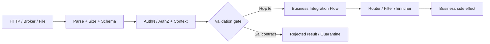
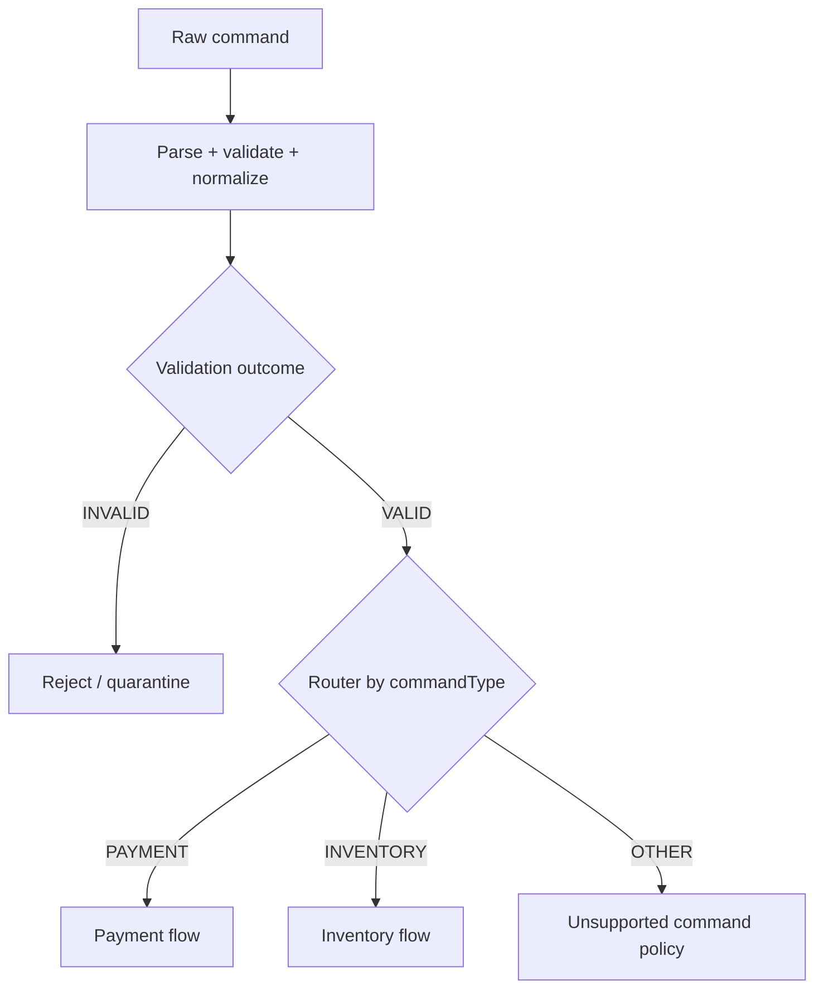
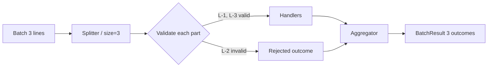
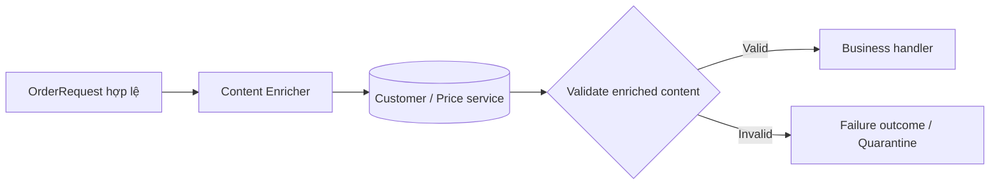
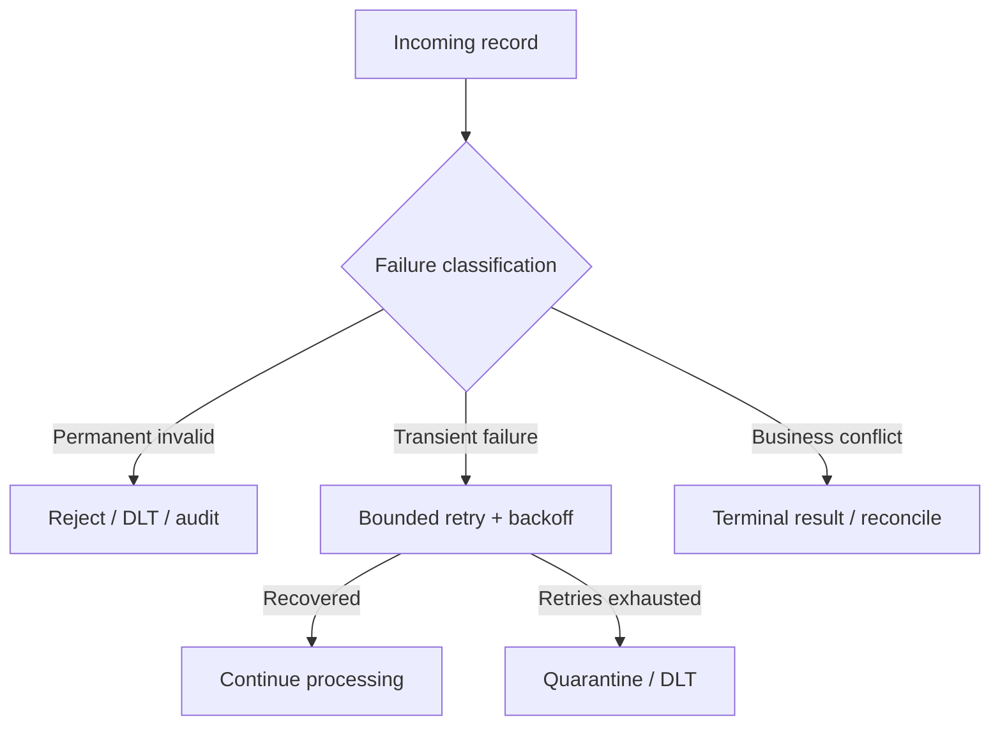

# Validation trước khi đưa message vào flow

Một hệ thống tiếp nhận yêu cầu xử lý đơn hàng từ REST API, AMQP hoặc Kafka. Có request hợp lệ, nhưng cũng có message thiếu mã đơn, `quantity=0`, sai kiểu dữ liệu, tenant không được phép thao tác, hoặc dữ liệu quá lớn. Nếu các message ấy đi thẳng đến **Router**, **Transformer**, **Splitter**, **Gateway** hay handler ghi database, lỗi có thể xuất hiện muộn: route nhầm, phát sinh side effect trước khi phát hiện sai, tạo message group chờ mãi hoặc khiến broker retry vô hạn một payload không thể sửa bằng retry.

**Validation trước khi đưa message vào flow** là thiết kế một **ranh giới kiểm tra đáng tin cậy**: dữ liệu đi từ thế giới bên ngoài vào hệ thống phải được parse, xác thực và đánh giá hợp đồng trước khi được phép tới **luồng nghiệp vụ chính**. Tùy nguồn, một phần kiểm tra diễn ra **trước khi tạo Spring `Message<?>`**, một phần diễn ra tại **endpoint đầu tiên của Spring Integration flow**; điều quan trọng là message chưa được gửi tới những bước nghiệp vụ có thể gây tác dụng phụ khi chưa đạt điều kiện.

Bài này thuộc chương **Message filter và validation** của module `SPRING_INTEGRATION_PATTERN`. Theo mục tiêu học **Enterprise Integration Patterns với Spring Integration**, chúng ta sẽ xây các luồng thông điệp ít phụ thuộc, dễ mở rộng, có Router, Filter, Transformer, Splitter, Aggregator, Gateway, retry, error channel và correlation; đồng thời kiểm thử cả message hợp lệ, message bị từ chối và lỗi hạ tầng.

> **Phân biệt cốt lõi:** **Validation** trả lời “message có đáp ứng hợp đồng để tham gia xử lý không?”; **Filter** trả lời “message này có được cho đi tiếp trên nhánh này không?”. Message **không hợp lệ** thường cần một kết quả từ chối có lý do, còn message **hợp lệ nhưng không phù hợp với nhánh** có thể được discard/reroute theo chính sách. Không coi mọi `Filter=false` là exception và không dùng retry để sửa dữ liệu sai cố định.

## 1. Một lỗi đầu vào có thể làm hỏng cả luồng

Giả sử producer gửi:

```json
{
  "tenantId": "TENANT-A",
  "orderId": "ORD-101",
  "sku": "BOOK-02",
  "quantity": -3
}
```

Nếu không kiểm tra đầu vào:

1. **Router** chọn nhánh xử lý đơn hàng như một request bình thường.
2. **Content Enricher** gọi Inventory API để kiểm tra tồn kho cho số lượng âm.
3. **Transformer** cố tính `totalPrice` từ dữ liệu không hợp lệ.
4. Handler có thể **ghi trạng thái sai** hoặc ném exception.
5. Adapter tự động retry cùng payload vì thấy lỗi kỹ thuật.
6. Message lặp không bao giờ thành công, nhưng vẫn chiếm consumer, connection, group store và log.

Một thiết kế có cổng kiểm tra:



**Lợi ích của kiểm tra sớm:** lỗi có thể được trả về producer trước side effect; log và metric có mã lỗi rõ; các bước phía sau nhận dữ liệu có **invariants** được công bố, thay vì mỗi handler phải tự đoán null/kiểu dữ liệu/giới hạn.

Tuy nhiên, validation **không biến đầu vào thành dữ liệu bất biến suốt đời**. Sau enrichment, mapping, gọi hệ thống ngoài hoặc thay đổi business state, một số invariants có thể cần kiểm tra lại.

## 2. “Trước flow” là ranh giới nào trong Spring Integration?

Có ba vị trí thực tế:

| Vị trí | Ví dụ | Thực hiện được điều gì |
| --- | --- | --- |
| **Trước khi tạo `Message<?>`** | REST controller, deserializer, adapter parser. | Giới hạn body/size, media type, cú pháp JSON, authentication, Bean Validation trên DTO. |
| **Tại ingress endpoint đầu tiên** | Spring Integration `IntegrationFlow.from("orders.ingress")` rồi `.transform(...)`/`.filter(...)`. | Validate payload/header đã chuyển thành message, route outcome trước nhánh nghiệp vụ. |
| **Ngay trước một side-effect boundary** | Service Activator gọi DB/Payment/Inventory, handler publish broker. | Kiểm tra trạng thái nghiệp vụ, quyền hiện tại, điều kiện commit, identity/idempotency. |

Nếu dùng `.filter(...)` làm bước đầu tiên của `IntegrationFlow`, message **đã bước vào một technical flow** tại input channel rồi. Vì vậy, câu “trước khi đưa message vào flow” nên hiểu chính xác là **trước khi vào business processing flow/nhánh có side effect**. Muốn từ chối ngay **trước khi gửi vào bất cứ Integration Channel nào**, phải validation ở controller/adapter hoặc một lớp ingress bên ngoài trước lời gọi `send(...)`.

```text
External request
  ├─ Transport/encoding/length check
  ├─ Authentication + authorization
  ├─ Parse DTO + field validation
  └─ Create Message and send to trusted ingress channel
      ├─ Integration validation/normalization gate
      ├─ Router/Filter/Transformer
      └─ Business handler/Outbound Gateway
```

**Không có một lệnh `@Valid` duy nhất tự chạy ở mọi Spring Integration channel.** Cần xác định lớp nào kích hoạt Bean Validation, exception được phát ra ở đâu và ai chịu trách nhiệm trả lỗi cho HTTP caller hoặc broker consumer.

## 3. Năm lớp kiểm tra đầu vào

| Lớp | Ví dụ | Khi nào thường kiểm tra? |
| --- | --- | --- |
| **Transport/encoding** | Content-Type, payload size, message framing, ký tự không hợp lệ. | Ngay ở HTTP/broker/file adapter. |
| **Syntax & schema** | JSON hợp lệ, field bắt buộc, kiểu Integer, schema version. | Deserialize trước/ở ingress. |
| **Constraint validation** | `quantity > 0`, `orderId` không trắng, chiều dài SKU. | Bean Validation/validator gần ingress. |
| **Identity & authorization** | Caller có quyền trên `tenantId/orderId` không? | Ranh giới xác thực/ủy quyền, trước side effect. |
| **Business/state validation** | Đơn chưa thanh toán thì không được ship; stock đủ không? | Sau khi có trạng thái mới nhất, sát thao tác nghiệp vụ. |

### 3.1. Schema validation khác business validation

Thông điệp có thể **đúng JSON và đúng DTO** nhưng sai nghiệp vụ:

```json
{
  "tenantId": "TENANT-A",
  "orderId": "ORD-101",
  "sku": "BOOK-02",
  "quantity": 500
}
```

`quantity=500` có thể thỏa `@Positive` nhưng vi phạm chính sách “mỗi dòng tối đa 100 sản phẩm”. Hoặc quantity hợp lệ nhưng tài khoản người gửi **không được phép** mua SKU này. Phải định nghĩa từng điều kiện ở **đúng tầng**:

- Hợp đồng DTO: giá trị dương, kích thước giới hạn, field bắt buộc.
- Business policy: hạn mức được áp dụng theo tenant/gói dịch vụ/version.
- Authorization: caller có quyền gửi thao tác này.
- Hạ tầng: DB/API đang trả lời được hay không.

Đừng trả `400 Bad Request` cho mọi lỗi hạ tầng; ngược lại, không retry mãi một `quantity=-3` chỉ vì exception bị gom vào một error channel chung.

### 3.2. Validated không đồng nghĩa trusted

Một DTO có `@NotBlank tenantId` chỉ chứng minh field không rỗng. Nó **không chứng minh** tenant thuộc quyền người gọi. Nếu đưa tenant ID từ client vào correlation key, dedup key hoặc route mà không kiểm chứng, có thể làm trộn nhóm/định tuyến dữ liệu sang tenant khác.

### 3.3. Kiểm tra độ lớn trước khi parse nếu có thể

Một body 200 MB hoặc collection hàng triệu phần tử có thể tạo áp lực bộ nhớ ngay lúc deserialization, **trước khi chạy validator**. Cần giới hạn request size, depth, số phần tử và tài nguyên ở adapter/API gateway theo hạ tầng. Không kỳ vọng `@Size` trên một List sẽ luôn bảo vệ được khỏi mọi chi phí cấp phát trước đó.

## 4. Định nghĩa hợp đồng message trước khi viết predicate

Trước khi viết code, hãy trả lời:

1. Những loại message nào được chấp nhận?
2. Ai được gửi và vào những business channel nào?
3. Metadata nào được dùng làm correlation/idempotency key?
4. Các field nào bắt buộc, có phạm vi/định dạng nào?
5. Lỗi dữ liệu nào **không thể retry** nếu không thay payload?
6. Lỗi nào cần **trả response**, lỗi nào **quarantine**, lỗi nào **drop có chủ đích**?
7. Sau validation, có bảo đảm gì để downstream dựa vào?

Ví dụ contract `OrderRequest`:

| Trường | Quy tắc | Lý do |
| --- | --- | --- |
| `tenantId` | Không rỗng, phải được đối chiếu với authenticated caller. | Tách dữ liệu và quyền. |
| `orderId` | Không trắng; đúng giới hạn và uniqueness scope. | Routing/correlation/trace. |
| `sku` | Không trắng; giới hạn ký tự/độ dài. | Chọn đúng sản phẩm. |
| `quantity` | Integer dương, trong hạn mức. | Tránh side effect sai về số lượng. |
| `schemaVersion` | Phiên bản đã được hỗ trợ. | Tránh deserialize sai khi rolling deploy. |
| `operationId` | Ổn định qua retry, không tùy ý thay. | Idempotent Receiver/command replay. |

**Hợp đồng đầu vào** nên được version hóa và kiểm thử giữa producer/consumer. Không lấy việc DTO compile được ở JVM làm bằng chứng một producer Python/Node/Kafka đã tuân thủ.

## 5. Bean Validation: kiểm tra trường cơ bản

Ví dụ Java dùng **Jakarta Bean Validation** với một `record`. Cần có implementation tương thích, thường được cung cấp qua `spring-boot-starter-validation` trong Spring Boot hoặc cấu hình `LocalValidatorFactoryBean` riêng trong Spring Framework.

```java
// OrderRequest.java
import jakarta.validation.constraints.NotBlank;
import jakarta.validation.constraints.NotNull;
import jakarta.validation.constraints.Positive;
import jakarta.validation.constraints.Size;

public record OrderRequest(
    @NotBlank @Size(max = 40) String tenantId,
    @NotBlank @Size(max = 64) String orderId,
    @NotBlank @Size(max = 40) String sku,
    @NotNull @Positive Integer quantity
) {}
```

**Tại sao `Integer` thay vì `int`?** Với `Integer`, một giá trị thiếu/null có thể được phát hiện bằng `@NotNull`. Với primitive `int`, một quá trình binding nào đó có thể tạo giá trị mặc định `0`; cần hiểu behavior của JSON deserializer đang dùng.

### 5.1. Bean Validation chỉ chạy khi được gọi

Viết `@NotBlank` trên DTO **không tự kích hoạt validation** cho mọi `Message<OrderRequest>` do integration flow nhận. Một cách tường minh:

```java
import jakarta.validation.ConstraintViolation;
import jakarta.validation.Validator;
import java.util.Set;

Set<ConstraintViolation<OrderRequest>> validate(
        Validator validator, OrderRequest request) {
    return validator.validate(request);
}
```

Với REST/Spring MVC, `@Valid @RequestBody` có thể kích hoạt kiểm tra trong quá trình binding theo cấu hình MVC. Với Spring Integration, ta có thể gọi `Validator` trong một **Transformer/Service Activator đầu flow** hoặc dùng một validator/selector phù hợp. **Không mặc định `@Valid` đặt trên bất kỳ method nào của handler cũng sẽ được interceptor tự gọi**.

### 5.2. Đừng dùng thông báo dịch thuật làm machine error code

Thông báo như `"must not be blank"` có thể thay đổi theo locale/implementation. Để producer xử lý ổn định, trả **error code** dựa trên constraint/domain rule và field path; trình bày thông báo cho người dùng ở lớp khác. Không trả giá trị nhạy cảm của field qua error message.

## 6. Thiết kế kết quả validation rõ ràng

Nếu chỉ trả `true/false`, hệ thống khó phân biệt SKU thiếu với quantity âm. Ta có thể định nghĩa một **envelope kết quả**:

```java
// ValidationIssue.java
public record ValidationIssue(String field, String code) {}

// ValidationOutcome.java
import java.util.List;

public record ValidationOutcome(
    OrderRequest request,
    List<ValidationIssue> issues
) {
    public ValidationOutcome {
        issues = List.copyOf(issues);
    }

    public boolean accepted() {
        return issues.isEmpty();
    }
}
```

`ValidationOutcome` là DTO ứng dụng tự thiết kế, **không phải class mặc định của Spring Integration**.

### 6.1. Một Validation Gate dùng `jakarta.validation.Validator`

```java
// OrderValidationGate.java
import jakarta.validation.Validator;
import java.util.ArrayList;
import java.util.Comparator;
import java.util.List;

public final class OrderValidationGate {

    private final Validator validator;

    public OrderValidationGate(Validator validator) {
        this.validator = validator;
    }

    public ValidationOutcome evaluate(OrderRequest request) {
        List<ValidationIssue> issues = new ArrayList<>();

        validator.validate(request).forEach(v -> {
            String field = v.getPropertyPath().toString();
            String code = v.getConstraintDescriptor()
                .getAnnotation().annotationType().getSimpleName();
            issues.add(new ValidationIssue(field, code));
        });

        if (request.quantity() != null
                && request.quantity() > 100) {
            issues.add(new ValidationIssue(
                "quantity", "MAX_PER_ORDER_LINE"));
        }

        issues.sort(Comparator
            .comparing(ValidationIssue::field)
            .thenComparing(ValidationIssue::code));

        return new ValidationOutcome(request, issues);
    }
}
```

**Điểm kỹ thuật:**

- `validate(request)` kiểm tra các constraint khai báo trên record.
- `quantity > 100` là quy tắc nghiệp vụ giản lược để thấy **schema/field validation** và **domain policy** có thể hợp tác.
- Chỉ lưu **field + error code**, không lưu `getInvalidValue()` hoặc dump request nguyên bản.
- `evaluate(...)` không làm I/O hoặc side effect, nên có thể unit test độc lập.
- Trong sản phẩm thật, chính sách “100” cần được cấu hình/version hóa theo hợp đồng, không nhất thiết hard-code.

### 6.2. Vì sao outcome thay vì exception trong demo?

Một validation gate có thể **trả dữ liệu về lỗi** để Router chọn channel:

```text
OrderRequest
   → evaluate(...)
       ├─ ValidationOutcome(issues=[]) → orders.validated
       └─ ValidationOutcome(issues=[...]) → orders.rejected
```

Ưu điểm: luồng hợp lệ và luồng từ chối đều là **business outcomes có quan sát được**, không cần ném exception cho mọi field sai. Nhưng với lỗi **không thể deserialize**, lỗi bảo mật nghiêm trọng hoặc hệ thống metadata đang unavailable, có thể không tạo được `ValidationOutcome`; cần error path riêng.

## 7. Java DSL: validation trước nhánh nghiệp vụ chính

Ví dụ dưới đây xây **một ingress flow đồng bộ** gồm:

1. Nhận `OrderRequest` tại `orders.ingress`.
2. Chuyển thành `ValidationOutcome`.
3. Dùng Router chuyển sang kênh accepted/rejected.
4. Test đọc kết quả từ `QueueChannel`, **không thực hiện ghi DB hay gọi Inventory**.

```java
// OrderValidationConfiguration.java
import org.springframework.context.annotation.Bean;
import org.springframework.context.annotation.Configuration;
import org.springframework.integration.channel.QueueChannel;
import org.springframework.integration.config.EnableIntegration;
import org.springframework.integration.dsl.IntegrationFlow;
import org.springframework.validation.beanvalidation.LocalValidatorFactoryBean;

@Configuration
@EnableIntegration
public class OrderValidationConfiguration {

    @Bean
    LocalValidatorFactoryBean orderBeanValidator() {
        return new LocalValidatorFactoryBean();
    }

    @Bean
    OrderValidationGate orderValidationGate(
            LocalValidatorFactoryBean orderBeanValidator) {
        return new OrderValidationGate(orderBeanValidator);
    }

    @Bean("orders.validated")
    QueueChannel validatedOrders() {
        return new QueueChannel(32);
    }

    @Bean("orders.rejected")
    QueueChannel rejectedOrders() {
        return new QueueChannel(32);
    }

    @Bean
    IntegrationFlow validateOrderIngress(
            OrderValidationGate gate) {
        return IntegrationFlow.from("orders.ingress")
            .transform(OrderRequest.class, gate::evaluate)
            .route(ValidationOutcome.class,
                outcome -> outcome.accepted()
                    ? "orders.validated"
                    : "orders.rejected")
            .get();
    }
}
```

**Luồng này có ý nghĩa gì?**

- `orders.ingress` là **technical entry channel**; message đầu vào đã được tạo trước khi send.
- `.transform(...)` chủ động gọi gate, không đợi validation xảy ra “ma thuật”.
- `.route(...)` chọn channel theo `accepted()`, **không trộn `ValidationOutcome` bị từ chối vào business queue**.
- Hai `QueueChannel` phục vụ minh họa/test. Trong production, nhánh `orders.validated` phải nối tiếp tới handler nghiệp vụ, còn nhánh `orders.rejected` cần error response/audit/quarantine theo yêu cầu.

**Chú ý API:** Cú pháp DSL minh họa các overload `transform(Class, Function)` và `route(Class, Function)` thường gặp. Khi tích hợp module thật, cần đối chiếu phiên bản Spring Integration đang dùng. Đoạn code chưa kiểm thử Gradle và chưa cấu hình transport.

### 7.1. Tại sao chưa chuyển thẳng `OrderRequest` qua kênh accepted?

Ví dụ intentionally chuyển **`ValidationOutcome`** để test nhìn thấy lý do cả hai nhánh. Nếu handler downstream chỉ nhận `OrderRequest`, có thể thêm một flow riêng:

```text
orders.validated
    → transform(ValidationOutcome::request)
    → orders.business
```

Khi dùng `QueueChannel` làm đầu vào của một consumer flow, cần **poller** hoặc lựa chọn channel phù hợp; đừng đơn giản khai báo một `IntegrationFlow.from(QueueChannel)` rồi kỳ vọng consumer chủ động chạy nếu không có polling endpoint. Có thể thay bằng `DirectChannel` cho chuyển tiếp đồng bộ, còn `QueueChannel` phù hợp điểm tách/buffer có consumer rõ.

## 8. JUnit 5: accepted và rejected không nhập nhằng

### 8.1. Test request hợp lệ

```java
import static org.junit.jupiter.api.Assertions.*;

import org.junit.jupiter.api.Test;
import org.springframework.beans.factory.annotation.Autowired;
import org.springframework.context.ApplicationContext;
import org.springframework.integration.channel.QueueChannel;
import org.springframework.messaging.Message;
import org.springframework.messaging.MessageChannel;
import org.springframework.messaging.support.MessageBuilder;
import org.springframework.test.context.junit.jupiter.SpringJUnitConfig;

@SpringJUnitConfig(OrderValidationConfiguration.class)
class OrderValidationFlowTest {

    @Autowired ApplicationContext context;

    private void send(OrderRequest request) {
        MessageChannel input = context.getBean(
            "orders.ingress", MessageChannel.class);
        assertTrue(input.send(
            MessageBuilder.withPayload(request).build()));
    }

    private QueueChannel accepted() {
        return context.getBean("orders.validated",
            QueueChannel.class);
    }

    private QueueChannel rejected() {
        return context.getBean("orders.rejected",
            QueueChannel.class);
    }

    @Test
    void validRequestGoesOnlyToAcceptedChannel() {
        send(new OrderRequest(
            "TENANT-A", "ORD-101", "BOOK-02", 3));

        Message<?> message = accepted().receive(0);
        assertNotNull(message);
        ValidationOutcome outcome =
            (ValidationOutcome) message.getPayload();

        assertTrue(outcome.accepted());
        assertEquals("ORD-101", outcome.request().orderId());
        assertTrue(outcome.issues().isEmpty());
        assertNull(rejected().receive(0));
    }

    @Test
    void invalidRequestIsRejectedWithReason() {
        send(new OrderRequest(
            "TENANT-A", "ORD-102", "", -5));

        Message<?> message = rejected().receive(0);
        assertNotNull(message);
        ValidationOutcome outcome =
            (ValidationOutcome) message.getPayload();

        assertFalse(outcome.accepted());
        assertTrue(outcome.issues().stream()
            .anyMatch(i -> i.field().equals("sku")));
        assertTrue(outcome.issues().stream()
            .anyMatch(i -> i.field().equals("quantity")));
        assertNull(accepted().receive(0));
    }

    @Test
    void policyLimitIsValidatedBeforeBusinessFlow() {
        send(new OrderRequest(
            "TENANT-A", "ORD-103", "PEN-01", 101));

        ValidationOutcome outcome = (ValidationOutcome)
            rejected().receive(0).getPayload();
        assertTrue(outcome.issues().contains(
            new ValidationIssue(
                "quantity", "MAX_PER_ORDER_LINE")));
        assertNull(accepted().receive(0));
    }
}
```

**Kiểm chứng:** request hợp lệ chỉ tới `orders.validated`; request thiếu SKU/quantity âm chỉ tới `orders.rejected` và mang reason; giá trị vượt chính sách cũng không vào business branch.

**Giới hạn test:** chưa kiểm tra HTTP binder, JSON sai cú pháp, broker ack, concurrency, authorization, database transaction hoặc retry. `receive(0)` thích hợp flow đồng bộ local; nếu dùng executor/poller thì phải chờ theo điều kiện có timeout thay vì kỳ vọng output có ngay.

### 8.2. Test lỗi type khác test lỗi constraint

JSON có `"quantity": "not-an-integer"` có thể **thất bại ngay lúc deserialize**, trước khi `OrderValidationGate.evaluate(...)` chạy. Đừng viết test gọi `new OrderRequest(..., "not-an-integer")` vì Java record cần `Integer` và không compile.

Để test type/schema errors, gửi **raw JSON** qua đúng HTTP/broker converter thực tế, kiểm tra exception/reject path tại adapter.

## 9. Cách khác: Filter chỉ trả true/false

Nếu hợp đồng chỉ cần pass/drop và không cần danh sách field errors, có thể dùng Message Filter:

```java
// Chỉ là flow minh họa khác, không nên khai báo
// cùng input channel với validateOrderIngress().
@Bean
IntegrationFlow filterEligibleOrders(OrderValidationGate gate) {
    return IntegrationFlow.from("orders.filter.in")
        .filter(OrderRequest.class,
            request -> gate.evaluate(request).accepted(),
            spec -> spec.discardChannel("orders.filter.discard"))
        .channel("orders.filter.accepted")
        .get();
}
```

Ở flow này, **discard channel nhận message bị Filter loại** theo semantics của Filter endpoint. Nó không tự mang `ValidationOutcome. Nếu cần trả lý do, nên dùng outcome route ở mục 7 hoặc tạo error event ở discard handler.

Một số cấu hình Filter hỗ trợ **throw exception on rejection**. Đây là lựa chọn khác với `discardChannel`, cần kiểm tra behavior và test theo phiên bản. Không tự bật “throw mọi invalid message” nếu đó là dữ liệu sai phổ biến và producer cần lỗi cấu trúc có thể sửa.

### 9.1. Filter khác Validator như thế nào?

| Tiêu chí | Validator/Validation gate | Message Filter |
| --- | --- | --- |
| Đầu vào | Message/DTO. | Message đi trong Integration flow. |
| Kết quả | Có thể là **tập lỗi chi tiết** hoặc exception. | Thường là `true/false` qua predicate. |
| Hợp đồng | Schema, field và business invariants. | Có cho message **đi qua nhánh** hay không. |
| State | Thường stateless, trừ business lookup. | Thường stateless; selector có thể stateful. |
| Side effect | Nên tránh ở structural validation. | Không nên lén thực hiện side effect trong predicate. |
| Phản hồi từ chối | Có thể trả mã lỗi ổn định, field paths. | Cần discard/error route nếu muốn phản hồi. |

Không dùng **Filter drop vô hình** cho một command có nghĩa vụ trả response/ack/receipt. Nếu message bị loại, phải biết caller/adapter có nhận được kết quả từ chối, hay nó sẽ timeout và retry.

## 10. Validation failure không luôn là exception

Có ít nhất ba nhóm tình huống:

| Nhóm | Ví dụ | Cách phản ứng thường hợp lý |
| --- | --- | --- |
| **Invalid input cố định** | Quantity âm, SKU trống, schema không hỗ trợ. | Reject 4xx/error outcome/quarantine, không retry cùng payload. |
| **Không được phép** | Tenant sai quyền, user chưa đăng nhập. | Unauthorized/forbidden, audit, không đưa vào business flow. |
| **Infrastructure/transient** | DB validation lookup timeout, config service tạm offline. | Retry/backoff có hạn hoặc fail closed; **không giả vờ dữ liệu đã invalid**. |
| **Business conflict** | Order đã final, version lỗi thời. | Conflict/terminal business result hoặc reconciliation theo contract. |

### 10.1. Error channel khác rejected channel

Trong Spring Integration:

- `orders.rejected` có thể là **kênh business outcome** chứa các request bị từ chối có lý do.
- `errorChannel` có thể chứa `ErrorMessage` từ error handling khi có exception trong **ngữ cảnh adapter/poller/async** phù hợp.
- Exception ở flow **đồng bộ** có thể truyền ngược sender thay vì tự đi vào một error channel.

Không dựa vào câu “mọi validation failure đều tới global errorChannel”. Phải xem **cấu hình adapter, errorChannel header, polling/async boundary, advice và exception propagation**.

### 10.2. Những lỗi nên làm gì?

```text
Malformatted JSON
   → adapter parse error, 400 / poison message policy

DTO has quantity=-3
   → ValidationOutcome INVALID / 422 hoặc contract-specific 400

Authenticated user cannot access tenant
   → 403 Forbidden / security audit

Inventory DB temporarily unreachable
   → technical error / bounded retry / 503 or async recovery

Order already shipped
   → business conflict, not a syntax error
```

Các HTTP status nêu trên là **gợi ý theo hợp đồng API**, không phải mapping mặc định được Spring Integration tự tạo. Broker có thể dùng nack/DLT thay vì HTTP response, và cần cấu hình rõ.

## 11. Kịch bản đầu vào qua HTTP: kiểm tra trước `send(...)`

Khi dùng Spring MVC/HTTP controller làm entrypoint, có thể kích hoạt Jakarta Bean Validation **trước khi đưa message vào channel**:

```java
// OrderIngressController.java
import jakarta.validation.Valid;
import org.springframework.http.ResponseEntity;
import org.springframework.messaging.MessageChannel;
import org.springframework.messaging.support.MessageBuilder;
import org.springframework.web.bind.annotation.PostMapping;
import org.springframework.web.bind.annotation.RequestBody;
import org.springframework.web.bind.annotation.RestController;

@RestController
public final class OrderIngressController {

    private final MessageChannel ingress;

    public OrderIngressController(
            @org.springframework.beans.factory.annotation.Qualifier(
                "orders.ingress") MessageChannel ingress) {
        this.ingress = ingress;
    }

    @PostMapping("/orders")
    public ResponseEntity<Void> submit(
            @Valid @RequestBody OrderRequest request) {
        // Authentication/authorization và tenant ownership
        // phải được kiểm tra trong security/application boundary
        // TRƯỚC lệnh send(...) này.
        boolean sent = ingress.send(
            MessageBuilder.withPayload(request).build());
        if (!sent) {
            throw new IllegalStateException(
                "Ingress channel did not accept message");
        }
        return ResponseEntity.accepted().build();
    }
}
```

**Lưu ý quan trọng:**

- `@Valid` chạy khi MVC có Bean Validation provider/configuration phù hợp.
- Nếu `quantity` sai kiểu JSON, lỗi xảy ra ở **HTTP binding/deserialization**; cần exception handler để trả response an toàn.
- Handler này không thể tự chứng minh **đã hoàn tất nghiệp vụ** chỉ vì `send(...)` trả `true`. Giá trị `202 Accepted` phù hợp **chỉ nếu hợp đồng là tiếp nhận bất đồng bộ** và có cơ chế status/reply cần thiết.
- Vì input `orders.ingress` trong ví dụ mục 7 là synchronous, một lỗi runtime trong downstream có thể truyền ngược controller; cần exception mapping hợp đồng.
- Kiểm tra **ownership** không được thay bằng `@NotBlank tenantId`.
- Trong ứng dụng dùng Spring Security, hãy kiểm tra principal/claims từ nguồn được xác thực, không lấy trường tenant tự khai làm chứng cứ.

### 11.1. Khi nào cần Gateway thay vì `send(...)`?

Nếu caller đòi **response nghiệp vụ đồng bộ** (chẳng hạn `OrderReceipt`), nên thiết kế `@MessagingGateway` hoặc request–reply flow có reply path và timeout. Không coi `send() == true` là bằng chứng Payment/Inventory đã thành công.

### 11.2. Trả lỗi dạng cấu trúc

Một response do ứng dụng định nghĩa có thể là:

```json
{
  "status": "INVALID",
  "code": "VALIDATION_FAILED",
  "issues": [
    {"field": "sku", "code": "NotBlank"},
    {"field": "quantity", "code": "Positive"}
  ],
  "requestRef": "opaque-ref-001"
}
```

Không trả raw JSON chưa validate, SQL exception, stack trace hoặc giá trị field nhạy cảm. **Thống nhất schema lỗi và error codes** để producer biết cần sửa payload hay có thể retry.

## 12. Ingress từ Kafka, RabbitMQ/JMS và file

Mỗi adapter có điểm bắt lỗi trước business flow khác nhau. Một số lỗi phát sinh **trước khi message được chuyển đổi sang DTO**, ví dụ deserialize sai hoặc message quá lớn. Chúng không thể được bắt bởi predicate `.filter(OrderRequest.class, ...)` nếu payload chưa trở thành `OrderRequest`.

| Nguồn | Kiểm tra sớm | Khi invalid |
| --- | --- | --- |
| **Kafka consumer** | Deserializer, schema registry/version, size, source authorization. | Reject/quarantine/DLT theo error handler; commit offset chỉ khi policy đã xác định. |
| **AMQP/RabbitMQ listener** | Message converter, allowed types, headers, length, auth. | Nack/reject/republish-DLQ theo adapter và policy; tránh requeue vô hạn. |
| **JMS listener** | Converter, property types, delivery metadata. | Rollback/redelivery/DLQ theo provider/transaction. |
| **HTTP inbound** | TLS/auth, media type, max body, JSON binding, `@Valid`. | 4xx structured error hoặc 5xx cho hạ tầng theo contract. |
| **File/SFTP poller** | File size/name, encoding, record count, checksum. | Quarantine file, đánh dấu lỗi theo batch, không poll lại vô hạn vô ích. |

### 12.1. Một poison message có thể khiến consumer lặp mãi

```text
Kafka record K1:
   schemaVersion=999 (unsupported)
   deserialize/validate fails
   retry same payload
   retry again
   ...
```

Đây không phải transient failure. Một chiến lược tốt:

1. Phân loại lỗi **cố định, không retry được**.
2. Đưa message vào **quarantine/DLT** đủ dữ liệu để điều tra nhưng không làm lộ secrets.
3. Chỉ commit/ack record sau khi quyết định poison-message policy được thực thi theo guarantee của transport.
4. Có một quy trình **repair + replay** với identity/version rõ.

Không khẳng định “cứ `nack` là message sẽ vào DLT”: behavior phụ thuộc adapter, broker, requeue và dead-letter configuration.

### 12.2. Header không phải nguồn thẩm quyền tuyệt đối

Một message có thể tự khai:

```text
headers:
  tenantId = ADMIN
  correlationId = group-of-another-customer
  priority = CRITICAL
  contentType = application/json
```

Đừng tin các header đó như chứng cứ quyền truy cập hoặc group identity. Ingress cần xác minh **nguồn publish**, tenant binding, schema và metadata được phép. Một schema-valid payload **chưa chắc được phép** vào flow nghiệp vụ.

## 13. Router và Dynamic Router cần dữ liệu đã chuẩn hóa

Router thường quyết định channel bằng **payload type**, field nghiệp vụ hoặc header. Nếu field dùng để route chưa được kiểm tra, một message có thể rơi vào nhánh sai, default route không mong muốn hoặc khiến SpEL ném exception.



### 13.1. Kiểm tra trước khi route theo dữ liệu

Giả sử `commandType` chỉ cho phép `PAYMENT` hoặc `INVENTORY`. Một payload:

```json
{
  "commandType": "__internal_admin_route__",
  "orderId": "ORD-101"
}
```

không nên tự trở thành tên channel/bean để router sử dụng, kể cả khi string không rỗng. Trước khi route:

- Validate `commandType` thuộc **allowlist** định nghĩa.
- Map enum/role nghiệp vụ sang **channel nội bộ cố định**, không dùng trực tiếp chuỗi client làm tên bean.
- Có default/error route rõ cho loại không hỗ trợ.
- Kiểm tra quyền của nguồn gửi đối với command type.
- Không ghi log toàn bộ payload không đáng tin khi routing thất bại.

### 13.2. Dynamic Router thay đổi cấu hình nhưng không bỏ validation

Một Dynamic Router có thể tra cứu destination từ policy/config thay đổi theo runtime. Nhưng “dynamic” không đồng nghĩa “chấp nhận mọi destination do producer khai”. Message phải thỏa **schema + source authorization**, rồi routing policy mới được phép chọn một destination hợp lệ. Nếu policy service tạm lỗi, đó là **technical failure**, không tự kết luận message sai.

### 13.3. Mọi nhánh cần một kết quả có nghĩa

Nếu Router chọn một nhánh không có handler/reply nhưng Gateway caller đang chờ, việc “message đã route” không đủ. Với một command không hỗ trợ, nên có **terminal rejected outcome** hoặc error path. Đừng để request hết hạn chỉ vì một nhánh không được chọn đúng.

## 14. Filter sau validation: policy chấp nhận hay từ chối

Validation và Filter có thể dùng **liên tiếp** nhưng phục vụ các mục tiêu khác nhau:

```text
Request đã parse + validate:
   {sku="BOOK-02", quantity=3}
       |
       v
Feature Filter:
   onlyPremiumSkusForTenant?
       ├─ true  → processing branch
       └─ false → normal rejection / alternate route
```

Message có thể **hợp lệ nhưng không được chọn cho nhánh này**. Ví dụ sản phẩm không nằm trong chương trình ưu đãi; đó không hẳn là lỗi schema.

### 14.1. Tránh ghép mọi predicate thành một cục khó quan sát

Một predicate:

```java
// Ví dụ minh họa logic khó bảo trì:
boolean allow(OrderRequest r) {
    return r != null && r.sku() != null
        && !r.sku().isBlank()
        && r.quantity() != null
        && r.quantity() > 0
        && r.quantity() <= 100
        && featureEnabledFor(r.tenantId(), r.sku())
        && inventoryHasStock(r.sku(), r.quantity());
}
```

trộn **schema validation**, **feature gating** và **I/O tới Inventory**. Nếu Inventory timeout, method có thể trả `false` và người dùng chỉ thấy “message rejected”, trong khi request hoàn toàn hợp lệ.

Phân tầng tốt hơn:

1. **Structural validation**: kiểm tra DTO, không I/O.
2. **Authorization/policy validation**: kiểm tra quyền và rule theo nguồn đáng tin.
3. **Routing/filtering**: chọn nhánh phù hợp.
4. **Content Enricher/Inventory lookup**: gọi dependency với timeout, error code và retry budget riêng.
5. **Business commitment validation**: kiểm tra lại điều kiện ngay trước side effect.

### 14.2. Dùng discard channel phải biết ai xử lý

Nếu Filter loại một message vào `discardChannel`, phải có listener/flow đọc channel ấy và quyết định:

- Chuyển thành response `NOT_ELIGIBLE`?
- Lưu audit/quarantine có kiểm soát?
- Bỏ có chủ đích theo hợp đồng?
- ACK record tại broker theo chính sách nào?

**Một `QueueChannel` dùng cho discard nhưng không có consumer** có thể chỉ làm tích tụ message. Không thiết kế một đường “an toàn” chỉ dựa vào tên `discardChannel`.

## 15. Validation trong Splitter và tác động tới Aggregator

Một batch chứa ba dòng:

```json
{
  "batchId": "BATCH-101",
  "lines": [
    {"lineId": "L-1", "sku": "PEN-01", "quantity": 2},
    {"lineId": "L-2", "sku": "BOOK-02", "quantity": -5},
    {"lineId": "L-3", "sku": "BAG-03", "quantity": 1}
  ]
}
```

Nếu Splitter phát ba part với `sequenceSize=3` nhưng Filter phía sau **drop part thứ hai**, Aggregator mặc định chờ đủ ba result có thể mãi chỉ nhận 2/3.



### 15.1. Hai chiến lược khác nhau

| Chiến lược | Khi dùng | Điều phải đảm bảo |
| --- | --- | --- |
| **Validate toàn batch trước Splitter** | Batch là giao dịch all-or-nothing. | Nếu một line sai, không phát bất kỳ part nào, tránh side effect nửa chừng. |
| **Validate từng part rồi tạo outcome cho cả invalid** | Batch cho phép partial success. | Mỗi part phát đúng một terminal result (`SUCCESS`/`REJECTED`), giữ part identity/correlation. |

Đừng **trộn** chiến lược: cho các line hợp lệ xử lý side effect rồi mới phát hiện batch vốn phải bị reject toàn phần.

### 15.2. Correlation metadata phải được giữ

Một part có thể mang:

```text
correlationId = UUID-BATCH
sequenceNumber = 2
sequenceSize = 3
lineId = L-2
validationStatus = REJECTED
```

Để Aggregator có thể tính kết quả đầy đủ, outcome của line lỗi cần **đúng group key/part ID**. Nếu tạo `MessageBuilder.withPayload(new RejectedLine(...)).build()` mà không giữ metadata liên quan, group có thể chia thành nhiều nhóm hoặc thiếu sequence information.

**Không dùng `sequenceNumber` đơn lẻ làm identity toàn cục**, vì batch khác cũng có part số 2. Và không dùng `group.size() == 3` làm bằng chứng đã có ba part **duy nhất** khi retry/redelivery có thể tạo duplicate.

### 15.3. Outcome có thể có loại rõ ràng

```java
// DTO ứng dụng minh họa, không phải kiểu framework.
public record LineOutcome(
    String batchId,
    String lineId,
    String status,
    String errorCode
) {}
```

Các line bị reject có thể tạo `LineOutcome(status="REJECTED", errorCode="NON_POSITIVE_QUANTITY")` và gửi đến Aggregator. Kết quả toàn batch sẽ phản ánh **đủ các phần nhưng không hoàn toàn thành công**, thay vì chờ vô hạn hoặc trả success giả.

## 16. Scatter–Gather và required replies

Một request có thể được gửi tới Pricing và Inventory. Nếu Pricing từ chối SKU vì format sai nhưng **không trả reply terminal**, Gather sẽ không nhận đủ hai role:

```text
Scatter(QuoteRequest)
  ├─ Pricing: invalid → drop
  └─ Inventory: success → reply

Gather waits for PRICING + INVENTORY forever
```

**Giải pháp:** kiểm tra contract request **trước Scatter** để không dispatch dữ liệu vô nghĩa; nếu một nhánh gặp **business rejection sau khi dispatch**, cần trả **terminal outcome cho role ấy**, có correlation ID tương ứng, hoặc áp dụng expiry/partial policy hợp đồng cho phép.

### 16.1. Schema hợp lệ không thay được dependency validation

Request có thể hợp lệ ở ingress nhưng một hệ thống ngoài phát hiện **SKU không tồn tại**. Đây là kết quả nghiệp vụ `SKU_NOT_FOUND`, không nhất thiết là lỗi input không parse được. Phân biệt:

- **Rejected input**: không nên được dispatch.
- **Terminal business reply**: đã dispatch, có kết quả cần gather.
- **Retryable technical failure**: hệ thống ngoài tạm thời chưa có outcome.

Đặt sai loại lỗi sẽ làm release strategy không biết có cần chờ hay không.

### 16.2. Fan-out động

Nếu Recipient List chỉ chọn Pricing cho một số message, không thể hard-code Gather phải đợi `INVENTORY` ở mọi request. Validation có thể kiểm tra danh sách recipient được chọn **hợp lệ**, nhưng tập recipient bắt buộc phải do **routing/policy contract** xác định cho từng request, không suy từ số message đến.

## 17. Content Enricher và validation sau khi lấy dữ liệu bổ sung

Hệ thống đôi khi cần làm giàu message bằng dữ liệu từ bên ngoài:



Một input đã validate **không bảo đảm dữ liệu enrichment hợp lệ**. Ví dụ:

- Customer service trả response thiếu `accountStatus`.
- Pricing trả `unitPrice < 0` do dữ liệu sai.
- Header từ external adapter không khớp correlation của request.
- Lookup timeout và fallback cache đã hết hạn.

Do đó có thể cần **validation thứ hai ngay sau enrichment**, tập trung vào **hợp đồng dữ liệu được bổ sung**. Đây không phải lặp vô ích: nguồn dữ liệu đã thay đổi.

### 17.1. Fail closed hay fallback?

- Với trường **bắt buộc cho payment/authorization**, không thể tự đi tiếp nếu thiếu thông tin đáng tin.
- Với thông tin **tùy chọn** như recommendation tag, có thể fallback theo policy rõ.
- Với timeout kỹ thuật, không nên ghi “customer not found” nếu thực tế **không đọc được service**.

### 17.2. Không gọi API trong một Bean Validation constraint tùy tiện

Một custom constraint truy vấn database/network có thể làm validation **khó đoán latency**, dễ time out hoặc không tái lập trong unit test. Thông thường giữ **Bean Validation thuần túy, deterministic** cho field/schema, còn kiểm tra state/remote service ở một **business validation stage** riêng, có timeout, error routing và instrumentation.

## 18. Validation và Idempotent Receiver: đặt thứ tự ra sao?

Với các command có side effect, cần có **stable operation identity** và **kiểm tra tính hợp lệ**. Hai việc này tương tác:

```text
Raw request
    → authenticate / tenant ownership
    → parse + validate identity, schema and immutable fields
    → validate same-key payload consistency
    → Idempotency gate / transactional claim
    → business state check
    → business effect + processed marker commit
```

### 18.1. “First seen” không phải “processed”

Nếu Idempotent Receiver đánh dấu key `SEEN` rồi validator phía sau phát hiện dữ liệu sai và ném exception, retry cùng message có thể bị chặn dù **chưa hề xử lý nghiệp vụ**.

Ngược lại, nếu một operation đã **COMPLETED**, duplicate được gửi lại có thể cần trả **stored result** thay vì chạy lại business validator dựa trên trạng thái hiện tại (đơn đã chuyển trạng thái từ lần đầu). Vì thế, với command request–reply:

1. Auth và schema/identity tối thiểu trước khi tin key.
2. Kiểm tra **cùng key phải có cùng canonical payload** (hoặc contract tương đương).
3. Nếu key đã terminal: trả lại outcome đã lưu.
4. Nếu mới: thực hiện các business validation phụ thuộc trạng thái và side effect.
5. Commit idempotency record **cùng business effect** khi có thể.

Đây là **mô hình hợp đồng**, không phải một order cố định cho mọi hệ thống. Phải cân nhắc tình huống duplicate sau schema evolution hoặc quyền truy cập đã thay đổi; authorization không được bị bỏ qua chỉ vì operation ID đã có.

### 18.2. Một stable key bị gửi với hai payload khác nhau

```json
{"operationId":"CAP-101","amount":100000}
```

so với:

```json
{"operationId":"CAP-101","amount":250000}
```

Không âm thầm gộp thành duplicate hợp lệ. Validate **payload fingerprint/operation semantics** và báo conflict. Hash nên dựa trên serialization canonical và được lưu theo key có tenant/operation scope; hash không thay auth hoặc kiểm tra business state.

## 19. Retry và error handling: phân loại trước khi phát lại

Validation có thể giúp **không retry dữ liệu lỗi cố định**:

| Lỗi | Retry cùng payload? | Lý do |
| --- | --- | --- |
| JSON malformed/unsupported schema | **Không** nếu không sửa payload. | Deserialization lần hai cho cùng bytes vẫn lỗi. |
| `quantity=-3` | **Không**. | Điều kiện không đổi. |
| Tenant không được phép | **Không** theo cùng quyền/context. | Authorization failure không phải network timeout. |
| DB validation lookup timeout | Có thể retry có giới hạn. | Technical transient failure. |
| Product state thay đổi đồng thời | Tùy business/version policy. | Có thể conflict, không chỉ retry vô hạn. |
| External validator trả 503 | Có thể retry/backoff. | Chưa biết dữ liệu hợp lệ hay không. |
| Duplicate đã commit | Không xử lý effect lại. | ACK/no-op hoặc replay response. |
| Handler ném sau DB commit trước ACK | Redelivery cần idempotency. | Không suy một exception là rollback. |

### 19.1. ErrorChannel không tự xác định retryability

Một `ErrorMessage` có `Throwable` phải được phân loại; đừng chỉ thấy exception rồi requeue. Nếu một poison message cứ quay về:



**Không đánh dấu thành công trước khi quarantine/outcome được lưu theo chính sách**. Với Kafka offset, RabbitMQ ack/nack và JMS transaction, cần hiểu cụ thể điểm commit và semantics của adapter.

### 19.2. Tránh retry storm

Nếu producer, Gateway, broker consumer và Content Enricher đều retry ba lần, số attempt tới dependency có thể nhân lên nhanh. Cần:

- Một **retry owner** rõ tại từng bước.
- Max attempts và deadline end-to-end.
- Backoff, jitter và rate limit.
- Phân biệt permanent invalid với transient.
- Idempotency key ổn định qua redelivery.
- Metrics cho retry exhausted, DLT và validation failure rate.

## 20. Dữ liệu nhạy cảm và validation trước log

Validation thường chạy trên **dữ liệu chưa đáng tin**. Không được dump raw payload ngay khi validation thất bại vì:

- Payload có thể chứa password, access token, cookie, địa chỉ hoặc PII.
- Producer có thể gửi chuỗi rất dài/lạ để làm nổ log hoặc injection vào log parser.
- Các header có thể chứa thông tin xác thực.
- `ConstraintViolation.getInvalidValue()` có thể chứa chính giá trị bí mật.

Thay vì:

```text
ERROR Validation failed: payload={... full customer profile ...}
```

hãy log theo cấu trúc:

```text
event=message_validation_rejected
flow=orderIngress
source=http
schema_version=1
field=quantity
error_code=Positive
message_ref=opaque-ref-001
decision=REJECTED
```

Nếu một request có nhiều lỗi, có thể log **số lỗi và các mã lỗi đã allowlist**; không log raw field values. Một request correlation ref **không phải authorization token** và không nên trở thành metric label riêng cho từng message.

### 20.1. Các nguy cơ security ở ingress

- **Cross-tenant routing:** tin `tenantId` do client gửi mà chưa auth.
- **Arbitrary channel injection:** route trực tiếp theo một string tùy ý.
- **Oversized payload/collection:** gây pressure CPU/heap trước Bean Validation.
- **Untrusted polymorphic deserialization:** chấp nhận type/class tùy ý từ payload/header.
- **Schema downgrade:** client khai version cũ để tránh chính sách mới.
- **Header spoofing:** tự khai `correlationId` hoặc `priority` mang đặc quyền.
- **Validation exception leakage:** trả stack trace, config, SQL hoặc secret cho caller.

Kiểm tra từ **nguồn đáng tin và quyền hiện tại**, dùng allowlist/parser an toàn, giới hạn tài nguyên, và không làm lộ thông tin khi từ chối.

### 20.2. Fail closed có ý nghĩa gì?

Nếu authorization service unavailable, **không coi request là authorized** chỉ vì không thể xác minh. Tùy SLA, có thể trả temporary failure và retry có hạn. Đừng biến một lỗi hạ tầng thành `VALID` hoặc `INVALID` giả để vượt qua bước bảo mật.

## 21. Schema evolution và compatibility

Một producer version 1 gửi:

```json
{
  "schemaVersion": 1,
  "orderId": "ORD-101",
  "quantity": 3
}
```

Producer version 2 bổ sung `currency` bắt buộc:

```json
{
  "schemaVersion": 2,
  "orderId": "ORD-101",
  "quantity": 3,
  "currency": "VND"
}
```

Nếu consumer mới đột ngột yêu cầu `currency` cho **mọi** payload, message version 1 đang nằm trong broker/DLT có thể trở thành invalid dù trước đó hợp lệ.

### 21.1. Thiết kế version-aware validation

Có thể:

1. **Ghi rõ schema version** được hỗ trợ.
2. Parse và validate theo schema thích hợp cho version.
3. **Migrate/normalize** về DTO nội bộ thống nhất.
4. Kiểm tra business invariants ở định dạng nội bộ.
5. Định nghĩa reject/quarantine cho version không hỗ trợ, không đoán tùy ý.

```text
Raw event + version
    → Versioned parser/schema validator
    → Canonical internal DTO
    → Domain validation
    → Trusted business integration flow
```

### 21.2. Backward/forward compatibility

| Thay đổi | Cần xem xét |
| --- | --- |
| Thêm field tùy chọn | Consumer cũ bỏ qua hay reject unknown field? |
| Thêm field bắt buộc | Đang có message cũ trong broker/backfill không? |
| Đổi kiểu số thành string | Converter có thể lỗi trước Bean Validation. |
| Thay canonicalization của order ID | Correlation/idempotency key có thể đổi. |
| Đổi validation rule | Retry/replay một event cũ có bị xét theo policy mới ngoài ý muốn? |
| Đổi enum/status | Router có default route và error outcome không? |

Đặc biệt, **validation rule là một phần của hợp đồng giữa producer và consumer**. Rolling deployment phải test dữ liệu do cả hai phiên bản phát và xử lý. Một update “thêm `@NotNull`” có thể làm message đang tồn trong hàng đợi không còn qua cổng kiểm tra.

## 22. Concurrency và trạng thái thay đổi sau validation

Giả sử cả hai request hợp lệ khi kiểm tra số lượng tồn kho:

```text
Stock available = 1

Request A: validate stock >= 1 → true
Request B: validate stock >= 1 → true

A reserves 1 item
B reserves 1 item
→ oversell nếu commit không được bảo vệ
```

Đây là **time-of-check/time-of-use (TOCTOU)**. Validation ở ingress không thay thế:

- Transaction/locking và optimistic version check.
- Conditional update tại database.
- Idempotent reservation operation.
- Kiểm tra trạng thái ngay trước commit.
- Ràng buộc business invariants trong hệ thống nguồn.

### 22.1. Ví dụ conditional database update

```sql
-- Minh họa SQL tổng quát:
UPDATE inventory
SET available = available - :quantity
WHERE sku = :sku
  AND available >= :quantity;

-- Ứng dụng phải kiểm tra update count == 1.
-- Nếu 0: thiếu hàng hoặc record không tồn tại theo contract.
```

Kết quả valid ở ingress chỉ khẳng định message có **định dạng/điều kiện đủ để thử thao tác**. Quy tắc không oversell phải được enforce **atomically tại business state boundary**, không chỉ bằng một Filter gọi Inventory trước đó.

### 22.2. Validation, concurrency và idempotency là ba trách nhiệm

| Trách nhiệm | Ngăn điều gì? |
| --- | --- |
| **Validation** | Dữ liệu sai contract, unauthorized hoặc không phù hợp. |
| **Idempotent Receiver** | Cùng operation bị thực hiện side effect nhiều lần vì redelivery. |
| **Concurrency/transaction guard** | Hai operation khác nhau cùng tranh chấp state và vi phạm invariant. |

Không một thành phần nào ở trên tự thay thế hai thành phần còn lại.

## 23. Observability: phân biệt reject với failure

Để biết validation gate đang giúp hay gây nghẽn, nên đo theo **lý do**:

| Metric đề xuất | Ý nghĩa |
| --- | --- |
| `ingress_messages_received_total` | Số message đến boundary. |
| `ingress_parse_errors_total` | Lỗi cú pháp/deserialize/schema trước validation. |
| `ingress_validation_accepted_total` | Số message đạt contract. |
| `ingress_validation_rejected_total` | Số message sai field/rule; phân nhóm bằng code hữu hạn. |
| `ingress_authorization_denied_total` | Số message không có quyền. |
| `ingress_unsupported_schema_total` | Version/type không hỗ trợ. |
| `ingress_validation_latency_seconds` | Chi phí validation, p95/p99. |
| `ingress_business_policy_errors_total` | Policy state/remote lookup thất bại. |
| `ingress_quarantined_messages_total` | Message bị đưa vào kho điều tra. |
| `ingress_dlt_publish_failures_total` | Không đưa được invalid message tới DLT. |
| `ingress_retry_exhausted_total` | Transient attempts hết hạn. |
| `ingress_outcome_delivery_failures_total` | Lỗi gửi accepted/rejected outcome. |
| `business_side_effects_after_reject_total` | Chỉ số điều tra nghiêm trọng: một reject đáng ra không phát sinh effect. |

Các tên metric trên là **gợi ý thiết kế**, không phải toàn bộ có sẵn khi thêm `.filter(...)`. Chỉ sử dụng labels có cardinality thấp như `flow=orderIngress`, `error_code=Positive`, `source=kafka`. Không dùng `orderId`, raw `tenantId`, correlation ID riêng mỗi event làm metric labels.

### 23.1. Dashboard cần phân biệt ba hiện tượng

1. **Nhiều invalid messages:** producer contract bị sai, version không tương thích hoặc nguồn độc hại.
2. **Nhiều technical failures:** validator phụ thuộc DB/remote service bị lỗi hoặc quá tải.
3. **Nhiều business rejections:** người dùng gửi request hợp lệ nhưng không đáp ứng trạng thái/hạn mức hiện tại.

Gom cả ba thành một metric `filter_dropped_total` khiến việc điều tra và xác định retryability rất khó.

### 23.2. Correlation và trace

Một request có thể đi qua validation, Router, handler, Aggregator rồi reply. Dùng trace/correlation metadata để nối các bước nhưng:

- Không coi `correlationId` từ client là group key đáng tin nếu chưa xác thực.
- Không đồng nhất `traceId` với idempotency key.
- Không tiết lộ raw ID hoặc payload vào log của validation failure.
- Không làm mất identity cần thiết khi chuyển `OrderRequest` thành `ValidationOutcome`.

## 24. Failure injection và test matrix

Một bộ test có ý nghĩa phải kiểm chứng cả **đường từ chối**:

| Kịch bản | Kết quả cần chứng minh |
| --- | --- |
| OrderRequest đầy đủ, quantity dương | Đi vào accepted, không vào rejected. |
| SKU trắng | Bị reject, field code ổn định, không side effect. |
| Quantity null/0/âm | Bị reject đúng constraint. |
| Quantity vượt business limit | Bị reject theo policy, không nhầm schema error. |
| Missing tenant/order ID | Bị reject; không tạo group key trống. |
| Wrong JSON type | Parser/converter trả lỗi trước khi gọi Bean Validator. |
| JSON malformed | Không gửi vào business channel; có error response/DLT policy. |
| Request body quá lớn | Bị giới hạn ở adapter trước memory pressure lớn. |
| Unsupported schema version | Reject/quarantine theo version policy. |
| Header tự xưng privileged tenant | Bị auth từ chối trước route/side effect. |
| Router nhận type không hỗ trợ | Default/error route rõ, không dynamic channel injection. |
| Validator phụ thuộc DB timeout | Retryable technical outcome, không coi INVALID. |
| Filter discard không có consumer | Test phát hiện tồn đọng/missing response. |
| Splitter có một part invalid | All-or-nothing reject hoặc terminal part outcome phù hợp. |
| Aggregator có part bị reject | Không chờ vô hạn; release strategy phù hợp. |
| Scatter–Gather thiếu recipient reply | Timeout/partial policy rõ. |
| Duplicate event sau rejected attempt | Không bị chặn nhầm như một business commit. |
| Handler commit rồi crash trước ACK | Idempotency ngăn side effect trùng. |
| Validation xong nhưng stock đổi | Commit guard không oversell. |
| Rolling deploy đổi schema | Backward compatibility hoặc quarantine đúng. |
| Lỗi gửi rejected event | Không ACK sai hoặc mất audit theo policy. |
| DLT replay đã sửa payload | Giữ operation identity/generation đúng. |

### 24.1. Unit test validator thuần

Các điều kiện deterministic như field trống, quantity âm, quantity vượt limit nên được kiểm tra **không cần Spring context hoặc broker**:

```java
import static org.junit.jupiter.api.Assertions.*;

import jakarta.validation.Validation;
import org.junit.jupiter.api.Test;

class OrderValidationGateUnitTest {

    @Test
    void validatesFieldsAndBusinessLimit() {
        try (var factory =
                Validation.buildDefaultValidatorFactory()) {
            OrderValidationGate gate =
                new OrderValidationGate(factory.getValidator());

            ValidationOutcome result = gate.evaluate(
                new OrderRequest(
                    "TENANT-A", "ORD-100", "", 101));

            assertFalse(result.accepted());
            assertTrue(result.issues().stream()
                .anyMatch(i -> i.field().equals("sku")));
            assertTrue(result.issues().stream()
                .anyMatch(i -> i.code().equals("MAX_PER_ORDER_LINE")));
        }
    }
}
```

**Lưu ý:** `Validation.buildDefaultValidatorFactory()` cần Jakarta Validation provider trên classpath. Test này không xác minh HTTP status hay broker ack; nó chỉ xác minh validation deterministic.

### 24.2. Tách test các ranh giới

- **Unit:** policy/constraint/normalization.
- **Integration flow:** accepted vs rejected channel, không có side effect sau reject.
- **Transport test:** converter/parser errors, HTTP response, nack/commit/DLT.
- **Business transaction test:** TOCTOU, idempotency, rollback.
- **Fault injection:** database timeout, queue full, process restart, retry exhausted.
- **Contract test:** producer/consumer và schema version cũ/mới.

Không cần một bài test end-to-end duy nhất làm tất cả; các test có ranh giới rõ giúp chẩn đoán nhanh khi fail.

## 25. Những sai lầm thường gặp

### Sai lầm 1 — “Có `@NotBlank` là message nào cũng được validate”

**Sai.** Bean Validation cần được kích hoạt ở controller/adapter/validator endpoint. Spring Integration không tự validate mọi payload đi qua mọi channel.

### Sai lầm 2 — “Message Filter là toàn bộ validation”

**Sai.** Filter thường chỉ quyết định pass/drop. Validation còn schema, error reasons, authorization và những business invariants cần được kiểm tra có chủ đích.

### Sai lầm 3 — “Mọi message sai đều ném exception để broker retry”

**Sai.** Malformed payload/quantity âm không tự trở thành hợp lệ sau retry. Cần permanent-error policy.

### Sai lầm 4 — “Filter false là message đã xử lý thành công”

**Không mặc nhiên.** Nếu caller cần reply hoặc Aggregator đang chờ một part, drop im lặng sẽ tạo timeout/group thiếu phần.

### Sai lầm 5 — “DTO đúng schema đồng nghĩa người gửi có quyền”

**Sai.** `tenantId`, `role` và `correlationId` từ message phải được xác thực theo security context.

### Sai lầm 6 — “HTTP `send()` trả true là đơn hàng đã xử lý xong”

**Sai.** Thường chỉ xác nhận message được channel chấp nhận; success của workflow cần receipt/reply/status riêng.

### Sai lầm 7 — “Gắn ErrorChannel là mọi exception đều được gửi đến đó”

**Sai.** Đồng bộ/async/poller/adapter có error behavior khác nhau. Phải kiểm tra thực tế.

### Sai lầm 8 — “Filter drop một part thì Splitter sẽ giảm `sequenceSize`”

**Sai.** Aggregator có thể thiếu phần và kẹt. Hãy phát rejected outcome hoặc dùng chiến lược validate trước split/partial policy.

### Sai lầm 9 — “Validation ở ingress bảo vệ được mọi race condition”

**Sai.** Tồn kho có thể thay đổi sau khi validate; enforce transaction/concurrency guard tại commit.

### Sai lầm 10 — “Dùng một predicate gọi HTTP để validate là đơn giản nhất”

**Rủi ro cao.** Độ trễ/lỗi hạ tầng bị che thành true/false, khó retry và quan sát. Tách structural validation khỏi dependency lookup.

### Sai lầm 11 — “Một error text tiếng Anh là API contract ổn định”

**Sai.** Message có thể đổi theo locale/provider. Cần machine-readable codes.

### Sai lầm 12 — “Validation thất bại thì log nguyên payload cho dễ debug”

**Không an toàn.** Raw payload có thể có secrets/PII hoặc chứa dữ liệu rất lớn. Log tối thiểu.

### Sai lầm 13 — “Schema version mới không ảnh hưởng message cũ trong broker”

**Sai.** Message backlog/replay có thể được xử lý bởi consumer mới, cần compatibility/migration.

### Sai lầm 14 — “Nếu idempotency key đã thấy thì mọi retry đều được drop”

**Sai.** First-seen chưa chứng minh business đã commit; một attempt có thể thất bại trước side effect.

### Sai lầm 15 — “Không kiểm tra output từ external service cũng được vì request đã valid”

**Sai.** Enrichment/remote replies tạo một **ranh giới dữ liệu mới**, cần kiểm tra schema/status/trust riêng.

## 26. Bài tập thực hành

**Bài 1 — Phân lớp validation.** Với một message có `quantity=-3`, `tenantId` giả và body JSON malformed, xác định lỗi nào bị phát hiện ở parser, Bean Validator và authorization.

**Bài 2 — Bean Validation.** Bổ sung `@Size`, `@NotNull`, `@Positive` cho `OrderRequest`. Viết unit test cho từng trường và kiểm tra error code ổn định.

**Bài 3 — Java DSL.** Chạy `OrderValidationConfiguration`. Thêm test gửi request hợp lệ, invalid và vượt limit; chỉ đúng một queue nhận outcome.

**Bài 4 — Filter vs Validation Outcome.** Viết flow `.filter(...)` dùng `discardChannel`; giải thích vì sao original rejected message không mang danh sách `ValidationIssue`.

**Bài 5 — HTTP ingress.** Thêm controller dùng `@Valid @RequestBody`, exception handler trả JSON có field/code, và test không gọi `orders.ingress` khi binding thất bại.

**Bài 6 — Kafka poison message.** Gửi record `schemaVersion=999`; thiết kế permanent rejection/DLT và offset handling theo adapter thật, không reprocess vô hạn.

**Bài 7 — Authorization.** Client gửi `tenantId=TENANT-B` nhưng principal chỉ có quyền TENANT-A. Xác minh không route sang business flow TENANT-B và không tiết lộ record khác tenant.

**Bài 8 — Dynamic routing.** Request khai `commandType="admin.internal"`. Thiết kế allowlist và map tới channel cố định, không dùng chuỗi tùy ý làm destination.

**Bài 9 — Splitter/Aggregator.** Batch ba part có một line quantity âm. So sánh all-or-nothing validation trước Splitter với per-line terminal rejected outcome sau Splitter.

**Bài 10 — Scatter–Gather.** Pricing nhận request hợp lệ nhưng trả `UNKNOWN_SKU`. Thiết kế một terminal reply giúp Gather hoàn tất, phân biệt với network timeout.

**Bài 11 — Content Enricher.** Customer API trả response thiếu account status. Thiết kế validation sau enrichment và policy fail closed/fallback rõ.

**Bài 12 — Idempotency.** Một message bị reject rồi producer sửa payload nhưng giữ operationId. Xác định conflict/retry/generation contract và tại sao first-seen marker không đủ.

**Bài 13 — TOCTOU.** Hai request valid cùng muốn reserve một mặt hàng khi stock=1. Viết conditional SQL update và test chỉ một request được commit.

**Bài 14 — Schema evolution.** Producer v1 không có currency, producer v2 có currency. Thiết kế parser/validator version-aware và compatibility test với backlog.

**Bài 15 — Observability.** Đề xuất dashboard phân biệt field rejects, auth denial, conversion error, technical timeout, DLT publish failure và business conflicts.

**Bài 16 — Failure injection.** Giả lập validator phụ thuộc DB unavailable và output rejected queue full. Kiểm tra không ACK/tiếp tục business sai theo chính sách đã chọn.

## 27. Checklist đưa validation gate vào production

| Câu hỏi | Tiêu chí đạt |
| --- | --- |
| Ranh giới ingress được xác định? | Biết kiểm tra nào trước khi tạo message và kiểm tra nào ở đầu business flow. |
| Transport có giới hạn tài nguyên? | Có max body/file/records, depth/size và rate limit. |
| Deserializer/schema có version? | Có contract được kiểm thử giữa producer và consumer. |
| DTO constraints có thực sự chạy? | `Validator`/`@Valid` được kích hoạt đúng boundary. |
| Có thông báo lỗi máy đọc được? | Field paths/codes ổn định; không lộ raw values/secrets. |
| Có AuthN/AuthZ trước side effect? | Tenant/owner/role dựa trên context đáng tin, không chỉ request field. |
| Có allowlist cho dynamic routing? | Không lấy chuỗi client làm channel name tùy ý. |
| Filter và Validator được phân biệt? | Pass/drop khác INVALID/REJECTED/technical failure. |
| Rejected message có đi đâu? | Có reply/quarantine/audit policy và consumer cho discard path. |
| Có phân loại permanent vs transient? | Không retry poison message mãi, có backoff/DLT khi phù hợp. |
| Có kiểm thử HTTP/broker adapter? | Parser failures, ack/requeue/offset behavior đúng deployment. |
| Có kiểm tra trên output của Enricher? | External reply/added headers được validate đúng contract. |
| Splitter/Aggregator có đợi part invalid không? | Có all-or-nothing hoặc terminal per-part outcome/partial policy. |
| Scatter–Gather có required roles rõ? | Invalid business outcome không biến mất mà gây group kẹt. |
| Correlation và idempotency có đúng scope? | Invalid headers không trộn tenant; stable IDs không bị thay tùy tiện. |
| Có transaction/TOCTOU guard? | Business invariant được enforce tại commit, không chỉ ingress. |
| Gateway có response contract? | `send()==true` không bị hiểu là business completion. |
| Có metric theo loại lỗi? | Accepted/rejected/auth/technical/business/expiry tách biệt. |
| Có kiểm soát privacy? | Không dump payload, tokens, PII, rejected values. |
| Có test failure path? | Invalid/missing/oversize/wrong version/timeout/race/retry/restart. |

## Kết luận

**Validation trước khi đưa message vào flow** là ranh giới bảo vệ **business integration flow** khỏi những message không đúng hợp đồng hoặc không có quyền tham gia xử lý. Trong Spring Integration, hãy phân biệt **kiểm tra tại adapter/controller trước khi tạo `Message<?>`** với **validation endpoint đầu flow**; Bean Validation cần được **kích hoạt tường minh**, còn Filter chỉ quyết định message có được đi qua một nhánh hay không.

Một thiết kế đáng tin cần **phân loại lỗi cố định và lỗi tạm thời**, trả rejected outcome có lý do, kiểm soát quyền/nguồn và tài nguyên, không retry poison message vô hạn, không để Filter âm thầm làm thiếu part của Splitter–Aggregator hoặc reply của Scatter–Gather. Sau ingress, tiếp tục **validate dữ liệu enrichment và bảo vệ business invariants ở transaction boundary**, phối hợp với Router, Transformer, Gateway, correlation, Idempotent Receiver, retry, error channel và observability. Khi đó hệ thống có thể **từ chối dữ liệu sai trước side effect, giải thích rõ vì sao từ chối, và cho phép retry đúng trường hợp có khả năng phục hồi**.
