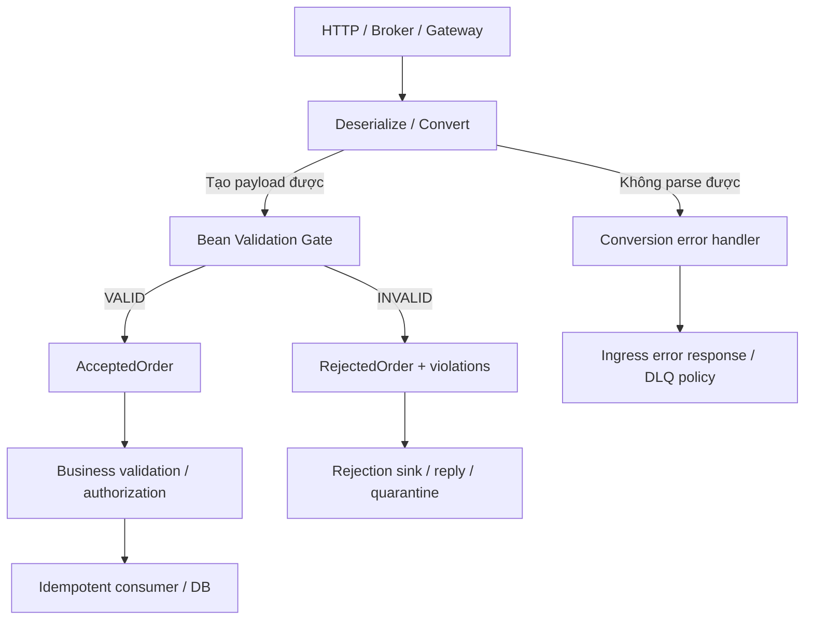
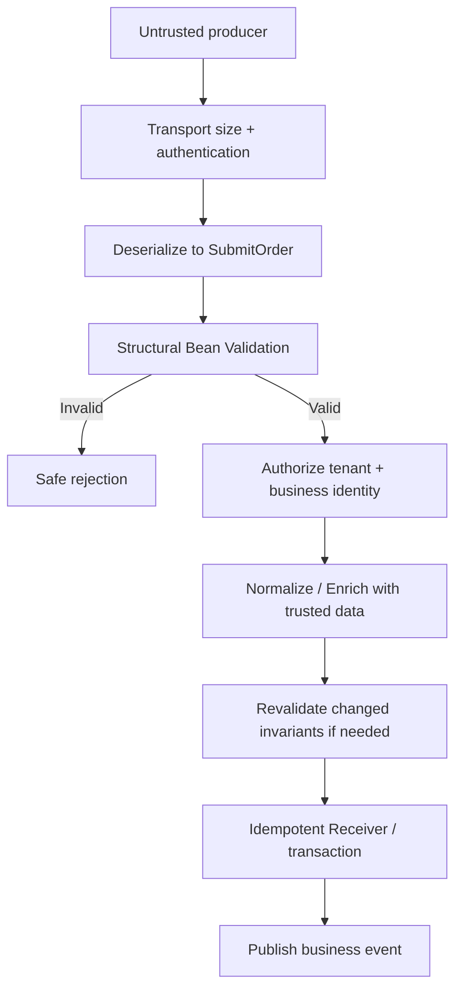

# Bean Validation trên payload

## 1. Tại sao cần kiểm tra payload trước khi đưa message vào nghiệp vụ?

Một ứng dụng bán hàng nhận message `SubmitOrder` từ HTTP, broker hoặc một Gateway. Payload chứa mã đơn, danh sách sản phẩm và tổng tiền khách gửi. Nếu một dòng có SKU trống, số lượng âm hoặc tổng tiền không khớp các dòng, việc cho message đi thẳng vào consumer có thể gây lỗi database, tính sai tiền hoặc tạo hiệu ứng nghiệp vụ cần khôi phục.

```text
SubmitOrder:
  orderId = "ORD-105"
  lines = [
    {sku: "SKU-A", quantity: 2, unitPrice: 25.00},
    {sku: "",      quantity: -1, unitPrice: 10.00}
  ]
  declaredTotal = 60.00

Kết quả mong muốn:
  - Không gọi OrderApplicationService
  - Trả trạng thái REJECTED với các mã vi phạm có thể xử lý
  - Giữ trackingId để đối soát request/reply
  - Không nuốt message hoặc retry vô hạn cùng input lỗi
```

**Bean Validation** (Jakarta Validation) cho phép mô tả các ràng buộc của Java object bằng annotation như `@NotBlank`, `@NotNull`, `@Positive` và `@Valid`, rồi dùng một `Validator` để kiểm tra. Trong Spring Integration, ta có thể đặt bước validation **trước** Transformer có tác dụng phụ, Service Activator, Router nghiệp vụ hoặc Consumer ghi dữ liệu.

Bài thuộc chương **Message filter và validation** của module **SPRING_INTEGRATION_PATTERN**. Module hướng đến triển khai Enterprise Integration Patterns (EIP) với Spring Integration để xây dựng luồng thông điệp ít phụ thuộc, dễ mở rộng; kết hợp Router, Filter, Transformer, Splitter, Aggregator, Gateway, retry, error channel và correlation, đồng thời kiểm thử và quan sát từng nhánh xử lý.



**Thông điệp chính:** Bean Validation kiểm tra hợp đồng **dữ liệu của payload**. Nó không thay thế xác thực người gửi, phân quyền tenant, tra cứu trạng thái bên ngoài hoặc atomicity của một giao dịch nghiệp vụ.

## 2. Phân biệt validation, filter, conversion và authorization

Những khái niệm dễ bị trộn lẫn:

| Tầng | Câu hỏi | Ví dụ | Phản ứng |
| --- | --- | --- | --- |
| **Message conversion** | Bytes/JSON có chuyển được thành object không? | JSON thiếu dấu ngoặc, sai kiểu | Conversion error; chưa có bean để validate |
| **Bean Validation** | Object có tuân theo contract cấu trúc/giá trị không? | SKU trống, quantity âm, lines rỗng | Invalid outcome hoặc validation exception |
| **Content-Based Filter** | Message có nên tiếp tục theo một tiêu chí không? | Chỉ nhận loại sự kiện `ORDER` | Accept/discard/route theo hợp đồng |
| **Business validation** | Trạng thái nghiệp vụ hiện thời có cho phép không? | Hết hạn thanh toán, không đủ hàng | Business reject hoặc retry theo nguyên nhân |
| **Authorization** | Chủ thể có quyền thực hiện thao tác không? | Tenant A sửa đơn của tenant B | Deny, security audit |
| **Idempotent Receiver** | Event này đã được xử lý chưa? | Broker giao cùng eventId hai lần | Chặn side effect lặp |
| **Infrastructure error** | DB, broker, API có sẵn sàng không? | Timeout PostgreSQL | Retry/backoff/error channel theo policy |

Ví dụ `@Positive` kiểm tra `quantity > 0` nhưng **không** cho biết mặt hàng còn tồn kho hay không. `@NotBlank tenantId` kiểm tra chuỗi không rỗng nhưng **không** chứng minh caller được phép đại diện tenant đó.

### 2.1. Bean Validation không tự chạy vì có annotation

Chỉ đặt `@NotBlank` trên field không khiến Spring Integration tự động từ chối mọi message sai. Validation phải được **kích hoạt** bằng một trong các cách:

- Gọi `jakarta.validation.Validator.validate(payload)` tại bước kiểm tra.
- Dùng method validation qua Spring proxy/interceptor khi đã bật và gọi đúng qua proxy.
- Dùng một adapter/inbound boundary hỗ trợ validation và đã được cấu hình.

`@Valid` đánh dấu **cascaded validation**, nhưng nó không thay thế lời gọi `Validator`. Cũng không được mặc định rằng một method `@ServiceActivator` hoặc `IntegrationFlow.handle(...)` được validate chỉ vì tham số có `@Valid`.

### 2.2. Spring Boot 3+ và Jakarta namespace

Trong Spring Framework 6 / Spring Boot 3 trở lên, dùng các annotation và interface thuộc namespace **`jakarta.validation.*`**. Ví dụ:

```java
import jakarta.validation.Valid;
import jakarta.validation.constraints.NotBlank;
import jakarta.validation.constraints.NotNull;
import jakarta.validation.constraints.Positive;
import jakarta.validation.constraints.Size;
```

Để validate tại runtime cần **provider** triển khai Jakarta Validation (thường là Hibernate Validator). Với Spring Boot, dependency thuận tiện là `spring-boot-starter-validation`. Chỉ có các annotation API mà không có provider có thể dẫn tới lỗi khi khởi tạo factory.

Hệ thống dùng Spring Boot 2 / Javax Validation có namespace `javax.validation.*`; không trộn ngẫu nhiên hai hệ annotation/provider. Mã trong bài giả định Java 17+ và Spring Boot 3+/Spring Integration tương thích.

## 3. Bean Validation trên Java record: từ trường đơn giản tới list lồng nhau

Ta mô hình hóa một order gồm nhiều dòng hàng.

### 3.1. Định nghĩa `OrderLine`

```java
import java.math.BigDecimal;
import jakarta.validation.constraints.DecimalMin;
import jakarta.validation.constraints.Digits;
import jakarta.validation.constraints.NotBlank;
import jakarta.validation.constraints.NotNull;
import jakarta.validation.constraints.Pattern;
import jakarta.validation.constraints.Positive;

record OrderLine(
        @NotBlank
        @Pattern(regexp = "[A-Z0-9-]{1,32}")
        String sku,

        @Positive
        int quantity,

        @NotNull
        @DecimalMin("0.00")
        @Digits(integer = 12, fraction = 2)
        BigDecimal unitPrice) {}
```

| Annotation | Ý nghĩa | Điều cần nhớ |
| --- | --- | --- |
| `@NotBlank` | String không null, không chỉ có whitespace | Dùng cho mã/tên bắt buộc |
| `@Pattern` | Giá trị phù hợp regex | Riêng `@Pattern` chấp nhận null, nên phối hợp `@NotBlank` |
| `@Positive` | Số lớn hơn 0 | Với `int` mặc định 0 khi deserialize thiếu trường có thể bị bắt |
| `@NotNull` | Không được null | Không khẳng định String/collection có nội dung |
| `@DecimalMin("0.00")` | Giá trị không âm | Nếu unitPrice phải dương, dùng `"0.01"`/exclusive rule phù hợp |
| `@Digits` | Giới hạn số chữ số phần nguyên/phần thập phân | Không thay thế logic currency/rounding |

**Chọn `BigDecimal` cho giá tiền** để không phụ thuộc sai số nhị phân của `double`. Khi tính tổng, dùng `BigDecimal.multiply(BigDecimal.valueOf(quantity))` và `add`, không chuyển qua `double`.

### 3.2. Định nghĩa `SubmitOrder` và nested validation

```java
import java.math.BigDecimal;
import java.util.List;
import jakarta.validation.Valid;
import jakarta.validation.constraints.DecimalMin;
import jakarta.validation.constraints.Digits;
import jakarta.validation.constraints.NotBlank;
import jakarta.validation.constraints.NotNull;
import jakarta.validation.constraints.Size;

@ConsistentOrderTotal
record SubmitOrder(
        @NotBlank String tenantId,
        @NotBlank String orderId,
        @NotBlank String eventId,

        @NotNull
        @Size(min = 1, max = 100)
        List<@NotNull @Valid OrderLine> lines,

        @NotNull
        @DecimalMin("0.00")
        @Digits(integer = 12, fraction = 2)
        BigDecimal declaredTotal) {}
```

Ba quy tắc độc lập về danh sách:

1. `@NotNull`: danh sách không được null.
2. `@Size(min=1,max=100)`: kích thước trong khoảng cho phép.
3. `List<@NotNull @Valid OrderLine>`: từng phần tử không được null và phải validate sâu vào các ràng buộc của `OrderLine`.

Nếu chỉ có `@Valid` trên một field mà quên `@NotNull`, việc field null **không mặc nhiên tạo vi phạm**: Jakarta Validation thường xem null là giá trị hợp lệ cho nhiều constraint nếu không có `@NotNull`.

Nếu chỉ validate `SubmitOrder` mà không có cascade `@Valid` ở phần tử list, các lỗi như `lines[1].sku` rỗng có thể không được phát hiện bởi lượt validate của object cha.

### 3.3. Những trường hợp người học cần thử

```text
Case A: lines = null
  -> NotNull

Case B: lines = []
  -> Size

Case C: lines = [null]
  -> NotNull on list element

Case D: lines = [OrderLine(sku="", quantity=-3, unitPrice=null)]
  -> NotBlank / Pattern / Positive / NotNull

Case E: lines = [OrderLine(sku="SKU-A", quantity=2, unitPrice=25.00)]
        declaredTotal = 50.00
  -> valid

Case F: same line, declaredTotal = 40.00
  -> cross-field inconsistency
```

Một giá trị sai có thể tạo **nhiều ConstraintViolation**, ví dụ SKU `""` vi phạm cả `@NotBlank` và `@Pattern`. Không dựa vào số lượng hoặc thứ tự violations mặc định của provider để xây giao thức trả lỗi; nên chuẩn hóa/sắp xếp nếu API yêu cầu deterministic output.

## 4. Constraint cấp object: tổng tiền phải khớp các dòng

Các annotation có sẵn xử lý ràng buộc cục bộ. Nhưng điều kiện:

```text
declaredTotal == sum(line.unitPrice * line.quantity)
```

cần **cross-field validation**. Ta tự định nghĩa annotation ở cấp type.

### 4.1. Tạo constraint annotation

```java
import java.lang.annotation.ElementType;
import java.lang.annotation.Retention;
import java.lang.annotation.RetentionPolicy;
import java.lang.annotation.Target;
import jakarta.validation.Constraint;
import jakarta.validation.Payload;

@Target(ElementType.TYPE)
@Retention(RetentionPolicy.RUNTIME)
@Constraint(validatedBy = ConsistentOrderTotalValidator.class)
public @interface ConsistentOrderTotal {
    String message() default "TOTAL_MISMATCH";
    Class<?>[] groups() default {};
    Class<? extends Payload>[] payload() default {};
}
```

Trong project Java, interface `public` thường đặt trong file riêng `ConsistentOrderTotal.java`; ở đây mã được chia theo mục để học viên dễ đọc.

### 4.2. ConstraintValidator không thực hiện side effect

```java
import java.math.BigDecimal;
import jakarta.validation.ConstraintValidator;
import jakarta.validation.ConstraintValidatorContext;

public final class ConsistentOrderTotalValidator
        implements ConstraintValidator<ConsistentOrderTotal, SubmitOrder> {

    @Override
    public boolean isValid(
            SubmitOrder order,
            ConstraintValidatorContext context) {

        if (order == null
                || order.lines() == null
                || order.declaredTotal() == null) {
            return true; // Để @NotNull kiểm tra trường vắng.
        }

        BigDecimal expected = BigDecimal.ZERO;
        for (OrderLine line : order.lines()) {
            // Tránh NPE; các constraint ở OrderLine báo lỗi riêng.
            if (line == null
                    || line.unitPrice() == null
                    || line.quantity() <= 0) {
                return true;
            }
            expected = expected.add(
                    line.unitPrice().multiply(
                            BigDecimal.valueOf(line.quantity())));
        }

        if (expected.compareTo(order.declaredTotal()) == 0) {
            return true;
        }

        context.disableDefaultConstraintViolation();
        context.buildConstraintViolationWithTemplate("TOTAL_MISMATCH")
                .addPropertyNode("declaredTotal")
                .addConstraintViolation();
        return false;
    }
}
```

**Vì sao dùng `compareTo` thay vì `equals`?** Hai số `BigDecimal("50.0")` và `BigDecimal("50.00")` bằng nhau về trị số nhưng khác scale; `compareTo == 0` phản ánh so sánh số học. Nếu hợp đồng cần scale cố định theo currency, đặt quy tắc riêng.

**Vì sao tạm trả `true` với dữ liệu con null/sai quantity?** Mục tiêu là không đè lỗi gốc bằng `NullPointerException` hoặc mã `TOTAL_MISMATCH` gây nhiễu. Các constraint cục bộ báo lỗi null/số lượng; quy tắc tổng chỉ kết luận khi có đủ giá trị tính toán. Với nhiều quy tắc chéo có phụ thuộc, có thể dùng nhóm validation/group sequence để xác định thứ tự, nhưng không nên biến `ConstraintValidator` thành một quy trình truy vấn database.

### 4.3. Quy tắc cross-field không thay thế authorization

Dù tổng tiền khách gửi khớp với `unitPrice` của từng dòng, **không được tin unitPrice do client tự khai là giá được phép thanh toán**. Sau Bean Validation, business service phải lấy giá đã được xác thực hoặc kiểm tra quote/version từ nguồn đáng tin. Validation chỉ chứng minh **nội bộ payload nhất quán theo contract**, không chứng minh nó được ủy quyền hoặc đúng với dữ liệu hiện tại.

## 5. Khởi tạo Jakarta Validator và hiểu kết quả

Trong ứng dụng Spring Boot 3+ có `spring-boot-starter-validation`, một `jakarta.validation.Validator` thường được cấu hình tự động. Với Spring Framework thuần, có thể dùng `LocalValidatorFactoryBean`:

```java
import org.springframework.context.annotation.Bean;
import org.springframework.context.annotation.Configuration;
import org.springframework.validation.beanvalidation.LocalValidatorFactoryBean;

@Configuration
class BeanValidationConfiguration {
    @Bean
    LocalValidatorFactoryBean jakartaValidator() {
        return new LocalValidatorFactoryBean();
    }
}
```

`LocalValidatorFactoryBean` tích hợp Jakarta Validation provider với Spring. Cấu hình này là **một lựa chọn thay thế** cho Boot autoconfiguration; nếu Boot đã có validator phù hợp, không cần khai báo thêm bean trùng chức năng.

Có thể gọi trực tiếp:

```java
import jakarta.validation.ConstraintViolation;
import jakarta.validation.Validator;
import java.util.Set;

Set<ConstraintViolation<SubmitOrder>> violations =
        validator.validate(order);

if (violations.isEmpty()) {
    // Dữ liệu hợp lệ theo bộ Bean Validation constraints đang kích hoạt.
} else {
    // Tạo outcome / exception theo chính sách của flow.
}
```

**`Validator.validate(...)` trả về tập `ConstraintViolation`.** Nó **không tự ném `ConstraintViolationException` chỉ vì payload sai**. Exception loại đó có thể xuất hiện khi ứng dụng chủ động ném hoặc qua cơ chế method validation được cấu hình; cần phân biệt với lỗi provider nội bộ.

### 5.1. Những thông tin thường đọc từ một violation

```java
violation.getPropertyPath();       // Ví dụ lines[1].sku
violation.getMessage();            // Message đã nội suy/i18n
violation.getConstraintDescriptor()
         .getAnnotation().annotationType().getSimpleName();
violation.getInvalidValue();       // Có thể chứa giá trị nhạy cảm!
```

Ở đầu ra public, nên sử dụng **field path đã giới hạn và error code ổn định**; không mặc định log `getInvalidValue()` hoặc gửi toàn bộ object/exception cho client. Violation message có thể được nội suy theo locale và chứa dữ liệu không được phép công khai.

### 5.2. Validator không phải bộ sửa lỗi

Jakarta Validation mặc định trả lời **hợp lệ/vi phạm**, không tự:
- Trim tất cả chuỗi.
- Thay SKU rỗng bằng SKU mặc định.
- Chuyển tiền tệ hoặc làm tròn đơn giá.
- Xác minh quyền tenant.
- Tạo eventId mới hoặc giữ stable ID qua retry.

Nếu muốn normalize, đặt một bước Transformer **thuần, được phê duyệt và kiểm thử** trước validation (ví dụ chuẩn hóa một mã SKU theo quy ước), rồi validate **object sau normalization**. Không tự sửa thông tin tài chính bằng cách đoán.

## 6. Thiết kế Validation Gate: phân loại thay vì làm mất message

Một Filter chỉ trả `true/false` có thể phù hợp để quyết định cho đi tiếp, nhưng với dữ liệu nhập sai ta thường muốn giữ **lý do từ chối** để trả lời Gateway, ghi audit hoặc đưa vào quarantine. Ta tạo một outcome cho mọi payload đã deserialize được.

### 6.1. Typed outcomes

```java
import java.util.List;

sealed interface ValidationOutcome
        permits AcceptedOrder, RejectedOrder {}

record AcceptedOrder(SubmitOrder order)
        implements ValidationOutcome {}

record ValidationIssue(String fieldPath, String errorCode) {}

record RejectedOrder(
        String trackingId,
        List<ValidationIssue> issues)
        implements ValidationOutcome {
    RejectedOrder {
        issues = List.copyOf(issues);
        if (trackingId == null || trackingId.isBlank()
                || issues.isEmpty()) {
            throw new IllegalArgumentException("Invalid rejection");
        }
    }
}
```

`AcceptedOrder` chứa payload đã pass các constraint; `RejectedOrder` **không chứa raw order payload** mà chỉ giữ một tracking ID đáng tin và danh sách mã lỗi đã chuẩn hóa. Nếu nghiệp vụ cần replay bản gốc để sửa, lưu payload vào kho có quyền hạn và retention, rồi dùng reference ID thay vì phát nó ra một error channel không được bảo vệ.

### 6.2. Gate gọi Validator một lần và tạo outcome có thứ tự xác định

```java
import java.util.Comparator;
import java.util.Objects;
import jakarta.validation.Validator;
import org.springframework.stereotype.Component;

@Component
final class OrderValidationGate {

    private final Validator validator;

    OrderValidationGate(Validator validator) {
        this.validator = validator;
    }

    ValidationOutcome classify(SubmitOrder order, String trackingId) {
        Objects.requireNonNull(order, "order");
        if (trackingId == null || trackingId.isBlank()) {
            throw new IllegalArgumentException(
                    "Missing trusted ingress tracking ID");
        }

        var violations = validator.validate(order);
        if (violations.isEmpty()) {
            return new AcceptedOrder(order);
        }

        var issues = violations.stream()
                .map(v -> new ValidationIssue(
                        v.getPropertyPath().toString(),
                        v.getConstraintDescriptor()
                                .getAnnotation()
                                .annotationType()
                                .getSimpleName()))
                .distinct()
                .sorted(Comparator
                        .comparing(ValidationIssue::fieldPath)
                        .thenComparing(ValidationIssue::errorCode))
                .limit(20)
                .toList();

        return new RejectedOrder(trackingId, issues);
    }
}
```

Việc sắp xếp giúp output/test không phụ thuộc thứ tự duyệt violation của provider. Giới hạn 20 issue để tránh response quá lớn; production nên thêm cờ `truncated` hoặc `totalViolationCount` nếu client cần biết danh sách bị cắt. Không đưa `invalidValue` hay toàn bộ Bean Validation exception vào `RejectedOrder`.

**Cần nguồn tracking ID đáng tin:** Một payload sai có thể có `eventId=""`, vì vậy không được phụ thuộc duy nhất vào chính field đang bị validate để đối soát lỗi. `trackingId` nên được cấp ở ingress/adapter và truyền qua header được kiểm soát, có scope theo tenant khi cần.

### 6.3. Những lỗi không nên biến thành RejectedOrder

Nếu `validator.validate(order)` ném lỗi vì provider hỏng, custom validator có bug hoặc thiếu dependency, đó là **processing/infrastructure failure**, không phải vi phạm dữ liệu đã được xác nhận. Đừng dùng `catch(Exception)` để đưa mọi exception vào nhánh rejected rồi ACK như “payload lỗi”.

Tương tự, JSON không parse được thành `SubmitOrder` thường bị chặn **trước** khi gate được gọi; nó cần một conversion-error policy ở inbound adapter.

## 7. Spring Integration: kết nối Transformer, Router và handlers

Trong ví dụ ta cấu hình hai giai đoạn rõ ràng:

```text
orders.raw
  -> OrderValidationTransformer
  -> orders.validation.outcomes
  -> OrderOutcomeRouter
      -> orders.accepted -> OrderApplicationService
      -> orders.rejected -> RejectionSink
```

Thông điệp còn nguyên raw payload chỉ được phép vào các bước đã tin cậy của biên validation. Nhánh rejected chỉ mang `RejectedOrder` đã được chuẩn hóa.

### 7.1. Transformer đưa Message payload vào ValidationGate

```java
import org.springframework.integration.annotation.Transformer;
import org.springframework.messaging.Message;
import org.springframework.stereotype.Component;

@Component
final class OrderValidationTransformer {
    private final OrderValidationGate gate;

    OrderValidationTransformer(OrderValidationGate gate) {
        this.gate = gate;
    }

    @Transformer(
            inputChannel = "orders.raw",
            outputChannel = "orders.validation.outcomes")
    public ValidationOutcome validate(Message<SubmitOrder> message) {
        Object rawId = message.getHeaders().get("ingressTrackingId");
        if (!(rawId instanceof String trackingId)
                || trackingId.isBlank()) {
            throw new IllegalArgumentException(
                    "Missing trusted ingressTrackingId");
        }

        return gate.classify(message.getPayload(), trackingId);
    }
}
```

`@Transformer` xử lý một message rồi phát payload outcome. Nó không có tác dụng nghiệp vụ. Trong ví dụ, incoming `Message<SubmitOrder>` phải do adapter/producer **đã kiểm soát headers** tạo ra; một caller chưa đáng tin không được tự đưa `ingressTrackingId` hoặc tenant authorization context bất kỳ mà framework tin tuyệt đối.

**Cảnh báo về header propagation:** Spring Integration có cơ chế truyền headers qua message-producing endpoints. Dù `RejectedOrder` không chứa raw payload, một header inbound có dữ liệu nhạy cảm vẫn có thể được chuyển sang outcome message. Phải **allowlist, strip hoặc sanitize headers** ở ingress/routing boundary trước khi cho rejected message vào broker/log/quarantine ngoài hệ thống.

### 7.2. Router chọn nhánh theo kết quả

```java
import org.springframework.integration.annotation.Router;
import org.springframework.stereotype.Component;

@Component
final class OrderOutcomeRouter {

    @Router(inputChannel = "orders.validation.outcomes")
    public String destination(ValidationOutcome outcome) {
        if (outcome instanceof AcceptedOrder) {
            return "orders.accepted";
        }
        if (outcome instanceof RejectedOrder) {
            return "orders.rejected";
        }
        throw new IllegalStateException("Unknown validation outcome");
    }
}
```

`@Router` chọn **channel name**. Đặt một nhánh riêng cho rejected có ích hơn silently drop: có thể gửi lỗi 400/422 cho Gateway hoặc lưu audit/quarantine, không làm một Aggregator downstream mất message mà không có tín hiệu hoàn tất.

### 7.3. Business và rejection handlers

```java
import org.springframework.integration.annotation.ServiceActivator;
import org.springframework.stereotype.Component;

interface OrderApplicationService {
    void submit(SubmitOrder order);
}

interface RejectionSink {
    void record(RejectedOrder rejection);
}

@Component
final class AcceptedOrderHandler {
    private final OrderApplicationService service;

    AcceptedOrderHandler(OrderApplicationService service) {
        this.service = service;
    }

    @ServiceActivator(inputChannel = "orders.accepted")
    public void accept(AcceptedOrder result) {
        // Bean Validation đã pass; vẫn cần authorization,
        // business rules và idempotency trong service.
        service.submit(result.order());
    }
}

@Component
final class RejectedOrderHandler {
    private final RejectionSink sink;

    RejectedOrderHandler(RejectionSink sink) {
        this.sink = sink;
    }

    @ServiceActivator(inputChannel = "orders.rejected")
    public void reject(RejectedOrder result) {
        sink.record(result);
    }
}
```

`OrderApplicationService` và `RejectionSink` là interface dùng để minh họa ranh giới trách nhiệm. Ứng dụng phải cung cấp bean hiện thực: business service có transaction/idempotency, rejection sink có chính sách bảo mật, retention và durability. **Một `DirectChannel` không tự làm rejection bền vững**.

### 7.4. Khai báo các channel

```java
import org.springframework.context.annotation.Bean;
import org.springframework.context.annotation.Configuration;
import org.springframework.integration.channel.DirectChannel;
import org.springframework.integration.config.EnableIntegration;
import org.springframework.messaging.MessageChannel;

@Configuration
@EnableIntegration
class OrderMessagingChannels {

    @Bean("orders.raw")
    MessageChannel raw() {
        return new DirectChannel();
    }

    @Bean("orders.validation.outcomes")
    MessageChannel outcomes() {
        return new DirectChannel();
    }

    @Bean("orders.accepted")
    MessageChannel accepted() {
        return new DirectChannel();
    }

    @Bean("orders.rejected")
    MessageChannel rejected() {
        return new DirectChannel();
    }
}
```

Dùng `DirectChannel` giúp unit/integration tests minh họa tuyến xử lý đồng bộ. Để ví dụ chạy trong ứng dụng thực, phải đăng ký các bean `@Component` (qua component scanning hoặc `@Import`), Validator provider và implementations cho hai interfaces.

**Topology này là one-way.** Nó không tự trả response cho một Messaging Gateway đang chờ; nếu cần request–reply, phải thiết kế reply channel/result cho cả accepted và rejected, không chỉ ghi vào hai terminal handlers `void` rồi mong Gateway có response.

## 8. Khi nào dùng Message Filter trực tiếp?

Nếu nghiệp vụ chỉ cần cho một loại dữ liệu đi tiếp và chấp nhận **drop** những dữ liệu khác có chủ đích, Spring Integration cung cấp Filter endpoint. Ví dụ đơn giản:

```java
import jakarta.validation.Validator;
import org.springframework.context.annotation.Bean;
import org.springframework.context.annotation.Configuration;
import org.springframework.integration.channel.DirectChannel;
import org.springframework.integration.config.EnableIntegration;
import org.springframework.integration.dsl.IntegrationFlow;
import org.springframework.messaging.MessageChannel;

// Chỉ minh họa API Filter; không cắm cùng lúc với
// topology orders.raw của mục 7.
@Configuration
@EnableIntegration
class SimpleOrderFilterFlow {

    @Bean("orders.filter.input")
    MessageChannel filterInput() {
        return new DirectChannel();
    }

    @Bean("orders.filter.valid")
    MessageChannel filterOutput() {
        return new DirectChannel();
    }

    @Bean
    IntegrationFlow simplePayloadFilter(Validator validator) {
        return IntegrationFlow.from("orders.filter.input")
                .filter(SubmitOrder.class,
                        order -> validator.validate(order).isEmpty(),
                        spec -> spec.throwExceptionOnRejection(true))
                .channel("orders.filter.valid")
                .get();
    }
}
```

Configuration này tạo cả `orders.filter.input` và `orders.filter.valid`; khi chạy thật cần **một consumer đăng ký ở output channel**. `throwExceptionOnRejection(true)` khiến filter báo lỗi khi predicate trả false thay vì silently discard theo chính sách mặc định. Nó **không tự tạo danh sách violations chi tiết**; vì vậy khi cần lý do, audit hay trả response chuẩn, nên dùng validation gate/outcome như mục 6–7.

Nếu mục tiêu là **lọc theo chính sách** (ví dụ chỉ nhận sự kiện loại ORDER), Filter có thể phù hợp. Nếu mục tiêu là **xác thực contract payload và phản hồi lỗi**, trộn cả hai vào một predicate boolean thường làm mất thông tin.

### 8.1. Filter không phải Validator

```text
Filter predicate:
  input -> true/false

Bean Validator:
  input -> Set<ConstraintViolation<T>>

Validation Gate:
  input + trusted tracking metadata -> Accepted / Rejected(details)
```

Một Filter có thể gọi Validator bên trong, nhưng vì nó chỉ chuyển kết quả thành boolean, cần chủ động chọn cách xử lý message không đạt. Đặc biệt nếu Filter nằm trước Aggregator, việc silently loại một số phần tử có thể khiến Aggregator chờ đủ `sequenceSize` ban đầu mãi mãi.

## 9. Validation nằm ở đâu trong một pipeline nhiều EIP?

Vị trí kiểm tra ảnh hưởng tới lượng công việc đã thực hiện trước khi phát hiện lỗi và khả năng khôi phục.

### 9.1. Validate càng gần ranh giới tin cậy càng tốt



Thứ tự này giúp giảm rủi ro một payload malformed được dùng trong Router, Transformer, database query hoặc HTTP call trước khi bị loại. Tuy nhiên, nếu chuẩn hóa là một bước thuần có chủ đích (ví dụ trim SKU theo hợp đồng), có thể chuẩn hóa **trước** validation rồi validate trên dữ liệu chuẩn hóa. Hai cách đều cần nói rõ đối tượng được validate là **bản nào**.

### 9.2. Validation không có hiệu lực vĩnh viễn sau Transformer

Giả sử `SubmitOrder` ban đầu hợp lệ, nhưng Transformer về sau:
- Chuyển price bằng tỷ giá không hợp lệ;
- Ghép sai các dòng;
- Tạo một DTO khác nhưng quên trường bắt buộc;
- Thay mã tenant;
- Xóa correlation headers.

Kết quả `@Valid` ở ingress **không chứng minh object mới còn đúng**. Có thể cần thêm validation cho outbound model hoặc cho các business invariants sau enrichment. Không nên rải cùng một phép validate nặng vào mọi endpoint mà không có lý do; hãy chỉ rõ trust boundaries và điểm nào tạo dữ liệu có contract mới.

### 9.3. Tương tác với Splitter và Aggregator

Nếu một batch có 5 phần tử, 2 phần tử bị validator từ chối, còn Aggregator chỉ nhận 3 accepted outcomes:

```text
Splitter:   5 input lines, expected sequence size = 5
Validator:  3 accepted, 2 rejected
Aggregator: chỉ nhìn nhánh accepted -> nhận 3

Nếu Aggregator đợi 5: group có thể không kết thúc.
```

Có ít nhất hai mô hình hợp lệ:

1. **Gom mọi outcome:** accepted/rejected đều phát trạng thái để Coordinator/Aggregator biết đủ 5 kết quả; báo batch COMPLETED/PARTIAL/FAILED.
2. **Gom accepted:** Coordinator truyền một `acceptedCount` đáng tin hoặc explicit completion marker; không chờ `sequenceSize` của toàn bộ chuỗi ban đầu.

Không được âm thầm `filter(valid)` mà quên cập nhật điều kiện release. Khi một phần tử malformed bị loại, `sourceIndex` của những item còn lại vẫn cần giữ để đối soát nguồn.

### 9.4. Tương tác với Gateway

Nếu một `@MessagingGateway` đang chờ reply mà Filter silently drop một request sai, caller có thể chỉ thấy **timeout** dù nguyên nhân là lỗi validation tức thời.

Một thiết kế request–reply nên xác định:
- Nhánh hợp lệ trả `OrderAcceptedReply` hoặc result tương ứng;
- Nhánh invalid trả `OrderRejectedReply` chứa reason codes đã chuẩn hóa;
- Lỗi hạ tầng qua error path/exception contract;
- Timeout chỉ dành cho vấn đề tiến độ thực sự.

Topology mục 7 dùng hai terminal handlers `void` nên **không phải implementation Gateway request–reply hoàn chỉnh**. Để hỗ trợ Gateway, cần thiết kế một bước join/routing cho reply rõ ràng và bảo toàn reply context theo cấu hình đang dùng, tránh gửi message lỗi ra kênh one-way rồi để caller chờ mãi.

## 10. Các hành vi lỗi khác nhau: reject, discard, throw

Khi validation thất bại, không có một chính sách mặc định đúng cho mọi nghiệp vụ.

| Chính sách | Cách xử lý | Khi phù hợp | Nguy cơ |
| --- | --- | --- | --- |
| **Reject outcome** | Tạo `RejectedOrder` có mã lỗi và tracking ID | Public API, import dữ liệu, cần đối soát | Cần bảo vệ error information |
| **Discard có audit** | Không chuyển tiếp nhưng ghi lý do/metric | Dữ liệu bỏ qua có chủ đích và không cần reply | Dễ mất message nếu quên discard handler |
| **Throw validation exception** | Endpoint ném lỗi | Ingress synchronous trả 4xx hoặc transactional reject | Broker có thể retry vô hạn nếu không phân loại |
| **Quarantine** | Lưu lỗi và tham chiếu input để sửa/replay | Batch ETL, hợp đồng nhập liệu | Cần durable store và access control |
| **Fail whole batch** | Reject tất cả khi một phần tử sai | Giao dịch cần tính toàn vẹn batch | Item hợp lệ không được xử lý |
| **Partial accept** | Xử lý hợp lệ, cách ly phần sai | Import dữ liệu lớn có policy partial | Cần summary/count và idempotency theo item |

**Bean Validation violations thường là lỗi dữ liệu có tính xác định.** Retry cùng payload, cùng schema/rule không làm nó hợp lệ. Ngược lại, timeout của database trong `OrderApplicationService` có thể phục hồi và cần bounded retry.

### 10.1. Lỗi `ConstraintViolationException` và `MessageRejectedException`

- Khi gọi `validator.validate(payload)` thủ công, kết quả là tập violations; application **có thể chủ động** tạo outcome hoặc ném `ConstraintViolationException`.
- Method validation qua Spring AOP có thể ném validation-related exception theo cấu hình và version.
- Filter với `throwExceptionOnRejection(true)` thường báo `MessageRejectedException` khi predicate trả false; nó không tự tạo report chi tiết kiểu `ConstraintViolation`.
- Nếu custom `ConstraintValidator` có bug và ném `NullPointerException`, đó **không phải** tín hiệu rằng user gửi payload invalid được phân loại thành công.

Không dùng một nhánh `catch (Exception) { return rejected; }` cho cả validation failure, application bug và store outage.

### 10.2. Error channel và retry phụ thuộc endpoint

Với `DirectChannel`, lỗi đồng bộ có thể truyền ngược về người gửi. Với poller, executor hoặc broker, error handler có thể chuyển exception thành `ErrorMessage` trên `errorChannel` theo cấu hình.

Nhưng `errorChannel` **không tự cung cấp**:
- Bản sao input đã lưu bền vững;
- Dead-letter queue;
- Phân loại lỗi vĩnh viễn và transient;
- ACK/NACK đúng semantics của từng broker;
- Kết quả trả về cho một Gateway đang chờ;
- Idempotency của consumer.

Muốn malformed message không gây retry storm, cấu hình rõ classifier/handling ở inbound adapter và chính sách terminal reject/quarantine. Một lỗi provider bất thường không nên bị ACK như lỗi dữ liệu đầu vào.

### 10.3. Một bảng error taxonomy thực dụng

```text
JSON_PARSE_FAILED        -> conversion error
PAYLOAD_CONSTRAINT_FAIL  -> Bean Validation reject
UNAUTHORIZED_TENANT      -> authorization deny
ORDER_ALREADY_PROCESSED  -> idempotency / stored outcome
OUT_OF_STOCK             -> business rule decision
DB_TIMEOUT               -> transient retry
VALIDATOR_RUNTIME_ERROR  -> application/infrastructure failure
GATEWAY_TIMEOUT          -> request-reply deadline
```

Các mã trên là **quy ước gợi ý của ứng dụng**, không phải exception class mặc định mà Spring Integration tự phát sinh. Error taxonomy giúp logs, metrics, API responses và DLQ/recovery nhất quán.

## 11. `@Validated`, method validation và giới hạn của proxy

Spring có thể hỗ trợ method-level validation:

```java
import jakarta.validation.Valid;
import jakarta.validation.constraints.NotNull;
import org.springframework.stereotype.Service;
import org.springframework.validation.annotation.Validated;

@Service
@Validated
class MethodValidatedOrderService {

    public void submit(@NotNull @Valid SubmitOrder order) {
        // Thực thi nghiệp vụ.
    }
}
```

Đoạn này chỉ phát huy tác dụng method validation **khi cấu hình interceptor/proxy phù hợp và method được gọi qua proxy**. Những cạm bẫy:

1. Một lời gọi từ method khác **trong cùng object** có thể bypass Spring AOP proxy (*self-invocation*).
2. Method được gọi bằng một cơ chế không qua proxy có thể không được kiểm tra.
3. Không phải mọi message handler hoặc Java DSL lambda mặc nhiên được AOP validate.
4. Ném exception ở tầng service có thể khiến broker retry dữ liệu malformed nếu upstream không phân loại.
5. Nếu method nhận `Message<SubmitOrder>` và chỉ `@Valid` trên message wrapper, không được giả định provider sẽ tự traverse vào payload nếu không có cascade đúng kiểu.

Vì vậy, với mục tiêu của bài học, **explicit Validation Gate bằng `Validator.validate(payload)`** là cách dễ quan sát, dễ kiểm thử và ít phụ thuộc vào self-invocation/proxy hơn. Method validation vẫn hữu ích như một lớp phòng vệ ở service boundary.

### 11.1. Spring Validator khác Jakarta Validator

Spring Framework còn có interface `org.springframework.validation.Validator` trả lỗi vào `Errors`, trong khi Jakarta Validation dùng `jakarta.validation.Validator` trả `Set<ConstraintViolation<T>>`. Chúng có thể tích hợp qua `LocalValidatorFactoryBean` nhưng **không phải cùng một interface**.

Trong ví dụ bài này, tất cả phần Gate/Unit test dùng `jakarta.validation.Validator`. Khi import IDE tự động, kiểm tra package để tránh gọi nhầm method hoặc hiểu sai loại exception.

## 12. Validation groups và thay đổi contract theo workflow

Một payload có thể đi qua nhiều trạng thái: tạo đơn, cập nhật đơn, phê duyệt, hoàn tất. Không phải mọi ràng buộc đều giống nhau ở mỗi bước.

### 12.1. Hai groups ví dụ

```java
interface OnCreate {}
interface OnApprove {}
```

Ví dụ một DTO phê duyệt có những constraint khác nhau:

```java
import jakarta.validation.constraints.NotBlank;
import jakarta.validation.constraints.NotNull;

record ApprovalCommand(
        @NotBlank(groups = {OnCreate.class, OnApprove.class})
        String orderId,

        @NotNull(groups = OnApprove.class)
        String approverId) {}
```

Gọi:

```java
var issuesWhenCreated =
        validator.validate(command, OnCreate.class);

var issuesWhenApproved =
        validator.validate(command, OnApprove.class);
```

**Lưu ý rất dễ sai:** Khi gọi `validate(bean, OnApprove.class)`, các constraint chỉ thuộc nhóm `Default` **không tự được chạy** trừ khi được cấu hình group inheritance/sequence phù hợp. Nếu chuyển toàn bộ flow sang groups mà quên Default, có thể vô tình bỏ qua constraint bắt buộc trước đó.

### 12.2. Không dùng groups để “sửa sai” schema version ngầm

Nếu producer v1 chưa gửi một trường mà producer v2 bắt buộc gửi, cần hợp đồng version rõ:
- Lựa chọn schema version từ nguồn đã xác thực;
- Convert version cũ sang model mới theo rule tường minh;
- Validate model sau conversion;
- Ghi lại version đã dùng để audit/replay;
- Từ chối version không hỗ trợ thay vì bỏ validation ngẫu nhiên.

Hai message từ hai phiên bản producer không nên được xử lý bằng cách tắt constraint bất kỳ chỉ để luồng xanh. Điều đó có thể che một lỗi contract nghiêm trọng.

### 12.3. Cross-field rule có cần database?

Một `ConstraintValidator` tốt nhất nên **thuần, nhanh và không có side effect**. Đừng gọi database để kiểm tra tồn kho, quyền user hoặc trạng thái đơn ở mỗi Bean Validation constraint: sẽ làm phụ thuộc vào I/O, latency, transaction và retry một cách khó đoán.

Nên phân tầng:

```text
Bean Validation:
  cấu trúc, format, khoảng giá trị, tổng tiền khai báo nhất quán

Business validation:
  tồn kho, quote hợp lệ, trạng thái đơn, giới hạn tín dụng

Authorization:
  principal được phép gửi đơn của tenant không?

Idempotent Receiver:
  logical event này đã commit hay chưa?
```

## 13. Validation và duplicate delivery

Giả sử broker gửi hai bản sao cùng một event. Cả hai có payload hợp lệ. Nếu chỉ validate rồi gọi service, side effect vẫn có thể chạy hai lần.

```text
Delivery #1 -> Bean Validation PASS -> stock reservation COMMITTED
Delivery #2 -> Bean Validation PASS -> stock reservation may run again
```

**Bean Validation không làm message idempotent.** Sau validation, cần một Idempotent Receiver hoặc transactional Inbox theo stable business key như `(consumerName, tenantId, eventId)`.

Một cách chọn thứ tự:

1. Deserialize, kiểm tra dữ liệu đầu vào cơ bản.
2. Xác thực tenant và nguồn gửi.
3. Validate payload contract.
4. Kiểm tra business identity, hash/version nếu duplicate đã được lưu.
5. Atomic claim + cập nhật nghiệp vụ theo idempotency contract.

Trong hệ thống có sự kiện đã xử lý ở một schema cũ, logic duplicate có thể cần đối chiếu snapshot/fingerprint trước khi validate theo schema mới, nếu không một event **đã hoàn thành hợp lệ trước đây** có thể bị chặn khi replay vì rule vừa thay đổi. Quy tắc này phải được thiết kế và version hóa rõ, không có một thứ tự duy nhất phù hợp cho mọi domain.

### 13.1. Validation failure có cần lưu dedupe key không?

Tùy hợp đồng:
- Nếu invalid là terminal rejection và hệ thống cần trả lại **cùng kết quả từ chối** trên retry, có thể lưu rejection outcome theo event ID và schema version.
- Nếu input có thể được sửa rồi gửi lại với cùng event ID, cần version/revision policy; không đánh dấu vĩnh viễn cho một bản có thể sửa.
- Nếu lỗi transient của validation provider, **không** lưu như một quyết định dữ liệu cuối cùng.
- Nếu payload cùng key nhưng khác nội dung, coi là conflict; không âm thầm trả rejection của bản cũ.

Không dùng một cache “seen IDs” không cùng transaction để thay thế ledger cần durability.

## 14. Kiểm thử Bean Validation và custom constraint bằng JUnit 5

### 14.1. Test không cần Spring context

Có thể khởi tạo provider theo Jakarta Validation API:

```java
import java.math.BigDecimal;
import java.util.List;
import jakarta.validation.Validation;
import jakarta.validation.Validator;
import jakarta.validation.ValidatorFactory;
import org.junit.jupiter.api.Test;

import static org.junit.jupiter.api.Assertions.*;

class SubmitOrderValidationTest {

    private static SubmitOrder validOrder() {
        return new SubmitOrder(
                "tenant-a",
                "ORD-105",
                "evt-order-105",
                List.of(new OrderLine(
                        "SKU-A", 2, new BigDecimal("25.00"))),
                new BigDecimal("50.00"));
    }

    @Test
    void acceptsValidNestedPayload() {
        try (ValidatorFactory factory =
                     Validation.buildDefaultValidatorFactory()) {
            Validator validator = factory.getValidator();

            assertTrue(validator.validate(validOrder()).isEmpty());
        }
    }

    @Test
    void rejectsMalformedLineAndWrongTotal() {
        try (ValidatorFactory factory =
                     Validation.buildDefaultValidatorFactory()) {
            Validator validator = factory.getValidator();

            var invalid = new SubmitOrder(
                    "tenant-a", "ORD-105", "evt-order-105",
                    List.of(new OrderLine(
                            "", -3, new BigDecimal("10.00"))),
                    new BigDecimal("70.00"));

            var errors = validator.validate(invalid);
            assertFalse(errors.isEmpty());

            var paths = errors.stream()
                    .map(v -> v.getPropertyPath().toString())
                    .toList();
            assertTrue(paths.stream()
                    .anyMatch(path -> path.contains("sku")));
            assertTrue(paths.stream()
                    .anyMatch(path -> path.contains("quantity")));
        }
    }

    @Test
    void reportsCrossFieldTotalMismatch() {
        try (ValidatorFactory factory =
                     Validation.buildDefaultValidatorFactory()) {
            var invalid = new SubmitOrder(
                    "tenant-a", "ORD-105", "evt-order-105",
                    List.of(new OrderLine(
                            "SKU-A", 2, new BigDecimal("25.00"))),
                    new BigDecimal("40.00"));

            var errors = factory.getValidator().validate(invalid);
            assertTrue(errors.stream()
                    .anyMatch(v -> "declaredTotal".equals(
                            v.getPropertyPath().toString())));
        }
    }
}
```

Test trên minh họa ba loại rule: valid object, nested violation và cross-field mismatch. Để tránh phụ thuộc vào thứ tự violations, chỉ kiểm tra **sự hiện diện** của path/code cần thiết, không assert “violation đầu tiên là gì”.

### 14.2. Test null, empty và over-limit

Bổ sung ca:

| Input | Mong đợi |
| --- | --- |
| `lines=null` | `NotNull` |
| `lines=[]` | `Size` |
| List 101 dòng | `Size` |
| `lines=[null]` | Vi phạm `NotNull` trên element |
| SKU chứa ký tự cấm | `Pattern` |
| Quantity = 0 | `Positive` |
| Unit price = null | `NotNull` |
| Unit price có quá 2 chữ số thập phân | `Digits` |
| `declaredTotal` âm | `DecimalMin` |
| `declaredTotal` không bằng tổng tính | `ConsistentOrderTotal` |
| `eventId=""` | `NotBlank` |

**Để tạo list chứa null trong test**, không dùng `List.of(null)` vì Java ném `NullPointerException` ngay lúc dựng list; dùng `Arrays.asList((OrderLine) null)` hoặc `ArrayList` được tạo phù hợp. Cần kiểm thử cả deserialization: một JSON có trường sai kiểu có thể bị reject trước Bean Validation.

### 14.3. Test ValidationGate không lộ raw payload

```java
import java.math.BigDecimal;
import java.util.List;
import jakarta.validation.Validation;
import jakarta.validation.ValidatorFactory;
import org.junit.jupiter.api.Test;
import static org.junit.jupiter.api.Assertions.*;

class OrderValidationGateTest {

    @Test
    void invalidPayloadBecomesSanitizedRejectedOutcome() {
        try (ValidatorFactory factory =
                     Validation.buildDefaultValidatorFactory()) {
            var gate = new OrderValidationGate(
                    factory.getValidator());

            var invalid = new SubmitOrder(
                    "tenant-a", "ORD-105", "evt-order-105",
                    List.of(new OrderLine(
                            "", -1, new BigDecimal("25.00"))),
                    new BigDecimal("25.00"));

            ValidationOutcome outcome =
                    gate.classify(invalid, "ingress-track-105");

            assertInstanceOf(RejectedOrder.class, outcome);
            RejectedOrder rejection = (RejectedOrder) outcome;
            assertEquals("ingress-track-105", rejection.trackingId());
            assertFalse(rejection.issues().isEmpty());

            // RejectedOrder record không chứa SubmitOrder
            // hoặc giá trị raw bị lỗi.
            assertTrue(rejection.issues().stream()
                    .allMatch(issue -> !issue.errorCode().isBlank()));
        }
    }
}
```

Test thêm rằng payload hợp lệ cho `AcceptedOrder`, error codes được sắp xếp nhất quán, issue count bị giới hạn và thiếu `trackingId` báo lỗi thay vì gửi message không thể đối soát.

## 15. Integration test qua channel, Transformer và Router

Unit test ở trên chưa chứng minh Spring Integration đã route message hợp lệ/từ chối đúng hoặc consumer không được gọi với input sai. Cần một integration test chạy channel và annotations.

### 15.1. Cấu hình test

Với các bean minh họa ở mục 5–7, một lớp test có thể đăng ký:
- `OrderMessagingChannels` với `@EnableIntegration`;
- `BeanValidationConfiguration` có `LocalValidatorFactoryBean`;
- `OrderValidationGate`, `OrderValidationTransformer` và `OrderOutcomeRouter`;
- Hai handlers;
- Mock implementations cho `OrderApplicationService` và `RejectionSink`.

```java
import org.junit.jupiter.api.AfterEach;
import org.junit.jupiter.api.Test;
import org.springframework.beans.factory.annotation.Autowired;
import org.springframework.beans.factory.annotation.Qualifier;
import org.springframework.context.annotation.Bean;
import org.springframework.context.annotation.Configuration;
import org.springframework.messaging.MessageChannel;
import org.springframework.messaging.support.MessageBuilder;
import org.springframework.test.context.junit.jupiter.SpringJUnitConfig;
import java.math.BigDecimal;
import java.util.List;

import static org.junit.jupiter.api.Assertions.*;
import static org.mockito.Mockito.*;

@SpringJUnitConfig(classes = {
        OrderMessagingChannels.class,
        BeanValidationConfiguration.class,
        OrderValidationGate.class,
        OrderValidationTransformer.class,
        OrderOutcomeRouter.class,
        AcceptedOrderHandler.class,
        RejectedOrderHandler.class,
        OrderValidationFlowIT.TestDependencies.class
})
class OrderValidationFlowIT {

    @Autowired
    @Qualifier("orders.raw")
    MessageChannel input;

    @Autowired
    OrderApplicationService applicationService;

    @Autowired
    RejectionSink rejectionSink;

    @AfterEach
    void resetMocks() {
        reset(applicationService, rejectionSink);
    }

    @Test
    void validOrderReachesBusinessHandler() {
        SubmitOrder order = order(
                "SKU-A", 2, "50.00");

        assertTrue(input.send(
                MessageBuilder.withPayload(order)
                        .setHeader("ingressTrackingId", "track-1")
                        .build()));

        verify(applicationService).submit(order);
        verifyNoInteractions(rejectionSink);
    }

    @Test
    void invalidOrderIsRejectedWithoutBusinessSideEffect() {
        SubmitOrder order = order(
                "", 0, "10.00");

        assertTrue(input.send(
                MessageBuilder.withPayload(order)
                        .setHeader("ingressTrackingId", "track-2")
                        .build()));

        verifyNoInteractions(applicationService);
        verify(rejectionSink).record(argThat(rejection ->
                "track-2".equals(rejection.trackingId())
                        && !rejection.issues().isEmpty()));
    }

    private static SubmitOrder order(
            String sku, int quantity, String total) {
        return new SubmitOrder(
                "tenant-a", "ORD-105", "evt-order-105",
                List.of(new OrderLine(
                        sku, quantity, new BigDecimal("25.00"))),
                new BigDecimal(total));
    }

    @Configuration
    static class TestDependencies {
        @Bean
        OrderApplicationService applicationService() {
            return mock(OrderApplicationService.class);
        }

        @Bean
        RejectionSink rejectionSink() {
            return mock(RejectionSink.class);
        }
    }
}
```

**Cách hiểu kết quả test:** Vì các channel mẫu là `DirectChannel` đồng bộ, mock verification có thể chạy ngay sau `send()`. Nếu đổi sang `ExecutorChannel`, poller hoặc broker, cần await/latch có timeout hữu hạn và assert trên trạng thái đã commit, không chỉ verify ngay lập tức.

### 15.2. Những test integration quan trọng khác

| Kịch bản | Assertion |
| --- | --- |
| Valid order | Chỉ accepted handler được gọi |
| Nested field invalid | Không gọi business handler; có issue path |
| Declared total mismatch | Có mã vi phạm custom constraint |
| Missing `ingressTrackingId` | Lỗi biên rõ; không trở thành valid |
| Invalid JSON trước deserialize | Conversion error handler chạy; gate chưa được gọi |
| Validator provider lỗi | Infrastructure error, không ACK như validation rejection |
| Rejection sink unavailable | Không giả định message đã được lưu; retry/recovery |
| Gateway với invalid input | Có reply rejection/exception rõ, không timeout im lặng |
| Batch có 2 rejected/3 accepted | Aggregator/Coordinator vẫn biết trạng thái đủ 5 |
| Message bị redeliver | Bean Validation pass nhưng idempotent consumer không xử lý trùng |
| Payload bị Transformer sửa | Validation sau transform kiểm tra invariant mới |
| Tenant header sai với trusted principal | Authorization boundary reject |
| Async adapter và error channel | Phân biệt terminal validation error và transient failure |
| Broker payload rất lớn | Ingress size limit trước khi xây object |

Không dùng một test với `@MockBean` hoặc mock provider để kết luận toàn bộ Bean Validation engine hoạt động; hãy có ít nhất một test với provider thật. Tương tự, Spring Integration annotation tests phải đăng ký các endpoint thực chứ không chỉ gọi thẳng method `validate()`.

## 16. Hiệu năng, giới hạn tài nguyên và an toàn dữ liệu

### 16.1. Validation có thể bị dùng để tấn công tài nguyên

Một message từ nguồn bên ngoài có thể chứa:
- Danh sách hàng triệu dòng, dù `@Size(max=100)` sẽ báo vi phạm **sau khi** object đã được deserialize và cấp phát memory.
- Chuỗi rất dài gây tốn CPU khi chạy regex.
- Hệ object lồng nhau sâu hoặc graph có vòng tham chiếu.
- Quá nhiều violations khiến xử lý/sắp xếp/error response nặng.
- Nội dung có token/PII khiến logging exception vô ý phát tán dữ liệu.

Cần các tầng bảo vệ **trước** Bean Validation:
1. Giới hạn request body bytes ở HTTP/broker adapter.
2. Giới hạn độ sâu JSON và số phần tử khi parse nếu converter hỗ trợ.
3. Dùng regex đơn giản, tránh các mẫu backtracking khó đoán trên input rất dài.
4. Timeout và rate limit input.
5. Giới hạn violations trả cho caller.
6. Không tạo Thread/Task riêng cho mỗi lỗi.
7. Giám sát độ trễ Validator và số message invalid.

### 16.2. Fail fast hay báo nhiều lỗi?

Hai chính sách hợp lệ:

| Cách | Ưu điểm | Đánh đổi |
| --- | --- | --- |
| Thu thập nhiều violations | Client sửa nhiều lỗi một lần | Có thể tốn thời gian/bộ nhớ hơn |
| Fail-fast theo provider/policy | Dừng sau lỗi sớm, giảm tải | Khó trải nghiệm nhập liệu; lỗi đầu không bảo đảm deterministic |
| Validation theo nhóm/phase | Ưu tiên contract cơ bản trước cross-field | Cần thiết kế rule rõ; dễ bỏ sót Default group |

Ví dụ bài này thu thập tối đa 20 issues ở **response representation**, nhưng provider vẫn có thể đã tính nhiều violations trước khi Gate cắt danh sách. Nếu khối lượng thật sự lớn, giới hạn đầu vào và cân nhắc fail-fast theo provider; không nhầm `stream.limit(20)` với giới hạn công việc mà Validator đã làm.

### 16.3. Bảo mật và cấu trúc log

Nên ghi:
- Tracking ID do ingress tạo, endpoint name;
- Message type và schema version;
- Mã vi phạm như `NotBlank`, `Positive`, `ConsistentOrderTotal`;
- Field path đã sanitize;
- Số violations và thời gian validate;
- Trace/correlation ID theo security policy.

Tránh ghi:
- Toàn bộ payload;
- `ConstraintViolation.getInvalidValue()`;
- Raw error message có khả năng chứa giá trị người dùng;
- Credential, access token, payment card data;
- Header map chưa lọc;
- Request/event ID như **metric labels** cardinality cao.

Nếu cần xử lý lại input lỗi, lưu reference trong một quarantine store được phân quyền, mã hóa và có retention thay vì đẩy raw body vào metric/log.

## 17. Metrics và vận hành

| Metric đề xuất | Ý nghĩa |
| --- | --- |
| `validation.requests.total` | Tổng số payload được đưa vào gate |
| `validation.accepted.total` | Số payload pass |
| `validation.rejected.total` | Số payload có violations |
| `validation.rejected.by_constraint` | Phân bố mã constraint trong tập hữu hạn |
| `validation.duration` | P50/P95/P99 thời gian validate |
| `validation.conversion.error` | Lỗi deserialize trước gate |
| `validation.provider.error` | Lỗi hạ tầng trong Validator |
| `validation.rejection.sink.error` | Không lưu được trạng thái từ chối |
| `validation.gateway.timeout` | Gateway chờ mà không nhận được reply |
| `validation.batch.partial` | Số batch có cả accepted/rejected |
| `validation.payload.too_large` | Input vượt giới hạn ingress |
| `validation.business.side_effect.before_reject` | Chỉ số cảnh báo sai thứ tự pipeline |

Tên các metric trên là **gợi ý cho instrumentation của ứng dụng**, không phải tên built-in luôn được Spring Integration tự xuất.

### 17.1. Cách diễn giải một số triệu chứng

| Triệu chứng | Khả năng | Hướng điều tra |
| --- | --- | --- |
| Invalid rate tăng sau deploy | Contract/schema thay đổi | So version producers và rules |
| Gateway timeout tăng nhưng handler không chạy | Filter silently drop | Kiểm tra reject/reply path |
| Aggregator groups bị kẹt | Invalid items bị loại không có outcome | Kiểm tra sequenceSize/release |
| Provider error tăng | Missing dependency/custom validator bug | Kiểm tra classpath/log exception |
| Duplicate side effect dù validation pass | Thiếu idempotency | Kiểm tra event key/transaction |
| CPU cao ở validation | Payload quá lớn/regex nặng | Kiểm tra ingress limits |
| Rejected sink backlog tăng | Quarantine store outage | Kiểm tra retries và durability |

## 18. Những lỗi thiết kế phổ biến

1. **Chỉ đặt `@NotBlank` rồi cho rằng Spring Integration tự validate mọi payload.**
2. **Dùng `@Valid` mà quên `@NotNull`**, khiến null vẫn lọt qua các constraint khác.
3. **Quên cascade `@Valid` trong List**, bỏ qua lỗi của item con.
4. **Dùng `@Pattern` một mình** rồi ngạc nhiên vì null không bị xem là vi phạm.
5. **Dùng `double` cho tiền**, gây sai số và mismatch khó giải thích.
6. **Không kiểm tra cross-field invariant** giữa tổng và các dòng.
7. **Gọi DB/API bên trong ConstraintValidator** rồi trộn lỗi hạ tầng với dữ liệu sai.
8. **Filter silently drop invalid request** khiến Gateway timeout.
9. **Filter bỏ phần tử nhưng Aggregator vẫn chờ sequenceSize ban đầu**.
10. **Nuốt mọi exception rồi ACK như invalid payload**, làm mất message transient.
11. **Dùng `Validator.validate(message)` trên wrapper** khi thực sự cần validate payload.
12. **Dựa vào `@Validated` qua self-invocation**, bỏ qua Spring proxy.
13. **Không xác thực tenant vì `@NotBlank tenantId` đã pass**, nhầm validation với authorization.
14. **Không giới hạn request size ở ingress**, để quá tải trước khi `@Size` chạy.
15. **Không version hóa schema/rules**, khiến replay hợp lệ trước đây bị từ chối khó hiểu.
16. **Log `getInvalidValue()`** hoặc raw payload vào error channel không được bảo vệ.
17. **Coi Bean Validation là idempotency**, chạy side effect trùng khi broker redeliver.
18. **Trả danh sách error không deterministic**, làm test và client khó đối chiếu.
19. **Copy headers nhạy cảm sang rejected message** dù payload đã được rút gọn.
20. **Dùng một consumer `void` cho nhánh rejected** rồi mong request–reply Gateway có kết quả.
21. **Xem tất cả violations là lỗi transient** và retry vô hạn.
22. **Bỏ qua kiểm thử provider thật** mà chỉ mock boolean từ predicate.

## 19. Bài tập thực hành

**Bài tập:** Thiết kế một pipeline nhận `InvoiceSubmitted` mang `tenantId`, `eventId`, `invoiceId`, `lineItems`, `declaredTotal` và `currency`. Một số invoice đến từ HTTP Gateway, một số từ broker.

1. Tạo Java records và constraints cho invoice/line items.
2. Dùng `@NotNull`, `@NotBlank`, `@Size`, `@Pattern`, `@Positive`, `@Digits` cho từng trường hợp thích hợp.
3. Bảo đảm list item được kiểm tra sâu bằng `@Valid` và element `@NotNull`.
4. Tạo custom constraint `@ConsistentInvoiceTotal` dùng `BigDecimal`.
5. Viết `ValidationGate` trả accepted/rejected outcomes, không log invalid values.
6. Thiết kế error code và tracking ID do ingress cấp, không phụ thuộc một `eventId` có thể đang invalid.
7. Tạo Transformer/Router trong Spring Integration cho hai nhánh.
8. Viết Service Activator lưu rejection có retention/ACL.
9. Xác định cách Gateway trả lỗi validation mà không timeout.
10. Với broker, phân biệt malformed JSON, Bean Validation failure và DB timeout.
11. Gắn idempotency key sau khi validate; xử lý redelivery một invoice hợp lệ.
12. Cho batch 5 invoice, 2 invalid; mô tả Aggregator/Coordinator phải điều chỉnh expected count thế nào.
13. Thử `@Validated` method validation và self-invocation, ghi nhận điều kiện proxy.
14. Viết JUnit tests cho null, blank, nested values, mismatch total và invalid currency.
15. Viết integration test xác nhận invalid invoice không chạm business service.
16. Thử payload quá lớn và xác minh ingress size limit chạy trước validation.
17. Thiết kế metrics theo type/constraint code, không dùng eventId làm metric label.
18. Đề xuất quy trình schema versioning để replay một event cũ vẫn được diễn giải đúng.

**Tự kiểm tra:** Bean Validation tự chạy khi có annotation không? `@Valid` có tự cấm null không? Tại sao `Validator.validate` không tự ném `ConstraintViolationException` với dữ liệu sai? `@NotBlank tenantId` có đủ để kiểm tra quyền tenant không? Vì sao một Filter bỏ message invalid khiến Gateway/Aggregator gặp vấn đề? Khi DB timeout sau validation pass, có nên coi message là malformed không? Tại sao cần Idempotent Receiver sau bước validation?

**Bean Validation trên payload** giúp các luồng Spring Integration phát hiện dữ liệu không thỏa contract trước khi chạy side effect. Cách triển khai hiệu quả là định nghĩa constraint rõ ràng trên model, kiểm tra nested/cross-field invariants bằng Jakarta Validator, chuyển violations thành outcome có thể quan sát và route tới accepted/rejected theo chính sách. Khi kết hợp đúng với conversion, authorization, Gateway, Filter, Aggregator, retry, error channel và idempotency, validation trở thành một ranh giới đáng tin thay vì một predicate âm thầm làm mất message.
