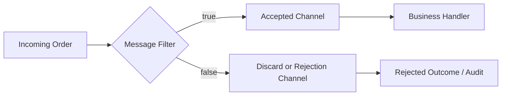
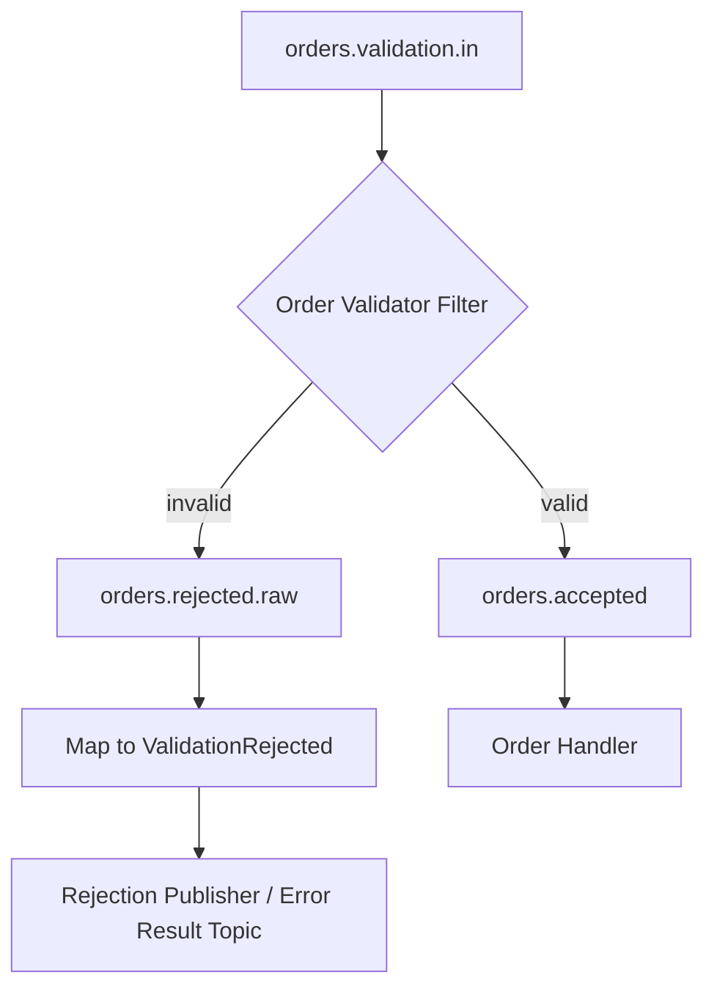
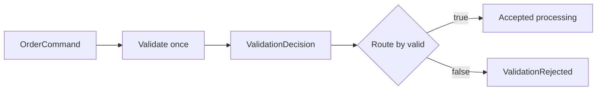
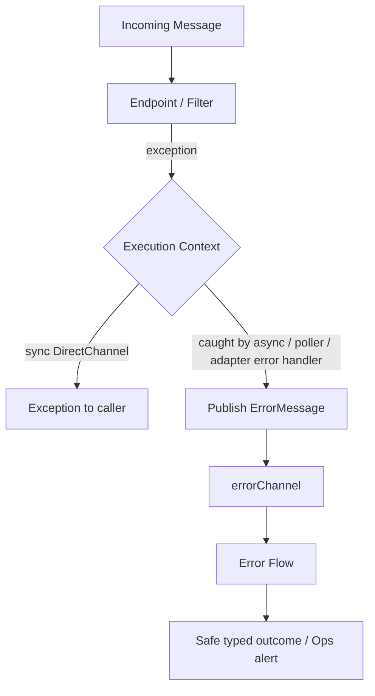
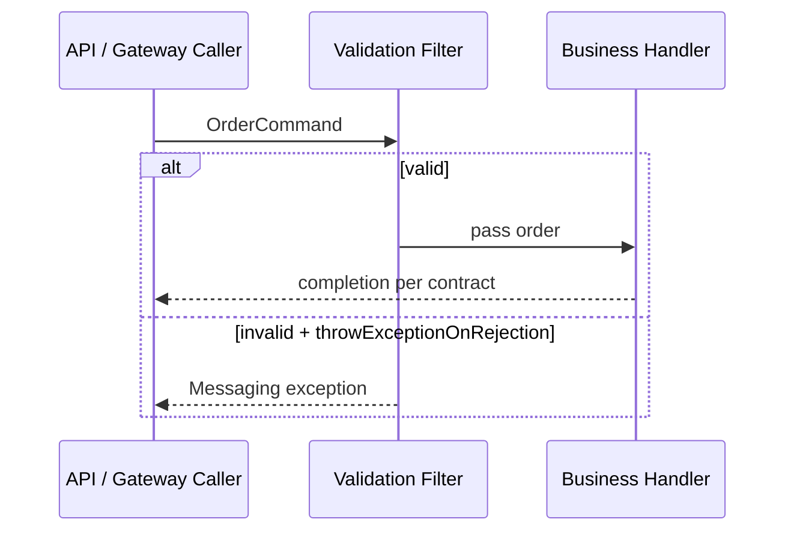
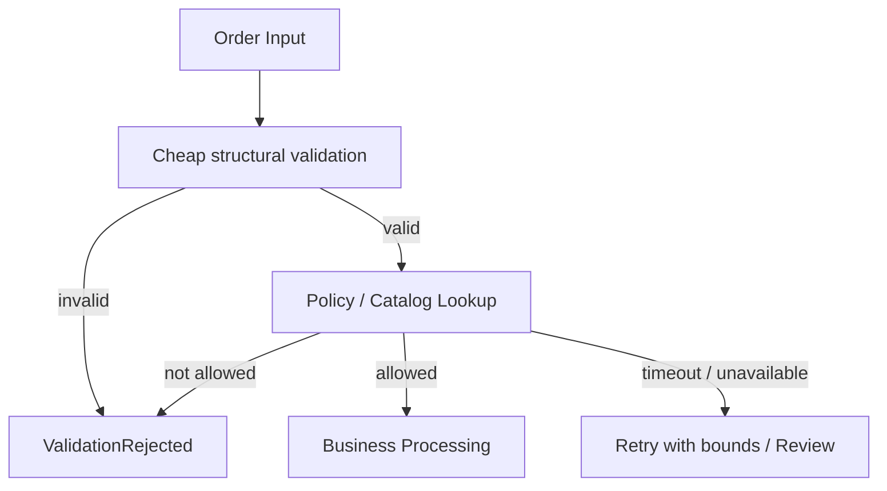
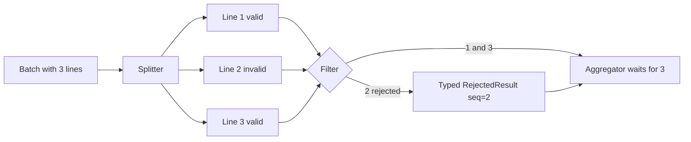
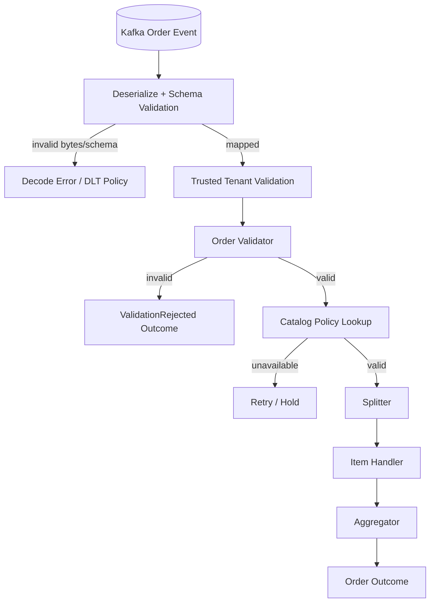

# Error message cho validation failure

Trong **Enterprise Integration Patterns (EIP)**, **Message Filter** quyết định một message có được tiếp tục đi qua một luồng xử lý hay không. Một bước **validation** cũng có thể từ chối message, nhưng khác với việc bỏ dữ liệu không cần thiết: khi một yêu cầu không hợp lệ, producer, client hoặc bộ phận vận hành thường cần biết **vì sao bị từ chối**, **lỗi nào có thể sửa**, và **message đó đã tạo side effect hay chưa**.

Ví dụ, một `OrderSubmitted` thiếu mã khách hàng hoặc có số lượng âm được đưa vào luồng xử lý đơn hàng. Nếu Filter chỉ loại bỏ nó âm thầm, hệ thống có thể báo nhận thành công nhưng không có đơn hàng nào được tạo; Gateway chờ reply có thể timeout; người vận hành không biết message bị loại ở bước nào. Nếu mọi validation failure đều bị ném như lỗi hạ tầng, retry policy lại có thể phát đi phát lại một message chắc chắn không hợp lệ.

Bài **“Error message cho validation failure”** thuộc chương **Message filter và validation** của module **SPRING_INTEGRATION_PATTERN**. Mục tiêu module là học triển khai Enterprise Integration Patterns bằng Spring Integration để xây dựng các luồng thông điệp ít phụ thuộc, dễ mở rộng, kết hợp Router, Filter, Transformer, Splitter, Aggregator, Gateway, retry, error channel, correlation và kiểm thử từng nhánh.

Bài phân biệt ba cơ chế thường bị nhầm:

1. **Message Filter từ chối**: predicate trả `false`. Message có thể bị discard hoặc đi vào `discardChannel`; việc này **không tự phát `ErrorMessage`**.
2. **Validation thất bại theo hợp đồng nghiệp vụ**: ứng dụng tạo một **kết quả từ chối có cấu trúc** (*validation rejection*) để caller hoặc consumer hiểu và sửa.
3. **Exception trong message flow**: khi exception được một cơ chế error handling bắt và công bố, Spring Integration có thể gửi một Spring `ErrorMessage` với **`Throwable` làm payload** tới error channel.

**Mục tiêu sau bài:** Chọn đúng loại thông điệp lỗi, cấu hình Filter/throw-on-rejection/error channel, bảo toàn correlation và thông tin cần điều tra, phân loại lỗi có nên retry hay không, và kiểm thử cả đường đồng bộ lẫn bất đồng bộ.

## 1. “Validation failure” là gì trong một message flow?

Validation failure xảy ra khi message **không đáp ứng hợp đồng dữ liệu hoặc quy tắc được kiểm tra ở một điểm xác định**.

Ví dụ:

```json
{
  "eventId": "evt-101",
  "tenantId": "tenant-a",
  "orderId": "ORD-101",
  "customerId": "",
  "lines": [
    {"sku": "SKU-1", "quantity": -2}
  ]
}
```

Message trên có thể sai ở hai chỗ:

- `customerId` rỗng.
- `quantity` phải lớn hơn 0 nhưng lại là -2.

Đây thường là **lỗi dữ liệu có thể xác định**. Nếu gửi lại nguyên văn không có gì thay đổi, khả năng rất cao nó vẫn không hợp lệ.

Ngược lại, nếu một validator cần đọc bảng cấu hình mà database bị mất kết nối, đó là **lỗi hạ tầng khi thực thi validation**, không chứng minh message không hợp lệ. Hướng xử lý retry của hai tình huống phải khác nhau.

### Phân loại ba kết quả chính

| Kết quả | Ý nghĩa | Hướng xử lý mặc định |
| --- | --- | --- |
| `VALID` | Hợp đồng đã đạt tại bước kiểm tra | Đi tiếp tới Router/handler |
| `INVALID` | Có vi phạm quy tắc xác định | Rejection result, discard có audit hoặc client error |
| `UNKNOWN` / `VALIDATION_UNAVAILABLE` | Chưa thể xác minh vì validator/dependency lỗi | Retry có giới hạn, hold, error channel hoặc recovery |

**Không được gán `UNKNOWN` thành `VALID` chỉ để hệ thống tiếp tục nhanh**, nhất là với kiểm tra quyền, hạn mức, chống gian lận hoặc tuân thủ bắt buộc.

## 2. Filter không phải lúc nào cũng là một error handler

Một Filter chuẩn thường hoạt động theo predicate:

```text
if predicate(message) == true:
    forward message
else:
    reject/discard message
```



Nếu không cấu hình đường discard thích hợp, kết quả `false` có thể dẫn đến việc message **không được phát tiếp**. Điều đó đôi khi hợp lệ, ví dụ Filter loại một bản tin telemetry không cần quan tâm. Nhưng với một yêu cầu tạo đơn, thanh toán hay đăng ký, bỏ âm thầm thường là hợp đồng kém.

**Quan trọng:** Một message bị Filter trả `false` **không tự trở thành một Spring `ErrorMessage`**. `discardChannel` thường nhận **message gốc bị từ chối**, không phải tự động một `ErrorMessage` mang `Throwable`.

Nếu muốn người gửi nhận lỗi, ứng dụng cần chọn một hành vi tường minh:

- Đưa original message qua discard flow để tạo `ValidationRejected` có cấu trúc.
- Cấu hình Filter ném `MessageRejectedException` khi từ chối.
- Dùng một validator/Router trả về kết quả typed `ACCEPTED/REJECTED`.
- Ghi audit/hold/DLQ có chính sách nếu message đến từ broker.

Mỗi cách phục vụ **hợp đồng và topology khác nhau**; đừng bật cả ba nơi một cách vô ý rồi phát sinh nhiều kết quả lỗi cho một event.

## 3. Phân biệt error, rejection, discard và dead-letter

| Khái niệm | Thông điệp thực tế | Thường dùng khi |
| --- | --- | --- |
| **ValidationRejected** | Business DTO/event do ứng dụng định nghĩa | Dữ liệu không đạt hợp đồng, caller cần biết lỗi |
| **Spring ErrorMessage** | Message có payload là `Throwable` | Exception được framework/error handler bắt và công bố |
| **Filter discard** | Original message được bỏ hoặc chuyển tới discard channel | Điều kiện Filter không cho message đi tiếp |
| **Dead-letter message** | Message cùng metadata lỗi theo broker/adapter | Xử lý thất bại cần cách ly, điều tra hoặc replay |
| **HTTP 400/422** | API status và body lỗi | Client gửi request dữ liệu không hợp lệ |
| **Retry message** | Công việc được lên lịch xử lý lại | Sự cố tạm thời hoặc outcome chưa rõ, retry an toàn |
| **Audit event** | Bản ghi truy vết quyết định | Cần chứng minh ai/điều kiện nào đã từ chối |

Một `ErrorMessage` của Spring không phải một object JSON có sẵn trường `errorCode`, `field` và `correlationId` theo hợp đồng ứng dụng. Nếu cần trả API body dạng JSON, phải **chuyển đổi exception/validation result thành lỗi nghiệp vụ an toàn**.

Ngược lại, một `ValidationRejected` có đầy đủ field vi phạm **không tự được phân phối qua global `errorChannel`**. Nó chỉ đi đến channel nào ứng dụng phát nó vào.

### Quy tắc thiết kế

**Dùng typed rejection cho lỗi dữ liệu dự kiến và dùng ErrorMessage cho exception/hạ tầng hoặc khi chủ đích cấu hình throw-on-rejection.** Đây không phải luật tuyệt đối: có những hệ thống xem validation failure là exception bắt buộc, nhưng khi đó phải hiểu rõ ý nghĩa với retry, Gateway và error channel.

## 4. Một validation error message nên chứa những gì?

Một kết quả từ chối có cấu trúc cho producer thường cần:

| Trường | Mục đích |
| --- | --- |
| `eventId` / `businessRequestId` | Liên kết với yêu cầu gốc, ổn định qua retry |
| `tenantId` | Phạm vi nghiệp vụ và kiểm tra quyền |
| `errorCode` | Mã máy đọc được, không phụ thuộc ngôn ngữ |
| `violations[]` | Từng trường/quy tắc không hợp lệ |
| `retryable` | Cho biết **có nên retry nguyên yêu cầu** theo policy |
| `validationPolicyVersion` | Phiên bản bộ quy tắc |
| `rejectedAt` | Thời điểm kiểm tra phía server |
| `correlationId` / `traceId` | Phục vụ truy vết nếu được cấp đáng tin cậy |
| `outcome` | Ví dụ `VALIDATION_REJECTED` |
| `nextAction` | FIX_INPUT, CONTACT_SUPPORT, WAIT_FOR_REVIEW... |

Ví dụ:

```json
{
  "eventId": "evt-101",
  "orderId": "ORD-101",
  "outcome": "VALIDATION_REJECTED",
  "errorCode": "ORDER_INPUT_INVALID",
  "retryable": false,
  "validationPolicyVersion": "order-v3",
  "violations": [
    {"field": "customerId", "code": "REQUIRED"},
    {"field": "lines[0].quantity", "code": "MUST_BE_POSITIVE"}
  ]
}
```

Đây là **hợp đồng ứng dụng do ta thiết kế**, không phải nội dung Spring `ErrorMessage` mặc định.

Không nên đưa:

- Toàn bộ payload có PII/secrets.
- Stack trace, tên bảng database hay URL nội bộ.
- Giá trị thô của mật khẩu/token trong `rejectedValue`.
- Thông tin một tenant khác.
- Một thông báo tự do khó chuẩn hóa như `"Something went wrong, try later"` cho mọi loại lỗi.

**Mã lỗi phải có nghĩa ổn định**. Message hiển thị bằng tiếng Việt/Anh có thể được sinh tại UI từ `errorCode`, không nên là cách duy nhất để consumer phân loại.

## 5. Thiết kế validator thuần, có kết quả ổn định

Một validator hợp đồng nên dễ unit test và không tạo side effect. Ví dụ dùng Java record (Java 17+):

```java
import java.util.List;

record OrderLine(String sku, int quantity) {}

record OrderCommand(
    String eventId,
    String tenantId,
    String orderId,
    String customerId,
    List<OrderLine> lines
) {}

record Violation(String field, String code) {}

record ValidationRejected(
    String eventId,
    String orderId,
    String errorCode,
    String policyVersion,
    boolean retryable,
    List<Violation> violations,
    java.time.Instant rejectedAt
) {
    ValidationRejected {
        violations = List.copyOf(violations);
    }
}
```

Validator:

```java
import java.util.ArrayList;
import java.util.List;

final class OrderValidator {
    static final String POLICY_VERSION = "order-v3";

    List<Violation> validate(OrderCommand order) {
        List<Violation> issues = new ArrayList<>();

        if (order == null) {
            issues.add(new Violation("order", "REQUIRED"));
            return List.copyOf(issues);
        }

        if (blank(order.eventId())) {
            issues.add(new Violation("eventId", "REQUIRED"));
        }
        if (blank(order.tenantId())) {
            issues.add(new Violation("tenantId", "REQUIRED"));
        }
        if (blank(order.orderId())) {
            issues.add(new Violation("orderId", "REQUIRED"));
        }
        if (blank(order.customerId())) {
            issues.add(new Violation("customerId", "REQUIRED"));
        }

        if (order.lines() == null || order.lines().isEmpty()) {
            issues.add(new Violation("lines", "MUST_NOT_BE_EMPTY"));
        } else {
            if (order.lines().size() > 500) {
                issues.add(new Violation("lines", "TOO_MANY"));
            }
            for (int i = 0; i < order.lines().size(); i++) {
                OrderLine line = order.lines().get(i);
                if (line == null) {
                    issues.add(new Violation(
                        "lines[" + i + "]", "REQUIRED"));
                    continue;
                }
                if (blank(line.sku())) {
                    issues.add(new Violation(
                        "lines[" + i + "].sku", "REQUIRED"));
                }
                if (line.quantity() <= 0) {
                    issues.add(new Violation(
                        "lines[" + i + "].quantity",
                        "MUST_BE_POSITIVE"));
                }
            }
        }

        return List.copyOf(issues);
    }

    private static boolean blank(String value) {
        return value == null || value.isBlank();
    }
}
```

Ở ví dụ này:

1. `validate` trả danh sách vi phạm, **không ném exception cho dữ liệu sai thông thường**.
2. `Violation` gồm field và error code, **không tiết lộ raw field value**.
3. Không gọi database hoặc API phụ trong validator mẫu, nên retry nguyên dữ liệu không thay đổi sẽ không làm nó hợp lệ.
4. Chính sách giới hạn 500 dòng là **giả định trong bài**, không phải hạn Spring Integration.
5. Validation dữ liệu **không thay thế authentication/authorization**: `tenantId` từ client phải được đối chiếu với security context.
6. Với payload lớn, cần giới hạn kích thước trước khi deserialize hoặc vòng lặp validation để tránh DoS.

Validator trả `List<Violation>` giúp dùng chung giữa API, Filter và unit test. Tuy nhiên, tránh validate lại nhiều lần không cần thiết; có thể đặt một lần validate ở đầu flow, tạo một `ValidationDecision` bất biến và route theo outcome.

## 6. Filter từ chối bằng discardChannel: chưa có ErrorMessage

Cấu hình đầu tiên minh họa Filter dùng đúng nghĩa loại message. Khi invalid, một **discard flow** tạo typed rejection để phát qua kênh ứng dụng. Đây là lựa chọn phù hợp nếu validation failure là kết quả dự kiến.



### 6.1. Hợp đồng các service

```java
interface OrderHandler {
    void handle(OrderCommand command);
}

interface RejectionSink {
    // Ví dụ publish rejection event vào topic hoặc outcome store.
    void publish(ValidationRejected rejection);
}
```

### 6.2. Spring Integration Java DSL

```java
import java.time.Instant;
import java.util.List;
import org.springframework.context.annotation.Bean;
import org.springframework.context.annotation.Configuration;
import org.springframework.integration.channel.DirectChannel;
import org.springframework.integration.config.EnableIntegration;
import org.springframework.integration.dsl.IntegrationFlow;
import org.springframework.messaging.MessageChannel;

@Configuration
@EnableIntegration
class FilterValidationConfiguration {

    @Bean("orders.validation.in")
    MessageChannel input() {
        return new DirectChannel();
    }

    @Bean("orders.accepted")
    MessageChannel accepted() {
        return new DirectChannel();
    }

    @Bean("orders.rejected.raw")
    MessageChannel discarded() {
        return new DirectChannel();
    }

    @Bean
    OrderValidator orderValidator() {
        return new OrderValidator();
    }

    @Bean
    IntegrationFlow orderFilterFlow(OrderValidator validator) {
        return IntegrationFlow.from("orders.validation.in")
            .filter(OrderCommand.class,
                command -> validator.validate(command).isEmpty(),
                spec -> spec.discardChannel("orders.rejected.raw"))
            .channel("orders.accepted")
            .get();
    }

    @Bean
    IntegrationFlow acceptedOrderFlow(OrderHandler handler) {
        return IntegrationFlow.from("orders.accepted")
            .handle(OrderCommand.class, (order, headers) -> {
                handler.handle(order);
                return null;
            })
            .get();
    }

    @Bean
    IntegrationFlow rejectedOrderFlow(
            OrderValidator validator,
            RejectionSink sink) {
        return IntegrationFlow.from("orders.rejected.raw")
            .handle(OrderCommand.class, (order, headers) -> {
                List<Violation> violations =
                    validator.validate(order);

                sink.publish(new ValidationRejected(
                    order.eventId(),
                    order.orderId(),
                    "ORDER_INPUT_INVALID",
                    OrderValidator.POLICY_VERSION,
                    false,
                    violations,
                    Instant.now()
                ));
                return null;
            })
            .get();
    }
}
```

**Ý nghĩa quan trọng:**

- `orders.rejected.raw` nhận **original message bị Filter từ chối**.
- `rejectedOrderFlow` **tự tạo** `ValidationRejected`; Spring **không tự tạo `ErrorMessage`** ở đây.
- Các handler trả `null` có chủ đích vì hai nhánh là **one-way endpoint**; không nên dùng đúng cấu hình này để hứa một Gateway sẽ nhận được response có cấu trúc.
- `validator.validate` được gọi hai lần (Filter và discard flow) để trình bày đơn giản. Với validator tốn tài nguyên hoặc phụ thuộc state, hãy **validate một lần** rồi route một `ValidationDecision` để tránh hai lần kiểm tra không nhất quán.
- `RejectionSink.publish` cần error handling, idempotency hoặc outbox phù hợp nếu ghi nhận việc từ chối là một side effect bắt buộc.
- Ví dụ này không kèm bean implementation `OrderHandler`, `RejectionSink`; chúng phải được ứng dụng cung cấp.

### Cẩn thận với payload null

Spring Message thông thường yêu cầu payload không null, nhưng các bước deserialize/envelope có thể báo lỗi **trước khi tạo được `OrderCommand`**. Khi đó, validation ở payload level **không nhận một OrderCommand null** theo cách thông thường.

Đừng ép mọi lỗi deserialize thành `Violation("order","REQUIRED")`; có thể cần một inbound error handler riêng để báo lỗi `INVALID_JSON` hoặc `SCHEMA_DECODE_FAILED` theo contract.

## 7. ValidationDecision: validate một lần rồi route

Trong hệ thống lớn, validation có thể gồm nhiều rule và lookup. Nếu gọi validator lại ở Filter và discard handler, kết quả có thể khác khi rule version hoặc dữ liệu phụ thay đổi.

Một mô hình an toàn hơn:

```java
import java.util.List;

record ValidationDecision(
    OrderCommand original,
    boolean valid,
    List<Violation> violations,
    String policyVersion
) {
    ValidationDecision {
        violations = List.copyOf(violations);
    }
}

final class OrderValidationService {
    private final OrderValidator validator;

    OrderValidationService(OrderValidator validator) {
        this.validator = validator;
    }

    ValidationDecision decide(OrderCommand command) {
        List<Violation> violations =
            validator.validate(command);

        return new ValidationDecision(
            command,
            violations.isEmpty(),
            violations,
            OrderValidator.POLICY_VERSION
        );
    }
}
```



Tầng workflow có thể route `ValidationDecision.valid()` bằng Router và đưa `original` sang business handler, hoặc map quyết định sai thành `ValidationRejected`. Cách này giữ **bộ violations như một snapshot** và giảm khác biệt giữa kiểm tra lần đầu với phần thông báo lỗi.

**Chưa được coi decision `VALID` là authorization** nếu các quyền phải được kiểm tra ngay trước side effect. Một policy có thể thay đổi sau khi decision được tạo; cần thiết kế freshness/validity scope nếu một decision được lưu và replay sau nhiều giờ.

## 8. Filter ném exception khi rejection: throwExceptionOnRejection

Có trường hợp hợp đồng yêu cầu message không hợp lệ phải tạo exception — ví dụ một caller đồng bộ muốn biết request đã bị từ chối ở bước này.

Trong Spring Integration, một Filter có tùy chọn **`throwExceptionOnRejection(true)`**. Khi predicate trả `false`, Filter không chỉ discard mà **ném `MessageRejectedException`** (theo semantics của thành phần/phiên bản tương ứng).

```java
import org.springframework.context.annotation.Bean;
import org.springframework.context.annotation.Configuration;
import org.springframework.integration.channel.DirectChannel;
import org.springframework.integration.config.EnableIntegration;
import org.springframework.integration.dsl.IntegrationFlow;
import org.springframework.messaging.MessageChannel;

@Configuration
@EnableIntegration
class StrictValidationConfiguration {

    @Bean("orders.strict.in")
    MessageChannel strictInput() {
        return new DirectChannel();
    }

    @Bean
    IntegrationFlow strictValidationFlow(
            OrderValidator validator,
            OrderHandler handler) {
        return IntegrationFlow.from("orders.strict.in")
            .filter(OrderCommand.class,
                order -> validator.validate(order).isEmpty(),
                spec -> spec.throwExceptionOnRejection(true))
            .handle(OrderCommand.class, (order, headers) -> {
                handler.handle(order);
                return null;
            })
            .get();
    }
}
```

Điểm cần hiểu:

- Một `OrderCommand` invalid gây **exception** tại Filter.
- Với `DirectChannel` và caller đồng bộ, exception có thể **lan ngược tới caller**, có thể được bọc qua các exception messaging khác.
- **Không có lời hứa** rằng exception này tự xuất hiện trong `global errorChannel`. Với call stack đồng bộ, error handling do caller hoặc endpoint upstream quyết định.
- Khi chuyển sang channel/executor/poller bất đồng bộ, một exception có thể được cơ chế error handler của thread đó bắt và công bố thành `ErrorMessage`.
- Không lạm dụng throw-on-rejection nếu nghiệp vụ xem invalid input là kết quả từ chối thông thường chứ không phải exception.

**Đừng dùng `discardChannel` và `throwExceptionOnRejection(true)` như hai đường phản hồi được mặc định chạy đồng thời.** Hãy xác minh semantics với cấu hình thực tế và chọn một hợp đồng duy nhất để không báo lỗi trùng.

## 9. Spring ErrorMessage thực chất có cấu trúc gì?

Spring `ErrorMessage` là một loại `Message<Throwable>`. Trong Spring Integration, nó thường được dùng để chuyển một exception qua **error channel** khi có cơ chế bắt lỗi và tạo/publish error message.

Có thể hình dung:

```text
ErrorMessage
  payload:
    Throwable / MessagingException
      message/cause
      failedMessage (nếu được gắn)
  headers:
    id, timestamp, ... error metadata
  originalMessage:
    có thể có tùy constructor/error publisher
```

**Payload của `ErrorMessage` là `Throwable`**, không phải một `ValidationRejected` theo schema của API.

Nếu exception là `MessagingException`, nó có thể mang **`failedMessage`**, chứa payload và headers của message gặp lỗi. Điều này rất hữu ích cho correlation, nhưng cũng có nguy cơ làm lộ thông tin nhạy cảm nếu log nguyên object hoặc đưa nguyên `ErrorMessage` ra ngoài.

### Một ErrorMessage có thể được tạo ở đâu?



**Không có một quy tắc “mọi exception đều đi tới errorChannel”.** Sự khác biệt nằm ở chỗ exception được ném trong call stack đồng bộ hay được một infrastructure error handler bắt trong xử lý bất đồng bộ.

## 10. Phân biệt MessageRejectedException và lỗi hạ tầng

`MessageRejectedException` là một signal phù hợp khi Filter được cấu hình ném exception do predicate từ chối. Nhưng **không phải mọi exception ở Filter là validation failure**.

Ví dụ:

- Predicate trả `false` do `quantity <= 0` → có thể là `INVALID_INPUT`.
- Predicate gọi database và bị `DataAccessResourceFailureException` → **validator unavailable**, không biết input hợp lệ hay không.
- Predicate bị `NullPointerException` vì bug → **lỗi lập trình**, không được báo `INVALID_INPUT` rồi bỏ qua.
- Predicate kiểm tra tenant và gặp lỗi truy cập policy store → có thể cần fail closed và recovery, không coi client đã sửa được dữ liệu bằng retry nguyên request.

### Mẫu phân loại

| Exception hoặc kết quả | Mã nội bộ | Có retry nguyên message? |
| --- | --- | --- |
| Validator trả violations xác định | `VALIDATION_REJECTED` | Không, trừ khi payload/policy được sửa |
| `MessageRejectedException` do Filter từ chối | `VALIDATION_REJECTED` nếu filter dành riêng cho validation | Thường không |
| Lỗi kết nối rule database | `VALIDATION_UNAVAILABLE` | Có thể retry có giới hạn |
| JSON decode failure | `INVALID_PAYLOAD_FORMAT` | Thường không, yêu cầu sửa input |
| Quyền truy cập bị từ chối | `ACCESS_DENIED` | Không retry tự động; cần quyền hợp lệ |
| Bug trong validator | `VALIDATOR_INTERNAL_ERROR` | Không đổ lỗi client; cảnh báo/khắc phục |
| Timeout với side effect chưa rõ | `OUTCOME_UNKNOWN` | Đối soát trước retry |

**Mã lỗi không nên được suy ra chỉ từ chuỗi của `Throwable.getMessage()`.** Nên dùng exception type/marker có kiểm soát và domain validation decision. Message tự do có thể đổi theo version hoặc chứa dữ liệu nhạy cảm.

## 11. Async flow: exception có thể thành ErrorMessage

Một ứng dụng có thể đưa validation vào `ExecutorChannel`. Khi Filter ném exception **trong worker thread**, cơ chế xử lý lỗi của executor/message endpoint có thể công bố `ErrorMessage` tới error channel tương ứng.

Ví dụ sau minh họa cấu hình các channel và nhánh xử lý. Nó cần được kiểm thử với **phiên bản Spring Integration thực tế** và cách xử lý lỗi của dispatcher/executor được dùng.

### 11.1. Channel và executor

```java
import org.springframework.beans.factory.annotation.Qualifier;
import org.springframework.context.annotation.Bean;
import org.springframework.context.annotation.Configuration;
import org.springframework.core.task.TaskExecutor;
import org.springframework.integration.channel.DirectChannel;
import org.springframework.integration.channel.ExecutorChannel;
import org.springframework.integration.config.EnableIntegration;
import org.springframework.messaging.MessageChannel;
import org.springframework.scheduling.concurrent.ThreadPoolTaskExecutor;

@Configuration
@EnableIntegration
class AsyncValidationChannels {

    @Bean("orders.validation.executor")
    TaskExecutor validationExecutor() {
        ThreadPoolTaskExecutor executor =
            new ThreadPoolTaskExecutor();
        executor.setCorePoolSize(2);
        executor.setMaxPoolSize(4);
        executor.setQueueCapacity(100);
        executor.setThreadNamePrefix("validation-");
        executor.initialize();
        return executor;
    }

    @Bean("orders.async.in")
    MessageChannel asyncInput(
            @Qualifier("orders.validation.executor")
            TaskExecutor executor) {
        return new ExecutorChannel(executor);
    }

    @Bean("orders.async.accepted")
    MessageChannel asyncAccepted() {
        return new DirectChannel();
    }

    @Bean("orders.validation.errors")
    MessageChannel validationErrors() {
        return new DirectChannel();
    }
}
```

### 11.2. Validation trong worker thread

```java
import org.springframework.context.annotation.Bean;
import org.springframework.context.annotation.Configuration;
import org.springframework.integration.dsl.IntegrationFlow;

@Configuration
class AsyncStrictValidationFlow {

    @Bean
    IntegrationFlow asyncOrderValidation(
            OrderValidator validator) {
        return IntegrationFlow.from("orders.async.in")
            .filter(OrderCommand.class,
                order -> validator.validate(order).isEmpty(),
                spec -> spec.throwExceptionOnRejection(true))
            .channel("orders.async.accepted")
            .get();
    }

    @Bean
    IntegrationFlow processAsyncAccepted(OrderHandler handler) {
        return IntegrationFlow.from("orders.async.accepted")
            .handle(OrderCommand.class, (order, headers) -> {
                handler.handle(order);
                return null;
            })
            .get();
    }
}
```

**Hai cấu hình trên minh họa một topology bất đồng bộ riêng**, không đăng ký chung những bean `orders...` trùng tên với ví dụ ở mục 6/8 trong cùng ApplicationContext mà không đổi tên hoặc chọn cấu hình.

### 11.3. Gửi message có error channel nội bộ được tin cậy

```java
import org.springframework.messaging.Message;
import org.springframework.messaging.MessageChannel;
import org.springframework.messaging.MessageHeaders;
import org.springframework.messaging.support.MessageBuilder;

// Phác thảo trong service/fixture có hai bean đã inject:
MessageChannel asyncInput = /* "orders.async.in" */ null;
MessageChannel validationErrors =
    /* "orders.validation.errors" */ null;

OrderCommand command = /* request đã map từ nguồn tin cậy */ null;

Message<OrderCommand> message = MessageBuilder
    .withPayload(command)
    .setHeader(MessageHeaders.ERROR_CHANNEL, validationErrors)
    .setHeader("businessEventId", command.eventId())
    .build();

asyncInput.send(message);
```

**Đây là đoạn minh họa cách xây message, chưa phải một class chạy nguyên văn** vì các biến dùng placeholder. Header error channel chứa **đối tượng `MessageChannel` nội bộ**, không nên lấy từ dữ liệu client, serialize tùy tiện qua Kafka/HTTP/JMS hoặc đưa cho user chọn. Với một adapter inbound, error channel có thể được cấu hình trên chính endpoint thay vì đặt trong message.

Khi exception phát sinh trên worker thread, một error publisher tương ứng **có thể** sử dụng error channel header hoặc error channel mặc định theo cơ chế của framework. Cần test thực tế rằng lỗi được đưa tới `orders.validation.errors`, không chỉ giả định dựa trên sự tồn tại của bean.

## 12. Xử lý ErrorMessage và chuyển thành báo cáo an toàn

Error flow phải phân biệt **lỗi validation có thể quy về dữ liệu** với những lỗi khác. Không nên biến mọi exception trên cùng error channel thành `ValidationRejected(retryable=false)`.

Một consumer có thể được gọi bởi Service Activator thông qua `ErrorMessage`:

```java
import java.time.Instant;
import java.util.List;
import org.springframework.integration.MessageRejectedException;
import org.springframework.messaging.Message;
import org.springframework.messaging.MessagingException;
import org.springframework.messaging.support.ErrorMessage;

interface InfrastructureErrorSink {
    void report(String category, String businessEventId);
}

final class ValidationErrorConsumer {
    private final OrderValidator validator;
    private final RejectionSink rejectionSink;
    private final InfrastructureErrorSink infrastructureSink;

    ValidationErrorConsumer(
            OrderValidator validator,
            RejectionSink rejectionSink,
            InfrastructureErrorSink infrastructureSink) {
        this.validator = validator;
        this.rejectionSink = rejectionSink;
        this.infrastructureSink = infrastructureSink;
    }

    public void handle(ErrorMessage error) {
        Throwable failure = error.getPayload();
        MessageRejectedException rejection = findRejection(failure);

        if (rejection == null) {
            // Không trá hình lỗi hạ tầng thành lỗi input.
            infrastructureSink.report(
                "UNCLASSIFIED_VALIDATION_FLOW_ERROR", null);
            return;
        }

        Message<?> failed = rejection.getFailedMessage();
        if (failed == null
                || !(failed.getPayload() instanceof OrderCommand order)) {
            infrastructureSink.report(
                "MISSING_FAILED_MESSAGE", null);
            return;
        }

        List<Violation> violations =
            validator.validate(order);

        if (violations.isEmpty()) {
            infrastructureSink.report(
                "REJECTION_WITHOUT_VIOLATIONS", order.eventId());
            return;
        }

        rejectionSink.publish(new ValidationRejected(
            order.eventId(),
            order.orderId(),
            "ORDER_INPUT_INVALID",
            OrderValidator.POLICY_VERSION,
            false,
            violations,
            Instant.now()
        ));
    }

    private static MessageRejectedException findRejection(
            Throwable failure) {
        Throwable current = failure;
        for (int depth = 0; current != null && depth < 12; depth++) {
            if (current instanceof MessageRejectedException rejected) {
                return rejected;
            }
            current = current.getCause();
        }
        return null;
    }
}
```

Code này là ví dụ phân loại **trên một error channel chỉ dành cho validation**, có những điều kiện:

1. `ErrorMessage.getPayload()` là `Throwable`, không trực tiếp là `OrderCommand`.
2. `MessageRejectedException` có thể nằm trong **cause chain**, không nhất thiết là exception ngoài cùng.
3. `failedMessage` có thể vắng hoặc payload không đúng kiểu, nhất là khi lỗi phát sinh trước lúc hoàn thành message mapping.
4. Validator được gọi lại để tạo violations; với rule động, cần lưu `ValidationDecision` hoặc snapshot policy version để tránh thông báo khác quyết định ban đầu.
5. `rejectionSink` và `infrastructureSink` là **đường xuất báo cáo do ứng dụng cung cấp**, cần idempotency, backpressure và bảo vệ PII.
6. Đừng log nguyên `ErrorMessage` vì `failedMessage` có thể chứa payload nhạy cảm.

### Đăng ký error flow

```java
import org.springframework.context.annotation.Bean;
import org.springframework.context.annotation.Configuration;
import org.springframework.integration.dsl.IntegrationFlow;

@Configuration
class ValidationErrorFlowConfiguration {

    @Bean
    ValidationErrorConsumer validationErrorConsumer(
            OrderValidator validator,
            RejectionSink rejectionSink,
            InfrastructureErrorSink infrastructureSink) {
        return new ValidationErrorConsumer(
            validator, rejectionSink, infrastructureSink);
    }

    @Bean
    IntegrationFlow validationErrorFlow(
            ValidationErrorConsumer consumer) {
        return IntegrationFlow.from("orders.validation.errors")
            .handle(consumer, "handle")
            .get();
    }
}
```

Như mọi ví dụ riêng trong bài, các cấu hình này **cần ghép đúng một topology và cung cấp các bean tương ứng**, không chồng các flow thay thế có cùng input channel hay cùng tên bean.

**Chú ý:** Nếu error flow cũng ném exception, không được mặc định nó tự retry vô hạn hoặc được chuyển tiếp an toàn. Cần một đường báo lỗi hạ tầng dự phòng và giám sát khi không thể publish rejection.

## 13. Tại sao không nên publish ErrorMessage thủ công cho mọi lỗi dữ liệu?

Một ứng dụng có thể tạo `ErrorMessage` thủ công:

```java
import org.springframework.integration.MessageRejectedException;
import org.springframework.messaging.Message;
import org.springframework.messaging.MessageChannel;
import org.springframework.messaging.support.ErrorMessage;

final class ExplicitErrorPublisher {
    private final MessageChannel errors;

    ExplicitErrorPublisher(MessageChannel errors) {
        this.errors = errors;
    }

    void publishValidationRejection(Message<?> failedMessage) {
        MessageRejectedException exception =
            new MessageRejectedException(
                failedMessage, "Order validation rejected");

        ErrorMessage error = new ErrorMessage(exception);

        if (!errors.send(error)) {
            throw new IllegalStateException(
                "Could not publish validation error");
        }
    }
}
```

Đây là **một lựa chọn tường minh**, không phải hành vi mặc định của Filter. Nó có thể hữu ích trong một môi trường mọi loại exception đều được tiêu thụ ở một error flow chuẩn hóa. Tuy nhiên:

- `ErrorMessage` mang exception và có thể tham chiếu payload đầy đủ qua `failedMessage`.
- Nếu error channel chứa listener nhiều team, dữ liệu nhạy cảm có thể bị phát tán.
- Nếu **vừa publish thủ công vừa ném exception** để error handler lại publish, có thể tạo **hai error messages** cho một failure.
- Việc phát ErrorMessage không tự trả một HTTP 422 hay một `ValidationRejected` cho caller.
- Nếu yêu cầu chỉ là thông báo client rằng field sai, **typed rejection** thường dễ kiểm thử, an toàn và ổn định hơn.

Hãy chọn **một nguồn phát error outcome** cho mỗi lần validation failure, hoặc đặt idempotency key và dedup nếu kiến trúc cố ý có nhiều đường phát.

## 14. Đồng bộ và bất đồng bộ ảnh hưởng người nhận lỗi

Cùng một Filter có thể được đặt trong hai topology rất khác:

### 14.1. Luồng đồng bộ với DirectChannel/Gateway



Nếu Filter ném exception và exception lan về caller, tầng API có thể **bắt loại lỗi validation** và map sang body lỗi 400/422 theo hợp đồng. Đừng yêu cầu caller vừa nhận exception đồng bộ vừa chờ `ErrorMessage` ở một channel khác mà chưa có thiết kế rõ.

Một Gateway **cần reply** nhưng phía sau chỉ có Filter bỏ message và không có reply có thể gây `reply timeout` hoặc `ReplyRequiredException` tùy cấu hình. Đó không phải cách tốt để báo lỗi field invalid.

### 14.2. Luồng bất đồng bộ qua executor hoặc broker

Khi message được chấp nhận vào queue/executor, producer có thể nhận **ACK ở mức transport**, trước khi validation chạy.

```text
Producer -> Broker ACK accepted
          -> Consumer validation
             -> INVALID
             -> typed rejection event / error channel / DLQ
```

Trong trường hợp đó, **ACK không đồng nghĩa dữ liệu đã được chấp nhận về nghiệp vụ**. Nếu client cần biết kết quả, phải có outcome store, callback, reply topic hoặc API truy vấn theo `businessEventId`.

Không cố trả `HTTP 422` cho một HTTP request đã nhận `202 Accepted` và kết thúc kết nối trước đó. Kết quả validation phải được chuyển qua một kênh được hợp đồng hỗ trợ.

## 15. Error channel khác discard channel

Đây là cách phân biệt thiết thực:

| Thuộc tính | `discardChannel` của Filter | `errorChannel` |
| --- | --- | --- |
| Khi nào dùng | Filter từ chối message theo predicate | Có lỗi được error handler bắt/công bố |
| Message thường nhận | **Message đầu vào bị từ chối** | **ErrorMessage** chứa `Throwable` |
| Có exception bắt buộc? | Không | Thường có exception/cause |
| Có violations sẵn? | Không, nếu chưa tạo | Không tự có violations nghiệp vụ |
| Có tự retry? | Không | Không; retry cần cấu hình/advice/transport |
| Có tự trả reply cho Gateway? | Không | Không mặc định |
| Dữ liệu nhạy cảm cần bảo vệ? | Có, original payload | Có, failedMessage/stack trace |

Nếu business muốn mọi input invalid đi về một **rejection topic**, có thể dùng discard flow hoặc typed Router mà không cần ném exception. Nếu hệ thống cần một error pipeline chung, có thể cấu hình throw-on-rejection và bảo đảm **error publisher** đúng ở execution context.

**Không nên gọi một channel `errorChannel` trong code rồi kết luận message gửi vào đó đã là `ErrorMessage`.** Tên channel không biến đổi kiểu payload.

## 16. Xử lý validation sau deserialize, schema và Bean Validation

Validation có nhiều tầng; vị trí thực thi quyết định liệu một Spring message đã tồn tại hay chưa.

| Tầng | Ví dụ | Thời điểm |
| --- | --- | --- |
| Transport/protocol | Header bắt buộc, giới hạn kích thước | Trước mapping payload |
| Deserialize | JSON sai cú pháp, kiểu dữ liệu không hợp lệ | Khi tạo object |
| Schema | Thiếu field, type/range theo JSON Schema/Avro | Trước hoặc trong mapping |
| Bean Validation | `@NotBlank`, `@Positive`, `@Valid` | Sau khi đã có object |
| Business validation | SKU ngừng bán, giới hạn đặt hàng | Theo policy hiện hành |
| Authorization | Actor có quyền tạo đơn cho tenant? | Tại trust boundary và trước side effect |
| Infrastructure validation dependency | Service danh mục không sẵn sàng | Có thể dẫn đến `UNKNOWN` |

**Không thể mong một `.filter(OrderCommand.class, ...)` bắt lỗi JSON không deserialize được thành `OrderCommand`**. Lỗi đó xảy ra ở inbound mapper, thường có đường error handling riêng.

### Sử dụng Jakarta Bean Validation khi phù hợp

Ví dụ DTO:

```java
import jakarta.validation.Valid;
import jakarta.validation.constraints.NotBlank;
import jakarta.validation.constraints.NotEmpty;
import jakarta.validation.constraints.Positive;
import java.util.List;

record ValidatedOrderLine(
    @NotBlank String sku,
    @Positive int quantity
) {}

record ValidatedOrder(
    @NotBlank String eventId,
    @NotBlank String tenantId,
    @NotBlank String orderId,
    @NotBlank String customerId,
    @NotEmpty List<@Valid ValidatedOrderLine> lines
) {}
```

Để chạy Bean Validation, ứng dụng phải có **Jakarta Validation provider** và gọi `Validator.validate(...)` ở đúng điểm (hoặc cấu hình tích hợp phù hợp). **Gắn annotation lên record không tự bảo đảm mọi Spring Integration Filter đều chạy validation.**

Khi chuyển `ConstraintViolation<?>` sang DTO trả client, nên map thành **field path + mã lỗi đã kiểm soát**, không log/echo giá trị trường nhạy cảm.

## 17. Domain validation failure khác hạ tầng validation unavailable

Một validator thực tế có thể cần gọi nguồn phụ để kiểm tra sản phẩm còn hoạt động hoặc tenant có quyền dùng dịch vụ.



Khi nguồn phụ lỗi:

- Không biến timeout thành `SKU_NOT_FOUND` nếu không biết SKU có tồn tại hay không.
- Không tự sử dụng cache stale cho chính sách bắt buộc nếu hợp đồng không cho phép.
- Có thể dùng timeout, bounded retry, circuit breaker và backpressure theo loại lỗi.
- Cần có error outcome `VALIDATION_UNAVAILABLE` hoặc `PENDING_REVIEW` nếu SLA yêu cầu.
- Nếu có fallback, phải ghi version/age/source dữ liệu đã được dùng.

Một exception trong validator đôi khi là `MessageHandlingException` hay exception hạ tầng, không phải `MessageRejectedException` do Filter từ chối. Error flow phải phân loại **theo cause và context** trước khi quyết định retry.

## 18. Tại sao retry sai loại lỗi làm tăng tải?

Giả sử một event có `quantity=-2`. Consumer retry 5 lần, sau đó broker redeliver 3 lần, rồi operator replay 2 lần. Nếu dữ liệu không được sửa, các lần thử này không giúp gì.

```text
quantity=-2
    -> validate
    -> REJECTED
    -> retry same payload
    -> REJECTED
    -> retry same payload
    -> REJECTED
```

Với validation failure **xác định, không đổi theo thời gian**, thường cần:

1. Ghi một rejection outcome có idempotency key.
2. Không retry vô hạn.
3. Cho producer/caller biết trường cần sửa.
4. Đưa vào quarantine hoặc DLT nếu contract và transport yêu cầu điều tra.
5. Chỉ xử lý lại sau **một correction/reprocess có chủ đích**.

Với validation phụ thuộc dữ liệu đang cập nhật, ví dụ chính sách giới hạn thay đổi sau 5 phút, retry có thể có ý nghĩa nhưng phải phân biệt `TEMPORARILY_UNAVAILABLE` với `NOT_ALLOWED`. **Không gộp cả hai thành `INVALID`**.

### Retry của inbound adapter khác retry bên trong handler

- Nếu lỗi xảy ra **trước ACK**, broker có thể redeliver toàn bộ event.
- Nếu retry advice bao quanh **toàn flow**, các bước đã thành công phía trước validator có thể bị chạy lại.
- Nếu chỉ retry **nguồn phụ** bị timeout, không nhất thiết phải phát lại toàn bộ workflow.
- Nếu rejection event đã publish thành công nhưng ACK mất, event rejection có thể bị publish lại; cần idempotency ở outcome sink.

**Đặt validation rẻ và chắc chắn trước các side effect** để hạn chế tác động của retry. Đừng đặt một side effect như trừ tồn kho trước khi kiểm tra số lượng có hợp lệ hay không.

## 19. Correlation và business event ID trong thông điệp lỗi

Một lỗi được phát ra bất đồng bộ cần được liên kết chắc chắn với message gốc.

| Metadata | Vai trò |
| --- | --- |
| `businessEventId` | Định danh ổn định xuyên retry/redelivery |
| `orderId` | Nhận diện đơn nghiệp vụ |
| `tenantId` | Phạm vi quyền và cách ly dữ liệu |
| `correlationId` | Kết nối các message trong workflow |
| `traceId` | Quan sát đường thực thi nếu tracing đang bật |
| `validationPolicyVersion` | Giải thích rule nào được áp dụng |
| `rejectionId` | Idempotency key cho rejection event nếu cần |
| `failedStage` | Ví dụ ORDER_SCHEMA_VALIDATION, ORDER_POLICY_VALIDATION |
| `rejectedAt` | Thời điểm server ra quyết định |

**Spring Message ID không phải business event ID ổn định.** Transformer và adapter có thể tạo message mới. Nếu `ErrorMessage` mang `failedMessage`, hãy trích xuất một business ID do nguồn tin cậy cấp, không sử dụng một generated ID ngẫu nhiên rồi yêu cầu producer tự correlate.

### Không copy mọi header từ message lỗi sang client response

Headers có thể chứa `replyChannel`, `errorChannel`, object nội bộ, trace baggage hoặc thông tin nhạy cảm. Chỉ copy **allowlist** của các field phục vụ contract, đã xác thực scope.

Nếu message đến qua HTTP/Kafka/JMS, nội dung header còn phụ thuộc inbound/outbound mapper. Không mặc định `correlationId` hoặc Java `MessageChannel` còn nguyên qua transport.

## 20. Bảo mật: error message có thể lộ nhiều hơn payload thường

Validation error thường chứa **đầu vào gây lỗi**. Đó chính là nơi dễ bị lộ secret nhất.

### Rủi ro phổ biến

- Exception message nối trực tiếp `password`/`apiKey` vào chuỗi.
- ErrorMessage chứa `failedMessage` với toàn bộ hồ sơ cá nhân.
- Log `error.getPayload().toString()` kéo theo toàn bộ serialized input.
- DLQ giữ nguyên payload nhạy cảm quá thời hạn cho phép.
- Một global error channel cho quá nhiều subscriber nghe mọi lỗi.
- HTTP response trả stack trace và đường dẫn nội bộ.
- Field `rejectedValue` chứa token xác thực hoặc dữ liệu thẻ.
- Metrics tag chứa email, ID khách hàng hoặc nguyên văn message.

Hướng bảo vệ:

- Trả **field path và error code**, không trả raw value khi không cần.
- Giới hạn quyền vào error channel/DLQ/outcome store.
- Chia scope theo tenant/flow, không để client chọn error channel nội bộ.
- Encrypt dữ liệu nhạy cảm khi lưu, dùng retention/purge thích hợp.
- Không nhét cả message vào exception description.
- Dùng structured logging có lọc PII, access control và audit.

**Dùng `MessageRejectedException` không tự bảo vệ dữ liệu bí mật.** Nó có thể giữ `failedMessage` để debug. Error handler phải xử lý message và exception như **dữ liệu nhạy cảm**, không phát trực tiếp ra công cụ hỗ trợ/monitoring công khai.

## 21. Validation trong Splitter, Aggregator và Scatter-Gather

### 21.1. Filter một item sau Splitter

Một batch có ba item. Splitter tạo các message với `sequenceNumber=1..3`, `sequenceSize=3`. Nếu Filter loại item số 2 âm thầm, Aggregator phía sau có thể chờ mãi vì chỉ nhận 1 và 3.



Để Aggregator biết **mọi item đã có kết quả**, discard flow có thể tạo `ItemResult(status=REJECTED)` giữ đúng `batchId`/`itemId`/`sequenceNumber`. Nhưng chỉ làm vậy nếu release contract cho phép **“đủ responses” dù có failed item**.

Nếu toàn batch phải dừng khi một item invalid, có thể validation **trước Splitter** rồi reject cả batch, thay vì tiếp tục và giữ các kết quả không cần thiết.

### 21.2. Resequencer và phần tử bị lọc

Resequencer cần đủ sequence. Nếu seq=2 bị Filter bỏ, các message 1 và 3 có thể không được phát trong chế độ full release. Cần typed `SKIPPED/REJECTED` result, manifest adjustment có kiểm soát hoặc một timeout/gap policy riêng.

**Không tự giảm `sequenceSize` từ 3 xuống 2** chỉ để giải phóng nhóm; điều đó có thể khiến late seq=2 tạo lỗi mới.

### 21.3. Scatter-Gather và nhánh không reply

Một supplier subflow bị Filter loại có thể **không trả reply**. Gatherer chỉ thấy A và C, chờ B rồi timeout. Nếu business muốn B được coi là đã xử lý nhưng không phù hợp, nhánh B có thể trả `NOT_APPLICABLE` thay vì im lặng.

Điểm chung: **validation rejection thường cần được biểu diễn thành một kết quả có identity/correlation**, không chỉ xóa message khỏi một flow đang chờ số lượng xác định.

## 22. Kafka, JMS, HTTP: từng transport cần hợp đồng riêng

### HTTP request-reply

Nếu validate ngay khi nhận HTTP request và chưa thực hiện xử lý bất đồng bộ, có thể map `ValidationRejected` thành HTTP `400 Bad Request` hoặc `422 Unprocessable Content` theo API contract. `403 Forbidden` dành cho quyền, không nên biến thành `400` chỉ để thống nhất error.

Nếu API đã trả `202 Accepted` để đưa message vào queue, kết quả validation muộn cần kênh khác: webhook, status resource hoặc rejection event. Không tự giả rằng có thể trả lại HTTP error trên kết nối đã đóng.

### Kafka/AMQP/JMS consumer

Khi một event invalid xuất hiện:

- Có thể **ACK/commit** sau khi ghi rejection outcome/quarantine thành công, theo hợp đồng.
- Có thể đưa message vào **DLQ/DLT** nếu cần cách ly và xử lý lại có kiểm soát.
- Không retry vô hạn message sai schema chắc chắn.
- Với temporary infrastructure failure, áp dụng retry/backoff phù hợp và quan sát hậu quả.
- Nếu publish rejection event và commit source offset thuộc hai hệ thống, cần idempotency/outbox để hạn chế duplicate hoặc mất outcome.

**Spring Integration `errorChannel` không đồng nghĩa Kafka DLT/JMS DLQ.** Error channel là một channel messaging trong ứng dụng; dead-lettering và offset/ack là semantics của transport/adapter, cần cấu hình riêng.

### Một điều đặc biệt ở Kafka

Một message invalid được đọc từ partition vẫn chiếm vị trí offset. Nếu chỉ để exception bắn ra và consumer cứ retry cùng record, các record sau có thể bị chặn theo consumer/error handler policy. Quyết định skip, seek, DLT và commit phải phù hợp nhu cầu ordering và đảm bảo không làm mất dữ liệu.

Không lấy “đã publish ErrorMessage” làm bằng chứng chắc chắn offset đã commit hay input đã được ACK.

## 23. Idempotency cho rejection event

Một message có thể được redeliver sau khi validation rejection đã được publish. Nếu mỗi lần lại phát một event `ValidationRejected` mới, downstream có thể gửi email/ticket trùng.

Dùng một **rejection identity ổn định**, ví dụ:

```text
(tenantId, businessEventId, validationStage, policyVersion)
```

Nếu ứng dụng cho phép correction của cùng business event, phải định nghĩa generation/version để biết rejection cũ còn hiệu lực hay không.

| Tình huống | Chính sách |
| --- | --- |
| Duplicate y hệt trong cùng rule version | Không phát side effect rejection trùng |
| Cùng event, payload đổi có phê duyệt | Xem như revision/command mới theo contract |
| Rule version thay đổi | Có thể revalidate theo workflow được phép |
| Rejection outcome đã ghi nhưng ACK mất | Replay chỉ xác nhận outcome đã có |
| Một stage invalid, stage khác chưa chạy | Không giả định mọi validation stage đều thất bại |
| Gửi rejection lên external callback | Có idempotency key/status reconciliation |

Một rejection cũng là **một kết quả nghiệp vụ đáng lưu và quan sát** trong những flow quan trọng. Hãy cân nhắc lưu `rejectionId`, `businessEventId`, `policyVersion` và trạng thái publish, thay vì chỉ log “invalid”.

## 24. Observability cho validation failures

Metrics gợi ý:

```text
validation_messages_total{flow="orders",outcome="valid"}
validation_messages_total{flow="orders",outcome="invalid"}
validation_messages_total{flow="orders",outcome="unavailable"}
validation_violations_total{flow="orders",code="REQUIRED"}
validation_violations_total{flow="orders",code="MUST_BE_POSITIVE"}
validation_errors_published_total{flow="orders",type="typed_rejection"}
validation_errors_published_total{flow="orders",type="error_message"}
validation_rejection_publish_failures_total{flow="orders"}
validation_duration_seconds{flow="orders"}
validation_deadletter_total{flow="orders",reason="invalid_schema"}
```

Đây là **tên metric đề xuất**, không phải danh sách metric Spring Integration tự sinh. Chỉ dùng những label có cardinality được kiểm soát: flow, code, outcome, policy version khi số version hữu hạn.

Không dùng `eventId`, `orderId`, email hoặc token làm metric label.

Một log an toàn:

```json
{
  "event": "order_validation_rejected",
  "businessEventId": "evt-101",
  "tenantScope": "tenant-a",
  "failedStage": "ORDER_INPUT_VALIDATION",
  "validationPolicyVersion": "order-v3",
  "violationCodes": ["REQUIRED", "MUST_BE_POSITIVE"],
  "outcome": "REJECTED",
  "retryable": false
}
```

Đừng log toàn bộ `OrderCommand` hoặc `ErrorMessage` chỉ vì chúng dễ in ra.

### Những cảnh báo nên có

- Tỷ lệ validation invalid tăng đột biến sau thay đổi producer/schema.
- Validation unavailable tăng trong khi nhiều message vẫn bị coi là valid.
- Rejection outcome publish thất bại hoặc backlog lớn.
- Nhiều ErrorMessage trên global error channel không có handler.
- Tỷ lệ retry của lỗi non-retryable.
- Một tenant/producer gửi request invalid liên tục (kèm rate limit phù hợp).
- Aggregator timeout tăng sau khi thêm Filter discard.
- Error flow tự lỗi hoặc tạo vòng lặp error publishing.

## 25. Unit test cho validator và Filter behavior

Một test validator phải kiểm tra **violations**, không chỉ assert có exception.

```java
import static org.junit.jupiter.api.Assertions.*;
import java.util.List;
import org.junit.jupiter.api.Test;

class OrderValidatorTest {
    private final OrderValidator validator =
        new OrderValidator();

    @Test
    void reportsAllKnownInvalidFields() {
        OrderCommand invalid = new OrderCommand(
            "evt-101", "tenant-a", "ORD-101", "",
            List.of(new OrderLine("SKU-1", -2)));

        List<Violation> issues = validator.validate(invalid);

        assertTrue(issues.contains(
            new Violation("customerId", "REQUIRED")));
        assertTrue(issues.contains(
            new Violation("lines[0].quantity",
                "MUST_BE_POSITIVE")));
    }

    @Test
    void validOrderHasNoViolations() {
        OrderCommand valid = new OrderCommand(
            "evt-102", "tenant-a", "ORD-102", "CUS-7",
            List.of(new OrderLine("SKU-1", 2)));

        assertTrue(validator.validate(valid).isEmpty());
    }
}
```

Cần thêm test:

- Không có lines, lines có null, số lượng quá giới hạn.
- Header tenant không khớp identity đáng tin.
- Rule business thay đổi trong khi validation đang chạy.
- Một validator phụ thuộc nguồn ngoài timeout: **không** tạo invalid violations giả.
- Lỗi deserialize trước khi có `OrderCommand`.

### Unit test không chứng minh ErrorMessage được publish

Dù test `OrderValidator` và `MessageRejectedException` đúng, vẫn phải kiểm thử topology thực: channel có hoạt động không, discard channel nhận gì, ErrorMessage có tới error flow không, và caller có nhận đúng kết quả không.

## 26. Integration test: discard flow và strict flow

### 26.1. Trường hợp Filter discard

Với `FilterValidationConfiguration`, inject `orders.validation.in`, `OrderHandler` và `RejectionSink` bằng mock. Gửi một order invalid:

```java
// Phác thảo trong Spring test fixture có mock beans.
input.send(MessageBuilder.withPayload(invalidOrder).build());

verify(orderHandler, never()).handle(any());
verify(rejectionSink, times(1)).publish(
    argThat(rejection ->
        rejection.errorCode().equals("ORDER_INPUT_INVALID")
        && !rejection.retryable()
        && rejection.violations().stream().anyMatch(v ->
            v.code().equals("MUST_BE_POSITIVE"))));
```

Đoạn này chỉ là **phần assertion minh họa**, không phải class JUnit chạy độc lập: cần Spring context, mock sink, đúng channel và fixture.

**Kỳ vọng:** invalid message **không** tới accepted handler, discard flow nhận original input và phát đúng một typed rejection. Nó **không** tự yêu cầu ErrorMessage xuất hiện ở error channel.

### 26.2. Trường hợp Filter throw-on-rejection trên DirectChannel

```java
import static org.junit.jupiter.api.Assertions.*;
import org.junit.jupiter.api.Test;
import org.springframework.messaging.MessageChannel;
import org.springframework.messaging.MessagingException;
import org.springframework.messaging.support.MessageBuilder;

class StrictFilterBehaviorTest {
    MessageChannel strictInput; // inject bean "orders.strict.in"

    @Test
    void rejectedInputPropagatesMessagingException() {
        OrderCommand invalid = new OrderCommand(
            "evt-103", "tenant-a", "ORD-103", "",
            java.util.List.of(new OrderLine("SKU-1", -1)));

        assertThrows(MessagingException.class, () ->
            strictInput.send(
                MessageBuilder.withPayload(invalid).build()));
    }
}
```

Đây là **phác thảo cần injection**. Tùy phiên bản và wrapper, type/cause thực tế cần được assert cụ thể sau khi chạy test; mục tiêu là xác minh **đường lỗi đồng bộ**, không tuyên bố đã có ErrorMessage trên `errorChannel`.

Không sử dụng `@SpringBootTest` và bean trùng nhau của cả ba cấu hình thay thế mà không cô lập test context.

## 27. Integration test cho ErrorMessage trong luồng async

Một test quan trọng phải quan sát được cả **lúc gửi input** và **lúc error flow nhận ErrorMessage**.

### 27.1. Các bước test

1. Khởi tạo `AsyncValidationChannels`, `AsyncStrictValidationFlow` và `ValidationErrorFlowConfiguration` với mock `RejectionSink`, `InfrastructureErrorSink`.
2. Gửi một `OrderCommand` invalid tới `orders.async.in`, gắn **trusted errorChannel** nội bộ.
3. Dùng `CountDownLatch`/Awaitility có deadline hữu hạn để chờ mock sink nhận rejection.
4. Assert `ValidationRejected.errorCode=ORDER_INPUT_INVALID` và `retryable=false`.
5. Assert accepted `OrderHandler` không được gọi.
6. Gửi một order valid; assert accepted handler nhận nó và không có rejection.
7. Làm validator ném exception hạ tầng; assert **infrastructure path**, không tạo rejection sai.
8. Test trường hợp error header bị thiếu hoặc sai: quan sát nơi error publisher thực sự gửi `ErrorMessage` và các fallback.
9. Test lỗi xảy ra khi consumer xử lý `ErrorMessage`: không tạo vòng lặp retry vô hạn.
10. Test rằng không log raw failed payload và không tạo error event trùng khi redelivery.

### 27.2. Mẫu chờ bằng latch

```java
import java.util.concurrent.CountDownLatch;
import java.util.concurrent.TimeUnit;
import java.util.concurrent.atomic.AtomicReference;

// Phác thảo bên trong integration test Spring.
CountDownLatch latch = new CountDownLatch(1);
AtomicReference<ValidationRejected> captured =
    new AtomicReference<>();

// Fake/spy RejectionSink gọi:
// captured.set(rejection);
// latch.countDown();

// Sau khi gửi invalid OrderCommand với trusted errorChannel:
boolean received = latch.await(5, TimeUnit.SECONDS);
assertTrue(received);
assertEquals("ORDER_INPUT_INVALID",
    captured.get().errorCode());
```

Dùng latch/await có deadline hữu hạn; **không chỉ `Thread.sleep` rồi hy vọng executor đã xử lý xong**. Trong `@AfterEach`/context cleanup cần đóng executor và giải phóng các task. Nếu test không nhận ErrorMessage, hãy kiểm tra **execution context và error handling** trước khi sửa lỗi bằng cách đặt thêm global error channel tùy tiện.

**Chưa test thì không nên khẳng định một cấu hình async bất kỳ luôn tự gửi exception tới cùng một error channel**. Phải xác minh với version, adapter, executor và message headers thật.

## 28. Test matrix đầy đủ

| Tình huống | Kỳ vọng |
| --- | --- |
| Message hợp lệ | Đi tiếp accepted handler, không phát error |
| Message sai một field | Một typed rejection đúng code |
| Message sai nhiều field | Trả đủ violations theo policy |
| Filter `false` với discard channel | Original message tới discard, không tự có ErrorMessage |
| Filter `false` với throw-on-rejection | Exception được ném theo sync semantics |
| DirectChannel ném exception | Caller xử lý; không kỳ vọng global ErrorMessage tự động |
| ExecutorChannel bắt exception | Error handler/error channel nhận đúng khi cấu hình phù hợp |
| JSON deserialize fail | Inbound error path, không giả vờ DTO validator đã chạy |
| Validation dependency timeout | `VALIDATION_UNAVAILABLE`/retry có giới hạn |
| Domain rule từ chối | `VALIDATION_REJECTED`/không retry mù |
| Không có businessEventId | Reject hoặc tạo ID theo trusted ingress policy |
| Hai tenant cùng orderId | Không nhầm correlation/authorization |
| Message chứa token/PII | Error output/log không lộ raw value |
| Rejection event publish thất bại | Recovery/outbox/alert; không ACK sai theo contract |
| Kafka redelivery event invalid | Rejection side effect được dedup |
| Filter loại một split item | Aggregator/Resequencer được thông báo theo policy |
| Error flow ném exception | Không tạo loop vô hạn |
| Rule version thay đổi | Reprocess theo policy version/generation rõ |
| Gateway cần reply nhưng Filter drop | Test no-reply timeout và thay bằng typed response khi phù hợp |
| Missing/forged errorChannel header | Không cho client điều khiển channel nội bộ |
| Async worker thread treo | Timeout/bulkhead không khiến hệ thống chờ vô hạn |
| Valid request bị Filter sau validation | Không đánh đồng business filtering với validation failure |

**Mỗi topology cần test semantics của chính nó**. Một suite chỉ chạy validator thuần Java chưa đủ để chứng minh hoạt động của Filter, Router, Gateway, executor hay error channel.

## 29. Sai lầm thường gặp

**“Filter trả false nghĩa là Spring tự phát ErrorMessage.”** Sai. Mặc định đó là rejection/discard behavior; error pipeline chỉ chạy nếu có exception hoặc publish tường minh.

**“discardChannel chứa Throwable.”** Không mặc định. Nó thường nhận original message; cần mapping nếu muốn typed rejection.

**“Global errorChannel bắt mọi exception.”** Không. Exception đồng bộ có thể lan về caller, và async error handler phải được cấu hình phù hợp.

**“Chỉ cần set errorChannel header từ HTTP request.”** Không. Client không được chọn destination channel nội bộ.

**“ErrorMessage chính là JSON ValidationRejected.”** Không. Spring ErrorMessage có `Throwable` làm payload; API DTO phải tự thiết kế và chuyển đổi.

**“Mọi MessageRejectedException đều là field sai.”** Không nếu Filter làm nhiều nhiệm vụ; phải phân loại theo stage và policy.

**“Validator timeout nghĩa là input invalid.”** Không. Đó là trạng thái chưa xác minh, cần retry/recovery phù hợp.

**“Cứ retry invalid input để cuối cùng qua được Filter.”** Với rule deterministic, retry chỉ làm tăng tải.

**“HTTP 202 Accepted nghĩa là validation đã thành công.”** Không nếu validation chạy async sau khi server nhận việc.

**“Một invalid item bị loại không ảnh hưởng Aggregator.”** Có thể làm group chờ đến timeout vì thiếu một result.

**“Log ErrorMessage nguyên bản là vô hại.”** `failedMessage` và stack trace có thể lộ payload nhạy cảm.

**“Spring Message ID đủ để correlate error event xuyên broker.”** Không; cần business event ID ổn định.

**“Một error result đã publish là exactly-once.”** Broker redelivery và mất ACK có thể gây duplicate; cần idempotency/outbox.

**“Một filter ở đầu flow thay cho authorization tại side effect.”** Quyền và dữ liệu có thể thay đổi; cần kiểm tra tại trust boundary và nơi tác động theo chính sách.

## 30. Bài tập: validation error trong luồng nhận đơn qua Kafka

Một hệ thống nhận `OrderSubmitted` qua Kafka, tạo đơn, tách từng dòng để kiểm tra tồn kho và tổng hợp kết quả. Các điều kiện:

- `customerId` phải có giá trị.
- Mỗi line phải có `sku` và `quantity > 0`.
- Tenant của message phải được xác minh theo producer.
- Catalog Service có thể timeout.
- Producer đôi khi gửi duplicate do retry.
- Order rejection phải có mã lỗi và danh sách field vi phạm.
- Một message invalid không được gây side effect tạo đơn.
- Một record JSON sai cú pháp có thể không map được thành `OrderCommand`.
- Sau khi một item bị Filter reject, Aggregator không được đợi vô hạn do thiếu result.
- Error channel và DLQ có thể được dùng, nhưng phải phân biệt vai trò.



Hãy thiết kế và giải thích:

1. Đâu là ranh giới giữa JSON decode error, validation failure và authorization denied?
2. Khi nào dùng `discardChannel`, khi nào dùng `throwExceptionOnRejection(true)`?
3. Nếu dùng ExecutorChannel, ErrorMessage được tạo và tới error channel bằng cách nào? Bạn sẽ test ra sao?
4. Thiết kế schema `ValidationRejected` để caller biết trường sai mà không lộ raw PII.
5. Nếu Catalog Service timeout, có nên gửi `SKU_NOT_FOUND` không? Vì sao?
6. Những error codes nào nên `retryable=false`?
7. Nếu producer đã nhận broker ACK nhưng validation thất bại, nó biết kết quả qua kênh nào?
8. Nếu inbound JSON không parse được, làm thế nào ghi audit mà không có `OrderCommand.eventId`?
9. Nếu Filter loại một line sau Splitter, Aggregator biết sequence missing bằng cách nào?
10. Làm sao dedup rejection event khi Kafka redelivery?
11. Nếu rejection sink publish thất bại, offset/ACK cần xử lý thế nào để không mất outcome?
12. Error channel và Kafka DLT có phải cùng một thứ không?
13. Tenant header từ client có đủ để authorize không? Cần dữ liệu nào từ security context?
14. Làm sao test exception đồng bộ không bị tuyên bố sai là ErrorMessage tự động?
15. Cần metric/alert nào khi tỷ lệ input invalid tăng sau một lần thay schema?

**Tiêu chí đạt:** Phân loại lỗi rõ ràng, message không hợp lệ không đi vào business side effect, validation rejection được phát có cấu trúc và có correlation, infrastructure errors có retry/recovery hợp lý, ErrorMessage đúng semantics của Spring Integration, có kiểm thử sync/async và không rò rỉ dữ liệu.

## 31. Checklist trước khi đưa validation error flow vào production

- [ ] Phân biệt Filter discard, typed `ValidationRejected` và Spring `ErrorMessage`.
- [ ] Mọi validation stage xác định loại lỗi và khả năng retry rõ ràng.
- [ ] Có error code ổn định, không chỉ chuỗi message tự do.
- [ ] Violation chứa field/code, không chứa bí mật hoặc payload đầy đủ.
- [ ] Validation rẻ và chắc chắn chạy trước side effect khi có thể.
- [ ] Tenant và quyền được xác minh từ nguồn tin cậy.
- [ ] Không nhận errorChannel/replyChannel điều khiển từ client.
- [ ] `discardChannel` có handler/observability nếu nghiệp vụ cần biết rejection.
- [ ] `throwExceptionOnRejection` chỉ được bật khi contract cần exception.
- [ ] Luồng đồng bộ bắt/map exception đúng, không mặc định phát ErrorMessage.
- [ ] Luồng bất đồng bộ có error publisher/error channel được kiểm chứng.
- [ ] Error flow phân biệt validation rejection và lỗi hạ tầng.
- [ ] Có phương án cho deserialize/schema error trước lúc tạo được payload DTO.
- [ ] Có typed outcome hoặc status API cho request đã ACK bất đồng bộ.
- [ ] Rejection event có businessEventId/correlationId ổn định và idempotency.
- [ ] Không retry vô hạn deterministic validation failures.
- [ ] DLQ/DLT và `errorChannel` có vai trò/configuration riêng.
- [ ] Validation không làm Splitter/Aggregator/Resequencer bị thiếu reply ngoài ý muốn.
- [ ] Đã định nghĩa error flow khi broker/database/rejection sink không sẵn sàng.
- [ ] ErrorMessage/failedMessage không bị log nguyên vẹn ra nơi không có quyền.
- [ ] Có metrics cho valid/invalid/unavailable và rejection publishing failures.
- [ ] Có test sync, async, Filter discard, exception, duplicate, PII và broker replay.
- [ ] Đã kiểm tra Java DSL và error handling theo phiên bản Spring Integration thực tế.

## Ghi nhớ

**Error message cho validation failure** phải được thiết kế theo **ngữ nghĩa của lỗi**, không chỉ theo tên channel. Trong Spring Integration, **Filter từ chối message** có thể discard hoặc đưa original message sang discard channel mà **không tự sinh `ErrorMessage`**. Nếu cấu hình `throwExceptionOnRejection(true)`, Filter có thể ném `MessageRejectedException`; exception ở đường đồng bộ thường quay về caller, còn ở đường bất đồng bộ có thể được error handler chuyển thành Spring **`ErrorMessage`** trên error channel được cấu hình.

Với lỗi dữ liệu dự kiến, hãy ưu tiên **typed rejection** có `errorCode`, `violations`, `businessEventId` và policy version, không phát tán failed payload nhạy cảm. Với lỗi hạ tầng hoặc kết quả chưa rõ, cần retry/hold/recovery riêng; không gán nhầm thành input invalid. Kiểm thử đủ **Filter, discard flow, Gateway, error channel, transport, correlation và idempotency** để message sai được xử lý minh bạch, hệ thống không retry mù và người nhận có thông tin an toàn để hành động.

