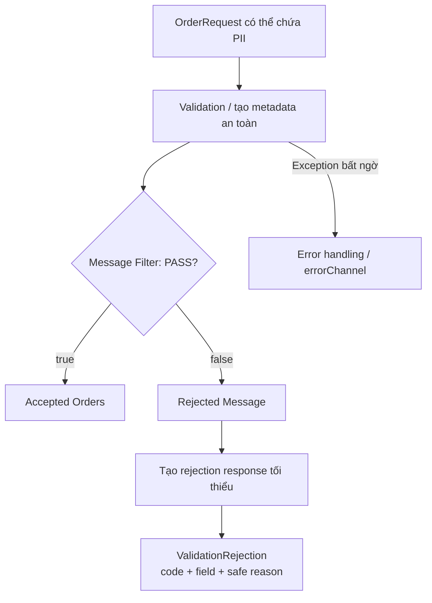
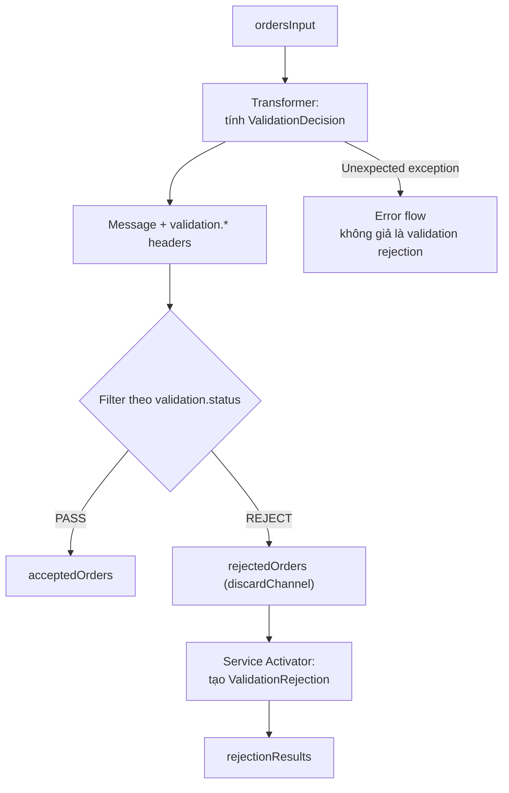
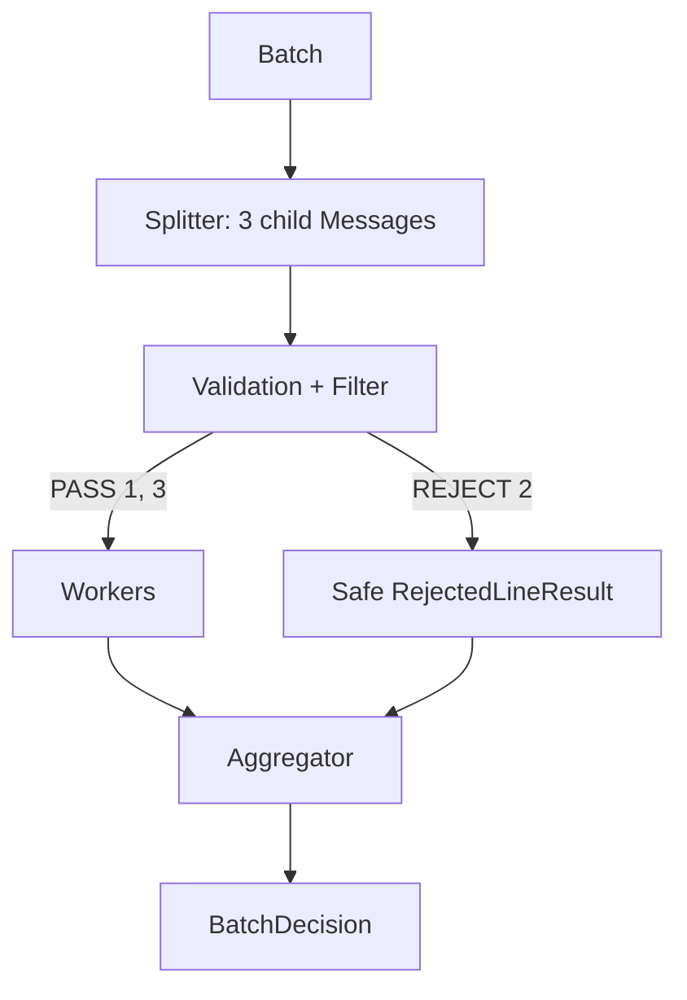
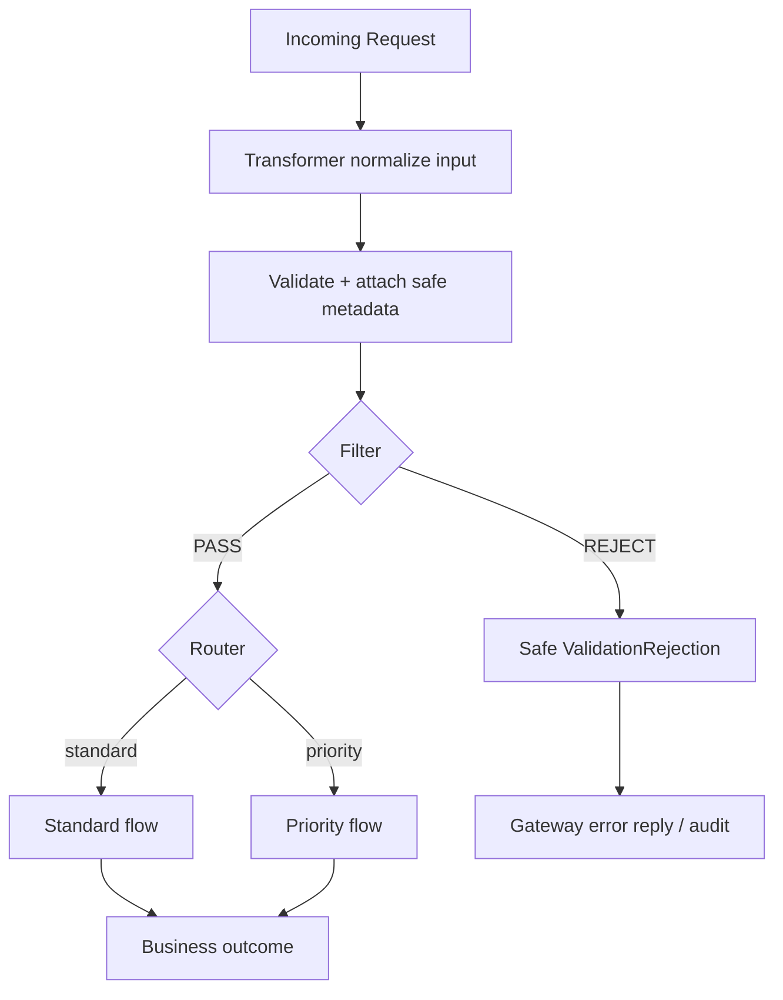

# Giữ lỗi và nguyên nhân trong metadata an toàn

Trong một hệ thống tích hợp, `Message Filter` thường được dùng để cho Message hợp lệ đi tiếp và chặn Message không đáp ứng điều kiện. Ví dụ, đơn hàng thiếu mã đơn, danh sách dòng hàng rỗng hoặc số lượng không hợp lệ không nên đi vào bước giữ hàng. Nhưng nếu Filter chỉ trả về `false` rồi bỏ Message, người vận hành và caller có thể không biết **vì sao yêu cầu bị loại**, còn việc retry hay điều tra trở nên khó khăn.

Một giải pháp hữu ích là gắn **metadata xác thực có cấu trúc và an toàn** trước khi Filter quyết định: trạng thái kiểm tra, mã lỗi chuẩn hóa, tên trường bị lỗi và lý do ngắn gọn từ một danh mục cho phép. Khi Filter chuyển Message sang nhánh từ chối, thành phần tiếp theo có thể đọc các metadata này để tạo phản hồi, ghi audit hoặc đo metric **mà không cần log toàn bộ payload hoặc exception thô**.

Tuy nhiên, header của Spring Integration có thể được truyền qua nhiều bước xử lý, adapter và hệ thống bên ngoài. Nếu đưa email khách hàng, access token, dữ liệu thanh toán, stack trace hay toàn bộ nội dung người dùng vào header, những thông tin đó có nguy cơ lan tới log, broker, trace hoặc dead-letter queue. Vì vậy, mục tiêu không chỉ là “giữ lỗi” mà là **giữ đủ nguyên nhân để xử lý, đồng thời giảm thiểu và kiểm soát dữ liệu có thể bị lộ**.

Bài **Giữ lỗi và nguyên nhân trong metadata an toàn** thuộc chương **Message filter và validation** của module `SPRING_INTEGRATION_PATTERN`. Module tập trung triển khai Enterprise Integration Patterns bằng Spring Integration để xây dựng flow ít phụ thuộc, dễ mở rộng, sử dụng Router, Filter, Transformer, Splitter, Aggregator, Gateway, retry, error channel và correlation, đồng thời kiểm thử, theo dõi các nhánh xử lý. Bài này hướng dẫn thiết kế **hợp đồng metadata**, xây một flow validation–filter–reject, phân biệt lỗi nghiệp vụ với lỗi hạ tầng, bảo vệ dữ liệu nhạy cảm và kiểm chứng hành vi bằng JUnit.

## 1. Từ Filter chỉ trả boolean đến Filter có thể giải thích lý do

Hãy xét Message có payload đơn hàng:

```json
{
  "tenantId": "tenant-7",
  "requestId": "req-1001",
  "orderId": "",
  "customerEmail": "customer@example.test",
  "lines": [
    {"sku": "BOOK-01", "quantity": 2}
  ]
}
```

`orderId` rỗng nên Message không được phép đi tiếp. Một Filter thuần:

```java
return order.orderId() != null && !order.orderId().isBlank();
```

trả `false`, nhưng không biểu đạt rõ ràng **lỗi nào**, **trường nào**, hay **phải phản hồi caller ra sao**.

Thay vì đặt toàn bộ nội dung lỗi vào log, có thể tạo một Message gắn metadata:

```text
payload:
  OrderRequest(... customerEmail="customer@example.test" ...)

headers:
  validation.status = REJECT
  validation.code   = ORDER_ID_REQUIRED
  validation.field  = orderId
  validation.reason = Order ID is required
  requestId         = req-1001
```

**Lưu ý quan trọng:** payload ở trên vẫn chứa email. Metadata được thiết kế an toàn **không tự làm payload trở nên an toàn**. Nếu Message bị đưa sang dead-letter queue, log hoặc broker bên ngoài, vẫn cần chính sách riêng để kiểm soát payload, header propagation, quyền truy cập và retention.



Ba nhánh trên có ý nghĩa khác nhau: **hợp lệ để xử lý**, **từ chối dự kiến do validation**, và **lỗi thực thi bất thường**.

## 2. Ba loại thông tin không nên trộn lẫn

| Loại | Ví dụ | Mục đích | Vị trí thích hợp |
| --- | --- | --- | --- |
| **Dữ liệu nghiệp vụ** | `orderId`, `customerEmail`, `lines` | Xử lý đơn hàng | Payload có quyền truy cập thích hợp |
| **Metadata validation an toàn** | `ORDER_ID_REQUIRED`, `orderId`, `REJECT` | Giải thích quyết định kiểm tra | Header hoặc envelope được kiểm soát |
| **Thông tin chẩn đoán kỹ thuật** | SQL exception, stack trace, endpoint nội bộ | Debug/sự cố vận hành | Log/error store nội bộ bảo mật, không phát tán tùy ý |

Một *error code* có thể được đưa vào header hoặc response để hỗ trợ điều hướng. Một **raw exception** thường không phù hợp làm metadata được truyền qua nhiều hệ thống.

### 2.1. `reasonCode` khác `exception.getMessage()`

`reasonCode="ORDER_ID_REQUIRED"` là giá trị giới hạn, ổn định, có thể lập tài liệu và đo lường.

`exception.getMessage()` có thể chứa:

- Giá trị dữ liệu đầu vào như email, số điện thoại, access token.
- Tên bảng, tên cột, SQL hoặc chi tiết cơ sở dữ liệu.
- URL, địa chỉ service nội bộ hoặc danh tính tài khoản.
- Chuỗi quá dài do client cố tình gửi.
- Thông tin thay đổi giữa thư viện, môi trường hoặc lần triển khai.

Vì vậy, **không dùng exception message tùy ý như lý do an toàn trong header**. Nếu cần người dùng xem thông báo thân thiện, hãy dịch `reasonCode` bằng một catalog kiểm soát ở tầng phản hồi.

### 2.2. Mã lỗi nghiệp vụ không phải trạng thái kỹ thuật

| Tình huống | Cách phân loại | Có nên retry tự động? |
| --- | --- | --- |
| `orderId` rỗng | `VALIDATION_REJECTED` | Thường không; caller cần sửa |
| `lines` không có phần tử | `VALIDATION_REJECTED` | Thường không |
| Một dòng có `quantity <= 0` | `VALIDATION_REJECTED` | Thường không |
| Database validator tạm ngừng | `TECHNICAL_FAILURE` | Có thể, với giới hạn |
| Parser gặp payload sai định dạng | `INVALID_REQUEST_FORMAT` ở ingress hoặc lỗi hợp đồng | Tùy chính sách, không giả là PASS |
| Code validator ném `NullPointerException` | Lỗi implementation | Cần error flow/điều tra |

Không nên bắt mọi `Exception` rồi biến thành `REJECT` với một mã nghiệp vụ giả. Làm như vậy che mất lỗi hạ tầng và có thể dẫn tới ACK sai.

## 3. Hợp đồng metadata validation tối thiểu

Một thiết kế đề xuất sử dụng bốn trường header:

| Header | Kiểu | Giá trị ví dụ | Hạn chế |
| --- | --- | --- | --- |
| `validation.status` | `String` | `PASS`, `REJECT` | Danh sách cho phép |
| `validation.code` | `String` | `ORDER_ID_REQUIRED` | Mã do server kiểm soát |
| `validation.field` | `String` | `orderId` | Tên field từ schema, không chứa giá trị |
| `validation.reason` | `String` | `Order ID is required` | Câu ngắn từ catalog, không nội suy input |

Nên có thêm `requestId` hoặc `correlationId` **đáng tin cậy** để truy vết quyết định, nhưng chúng là **định danh của lượt xử lý**, không phải lý do lỗi.

Ví dụ metadata có thể serialize:

```json
{
  "validation.status": "REJECT",
  "validation.code": "LINE_QUANTITY_INVALID",
  "validation.field": "lines.quantity",
  "validation.reason": "Every line quantity must be positive",
  "requestId": "req-1001"
}
```

**Bảng và JSON là hợp đồng đề xuất của ứng dụng, không phải tên header mặc định của Spring Integration.** Nếu cần ánh xạ qua broker hoặc HTTP, hãy xác định rõ tên, kiểu, phiên bản và quyền được chuyển tiếp.

### 3.1. Khi validation thành công

Không nhất thiết phải gắn `reason` dài cho Message hợp lệ. Nhưng để test đơn giản, ta có thể dùng:

```text
validation.status = PASS
validation.code   = NONE
validation.field  = NONE
validation.reason = Validation passed
```

Đây là các giá trị cố định, không tiết lộ dữ liệu. Với hệ thống lớn, có thể tối giản còn `status=PASS`, hoặc không gắn metadata khi thành công, miễn **hợp đồng Filter thống nhất**.

### 3.2. Không đưa danh sách lỗi vô hạn vào header

Nếu một batch có 100.000 bản ghi sai, sao chép toàn bộ lỗi vào MessageHeaders gây:

- Tăng heap và kích thước Message.
- Vượt giới hạn header của broker/transport.
- Bộc lộ dữ liệu nếu formatter vô tình thêm giá trị lỗi.
- Tạo metric cardinality cao và log không thể quản lý.

Nên chọn **mã lỗi chính** hoặc một tập mã lỗi được giới hạn, còn báo cáo chi tiết dài được lưu ở nơi được phân quyền với `reportId`/tham chiếu phù hợp.

## 4. Catalog lỗi: ổn định, có giới hạn và không chứa PII

Ví dụ danh mục lỗi:

| `validation.code` | `validation.field` | `validation.reason` | Hành động caller |
| --- | --- | --- | --- |
| `ORDER_ID_REQUIRED` | `orderId` | `Order ID is required` | Bổ sung mã đơn |
| `LINES_REQUIRED` | `lines` | `At least one order line is required` | Gửi danh sách dòng |
| `LINE_SKU_REQUIRED` | `lines.sku` | `Every line must have an SKU` | Kiểm tra SKU |
| `LINE_QUANTITY_INVALID` | `lines.quantity` | `Every line quantity must be positive` | Sửa số lượng |
| `REQUEST_ID_REQUIRED` | `requestId` | `Request ID is required` | Bổ sung định danh lượt |
| `TENANT_ID_REQUIRED` | `tenantId` | `Tenant ID is required` | Xác minh thông tin tenant |

Một số quy tắc:

1. **Mã phải được tạo bởi code server**, không chép nguyên văn thông tin từ client.
2. **Lý do phải đến từ catalog tĩnh**, không nối `email`, token hay nội dung dòng hàng.
3. **Field phải là tên trường đã cho phép**, không là JSONPath tùy ý do client gửi.
4. **Độ dài phải hữu hạn**; có thể kiểm tra ở thời điểm tạo hoặc ở boundary gửi Message.
5. **Danh mục phải có version/chính sách tương thích** nếu nhiều hệ thống dùng cùng metadata.

### 4.1. Không biến reason thành input echo

**Không nên** tạo:

```java
String reason = "Invalid email: " + request.customerEmail();
```

vì `customerEmail` sẽ xuất hiện trong header và có thể bị ghi vào trace, retry store hoặc log.

**Nên** sử dụng:

```java
String code = "CUSTOMER_EMAIL_INVALID";
String reason = "Customer email is invalid";
```

Nếu cần chỉ ra dòng bị lỗi, có thể dùng **chỉ số số nguyên được kiểm soát** trong một response chuyên biệt, thay vì chứa toàn bộ nội dung dòng đó trong header. Chỉ số cũng phải có giới hạn phù hợp.

## 5. Hai mô hình giữ lỗi: metadata trên Message và rejection result riêng

### 5.1. Metadata trên Message gốc

Một Transformer hoặc bước validation có thể giữ payload nguyên trạng và gắn các trường `validation.*` trước khi Filter hoạt động.

```text
Message<OrderRequest> + validation headers
                   |
                   v
                 Filter
          +--------+--------+
          |                 |
       accepted           rejected
```

Ưu điểm: nhánh từ chối có thể đọc lại **vì sao** Message bị loại; correlation/headers phục vụ truy vết dễ truyền qua các endpoint trong cùng flow.

Nhược điểm: **Message bị từ chối vẫn có payload gốc**, có thể chứa dữ liệu nhạy cảm. Không được log `Message.toString()` hoặc chuyển nguyên Message sang hệ thống audit ít quyền.

### 5.2. Rejection result tối thiểu

Sau khi Filter đưa Message đến discard channel, một handler có thể tạo:

```json
{
  "requestId": "req-1001",
  "orderId": null,
  "errorCode": "ORDER_ID_REQUIRED",
  "field": "orderId",
  "safeReason": "Order ID is required"
}
```

Lúc này output chỉ chứa dữ liệu cần thiết cho caller/nhánh xử lý từ chối. Có thể **loại `orderId` nếu nó không cần thiết hoặc bị coi là nhạy cảm**. Đừng mặc định sao chép mọi header và toàn bộ payload gốc vào rejection result.

### 5.3. Chọn mô hình theo ranh giới tin cậy

| Tình huống | Gợi ý |
| --- | --- |
| Validation và Filter trong cùng JVM | Có thể truyền metadata an toàn trên Message gốc |
| Trả validation response qua HTTP | Chuyển sang DTO an toàn, kiểm soát fields công khai |
| Đưa reject vào broker ngoài | Whitelist header + payload tối thiểu hoặc encryption |
| Audit/analytics | Lưu code/field/trạng thái, giới hạn định danh và retention |
| Điều tra lỗi phức tạp | Lưu log nội bộ có kiểm soát, dùng trace/request ID để liên hệ |

## 6. Chuỗi EIP phù hợp: Validate → Attach Metadata → Filter → Handle Reject

Một flow dễ kiểm thử:



Vì Filter theo nguyên lý thường chỉ đánh giá predicate, việc tính lỗi **một lần** ở bước trước giúp tránh trường hợp:

```text
filterPredicate kiểm tra bộ quy tắc A
discardHandler tính lại bộ quy tắc B
```

Nếu hai bước có logic khác nhau hoặc phụ thuộc dữ liệu thay đổi, error code có thể không phản ánh quyết định thật.

**Hợp đồng trong bài:** bước validation tạo metadata; Filter chỉ đọc `validation.status`; nhánh discard dùng `validation.code/field/reason` đã tạo để sinh kết quả từ chối.

## 7. Domain model cho ví dụ Java 17+

Một đơn hàng gồm những dòng hàng và có email khách hàng chỉ để minh họa yêu cầu **không làm lộ PII trong metadata**.

```java
package example.integration;

import java.util.List;

public final class OrderValidationModel {

    private OrderValidationModel() {
    }

    public record Line(String sku, int quantity) {
    }

    public record OrderRequest(
            String tenantId,
            String requestId,
            String orderId,
            String customerEmail,
            List<Line> lines) {
    }

    public record ValidationDecision(
            boolean valid,
            String code,
            String field,
            String safeReason) {
    }

    public record ValidationRejection(
            String requestId,
            String orderId,
            String errorCode,
            String field,
            String safeReason) {
    }
}
```

`OrderRequest` có thể chứa null trong ví dụ để **minh họa validation**, nên record không cưỡng chế toàn bộ điều kiện ở constructor. Trong một ứng dụng thật, có thể đặt validation ở ingress/DTO và dùng record chỉ chứa dữ liệu đã được kiểm tra, nhưng phải tránh việc **ném exception mà không có chính sách trả lỗi rõ ràng**.

`ValidationRejection` không chứa `customerEmail`, thông tin dòng hàng hoặc exception nội bộ. Dù vậy, `orderId` và `requestId` vẫn là định danh cần kiểm soát quyền truy cập, không mặc định là dữ liệu công khai.

## 8. Validation logic thuần: trả mã lỗi từ catalog

Một validator không nên gọi dịch vụ bên ngoài chỉ để trả một boolean khi đây là những quy tắc cơ bản về cấu trúc.

```java
package example.integration;

import example.integration.OrderValidationModel.*;

public final class OrderValidator {

    private OrderValidator() {
    }

    public static ValidationDecision validate(OrderRequest request) {
        if (request.tenantId() == null
                || request.tenantId().isBlank()) {
            return reject("TENANT_ID_REQUIRED",
                    "tenantId", "Tenant ID is required");
        }

        if (request.requestId() == null
                || request.requestId().isBlank()) {
            return reject("REQUEST_ID_REQUIRED",
                    "requestId", "Request ID is required");
        }

        if (request.orderId() == null
                || request.orderId().isBlank()) {
            return reject("ORDER_ID_REQUIRED",
                    "orderId", "Order ID is required");
        }

        if (request.lines() == null || request.lines().isEmpty()) {
            return reject("LINES_REQUIRED",
                    "lines", "At least one order line is required");
        }

        for (Line line : request.lines()) {
            if (line == null || line.sku() == null
                    || line.sku().isBlank()) {
                return reject("LINE_SKU_REQUIRED",
                        "lines.sku", "Every line must have an SKU");
            }

            if (line.quantity() <= 0) {
                return reject("LINE_QUANTITY_INVALID",
                        "lines.quantity",
                        "Every line quantity must be positive");
            }
        }

        return new ValidationDecision(
                true, "NONE", "NONE", "Validation passed");
    }

    private static ValidationDecision reject(
            String code, String field, String reason) {
        return new ValidationDecision(false, code, field, reason);
    }
}
```

Tất cả `code`, `field` và `safeReason` trong validator đến từ **hằng số do ứng dụng quy định**. Không có `request.customerEmail()` hoặc `line.sku()` nào bị nối vào lý do trả ra.

### 8.1. Vì sao trả một ValidationDecision thay vì ném exception?

Các lỗi `ORDER_ID_REQUIRED`, `LINES_REQUIRED` là tình huống **dự kiến do input không hợp lệ**. Trả `ValidationDecision` cho phép Filter chọn nhánh reject mà không biến mọi dữ liệu sai thành lỗi kỹ thuật cần retry.

Ngược lại, nếu validator phát sinh lỗi lập trình hoặc dịch vụ phụ thuộc không khả dụng, nó không nên âm thầm tạo một `ValidationDecision(valid=false)` không phản ánh bản chất lỗi. Hãy để lỗi được xử lý qua **technical error policy**.

### 8.2. Tại sao chỉ trả lỗi đầu tiên?

Đây là chính sách demo, giúp metadata có kích thước ổn định. Trong API cần trả nhiều lỗi, có thể tạo một danh sách `ValidationIssue(code, field)` **có giới hạn số lượng** trong rejection response hoặc error report được phân quyền. Không nên đưa một danh sách lớn không kiểm soát vào headers.

### 8.3. Quy tắc nghiệp vụ thay đổi sau validation

Ví dụ tồn kho có thể thay đổi sau khi kiểm tra `quantity>0`. Metadata `PASS` chỉ chứng minh **validation ở thời điểm kiểm tra theo bộ quy tắc đã chọn**, không thay thế kiểm tra tồn kho hoặc authorization ngay trước side effect. Đừng để một header `PASS` được hiểu là quyền vượt qua mọi kiểm tra về sau.

## 9. Spring Integration: Transformer gắn metadata an toàn

Ta dùng `@Transformer` để tạo một Message có payload giữ nguyên nhưng được thêm validation headers.

```java
package example.integration;

import org.springframework.context.annotation.Bean;
import org.springframework.context.annotation.Configuration;
import org.springframework.integration.annotation.Filter;
import org.springframework.integration.annotation.ServiceActivator;
import org.springframework.integration.annotation.Transformer;
import org.springframework.integration.channel.DirectChannel;
import org.springframework.integration.channel.QueueChannel;
import org.springframework.integration.config.EnableIntegration;
import org.springframework.messaging.Message;
import org.springframework.messaging.MessageChannel;
import org.springframework.messaging.PollableChannel;
import org.springframework.messaging.support.MessageBuilder;

import example.integration.OrderValidationModel.*;

@Configuration
@EnableIntegration
public class SafeValidationFilterConfiguration {

    public static final String STATUS = "validation.status";
    public static final String CODE = "validation.code";
    public static final String FIELD = "validation.field";
    public static final String REASON = "validation.reason";

    @Bean
    public MessageChannel ordersInput() {
        return new DirectChannel();
    }

    @Bean
    public MessageChannel taggedOrders() {
        return new DirectChannel();
    }

    @Bean
    public PollableChannel acceptedOrders() {
        return new QueueChannel(20);
    }

    @Bean
    public MessageChannel rejectedOrders() {
        return new DirectChannel();
    }

    @Bean
    public PollableChannel rejectionResults() {
        return new QueueChannel(20);
    }

    @Transformer(
            inputChannel = "ordersInput",
            outputChannel = "taggedOrders")
    public Message<OrderRequest> attachValidationMetadata(
            Message<OrderRequest> input) {

        ValidationDecision decision =
                OrderValidator.validate(input.getPayload());

        return MessageBuilder.fromMessage(input)
                .setHeader(STATUS, decision.valid() ? "PASS" : "REJECT")
                .setHeader(CODE, decision.code())
                .setHeader(FIELD, decision.field())
                .setHeader(REASON, decision.safeReason())
                .build();
    }

    @Filter(
            inputChannel = "taggedOrders",
            outputChannel = "acceptedOrders",
            discardChannel = "rejectedOrders")
    public boolean isValidated(Message<OrderRequest> input) {
        Object status = input.getHeaders().get(STATUS);

        if ("PASS".equals(status)) {
            return true;
        }
        if ("REJECT".equals(status)) {
            return false;
        }
        throw new IllegalStateException(
                "Missing or unknown server validation status");
    }

    @ServiceActivator(
            inputChannel = "rejectedOrders",
            outputChannel = "rejectionResults")
    public ValidationRejection createRejection(
            Message<OrderRequest> input) {
        OrderRequest request = input.getPayload();
        return new ValidationRejection(
                request.requestId(),
                request.orderId(),
                requiredHeader(input, CODE),
                requiredHeader(input, FIELD),
                requiredHeader(input, REASON));
    }

    private static String requiredHeader(
            Message<?> input, String headerName) {
        Object raw = input.getHeaders().get(headerName);
        if (!(raw instanceof String value)
                || value.isBlank()
                || value.length() > 100) {
            throw new IllegalStateException(
                    "Invalid server validation metadata: " + headerName);
        }
        return value;
    }
}
```

### 9.1. Phân tích từng endpoint

1. `ordersInput` nhận `Message<OrderRequest>`.
2. `@Transformer` chạy validation một lần, tự gắn **bốn header** từ catalog và giữ payload.
3. `@Filter` chỉ xét `validation.status`. `PASS` đi sang `acceptedOrders`.
4. Với `REJECT`, Filter chuyển **Message bị từ chối** sang `rejectedOrders` qua `discardChannel`.
5. `@ServiceActivator` trên nhánh reject tạo DTO `ValidationRejection` tối thiểu và đưa ra `rejectionResults`.
6. Trạng thái không có hoặc lạ không được coi là `PASS`: code ném lỗi cấu hình/hợp đồng và để error flow xử lý.

**Chỉ xóa hoặc giữ các trường payload phù hợp với quyền của downstream.** Ví dụ này giữ toàn bộ `OrderRequest` bên trong Message tới `rejectedOrders` để handler đọc `requestId` và `orderId`, nhưng **không chuyển raw payload sang `rejectionResults`**.

### 9.2. Vì sao dùng Transformer trước Filter?

Nếu đặt toàn bộ validation trong một predicate boolean, một kết quả `false` thường không có cấu trúc nguyên nhân. Việc tách:

```text
ValidationDecision → metadata → Filter → rejection result
```

cho phép tạo metadata đúng một lần và kiểm tra rõ ràng việc header đi theo Message nào.

Một cách khác là tạo `ValidatedOrder` chứa cả order và `ValidationDecision` trong payload, rồi Filter dựa vào decision của envelope. Cách đó phù hợp khi headers không được bảo toàn qua transport; không có một lựa chọn duy nhất cho mọi hệ thống.

### 9.3. Chế độ reject của Filter

Trong ví dụ, Filter có `discardChannel="rejectedOrders"` để nhận những Message không đạt predicate. Nếu không cấu hình discard channel hoặc không có cơ chế tạo response, Message bị loại có thể **không sinh reply nào** cho caller.

Một chế độ khác là **ném lỗi khi reject** (như thuộc tính `throwExceptionOnRejection` ở các cấu hình Filter tương ứng), nhưng việc ném exception không mặc nhiên tạo một `ValidationRejection` chứa code/field an toàn. Phải quyết định chủ ý giữa **business rejection** và **technical exception**.

### 9.4. Header nào được tin cậy?

`validation.status` ở đây được **server tính lại và ghi đè** trên Message. Nếu client bên ngoài gửi sẵn `validation.status=PASS`, không được để client điều khiển kết quả Filter. Nên:

- Bỏ các header `validation.*` đến từ biên giới không tin cậy.
- Chạy validation bằng code server.
- Chỉ cho những endpoint được phép gắn/sửa metadata xác thực.
- Xem validation header là **kết quả kiểm tra**, không phải chứng cứ quyền truy cập hoặc chữ ký bảo mật.

Nếu Message đã đi qua một adapter không tin cậy, hãy xác thực lại những thuộc tính quan trọng trước side effect, thay vì tin tuyệt đối vào header.

## 10. Demo: gửi một đơn hợp lệ và một đơn bị từ chối

Một ứng dụng nhỏ có thể dùng các channel vừa cấu hình:

```java
package example.integration;

import java.util.List;

import org.springframework.context.annotation.AnnotationConfigApplicationContext;
import org.springframework.messaging.Message;
import org.springframework.messaging.MessageChannel;
import org.springframework.messaging.PollableChannel;
import org.springframework.messaging.support.MessageBuilder;

import example.integration.OrderValidationModel.*;

public class SafeValidationDemo {

    public static void main(String[] args) {
        try (var context = new AnnotationConfigApplicationContext(
                SafeValidationFilterConfiguration.class)) {

            MessageChannel input = context.getBean(
                    "ordersInput", MessageChannel.class);
            PollableChannel accepted = context.getBean(
                    "acceptedOrders", PollableChannel.class);
            PollableChannel rejected = context.getBean(
                    "rejectionResults", PollableChannel.class);

            OrderRequest good = new OrderRequest(
                    "tenant-7", "req-good", "ORD-1001",
                    "person@example.test",
                    List.of(new Line("BOOK-01", 2)));

            OrderRequest bad = new OrderRequest(
                    "tenant-7", "req-bad", "",
                    "person@example.test",
                    List.of(new Line("BOOK-01", 2)));

            input.send(MessageBuilder.withPayload(good).build());
            input.send(MessageBuilder.withPayload(bad).build());

            Message<?> acceptedMessage = accepted.receive(0);
            Message<?> rejectedMessage = rejected.receive(0);

            if (acceptedMessage == null || rejectedMessage == null) {
                throw new IllegalStateException("Missing expected output");
            }

            System.out.println(
                    acceptedMessage.getHeaders().get(
                            SafeValidationFilterConfiguration.STATUS));

            ValidationRejection result =
                    (ValidationRejection) rejectedMessage.getPayload();
            System.out.println(result.errorCode());
            System.out.println(result.safeReason());
        }
    }
}
```

Kết quả kỳ vọng:

```text
PASS
ORDER_ID_REQUIRED
Order ID is required
```

Demo cố ý **không in payload gốc**, email, toàn bộ Message hay headers không liên quan. Trong ứng dụng thật, việc log cần đi qua một cấu hình redaction/allowlist, chứ không dựa vào quy ước mỗi developer sẽ luôn tránh `toString()`.

`DirectChannel` cho phép các handler trong ví dụ chạy đồng bộ; output `QueueChannel` giữ Message để test đọc. Với async/broker, việc `send()` hoàn tất không chứng minh business handler đã xử lý xong; cần chờ có timeout, correlation và error handling tương ứng.

## 11. JUnit 5: validation thành công không sinh lỗi

Một unit test gọi trực tiếp `OrderValidator.validate(...)` hữu ích nhưng chưa chứng minh Filter đã đi đúng channel. Integration test sau kiểm tra **routing và metadata**:

```java
package example.integration;

import static org.junit.jupiter.api.Assertions.*;

import java.util.List;

import org.junit.jupiter.api.Test;
import org.springframework.context.annotation.AnnotationConfigApplicationContext;
import org.springframework.messaging.Message;
import org.springframework.messaging.MessageChannel;
import org.springframework.messaging.PollableChannel;
import org.springframework.messaging.support.MessageBuilder;

import example.integration.OrderValidationModel.*;

class SafeValidationFilterIntegrationTest {

    @Test
    void validOrderPassesWithSafePassMetadata() {
        try (var context = new AnnotationConfigApplicationContext(
                SafeValidationFilterConfiguration.class)) {

            MessageChannel input = context.getBean(
                    "ordersInput", MessageChannel.class);
            PollableChannel accepted = context.getBean(
                    "acceptedOrders", PollableChannel.class);
            PollableChannel rejected = context.getBean(
                    "rejectionResults", PollableChannel.class);

            OrderRequest valid = new OrderRequest(
                    "tenant-7", "req-1", "ORD-1001",
                    "private@example.test",
                    List.of(new Line("BOOK-01", 2)));

            assertTrue(input.send(
                    MessageBuilder.withPayload(valid).build()));

            Message<?> message = accepted.receive(0);
            assertNotNull(message);
            assertEquals(valid, message.getPayload());
            assertEquals("PASS", message.getHeaders().get(
                    SafeValidationFilterConfiguration.STATUS));
            assertEquals("NONE", message.getHeaders().get(
                    SafeValidationFilterConfiguration.CODE));
            assertNull(rejected.receive(0));
            assertNull(accepted.receive(0));
        }
    }
}
```

Đây là test cho cả validator, transformer và filter trong cùng application context. Nó xác minh Message hợp lệ **được nhận tại output channel đúng**, không chỉ có predicate trả `true`.

Trong flow có executor hoặc broker, một `receive(0)` tức thời có thể trả null trước khi handler chạy xong. Lúc đó cần timeout hữu hạn và một phương thức đồng bộ test phù hợp; không dùng `Thread.sleep` làm bằng chứng đáng tin.

## 12. JUnit 5: lỗi an toàn đi qua discard channel

Một test quan trọng hơn là Message có email **không được sao chép email vào metadata validation hay rejection result**.

```java
// Đặt method này trong SafeValidationFilterIntegrationTest.
@Test
void invalidOrderProducesSafeRejectionWithoutEmailInMetadata() {
    try (var context = new AnnotationConfigApplicationContext(
            SafeValidationFilterConfiguration.class)) {

        MessageChannel input = context.getBean(
                "ordersInput", MessageChannel.class);
        PollableChannel accepted = context.getBean(
                "acceptedOrders", PollableChannel.class);
        PollableChannel rejected = context.getBean(
                "rejectionResults", PollableChannel.class);

        String privateEmail = "secret+customer@example.test";
        OrderRequest invalid = new OrderRequest(
                "tenant-7", "req-2", "",
                privateEmail,
                List.of(new Line("BOOK-01", 2)));

        assertTrue(input.send(MessageBuilder.withPayload(invalid).build()));
        assertNull(accepted.receive(0));

        Message<?> output = rejected.receive(0);
        assertNotNull(output);
        assertInstanceOf(ValidationRejection.class, output.getPayload());

        ValidationRejection result =
                (ValidationRejection) output.getPayload();
        assertEquals("req-2", result.requestId());
        assertEquals("ORDER_ID_REQUIRED", result.errorCode());
        assertEquals("orderId", result.field());
        assertEquals("Order ID is required", result.safeReason());

        // Validation response không mang customerEmail.
        assertFalse(result.toString().contains(privateEmail));
        assertFalse(result.safeReason().contains(privateEmail));
        assertNull(rejected.receive(0));
    }
}
```

Test này chứng minh **DTO rejection đã được tạo từ catalog và không chứa email**. Nó **chưa chứng minh tất cả headers trên mọi Message hoặc mọi broker adapter đều sạch**. Muốn kiểm tra một biên giới vận chuyển, cần instrument/spy chính adapter đó và assert các field sau header mapping hoặc serialization.

### 12.1. Test server ghi đè header không tin cậy

Thêm một ca:

```java
// Method minh họa để đặt cùng class test ở mục 11.
@Test
void clientSuppliedPassHeaderCannotBypassValidation() {
    try (var context = new AnnotationConfigApplicationContext(
            SafeValidationFilterConfiguration.class)) {

        MessageChannel input = context.getBean(
                "ordersInput", MessageChannel.class);
        PollableChannel accepted = context.getBean(
                "acceptedOrders", PollableChannel.class);
        PollableChannel rejected = context.getBean(
                "rejectionResults", PollableChannel.class);

        OrderRequest invalid = new OrderRequest(
                "tenant-7", "req-3", "",
                "secret@example.test",
                List.of(new Line("BOOK-01", 2)));

        assertTrue(input.send(
                MessageBuilder.withPayload(invalid)
                        .setHeader(
                                SafeValidationFilterConfiguration.STATUS,
                                "PASS")
                        .setHeader(
                                SafeValidationFilterConfiguration.CODE,
                                "NONE")
                        .build()));

        assertNull(accepted.receive(0));
        Message<?> output = rejected.receive(0);
        assertNotNull(output);
        assertEquals(
                "ORDER_ID_REQUIRED",
                ((ValidationRejection) output.getPayload()).errorCode());
    }
}
```

Vì `@Transformer` **tính lại** và `setHeader` ghi giá trị do server quyết định, một header `PASS` đến từ client không được phép làm Message vượt qua Filter. Với ingress thực tế, nên bỏ luôn các validation header do client gửi trước khi đưa chúng vào nội bộ.

## 13. Test unit: catalog không nội suy dữ liệu đầu vào

Các test thuần có thể kiểm tra validator theo từng mã:

```java
package example.integration;

import static org.junit.jupiter.api.Assertions.*;

import java.util.List;

import org.junit.jupiter.api.Test;

import example.integration.OrderValidationModel.*;

class OrderValidatorTest {

    @Test
    void missingOrderIdUsesConstantReason() {
        String sensitive = "secret+person@example.test";

        ValidationDecision result = OrderValidator.validate(
                new OrderRequest(
                        "tenant-7", "req-4", "", sensitive,
                        List.of(new Line("BOOK-01", 2))));

        assertFalse(result.valid());
        assertEquals("ORDER_ID_REQUIRED", result.code());
        assertEquals("orderId", result.field());
        assertEquals("Order ID is required", result.safeReason());
        assertFalse(result.safeReason().contains(sensitive));
    }

    @Test
    void negativeQuantityUsesStableCode() {
        ValidationDecision result = OrderValidator.validate(
                new OrderRequest(
                        "tenant-7", "req-5", "ORD-1001",
                        "person@example.test",
                        List.of(new Line("BOOK-01", -3))));

        assertFalse(result.valid());
        assertEquals("LINE_QUANTITY_INVALID", result.code());
        assertEquals("lines.quantity", result.field());
    }

    @Test
    void validRequestHasPassStatus() {
        ValidationDecision result = OrderValidator.validate(
                new OrderRequest(
                        "tenant-7", "req-6", "ORD-1001",
                        "person@example.test",
                        List.of(new Line("BOOK-01", 1))));

        assertTrue(result.valid());
        assertEquals("NONE", result.code());
    }
}
```

**Unit test đảm bảo bộ quy tắc và catalog ổn định**, còn integration test đảm bảo Filter/discard channel nhận đúng Message. Muốn kiểm tra việc chuyển metadata qua transport hoặc redaction log, cần test riêng ở ranh giới thực tế.

## 14. Lỗi kỹ thuật: `errorChannel` khác `discardChannel`

Đây là khác biệt cực kỳ quan trọng trong Spring Integration:

| Đường đi | Nguyên nhân | Payload thường thấy | Ý nghĩa |
| --- | --- | --- | --- |
| `acceptedOrders` | Filter predicate trả `true` | `OrderRequest` | Được phép đi tiếp |
| `rejectedOrders` | Filter predicate trả `false` | Message đã gắn metadata validation | Bị từ chối dự kiến |
| `rejectionResults` | Handler chuyển discard thành DTO | `ValidationRejection` | Lý do an toàn để phản hồi/audit |
| `errorChannel` (nếu cấu hình) | Handler/adapter phát sinh exception | `ErrorMessage` mang lỗi | Sự cố kỹ thuật cần xử lý |

Không nên gửi thẳng `ErrorMessage` chứa `Throwable` vào kênh trả validation result công khai. `Throwable` có thể chứa stack trace, nested cause, SQL, địa chỉ hệ thống hoặc các giá trị đầu vào trong exception message.

### 14.1. Lỗi đồng bộ

Trong flow qua `DirectChannel`, exception từ một handler thường có thể lan tới caller qua `send()` hoặc Gateway. Nó không nhất thiết được tự động chuyển thành một `ErrorMessage` trên `errorChannel`.

### 14.2. Lỗi bất đồng bộ

Với poller, executor hoặc inbound adapter, lỗi xảy ra ở thread khác có thể được đưa vào error flow được cấu hình. `send()` ban đầu có thể thành công khi Message mới được nhận vào queue, không chứng minh validation/side effect cuối đã hoàn tất.

### 14.3. Muốn trả mã lỗi kỹ thuật an toàn thì làm gì?

Tại một **error boundary đáng tin**, ánh xạ exception đã phân loại sang mã như:

```text
DEPENDENCY_TIMEOUT
VALIDATION_SERVICE_UNAVAILABLE
INTERNAL_PROCESSING_ERROR
```

Chỉ trả **mã đã cho phép** và một thông điệp chung nếu caller không có quyền xem chi tiết. Giữ raw exception trong log/error store nội bộ có kiểm soát, liên kết bằng `requestId` hoặc trace ID. Không nội suy trực tiếp `exception.getMessage()` vào metadata hoặc response.

## 15. Validation, retry, dead-letter và chính sách ACK

Nhánh xử lý ảnh hưởng tới việc broker có nên giao lại Message:

| Kết quả | Có cần retry cùng payload? | Hướng xử lý thường gặp |
| --- | --- | --- |
| Validation `REJECT` do dữ liệu không hợp lệ | Thường không | Phản hồi lỗi, quarantine/audit theo nhu cầu |
| Lỗi kết nối DB tạm thời | Có thể | Retry hữu hạn với backoff |
| Service validation chưa sẵn sàng | Có thể | Retry hoặc circuit breaker |
| Payload sai schema không parse được | Phụ thuộc hợp đồng | Reject/DLQ và lý do tối thiểu |
| Lỗi lập trình không biết trước | Không retry vô hạn | Điều tra, retry hạn chế hoặc DLQ |

Một Message từ broker được ACK sớm rồi mới xử lý validation có thể mất cơ hội redelivery khi business service hỏng. Ngược lại, gửi lại mãi một Message **chắc chắn vi phạm schema** tạo vòng poison message.

**Discard không đồng nghĩa ACK.** Việc xác nhận input, commit transaction và route sang discard channel phụ thuộc adapter/consumer và cấu hình transaction cụ thể. Thiết kế phải chỉ rõ ai chịu trách nhiệm ACK, lúc nào và sau khi output từ chối đã được lưu/giao bền vững hay chưa.

### 15.1. Đưa nguyên payload vào dead-letter queue có an toàn không?

Không thể kết luận chỉ vì metadata validation an toàn. Payload ban đầu vẫn có thể chứa email, địa chỉ, số tài khoản hoặc tệp nhạy cảm. Trước khi gửi DLQ:

1. Xác định payload nào được phép giữ.
2. Mã hóa dữ liệu và giới hạn quyền truy cập.
3. Không giữ raw headers không được kiểm soát.
4. Có retention/deletion policy.
5. Có cơ chế phát lại với quyền được kiểm soát.

Một DLQ không phải nơi miễn trừ các yêu cầu bảo mật.

## 16. Không làm hỏng correlation và sequence khi lọc Message

Một Message từ Splitter có thể mang:

```text
correlationId = batch-attempt-01
sequenceNumber = 2
sequenceSize = 3
```

Nếu validation phát hiện dòng số 2 không hợp lệ và Filter **bỏ hẳn Message** mà không tạo kết quả tương ứng, Aggregator downstream có thể nhận chỉ dòng 1 và 3 nhưng vẫn chờ đủ ba phần.



Nếu yêu cầu nghiệp vụ cần một kết quả cho mọi dòng, nhánh từ chối có thể tạo **`RejectedLineResult`** giữ khóa nhóm và số thứ tự hợp lệ, kèm `errorCode` an toàn, rồi đưa vào cùng cơ chế tổng hợp.

### 16.1. Không phải mọi trường hợp đều cần giữ Message bị loại

Với một pipeline chỉ xử lý những sự kiện thỏa predicate và **không cần đủ N kết quả**, việc discard có thể là ý định thiết kế đúng. Nhưng phải nói rõ đó là **lọc sự kiện** chứ không phải một group đang đợi đủ số phần tử từ Splitter.

### 16.2. Metadata nghiệp vụ và metadata validation có mục đích khác nhau

- `correlationId` xác định nhóm.
- `sequenceNumber` xác định vị trí trong nhóm.
- `validation.code` giải thích vì sao một phần tử không đạt điều kiện.
- `requestId` giúp truy vết lượt gọi.

Không dùng `validation.code` làm khóa correlation nếu mục tiêu là gom **các kết quả khác loại lỗi thuộc cùng một request**.

## 17. Filter, Router, Transformer, Gateway và Content Enricher

Một flow có thể kết hợp:



### 17.1. Transformer

Transformer có thể chuẩn hóa payload trước khi validation, nhưng phải tránh làm mất các định danh `requestId`, `tenantId` hoặc metadata correlation cần thiết. Khi Transformer tạo Message mới, hãy kiểm thử header propagation thực tế, không giả định mọi header sẽ tự tồn tại qua adapter.

### 17.2. Router

Router chọn nơi Message hợp lệ sẽ đi. **Không nên route theo raw exception string**; nếu cần phân nhánh rejected result, dùng `validation.code` nằm trong danh sách được kiểm soát.

### 17.3. Content Enricher

Enricher có thể bổ sung thông tin từ hệ thống ngoài, chẳng hạn hồ sơ khách hàng. Lỗi khi gọi dịch vụ enrichment cần được phân loại thành **technical failure** theo hợp đồng, không tự ghi vào `validation.reason` dưới dạng nội dung exception. Metadata validation trước enrichment cũng không chứng minh dữ liệu được enrich sau đó là hợp lệ.

### 17.4. Gateway

Gateway request-reply thường muốn một phản hồi cho mỗi request. Nếu Filter loại Message rồi không gửi rejection result về đường reply, Gateway có thể hết timeout.

Hãy đảm bảo có một **reply an toàn** cho yêu cầu validation thất bại, hoặc một exception/response contract rõ ràng. Với xử lý bất đồng bộ, cần định danh lượt xử lý để kết quả từ nhánh reject đi đúng caller/request.

### 17.5. Idempotent Receiver

Message bị retry/redeliver có thể gặp cùng một validation error nhiều lần. Nếu lưu audit theo lần nhận, cần phân biệt **một sự kiện nghiệp vụ** với **nhiều lần delivery** để tránh đếm duplicate như nhiều yêu cầu độc lập.

## 18. Header propagation và ranh giới transport

Ở trong một JVM, Message headers có thể đi theo Message qua một số endpoint. Khi qua HTTP, Kafka, AMQP hoặc storage, **mỗi adapter/header mapper có quy tắc riêng** về tên, kiểu và nội dung được truyền.

### 18.1. Whitelist headers

Ví dụ chính sách cho một outbound adapter:

```text
Allowed outbound validation headers:
  validation.status
  validation.code
  validation.field
  requestId (nếu được phép)

Not exported:
  validation.reason (nếu chỉ dành cho nội bộ)
  security credentials
  raw exception or stack trace
  full headers dump
  internal replyChannel/errorChannel object
```

Đây là **policy minh họa**, không phải tên cấu hình chung của mọi adapter. Cần dùng cơ chế header mapping đúng với thư viện/transport được triển khai.

### 18.2. Chuyển sang DTO/envelope khi cần hợp đồng ổn định

Nếu hệ thống nhận không hỗ trợ kiểu header của Spring Integration hoặc cần schema version, có thể chuyển sang payload:

```json
{
  "schemaVersion": 1,
  "requestId": "req-1001",
  "status": "REJECTED",
  "error": {
    "code": "ORDER_ID_REQUIRED",
    "field": "orderId"
  }
}
```

Payload response này cố ý **không** chứa `customerEmail`, raw request hoặc stack trace. Với error từ hệ thống công khai, `requestId` nên là ID không suy đoán được hoặc được kiểm soát quyền xem thông tin tương ứng.

### 18.3. Không dùng validation header làm security principal

Một header `validation.status=PASS` có thể bị sửa bởi producer hoặc Message interceptor không tin cậy. Nó không phải bằng chứng authentication/authorization. Kiểm tra quyền nên dựa trên security context đã xác thực tại đúng trust boundary, không dựa vào một chuỗi do client có thể tự khai.

## 19. Logging: giữ nguyên nhân nhưng không phơi bày dữ liệu

Một structured log có thể ghi:

```json
{
  "stage": "order-validation-filter",
  "requestId": "req-1001",
  "validationStatus": "REJECT",
  "errorCode": "ORDER_ID_REQUIRED",
  "field": "orderId",
  "flow": "rejection",
  "businessOperation": "CREATE_ORDER"
}
```

**Không** ghi:

```text
Rejected message: Message[payload=OrderRequest(
  customerEmail=secret+person@example.test,
  paymentToken=...
), headers=...]
```

Trong thực tế, nhiều framework logging sẽ gọi `toString()` lên object một cách dễ dàng. Vì vậy, ngay cả record Java được tạo tiện cho demo cũng không nên bị log toàn bộ ở môi trường có dữ liệu khách hàng.

### 19.1. Log an toàn không có nghĩa mất khả năng điều tra

Một mô hình tốt giữ hai lớp:

- **Log vận hành phổ thông:** status, errorCode, field, request/correlation ID có kiểm soát.
- **Kho chẩn đoán hạn chế quyền:** thông tin kỹ thuật đủ để điều tra, có redaction, encryption, audit access và retention.

Khi nhân viên hỗ trợ cần tìm lỗi, họ dùng `requestId` để truy vấn hệ thống có quyền thay vì yêu cầu log chung chứa toàn bộ payload.

### 19.2. Giới hạn dữ liệu ở tầng platform

Nếu một công cụ tracing tự capture toàn bộ Message headers, việc viết code sạch ở handler chưa đủ. Phải cấu hình **observability hooks, tracing instrumentation, header mapper, DLQ serializer và logging appender** để loại trường nhạy cảm.

## 20. Metrics: mã lỗi có thể làm tag, giá trị nhập không nên

Một số metric đề xuất:

| Metric | Mục tiêu |
| --- | --- |
| `validation.messages.total` | Tổng Message được kiểm tra |
| `validation.accepted.total` | Số Message PASS |
| `validation.rejected.total` | Số Message REJECT |
| `validation.technical_failure.total` | Lỗi khi thực thi validation |
| `validation.rejection.delivery_failure` | Lỗi đưa rejection result ra channel |
| `validation.duration` | Thời gian kiểm tra |
| `validation.missing_metadata.total` | Message đến Filter thiếu header mong đợi |
| `validation.unknown_code.total` | Mã lỗi nằm ngoài catalog |
| `validation.discard.total` | Message đi qua nhánh discard |

Tên metric là **đề xuất để instrument**, không phải danh sách mặc định do Spring Integration/Micrometer cung cấp đầy đủ.

### 20.1. Cardinality

Một số tag có thể an toàn nếu nằm trong tập cố định:

```text
status = PASS | REJECT
code   = ORDER_ID_REQUIRED | LINES_REQUIRED | ...
flow   = validation | rejection
```

Tránh các tag:

```text
email
orderId
requestId
exceptionMessage
rawFieldValue
```

Chúng có thể tạo hàng triệu chuỗi time-series khác nhau và còn làm lộ dữ liệu. `validation.reason` cũng không nên dùng làm tag, dù hiện tại nó đến từ catalog; `validation.code` ổn định và dễ kiểm soát hơn.

## 21. Xử lý lỗi nhiều cấp và danh sách issues có giới hạn

Một request có thể đồng thời có nhiều lỗi:

```text
orderId missing
lines[0].sku missing
lines[1].quantity invalid
```

Chọn một lỗi đầu tiên giúp flow đơn giản, nhưng một UI form có thể muốn hiển thị nhiều vấn đề trong một lần.

Một mô hình response an toàn:

```json
{
  "status": "REJECTED",
  "errors": [
    {"code": "ORDER_ID_REQUIRED", "field": "orderId"},
    {"code": "LINE_SKU_REQUIRED", "field": "lines.sku"},
    {"code": "LINE_QUANTITY_INVALID", "field": "lines.quantity"}
  ],
  "hasMoreErrors": false
}
```

Để dùng được trong production:

- Giới hạn **số errors**, ví dụ tối đa 10 hoặc 20 theo hợp đồng API.
- Giới hạn kích thước tổng response.
- Chỉ gửi các `code` và `field` từ catalog.
- Nếu cần vị trí dòng, cho phép `lineIndex` dạng số với range hợp lệ.
- Không trả lại `rejectedValue`, raw JSON body hoặc stack trace.
- Quy định thứ tự ưu tiên ổn định giữa các errors.

Khi số lỗi vượt giới hạn, trả `hasMoreErrors=true` và/hoặc một `validationReportId` có kiểm soát truy cập. Không đổ cả danh sách lỗi dài vào một header duy nhất.

## 22. Bảo vệ khỏi lỗi do nguồn không tin cậy

Một người gửi có thể cố tình truyền:

```text
validation.status = PASS
validation.code = NONE
validation.reason = "passed"
```

trong khi payload sai. Hoặc họ gửi giá trị rất dài, ký tự xuống dòng hay một chuỗi gần giống header nội bộ để gây rối log/transport.

Các nguyên tắc:

1. **Không tin header validation ở ingress**; strip hoặc overwrite.
2. **Không phản chiếu raw input vào reason**; dùng mã và thông điệp từ catalog.
3. **Validate độ dài/kiểu header** khi xuất qua trust boundary.
4. **Không dùng exception string làm tên metric hoặc key router**.
5. **Không gộp lẫn tenant** khi lưu audit hoặc trả lời từ chối.
6. **Không để caller xem raw errors của request khác** chỉ qua request ID.
7. **Không gửi secrets vào discard/dead-letter đường không được phân quyền**.

### 22.1. Dấu vết do chính framework tạo

Spring Messaging có Message ID và timestamp, còn Spring Integration còn có correlation/sequence metadata trong những mẫu phù hợp. Những trường đó hữu ích để quan sát nhưng **không thay thế** `validation.code`. Đừng giả định `MessageHeaders.ID` là khóa nghiệp vụ ổn định qua redelivery.

### 22.2. Validation không đồng nghĩa authorization

Đơn hàng có payload đúng schema vẫn có thể thuộc tenant khác hoặc được gửi bởi người không có quyền. Authorization cần thực hiện bằng security context đáng tin và rule nghiệp vụ tương ứng; không nên gắn nhãn `PASS` rồi bỏ qua authorization ở các endpoint downstream.

## 23. Checklist test cho metadata an toàn

| Kịch bản | Điều phải xác minh |
| --- | --- |
| Payload hợp lệ | Đi `acceptedOrders`, status PASS, không có rejection |
| Thiếu `orderId` | Đi discard, code `ORDER_ID_REQUIRED` |
| Danh sách dòng rỗng | Code `LINES_REQUIRED` |
| SKU rỗng | Code `LINE_SKU_REQUIRED` |
| Số lượng bằng 0/âm | Code `LINE_QUANTITY_INVALID` |
| Client tự gửi `validation.status=PASS` | Server ghi đè, vẫn REJECT nếu input sai |
| Payload chứa email/token | Không xuất hiện trong metadata do validator tạo |
| Unknown/missing validation status ở Filter | Không âm thầm PASS; technical error flow |
| Exception trong validator | Không giả là validation rejection |
| Async handler lỗi | Error được quan sát ở đúng tầng, không dựa vào `send()` |
| Header qua Kafka/AMQP/HTTP | Chỉ các header được phép được map/export |
| Retry bản tin không hợp lệ | Không retry vô hạn; có ACK/DLQ policy |
| Splitter có một child reject | Aggregator không bị treo do thiếu phần tử ngoài ý định |
| Gateway nhận input không hợp lệ | Có rejection/error response phù hợp, không chờ vô hạn |
| Log/trace | Không ghi full Message hoặc dữ liệu nhạy cảm |
| Metric labels | Chỉ tag với enum/code số lượng hữu hạn |

**Chỉ có test unit cho `OrderValidator` là chưa đủ** để chứng minh metadata an toàn trong production. Các ranh giới log/trace, error flow, serializer, header mapper, broker, DLQ và API response đều cần test theo hệ thống thực tế.

## 24. Những lỗi thiết kế thường gặp

| Triệu chứng | Nguyên nhân | Cách khắc phục |
| --- | --- | --- |
| Caller chỉ thấy timeout khi input sai | Filter discard không có reply | Tạo rejection result hoặc error response rõ |
| Không biết vì sao Message bị loại | Predicate chỉ trả boolean | Tạo ValidationDecision có code/field |
| Email/token xuất hiện trong log | Nội suy giá trị input vào reason/header hoặc log full Message | Dùng catalog an toàn, redaction và audit riêng |
| Retry một lỗi validation vĩnh viễn | Nhầm rejection với technical exception | Phân loại lỗi, không retry poison input |
| Lỗi DB bị trả như `ORDER_ID_REQUIRED` | Catch `Exception` rồi map sai | Giữ technical failure riêng |
| Client truyền header PASS để qua Filter | Tin metadata đầu vào | Server tính lại, strip untrusted headers |
| Aggregator không bao giờ đủ Message | Filter loại một child khỏi group | Tạo rejected child result hoặc release policy phù hợp |
| Broker từ chối Message vì header quá lớn | Đưa toàn bộ lỗi vào metadata | Giới hạn số errors/bytes, dùng reportId |
| Số lượng metric series bùng nổ | Dùng requestId/email/reason tự do làm tag | Chỉ dùng status và code danh mục hữu hạn |
| Raw exception lộ qua API | Gửi ErrorMessage/Throwable ra response | Error mapper an toàn theo code |
| Khóa correlation bị mất | Transformer/adapter làm mất headers | Test propagation và schema/envelope |
| Rejection nhầm tenant | Chỉ tin tenantId do client khai | Authorization và tenant context đáng tin |
| Audit chứa dữ liệu quá lâu | Không có retention/deletion | Thiết kế lifecycle dữ liệu và truy cập |
| Dữ liệu vẫn rò từ discard queue | Chỉ an toàn metadata, payload vẫn nguyên | Sanitize payload và kiểm soát boundary |

## 25. Checklist triển khai

- **Định nghĩa hợp đồng validation:** PASS/REJECT và lỗi kỹ thuật tách biệt.
- **Dùng catalog lỗi:** code, field, safe reason hữu hạn và nhất quán.
- **Không copy raw exception message:** tránh stack trace, SQL, token, URL nội bộ.
- **Không nội suy giá trị đầu vào:** đặc biệt email, địa chỉ, thông tin thanh toán.
- **Giới hạn metadata:** số header, độ dài, kiểu dữ liệu và phiên bản.
- **Tạo metadata ở trusted boundary:** strip/overwrite header validation do client gửi.
- **Tính validation một lần:** tránh Filter và rejection handler áp dụng hai bộ rule khác nhau.
- **Định tuyến rõ:** PASS sang accepted channel, REJECT qua discard/response, exception vào error policy.
- **Không log toàn bộ Message:** luôn kiểm soát payload lẫn headers.
- **Bảo toàn correlation/sequence:** đặc biệt khi Filter nằm giữa Splitter và Aggregator.
- **Thiết kế retry/ACK:** validation reject không giống DB timeout.
- **Dùng DTO tối thiểu khi ra ngoài:** không chuyển raw OrderRequest sang hệ thống ít quyền.
- **Giới hạn errors list:** không đặt báo cáo validation lớn trong header.
- **Theo dõi bằng metric có cardinality thấp:** status/errorCode thay vì email/requestId.
- **Kiểm thử security boundary:** header mapper, serializer, DLQ, tracing và audit.
- **Kiểm thử JUnit cả unit/integration:** validator, routing, metadata, injection và không rò PII.

## 26. Bài tập thực hành: ba lỗi, một phản hồi an toàn

Một hệ thống nhận:

```json
{
  "tenantId": "tenant-7",
  "requestId": "req-9001",
  "orderId": "",
  "customerEmail": "private.person@example.test",
  "paymentToken": "secret-token-must-not-leak",
  "lines": [
    {"sku": "", "quantity": -2}
  ]
}
```

Yêu cầu:

1. Liệt kê các lỗi nghiệp vụ nhưng **không** đưa email/token vào metadata.
2. Chọn `validation.code` ưu tiên nếu chỉ cho phép giữ một lỗi.
3. Nếu cần trả nhiều lỗi, giới hạn tối đa ba phần tử và chỉ gồm `code`, `field`.
4. Xác định Message đi tới `acceptedOrders` hay `rejectedOrders`.
5. Thiết kế log/metric không có giá trị PII và không bị cardinality cao.
6. Giải thích vì sao một lỗi kết nối database xảy ra sau validation không được gắn `ORDER_ID_REQUIRED`.

Một kết quả hợp lý nếu ưu tiên kiểm tra `orderId`:

```json
{
  "validation.status": "REJECT",
  "validation.code": "ORDER_ID_REQUIRED",
  "validation.field": "orderId",
  "validation.reason": "Order ID is required"
}
```

Nếu trả nhiều lỗi, có thể thêm `LINE_SKU_REQUIRED` và `LINE_QUANTITY_INVALID` trong một response **được giới hạn**. `customerEmail` và `paymentToken` không xuất hiện trong metadata/response; chúng vẫn phải được bảo vệ nếu payload thô được giữ ở các bước khác.

---

**Giữ lỗi và nguyên nhân trong metadata an toàn nghĩa là lưu đúng phần thông tin cần để quyết định, phản hồi và vận hành — không phải lưu mọi thứ mà hệ thống biết về lỗi.** Khi validation tạo mã lỗi từ catalog, Filter dùng quyết định rõ ràng, nhánh reject trả DTO tối thiểu và error flow tách khỏi lỗi nghiệp vụ, hệ thống Spring Integration vừa giải thích được Message vì sao bị loại, vừa hạn chế rò dữ liệu qua header, log, broker và các nhánh xử lý tiếp theo.
