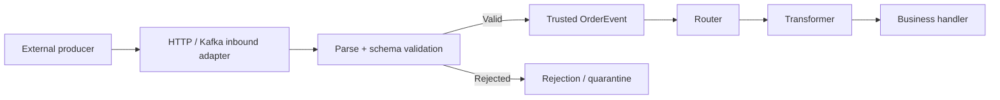
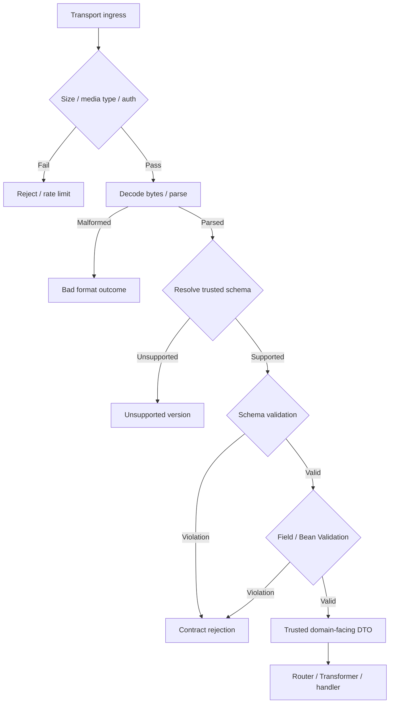
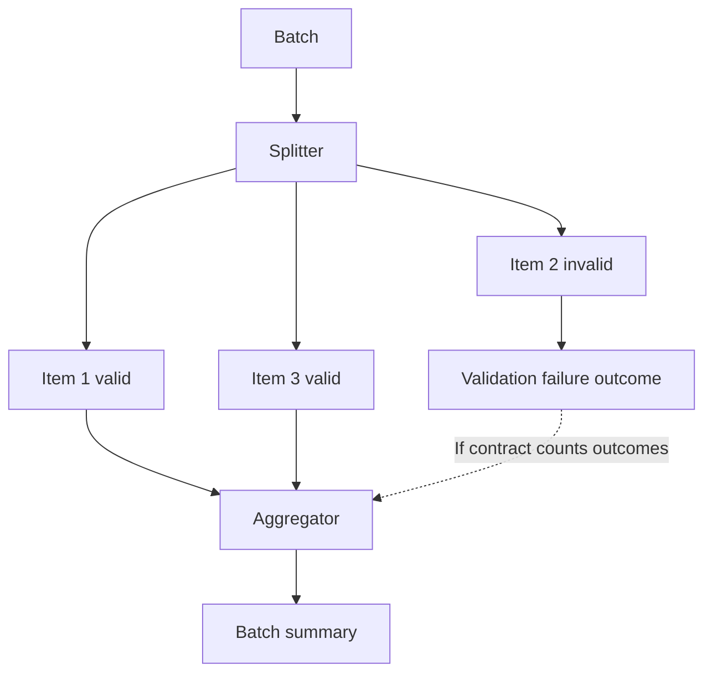
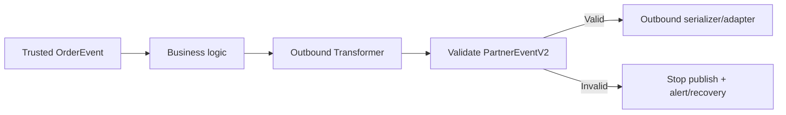
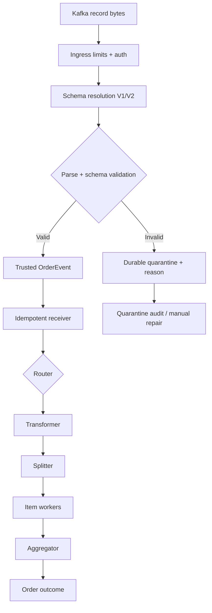

# Validation schema tại boundary

Một IntegrationFlow có thể có hàng chục Router, Transformer, Filter, Splitter, Aggregator và Gateway, nhưng **không phải endpoint nào cũng nên tự đoán dữ liệu có hợp lệ hay không**. Nếu một message JSON bị sai trường, nhầm phiên bản hoặc chứa giá trị vượt giới hạn đi sâu vào hệ thống rồi mới phát hiện, lỗi có thể xuất hiện dưới dạng `ClassCastException`, group chờ mãi, retry vô hạn, sai nhánh định tuyến hoặc một tác dụng phụ nghiệp vụ không thể đảo ngược.

**Validation schema tại boundary** là cách xác minh *hợp đồng dữ liệu ngay tại ranh giới đi vào hoặc đi ra của một hệ thống/thành phần*, trước khi message được coi là dữ liệu tin cậy. Boundary có thể là HTTP Gateway, Kafka/AMQP inbound adapter, file poller, webhook, message từ một service khác, hoặc output chuẩn bị gửi ra đối tác. Đây là chủ đề của bài thuộc chương **Message filter và validation** trong module `SPRING_INTEGRATION_PATTERN`: học triển khai Enterprise Integration Patterns bằng Spring Integration để xây dựng luồng thông điệp ít phụ thuộc, dễ mở rộng; phối hợp Router, Filter, Transformer, Splitter, Aggregator, Gateway, retry, error channel, correlation và kiểm thử/quan sát các nhánh xử lý.

**Mục tiêu sau bài học:**

- Phân biệt **decode/parsing**, **schema validation**, **Bean Validation**, **business validation** và **Filter**.
- Xác định nơi kiểm tra contract giữa producer/consumer thay vì rải cùng một bộ kiểm tra khắp flow.
- Thiết kế schema JSON có version, trường bắt buộc, kiểu dữ liệu, giới hạn kích thước và quy tắc field lạ.
- Nối một bước kiểm tra boundary vào Spring Integration Java DSL, đưa kết quả hợp lệ và không hợp lệ sang hai nhánh có thể quan sát.
- Chọn đường xử lý phù hợp: trả lỗi HTTP, reject event có lý do, quarantine/DLQ hoặc retry có giới hạn.
- Bảo vệ correlation/sequence, idempotency, security và khả năng tương thích schema khi hệ thống phát triển.
- Viết unit/integration tests cho message đúng schema, sai cấu trúc, sai version, sai kiểu, thiếu field, payload quá lớn và tình huống nhiều message.

## 1. Boundary là nơi nào trong một luồng message?

Xét hệ thống nhận sự kiện đặt hàng từ một đối tác:



Boundary có thể hiểu như **cửa kiểm soát một hợp đồng** giữa hai phía. Một phía phát dữ liệu theo biểu diễn mà hai bên đã thỏa thuận; phía kia chỉ chấp nhận dữ liệu khi nó thỏa thuận đó.

Boundary không nhất thiết trùng với **process boundary**. Trong một ứng dụng lớn, một module nội bộ có thể công bố channel/DTO riêng. Nếu dữ liệu giữa hai module được chuyển đổi sang một contract khác, ranh giới ấy cũng có thể có validation; tuy nhiên không cần lặp lại toàn bộ schema check ở mỗi hop khi input đã được kiểm tra và message không thể bị sửa hoặc giả mạo.

**Mục tiêu:** Đưa dữ liệu từ trạng thái *untrusted bytes/envelope* sang *đối tượng đã được xác minh theo contract*, rồi mới thực hiện routing, aggregation và side effects.

### Ví dụ sai và đúng

**Thiết kế dễ lỗi:**

```text
Kafka bytes
  -> Router đọc payload.orderType
  -> Transformer cast amount sang long
  -> Handler gọi payment
  -> Kiểm tra amount có dương không
```

Nếu dữ liệu sai được phát hiện cuối flow, payment có thể đã bắt đầu.

**Thiết kế rõ ràng hơn:**

```text
Kafka bytes
  -> Size/content-type limit
  -> JSON parse
  -> Schema version + structural validation
  -> Semantic field validation
  -> Authenticated context binding
  -> Router / Transformer / business handler
```

**Không có nghĩa tất cả business rules phải nằm ở boundary.** Check “đơn đã thanh toán chưa?” có thể phụ thuộc database và là quy tắc nghiệp vụ ở lớp sau; boundary chỉ cần bảo đảm message **có cấu trúc, version và các ràng buộc trường** đủ để code phía sau hoạt động an toàn.

## 2. Năm loại kiểm tra thường bị gọi chung là “validation”

| Lớp kiểm tra | Câu hỏi | Ví dụ lỗi | Nên nằm ở đâu? |
| --- | --- | --- | --- |
| **Transport/size** | Có nhận được bytes an toàn và đúng giao thức? | Body 100 MiB vượt quota, Content-Type sai. | Ingress adapter/gateway, trước cấp phát hoặc parse lớn. |
| **Parsing/deserialization** | Bytes có giải mã được thành document/object? | JSON thiếu dấu ngoặc, encoding lỗi. | Decoder/serializer tại boundary. |
| **Schema/contract** | Có đúng trường, kiểu, version, cardinality? | `quantity` là chuỗi, thiếu `eventId`, field lạ. | Schema validator/registry/decoder. |
| **Field/semantic** | Giá trị của trường có hợp lệ? | `quantity=-1`, `currency` không hỗ trợ. | Bean Validation hoặc policy validator sau parse. |
| **Business rule/eligibility** | Có nên chấp nhận công việc này tại thời điểm hiện tại? | Đơn đã hủy, khách vượt hạn mức. | Business service, Filter/Router có chủ đích. |

Có thể có vùng giao nhau: JSON Schema cũng mô tả `minimum`, `pattern`, `enum`; Bean Validation cũng kiểm tra `@NotBlank`, `@Positive`. Quan trọng là **quyết định nguồn chân lý** cho một ràng buộc và kiểm thử không để hai bộ rule phát triển lệch nhau.

### Validation không đồng nghĩa Filter

`Filter` theo Enterprise Integration Patterns quyết định **message có đi tiếp hay bị loại**. **Schema validation** quyết định **message có thỏa hợp đồng đầu vào hay không**.

- Một message JSON sai cấu trúc thường cần **rejection có lý do/quarantine**, không được âm thầm coi như “không quan tâm”.
- Một event hợp lệ nhưng không thuộc vùng địa lý cần xử lý có thể được **Filter bỏ qua có audit**.
- Một message hợp lệ nhưng vi phạm business invariant có thể phải sinh **business rejection** thay vì một transport schema error.

Dùng `Filter` để triển khai validation là khả thi về topology, nhưng phải định nghĩa `discardChannel`, lỗi và response; không nên chỉ return `false` rồi mất dấu event.

## 3. Payload, envelope và header: xác minh đúng lớp

Một message Spring có **payload** và **headers**. Trên broker hoặc HTTP, payload có thể là bytes/string, còn headers chứa metadata điều phối.

Ví dụ envelope:

```json
{
  "schemaVersion": 1,
  "eventId": "evt-1001",
  "orderId": "ORD-42",
  "lines": [
    {"sku": "SKU-A", "quantity": 2},
    {"sku": "SKU-B", "quantity": 1}
  ]
}
```

Một Spring message sau decode có thể có:

```text
payload = OrderEvent(version=1, eventId=evt-1001, ...)
headers:
  contentType   = application/json
  traceId       = trace-42
  correlationId = group-42       (nếu flow cần)
  tenantId      = authenticated tenant context
  replyChannel  = internal reply channel (nếu có)
```

**Không coi mọi header là đáng tin cậy.** Client ngoài có thể tự đặt `tenantId`, `role`, `correlationId` hoặc `replyChannel`. Việc parse thành công **không xác thực nguồn** và cũng không cấp quyền truy cập dữ liệu. Những header dùng cho authorization phải đến từ context đã được xác thực hoặc được thiết lập lại ở ingress.

### Schema của payload và schema của envelope

Có hai lựa chọn phổ biến:

1. **Một envelope có version và business payload:** Schema định nghĩa cả `eventId`, `eventType`, `schemaVersion` và `data`.
2. **Một event payload có trường version:** Schema định nghĩa trực tiếp fields; metadata của transport được xác nhận riêng.

Dù chọn cách nào, phải biết **phiên bản schema ứng với payload**. Không dựa vào một header version không đáng tin cậy để giải mã một payload thành object tùy ý.

## 4. Thiết kế hợp đồng JSON Schema rõ ràng

Giả sử producer gửi sự kiện `OrderSubmittedV1`. Ta dùng JSON Schema Draft 2020-12 minh họa:

```json
{
  "$schema": "https://json-schema.org/draft/2020-12/schema",
  "$id": "https://contracts.example.invalid/order-submitted/v1",
  "title": "OrderSubmittedV1",
  "type": "object",
  "additionalProperties": false,
  "required": ["schemaVersion", "eventId", "orderId", "lines"],
  "properties": {
    "schemaVersion": {
      "const": 1
    },
    "eventId": {
      "type": "string",
      "minLength": 1,
      "maxLength": 128
    },
    "orderId": {
      "type": "string",
      "minLength": 1,
      "maxLength": 128
    },
    "lines": {
      "type": "array",
      "minItems": 1,
      "maxItems": 100,
      "items": {
        "type": "object",
        "additionalProperties": false,
        "required": ["sku", "quantity"],
        "properties": {
          "sku": {
            "type": "string",
            "minLength": 1,
            "maxLength": 64
          },
          "quantity": {
            "type": "integer",
            "minimum": 1,
            "maximum": 10000
          }
        }
      }
    }
  }
}
```

Tên miền `example.invalid` chỉ là **định danh minh họa**, không yêu cầu truy cập web. Trong hệ thống thật, schema nên có **định danh/version ổn định** và được quản lý ở contract repository hoặc schema registry mà các đội biết cách truy cập.

### Vì sao các keyword này quan trọng?

| Keyword | Hợp đồng | Trường hợp bị loại |
| --- | --- | --- |
| `type: object` | Payload gốc phải là object. | `[]`, `"hello"`, `null`. |
| `required` | Những field cơ bản phải có mặt. | Thiếu `eventId` hoặc `lines`. |
| `additionalProperties: false` | Không nhận field lạ ở phiên bản này. | `isAdmin: true` không được công nhận. |
| `const: 1` | Message thuộc schema version 1. | `schemaVersion=9`. |
| `minItems: 1` | Đơn có ít nhất một dòng. | `lines=[]`. |
| `maxItems: 100` | Giới hạn một batch trong contract. | 100.000 dòng. |
| `minimum/maximum` | Số lượng từng dòng hợp lệ. | 0 hoặc số cực lớn. |

**`additionalProperties: false` là một lựa chọn tương thích có chủ đích**, không phải quy tắc luôn tốt nhất. Nếu consumer cũ cần chấp nhận producer mới bổ sung optional field, schema quá strict có thể gây lỗi cho thay đổi tương thích. Chính sách unknown-field phải được thống nhất giữa producer và consumer.

### JSON Schema không tự kiểm tra mọi ngữ nghĩa

Schema có thể đảm bảo `quantity` là số nguyên dương, nhưng không thể tự biết **SKU có trong catalog hiện tại** hoặc **orderId có được phép tạo nhãn** khi cần đọc business database. Những kiểm tra đó ở service nghiệp vụ.

## 5. Những message hợp lệ và không hợp lệ

**Hợp lệ theo V1:**

```json
{
  "schemaVersion": 1,
  "eventId": "evt-1001",
  "orderId": "ORD-42",
  "lines": [
    {"sku": "SKU-A", "quantity": 2}
  ]
}
```

**Sai kiểu:**

```json
{
  "schemaVersion": 1,
  "eventId": "evt-1002",
  "orderId": "ORD-43",
  "lines": [
    {"sku": "SKU-A", "quantity": "2"}
  ]
}
```

Ở đây `"2"` là **string**, không phải **integer**. Một deserializer có chế độ *coercion* có thể chuyển thành `2`; nếu contract yêu cầu đúng JSON type, hãy **kiểm tra schema trước mapping hoặc tắt coercion không mong muốn**. Không nên để parser âm thầm “chữa” dữ liệu sai rồi tuyên bố input phù hợp schema.

**Thiếu field bắt buộc:**

```json
{
  "schemaVersion": 1,
  "orderId": "ORD-44",
  "lines": [
    {"sku": "SKU-A", "quantity": 2}
  ]
}
```

Thiếu `eventId` khiến việc chống duplicate và truy vết event trở nên không đáng tin cậy. Không tự tạo một `eventId` mới cho dữ liệu gửi sai nếu contract yêu cầu producer cung cấp identity bền vững.

**Field lạ ở strict V1:**

```json
{
  "schemaVersion": 1,
  "eventId": "evt-1003",
  "orderId": "ORD-45",
  "lines": [
    {"sku": "SKU-A", "quantity": 2}
  ],
  "extraFlag": true
}
```

Nếu schema V1 dùng `additionalProperties: false`, message bị reject. Nếu contract cho phép extension, phải có quy tắc version/namespace và cách xử lý rõ; không tự suy luận `extraFlag` là chức năng được phép.

## 6. Validate tại ingress theo thứ tự an toàn

Một pipeline kiểm tra ingress nên được thiết kế sao cho lỗi bị phát hiện **trước bước tốn kém hoặc có side effect**.



**Thứ tự khuyến nghị:**

1. **Transport gate:** kiểm tra authentication, media type, quota/body-size giới hạn trước khi đọc/giải nén payload lớn.
2. **Parse:** xác nhận encoding/cú pháp; xử lý trùng JSON keys hoặc trailing tokens theo policy.
3. **Schema selection:** xác định version/loại message từ nguồn hợp lệ, chọn contract đúng.
4. **Schema validation:** kiểm tra hình dạng, trường, kiểu, giá trị cố định, giới hạn.
5. **DTO mapping/Bean Validation:** tạo đối tượng mạnh kiểu, kiểm tra ràng buộc trường bổ sung nếu cần.
6. **Trusted context:** gắn tenant/identity đã xác minh, trace/correlation theo policy nội bộ.
7. **Business validation:** sau khi hình dạng đã an toàn, tra cứu DB/domain khi cần.

**Không đặt mọi validation trong một handler cuối cùng sau các bước đã ghi DB, gửi email hoặc gọi payment.**

## 7. Xác thực ở HTTP Gateway và ở broker khác nhau

| Tiêu chí | HTTP/Gateway inbound | Kafka/AMQP inbound |
| --- | --- | --- |
| Người gọi | Client trực tiếp đang chờ response. | Producer có thể không chờ consumer xử lý. |
| Payload lỗi | Có thể trả 4xx theo API contract. | Cần reject/quarantine/DLQ có audit. |
| Retry | Client tự retry hoặc gateway/proxy retry. | Broker redelivery, consumer retry/requeue. |
| Metadata | HTTP headers, auth context, content-type. | Broker headers, key/offset/delivery metadata. |
| Xác nhận | HTTP response/acceptance. | Consumer ACK/commit, theo adapter/transaction. |
| Lỗi schema vĩnh viễn | Thường không nên bảo client retry cùng bytes vô hạn. | **Không** requeue vô hạn cùng poison message. |
| Lỗi tạm thời | Có thể trả 503/thử lại. | Backoff/retry theo consumer policy. |

Schema violation phần lớn là **lỗi dữ liệu không tự hết nếu lặp lại y nguyên payload**. Nếu consumer trả nack/requeue vô hạn cho một JSON sai, nó tạo **poison-message loop** và có thể chặn partition/queue. Hãy gửi tới quarantine hoặc error flow đủ thông tin sửa/replay.

Ngược lại, nếu schema registry tạm thời không truy cập được, đó có thể là **lỗi hạ tầng transient**, khác hẳn một message không khớp schema đã biết.

### HTTP status nào dùng?

Có thể dùng `400 Bad Request` cho JSON malformed, `415 Unsupported Media Type` cho Content-Type không hỗ trợ, `422 Unprocessable Content` cho validation ràng buộc nội dung và `409 Conflict` cho idempotency conflict. Nhưng đây là **lựa chọn contract API**, không phải mapping tự động chung của Spring Integration. Gateway/controller cần chuyển mã lỗi thành response tương ứng và tránh tiết lộ stack trace.

## 8. Schema registry và định danh phiên bản

Một schema có thể được nhúng trong ứng dụng, nằm ở registry hoặc được phát hành như artifact versioned.

```text
Event: OrderSubmitted
  schema v1
  schema v2
  schema v3

Consumer supports:
  v1, v2

Incoming version:
  v3  -> reject/park as UNSUPPORTED_SCHEMA_VERSION
```

### Dùng tên event + version thay vì chỉ version

`schemaVersion=2` một mình chưa đủ nếu hệ thống có nhiều event types. Một envelope có thể dùng:

```json
{
  "eventType": "OrderSubmitted",
  "schemaVersion": 2,
  "eventId": "evt-2001",
  "data": {
    "orderId": "ORD-200",
    "lines": []
  }
}
```

Ví dụ trên chỉ minh họa **cách định danh**, còn `lines=[]` có thể bị reject nếu contract OrderSubmitted yêu cầu ít nhất một dòng.

Khi validate thực tế, cần ánh xạ `(eventType, schemaVersion)` hoặc schema ID ổn định tới **đúng schema**; không tự tạo tên Java class từ chuỗi bên ngoài rồi bật polymorphic deserialization không kiểm soát.

### Registry outage khác unsupported schema

| Trạng thái | Cách ứng xử |
| --- | --- |
| Schema version đã hỗ trợ và cached an toàn | Có thể validate bằng bản cache có xác thực/version cố định. |
| Version không nằm trong tập được phép | Reject/quarantine, không đoán mapping. |
| Registry tạm lỗi nhưng schema không có trong cache | Retry/buffer có giới hạn hoặc fail closed theo policy. |
| Producer công bố schema ID thay đổi nội dung âm thầm | Contract governance lỗi; cần immutable schema/version. |
| Schema được cập nhật thêm trường | Kiểm tra compatibility trước rollout. |

Schema cache phải gắn với version/hash; không được để một bản V1 **âm thầm thay đổi** giữa hai lần nhận message mà không quản lý migration và observability.

## 9. JSON Schema, Avro và Protobuf: cùng mục tiêu, khác điểm kiểm tra

**JSON Schema** mô tả shape và ràng buộc của JSON, thường validate trên `JsonNode`/document trước khi map DTO. **Avro** và **Protocol Buffers** dùng contract nhị phân/schema-generated types; một phần kiểm tra kiểu diễn ra khi deserialize, nhưng vẫn có field semantic validation và version compatibility cần quản lý.

| Công nghệ | Kiểm tra gì tại boundary? | Không nên giả định |
| --- | --- | --- |
| JSON + JSON Schema | Field, type, required, enum, giới hạn, schema version. | Parser tự validate schema; JSON có field lạ luôn được reject. |
| JSON + Bean Validation | Kiểm tra annotation trên DTO sau parse. | Parser không có type coercion; ràng buộc tồn tại trên JSON gốc. |
| Avro | Writer/reader schema, codec và compatibility rules. | Schema resolver luôn tìm được schema; logic nghiệp vụ tự đúng. |
| Protobuf | Decoder/generated message, field numbers và evolution policy. | Mọi required-like business field đều được bảo đảm có giá trị hợp lệ. |
| XML + XSD | Cấu trúc XML và kiểu/namespace theo XSD. | XML parser luôn an toàn nếu chưa cấu hình chống XXE/entity expansion. |

**Chọn một contract chính thức và kiểm thử serializer/deserializer trên version của hệ thống.** Không tạo ra hai hợp đồng mâu thuẫn: một schema registry nói field optional nhưng Bean Validation lại `@NotNull`, trừ khi đó là sự phân lớp có chủ đích và được ghi rõ.

## 10. DTO Java 17+ và Bean Validation

Ta mô hình hóa event từ JSON Schema V1:

```java
import java.util.List;

import jakarta.validation.Valid;
import jakarta.validation.constraints.Max;
import jakarta.validation.constraints.Min;
import jakarta.validation.constraints.NotBlank;
import jakarta.validation.constraints.NotEmpty;
import jakarta.validation.constraints.Size;

record OrderLine(
        @NotBlank @Size(max = 64) String sku,
        @Min(1) @Max(10_000) int quantity
) {}

record OrderEvent(
        @Min(1) int schemaVersion,
        @NotBlank @Size(max = 128) String eventId,
        @NotBlank @Size(max = 128) String orderId,
        @NotEmpty @Size(max = 100)
        List<@Valid OrderLine> lines
) {}
```

Các annotation sử dụng **Jakarta Bean Validation** và hoạt động khi có provider Jakarta Validation tương ứng, chẳng hạn Hibernate Validator. Trong ứng dụng Spring Boot/Spring Framework hiện đại, cần dependency đúng với phiên bản đang dùng; đừng trộn `javax.validation` của thế hệ cũ với `jakarta.validation` trên Spring 6+.

### Schema và Bean Validation không tương đương hoàn toàn

Với field `quantity`, DTO dùng `int` nguyên thủy. Nếu JSON thiếu `quantity`, một mapper có thể đưa nó về `0` hoặc báo lỗi tùy cấu hình. Bean Validation `@Min(1)` bắt được `0`, nhưng **không tự chứng minh field đã xuất hiện trong JSON**. JSON Schema `required` kiểm tra chính xác sự hiện diện.

Với JSON có `"quantity":"2"`, một mapper cho phép coercion có thể biến string thành số nguyên trước khi Bean Validation. Do đó cần **schema check trên JSON tree hoặc cấu hình deserializer strict** khi hợp đồng yêu cầu đúng type.

## 11. Thiết kế kết quả validation có kiểu, không chỉ `true/false`

Một boolean `valid` thuận tiện cho Filter nhưng thiếu thông tin để debug, quarantine và gửi lỗi về client.

```java
import java.util.List;

record ValidationIssue(
        String path,
        String code
) {}

record BoundaryVerdict(
        boolean accepted,
        OrderEvent event,
        List<ValidationIssue> issues
) {
    BoundaryVerdict {
        issues = List.copyOf(issues);
    }

    static BoundaryVerdict pass(OrderEvent event) {
        return new BoundaryVerdict(true, event, List.of());
    }

    static BoundaryVerdict reject(
            String path, String code) {
        return new BoundaryVerdict(
                false, null,
                List.of(new ValidationIssue(path, code)));
    }

    static BoundaryVerdict reject(
            List<ValidationIssue> issues) {
        return new BoundaryVerdict(false, null, issues);
    }
}
```

Hợp đồng trên là **code ứng dụng**, không phải kiểu Spring Integration cung cấp sẵn. Thông thường cần thêm `eventId`/audit reference **khi đọc được và đã được xác minh**, version/schema ID, ingress source, time và một mã reason hữu hạn. Không đưa toàn bộ payload người dùng hoặc stack trace vào `ValidationIssue`.

### Dữ liệu lỗi có thể không đáng tin

Nếu JSON chưa parse được, `eventId` bên trong không thể được coi là đã xác minh. Hãy dùng một **ingress audit ID** độc lập cho log/quarantine; chỉ bổ sung business ID sau khi đã kiểm tra đủ trường và phạm vi.

## 12. Ví dụ parser và validation gate tại boundary

Ví dụ sau minh họa một **boundary gate trong JVM**: giới hạn bytes, parse JSON, kiểm tra một số điều kiện cấu trúc quan trọng, ánh xạ DTO rồi chạy Bean Validation. Code dùng Jackson và Jakarta Validation; **phần kiểm tra hình dạng Java là subset minh họa**, không tự nhận là engine JSON Schema Draft 2020-12 hoàn chỉnh.

### 12.1. Bộ kiểm tra hình dạng tối thiểu

```java
import java.util.ArrayList;
import java.util.List;

import com.fasterxml.jackson.databind.JsonNode;

final class OrderV1ShapeGate {

    List<ValidationIssue> check(JsonNode json) {
        List<ValidationIssue> issues = new ArrayList<>();

        if (json == null || !json.isObject()) {
            return List.of(new ValidationIssue("$", "ROOT_NOT_OBJECT"));
        }

        JsonNode version = json.path("schemaVersion");
        if (!version.isIntegralNumber()
                || version.intValue() != 1) {
            issues.add(new ValidationIssue(
                    "$.schemaVersion", "UNSUPPORTED_VERSION"));
        }

        requireText(json, "eventId", issues);
        requireText(json, "orderId", issues);

        JsonNode lines = json.path("lines");
        if (!lines.isArray()
                || lines.isEmpty()
                || lines.size() > 100) {
            issues.add(new ValidationIssue(
                    "$.lines", "INVALID_LINES"));
            return issues;
        }

        for (int index = 0; index < lines.size(); index++) {
            JsonNode line = lines.get(index);
            String path = "$.lines[" + index + "]";

            if (!line.isObject()) {
                issues.add(new ValidationIssue(
                        path, "LINE_NOT_OBJECT"));
                continue;
            }

            requireText(line, "sku", issues, path);
            JsonNode quantity = line.path("quantity");

            if (!quantity.isIntegralNumber()
                    || quantity.longValue() < 1
                    || quantity.longValue() > 10_000) {
                issues.add(new ValidationIssue(
                        path + ".quantity", "INVALID_QUANTITY"));
            }
        }

        return issues;
    }

    private static void requireText(
            JsonNode node,
            String field,
            List<ValidationIssue> issues) {
        requireText(node, field, issues, "$");
    }

    private static void requireText(
            JsonNode node, String field,
            List<ValidationIssue> issues, String path) {
        JsonNode value = node.path(field);
        if (!value.isTextual() || value.textValue().isBlank()) {
            issues.add(new ValidationIssue(
                    path + "." + field, "REQUIRED_STRING"));
        }
    }
}
```

Bộ này chưa thay được JSON Schema validator thực: nó **chưa kiểm tra đầy đủ `additionalProperties`, length constraint, tất cả JSON number representations và mọi keyword của JSON Schema**. Khi triển khai production, dùng thư viện JSON Schema phù hợp, nạp đúng schema version ở mục 4, rồi map các lỗi thư viện thành `ValidationIssue` với code ổn định.

### 12.2. Boundary service

```java
import java.util.List;
import java.util.Set;

import com.fasterxml.jackson.core.JsonProcessingException;
import com.fasterxml.jackson.databind.ObjectMapper;
import com.fasterxml.jackson.databind.JsonNode;

import jakarta.validation.ConstraintViolation;
import jakarta.validation.Validator;

final class OrderBoundaryService {
    private static final int MAX_BODY_BYTES = 64 * 1024;

    private final ObjectMapper mapper;
    private final Validator beanValidator;
    private final OrderV1ShapeGate shapeGate =
            new OrderV1ShapeGate();

    OrderBoundaryService(
            ObjectMapper mapper, Validator beanValidator) {
        this.mapper = mapper;
        this.beanValidator = beanValidator;
    }

    BoundaryVerdict inspect(byte[] bytes) {
        if (bytes == null || bytes.length == 0
                || bytes.length > MAX_BODY_BYTES) {
            return BoundaryVerdict.reject(
                    "$", "BODY_SIZE_INVALID");
        }

        try {
            JsonNode root = mapper.readTree(bytes);

            List<ValidationIssue> shape = shapeGate.check(root);
            if (!shape.isEmpty()) {
                return BoundaryVerdict.reject(shape);
            }

            OrderEvent event = mapper.treeToValue(
                    root, OrderEvent.class);

            Set<ConstraintViolation<OrderEvent>> violations =
                    beanValidator.validate(event);

            if (!violations.isEmpty()) {
                List<ValidationIssue> issues = violations.stream()
                        .map(v -> new ValidationIssue(
                                v.getPropertyPath().toString(),
                                "FIELD_CONSTRAINT_VIOLATION"))
                        .sorted(java.util.Comparator.comparing(
                                ValidationIssue::path))
                        .toList();
                return BoundaryVerdict.reject(issues);
            }

            return BoundaryVerdict.pass(event);

        } catch (JsonProcessingException ex) {
            // Không trả parser exception/raw payload cho caller.
            return BoundaryVerdict.reject(
                    "$", "JSON_PARSE_OR_MAPPING_FAILED");
        }
    }
}
```

**Giới hạn thực tế của ví dụ:**

- Kiểm tra `bytes.length` ở service **không đủ** để chống DoS nếu adapter đã đọc toàn bộ request cực lớn vào RAM. Hãy **enforce body-size limit tại ingress** trước khi allocation.
- `ObjectMapper` cần chính sách rõ về **unknown fields, numeric coercion, duplicate keys, trailing tokens và polymorphic typing**. Nếu bật coercion rộng, kết quả map có thể khác schema.
- Parser có thể ném các lỗi runtime khác do giới hạn stream/nesting; boundary cần một error classification không tiết lộ dữ liệu.
- JSON Schema đầy đủ phải được validate bằng **validator chuẩn**; `OrderV1ShapeGate` chỉ là mã tối giản để người học nhìn thấy ranh giới.
- Không tự động retry message malformed vì parser báo lỗi; chỉ retry nếu nguyên nhân là hạ tầng tạm thời.
- `Validator` là Jakarta Validation API, cần provider thực ở application context.
- Nếu lỗi validation quá nhiều, nên giới hạn **số lỗi trả ra** tránh response quá lớn và high-cardinality log.

## 13. Cấu hình Spring Integration Java DSL: nhánh hợp lệ và nhánh loại

Một cách rõ ràng là để boundary service trả **`BoundaryVerdict`** có kiểu, sau đó Router đưa kết quả tới đúng channel. Đường rejected **không bị bỏ im lặng**.

```java
import com.fasterxml.jackson.databind.ObjectMapper;
import jakarta.validation.Validation;
import jakarta.validation.Validator;

import org.springframework.context.annotation.Bean;
import org.springframework.context.annotation.Configuration;
import org.springframework.integration.channel.DirectChannel;
import org.springframework.integration.channel.QueueChannel;
import org.springframework.integration.config.EnableIntegration;
import org.springframework.integration.dsl.IntegrationFlow;

@Configuration
@EnableIntegration
class OrderBoundaryFlowConfig {

    @Bean
    DirectChannel rawOrders() {
        return new DirectChannel();
    }

    @Bean
    QueueChannel acceptedOrders() {
        return new QueueChannel();
    }

    @Bean
    QueueChannel rejectedOrders() {
        return new QueueChannel();
    }

    @Bean
    ObjectMapper orderObjectMapper() {
        return new ObjectMapper();
    }

    @Bean
    Validator orderBeanValidator() {
        return Validation.buildDefaultValidatorFactory()
                .getValidator();
    }

    @Bean
    OrderBoundaryService orderBoundaryService(
            ObjectMapper orderObjectMapper,
            Validator orderBeanValidator) {
        return new OrderBoundaryService(
                orderObjectMapper, orderBeanValidator);
    }

    @Bean
    IntegrationFlow orderBoundaryFlow(
            OrderBoundaryService boundaryService) {
        return IntegrationFlow.from("rawOrders")
                .handle(byte[].class, (payload, headers) ->
                        boundaryService.inspect(payload))
                .route(BoundaryVerdict.class,
                        verdict -> verdict.accepted()
                                ? "VALID" : "REJECTED",
                        mapping -> mapping
                                .channelMapping("VALID", "acceptedOrders")
                                .channelMapping("REJECTED", "rejectedOrders"))
                .get();
    }
}
```

Ở ví dụ, **cả hai channel đều nhận payload `BoundaryVerdict`**, không phải `OrderEvent` trực tiếp. Downstream ở `acceptedOrders` có thể dùng `.transform(BoundaryVerdict::event)` hoặc service lấy `verdict.event()`. Điều này có lợi khi cần audit/trace nhưng cũng có nghĩa **contract downstream phải được cập nhật đúng kiểu**.

`QueueChannel` chỉ để test quan sát message. Trong production, rejected route thường tới **error mapping, quarantine writer hoặc DLQ publisher**; valid route tới xử lý nghiệp vụ. Không mặc định một QueueChannel in-memory là persistent queue.

### Lưu ý compile/version

Các API Java DSL có thể thay đổi overload hoặc cách suy luận generic theo phiên bản Spring Integration/Spring Framework. Ví dụ ở đây phục vụ bài học; **chưa chạy Gradle/kiểm thử build tại STEP 4**. Khi đưa vào dự án, đối chiếu `IntegrationFlow`, `route`, Jakarta Validation provider, Jackson config và package thực tế của dependency được chọn.

## 14. Kiểm thử thuần Java: parser, schema, semantic constraint

Với `OrderBoundaryService`, nên test các ca lỗi cơ bản trước khi kiểm tra wiring Spring. Mỗi test phải assert **reason code có nghĩa**, không chỉ `accepted=false`.

```java
import static org.junit.jupiter.api.Assertions.*;

import java.nio.charset.StandardCharsets;

import com.fasterxml.jackson.databind.ObjectMapper;
import jakarta.validation.Validation;
import org.junit.jupiter.api.Test;

class OrderBoundaryServiceTest {

    private final OrderBoundaryService service =
            new OrderBoundaryService(
                    new ObjectMapper(),
                    Validation.buildDefaultValidatorFactory()
                            .getValidator());

    private static byte[] utf8(String text) {
        return text.getBytes(StandardCharsets.UTF_8);
    }

    @Test
    void acceptsValidV1Event() {
        byte[] bytes = utf8("""
            {
              "schemaVersion": 1,
              "eventId": "evt-101",
              "orderId": "ORD-101",
              "lines": [{"sku": "SKU-A", "quantity": 2}]
            }
            """);

        BoundaryVerdict verdict = service.inspect(bytes);

        assertTrue(verdict.accepted());
        assertEquals("evt-101", verdict.event().eventId());
        assertTrue(verdict.issues().isEmpty());
    }

    @Test
    void rejectsStringQuantityWithoutCoercion() {
        BoundaryVerdict verdict = service.inspect(utf8("""
            {
              "schemaVersion": 1,
              "eventId": "evt-102",
              "orderId": "ORD-102",
              "lines": [{"sku": "SKU-A", "quantity": "2"}]
            }
            """));

        assertFalse(verdict.accepted());
        assertTrue(verdict.issues().stream()
                .anyMatch(i -> "INVALID_QUANTITY".equals(i.code())));
    }

    @Test
    void rejectsMissingEventId() {
        BoundaryVerdict verdict = service.inspect(utf8("""
            {
              "schemaVersion": 1,
              "orderId": "ORD-103",
              "lines": [{"sku": "SKU-A", "quantity": 1}]
            }
            """));

        assertFalse(verdict.accepted());
        assertTrue(verdict.issues().stream()
                .anyMatch(i -> i.path().contains("eventId")));
    }

    @Test
    void rejectsUnsupportedSchemaVersion() {
        BoundaryVerdict verdict = service.inspect(utf8("""
            {
              "schemaVersion": 9,
              "eventId": "evt-104",
              "orderId": "ORD-104",
              "lines": [{"sku": "SKU-A", "quantity": 1}]
            }
            """));

        assertFalse(verdict.accepted());
        assertTrue(verdict.issues().stream()
                .anyMatch(i -> "UNSUPPORTED_VERSION".equals(i.code())));
    }

    @Test
    void rejectsMalformedJson() {
        BoundaryVerdict verdict = service.inspect(
                utf8("{ \"eventId\":"));

        assertFalse(verdict.accepted());
        assertTrue(verdict.issues().stream()
                .anyMatch(i -> "JSON_PARSE_OR_MAPPING_FAILED"
                        .equals(i.code())));
    }
}
```

**JUnit này minh họa đúng logic lớp kiểm tra tối thiểu**, nhưng không thay thế bộ test chạy trên engine JSON Schema thực tế. Test malformed JSON không nên kỳ vọng message có business `eventId` hợp lệ.

### Test giới hạn bytes

```java
@Test
void rejectsOverSizedDocumentBeforeParsing() {
    byte[] large = new byte[64 * 1024 + 1];

    BoundaryVerdict verdict = service.inspect(large);

    assertFalse(verdict.accepted());
    assertEquals("BODY_SIZE_INVALID",
            verdict.issues().get(0).code());
}
```

Giới hạn ở trên là **64 KiB trong ví dụ**. Production phải áp dụng tại transport ingress và định nghĩa dựa trên payload size, nén/giải nén, tải hệ thống và các yêu cầu thực.

## 15. Integration test: message không hợp lệ không lọt vào business branch

Unit test chỉ kiểm tra một method. Integration test cần khởi tạo **Spring Integration channels + flow** và xác nhận message valid đi vào `acceptedOrders`, invalid đi vào `rejectedOrders`.

```java
import static org.junit.jupiter.api.Assertions.*;

import java.nio.charset.StandardCharsets;

import org.junit.jupiter.api.Test;
import org.springframework.beans.factory.annotation.Autowired;
import org.springframework.beans.factory.annotation.Qualifier;
import org.springframework.integration.channel.QueueChannel;
import org.springframework.messaging.Message;
import org.springframework.messaging.MessageChannel;
import org.springframework.messaging.support.MessageBuilder;
import org.springframework.test.annotation.DirtiesContext;
import org.springframework.test.context.junit.jupiter.SpringJUnitConfig;

@SpringJUnitConfig(OrderBoundaryFlowConfig.class)
@DirtiesContext(classMode = DirtiesContext.ClassMode.AFTER_EACH_TEST_METHOD)
class OrderBoundaryFlowTest {

    @Autowired @Qualifier("rawOrders")
    MessageChannel input;

    @Autowired @Qualifier("acceptedOrders")
    QueueChannel accepted;

    @Autowired @Qualifier("rejectedOrders")
    QueueChannel rejected;

    private static Message<byte[]> json(String text) {
        return MessageBuilder.withPayload(
                text.getBytes(StandardCharsets.UTF_8)).build();
    }

    @Test
    void validEventOnlyReachesAcceptedChannel() {
        assertTrue(input.send(json("""
            {
              "schemaVersion": 1,
              "eventId": "evt-201",
              "orderId": "ORD-201",
              "lines": [{"sku": "SKU-A", "quantity": 2}]
            }
            """)));

        Message<?> result = accepted.receive(1_000);
        assertNotNull(result);
        BoundaryVerdict verdict =
                (BoundaryVerdict) result.getPayload();

        assertTrue(verdict.accepted());
        assertEquals("evt-201", verdict.event().eventId());
        assertNull(rejected.receive(0));
    }

    @Test
    void invalidEventIsQuarantinedByRouteNotDropped() {
        assertTrue(input.send(json("""
            {
              "schemaVersion": 1,
              "eventId": "evt-202",
              "orderId": "ORD-202",
              "lines": [{"sku": "SKU-A", "quantity": -4}]
            }
            """)));

        Message<?> result = rejected.receive(1_000);
        assertNotNull(result);
        BoundaryVerdict verdict =
                (BoundaryVerdict) result.getPayload();

        assertFalse(verdict.accepted());
        assertFalse(verdict.issues().isEmpty());
        assertNull(accepted.receive(0));
    }
}
```

Bài test giả định **DirectChannel đồng bộ** và QueueChannel trong JVM. Khi chuyển sang broker/executor, thời điểm xử lý và error handling khác đi; test cần bounded wait, test store/DLQ thật và reset state sau mỗi ca.

**Đừng chỉ assert `rejected.receive() != null` rồi coi quá trình cách ly đã hoàn thành**. Production phải kiểm tra quarantine record đã được lưu bền vững/ACK đúng, có reason, replay policy và retention; bước đó nằm ngoài demo này.

## 16. Schema error, Filter discard và `errorChannel`

Ba cách xử lý có mục tiêu khác nhau:

| Cơ chế | Ví dụ | Ý nghĩa |
| --- | --- | --- |
| **Structured rejection** | Trả `BoundaryVerdict` với `INVALID_QUANTITY`. | Dữ liệu đã được phân loại là không đúng contract. |
| **Filter discard** | Event hợp lệ nhưng `region != supported`. | Message không phù hợp mục đích flow; có thể bỏ có chủ đích. |
| **Exception + error channel** | Schema registry timeout hoặc handler ném exception. | Lỗi thực thi cần retry/giám sát/khôi phục. |

Một số endpoint Spring Integration có thể dùng `Filter` và `discardChannel`; có lựa chọn ném lỗi khi reject. Nhưng **một `false` không phải một error payload tự động**. Với message sai schema cần audit, nên đưa tới **quarantine channel hoặc handler** có đầy đủ reason, thay vì im lặng drop.

### Không mặc định exception đi vào `errorChannel`

Với **flow đồng bộ** qua `DirectChannel`, exception có thể lan về caller dưới dạng messaging exception thích hợp. Với **poller/executor/broker listener**, error handler hoặc `errorChannel` có thể nhận `ErrorMessage` khi được cấu hình đúng. Không bảo đảm mọi `IllegalArgumentException` từ một handler đều biến thành một DLQ record tự động.

Khi thiết kế recovery, hãy xác định:

1. Ai sở hữu lỗi và quyết định retry?
2. ErrorMessage có đủ nguồn gốc/audit ID không?
3. Message raw có được phép lưu lại không, xét PII/quy định lưu trữ?
4. Khi quarantine write thất bại, source có ACK hay phải retry?
5. Có cơ chế tránh poison-message loop không?

## 17. Fail-fast và quarantine: loại lỗi nào được retry?

| Loại lỗi | Ví dụ | Xử lý phù hợp |
| --- | --- | --- |
| **Malformed data** | JSON sai cú pháp. | Reject/quarantine, không retry vô hạn cùng bytes. |
| **Schema violation** | Thiếu `eventId`, sai kiểu quantity. | Reject có reason; producer cần sửa. |
| **Unsupported version** | Producer V3, consumer chỉ biết V1/V2. | Park/quarantine, nâng consumer hoặc rollback producer. |
| **Schema service outage** | Registry tạm không truy cập được. | Retry có backoff hoặc dùng cache version đã xác thực. |
| **Authentication failure** | Token invalid, tenant mismatch. | Reject/fail closed, audit bảo mật. |
| **Business validation failure** | Order bị hủy. | Domain rejection; có thể là kết quả bình thường. |
| **Downstream timeout** | DB hoặc external API không phản hồi. | Retry tùy idempotency và deadline; không gắn nhầm mã `BAD_SCHEMA`. |
| **Quarantine storage failure** | Ghi DLQ/DB lỗi. | Recovery policy riêng; tránh ACK mất dữ liệu. |

Phân loại rõ lỗi **permanent** và **transient** đặc biệt quan trọng với Kafka/AMQP. Một message sai schema không tự trở nên đúng nếu redeliver 10.000 lần. Ngược lại, khi registry đang outage, bỏ vĩnh viễn một event hợp lệ có thể gây mất dữ liệu.

### Một quarantine record tốt nên chứa gì?

```json
{
  "auditId": "ingress-audit-001",
  "source": "orders-topic",
  "eventType": "OrderSubmitted",
  "schemaVersion": 1,
  "reasonCode": "INVALID_QUANTITY",
  "observedAt": "2026-11-21T10:00:00Z",
  "payloadReference": "secure-quarantine-ref"
}
```

Đây là **schema application minh họa**. `payloadReference` có thể trỏ tới một kho được bảo vệ; không nhất thiết chép toàn bộ message raw vào DLQ/log. Chỉ phát `eventId` khi nó đã được kiểm tra hợp lệ và không dùng string từ payload chưa parse như ID tin cậy.

## 18. Validation liên quan tới Router và Transformer

Một Router thường đọc vài field để quyết định channel:

```text
OrderSubmittedV1 -> validate -> route by orderType
```

Nếu `orderType` sai kiểu hoặc không thuộc enum, việc route trước validate có thể đưa message tới default channel không mong muốn. Nên validate **trước khi dùng field để quyết định điều phối**.

Một Transformer có thể tạo output sai contract dù input hợp lệ:

```text
Validated OrderSubmittedV1
   -> Transformer
   -> PaymentInstructionV2
```

Ở ranh giới `PaymentInstructionV2` gửi sang hệ thống khác, có thể cần **outbound validation** để kiểm tra serializer và contract của consumer. Không mặc định “input valid” ⇒ “output valid”, vì logic chuyển đổi có thể làm mất trường, đổi đơn vị tiền hoặc tạo dữ liệu sai.

### Thứ tự giữa normalization và validation

Một số giá trị có thể được chuẩn hóa trước validation, ví dụ trim whitespace hoặc canonicalize currency code. Điều này chỉ an toàn khi contract quy định rõ **phép chuẩn hóa**. Không tự động sửa `quantity: "2"` thành `quantity: 2` nếu schema nghiêm cấm string, trừ khi gateway **có trách nhiệm tương thích có phiên bản** và ghi nhận việc sửa.

**Tính minh bạch quan trọng:** muốn chuyển đổi dữ liệu legacy phải có **adapter/anti-corruption layer** rõ ràng, không đặt conversion ngầm trong Jackson rồi khiến producer tin rằng bất kỳ shape nào cũng hợp lệ.

## 19. Splitter/Aggregator: validation có thể làm thiếu message con

Giả sử một `OrderBatch` được Splitter tách thành ba item. Sau split, một item sai schema hoặc vi phạm field validation bị loại:

```text
Batch B-42
  seq=1 / size=3 -> valid
  seq=2 / size=3 -> invalid, discarded
  seq=3 / size=3 -> valid
```

Nếu Aggregator chờ `sequenceSize=3`, nó có thể **không bao giờ nhận đủ ba phần tử**.



Có ít nhất ba chính sách:

1. **Reject cả batch trước split:** schema của batch kiểm tra từng phần tử trước khi bắt đầu phát, phù hợp khi một item sai làm cả request không hợp lệ.
2. **Failure-as-result:** nếu mỗi item có thể thất bại độc lập, tạo `ItemRejected` giữ `correlationId`, `sequenceNumber`/identity phù hợp để Aggregator gom đủ **các outcomes**.
3. **Partial release:** Aggregator có group timeout/release policy trả kết quả thiếu có status rõ; không tự coi phần thiếu là thành công.

**Không dùng `Filter` loại item rồi mặc định group đã đủ**. Validation và Aggregator release strategy là hai trách nhiệm khác nhau.

### Correlation headers không phải dữ liệu schema đáng tin cậy

`correlationId`, `sequenceNumber`, `sequenceSize` phục vụ group/routing theo topology. Nếu chúng đến từ nguồn ngoài, phải xác thực và map trước khi dùng. Một client không được tự đặt group key để gộp dữ liệu của tenant khác vào chung một Aggregator group.

## 20. Validation và Idempotent Receiver: kiểm tra trước hay sau dedup?

Một event sai schema có thể được giao lại nhiều lần. Một câu hỏi khó là **có ghi idempotency key trước khi validate không?**

**Nếu ghi key “seen” trước validation**, một event invalid có thể khiến key bị giữ dù producer đã sửa và phát lại theo một policy hợp lệ. **Nếu không có dedup**, cùng poison message có thể tạo hàng nghìn quarantine records. Thiết kế nên phân biệt:

- **Transport delivery ID:** dùng để nhận diện việc cùng record được redeliver khi cần.
- **Business event ID:** chỉ có thể tin sau khi schema và identity validation hợp lệ.
- **Quarantine key:** định danh một payload lỗi để giới hạn số lần quarantine, có retention riêng.
- **Business processed receipt:** đánh dấu hoàn thành sau khi nghiệp vụ đã commit theo policy.

Ví dụ:

```text
Raw message
  -> size/parse/schema validation
  -> if invalid: quarantine with audit/fingerprint + poison-loop guard
  -> if valid: idempotency key -> business handler
```

Đây là một mô hình phổ biến, nhưng khi message cực lớn hoặc dễ bị tấn công, **rate limit, authorization và size gate** phải diễn ra **trước parse/schema check**.

### Không tạo ID nghiệp vụ mới cho event bị lỗi

Nếu producer thiếu `eventId`, **không tự cấp event ID rồi xử lý như message hợp lệ** khi contract đòi hỏi producer giữ identity qua retry. Làm vậy khiến redelivery/repair có thể tạo một công việc mới ngoài ý muốn. Hãy reject/quarantine và chỉ reissue theo policy có thể truy vết.

## 21. Gateway và reply: invalid message vẫn phải có câu trả lời

Trong request–reply Gateway, nếu boundary Filter **drop** message không hợp lệ, caller có thể chờ đến timeout mà không hiểu vì sao.

```text
Client -> Gateway -> schema validation
                        |
                        +-- valid -> business handler -> reply
                        |
                        +-- invalid -> structured error reply
```

Một API thường cần chuyển `BoundaryVerdict.issues()` thành response có schema ổn định:

```json
{
  "errorCode": "VALIDATION_FAILED",
  "auditId": "req-audit-112",
  "violations": [
    {
      "path": "$.lines[0].quantity",
      "code": "INVALID_QUANTITY"
    }
  ]
}
```

Đừng gửi stack trace, SQL exception hoặc raw message chứa PII. Nếu một field trong request là secret/token, **path/code** thường đủ; không log hoặc echo lại `rejectedValue` mà không có redaction.

Nếu Gateway trả `202 Accepted` chỉ vì message đã vào queue, contract phải nói rõ **accepted for processing**, không khẳng định business validation và execution đã hoàn tất ở downstream.

## 22. Schema evolution: thay đổi hợp đồng mà không phá consumer cũ

Một producer V2 muốn thêm optional field `sourceChannel`. Consumer V1 dùng schema strict `additionalProperties: false` có thể reject toàn bộ message V2 dù trường mới không ảnh hưởng logic cũ.

| Thay đổi | Rủi ro compatibility |
| --- | --- |
| Thêm optional field | Consumer cũ strict có thể reject field lạ. |
| Thêm required field | Producer cũ không gửi → consumer mới reject. |
| Đổi string sang integer | Parser/contract của một phía không còn khớp. |
| Đổi enum bằng giá trị mới | Router cũ có thể không nhận diện giá trị mới. |
| Đổi nghĩa/đơn vị của trường | Schema có thể vẫn pass nhưng nghiệp vụ sai. |
| Bỏ field bắt buộc | Consumer cũ có thể thiếu dữ liệu. |
| Thay ID hoặc correlation | Idempotency/Aggregator có thể sai dù cấu trúc parse được. |

### Backward và forward compatibility cần định nghĩa rõ chiều

Một cách nói dễ nhớ:

- **Backward compatibility (reader mới đọc writer cũ):** consumer mới tiếp tục xử lý dữ liệu được producer cũ phát.
- **Forward compatibility (reader cũ đọc writer mới):** consumer cũ tiếp tục xử lý dữ liệu từ producer mới.

Tên gọi cụ thể có thể thay theo ngữ cảnh công cụ/schema registry, nên trong tài liệu hợp đồng cần ghi rõ **ai là reader/writer và version nào phải đọc được version nào**.

### Kế hoạch phát hành thay đổi an toàn

1. Tạo schema/version mới **không sửa âm thầm V1 đã phát hành**.
2. Viết compatibility test theo những chiều hỗ trợ cụ thể.
3. Cho consumer hỗ trợ cả V1/V2 hoặc có upcaster/adapter trong giai đoạn chuyển tiếp.
4. Chỉ khi consumer sẵn sàng mới chuyển producer sang V2 theo canary.
5. Theo dõi tỷ lệ `UNSUPPORTED_VERSION`, `UNKNOWN_FIELD` và schema rejects.
6. Giữ khả năng rollback; không xóa decoder V1 khi còn message V1 trong broker/DLQ cần replay.

**Schema version không thay thế migration chính sách nghiệp vụ.** Nếu semantics của `amount` từ VND sang cents, phải thay version/field tên hoặc định nghĩa chuyển đổi rõ, không chỉ đổi dữ liệu mà giữ cùng shape.

## 23. Validation tại outbound boundary

Một dữ liệu đã qua business service có thể được biến đổi thành message gửi ra đối tác:



Outbound validation bảo vệ **consumer khác**, đặc biệt khi mapping code, schema version hoặc feature flag thay đổi.

Ví dụ một Transformer có thể:
- Đổi số tiền sang đơn vị sai.
- Bỏ `eventId` nên remote consumer không thể deduplicate.
- Thêm enum value mà partner chưa hỗ trợ.
- Tạo payload gồm 101 items dù partner giới hạn 100.
- Đánh rơi correlation/reply metadata cần cho Scatter–Gather.

Không phải luôn cần chạy full JSON Schema validator ở mọi outbound hop nội bộ. Nhưng trước **public API, broker event contract hoặc partner adapter** có yêu cầu nghiêm, outbound contract test/validation là một lớp phòng vệ có giá trị.

**Không publish một event không hợp lệ rồi dựa vào consumer từ chối để phát hiện bug.** Nếu outbound validation lỗi, hãy dừng publish, ghi audit và sửa transformer; retry chỉ có ích khi nguyên nhân thực sự transient.

## 24. Performance và giới hạn tài nguyên của schema validation

Validate schema có chi phí CPU, allocation, cấu trúc dữ liệu và đôi khi phải truy cập registry. Với throughput lớn, cần tối ưu nhưng **không đánh đổi an toàn**.

Các hướng:

- **Cache compiled schema theo ID/version**, không parse/compile schema cho từng message.
- **Enforce size limit tại ingress** trước khi toàn bộ request được đọc vào RAM.
- Giới hạn **nesting depth, array length, number size và string length**.
- Kiểm tra giới hạn giải nén để tránh compression bomb.
- Chọn một parser/deserializer hỗ trợ **strict duplicate-key policy** khi hợp đồng yêu cầu.
- Tránh bật polymorphic type resolution không an toàn với dữ liệu untrusted.
- Không chạy synchronous remote schema-registry request trên mỗi message nếu có cache an toàn.
- Dùng **rate limiting/backpressure** để tránh flood các invalid messages làm nghẽn CPU/quarantine store.
- Giới hạn số `ValidationIssue` và redaction, tránh tạo log khổng lồ.

### Reject sớm có thật sự rẻ hơn?

Một request 100 MiB đã được toàn bộ web server đọc vào byte array rồi mới kiểm tra `bytes.length` **không được coi là reject sớm** về mặt tài nguyên. Cần cấu hình gateway/proxy/container max request size, stream limit hoặc decoder limit ở ranh giới thích hợp. Spring Integration handler ở phía trong không thể thu hồi bộ nhớ đã bị tiêu tốn trước đó.

## 25. Bảo mật: schema hợp lệ không đồng nghĩa input an toàn

**Schema validation là một lớp phòng vệ, không phải cơ chế authentication hoặc authorization.**

Các vấn đề quan trọng:

1. **Trusted identity:** không tin `tenantId`/`role` chỉ vì chúng là string đúng schema; đối chiếu với principal hoặc trusted metadata.
2. **Mass assignment:** không cho JSON field lạ ánh xạ thành field nội bộ nhạy cảm; kiểm soát unknown fields và mapping.
3. **Type coercion:** không tự chuyển chuỗi thành số/boolean nếu contract yêu cầu type chính xác.
4. **Deserialization safety:** tắt polymorphic default typing nguy hiểm khi xử lý dữ liệu không tin cậy; tránh load class theo tên từ payload.
5. **Parser limits:** chống nested payload/array/number gây resource exhaustion.
6. **Secrets/PII:** không log raw JSON của những event chứa thông tin cá nhân, tài khoản, token.
7. **Replay:** message đúng schema nhưng replay nhiều lần vẫn cần Idempotent Receiver.
8. **Cross-tenant correlation:** một `correlationId` hợp lệ về kiểu vẫn có thể cố tình trộn dữ liệu giữa tenant.
9. **Schema supply chain:** registry/schema artifact cần integrity, quyền publish và version immutability.
10. **Quarantine privacy:** payload lỗi có thể chứa secret; kho quarantine phải có retention/access control riêng.

**Một message “VALID” chỉ có nghĩa đã qua những check được định nghĩa**, không có nghĩa nghiệp vụ được phép thực hiện mọi thao tác.

## 26. Observability: nhìn được schema rejection và nguyên nhân

Nếu producer triển khai một bản V3 chưa được consumer hỗ trợ, lỗi schema có thể tăng đột ngột. Cần nhìn thấy nguyên nhân theo **schema ID/version, source, code và outcome**, không cần log nội dung message.

| Metric minh họa | Ý nghĩa |
| --- | --- |
| `boundary_message_received_total{source}` | Số message đi vào boundary. |
| `boundary_validation_pass_total{schema}` | Số message qua contract check. |
| `boundary_validation_reject_total{reason}` | Số message bị reject theo nhóm lỗi hữu hạn. |
| `boundary_validation_duration_seconds` | Độ trễ parse + validation. |
| `boundary_unsupported_version_total{eventType}` | Producer/consumer rollout chưa tương thích. |
| `boundary_schema_registry_error_total` | Registry unavailable/mismatch. |
| `boundary_quarantine_write_total{outcome}` | Ghi cách ly thành công/thất bại. |
| `boundary_replay_total{outcome}` | Replay message đã được sửa/cho phép. |
| `boundary_oversized_message_total` | Payload vượt giới hạn. |
| `boundary_unknown_field_total{schema}` | Phát hiện extension ngoài contract khi strict. |

Các tên này là **đề xuất instrument do ứng dụng định nghĩa**, không phải framework tự cam kết sinh đúng tên. Không đưa raw `eventId`, orderId, tenant ID chưa kiểm soát hoặc giá trị field bị reject vào metric labels vì high cardinality và nguy cơ lộ dữ liệu.

Một log có cấu trúc:

```text
auditId=ingress-1001
eventType=OrderSubmitted
schemaVersion=1
stage=SCHEMA_VALIDATION
outcome=REJECTED
reasonCode=INVALID_QUANTITY
source=partner-orders
traceId=trace-1001
```

Log không chứa raw body. Với message chưa parse, một số trường như `eventType`/`schemaVersion` chưa được tin cậy; có thể dùng `UNKNOWN` hoặc nguồn transport đã xác minh thay vì cố điền từ nội dung hỏng.

### Các cảnh báo nên có

- Tỷ lệ rejected tăng sau deployment producer.
- `UNSUPPORTED_VERSION` tăng trong thời gian canary/rollout.
- Schema-registry lookup latency/error tăng.
- Quarantine/DLQ backlog kéo dài.
- `INVALID_JSON` tăng bất thường từ một nguồn cụ thể.
- Business handler nhận dữ liệu sai dù boundary báo pass — dấu hiệu thiếu contract check hoặc sau boundary có transformer làm sai schema.

## 27. Ma trận kiểm thử boundary trước production

| Ca | Input/tình huống | Assertion tối thiểu |
| --- | --- | --- |
| VALID-01 | JSON V1 đúng bốn field chính và item hợp lệ. | Pass, DTO đúng, đi valid channel. |
| VALID-02 | Hai item trong một event. | Pass, cardinality giữ nguyên. |
| PARSE-01 | JSON thiếu dấu đóng. | Rejected `JSON_PARSE_OR_MAPPING_FAILED`, không business side effect. |
| PARSE-02 | Hai root JSON documents/trailing tokens. | Strict parser policy reject theo contract. |
| PARSE-03 | Duplicate JSON key quan trọng. | Parser/validator có kết quả rõ, không nhận “last wins” vô thức. |
| SHAPE-01 | `quantity` là string `"2"`. | Reject đúng JSON type. |
| SHAPE-02 | Thiếu `eventId`. | Reject required field, không tự tạo identity. |
| SHAPE-03 | Field lạ trong strict V1. | Reject theo `additionalProperties: false`. |
| SHAPE-04 | Root là `null` hoặc array. | Reject root not object. |
| FIELD-01 | `sku` trống. | Reject field constraint. |
| FIELD-02 | `quantity` âm hoặc bằng 0. | Reject, reason ổn định. |
| FIELD-03 | `quantity` rất lớn/tràn kiểu. | Reject, không silent overflow. |
| SIZE-01 | Hơn body size limit. | Reject trước parse/đặt quota ở transport. |
| SIZE-02 | 101 item khi max 100. | Reject theo schema. |
| VERSION-01 | `schemaVersion=9` chưa hỗ trợ. | Quarantine/reject unsupported version. |
| VERSION-02 | V1 và V2 cùng được hỗ trợ. | Đúng decoder/upcaster cho từng version. |
| COMPAT-01 | Producer thêm optional field. | Hành vi strict/tolerant đúng contract. |
| SECURITY-01 | Client tự gắn `tenantId` giả. | Auth context thắng, không vượt quyền. |
| SECURITY-02 | Payload chứa nested object/array cực sâu. | Parser/size/nesting guard hoạt động. |
| ERROR-01 | Schema registry outage. | Retry/fail closed theo policy; không gắn nhãn bad payload. |
| ERROR-02 | Ghi quarantine thất bại. | Không ACK mất message khi contract đòi durability. |
| RETRY-01 | Poison message redeliver nhiều lần. | Bounded/quarantine, không retry storm. |
| IDEMP-01 | Event hợp lệ redeliver cùng ID. | Không lặp side effect; receipt được kiểm tra. |
| SPLIT-01 | Một item invalid trong batch. | Batch reject hoặc failure-as-result/partial đúng policy. |
| GATEWAY-01 | Payload invalid từ caller. | Có reply lỗi rõ, không chỉ request timeout. |
| OUTBOUND-01 | Transformer làm mất field required. | Chặn publish, có alert/recovery. |
| LOAD-01 | Tốc độ invalid messages cao. | Backpressure/metrics/limits không làm cạn tài nguyên. |

**Không chỉ test một `Validator.validate(dto)` rồi coi toàn bộ ingress an toàn.** Cần test transport, parser, schema engine, mapping, routing/rejection, error handling và persistence của quarantine khi những tính chất đó là yêu cầu sản phẩm.

## 28. Bài tập tình huống: một đối tác gửi sự kiện đơn hàng qua Kafka

**Bối cảnh:** Một đối tác logistics gửi `OrderSubmitted` qua Kafka. Hệ thống của bạn chạy ba replica, mỗi ngày nhận hàng triệu events. Producer có V1 và đang chuẩn bị V2. Một số records sai `quantity`, một số có field lạ, có trường hợp JSON rất lớn. Sau khi valid, Router chuyển theo loại đơn, Transformer tạo yêu cầu cấp hàng, Splitter tách các dòng và Aggregator gom kết quả. Event có thể redeliver.



### Yêu cầu thiết kế

1. **Contract:** viết schema V1 và V2, nêu rõ required/optional fields, field lạ, enum, size và versioning.
2. **Source of truth:** chọn schema registry hoặc versioned artifact; ai có quyền publish schema và khi nào consumer nạp bản mới?
3. **Ingress limits:** thực thi size/nesting guard trước allocation lớn, quy định giới hạn item count.
4. **Validation pipeline:** xác định ranh giới parsing/schema/Bean Validation/business eligibility.
5. **Error taxonomy:** chọn mã lỗi cho malformed JSON, unsupported version, invalid quantity, registry outage và authentication failure.
6. **Transport recovery:** broker ACK/offset commit khi ghi quarantine thành công; nếu quarantine unavailable thì xử lý thế nào?
7. **Idempotency:** event thiếu/sai `eventId` không được tự gán ID rồi xử lý; event hợp lệ replay cần receipt.
8. **Security:** tenant identity phải từ đâu, có dùng raw Kafka headers làm quyền không?
9. **Splitter/Aggregator:** một item invalid được reject toàn batch hay tạo `ItemRejected` để Aggregator không treo?
10. **Compatibility:** consumer V1 xử lý V2 như thế nào; chạy canary/rollback khi unknown fields tăng.
11. **Outbound contract:** schema của `InventoryAllocationRequested` được kiểm tra ở đâu?
12. **Test:** chạy các ca `VALID`, `MALFORMED`, `WRONG_TYPE`, `EXTRA_FIELD`, `OLD_VERSION`, `FUTURE_VERSION`, `OVERSIZED`, `DUPLICATE`, `QUARANTINE_FAILED` và `LOAD`.

### Câu hỏi tự đánh giá

**Câu 1:** JSON parse thành công thì đã đúng schema chưa? **Chưa.** Cú pháp hợp lệ không chứng minh đủ field, đúng kiểu/version hoặc thỏa ràng buộc.

**Câu 2:** Có thể dùng Bean Validation sau mapping thay hoàn toàn JSON Schema để kiểm tra `quantity` là integer chứ không phải string không? **Không nên mặc định.** Mapper có thể coercion; kiểm tra shape trên JSON hoặc cấu hình deserializer strict.

**Câu 3:** Filter trả `false` khi message sai schema, vậy Kafka đã được xử lý lỗi hoàn chỉnh chưa? **Không.** Cần discard/quarantine, ACK/error policy và audit.

**Câu 4:** Schema hợp lệ có nghĩa `tenantId` do client gửi là đáng tin cậy không? **Không.** Authorization dựa trên trusted authentication context.

**Câu 5:** Một item sau Splitter bị loại do validation, Aggregator chờ đủ ba message. Điều gì có thể xảy ra? **Group thiếu result và chờ đến expiry**, trừ khi có failure-as-result hoặc partial/release policy.

**Câu 6:** Consumer cũ dùng `additionalProperties: false`, producer mới thêm optional field. Có chắc tương thích không? **Không.** Consumer cũ có thể reject; phải test compatibility theo reader/writer.

**Câu 7:** Schema registry tạm outage có nên gắn tất cả message là `INVALID_SCHEMA` rồi bỏ vĩnh viễn không? **Không.** Đây là lỗi hạ tầng có thể retry/cached schema theo chính sách.

**Câu 8:** `send()` vào `DirectChannel` trả `true` có chứng minh business side effect hoàn tất không? **Không cho mọi topology**, đặc biệt khi có executor/broker downstream; cần xác nhận đúng các mốc.

## 29. Checklist triển khai validation schema tại boundary

- [ ] Có schema/version chính thức, xác định rõ producer/consumer/reader/writer.
- [ ] Có giới hạn size/encoding/nesting từ ingress, trước khi parse dữ liệu lớn.
- [ ] Parser xử lý duplicate keys, trailing tokens và numeric coercion theo policy.
- [ ] Có kiểm tra **required fields, JSON types, cardinality, enum, range, unknown fields**.
- [ ] Có nguồn truth cho contract, tránh Bean Validation mâu thuẫn JSON Schema.
- [ ] Không dùng raw headers từ nguồn ngoài làm principal/tenant/role.
- [ ] Có validated DTO rõ ràng cho Router/Transformer/handler phía sau.
- [ ] Invalid data đi rejection/quarantine có reason, không im lặng drop.
- [ ] Phân biệt permanent data error với transient registry/store failure.
- [ ] ACK/retry/DLQ được thiết kế để không mất dữ liệu hoặc tạo poison-message loop.
- [ ] Gateway có lỗi/reply rõ ràng khi input invalid.
- [ ] Event hợp lệ được kết nối với Idempotent Receiver sau khi identity đáng tin.
- [ ] Splitter/Aggregator có chính sách cho item invalid mà không kẹt group.
- [ ] Có outbound contract validation ở ranh giới xuất sự kiện quan trọng.
- [ ] Có schema evolution/compatibility tests, rollout và rollback plan.
- [ ] Metrics ghi pass/reject/unsupported/registry error/quarantine, không lộ PII.
- [ ] Test trường hợp nested/oversized, duplicate key, concurrency, retry và failure injection.
- [ ] Nội dung tự chứa, code ví dụ đã được ghi chú rõ phạm vi; QA chuyên môn và biên dịch được tiến hành ở bước riêng.

## Tổng kết

- **Validation schema tại boundary** biến dữ liệu *untrusted bytes* thành DTO được xác minh trước khi Router, Filter, Transformer, Splitter, Aggregator hoặc handler có side effect sử dụng.
- Phải phân biệt **transport limit → parse → schema → field/Bean Validation → business rule**. JSON có cú pháp đúng chưa chắc đúng schema; DTO parse được cũng không chứng minh JSON đúng kiểu nếu mapper có coercion.
- **Invalid message không nên biến mất âm thầm**: HTTP/Gateway cần lỗi có nghĩa; broker cần reject/quarantine/DLQ, ACK/retry theo chính sách và phân biệt poison data với outage tạm.
- **Schema version và compatibility** phải được kiểm thử theo đúng consumer/producer; không sửa contract cũ âm thầm, không tin unknown fields hoặc headers chứa thông tin bảo mật chỉ vì chúng đúng kiểu.
- **Validation không thay authentication, idempotency hoặc Aggregator release policy**. Message hợp lệ vẫn có thể bị replay; một item invalid bị loại có thể khiến group chờ mãi nếu không có failure-as-result/partial policy.
- Dùng **Spring Integration Java DSL** để tách valid/rejected channels có thể quan sát; kiểm thử cả parser/service, flow thực, quarantine, timeout, schema evolution, outbound mapping và giới hạn tải trước khi triển khai.
