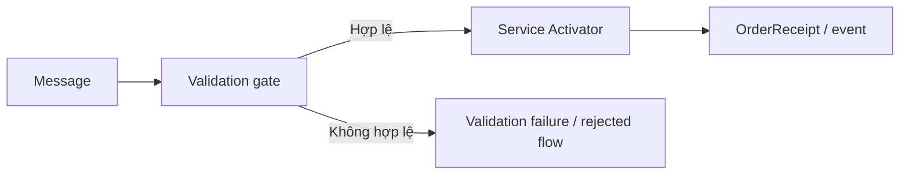
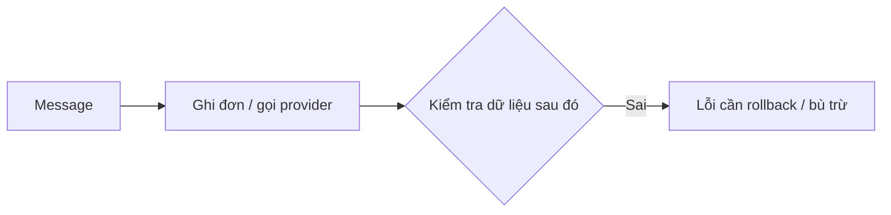
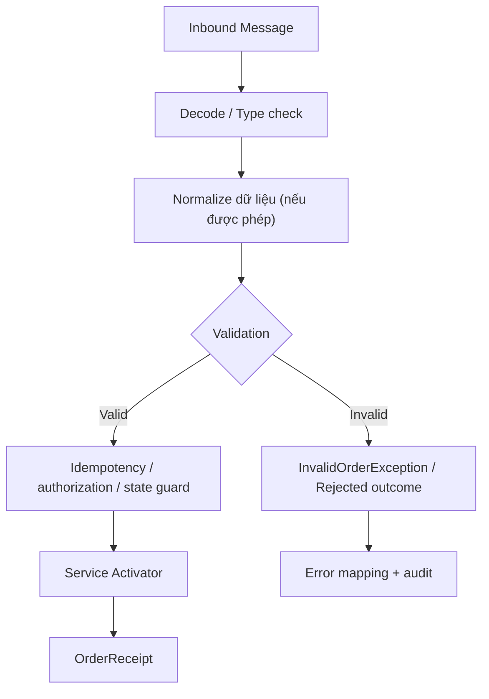
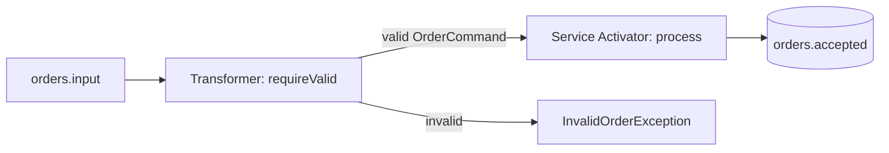
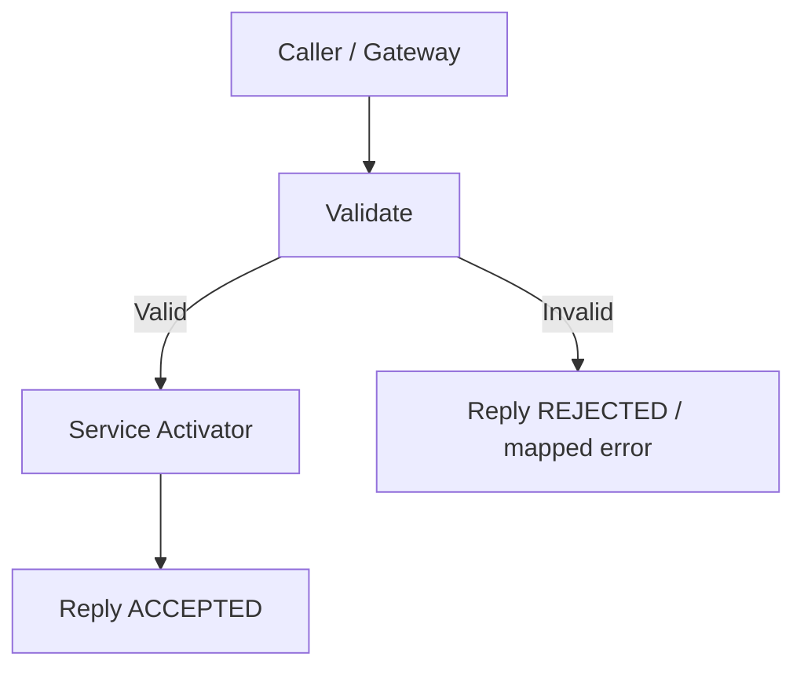
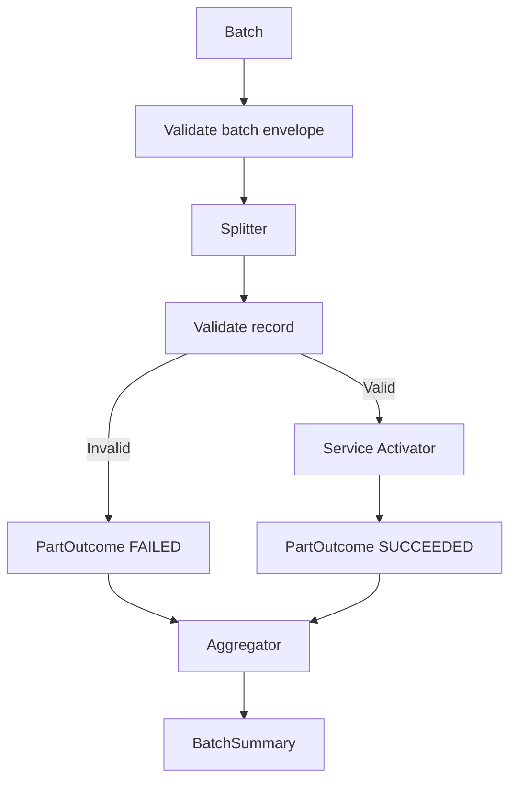

# Validation trước service activator trong Spring Integration

## Mục tiêu bài học

Một hệ thống nhận thông điệp đặt hàng từ API hoặc broker. Mỗi message mang mã đơn, mã khách hàng, số tiền và loại tiền tệ. Một `Service Activator` sẽ ghi đơn hàng vào cơ sở dữ liệu, giữ chỗ tồn kho hoặc gọi hệ thống thanh toán. Nếu message có `amount=-100`, `orderId=""` hoặc currency không được hỗ trợ mà vẫn tới handler, hệ thống có thể ghi trạng thái sai hoặc tạo side effect khó phục hồi.

Giải pháp là bố trí một **validation gate trước Service Activator**. Gate kiểm tra dữ liệu và chỉ cho message hợp lệ đi tiếp; message không hợp lệ được từ chối với lý do rõ ràng hoặc đưa sang luồng xử lý riêng. Đặt validation *trước* bước có side effect giúp tránh tạo một giao dịch rồi mới phát hiện payload không hợp lệ.

Bài thuộc chương **Message filter và validation** của module **SPRING_INTEGRATION_PATTERN**. Module hướng tới triển khai Enterprise Integration Patterns với Spring Integration để xây dựng luồng thông điệp ít phụ thuộc, dễ mở rộng; thực hành Router, Filter, Transformer, Splitter, Aggregator, Gateway, retry, error channel, correlation, kiểm thử và theo dõi từng nhánh xử lý.

Sau bài này, bạn có thể:

1. Phân biệt **schema validation**, **business validation**, **authorization**, **Filter** và **Service Activator**.
2. Tổ chức tuyến `input → validate → service activator → output` với Java DSL.
3. Kiểm thử rằng payload lỗi bị chặn **trước khi** handler tạo side effect.
4. Sử dụng Jakarta Bean Validation khi cần kiểm tra constraint trên DTO.
5. Biết khi nào nên dùng `.filter(...)` + `discardChannel` và khi nào nên trả lỗi validation chi tiết.
6. Truyền `correlationId` và thông tin truy vết qua validation, error flow và handler.
7. Thiết kế phản hồi nhất quán cho Gateway, broker, retry, batch/Splitter/Aggregator.
8. Tránh những lỗi thường gặp: nuốt exception, drop im lặng, kiểm tra sau khi commit, tin header client hoặc retry vô hạn dữ liệu sai.

---

## 1. Tại sao validation phải đứng trước Service Activator?

**Service Activator** là một endpoint gọi một phương thức/handler để thực hiện logic nghiệp vụ. Nó có thể trả một reply hoặc không; trong cả hai trường hợp, handler thường là nơi tạo **side effect**: ghi DB, gửi HTTP, phát event, cập nhật trạng thái.

Sơ đồ khuyến nghị:



Sơ đồ phản ví dụ:



Ở sơ đồ thứ hai, ngay cả khi phát hiện lỗi, một lời gọi HTTP đến nhà cung cấp hoặc email đã gửi có thể **không rollback được**. Validation sớm giúp giảm rủi ro, nhưng vẫn cần kiểm tra **business invariants** ngay tại service/transaction khi dữ liệu có thể thay đổi do concurrency.

### Quy tắc quan trọng

- **Validate trước side effect** đối với những điều kiện có thể kiểm tra từ input.
- **Không coi validation đầu flow là lớp bảo vệ cuối cùng** cho tồn kho, hạn mức, số dư hoặc quyền truy cập. Những điều kiện đó có thể thay đổi trước commit.
- **Không đánh đồng dữ liệu sai với lỗi hạ tầng tạm thời.** Dữ liệu sai không tự trở nên hợp lệ sau vài lần retry.
- **Không âm thầm drop request cần reply.** Nếu Gateway/HTTP caller đang đợi phản hồi, cần lỗi rõ hoặc kết quả từ chối, không phải timeout khó hiểu.

## 2. Phân biệt các bước kiểm tra

Một message có thể cần nhiều tầng kiểm tra:

| Tầng | Ví dụ | Thường đặt ở đâu? |
| --- | --- | --- |
| **Transport/schema** | JSON parse thất bại, thiếu field bắt buộc, payload không đúng kiểu | Inbound adapter/decoder |
| **Bean Validation** | `@NotBlank`, `@Positive`, `@Pattern` | Validation endpoint trước service |
| **Cross-field validation** | `currency=VND` nhưng amount precision không hợp lệ | Validator/policy thuần Java |
| **Business eligibility** | Đơn bị khóa, khách không thuộc chương trình | Filter hoặc policy service |
| **Authorization** | Người gọi có quyền tạo đơn cho tenant này? | Trust boundary trước handler và kiểm tra ở service |
| **Stateful invariant** | Còn tồn kho/hạn mức tại lúc commit? | Service + DB transaction/locking |
| **Idempotency** | Command này đã được thực hiện chưa? | Idempotent receiver/ledger trước side effect |
| **Output validation** | Reply chứa mã trạng thái/định dạng đúng | Sau handler hoặc tại adapter outbound |

Một validation gate có thể giải quyết phần lớn **input validation**, nhưng không thể thay thế mọi tầng.

### Filter khác Validator thế nào?

| Khía cạnh | Message Filter | Validator/validation stage |
| --- | --- | --- |
| Câu hỏi chính | “Message này có được đi tiếp không?” | “Payload có hợp đồng hợp lệ và nếu không, sai ở đâu?” |
| Kết quả điển hình | `true/false` | Danh sách lỗi, exception hoặc kết quả typed |
| Nguyên nhân loại | Có thể không có lý do chi tiết | Có thể trả mã lỗi/field path |
| Luồng sai | Discard, throw hoặc drop | Rejected response/error/quarantine |
| Trường hợp phù hợp | Không thuộc đối tượng, không đạt predicate đơn giản | Ràng buộc dữ liệu, field và cross-field |
| Rủi ro | Drop im lặng gây timeout hoặc mất phần Aggregator | Exception chưa được map về reply ở async boundary |

Trong Spring Integration, **Filter** có thể được dùng để triển khai một rule validation đơn giản. Nhưng khi muốn trả *nhiều lỗi có vị trí trường*, một **validation stage riêng** thường dễ kiểm thử và giải thích hơn.

## 3. Một hợp đồng input cụ thể

Giả sử ứng dụng nhận:

```json
{
  "orderId": "ORD-101",
  "customerId": "CUST-42",
  "amount": 125000,
  "currency": "VND"
}
```

Ta định nghĩa các ràng buộc minh họa:

1. `orderId` không rỗng và đúng mẫu `[A-Za-z0-9_-]+`.
2. `customerId` không rỗng và đúng mẫu tương tự.
3. `amount` phải tồn tại và lớn hơn 0.
4. `currency` phải là `VND` hoặc `USD`.
5. Quy tắc độ chính xác đơn vị tiền tệ cần được triển khai theo hợp đồng nếu có (ví dụ `VND` không nhận phần lẻ trong bài thực hành).
6. Header `traceId` dùng truy vết, không được dùng để quyết định người gọi có quyền hay không.

Một bảng quyết định:

| Input | Hợp lệ? | Mã lỗi gợi ý |
| --- | --- | --- |
| `ORD-101, CUST-42, 125000, VND` | Có | — |
| `"", CUST-42, 125000, VND` | Không | `ORDER_ID_REQUIRED` |
| `ORD-101, "", 125000, VND` | Không | `CUSTOMER_ID_REQUIRED` |
| `ORD-101, CUST-42, -100, VND` | Không | `AMOUNT_NOT_POSITIVE` |
| `ORD-101, CUST-42, null, VND` | Không | `AMOUNT_REQUIRED` |
| `ORD-101, CUST-42, 125000, EUR` | Không | `UNSUPPORTED_CURRENCY` |
| `ORD!101, CUST-42, 125000, VND` | Không | `ORDER_ID_INVALID_FORMAT` |

Bảng này là chính sách **của bài thực hành**, không phải tiêu chuẩn thanh toán chung. Khi xây hệ thống thật cần phân biệt loại tiền, minor unit, rounding, kích thước trường và yêu cầu nghiệp vụ.

## 4. Lộ trình input trước khi gọi handler



Có hai loại “validate trước” cần phân biệt:

- **Kiểm tra tĩnh**: payload đã đúng schema/ràng buộc cơ bản chưa? Thực hiện trước khi service chạy.
- **Kiểm tra trạng thái**: khách còn quyền, đơn có bị xử lý lại, tồn kho có đủ trong DB không? Nên kiểm tra tại nơi commit, thường là Service Activator/service transaction, để không gặp race kiểu **time-of-check/time-of-use**.

Nếu normalize (ví dụ trim whitespace, uppercase currency), phải nêu rõ hợp đồng. Không tự động trim dữ liệu mà khoảng trắng có ý nghĩa như chữ ký hoặc fixed-width record.

## 5. Mô hình lỗi validation có cấu trúc

Thay vì chỉ ném `IllegalArgumentException("Bad input")`, tạo đối tượng lỗi định danh trường và mã.

```java
public record FieldViolation(
    String field,
    String code
) {}
```

Ví dụ danh sách lỗi:

```json
{
  "code": "INVALID_ORDER",
  "violations": [
    {"field": "orderId", "code": "ORDER_ID_REQUIRED"},
    {"field": "amount", "code": "AMOUNT_NOT_POSITIVE"}
  ]
}
```

Ưu điểm:

- Client có thể sửa nhiều field trong một lần.
- Log/metric có thể nhóm theo mã lỗi ít cardinality.
- Có thể bản địa hóa thông điệp người dùng mà không đổi error code.
- Test có thể assert trên cấu trúc thay vì phụ thuộc chuỗi message.
- Không cần đưa nguyên nội dung người dùng gửi vào exception/log.

**Đừng tự động trả stack trace, SQL message hoặc thông tin nhạy cảm** ra bên ngoài. Thông điệp lỗi đối ngoại khác chi tiết nội bộ trong log/audit.

## 6. Demo Java DSL: validate → Service Activator

Chúng ta sẽ dùng Java 17 và Spring Integration Java DSL. Cấu hình gồm:

- `orders.input`: nhận `OrderCommand`.
- **Validation stage**: một Transformer trả lại payload đã qua kiểm tra hoặc ném `InvalidOrderException`.
- **Service Activator**: chỉ xử lý payload đã qua validator, trả `OrderReceipt`.
- `orders.accepted`: `QueueChannel` để test đọc reply.
- `OrderService.calls()`: bộ đếm phục vụ kiểm thử **handler không chạy khi invalid**.



### Ví dụ cấu hình đầy đủ

```java
import java.math.BigDecimal;
import java.util.ArrayList;
import java.util.List;
import java.util.Set;
import java.util.concurrent.atomic.AtomicInteger;
import java.util.regex.Pattern;

import org.springframework.context.annotation.Bean;
import org.springframework.context.annotation.Configuration;
import org.springframework.integration.channel.DirectChannel;
import org.springframework.integration.channel.QueueChannel;
import org.springframework.integration.config.EnableIntegration;
import org.springframework.integration.dsl.IntegrationFlow;
import org.springframework.messaging.MessageChannel;
import org.springframework.messaging.PollableChannel;

@Configuration
@EnableIntegration
public class OrderIngressValidationConfig {

    public record OrderCommand(
        String orderId,
        String customerId,
        BigDecimal amount,
        String currency
    ) {}

    public record OrderReceipt(
        String orderId,
        String status
    ) {}

    public record FieldViolation(
        String field,
        String code
    ) {}

    public static final class InvalidOrderException
            extends RuntimeException {

        private final List<FieldViolation> violations;

        public InvalidOrderException(
            List<FieldViolation> violations
        ) {
            super("INVALID_ORDER");
            this.violations = List.copyOf(violations);
        }

        public List<FieldViolation> violations() {
            return violations;
        }
    }

    public static final class OrderGuard {

        private static final Pattern SAFE_ID =
            Pattern.compile("[A-Za-z0-9_-]+");

        private static boolean validId(String value) {
            return value != null
                && SAFE_ID.matcher(value).matches();
        }

        public OrderCommand requireValid(OrderCommand order) {
            List<FieldViolation> errors = new ArrayList<>();

            if (order == null) {
                throw new InvalidOrderException(
                    List.of(new FieldViolation(
                        "payload", "PAYLOAD_REQUIRED")));
            }

            if (order.orderId() == null
                    || order.orderId().isBlank()) {
                errors.add(new FieldViolation(
                    "orderId", "ORDER_ID_REQUIRED"));
            } else if (!validId(order.orderId())) {
                errors.add(new FieldViolation(
                    "orderId", "ORDER_ID_INVALID_FORMAT"));
            }

            if (order.customerId() == null
                    || order.customerId().isBlank()) {
                errors.add(new FieldViolation(
                    "customerId", "CUSTOMER_ID_REQUIRED"));
            } else if (!validId(order.customerId())) {
                errors.add(new FieldViolation(
                    "customerId", "CUSTOMER_ID_INVALID_FORMAT"));
            }

            if (order.amount() == null) {
                errors.add(new FieldViolation(
                    "amount", "AMOUNT_REQUIRED"));
            } else if (order.amount()
                    .compareTo(BigDecimal.ZERO) <= 0) {
                errors.add(new FieldViolation(
                    "amount", "AMOUNT_NOT_POSITIVE"));
            }

            if (order.currency() == null
                    || order.currency().isBlank()) {
                errors.add(new FieldViolation(
                    "currency", "CURRENCY_REQUIRED"));
            } else if (!Set.of("VND", "USD")
                    .contains(order.currency())) {
                errors.add(new FieldViolation(
                    "currency", "UNSUPPORTED_CURRENCY"));
            }

            if (!errors.isEmpty()) {
                throw new InvalidOrderException(errors);
            }

            return order;
        }
    }

    public static final class OrderService {
        private final AtomicInteger invocations =
            new AtomicInteger();

        public OrderReceipt process(OrderCommand order) {
            invocations.incrementAndGet();

            // Demo: không ghi DB và không gọi HTTP thật.
            return new OrderReceipt(
                order.orderId(), "ACCEPTED");
        }

        public int calls() {
            return invocations.get();
        }
    }

    @Bean
    OrderGuard orderGuard() {
        return new OrderGuard();
    }

    @Bean
    OrderService orderService() {
        return new OrderService();
    }

    @Bean("orders.input")
    MessageChannel input() {
        return new DirectChannel();
    }

    @Bean("orders.accepted")
    PollableChannel accepted() {
        // Test sink; chưa có consumer nền.
        return new QueueChannel();
    }

    @Bean
    IntegrationFlow validatedOrderFlow(
        OrderGuard guard,
        OrderService service
    ) {
        return IntegrationFlow.from("orders.input")
            // Stage 1: validate, trả lại OrderCommand.
            .transform(OrderCommand.class, guard::requireValid)

            // Stage 2: Service Activator có thể tạo side effect.
            .handle(OrderCommand.class,
                (order, headers) -> service.process(order))

            // Stage 3: reply để kiểm thử.
            .channel("orders.accepted")
            .get();
    }
}
```

### Vì sao dùng Transformer làm validation gate?

Trong flow trên, `.transform(OrderCommand.class, guard::requireValid)` gọi một hàm Java:

- Khi hợp lệ, **trả về cùng payload** để tiếp tục.
- Khi không hợp lệ, **ném exception**. Service Activator ở sau **không được gọi**.
- Framework xử lý message mới từ kết quả Transformer, có cơ chế truyền các header liên quan khi dùng DSL theo mẫu này.
- Validation không tạo đơn hàng, không gọi payment API và không có side effect nghiệp vụ.

Điều này khác với `.filter(...)` vốn chủ yếu quyết định **accept/reject** bằng boolean. Dùng Transformer không phải vì cần thay đổi hình dạng dữ liệu, mà vì ta muốn **đưa validation có lỗi chi tiết vào một stage riêng có thể test**.

### Lưu ý ngữ nghĩa synchronous

Ví dụ dùng `DirectChannel`, nên lỗi từ validation có thể **truyền ngược tới lời gọi `send(...)`**. Không khẳng định exception tự được chuyển tới `errorChannel` nếu chưa cấu hình cơ chế error handling phù hợp.

Trong các luồng poller, executor hoặc broker, exception thường xuất hiện tại thread xử lý tương ứng; cần cấu hình nơi chuyển lỗi, retry/ack và quarantine riêng.

## 7. Kiểm thử tích hợp: invalid không được chạm tới Service Activator

Đây là kiểm thử trọng tâm. Không chỉ assert message bị reject; cần assert **handler không có side effect**.

```java
import static org.assertj.core.api.Assertions.assertThat;
import static org.assertj.core.api.Assertions.assertThatThrownBy;

import java.math.BigDecimal;

import org.junit.jupiter.api.Test;
import org.springframework.beans.factory.annotation.Autowired;
import org.springframework.beans.factory.annotation.Qualifier;
import org.springframework.messaging.Message;
import org.springframework.messaging.MessageChannel;
import org.springframework.messaging.PollableChannel;
import org.springframework.messaging.support.MessageBuilder;
import org.springframework.test.annotation.DirtiesContext;
import org.springframework.test.context.junit.jupiter.SpringJUnitConfig;

@SpringJUnitConfig(OrderIngressValidationConfig.class)
@DirtiesContext(
    classMode = DirtiesContext.ClassMode.AFTER_EACH_TEST_METHOD)
class OrderValidationFlowTest {

    @Autowired
    @Qualifier("orders.input")
    MessageChannel input;

    @Autowired
    @Qualifier("orders.accepted")
    PollableChannel accepted;

    @Autowired
    OrderIngressValidationConfig.OrderService service;

    private OrderIngressValidationConfig.OrderCommand order(
        String orderId, BigDecimal amount, String currency
    ) {
        return new OrderIngressValidationConfig.OrderCommand(
            orderId, "CUST-42", amount, currency);
    }

    @Test
    void validMessageReachesServiceExactlyOnceInThisFlow() {
        var command = order(
            "ORD-101", new BigDecimal("125000"), "VND");

        assertThat(input.send(
            MessageBuilder.withPayload(command)
                .setHeader("traceId", "trace-101")
                .setHeader("sourceId", "api-order")
                .build()
        )).isTrue();

        Message<?> reply = accepted.receive(2_000);

        assertThat(reply).isNotNull();
        assertThat(reply.getPayload()).isEqualTo(
            new OrderIngressValidationConfig.OrderReceipt(
                "ORD-101", "ACCEPTED"));

        assertThat(service.calls()).isEqualTo(1);
        assertThat(accepted.receive(0)).isNull();

        // Header truyền qua các endpoint để truy vết.
        assertThat(reply.getHeaders().get("traceId"))
            .isEqualTo("trace-101");
    }

    @Test
    void invalidOrderIdNeverCallsService() {
        var command = order(
            "", new BigDecimal("100"), "VND");

        assertThatThrownBy(() ->
            input.send(MessageBuilder.withPayload(command).build()))
            .isInstanceOf(RuntimeException.class);

        assertThat(service.calls()).isZero();
        assertThat(accepted.receive(0)).isNull();
    }

    @Test
    void nonPositiveAmountNeverCallsService() {
        var command = order(
            "ORD-102", new BigDecimal("-1"), "VND");

        assertThatThrownBy(() ->
            input.send(MessageBuilder.withPayload(command).build()))
            .isInstanceOf(RuntimeException.class);

        assertThat(service.calls()).isZero();
        assertThat(accepted.receive(0)).isNull();
    }

    @Test
    void unsupportedCurrencyNeverCallsService() {
        var command = order(
            "ORD-103", new BigDecimal("50"), "EUR");

        assertThatThrownBy(() ->
            input.send(MessageBuilder.withPayload(command).build()))
            .isInstanceOf(RuntimeException.class);

        assertThat(service.calls()).isZero();
        assertThat(accepted.receive(0)).isNull();
    }

    @Test
    void twoDifferentValidMessagesAreBothProcessed() {
        var first = order(
            "ORD-201", new BigDecimal("10"), "USD");
        var second = order(
            "ORD-202", new BigDecimal("20"), "USD");

        assertThat(input.send(
            MessageBuilder.withPayload(first).build())).isTrue();
        assertThat(input.send(
            MessageBuilder.withPayload(second).build())).isTrue();

        assertThat(accepted.receive(2_000)).isNotNull();
        assertThat(accepted.receive(2_000)).isNotNull();
        assertThat(service.calls()).isEqualTo(2);
        assertThat(accepted.receive(0)).isNull();
    }
}
```

**Phạm vi kết luận:** với Spring context này, invalid payload bị chặn trước Service Activator; valid payload đi qua một lượt. Test **không chứng minh exactly-once** khi có broker redelivery hay retry; `OrderService` chỉ tăng counter và tạo DTO, chưa thực hiện commit nghiệp vụ.

`@DirtiesContext` ở đây giúp cô lập bộ đếm và queue giữa các test. Đây là một lựa chọn test, không phải yêu cầu cho ứng dụng thật.

### Unit test trực tiếp validator

Không cần khởi động Spring context để kiểm tra từng rule:

```java
import static org.assertj.core.api.Assertions.assertThat;
import static org.assertj.core.api.Assertions.assertThatThrownBy;

import java.math.BigDecimal;

import org.junit.jupiter.api.Test;

class OrderGuardTest {

    private final OrderIngressValidationConfig.OrderGuard guard =
        new OrderIngressValidationConfig.OrderGuard();

    @Test
    void returnsSameCommandWhenValid() {
        var order = new OrderIngressValidationConfig.OrderCommand(
            "ORD-1", "CUST-1",
            new BigDecimal("100"), "VND");

        assertThat(guard.requireValid(order)).isSameAs(order);
    }

    @Test
    void reportsMultipleFieldViolations() {
        var order = new OrderIngressValidationConfig.OrderCommand(
            "", "", new BigDecimal("-100"), "XYZ");

        assertThatThrownBy(() -> guard.requireValid(order))
            .isInstanceOf(
                OrderIngressValidationConfig.InvalidOrderException.class)
            .satisfies(error -> {
                var violations =
                    ((OrderIngressValidationConfig.InvalidOrderException)
                        error).violations();

                assertThat(violations)
                    .extracting(
                        OrderIngressValidationConfig.FieldViolation::code)
                    .containsExactly(
                        "ORDER_ID_REQUIRED",
                        "CUSTOMER_ID_REQUIRED",
                        "AMOUNT_NOT_POSITIVE",
                        "UNSUPPORTED_CURRENCY");
            });
    }

    @Test
    void nullAmountIsReportedWithoutNullPointerException() {
        var order = new OrderIngressValidationConfig.OrderCommand(
            "ORD-2", "CUST-2", null, "VND");

        assertThatThrownBy(() -> guard.requireValid(order))
            .isInstanceOf(
                OrderIngressValidationConfig.InvalidOrderException.class);
    }
}
```

Unit test giúp phát hiện lỗi rule nhanh; integration test xác minh **thứ tự endpoint** và việc Service Activator không bị gọi.

## 8. Lựa chọn khác: Message Filter trước Service Activator

Khi chỉ cần một predicate đơn giản, Filter ngắn gọn:

```java
import java.math.BigDecimal;

import org.springframework.context.annotation.Bean;
import org.springframework.integration.dsl.IntegrationFlow;

@Bean
IntegrationFlow filterBeforeService(
    OrderIngressValidationConfig.OrderService service
) {
    return IntegrationFlow.from("orders.filter.input")
        .filter(
            OrderIngressValidationConfig.OrderCommand.class,
            order -> order.amount() != null
                && order.amount().compareTo(BigDecimal.ZERO) > 0,
            endpoint -> endpoint
                .discardChannel("orders.filter.rejected"))
        .handle(
            OrderIngressValidationConfig.OrderCommand.class,
            (order, headers) -> service.process(order))
        .channel("orders.filter.accepted")
        .get();
}
```

Đây là **đoạn cấu hình thay thế**; các channel `orders.filter.input`, `orders.filter.rejected` và `orders.filter.accepted` cần được khai báo. Không đăng ký hai flow cùng đích input để mong cả hai cùng nhận message: trên `DirectChannel`, nhiều subscriber có thể được dispatcher chọn theo cơ chế của channel, không tự broadcast.

### Điều gì được gửi tới discard channel?

Với `MessageFilter`, khi predicate trả `false` và có `discardChannel`, message bị loại được gửi theo đường discard. **Message bị discard không tự chứa danh sách lỗi field** nếu predicate chỉ trả boolean.

Bạn có thể:

- Dùng predicate để kiểm tra rule rõ ràng, thống kê số lần reject.
- Chuyển message reject sang flow gắn `reasonCode`/quarantine dựa trên chính sách.
- Dùng validation stage ở mục 6 nếu cần danh sách lỗi chi tiết.
- Với các request cần reply, thiết kế đường trả `ValidationRejected` thay vì chỉ đưa vào QueueChannel không có consumer.

### `throwExceptionOnRejection`

Một lựa chọn khác:

```java
.filter(
    OrderIngressValidationConfig.OrderCommand.class,
    order -> order.amount() != null
        && order.amount().signum() > 0,
    spec -> spec.throwExceptionOnRejection(true))
```

Khi predicate `false`, Filter ném `MessageRejectedException` theo chính sách cấu hình. Với flow đồng bộ, caller có thể nhận exception; với flow bất đồng bộ, nó được xử lý theo error mechanism của endpoint/adapter.

**Không cấu hình `throwExceptionOnRejection(true)` chỉ vì muốn “nhìn thấy lỗi”** mà chưa quyết định cách chuyển exception thành response/DLQ ở ranh giới tương ứng.

## 9. Filter, Validator và Router: chọn đúng pattern

| Yêu cầu | Pattern/cấu trúc phù hợp |
| --- | --- |
| Bỏ những message không thuộc loại cần xử lý | Filter |
| Kiểm tra dữ liệu đơn giản, invalid có thể discard | Filter + discard channel |
| Cần trả nhiều field errors | Validation stage + typed exception/outcome |
| Invalid đi sang nhánh sửa lỗi hoặc quarantine | Validation outcome + Router |
| Chọn nhánh theo loại đơn hợp lệ | Router **sau validation** |
| Thay đổi payload input thành DTO chuẩn | Transformer/normalizer rồi Validator |
| Gọi nghiệp vụ có side effect | Service Activator **sau validation** |
| Bảo vệ state bất biến tại commit | Service transaction/DB constraint |
| Chặn command trùng | Idempotent receiver/ledger, không phải schema validator |

### Tại sao Router nên đứng sau validation?

Nếu một payload sai/malicious có `currency="ADMIN"` hoặc header `tenantId` giả, một Router chạy trước validation có thể gửi message tới nhánh không phù hợp. Ở ranh giới không đáng tin, cần xác thực dữ liệu dùng làm điều kiện route trước.

Điều này không có nghĩa **mọi Router** phải đứng sau tất cả bước kiểm tra: một ingress Router có thể chọn decoder theo content type đáng tin. Nhưng routing có tác động quyền/tài nguyên cần dữ liệu đã được validate và xác thực.

## 10. Jakarta Bean Validation thay cho rule thủ công

Ví dụ mục 6 không cần dependency Bean Validation nên dễ thử. Trong ứng dụng thực, có thể khai báo constraint Jakarta trên DTO.

```java
import java.math.BigDecimal;

import jakarta.validation.constraints.NotBlank;
import jakarta.validation.constraints.NotNull;
import jakarta.validation.constraints.Pattern;
import jakarta.validation.constraints.Positive;

public record ValidatedOrder(
    @NotBlank String orderId,
    @NotBlank String customerId,
    @NotNull @Positive BigDecimal amount,
    @NotBlank @Pattern(regexp = "VND|USD") String currency
) {}
```

Một gate tái sử dụng `jakarta.validation.Validator`:

```java
import java.util.Set;

import jakarta.validation.ConstraintViolation;
import jakarta.validation.ConstraintViolationException;
import jakarta.validation.Validator;

public final class BeanValidationGuard {

    private final Validator validator;

    public BeanValidationGuard(Validator validator) {
        this.validator = validator;
    }

    public ValidatedOrder requireValid(ValidatedOrder order) {
        if (order == null) {
            throw new IllegalArgumentException("NULL_ORDER");
        }

        Set<ConstraintViolation<ValidatedOrder>> errors =
            validator.validate(order);

        if (!errors.isEmpty()) {
            throw new ConstraintViolationException(errors);
        }

        return order;
    }
}
```

Có thể dùng trong flow theo cùng mẫu:

```java
.transform(
    ValidatedOrder.class,
    beanValidationGuard::requireValid)
.handle(
    ValidatedOrder.class,
    (order, headers) -> orderService.processValidated(order))
```

Đây là **đoạn tích hợp minh họa**, cần cung cấp bean `Validator`, `BeanValidationGuard` và service tương ứng. Nếu dùng Spring Boot, dependency như `spring-boot-starter-validation` thường cung cấp provider phù hợp; trong ứng dụng không dùng Boot, có thể cấu hình `LocalValidatorFactoryBean` và Jakarta Validation provider.

### Những điều Bean Validation không tự làm

- Không tự tạo authorization policy theo tenant.
- Không tự đảm bảo `@Valid` trên một DTO sẽ được áp dụng tại mọi Spring Integration endpoint.
- Không tự đảm bảo số dư/tồn kho còn đúng ở thời điểm commit.
- Không tự mapping `ConstraintViolationException` thành HTTP response hoặc broker rejection.
- Không xác định idempotency key hoặc xử lý redelivery.
- Không sửa lỗi dữ liệu sau khi payload đã vào handler.

**Phải gọi validation thực sự** trong flow hoặc sử dụng cơ chế Method Validation được cấu hình và kiểm thử. Việc chỉ đặt annotation `@NotBlank` trên record không đủ bằng chứng handler sẽ tự từ chối message sai.

### Khi nào cần validation groups?

Một DTO được dùng cho CREATE và UPDATE có thể có ràng buộc khác nhau:

- CREATE: `orderId` có thể được server sinh, nhưng `customerId` bắt buộc.
- UPDATE: `orderId` bắt buộc, các field có thể là patch.
- CANCEL: không nhất thiết có amount.

Có thể dùng Jakarta Validation groups hoặc tách DTO theo command. Tách DTO thường giúp tránh một class quá nhiều rule phụ thuộc trạng thái.

## 11. Cross-field validation và chuẩn hóa dữ liệu

Các annotation trên một field không đủ cho mọi ràng buộc. Ví dụ:

- `currency=VND` nhưng amount có phần lẻ.
- `deliveryMode=PICKUP` nhưng lại có phí giao hàng.
- `startAt > endAt`.
- Một field chỉ bắt buộc khi field khác có giá trị nhất định.

Một hàm kiểm tra cross-field:

```java
import java.math.BigDecimal;

static boolean validMoney(
    BigDecimal amount,
    String currency
) {
    if (amount == null || currency == null
            || amount.signum() <= 0) {
        return false;
    }

    if ("VND".equals(currency)) {
        return amount.stripTrailingZeros().scale() <= 0;
    }

    if ("USD".equals(currency)) {
        return amount.scale() <= 2;
    }

    return false;
}
```

Chính sách trên là **ví dụ giản lược**; không dùng thay quy tắc money/minor-unit của mọi hệ thống. Trong thực tế, nên định nghĩa amount theo `Money` value object hoặc integer minor units đã được chuẩn hóa, cùng policy rounding rõ.

### Normalize trước hay sau validate?

Một pipeline minh bạch:

```text
Raw Input
  -> Structural validation
  -> Normalize theo hợp đồng (nếu cho phép)
  -> Business input validation
  -> Service Activator
```

Ví dụ currency `"usd"` có được chuyển thành `"USD"` không là quyết định contract, không phải chi tiết ngẫu nhiên của code.

Nếu cần lưu bằng chứng gốc, giữ raw input trong vùng audit được bảo vệ và chỉ đưa DTO đã chuẩn hóa tới Service Activator.

## 12. Error channel không thay thế rejected/discard channel

Trong Spring Integration có các khái niệm khác nhau:

| Đường xử lý | Khi nào dùng | Payload thường liên quan |
| --- | --- | --- |
| `discardChannel` của Message Filter | Predicate không chấp nhận message | Message bị loại |
| Exception từ Validator | Rule thất bại khi xử lý | Cause như `InvalidOrderException` |
| `errorChannel` | Xử lý lỗi endpoint/adapter khi được cấu hình | `ErrorMessage` chứa Throwable |
| Dead-letter/quarantine | Dữ liệu không thể xử lý tự động | Payload/metadata có kiểm soát, lý do reject |
| Business rejection output | Validation thất bại nhưng giao thức cần reply | `ValidationRejected`/`OrderRejected` |

**Không giả định mọi exception đều tự đi vào `errorChannel`.**

### Flow đồng bộ

```text
Caller
  -> DirectChannel
     -> Validation Transformer throws
        -> exception propagates to Caller
```

Với caller trực tiếp, exception có thể được wrap trong một `MessagingException`. Test nên kiểm tra handler chưa chạy và tìm nguyên nhân gốc theo cơ chế cụ thể, thay vì giả định luôn nhận cùng exception type ở cấp trên cùng.

### Flow bất đồng bộ

```text
Broker / Poller / Executor
  -> Worker thread
     -> Validation fails
        -> error flow / retry / nack / DLQ
```

Phải xác định adapter, executor, poller và error channel cụ thể. Một số cấu hình chuyển lỗi thành `ErrorMessage`, số khác truyền exception tới error handler/adapter; không có một quy tắc duy nhất cho mọi topology.

### Khi cần phản hồi lỗi có cấu trúc

Ở một HTTP/Gateway boundary, có thể mapping:

```json
{
  "requestId": "REQ-42",
  "status": "REJECTED",
  "errorCode": "INVALID_ORDER",
  "violations": [
    {"field": "amount", "code": "AMOUNT_NOT_POSITIVE"}
  ]
}
```

Trả response này cần một **error handling/mapping component** phù hợp với adapter. Nó **không tự sinh ra** chỉ vì Validation Transformer ném `InvalidOrderException`.

## 13. Tránh làm Gateway timeout khi validation thất bại

Một `@MessagingGateway` hoặc HTTP caller có thể chờ reply:



Nếu dùng:

```java
.filter(OrderCommand.class, OrderValidationPolicy::isValid)
```

mà mặc định bỏ message sai **không có reply**, Gateway có thể đợi đến timeout. Trong khi đó, client thật sự chỉ cần biết field nào bị sai.

Có hai lựa chọn:

**A. Fail fast bằng exception:** validation stage ném `InvalidOrderException`. Gateway/adapter map exception thành lỗi hợp đồng.

**B. Explicit outcome:** validator luôn trả một `ValidationOutcome` rồi Router chuyển sang nhánh accepted/rejected; cả hai nhánh đều tạo reply rõ.

Ví dụ contract outcome:

```java
public record ValidationOutcome<T>(
    T value,
    java.util.List<String> errorCodes
) {
    public boolean valid() {
        return errorCodes.isEmpty();
    }
}
```

Với outcome, cần định nghĩa rõ:

- Khi valid, gọi Service Activator trên `value`.
- Khi invalid, không gọi service; tạo `OrderRejected`.
- Nhánh nào có replyChannel/returnAddress tới caller.
- Không phát **cả success và error reply** cho cùng request.
- Với processing không đồng bộ, trả acknowledgment hay kết quả terminal vào lúc nào.

**Chọn một hợp đồng rõ** thay vì cho message lỗi lặng lẽ biến mất.

## 14. Broker, retry và dữ liệu sai cố định

Một broker thường hỗ trợ redelivery khi consumer lỗi hoặc không ACK. Nếu payload sai format vĩnh viễn:

```text
Receive invalid order
-> Validation fails
-> NACK/retry
-> Receive same invalid order
-> Validation fails again
-> ...
```

Đó là **poison message loop**. Những bản giao lại giống nhau không tự làm `amount=-1` thành hợp lệ.

### Phân loại lỗi

| Loại | Ví dụ | Hành động thường phù hợp |
| --- | --- | --- |
| Permanent validation | Thiếu orderId, amount âm | Reject/DLQ/quarantine, không retry vô hạn |
| Unauthorized | Tenant/service không có quyền | Deny/audit; không tự retry như lỗi transient |
| Schema mismatch | Producer gửi version không tương thích | Quarantine/contract fix |
| Transient infrastructure | DB timeout, network unavailable | Retry có giới hạn/backoff |
| Concurrency conflict | Optimistic locking thất bại | Retry có điều kiện/reload state |
| Unknown provider result | Đã gửi payment nhưng mất response | Reconcile/idempotency, không retry mù |

### Vị trí đặt RetryAdvice

Nếu RetryAdvice bao quanh cả Validation Transformer, một payload sai có thể bị validate **nhiều lần vô ích**. Có thể:

1. Validate **trước** bước bắt đầu retry hạ tầng.
2. Chỉ retry phần Service Activator cần thiết.
3. Phân loại exception để không retry `InvalidOrderException`.
4. Bảo đảm side effect của handler idempotent khi retry.

Trong flow thực, thứ tự advice/transaction và boundary phụ thuộc endpoint. Viết integration test với retry policy thật thay vì suy đoán thứ tự interceptor.

## 15. Authorization không phải kiểm tra format của tenantId

Giả sử message có:

```text
headers.tenantId = "shop-b"
payload.orderId  = "ORD-42"
```

Kiểm tra `tenantId` có dạng chữ số/chữ cái **không chứng minh** người gửi thuộc tenant B. Validation gate về cấu trúc và **authorization** có trách nhiệm khác nhau.

- Tenant identity phải đến từ principal/service identity đã được xác thực.
- Payload và headers từ client là input không đáng tin.
- Có thể đối chiếu tenant trong payload với identity đáng tin.
- Nếu dùng header đã được server xác thực và gắn tại ingress, nên chỉ rõ nguồn gốc.
- Service vẫn kiểm tra quyền đối với đối tượng hoặc thao tác nhạy cảm tại transaction boundary.

### Ví dụ policy

```java
public record VerifiedPrincipal(
    String subject,
    String tenantId
) {}

static boolean allowedForTenant(
    VerifiedPrincipal actor,
    String targetTenant
) {
    return actor != null
        && actor.tenantId() != null
        && actor.tenantId().equals(targetTenant);
}
```

Đây chỉ là **policy minh họa**; không được tạo `VerifiedPrincipal` từ một JSON client tự khai rồi xem nó đã xác thực.

### Ranh giới async

`SecurityContextHolder` dạng thread-local có thể không tự được truyền qua Kafka listener/poller/executor. Khi xử lý async, phải thiết kế service identity hoặc ngữ cảnh đã được xác minh tại consumer; không dựa vào việc “thread trước đã đăng nhập”.

## 16. Validation và idempotent receiver: thứ tự ảnh hưởng kết quả

Một command có thể được broker giao lại. Hãy phân biệt:

- **Validation:** command có format và business input hợp lệ?
- **Idempotency:** command logic này đã được commit chưa?
- **Service processing:** cần thực hiện tác động hay trả cached result?

Nếu idempotency selector **ghi dấu key trước validator**, một command sai có thể chiếm khóa. Lần gửi lại đã sửa nội dung nhưng vẫn dùng key cũ có thể bị coi là duplicate; đây có thể là đúng hoặc sai tùy hợp đồng.

Một tuyến thường hợp lý:

```text
Decode
  -> Authenticate/authorize
  -> Validate schema + canonical fields
  -> Compute stable idempotency key and fingerprint
  -> Business ledger (new/in-progress/completed/conflict)
  -> Service Activator
  -> Commit effect + result
```

**Lưu ý:** Idempotent Receiver ở tầng message có thể claim key *trước handler commit*. Nó không tự bảo đảm transaction với business write. Khi cần “cùng command không tạo hai tác động”, dùng ledger/unique constraint/idempotent external API.

### Retry một command đã sửa payload

Hai request cùng idempotency key nhưng amount khác:

```text
KEY=CAP-42 amount=125000
KEY=CAP-42 amount=999000
```

Dù cả hai **pass schema validation**, đây có thể là **idempotency key conflict**. Không cho việc “pass validator” biến chúng thành hai lệnh thu tiền hợp lệ với cùng key.

## 17. Validation trước Splitter, Filter và Aggregator

### Validation trước Splitter

Khi input là một batch chứa nhiều dòng/record:

1. Validate **batch envelope**: source ID, charset, giới hạn số record, business tenant.
2. Split thành phần tử.
3. Validate **từng phần tử** trước Service Activator per-record.
4. Phát `PartOutcome` cho mọi phần nếu Aggregator chờ summary.



### Bẫy: Filter discard làm Aggregator chờ mãi

```text
Splitter sinh N=3, sequenceSize=3.
Part #1 -> accepted.
Part #2 -> invalid, Filter discard không tạo outcome.
Part #3 -> accepted.

Aggregator nhận 2/3.
```

Nếu release strategy dựa vào `sequenceSize=3`, group có thể không bao giờ hoàn tất. Cách giải quyết:

- Validate/lọc **trước Splitter** nếu policy cho phép loại phần khỏi count.
- Hoặc chuyển invalid part thành `PartOutcome(status=FAILED hoặc SKIPPED)` giữ correlation/sequence để Aggregator nhận đủ.
- Hoặc custom release/timeout policy thể hiện rõ số phần được kỳ vọng.

Không sửa lẻ `sequenceSize` trên từng message sau khi đã split.

### Router sau validation

Sau khi record hợp lệ, Router có thể chọn handler `STANDARD` hoặc `REVIEW`. Các record invalid được đưa sang quarantine/repair flow, không cố route theo một giá trị sai rồi mới xử lý.

## 18. Correlation và truy nguyên lỗi validation

Một flow có thể gắn:

```text
correlationId = shop-a|ORD-101|run-1
traceId       = trace-8a...
sourceId      = order-api
messageId     = UUID của message hiện tại
```

Mỗi ID phục vụ mục đích khác:

| Trường | Mục đích |
| --- | --- |
| `correlationId` | Liên kết các message thuộc workflow/group |
| `traceId` | Theo dõi span/call chain, độ trễ |
| `sourceId` | Biết message đến từ đâu |
| `messageId` | Phân biệt instance message |
| `orderId` | Đối tượng nghiệp vụ |
| `validationCode` | Phân loại lỗi mà không log raw input |

Khi message bị reject:

```text
event=validation_rejected
correlationId=shop-a|ORD-101|run-1
sourceId=order-api
code=AMOUNT_NOT_POSITIVE
stage=pre_service_activator
```

Nếu payload hỏng đến mức **chưa tính được correlationId**, dùng transport offset/request ID/ingress ID đáng tin để tìm lại sự kiện. Không gộp mọi message thiếu correlation vào một group `UNKNOWN`.

### Giữ header khi transform

Spring Integration thường hỗ trợ header propagation khi Transformer trả payload. Nhưng khi tự dựng `Message<?>` mới hoặc chuyển qua Kafka/JMS/HTTP, cần kiểm tra header mapping/allowlist. Không copy bừa `replyChannel`, `errorChannel` hay header chứa dữ liệu nhạy cảm qua ranh giới ngoài tiến trình.

### Không biến error message thành một record lộ dữ liệu

`ErrorMessage` có thể tham chiếu exception và original/failed message. Khi serialize nó ra DLQ hoặc log, phải loại/redact dữ liệu nhạy cảm, stack trace, object channel nội bộ và secret.

## 19. Validation có tốn chi phí không?

Một validator thuần Java thường nhanh. Nhưng validation có thể gồm:

- Regex phức tạp.
- Tra cứu DB.
- Kiểm tra schema động.
- Gọi API xác thực/tra cấu hình bên ngoài.
- Kiểm tra một tập bản ghi lớn.

Nguyên tắc thiết kế:

1. Đặt **cheap checks** trước expensive checks.
2. Dùng rule **deterministic** khi có thể để dễ test và retry.
3. Giới hạn kích thước payload, độ sâu cấu trúc và số lượng violations.
4. Tránh regex có nguy cơ catastrophic backtracking với input không đáng tin.
5. Không gọi mạng trong một Filter predicate nếu failure/retry semantics chưa rõ.
6. Nếu phải tra DB để validate tính duy nhất/state, kiểm tra lại tại **transaction commit**.
7. Đừng tạo validation log chứa toàn bộ payload lớn.
8. Theo dõi `validation_duration` và rejected rate để phát hiện producer contract bị phá.

### Filter không phải circuit breaker

Nếu Service Activator gọi API không phản hồi, một predicate `isValid(order)` trước đó không xử lý được tình trạng downstream outage. Cần retry/backoff, timeout, bulkhead/circuit breaker và error flow tại đúng tầng.

## 20. Validation message-level và service-level cùng tồn tại

Trong kiến trúc đa lối vào:

```text
HTTP adapter ----\
Kafka listener ---+--> Validation gate --> Service Activator
Batch import -----/
```

Validation ở một flow **không đủ** nếu service bean còn được gọi trực tiếp từ một API khác. Khi nghiệp vụ quan trọng, nên thiết kế:

- **DTO/contract validation ở mọi ingress**, tạo feedback tốt cho producer.
- **Domain invariants trong service/domain model**, không thể bypass.
- **DB constraints và transaction** cho tính đúng đắn khi nhiều worker.
- **Authorization ở trust boundary và service** cho đối tượng nhạy cảm.
- **Idempotency ở nơi commit side effect** cho at-least-once delivery.

Đây không phải “kiểm tra trùng lặp vô ích”. Các lớp bảo vệ có **phạm vi và thời điểm** khác nhau.

### Một ví dụ time-of-check/time-of-use

```text
T1 validation gọi DB: remainingStock=1.
T2 Worker A và B đều pass validation.
T3 Worker A giữ 1 sản phẩm.
T4 Worker B cũng cố giữ 1 sản phẩm.
```

Chỉ một điều kiện transaction/lock/unique constraint phù hợp mới bảo vệ tồn kho. “Đã pass validation trước Service Activator” không nghĩa có thể bỏ kiểm tra tồn kho tại lúc ghi.

## 21. Các mô hình phản hồi khi validation thất bại

| Kiểu tích hợp | Kết quả invalid nên được thiết kế |
| --- | --- |
| HTTP request/response | 4xx có error code và field violations, không trả stack trace |
| Messaging Gateway | Exception được map hoặc typed rejection reply, không im lặng |
| Kafka/AMQP event consumer | Quarantine/DLQ với mã lỗi; ACK/NACK theo policy |
| File batch import | Per-record outcome `FAILED` và summary đầy đủ |
| Interactive UI | Trả field-level errors có thể hiển thị |
| Fire-and-forget event | Reject log/audit và dead-letter nếu cần replay |
| Workflow dài | Terminal `ValidationRejected` event có correlation ID |

Nếu yêu cầu đầu vào bắt buộc tạo một nghiệp vụ thành công hoặc thất bại **có thể quan sát**, drop im lặng thường là lựa chọn tệ. Nếu message chỉ là notification “không thuộc điều kiện cần quan tâm”, Filter discard có thể là hành vi đúng và đơn giản.

### HTTP response: tránh suy luận mã lỗi từ exception class

Một `InvalidOrderException` chỉ là exception nội bộ. Để trả HTTP 400/422 cần error mapper của adapter/controller thích hợp; không có mapping tự động chỉ từ việc đặt tên exception.

## 22. Những lỗi lập trình phổ biến

### Sai: gọi service trước khi validate

```java
// Sai: side effect có thể xảy ra trước khi phát hiện lỗi.
.handle(OrderCommand.class, (order, headers) -> {
    var receipt = orderService.process(order);
    guard.requireValid(order);
    return receipt;
})
```

Sửa:

```java
.transform(OrderCommand.class, guard::requireValid)
.handle(OrderCommand.class, (order, headers) ->
    orderService.process(order))
```

### Sai: chỉ log rồi cho qua

```java
// Sai: dữ liệu invalid vẫn đi vào Service Activator.
try {
    guard.requireValid(order);
} catch (RuntimeException ex) {
    log.warn("invalid");
}
return order;
```

Nếu muốn chấp nhận dữ liệu với warning, đó phải là **một policy được định nghĩa**; không do catch block tình cờ quyết định.

### Sai: filter null-sensitive

```java
// Sai: amount==null gây NullPointerException.
.filter(OrderCommand.class, order ->
    order.amount().signum() > 0)
```

Sửa:

```java
.filter(OrderCommand.class, order ->
    order != null
        && order.amount() != null
        && order.amount().signum() > 0)
```

Trong Spring Messaging, payload của `Message<?>` thông thường không được null; nhưng **field bên trong payload** hoàn toàn có thể null. Predicate phải xử lý những field đó, không nhầm lỗi dữ liệu với lỗi framework.

### Sai: biến mọi validation failure thành retryable

```text
INVALID_ORDER -> Retry 10 lần -> Invalid vẫn Invalid.
```

Hãy phân loại permanent validation failure và trả kết quả từ chối hoặc đưa sang vùng sửa dữ liệu.

### Sai: kiểm tra `@Valid` bằng niềm tin

Chỉ thêm annotation vào DTO mà không có Jakarta Validation provider, Method Validation hoặc explicit `validator.validate(...)` tại đúng boundary **không đảm bảo** ràng buộc được thực thi.

## 23. Quan sát và đo lường

Một dashboard nên phân biệt **số message đến**, **số bị từ chối trước service** và **số đã thực hiện nghiệp vụ**.

| Metric gợi ý | Ý nghĩa |
| --- | --- |
| `validation_received_total{source}` | Tổng message vào validation stage |
| `validation_passed_total{type}` | Số payload qua validator |
| `validation_rejected_total{code}` | Số bị từ chối theo mã lỗi |
| `validation_duration_seconds{type}` | Thời gian validate |
| `service_activator_invoked_total{operation}` | Handler được gọi bao nhiêu lần |
| `service_activator_success_total` | Số tác động thành công |
| `service_activator_failure_total{reason}` | Lỗi sau khi đã qua validation |
| `validation_quarantined_total` | Payload gửi sang quarantine |
| `validation_retry_misclassified_total` | Lỗi validation bị retry sai policy |
| `batch_validation_failed_parts_total` | Số phần batch invalid |
| `validation_contract_version_total{version}` | Phân phối schema/policy versions |
| `validation_dead_letter_total` | Số message vào DLQ |

Đây là **các metric do ứng dụng có thể định nghĩa**, không phải danh sách Spring Integration tự động tạo đúng những tên này. Dùng Micrometer/Observation, structured logging và tracing theo khả năng của dự án.

Không dùng `orderId`, `requestId` hay `correlationId` có cardinality lớn làm nhãn metric. Dùng chúng ở log/audit có kiểm soát truy cập.

### Sự khác nhau giữa reject và service failure

```text
validation_received=1000
validation_passed=970
validation_rejected=30
service_invoked=970
service_succeeded=965
service_failed=5
```

Các số trên chỉ là **minh họa** cho một flow đơn giản, một lần xử lý, không retry. Với redelivery/parallel fan-out, counters có thể lớn hơn số business commands duy nhất; không tự suy rằng `passed == invoked` trong mọi topology.

### Log nên có cấu trúc

```text
event=validation_rejected
traceId=trace-42 correlationId=order-42
stage=pre_service_activator field=amount code=AMOUNT_NOT_POSITIVE

event=service_activator_completed
traceId=trace-43 correlationId=order-43
operation=createOrder outcome=SUCCEEDED
```

Không log password, token, card details, toàn payload của khách hoặc SQL stacktrace trong public log.

## 24. Bảng chẩn đoán sự cố

| Triệu chứng | Nguyên nhân | Kiểm tra/khắc phục |
| --- | --- | --- |
| Handler vẫn chạy với amount âm | Validation đặt sau handler hoặc catch rồi cho qua | Di chuyển gate trước Service Activator |
| Invalid không có response, caller timeout | Filter drop im lặng | Trả typed rejection/exception mapping |
| Filter không tạo field errors | Predicate boolean không chứa danh sách lỗi | Dùng validator/outcome có cấu trúc |
| Lỗi âm tiền bị retry vô hạn | Error handler coi mọi exception là transient | Permanent error classification + DLQ |
| Bean Validation annotation không có tác dụng | Chưa gọi `Validator` hoặc thiếu provider | Configure/test explicit validation |
| Exception ở DirectChannel không vào errorChannel | Đồng bộ propagation, chưa cấu hình error handling | Xử lý ở caller/gateway hoặc error flow thích hợp |
| Queue reject tăng mà không ai xử lý | Discard channel không có consumer | Bổ sung consumer/retention/backpressure |
| Amount null gây NPE | Predicate bỏ kiểm tra null field | Null-safe validation |
| Tenant client giả được chấp nhận | Chỉ validate định dạng header | AuthN/AuthZ trên identity đáng tin |
| Record hợp lệ nhưng tồn kho âm | State thay đổi sau validation | Check/lock tại transaction |
| Batch Aggregator không release | Filter discard một part làm thiếu sequence | Phát FAILED/SKIPPED outcome hoặc thay policy |
| Correlation biến mất | Transformer/adapter làm mất header | Header propagation và contract tests |
| Một valid command tạo hai đơn | Broker retry, thiếu idempotency | Business key + ledger/unique constraint |
| Validation chậm đột biến | Regex/API lookup đắt, payload lớn | Giới hạn input và theo dõi latency |
| Error flow lộ PII | Log nguyên input/exception | Redaction và quyền truy cập |
| Test pass nhưng production sai | Demo đồng bộ, production bất đồng bộ | Tích hợp test poller/broker/retry thật |

## 25. Bài tập thực hành

### Bài 1 — Viết validation gate

Tạo `OrderGuard.requireValid(...)` cho `orderId`, `customerId`, `amount`, `currency`. Kiểm tra một payload nhiều lỗi trả **đủ mã lỗi** trong một lần.

### Bài 2 — Valid input tới handler

Chạy `OrderIngressValidationConfig`, gửi một `OrderCommand` hợp lệ. Assert `OrderReceipt.status=ACCEPTED` và `OrderService.calls()==1`.

### Bài 3 — Invalid không tạo side effect

Gửi amount âm hoặc orderId rỗng. Assert `OrderService.calls()==0` và `orders.accepted` không có reply. Kiểm tra exception được ném về caller đồng bộ.

### Bài 4 — Filter với discardChannel

Đổi từ Transformer sang `MessageFilter` kiểm tra amount dương. Gửi một invalid message; xác nhận nó tới `orders.filter.rejected`, không tới handler. So sánh khả năng trả lỗi field.

### Bài 5 — Gateway

Đặt một Gateway trước flow và gửi message invalid. Đo hành vi khi Filter drop im lặng; sau đó thay bằng exception mapping hoặc typed rejection để caller không chờ timeout.

### Bài 6 — Bean Validation

Dùng `@NotBlank`, `@Positive`, `@Pattern` trên DTO và một `Validator` được cấu hình. Viết test cho từng constraint và đối chiếu với manual guard.

### Bài 7 — Cross-field policy

Quy định `VND` không có số thập phân trong bài tập. Gửi `amount=12.5, currency=VND` và kiểm tra một mã lỗi riêng, không làm tròn ngầm.

### Bài 8 — Retry classification

Một payload invalid và một handler giả lập ném DB timeout. Kiểm thử permanent error đi quarantine, transient error được retry có giới hạn; kiểm soát side effect khi retry.

### Bài 9 — Authorization

Một message có `headers.tenantId` từ client. Chứng minh regex validation không đủ chứng minh tenant. Sử dụng principal đã xác thực từ ingress để so quyền và block cross-tenant input.

### Bài 10 — Splitter/Aggregator

Tách batch ba phần, một phần invalid. Thay Filter discard bằng `PartOutcome(FAILED)` giữ sequence/correlation rồi xác nhận Aggregator release summary đầy đủ.

### Bài 11 — Idempotency

Gửi cùng command hợp lệ hai lần vì broker redelivery. Thấy guard cho qua cả hai; bổ sung idempotency key/unique ledger để tác động chỉ commit một lần.

### Bài 12 — Correlation và logging

Thêm `traceId`/`correlationId` vào input, xác nhận header propagation và log reject/success có thể truy vấn mà không chứa payload nhạy cảm.

### Bài 13 — Contract version

Giả lập producer v1 gửi amount số nguyên, producer v2 gửi amount cùng currency/precision mới. Chọn decoder/validator theo version hợp lệ và test schema mismatch.

### Bài 14 — Hiệu năng validator

Tạo payload có chuỗi ID rất dài và nhiều record. Đo validation duration, giới hạn kích thước, tránh regex không kiểm soát và bảo đảm lỗi không tạo hàng triệu log entries.

## 26. Checklist triển khai

1. **Validation đã đứng trước Service Activator và mọi side effect đầu tiên chưa?**
2. Payload có đúng kiểu DTO, schema và version không?
3. Các field bắt buộc, định dạng, độ dài, amount và currency đã được validate?
4. Có cross-field rules và domain invariants nào cần thêm?
5. Quy tắc normalize có được thống nhất với producer và client?
6. Khi invalid, ứng dụng **throw**, **discard** hay **trả typed rejection**?
7. Nếu Gateway/HTTP chờ reply, đường invalid có phản hồi rõ?
8. `MessageFilter` có `discardChannel`/`throwExceptionOnRejection` phù hợp?
9. Nếu dùng Jakarta Bean Validation, đã gọi validator thật và có provider chưa?
10. Có test xác nhận **Service Activator không bị gọi** với invalid payload?
11. Có phân biệt permanent validation errors với transient infrastructure errors để retry đúng?
12. Correlation/trace/source metadata có được giữ qua Transformer, Router và adapter?
13. Có kiểm soát tenant/authorization dựa trên principal đáng tin thay vì header client?
14. Service có kiểm tra lại điều kiện stateful tại transaction commit?
15. Side effect có idempotency khi message bị giao lại không?
16. Với Splitter/Aggregator, invalid part có tạo terminal outcome hoặc policy release phù hợp?
17. Error flow/DLQ có redaction, quota, consumer và replay process?
18. Có giới hạn kích thước input, số lỗi và chi phí validation?
19. Có metric/log phân biệt reject, service invocation và service failure?
20. Đã test đồng bộ, bất đồng bộ, broker redelivery, timeout và concurrency theo topology thật?

### Ghi nhớ

**Validation trước Service Activator** là ranh giới để dữ liệu sai bị dừng **trước khi** gây tác động nghiệp vụ. Với Spring Integration, một cách dễ kiểm thử là dùng `.transform(OrderCommand.class, guard::requireValid)` trước `.handle(...)`; payload hợp lệ đi tiếp, payload không hợp lệ làm validator ném lỗi. Nếu chỉ cần accept/reject boolean, dùng `.filter(...)` kết hợp `discardChannel` hoặc `throwExceptionOnRejection` theo hợp đồng.

Nhưng validation không thay thế **authorization, idempotency, transaction và kiểm tra stateful invariants**. Hệ thống đáng tin cậy cần phân biệt **reject vì input sai** với **retry vì hạ tầng lỗi**, tránh Gateway timeout do drop im lặng, giữ correlation để điều tra và tạo terminal outcome cho các phần tử batch khi Aggregator chờ đủ nhóm.

Mục tiêu không chỉ là “message có đi qua Filter không?”, mà là **dữ liệu không hợp lệ có thực sự bị chặn trước side effect, lỗi có được giải thích cho bên gửi và mọi đường xử lý đều có thể kiểm thử/quan sát được không?**

### Tài liệu tham khảo

- [Spring Integration Reference — Message Filter](https://docs.spring.io/spring-integration/reference/filter.html)
- [Spring Integration Reference — Service Activator](https://docs.spring.io/spring-integration/reference/service-activator.html)
- [Spring Integration Reference — Transformer](https://docs.spring.io/spring-integration/reference/transformer.html)
- [Spring Integration Reference — Java DSL](https://docs.spring.io/spring-integration/reference/dsl.html)
- [Spring Integration Reference — Error Handling](https://docs.spring.io/spring-integration/reference/error-handling.html)
- [Spring Integration Reference — Aggregator](https://docs.spring.io/spring-integration/reference/aggregator.html)
- [Jakarta Bean Validation — Specification](https://jakarta.ee/specifications/bean-validation/)
- [Spring Framework — Validation](https://docs.spring.io/spring-framework/reference/core/validation/beanvalidation.html)
