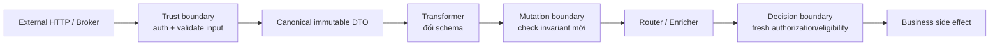
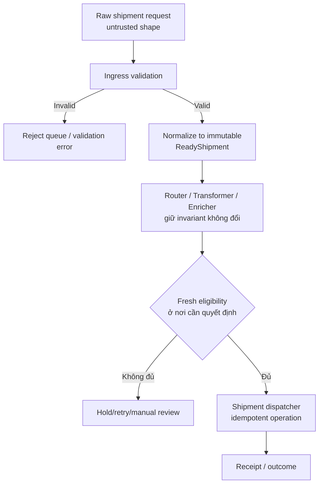
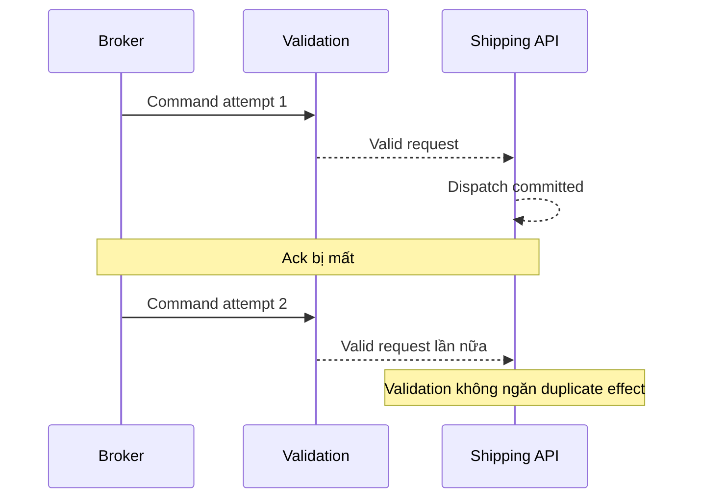

# Không xác thực lại tùy tiện ở mọi bước

## 1. Bài toán: càng nhiều Filter chưa chắc càng an toàn

Một hệ thống nhận yêu cầu giao hàng qua HTTP, chuẩn hóa dữ liệu, chọn nhánh xử lý, kiểm tra khả năng giao hàng và gọi dịch vụ vận chuyển. Nhóm phát triển muốn “an toàn tối đa” nên viết:

```text
HTTP Inbound
   ↓
Filter: orderId hợp lệ?
   ↓
Transformer: đổi input sang DTO
   ↓
Filter: orderId hợp lệ?
   ↓
Router: chọn STANDARD hay EXPRESS
   ↓
Filter: orderId hợp lệ, country hợp lệ?
   ↓
Content Enricher: tra cứu điểm giao hàng
   ↓
Filter: orderId hợp lệ, country hợp lệ, weight hợp lệ?
   ↓
Gateway: gửi tới Shipping Service
   ↓
Filter: orderId hợp lệ, country hợp lệ lần nữa?
```

Nhìn qua, hệ thống có nhiều lớp bảo vệ. Nhưng thiết kế này có ít nhất năm vấn đề:

1. **Kiểm tra lặp mà không có lý do:** cùng một `orderId` bất biến được kiểm tra nhiều lần dù chưa thay đổi.
2. **Dễ mâu thuẫn:** mỗi Filter có thể dùng phiên bản regex, danh sách country hoặc luật giới hạn khác nhau.
3. **Tăng độ trễ và coupling:** nếu validation truy cập database/API, nhiều bước cùng gọi một nguồn để xác minh một thông tin.
4. **Sai điểm quyết định:** kiểm tra trạng thái tài khoản ở đầu flow rồi tin mãi kết quả đó, trong khi lệnh có thể chờ lâu trước khi thực hiện side effect.
5. **Khó xử lý lỗi:** Filter A bỏ message im lặng, Filter B ném exception, Filter C gửi discard channel; người vận hành không biết dữ liệu bị từ chối ở đâu và vì sao.

Ngược lại, bỏ hết kiểm tra sau ingress cũng không đúng: dữ liệu có thể được **thay đổi**, **tái tạo từ nguồn bên ngoài**, **đi qua ranh giới tin cậy**, hoặc **hết hiệu lực theo thời gian**.

Nguyên tắc của bài:

> **Kiểm tra một thuộc tính ở nơi nó được nhận hoặc thay đổi, và kiểm tra lại những điều kiện phụ thuộc trạng thái mới ngay trước quyết định có hậu quả. Không sao chép cùng một phép kiểm tra vào mọi endpoint chỉ để tạo cảm giác an toàn.**

Bài **“Không xác thực lại tùy tiện ở mọi bước”** thuộc chương **Message filter và validation**, module **SPRING_INTEGRATION_PATTERN**. Module hướng dẫn triển khai Enterprise Integration Patterns với Spring Integration để xây dựng luồng thông điệp ít phụ thuộc, dễ mở rộng; thực hành Router, Filter, Transformer, Splitter, Aggregator, Gateway, retry, error channel và correlation, cùng kiểm thử và theo dõi các nhánh xử lý.

### Mục tiêu học tập

Sau bài này, bạn có thể:

- Phân biệt **validation của dữ liệu**, **authentication**, **authorization**, **business rules** và **lựa chọn nhánh bằng Filter**.
- Xác định *trust boundary*, *mutation boundary* và *decision boundary* — ba lý do chính đáng để kiểm tra.
- Thiết kế DTO đã chuẩn hóa, bất biến, có invariant rõ mà không cần chạy lại cùng regex ở mọi bước.
- Dùng Spring Integration Java DSL để kiểm tra ở ingress, biến đổi an toàn, và xác minh điều kiện động ngay trước thao tác.
- Phân biệt `discardChannel`, exception, error channel, retry và dead-letter handling.
- Viết JUnit test chứng minh dữ liệu sai không đi tiếp, dữ liệu hợp lệ không bị kiểm tra lặp tùy tiện và điều kiện nghiệp vụ có thể thay đổi.
- Tránh stale validation, giả mạo header, duplicate side effect và lỗi trong fan-out/fan-in.

## 2. Validation, authentication và Filter không phải một thứ

Từ “xác thực” đôi khi được dùng rộng để chỉ cả **kiểm tra dữ liệu** lẫn **xác minh người gửi**. Trong hệ thống tích hợp, cần tách các khái niệm:

| Khái niệm | Câu hỏi | Ví dụ | Nơi thực hiện |
| --- | --- | --- | --- |
| **Authentication** | Ai gửi request? | Token/mTLS xác nhận một service | Trusted ingress và các ranh giới bảo mật |
| **Authorization** | Actor có được làm việc này? | Tenant A được xử lý đơn O-204? | Trước khi truy cập tài nguyên hoặc side effect |
| **Structural validation** | Dữ liệu có đúng schema/định dạng? | `weightGrams` là số dương trong phạm vi | Tại biên nhận dữ liệu/biên thay đổi schema |
| **Semantic/domain validation** | Dữ liệu có hợp nghĩa nghiệp vụ? | Mã nước được hỗ trợ theo hợp đồng | Khi tạo mô hình domain/đưa ra quyết định |
| **Dynamic eligibility** | Ngay lúc này có thể thực hiện không? | Kho còn hàng, user chưa bị khóa | Gần thao tác phụ thuộc trạng thái hiện hành |
| **Filter** | Message có đi tiếp theo một predicate không? | Chỉ đơn đủ điều kiện vào nhánh giao hàng | Endpoint được thiết kế để chọn accept/reject |
| **Router** | Message đi nhánh nào? | EXPRESS → channel ưu tiên | Sau khi có dữ kiện định tuyến đáng tin cậy |
| **Idempotent Receiver** | Operation này đã được áp dụng chưa? | Retry cùng `shipmentRequestId` | Gần boundary có side effect, cùng store/recovery |

Một `MessageFilter` trong Spring Integration thực hiện **quyết định accept/reject theo predicate**. Nó có thể được dùng cho một phép validation đơn giản, nhưng **không tự động thay thế** lớp validation trả danh sách lỗi, quy trình authentication hoặc authorization của hệ thống.

Đặc biệt:

- “Input có đúng định dạng?” là câu hỏi tương đối ổn định đối với một payload bất biến.
- “Đơn có còn đủ quyền để dispatch lúc này?” có thể thay đổi theo thời gian.
- “Đã dispatch lệnh này chưa?” cần idempotency/transaction, không phải chỉ xác thực regex.

## 3. Ba loại ranh giới quyết định có cần kiểm tra lại



### 3.1. Trust boundary — nơi dữ liệu trở nên đáng tin

Mọi nguồn dữ liệu chưa tin cậy phải được kiểm tra khi vào hệ thống: HTTP body, broker message từ đối tác, webhook, file CSV, callback hay reply của service ngoài.

Tại đây thường cần:

1. Xác thực nguồn và quyền của actor.
2. Kiểm tra schema, version, kích thước, định dạng và trường bắt buộc.
3. Chuẩn hóa biểu diễn dữ liệu nếu có hợp đồng.
4. Tạo một **typed DTO nội bộ** mang các invariant đã được chứng minh.
5. Bảo vệ những trường có nguồn đáng tin như `tenantId`, `principal`, `permissions`.

Nếu message đã qua validation ở Service A rồi được gửi sang Service B qua broker không có cơ chế bảo đảm nguồn/biến đổi, Service B vẫn phải xem đây là **một ingress mới**. Một flag `validated=true` do người gửi tự gán không chứng minh điều gì.

### 3.2. Mutation boundary — nơi invariant có thể bị phá vỡ

Nếu Transformer đổi `amountCents` sang `BigDecimal`, áp dụng tỷ giá, gộp nhiều kết quả hoặc cập nhật `shippingAddress`, **những thuộc tính đã thay đổi cần được xác minh theo hợp đồng của kiểu dữ liệu mới**.

Không cần chạy lại toàn bộ kiểm tra `orderId` chỉ vì Transformer đổi trường `weightGrams`, nếu `orderId` được giữ nguyên, bất biến và vẫn thuộc cùng trust scope.

### 3.3. Decision boundary — nơi thông tin có thể hết hiệu lực

Kiểm tra tồn kho, trạng thái tài khoản, hạn mức, KYC, quota, khả năng giao vận hoặc quyền đối với một tài nguyên có thể **stale** nếu flow chờ lâu.

Vì thế cần kiểm tra/ủy quyền ở **điểm thực hiện quyết định**. Tuy nhiên cũng không nên gọi cùng API để check trạng thái ở mỗi Filter trung gian; phải định nghĩa thời hạn hợp lệ, ownership, deadline và cơ chế atomic claim/transaction nếu cần.

## 4. Ma trận: kiểm tra ở đâu, khi nào được tin tiếp?

| Dữ kiện/điều kiện | Kiểm tra lần đầu | Kiểm tra lại khi nào? | Không nên làm |
| --- | --- | --- | --- |
| `orderId` đúng format | Ingress | Khi đọc từ source mới hoặc ID bị thay | Regex sau mọi Transformer dù ID không đổi |
| `weightGrams` trong miền giá trị | Khi parse/normalize | Sau khi tính lại trọng lượng/đổi đơn vị | Lặp parse String ở mọi Filter |
| `currency` và scale của tiền | Ingress/domain constructor | Khi currency/amount được tính lại | Mỗi Router tự đoán rounding |
| `tenantId` | Trusted authentication boundary | Khi một service boundary mới cần tự xác thực | Tin header `tenantId` của client |
| Quyền đọc order | Trước truy cập order | Khi chuyển quyền/actor/tài nguyên hoặc tại thao tác nhạy cảm | Coi `isAuthorized` client gửi là bằng chứng |
| Tồn kho | Khi quyết định reserve | Gần commit hoặc trong transaction/atomic reservation | Check đi check lại rồi vẫn không khóa |
| KYC/trạng thái khóa | Policy boundary liên quan | Gần giao dịch nhạy cảm theo freshness contract | Cache kết quả APPROVED vô hạn |
| Idempotency key | Khi nhận business command | Khi claim/commit cùng operation | Sinh UUID mới ở retry hoặc dùng Message ID |
| `correlationId` | Khi tạo/nhận nhóm | Khi adapter tái tạo hoặc nguồn không tin cậy | Ghép group theo header không xác minh |
| Reply của remote service | Khi reply đi qua boundary | Khi schema/provenance/version không còn phù hợp | Tin mọi reply chỉ vì request đã validate |
| `ValidatedOrder` nội bộ bất biến | Khi construct | Khi tạo instance mới từ nguồn không tin/khác schema | Deserialization trực tiếp từ client thành “trusted” record |

Bảng không có nghĩa kiểm tra tại ingress rồi **bỏ hoàn toàn mọi invariant runtime**. Những kiểm tra thuộc **type contract**, **authorization ở resource layer**, và **database constraints** vẫn có thể tồn tại để phòng thủ. Điều cần tránh là sao chép **cùng logic expensive/không đồng bộ** vào từng điểm của một flow mà không có lý do.

## 5. Anti-pattern: mỗi endpoint tự tái xác thực

Ví dụ không nên áp dụng:

```java
// Chỉ minh họa anti-pattern, không phải cấu hình khuyến nghị.
@Bean
IntegrationFlow repeatedValidationFlow() {
    return IntegrationFlow.from("orders.in")
        .filter(OrderCommand.class,
            order -> validationService.fullCheck(order))
        .transform(OrderCommand.class,
            this::normalize)
        .filter(OrderCommand.class,
            order -> validationService.fullCheck(order))
        .route(OrderCommand.class, this::chooseRoute)
        .filter(OrderCommand.class,
            order -> validationService.fullCheck(order))
        .handle(shippingGateway)
        .get();
}
```

Tại sao sai?

- `fullCheck()` có thể truy cập network/DB; nếu gọi ba lần, cùng một request tăng ba lần tải nguồn.
- Giá trị external state có thể thay đổi giữa ba lần; hai Filter trả kết quả khác nhau mà không có một decision contract chung.
- Nếu Router/Transformer thay payload type, Filter có thể cần cast sai.
- Một endpoint throw exception, endpoint khác discard — kết quả phụ thuộc vị trí và thứ tự.
- Khi thay rule, dễ quên cập nhật một Filter; hai nhánh chấp nhận/từ chối khác nhau.
- Không thể suy ra việc gọi cùng một validation ba lần giúp bảo vệ side effect; **check-then-act vẫn có race**.

### Ví dụ race điều kiện động

```text
10:00:00  Filter A: stock=1 → allow
10:00:01  Filter B: stock=1 → allow
10:00:02  Worker khác reserve đơn cuối cùng
10:00:03  Gateway: submit shipment → stock=0
```

Lặp lại check nhiều lần **không tạo atomicity**. Với các resource có tranh chấp, cần **atomic reservation**, database constraint, optimistic lock, transaction hoặc API có precondition/idempotency phù hợp.

## 6. Thiết kế tốt hơn: validate once per trust/versioned contract



Một cách tiếp cận đáng tin:

1. **Tập trung input contract:** chỉ một nơi chịu trách nhiệm schema/syntax cho loại message.
2. **Chuẩn hóa thành kiểu rõ nghĩa:** String `weightGrams` → int; String `mode` → enum.
3. **Giữ data immutable:** các bước phía sau không vô tình sửa giá trị đã xác minh.
4. **Tách static invariant và dynamic eligibility:** mỗi loại có thời điểm kiểm tra phù hợp.
5. **Mỗi reject có outcome rõ:** không bỏ message âm thầm.
6. **Revalidate có chủ đích:** khi dữ liệu/schema/trust state thực sự thay đổi.
7. **Quan sát được quyết định:** ai reject, rule version nào, request nào, retryable hay permanent.

“Validate once” ở đây **không có nghĩa toàn hệ thống kiểm tra một lần duy nhất rồi tin suốt đời**. Nó có nghĩa **không lặp một invariant ổn định một cách vô nghĩa trong cùng phạm vi tin cậy**.

## 7. Mô hình dữ liệu ví dụ

Bài dùng một request giao hàng raw, một envelope đã xác thực tenant, một DTO đã chuẩn hóa và một receipt.

```java
record RawShipment(
    String orderId,
    String countryCode,
    String weightGrams,
    String shippingMode) {}

record TrustedIncomingShipment(
    String authenticatedTenantId,
    RawShipment raw) {}

enum ShippingMode {
    STANDARD,
    EXPRESS
}

record ReadyShipment(
    String tenantId,
    String orderId,
    String countryCode,
    int weightGrams,
    ShippingMode mode) {}

record ShipmentReceipt(
    String tenantId,
    String orderId,
    String outcome) {}
```

**Điều kiện của ví dụ:**

- `TrustedIncomingShipment` **chỉ được tạo bởi adapter đã xác thực**. Client HTTP không được truyền trực tiếp `authenticatedTenantId` với quyền tự chọn.
- `orderId` là mã ASCII không trống, tối đa 40 ký tự.
- `countryCode` phải là `VN` hoặc `SG` theo **contract demo**. Ở production, danh sách nước hỗ trợ có thể thuộc versioned policy khác với structural validation.
- `weightGrams` được nhận dưới dạng chuỗi số nguyên dương, tối đa 25.000 g.
- `shippingMode` thuộc enum `STANDARD` hoặc `EXPRESS`.
- `ReadyShipment` là record bất biến; các stage downstream chỉ đọc nó.
- Kiểm tra khả năng tiếp nhận đơn tại dispatcher là **dynamic eligibility**, không phải lặp validate format của `orderId`.

Nếu dữ liệu đã được parse từ JSON bằng một framework có schema validation, vẫn cần xác định điểm tạo typed message và cách trả lỗi; ví dụ không yêu cầu mọi ứng dụng giữ trọng lượng ở dạng String.

## 8. Validator structural/semantic ở ingress

Mô tả một contract được dùng ở **một biên nhận**, không copy expression vào Router hay handler.

```java
final class ShipmentIngressContract {

    boolean valid(TrustedIncomingShipment incoming) {
        if (incoming == null
                || incoming.raw() == null
                || blank(incoming.authenticatedTenantId())) {
            return false;
        }

        RawShipment raw = incoming.raw();

        if (blank(raw.orderId())
                || !raw.orderId().matches("[A-Z0-9-]{1,40}")
                || !("VN".equals(raw.countryCode())
                    || "SG".equals(raw.countryCode()))
                || !("STANDARD".equals(raw.shippingMode())
                    || "EXPRESS".equals(raw.shippingMode()))) {
            return false;
        }

        String rawWeight = raw.weightGrams();

        if (rawWeight == null
                || !rawWeight.matches("[0-9]{1,5}")) {
            return false;
        }

        int grams;
        try {
            grams = Integer.parseInt(rawWeight);
        } catch (NumberFormatException ex) {
            return false;
        }

        return grams > 0 && grams <= 25_000;
    }

    private static boolean blank(String value) {
        return value == null || value.isBlank();
    }
}
```

### Tại sao phải check overflow khi parse?

Regex có giới hạn năm chữ số đã làm giá trị hiện tại phù hợp với `int`, nhưng giữ code parse có kiểm soát giúp hợp đồng rõ ràng khi rule thay đổi. Đừng dùng `Integer.parseInt()` tự do rồi để một exception tình cờ quyết định message có bị reject hay không.

### Tại sao không truy vấn tồn kho tại đây?

Input contract có nhiệm vụ xác định message đủ điều kiện **về hình dạng** để đi qua nội bộ. Tồn kho/khả năng giao vận có thể thay đổi khi message nằm trong queue hoặc đang retry; nó cần được kiểm tra gần thao tác reserve/dispatch, với consistency phù hợp.

### Nếu cần trả nhiều lỗi validation?

Một boolean `valid()` chỉ phân biệt pass/fail. Khi API cần trả tất cả field errors, hãy dùng một model như:

```java
record FieldError(
    String field,
    String code) {}

record ValidationResult<T>(
    T value,
    java.util.List<FieldError> errors) {

    boolean valid() {
        return errors.isEmpty();
    }
}
```

Có thể chuyển `RawShipment` thành `ValidationResult<ReadyShipment>` rồi dùng Router chia nhánh accepted/rejected và trả lỗi có kiểu. **Không nên nhét danh sách lỗi vào static field hoặc ThreadLocal** để Filter đọc lại, vì đó là state khó đúng khi concurrency/async.

## 9. Transformer tạo DTO chuẩn hóa

Khi validator đã bảo đảm schema của input, một Transformer chuyển dữ liệu sang kiểu mà downstream có thể dùng trực tiếp.

```java
final class ShipmentNormalizer {

    ReadyShipment normalize(TrustedIncomingShipment incoming) {
        RawShipment raw = incoming.raw();

        return new ReadyShipment(
            incoming.authenticatedTenantId(),
            raw.orderId(),
            raw.countryCode(),
            Integer.parseInt(raw.weightGrams()),
            ShippingMode.valueOf(raw.shippingMode()));
    }
}
```

Với cặp Filter → Transformer **đồng bộ**, dòng input đi tới normalizer đã vượt qua validation. Tại đây không cần gọi lại toàn bộ `ShipmentIngressContract.valid()`: những phép convert có kiểu được xây trên invariant đã thiết lập.

**Hạn chế:** nếu một nơi khác gọi `normalize()` trực tiếp với input chưa validate, nó có thể ném exception. Khi là public API tái sử dụng bên ngoài flow, nên dùng một entrypoint `parseAndValidate()` trả `ValidationResult`/throw typed exception, tránh khiến mọi caller phải nhớ hai bước riêng. Một cách khác là đặt constructor/factory của `ReadyShipment` giữ invariant cốt lõi.

### Trust không tự gắn với tên DTO

Tên `ReadyShipment` không có tác dụng bảo mật. Nếu một external adapter deserialize JSON trực tiếp thành `ReadyShipment` và gửi vào channel nội bộ mà không xác thực, nó đã **bỏ qua biên kiểm tra**.

Mô hình đáng tin phải đi kèm **quyền gọi channel/API**, loại message được phép tạo, trusted adapter và authorization theo tenant.

## 10. Dynamic eligibility: điều kiện chỉ có ý nghĩa tại điểm xử lý

Ví dụ dispatcher có thể tạm dừng nhận đơn khi hệ thống vận chuyển không hoạt động. Đây là **điều kiện động**, khác với việc kiểm tra `weightGrams` có đúng kiểu hay không.

```java
import java.util.concurrent.atomic.AtomicBoolean;

final class ShippingAvailability {

    private final AtomicBoolean open =
        new AtomicBoolean(true);

    boolean canAccept(ReadyShipment shipment) {
        // Demo: đọc trạng thái vận hành hiện hành.
        // Production: cần tenant, route, quota, deadline
        // và atomic reservation nếu có cạnh tranh.
        return open.get();
    }

    void setOpen(boolean value) {
        open.set(value);
    }
}
```

Với shipment hợp lệ, `open=false` không làm `ReadyShipment` trở thành dữ liệu sai định dạng. Nó chỉ có nghĩa lệnh **chưa được phép thực hiện lúc này**, và cần được giữ/retry có kiểm soát hoặc báo HOLD theo nghiệp vụ.

Không nên trộn `validFormat` và `canAccept` thành cùng một boolean `isValidOrder` rồi gọi lại ở mọi bước. Hai điều kiện có **tuổi thọ và error policy khác nhau**.

### Lưu ý về check-then-act

Trong ví dụ, `open.get()` chỉ mô phỏng một switch; nó không bảo đảm trạng thái không đổi ngay sau check. Với quota, tồn kho và tài nguyên có tranh chấp, một hệ thống thật cần **atomic reserve/commit**, database constraint, optimistic lock hoặc remote API thực thi điều kiện trong cùng thao tác.

## 11. Handler mô phỏng side effect

Để test không chạm dịch vụ vận chuyển, dùng một handler đếm số lần dispatch:

```java
import java.util.concurrent.atomic.AtomicInteger;

final class FakeShipmentDispatcher {

    private final AtomicInteger attempts =
        new AtomicInteger();

    ShipmentReceipt dispatch(ReadyShipment shipment) {
        attempts.incrementAndGet();

        return new ShipmentReceipt(
            shipment.tenantId(),
            shipment.orderId(),
            "SIMULATED_ACCEPTED");
    }

    int attempts() {
        return attempts.get();
    }
}
```

Handler này **không** gọi HTTP, không ghi database và không phải bằng chứng đã giao hàng. Nó chỉ giúp test:

- Raw input sai phải bị chặn trước handler.
- Input hợp lệ và điều kiện mở thì handler chạy.
- Dữ liệu hợp lệ nhưng điều kiện vận hành đóng thì không gọi handler.

Một pipeline production cần thêm **idempotency key**, timeout, error channel, retry/reconciliation cho side effect thật, được trình bày ở phần sau.

## 12. Spring Integration Java DSL: kiểm tra đúng ranh giới

Dưới đây là một flow hoàn chỉnh để minh họa:

1. Filter structural/semantic ở ingress.
2. Transformer sang typed immutable DTO.
3. Filter **dynamic eligibility** khi cần ra quyết định.
4. Service Activator thực hiện tác vụ mô phỏng.
5. Hai discard channel phân biệt **invalid input** với **on hold**.

```java
import org.springframework.context.annotation.Bean;
import org.springframework.context.annotation.Configuration;
import org.springframework.integration.channel.DirectChannel;
import org.springframework.integration.channel.QueueChannel;
import org.springframework.integration.config.EnableIntegration;
import org.springframework.integration.dsl.IntegrationFlow;

@Configuration
@EnableIntegration
public class ShipmentValidationFlowConfig {

    @Bean
    ShipmentIngressContract shipmentIngressContract() {
        return new ShipmentIngressContract();
    }

    @Bean
    ShipmentNormalizer shipmentNormalizer() {
        return new ShipmentNormalizer();
    }

    @Bean
    ShippingAvailability shippingAvailability() {
        return new ShippingAvailability();
    }

    @Bean
    FakeShipmentDispatcher fakeShipmentDispatcher() {
        return new FakeShipmentDispatcher();
    }

    @Bean("shipment.raw.in")
    DirectChannel rawInput() {
        return new DirectChannel();
    }

    @Bean("shipment.invalid")
    QueueChannel invalidInput() {
        return new QueueChannel();
    }

    @Bean("shipment.on-hold")
    QueueChannel onHold() {
        return new QueueChannel();
    }

    @Bean("shipment.receipts")
    QueueChannel receipts() {
        return new QueueChannel();
    }

    @Bean
    IntegrationFlow shipmentFlow(
            ShipmentIngressContract contract,
            ShipmentNormalizer normalizer,
            ShippingAvailability availability,
            FakeShipmentDispatcher dispatcher) {

        return IntegrationFlow.from("shipment.raw.in")
            .filter(TrustedIncomingShipment.class,
                contract::valid,
                spec -> spec.discardChannel("shipment.invalid"))
            .transform(TrustedIncomingShipment.class,
                normalizer::normalize)
            .filter(ReadyShipment.class,
                availability::canAccept,
                spec -> spec.discardChannel("shipment.on-hold"))
            .handle(ReadyShipment.class,
                (shipment, headers) ->
                    dispatcher.dispatch(shipment))
            .channel("shipment.receipts")
            .get();
    }
}
```

Hai Filter ở đây **không** lặp cùng rule:

- Filter 1: kiểm tra **định dạng/hợp đồng đầu vào** trước khi tạo DTO nội bộ.
- Filter 2: kiểm tra **điều kiện vận hành động** gần handler.

Nếu lồng thêm nhiều Router, Header Enricher hoặc Wire Tap giữa hai Filter mà không thay input invariant, không cần sao chép Filter 1 vào từng stage.

### Vì sao không chỉ dùng một Filter đầu vào?

Vì `availability::canAccept` có thể thay đổi theo thời gian. Message có thể chờ queue lâu sau ingress; kiểm tra dynamic eligibility ở thời điểm nhận HTTP không đủ cho hành động cuối. Tuy nhiên đối với tài nguyên có tranh chấp, kiểm tra trước dispatch **vẫn phải đi kèm atomic operation**.

### Discard channel không phải queue lưu trữ bền vững

`QueueChannel` trong ví dụ dùng để quan sát kết quả test; không bảo đảm survives restart. Khi một yêu cầu bị từ chối hoặc HOLD quan trọng, hãy dùng failure record, durable broker/workflow store hoặc trả response có kiểu theo contract.

### Lưu ý về overload/API

Mẫu Java DSL ở đây sử dụng Spring Integration hiện đại và Java 17+ (records). Khi tích hợp vào dự án thật, cần đối chiếu overload của `filter(payloadType, predicate, endpointConfigurer)`, `transform(payloadType, transformer)` và `handle(payloadType, handler)` theo dependency. STEP 6 sẽ kiểm tra chuyên môn và khả năng biên dịch; bài hiện tại không thực hiện build theo chỉ thị STEP 4.

## 13. JUnit: dữ liệu sai bị từ chối một lần, dữ liệu đúng được xử lý

Dùng JUnit 5, Spring Test và AssertJ.

```java
import static org.assertj.core.api.Assertions.assertThat;

import org.junit.jupiter.api.BeforeEach;
import org.junit.jupiter.api.Test;
import org.springframework.beans.factory.annotation.Autowired;
import org.springframework.beans.factory.annotation.Qualifier;
import org.springframework.integration.channel.QueueChannel;
import org.springframework.messaging.Message;
import org.springframework.messaging.MessageChannel;
import org.springframework.messaging.support.MessageBuilder;
import org.springframework.test.context.junit.jupiter.SpringJUnitConfig;

@SpringJUnitConfig(ShipmentValidationFlowConfig.class)
class ShipmentValidationFlowTest {

    @Autowired
    @Qualifier("shipment.raw.in")
    MessageChannel input;

    @Autowired
    @Qualifier("shipment.invalid")
    QueueChannel invalid;

    @Autowired
    @Qualifier("shipment.on-hold")
    QueueChannel onHold;

    @Autowired
    @Qualifier("shipment.receipts")
    QueueChannel receipts;

    @Autowired
    ShippingAvailability availability;

    @Autowired
    FakeShipmentDispatcher dispatcher;

    @BeforeEach
    void resetDynamicPolicy() {
        availability.setOpen(true);
    }

    private TrustedIncomingShipment request(
            String orderId,
            String weight) {

        return new TrustedIncomingShipment(
            "tenant-A",
            new RawShipment(
                orderId, "VN", weight, "STANDARD"));
    }

    private void send(TrustedIncomingShipment payload) {
        assertThat(input.send(MessageBuilder
            .withPayload(payload)
            .setHeader("requestId",
                "req-" + payload.raw().orderId())
            .build())).isTrue();
    }

    @Test
    void acceptedInputProducesOneReceipt() {
        int before = dispatcher.attempts();

        send(request("O-204", "1200"));

        Message<?> result = receipts.receive(1_000);
        assertThat(result).isNotNull();

        ShipmentReceipt receipt =
            (ShipmentReceipt) result.getPayload();
        assertThat(receipt.orderId()).isEqualTo("O-204");
        assertThat(receipt.tenantId()).isEqualTo("tenant-A");
        assertThat(receipt.outcome())
            .isEqualTo("SIMULATED_ACCEPTED");

        assertThat(invalid.receive(0)).isNull();
        assertThat(onHold.receive(0)).isNull();
        assertThat(dispatcher.attempts() - before).isEqualTo(1);
    }

    @Test
    void invalidWeightIsRejectedBeforeDispatcher() {
        int before = dispatcher.attempts();

        send(request("O-205", "-1"));

        Message<?> rejected = invalid.receive(1_000);
        assertThat(rejected).isNotNull();
        assertThat(rejected.getPayload())
            .isInstanceOf(TrustedIncomingShipment.class);

        assertThat(receipts.receive(0)).isNull();
        assertThat(onHold.receive(0)).isNull();
        assertThat(dispatcher.attempts() - before).isZero();
    }

    @Test
    void validDataCanBeOnHoldWithoutBecomingInvalid() {
        int before = dispatcher.attempts();
        availability.setOpen(false);

        send(request("O-206", "1000"));

        Message<?> held = onHold.receive(1_000);
        assertThat(held).isNotNull();
        assertThat(held.getPayload())
            .isInstanceOf(ReadyShipment.class);
        assertThat(((ReadyShipment) held.getPayload())
            .weightGrams()).isEqualTo(1000);

        assertThat(invalid.receive(0)).isNull();
        assertThat(receipts.receive(0)).isNull();
        assertThat(dispatcher.attempts() - before).isZero();
    }

    @Test
    void eligibilityMayChangeBetweenTwoRequests() {
        int before = dispatcher.attempts();

        availability.setOpen(false);
        send(request("O-207", "900"));
        assertThat(onHold.receive(1_000)).isNotNull();

        availability.setOpen(true);
        send(request("O-208", "900"));
        assertThat(receipts.receive(1_000)).isNotNull();

        assertThat(dispatcher.attempts() - before).isEqualTo(1);
    }

    @Test
    void unsupportedMethodIsInvalidAtIngress() {
        int before = dispatcher.attempts();

        send(new TrustedIncomingShipment(
            "tenant-A",
            new RawShipment(
                "O-209", "VN", "1200", "DRONE")));

        assertThat(invalid.receive(1_000)).isNotNull();
        assertThat(receipts.receive(0)).isNull();
        assertThat(dispatcher.attempts() - before).isZero();
    }
}
```

**Lưu ý fixture:** ApplicationContext và `QueueChannel` có thể được dùng lại giữa các test. Các test ở đây tiêu thụ message mong đợi và chỉ giữ trạng thái `availability` được reset ở `@BeforeEach`. Với test chạy song song, cần cô lập context/fixture và không chia sẻ cùng các queue; không dựa vào thứ tự JUnit.

**Những gì test chứng minh:** đầu vào sai bị chặn, đầu vào đúng được normalize trước khi dispatch, điều kiện động HOLD không bị nhầm với validation fail.

**Những gì test chưa chứng minh:** authentication thật, distributed queue, atomic stock reservation, idempotency khi broker redeliver, hoặc dữ liệu hạ tầng thay đổi trong transaction. Những phần đó cần test riêng ở đúng boundary.

## 14. Unit test contract và normalizer

Việc tách rule khỏi flow giúp kiểm tra invariant trực tiếp, không phải chạy cả Spring context cho mọi trường hợp.

```java
import static org.assertj.core.api.Assertions.assertThat;

import org.junit.jupiter.api.Test;

class ShipmentIngressContractTest {

    private final ShipmentIngressContract contract =
        new ShipmentIngressContract();

    private final ShipmentNormalizer normalizer =
        new ShipmentNormalizer();

    private TrustedIncomingShipment incoming(
            String orderId,
            String country,
            String weight,
            String mode) {

        return new TrustedIncomingShipment(
            "tenant-A",
            new RawShipment(orderId, country, weight, mode));
    }

    @Test
    void validRawDataNormalizesIntoTypedPayload() {
        TrustedIncomingShipment request = incoming(
            "O-204", "VN", "1200", "STANDARD");

        assertThat(contract.valid(request)).isTrue();

        ReadyShipment ready = normalizer.normalize(request);
        assertThat(ready.orderId()).isEqualTo("O-204");
        assertThat(ready.weightGrams()).isEqualTo(1200);
        assertThat(ready.mode())
            .isEqualTo(ShippingMode.STANDARD);
    }

    @Test
    void invalidWeightsAreRejectedAtOneBoundary() {
        assertThat(contract.valid(
            incoming("O-204", "VN", "0", "STANDARD")))
            .isFalse();

        assertThat(contract.valid(
            incoming("O-204", "VN", "25001", "STANDARD")))
            .isFalse();

        assertThat(contract.valid(
            incoming("O-204", "VN", "12.5", "STANDARD")))
            .isFalse();
    }

    @Test
    void missingTenantAndBadCountryAreRejected() {
        TrustedIncomingShipment missingTenant =
            new TrustedIncomingShipment(
                "", new RawShipment(
                    "O-204", "VN", "1200", "STANDARD"));

        assertThat(contract.valid(missingTenant)).isFalse();
        assertThat(contract.valid(
            incoming("O-204", "US", "1200", "STANDARD")))
            .isFalse();
    }

    @Test
    void orderIdHasAStableCanonicalDomain() {
        assertThat(contract.valid(
            incoming("O-204", "VN", "1200", "EXPRESS")))
            .isTrue();

        assertThat(contract.valid(
            incoming(" o-204 ", "VN", "1200", "EXPRESS")))
            .isFalse();
    }
}
```

### Vì sao unit test validator không thay thế contract test transport?

Một inbound HTTP adapter có thể deserialize sai kiểu, drop một header hoặc bỏ qua `Content-Type`. Unit test `ShipmentIngressContract` không phát hiện lỗi của adapter.

Cần integration test ở **thực tế ingress** để chứng minh:

- JSON quá lớn bị từ chối trước khi cấp phát tài nguyên không kiểm soát.
- Trường JSON không biết có được bỏ, reject hay forward theo schema policy.
- Tenant được trích từ principal đã xác thực chứ không phải body/header do client kiểm soát.
- DTO được tạo qua đúng validated factory/mapper.
- Các message từ broker partner có version và provenance hợp lệ.

## 15. Validation ở tầng type: giữ invariant thay vì tái kiểm tra

Một thiết kế tốt có thể để constructor/factory của DTO đảm bảo invariant:

```java
record PositiveGrams(int value) {

    PositiveGrams {
        if (value < 1 || value > 25_000) {
            throw new IllegalArgumentException(
                "Weight must be between 1 and 25000 g");
        }
    }
}
```

Khi payload đã mang `PositiveGrams`:

- Router không cần parse lại string trọng lượng.
- Transformer không nên sửa trực tiếp object đó vì record bất biến.
- Nếu business step cần tính lại trọng lượng, nó sẽ tạo **một `PositiveGrams` mới**; constructor bảo vệ invariant mới.
- Nếu dữ liệu được deserialize trực tiếp bỏ qua trusted factory, biên external vẫn cần schema/type validation.

**Cần phân biệt hai lớp bảo vệ:** constructor đảm bảo invariant cục bộ của object, còn ingress xác minh **nguồn, quyền, protocol và giới hạn tài nguyên**. Không thể bỏ authentication chỉ vì DTO có kiểu mạnh.

### Trạng thái “validated” có thể bị mất

Những hành động sau có thể làm mất giả định đã được xác minh:

- Chuyển từ DTO bất biến sang một `Map<String,Object>` rồi cập nhật trường không kiểm soát.
- Serialize ra JSON, chuyển qua queue không đáng tin, deserialize ở service mới.
- Enrich bằng reply của hệ thống ngoài rồi ghi đè một trường nghiệp vụ cốt lõi.
- Gộp nhiều payload từ các tenant hoặc schema version khác nhau.
- Thay đổi đơn vị đo hoặc công thức tính.
- Sử dụng shared mutable object qua nhiều subscriber/worker.

Khi các hành động đó xảy ra, hãy xác định **thuộc tính nào cần xác minh lại**, không chạy tất cả validators chỉ vì “message vừa qua Transformer”.

## 16. Revalidation có điều kiện sau Transformer

Một Transformer có thể chỉ thay biểu diễn:

```text
Raw amount "19.95" USD
    ↓ parse/normalize có kiểm soát
Money(USD, 19.95)
```

Một Transformer khác có thể thay **nghĩa**:

```text
Amount 19.95 USD
    ↓ apply exchangeRate
Amount 485000 VND
```

Hai trường hợp không giống nhau.

| Thay đổi | Validation cần thiết |
| --- | --- |
| String → enum đã validate | Tính đúng của mapping/schema mới |
| Ngày giờ String → Instant | Parse + timezone/effective-time contract |
| Currency conversion | Cặp tiền tệ, tỷ giá/phiên bản, rounding, amount invariant |
| Splitter tách 100 line | Mỗi line có ID/số thứ tự hợp lệ; không cần xác minh lại order ID ở mọi part nếu trusted |
| Aggregator gom nhiều kết quả | Correlation, số phần duy nhất, consistency/currency trên kết quả |
| Content Enricher thêm profile | Reply source, freshness và quyền tenant của dữ liệu bổ sung |
| Router chọn branch | Input dùng cho route đủ đáng tin; không cần chạy toàn bộ input contract lần nữa |
| Gateway sang external system | Authorization, schema outbound, PII data minimization |
| External response vào flow | Kiểm tra **một trust boundary mới** |
| Retries | Bảo toàn business ID, validate các giá trị thay đổi/timeout state |

### Tái kiểm tra invariant khác với tái xác thực authentication

Có thể cần xác minh lại **quyền thực hiện một hành động** dù người dùng đã được authentication ở ingress. Quyền truy cập có thể thay đổi, token có thể bị thu hồi và resource state có thể khác.

Tuy nhiên, điều đó không đồng nghĩa phải **gọi lại toàn bộ token introspection tại mọi Filter**. Thực hiện theo security architecture: token validation/caching hợp lệ, policy enforcement point đúng ranh giới và authorization lại khi cần trước side effect nhạy cảm.

## 17. Thời điểm xác thực quyền của actor và resource

Ví dụ:

```text
09:00:00  Người dùng được xác thực, yêu cầu hoàn tiền.
09:00:01  Job vào queue, chờ xử lý.
09:15:00  Quyền refund của actor bị thu hồi.
09:20:00  Worker xử lý job.
```

Một kiểm tra “actor có quyền refund” ở 09:00 có thể không còn hợp lệ lúc 09:20, tùy business policy.

Cần hỏi:

1. Authorization quyết định theo **quyền tại lúc yêu cầu** hay **quyền tại lúc thực thi**?
2. Token/job có mang delegated authority đã giới hạn thời hạn và scope không?
3. Ai có quyền revoke và khi nào revoke có hiệu lực?
4. Có cần kiểm tra trạng thái của entity/resource ngay trước commit?
5. Nếu policy service unavailable, fail closed hay cho phép xử lý theo một snapshot được ký?
6. Có audit policy version và decision time không?

Không nên đưa những câu hỏi đó vào regex Filter của payload. Chúng thuộc một **authorization/decision service** có hợp đồng riêng.

## 18. Error handling: invalid, rejected, unavailable không giống nhau

Với Spring Integration Filter, có nhiều cách xử lý khi predicate trả `false`:

- Chuyển message sang `discardChannel` đã cấu hình.
- Ném exception nếu dùng cấu hình như `throwExceptionOnRejection(true)`.
- Trong một số cấu hình, message có thể bị loại bỏ mà không phát kết quả nghiệp vụ về caller.

**Không mặc định Filter tự tạo HTTP 400 hoặc tự gửi tất cả lỗi vào global `errorChannel`.** Hành vi phụ thuộc endpoint, channel, adapter và thiết kế error flow.

| Kết quả | Ví dụ | Loại | Hướng xử lý |
| --- | --- | --- | --- |
| `INVALID_INPUT` | Trọng lượng âm, sai schema | Permanent validation | Trả lý do có cấu trúc, không retry vô hạn |
| `UNAUTHORIZED` | Tenant sai, actor thiếu quyền | Security | Deny/audit, không lộ dữ liệu khác tenant |
| `NOT_ELIGIBLE` | Không hỗ trợ route này | Business decision | Hold/reject theo policy |
| `TEMPORARILY_UNAVAILABLE` | Shipping service down | Transient | Retry bounded/backoff/deadline |
| `INTEGRITY_CONFLICT` | Cùng ID nhưng payload khác | Integrity | Quarantine/manual review |
| `DUPLICATE_COMPLETED` | Command đã commit | Idempotency | Trả persisted result/ACK |
| `UNKNOWN_OUTCOME` | Remote commit chưa rõ sau timeout | Reconciliation | Không tự gọi lại với key mới |

Không nên gom tất cả vào `validationFailed=true`. Ví dụ `TEMPORARILY_UNAVAILABLE` không phải một input sai; retry input validation nhiều lần cũng không phục hồi được network.

### Filter discard không nên được hiểu là success

Nếu một Gateway chờ reply và Filter im lặng discard, caller có thể chờ đến timeout, dù message đã được xử lý “đúng” theo nghĩa bị từ chối. Với API request–reply, nên trả **kết quả rejection có kiểu** hoặc ném exception được adapter ánh xạ thành response rõ.

Với async broker, cần xác định ACK/retry/DLQ và audit sự kiện bị reject. Một discard channel chỉ có ý nghĩa nếu **consumer của nó thật sự xử lý rejection** và lưu/response theo hợp đồng.

## 19. Khi cần nhiều lỗi trường: một validation stage có kiểu

Filter boolean phù hợp cho câu hỏi đơn giản “có đi tiếp không?”. Với API cần phản hồi chi tiết, có thể tạo một bước riêng:

```java
record Rejection(
    String requestId,
    String errorCode,
    java.util.List<String> invalidFields) {}

record ValidationEnvelope<T>(
    T accepted,
    Rejection rejected) {

    static <T> ValidationEnvelope<T> ok(T value) {
        return new ValidationEnvelope<>(value, null);
    }

    static <T> ValidationEnvelope<T> reject(
            Rejection reason) {
        return new ValidationEnvelope<>(null, reason);
    }

    boolean isAccepted() {
        return accepted != null && rejected == null;
    }
}
```

Sau đó dùng Router đọc `isAccepted()` để đưa vào hai flow:

```text
Raw message
    ↓ Validator/Transformer → ValidationEnvelope
    ↓ Content-Based Router
       ├─ accepted → typed business flow
       └─ rejected → structured error handler
```

Ưu điểm: có thể lưu nhiều lỗi field, version của rule và source của rejection. Nhược điểm: thêm model/flow cần bảo trì. Không cần dùng cấu trúc này nếu một Filter đơn giản đã đủ.

**Cẩn thận với dữ liệu nhạy cảm:** list lỗi nên chứa mã field/error, không in nguyên số giấy tờ, thông tin tài chính hoặc token.

## 20. Một validation policy có version và owner

Khi một rule xuất hiện ở nhiều endpoint, vấn đề không chỉ là số lần chạy mà còn là **ai sở hữu rule**.

Ví dụ:

```text
Rule: weight <= 25 kg

Ingress Filter:       <= 25 kg
Router expression:    <= 20 kg
Fulfillment handler:  <= 30 kg
```

Ba nơi đưa ba quyết định khác nhau. Hệ thống cần một **contract/policy owner** với version:

```text
ShipmentInputContract:
  schemaVersion = shipment-v2
  maxWeightGrams = 25000
  acceptedCountries = VN, SG
  shippingModes = STANDARD, EXPRESS
```

Một số rule là **structural** (số phải dương) và có thể ổn định lâu dài. Một số là **business policy** (dịch vụ hỗ trợ tới 25 kg) và có thể thay đổi theo tenant/kho/region. Tách chúng thành các modules/interfaces khác nhau, thay vì đặt tất cả vào `fullValidate()`.

### Rollout policy giữa nhiều instance

Nếu instance A dùng `shipment-v2` và B dùng `shipment-v3`, cùng request có thể bị accept ở A, reject ở B. Cần định nghĩa:

- Version được gắn ở ingress hay trên event?
- Retry cùng request có giữ policy version cũ không?
- Workflow có cần re-evaluate theo policy mới không?
- Rolling deployment có thời gian overlap và backward compatibility ra sao?
- Có audit decision và version không?

Không giải quyết bằng cách **“validate ở mọi endpoint để chắc chắn”**: nó làm cho kết quả phụ thuộc instance/ngẫu nhiên hơn nếu các rule lệch phiên bản.

## 21. Cache kết quả validation: khi nào dùng được?

Có thể tối ưu những phép check tốn kém, nhưng phải biết dữ liệu nào được phép cache.

| Loại | Có thể lưu kết quả? | Điều kiện |
| --- | --- | --- |
| Format order ID | Thường không cần cache | Chi phí nhỏ; dùng typed invariant |
| Schema hợp lệ | Có thể giữ thông qua DTO bất biến | Không dùng “validated=true” từ nguồn không tin |
| Currency scale | Trong value object | Kiểm tra khi construct |
| Tenant authentication | Tùy security architecture | Signature, token expiry, revocation contract |
| Inventory availability | Chỉ cache khi business cho phép staleness | Không thay atomic reserve |
| Customer status | Tùy độ tươi và policy | Không mặc định cache trạng thái nhạy cảm vô hạn |
| Address lookup | Có thể cache theo version/TTL | Source có thẩm quyền và permission |
| KYC/transaction risk | Rất thận trọng | Fail-closed hoặc snapshot được phê duyệt |

Một field `validationPassedAt` không có nghĩa kết quả hợp lệ vĩnh viễn. Nếu điều kiện phụ thuộc thời gian, hãy lưu `asOf`, `policyVersion`, `expiresAt` và provenance rõ ràng.

## 22. Validation lặp trong Splitter, Aggregator và Scatter-Gather

### Splitter: validate cấp batch và cấp phần khác nhau

```text
Order batch:
  100 lines
   ↓
Batch validation: order owner, schema, max line count
   ↓
Splitter
   ↓
Line validation: lineId, quantity, item SKU
```

Không cần xác minh lại chữ ký toàn bộ order trong 100 line nếu các part vẫn nằm trong trusted scope và có cách bảo toàn provenance. Nhưng mỗi line có thể có invariant riêng cần kiểm tra, và khi part đến từ **external worker** thì đó là trust boundary mới.

Một anti-pattern: một validator gọi customer service cho cả đơn rồi chạy lại một lần trên mỗi line → N+1 remote calls. Giải pháp có thể là enrich/validate ở batch trước Splitter, giữ immutable snapshot và chỉ kiểm tra các thuộc tính per-line.

### Aggregator: validate invariant của kết quả tổng hợp

Input validation của từng phần **không chứng minh** group được ghép đúng:

- Correlation key có đủ tenant/workflow/revision chưa?
- Có đủ expected unique parts không?
- Có duplicate/conflicting results không?
- Currency có đồng nhất trước khi cộng không?
- Có nguồn external nào trả schema sai không?

Đây là **validation mới ở mutation/composition boundary**, không phải lặp vô nghĩa. Không chạy lại regex của orderId 100 lần để thay thế kiểm tra correlation.

### Scatter-Gather: kiểm tra identity của từng responder

Hai reply giống payload nhưng từ hai provider khác nhau là hai kết quả hợp lệ; hai reply của cùng provider có thể là duplicate. Validation ở gatherer cần theo **responder identity, expected plan, reply schema và deadline**, không chỉ structural validation của request gốc.

### Resequencer: kiểm tra sequence metadata

Một part đã được validate về domain vẫn có thể mang `SEQUENCE_NUMBER` trùng, gap hoặc `SEQUENCE_SIZE` sai. Resequencer cần contract nhóm và dedup theo business part identity; điều này **không** được giải quyết bằng cách lặp `RawShipment.valid()`.

## 23. Idempotency không được thay bằng lặp validation

Giả sử một message đã đi qua toàn bộ validators, handler gọi dịch vụ vận chuyển và commit. Broker mất ACK và phát lại cùng message.



Cả hai lần đều vượt qua validation là **đúng**, vì payload không sai. Điều cần bảo vệ là **business operation**:

```text
idempotencyKey = (tenantId, DISPATCH, shipmentRequestId)
```

Trong production:

1. Có stable operation ID xuyên retry.
2. Ghi nhận PROCESSING/COMPLETED/result bằng ledger phù hợp.
3. Khi gọi remote API, dùng cùng idempotency key nếu provider hỗ trợ.
4. Nếu remote outcome không rõ, reconcile trước khi tạo operation mới.
5. Không ACK/bỏ duplicate chỉ vì đã thấy marker trước khi side effect commit.
6. Retention của ledger bao phủ broker redelivery và DLQ replay.

**Kiểm tra dữ liệu đúng không đồng nghĩa tác vụ chưa từng chạy.**

## 24. Retry không nên chạy lại những rule không liên quan

Một flow bất đồng bộ có thể bị retry vì Shipping API 503. Có hai cách:

**Retry cả pipeline từ ingress:** parse input, validate schema, normalize, enrich và gọi API lại.

**Retry từ checkpoint trước thao tác thất bại:** sử dụng immutable `ReadyShipment`/snapshot đã có, kiểm tra lại **eligibility còn động** và gọi API với cùng idempotency key.

Cách thứ hai có thể giảm tải và giảm divergence, nếu:

- Snapshot/checkpoint còn đáng tin và được bảo toàn qua restart.
- Tenant/authorization vẫn được xác minh theo policy ở điểm xử lý.
- Những facts có thể stale được refresh theo contract.
- Operation ID được giữ nguyên.
- Không bỏ qua validation ở một trust boundary mới.

**Không thể nói “đã validate rồi” để bỏ qua kiểm tra khi một message được replay từ nguồn không đáng tin**. Nhưng cũng không cần chạy một validator external đắt đỏ ba lần trong cùng attempt nếu dữ liệu/decision không thay đổi.

### Permanent và transient phải có error policy riêng

| Lỗi | Ví dụ | Có nên retry input validation? |
| --- | --- | --- |
| Permanent schema invalid | Cân nặng âm, format sai | Không |
| Unsupported schema version | Consumer chưa tương thích | Có thể chuyển DLQ/quarantine chờ nâng cấp, không lặp vô hạn |
| Access denied | Tenant sai | Không |
| DB capacity temporarily unavailable | Không truy vấn được hiện trạng | Retry bounded chính nguồn/decision |
| Remote API timeout | Không rõ đã commit | Reconcile/idempotent retry |
| Duplicate message | Operation đã complete | Trả outcome/ACK, không tái thực hiện |
| Conflicting payload | Cùng ID, content thay đổi | Reject/audit |
| Stale policy decision | Snapshot quá hạn | Refresh đúng rule động tại decision boundary |

## 25. Bảo mật và revalidation tại ranh giới tin cậy

**Không tái xác thực tùy tiện** không có nghĩa giảm yêu cầu bảo mật:

- Mỗi service cần xác thực nguồn khi nhận dữ liệu từ một trust domain khác.
- Không tin một header `authenticated=true` do client tự gửi.
- Không cho người gửi tự đặt `tenantId` hoặc `correlationId` để nhập nhóm tenant khác.
- Không dùng data validation như bằng chứng authorization.
- Không lưu token/raw PII trong discard queue hoặc DLQ nếu không được phép.
- Không log toàn payload sai chỉ để debug.
- Giới hạn kích thước message, số phần, nested JSON depth, file upload size ở ingress.
- Kiểm tra content type/schema version trước deserialization phức tạp.
- Đối với webhook, xác minh chữ ký/timestamp/replay policy ở boundary.
- Kiểm tra provenance của enrichment data, không tin reply external vì request nội bộ đã validate.
- Tại side-effect boundary, bảo vệ transaction, authorization và idempotency theo rủi ro thực tế.

Một **validated DTO** nội bộ có thể được chuyển thành JSON đưa lên broker rồi trở lại từ một đối tác khác. Lúc trở lại, **không thể chỉ tin tên type hoặc một field boolean**; phải xác minh lại nguồn và các invariant quan trọng theo hợp đồng của boundary mới.

## 26. Observability: theo dõi lý do từ chối, không đếm số Filter

Một dashboard “có 12 validation steps” không chứng minh chất lượng. Nên quan sát **tỷ lệ input lỗi, rule thất bại, độ trễ, eligibility và side effect**.

Gợi ý event:

```text
event=shipment_input_rejected
requestRef=req-204
tenantScope=tenant-A
stage=INGRESS_VALIDATION
schemaVersion=shipment-v2
ruleCode=INVALID_WEIGHT_GRAMS
retryable=false
```

Và một event khác:

```text
event=shipment_on_hold
requestRef=req-205
stage=DISPATCH_ELIGIBILITY
policyVersion=shipping-capacity-v4
reason=SERVICE_UNAVAILABLE
retryable=true
```

Đây là **schema ứng dụng minh họa**, không phải log do Spring Integration tự sinh. Không đưa raw token, PII, số điện thoại, địa chỉ đầy đủ hay payload nhạy cảm vào log theo mặc định.

| Metric gợi ý | Ý nghĩa |
| --- | --- |
| `validation.requests.total{stage}` | Số request được kiểm tra tại boundary |
| `validation.rejected.total{ruleCode}` | Lỗi schema/domain nào thường gặp |
| `validation.duration{stage}` | Chi phí của validation |
| `eligibility.hold.total{reason}` | Điều kiện nghiệp vụ động đang chặn |
| `validation.policy.version{version}` | Theo dõi rollout phiên bản rule |
| `validation.remote.calls.total{source}` | Phát hiện tái xác thực API lặp |
| `filter.discard.total{channel}` | Message bị loại theo endpoint |
| `filter.exceptions.total{reason}` | Lỗi predicate/transform/handler |
| `business.dispatch.attempts.total` | Số lần gọi side effect |
| `business.idempotency.hits.total` | Số duplicate được nhận diện |
| `business.unknown.outcome.total` | Remote result cần reconcile |

Không dùng `requestId`/`orderId` làm metric labels có cardinality cao. Dùng trace/log có quyền truy cập để điều tra một request cụ thể.

### Dấu hiệu validation bị lặp không cần thiết

- Một message tạo nhiều lần gọi cùng policy API mà input vẫn là cùng DTO.
- CPU/latency tăng theo số endpoint dù dữ liệu không thay đổi.
- Hai Filter có rule version khác nhau chấp nhận/từ chối cùng một request.
- Duplicate/retry khiến số lần validation tăng mạnh, trong khi lỗi thực tế nằm ở outbound HTTP.
- Downstream bị thiếu message nhưng không có rejected record vì Filter âm thầm discard.

## 27. Troubleshooting thực tế

| Triệu chứng | Nguyên nhân có thể | Cách xử lý |
| --- | --- | --- |
| Cùng order bị reject ở bước 3 nhưng pass bước 1 | Rule duplicated lệch version | Một owner/schema và contract test |
| Latency cao dù business handler nhanh | Nhiều Filter cùng gọi DB/API | Phân loại static/dynamic, tái sử dụng immutable DTO |
| Filter loại message nhưng caller timeout | Discard không có explicit reply | Result/error flow theo Gateway contract |
| Một invalid message biến mất | Predicate=false, không cấu hình discard | Durable reject flow/audit nếu cần |
| Input hợp lệ nhưng dispatch khi hàng hết | Eligibility check quá sớm, thiếu atomic reservation | Check/commit cùng resource boundary |
| Client giả mạo validated=true | Tin field/header client | Trusted ingress và server-side validation |
| Dữ liệu từ partner bypass validator | Có channel phụ hoặc deserialize trực tiếp typed DTO | Kiểm soát các ingress và channel permissions |
| Validator xử lý lỗi mạng như “invalid” | Gộp transient lỗi vào boolean | Typed result/exception và retry policy |
| Regex orderId bị chạy 100 lần | Splitter sao chép rule batch xuống mỗi part | Kiểm tra batch invariant trước split |
| Aggregator trả sai tổng dù parts hợp lệ | Thiếu group validation/currency/correlation | Validate composition boundary |
| Service mới trả schema khác | External response không được validate | Contract/provenance/version check |
| Duplicate side effect dù mọi Filter pass | Thiếu idempotency | Stable business operation key + ledger |
| Một exception không vào global errorChannel | DirectChannel đồng bộ hoặc thiếu error handler | Kiểm tra runtime thread/adapter |
| Rule thay trong rollout làm retry khác kết quả | Policy version không được pin/ghi nhận | Versioned decision và replay contract |
| Tenant A nhận dữ liệu tenant B | Tin header/correlation không xác thực | Trusted identity + authorization tại boundary |

## 28. Ma trận kiểm thử đề xuất

| Tình huống | Kết quả đúng |
| --- | --- |
| Raw input hợp lệ | Chuyển thành typed DTO, xử lý theo eligibility |
| orderId sai format | Reject ở ingress; không gọi dispatcher |
| weight âm/0/vượt giới hạn | Reject ở ingress |
| weight dạng decimal không hợp đồng | Reject, không âm thầm parse/round |
| mode không thuộc enum | Reject ở ingress |
| tenant đã xác thực bị thiếu | Deny/reject tại ingress |
| typed DTO hợp lệ nhưng availability down | HOLD riêng, không coi INVALID |
| availability đổi giữa hai request | Quyết định theo trạng thái tại decision boundary |
| message qua Router không đổi payload | Không chạy lại static validator vô nghĩa |
| Transformer tạo amount mới sai invariant | Fail ở mutation/new value object boundary |
| Content Enricher trả profile sai tenant | Reject dữ liệu mới ở boundary |
| Splitter tạo nhiều part | Mỗi part được check các invariant riêng, không lặp toàn batch |
| Aggregator trộn currency/tenant | Reject composition |
| Consumer nhận message external giả mạo “validated” | Revalidate theo trust boundary |
| Retry một remote 503 | Giữ stable operation ID; không tạo lệnh mới |
| Broker redelivery sau commit | Idempotent downstream không double effect |
| Store/DB availability không biết | Không coi input invalid |
| Gateway gọi Filter discard | Có explicit rejection reply hoặc deadline rõ |
| Concurrent reserve cùng stock=1 | Atomic reservation không oversell |
| Rule rollout v2/v3 | Có test policy version/replay |
| Input invalid chứa PII | Error flow không log raw data |
| Header mapping làm mất tenant/correlation | Fail safe ở boundary |
| Audit của validation | Có rule code, version, stage, không leak secrets |

## 29. Bài tập thực hành

### Bài 1 — Đánh dấu ba loại ranh giới

Vẽ luồng HTTP → Parser → Filter → Transformer → Router → Enricher → Gateway. Đánh dấu **trust**, **mutation** và **decision boundary**. Với mỗi rule `orderId format`, `weight positive`, `shipping service available` và `tenant authorization`, chỉ rõ nên kiểm tra ở bước nào và giải thích tại sao không nên copy vào từng endpoint.

### Bài 2 — Refactor validation bị lặp

Cho một flow có ba Filter dùng `fullValidate(order)` gọi DB. Refactor thành input contract, immutable DTO và một decision check đúng thời điểm. Thử 1000 request, so sánh số lần gọi DB trước và sau, nhưng không được giảm bảo vệ cho thao tác có cạnh tranh.

### Bài 3 — Java DSL với hai reject channel

Chạy `ShipmentValidationFlowConfig`. Gửi request đúng, sai cân nặng, country không hỗ trợ, method không hợp lệ và request hợp lệ khi shipping đang đóng. Assert payload ở đúng channel và `FakeShipmentDispatcher.attempts()`.

### Bài 4 — Typed error result

Thay Filter boolean ở ingress bằng một `ValidationResult<ReadyShipment>` chứa các `FieldError`. Dùng Content-Based Router tách `accepted` và `rejected`. Viết test hai field sai cùng lúc đều được báo, không làm lộ dữ liệu nhạy cảm.

### Bài 5 — Transformer làm thay đổi invariant

Transformer đổi `weightKg` sang `weightGrams`; một input gây overflow hoặc giá trị vượt giới hạn. Thiết kế value object `PositiveGrams` để validation xảy ra khi tạo dữ liệu mới. Không chạy lại regex của orderId.

### Bài 6 — Authorization sau queue delay

Một đơn chờ 20 phút. Quyền dispatch của actor bị thu hồi sau khi ingress xác thực. Định nghĩa policy kiểm tra theo request-time hay execution-time, điểm kiểm tra đúng và trường hợp policy service unavailable.

### Bài 7 — Filter và Gateway timeout

Một Gateway request–reply gửi message vào Filter với `discardChannel`. Caller không nhận reply khi reject. Thiết kế explicit rejection response hoặc exception mapping, test timeout không xảy ra chỉ vì Filter discard im lặng.

### Bài 8 — Splitter/Aggregator

Một batch gồm 100 order lines. Validate batch owner và schema một lần, validate line quantity theo từng part. Ở Aggregator, kiểm tra correlation, distinct line IDs và currency trước tạo total. Chứng minh vì sao đó không phải validation lặp vô nghĩa.

### Bài 9 — Retry và idempotency

Broker redeliver cùng dispatch command sau khi remote service đã commit nhưng ACK mất. Giải thích tại sao lặp validation không ngăn side effect. Thiết kế stable `shipmentRequestId`, idempotency ledger và reconciliation khi kết quả remote không rõ.

### Bài 10 — External reply không đáng tin

Content Enricher nhận `CustomerProfile` từ service ngoài. Đã validate `orderId` ở ingress. Viết contract riêng cho response: tenant match, schema version, data freshness, required fields. Không chạy lại toàn bộ input validator của đơn.

### Bài 11 — Kiểm thử rollout policy

Phiên bản A dùng max weight 20 kg; B dùng 25 kg. Message cùng workflow đi qua hai instance. Xác định policy nào có hiệu lực cho lần xử lý đó, pin version ở đâu và cách tránh retry thay đổi kết quả không kiểm soát.

### Bài 12 — Quan sát sản xuất

Thiết kế metric và runbook phân biệt `INVALID_INPUT`, `NOT_ELIGIBLE`, `STORE_UNAVAILABLE`, `DUPLICATE_COMPLETED` và `UNKNOWN_OUTCOME`. Khi message biến mất, xác định có bị discard ở Filter hay fail ở handler không.

**Tiêu chí hoàn thành:** người học có thể giải thích **lý do của mỗi phép kiểm tra**, **invariant nào đã được bảo đảm**, **dữ liệu/nguồn nào thay đổi khiến cần kiểm tra lại**, **đường reject/error rõ**, và **vì sao thao tác quan trọng vẫn cần authorization cùng idempotency/transaction**.

## 30. Checklist áp dụng production

- [ ] Đã phân biệt validation, authentication, authorization và dynamic eligibility.
- [ ] Mỗi ingress có contract/schema/version và owner rõ.
- [ ] Tenant và security context được xác thực ở trusted boundary.
- [ ] Không tin `validated=true` từ external message/header.
- [ ] Dữ liệu đã chuẩn hóa được biểu diễn bằng typed immutable DTO/value object khi phù hợp.
- [ ] Không parse lại cùng raw field ở mọi Filter/Transformer.
- [ ] Chỉ revalidate các thuộc tính thay đổi hoặc khi trust boundary mới xuất hiện.
- [ ] Dynamic state được kiểm tra gần decision/commit, theo freshness policy.
- [ ] Check-then-act nhạy cảm có atomic reserve/transaction/precondition.
- [ ] Rule structural và rule business được sở hữu, versioned, kiểm thử riêng.
- [ ] Input errors, unauthorized, not eligible và transient errors có outcome khác nhau.
- [ ] Filter discard được xử lý, không làm mất message quan trọng âm thầm.
- [ ] Gateway/request–reply có đường trả rejection rõ.
- [ ] MessageGroup/Scatter-Gather có validation correlation và distinct parts riêng.
- [ ] External enrichment/reply có validation provenance/schema/freshness.
- [ ] Retry giữ stable business ID và checkpoint; không tự chạy lại side effect.
- [ ] Side-effect consumer có idempotency và recovery sau crash.
- [ ] Có metrics validation theo stage/rule/version, không lộ PII.
- [ ] Có test positive/negative, concurrency, replay, timeout và cross-tenant.
- [ ] Tính tương thích DSL/API được kiểm chứng trong giai đoạn build/QA.

## 31. Tổng kết

**Không xác thực lại tùy tiện ở mọi bước** không có nghĩa giảm bảo mật hay bỏ qua kiểm tra cần thiết. Nó yêu cầu đặt từng phép kiểm tra **đúng nơi dữ liệu được nhận, thay đổi hoặc được dùng để ra quyết định có hậu quả**:

- **Ingress/trust boundary:** xác thực nguồn, kiểm tra định dạng, version, tenant và tạo DTO nội bộ đáng tin.
- **Mutation/schema boundary:** kiểm tra những invariant bị ảnh hưởng bởi dữ liệu mới hoặc phép chuyển đổi.
- **Decision/side-effect boundary:** xác minh authorization, eligibility và điều kiện trạng thái có thể thay đổi.
- **Replay/retry boundary:** bảo toàn operation identity, idempotency và recovery; không dùng repeated validation để thay idempotency.

Trong Spring Integration, `MessageFilter` là một công cụ lựa chọn message, không phải yêu cầu phải tạo Filter ở mọi chặng. Kết hợp **Filter**, **Transformer**, **Router**, **Gateway**, **error/discard handling**, **content enrichment** và **idempotent receiver** theo hợp đồng rõ sẽ tạo flow dễ đọc, ít phụ thuộc và dễ kiểm thử hơn.

**Chỉ kiểm tra lại khi có lý do có thể nêu tên và kiểm chứng bằng test; đừng lặp kiểm tra chỉ vì message vừa đi qua thêm một endpoint.**

## Tài liệu tham khảo

- [Spring Integration Reference — Message Filtering](https://docs.spring.io/spring-integration/reference/filter.html)
- [Spring Integration Reference — Message Transformation](https://docs.spring.io/spring-integration/reference/transformer.html)
- [Spring Integration Reference — Java DSL](https://docs.spring.io/spring-integration/reference/dsl.html)
- [Spring Integration Reference — Message Routing](https://docs.spring.io/spring-integration/reference/router.html)
- [Spring Integration Reference — Error Handling](https://docs.spring.io/spring-integration/reference/error-handling.html)
- [Spring Integration Reference — Messaging Gateways](https://docs.spring.io/spring-integration/reference/gateway.html)
- [Spring Integration Reference — Idempotent Receiver](https://docs.spring.io/spring-integration/reference/handler-advice/idempotent-receiver.html)
- [Spring Integration Reference — Aggregator](https://docs.spring.io/spring-integration/reference/aggregator.html)
- [Enterprise Integration Patterns — Message Filter](https://www.enterpriseintegrationpatterns.com/patterns/messaging/Filter.html)
- [Enterprise Integration Patterns — Content-Based Router](https://www.enterpriseintegrationpatterns.com/patterns/messaging/ContentBasedRouter.html)
- [Enterprise Integration Patterns — Idempotent Receiver](https://www.enterpriseintegrationpatterns.com/patterns/messaging/IdempotentReceiver.html)

Các ví dụ minh họa dùng Java 17+, Spring Integration Java DSL và JUnit 5/AssertJ. Luồng dispatcher chỉ mô phỏng side effect, không thực hiện giao hàng hoặc thao tác tài chính thật. Khi triển khai vào dự án, cần đối chiếu overload/version framework, schema/validation contract, security boundary, transaction, timeout và retry/error behavior. Bài thuộc STEP 4 NEW; việc chạy build, kiểm thử hạ tầng và vòng Content QA chuyên môn được thực hiện ở giai đoạn riêng.
