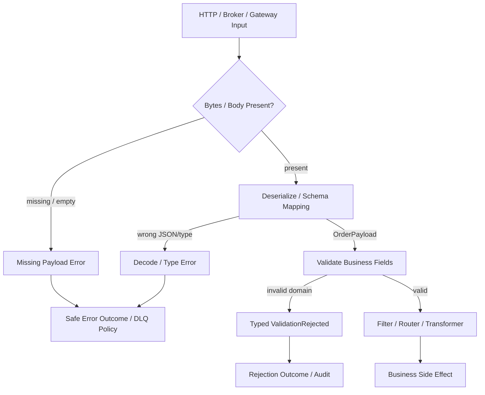
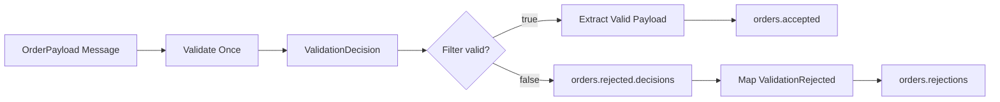
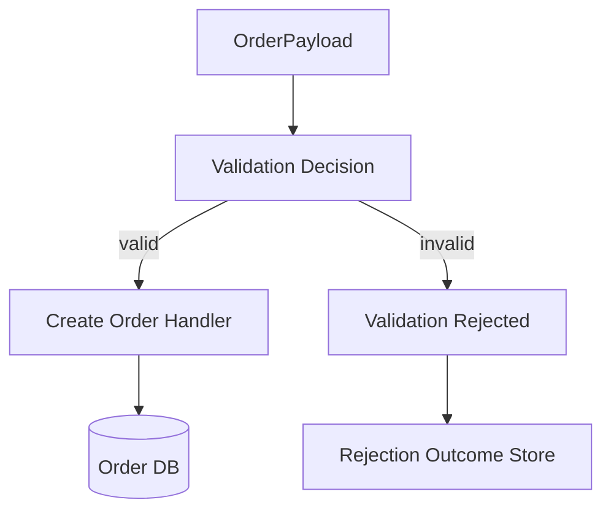
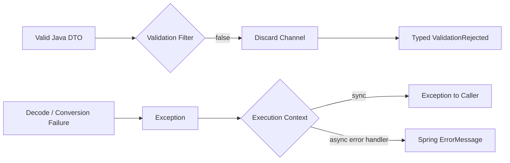
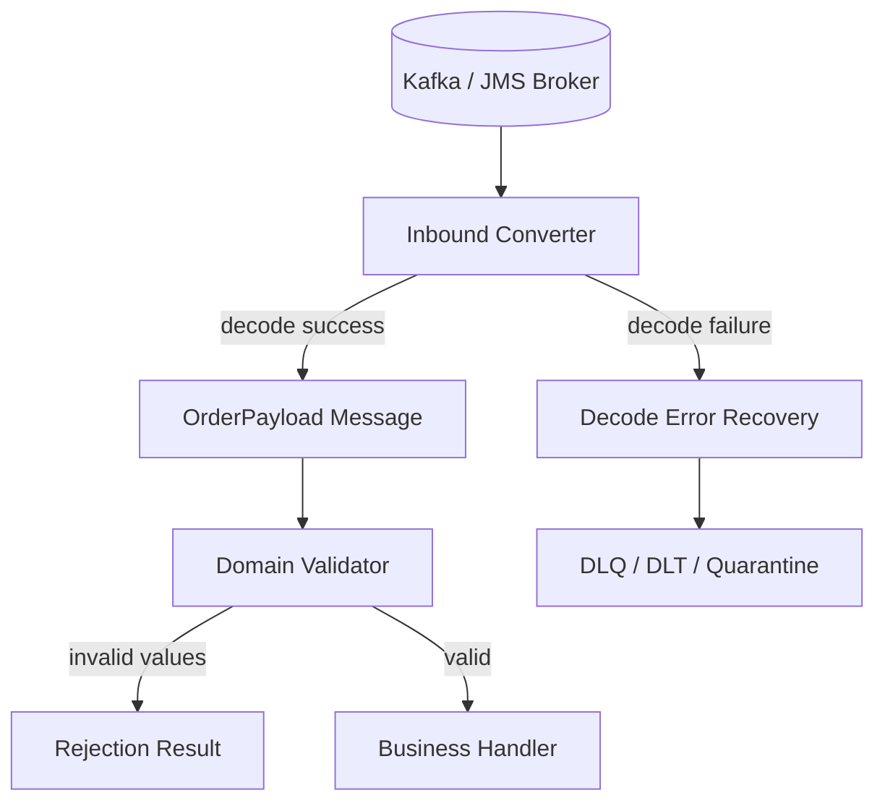
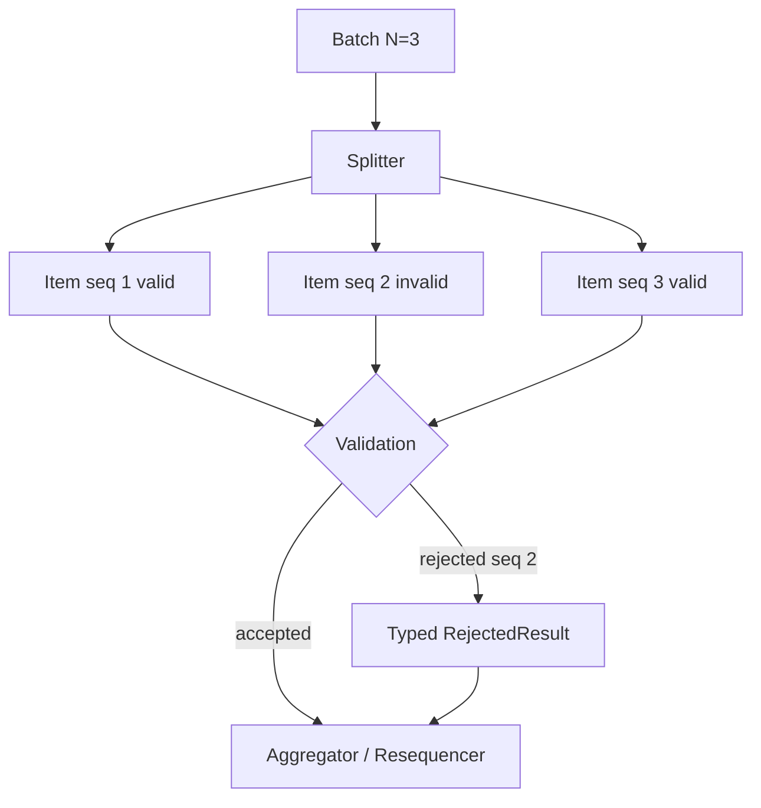
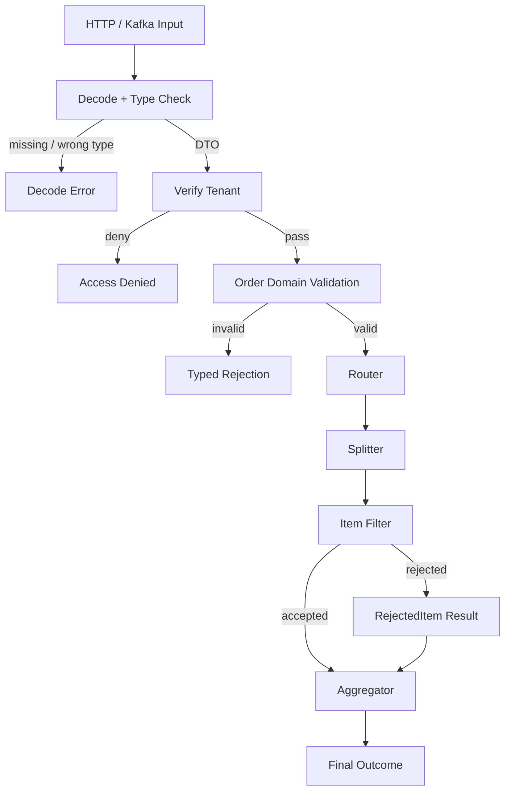

# Kiểm thử payload thiếu, sai kiểu và sai miền giá trị

Một hệ thống tích hợp có thể chạy ổn khi producer gửi message đúng định dạng nhưng thất bại khó dự đoán khi nhận **payload thiếu**, **payload sai kiểu**, hoặc **payload đúng kiểu nhưng giá trị nằm ngoài miền cho phép**. Cả ba đều được gọi chung là “validation failure” trong trao đổi hằng ngày, song chúng phát sinh tại **những lớp kỹ thuật khác nhau**, đòi hỏi kết quả kiểm thử và chiến lược xử lý riêng.

Ví dụ, một hệ thống nhận `OrderSubmitted` để chuyển tới Router, Filter, Transformer, Splitter và Aggregator:

- Request không có body, hoặc JSON `null`: có thể **chưa có DTO/message hợp lệ** để Filter xử lý.
- JSON có `lines` là chuỗi thay vì mảng: decoder có thể **không ánh xạ được sang kiểu Java**.
- JSON ánh xạ thành công nhưng `quantity=-2`: DTO tồn tại, song **vi phạm quy tắc nghiệp vụ**.

Nếu chỉ viết một test kiểm tra `validator.validate(order)` với `quantity=-2`, ta **chưa kiểm chứng** quá trình deserialize, ingress, Filter, discard flow, error channel hoặc việc ngăn side effect. Ngược lại, ném một exception chung ở mọi tầng khiến producer khó biết cần sửa dữ liệu hay retry khi phụ thuộc hạ tầng gặp sự cố.

Bài **“Kiểm thử payload thiếu, sai kiểu và sai miền giá trị”** thuộc chương **Message filter và validation** trong module **SPRING_INTEGRATION_PATTERN**. Module học cách triển khai Enterprise Integration Patterns bằng Spring Integration để xây dựng luồng thông điệp ít phụ thuộc, dễ mở rộng, kết hợp Router, Filter, Transformer, Splitter, Aggregator, Gateway, retry, error channel, correlation và kiểm thử các nhánh xử lý.

**Mục tiêu:** xây một hợp đồng input rõ ràng, phân tầng các loại lỗi, viết unit/parameterized/integration tests bằng JUnit 5 và Spring Integration, quan sát đúng accepted/rejected/error outputs, và bảo đảm dữ liệu sai không lọt vào side effect. Các đoạn mã là ví dụ học tập cho Java 17+, Jackson, JUnit 5 và Spring Integration Java DSL; cần đối chiếu API thực tế với phiên bản dự án ở vòng Content QA sau.

## 1. Ba nhóm lỗi phải được nhận diện riêng

| Nhóm | Ví dụ | Điểm phát hiện | Kết quả mong muốn |
| --- | --- | --- | --- |
| **Payload thiếu** | HTTP body rỗng; JSON `null`; thiếu field bắt buộc | Transport/decoder hoặc DTO validator | Không tạo lệnh nghiệp vụ; lỗi thiếu dữ liệu có cấu trúc |
| **Sai kiểu** | `lines` là chuỗi; `quantity` là object; payload là `String` thay vì `OrderPayload` | JSON/schema/Java type conversion | Không thực thi handler; decode/type error đúng phân loại |
| **Sai miền giá trị** | `quantity=-2`, `currency="XYZ"`, danh sách rỗng | Domain validator/Filter | Typed rejection với field/code; không có side effect |

Cần phân biệt **thiếu toàn bộ payload** với **thiếu một trường của payload**:

- Ở điểm nhận HTTP/JMS/Kafka, body có thể rỗng, bytes không hợp lệ hoặc JSON root là `null`. Decoder/inbound adapter cần xử lý trước khi đi đến Filter kiểu Java.
- Sau khi đã ánh xạ thành `OrderPayload`, một field như `customerId` có thể là `null` hoặc chuỗi rỗng. Đây là lỗi *field-level validation*.
- Khi lập trình trong Spring Messaging, các implementation thông dụng như `GenericMessage` và `MessageBuilder.withPayload(...)` **không cho phép payload `null`**. Vì vậy test `MessageBuilder.withPayload(null)` không thể dùng để chứng minh Filter bắt được null payload; nó phải test **hành vi tạo message hoặc ingress boundary**.

### Định nghĩa “đã test đúng”

Một kịch bản chỉ hoàn thành khi biết:

1. **Đầu vào** nào được gửi tới hệ thống, qua boundary nào.
2. **Thành phần** nào chịu trách nhiệm nhận diện lỗi.
3. **Đường xử lý lỗi** là rejection, exception hay dead-letter.
4. **Kết quả quan sát được** có đúng code/correlation và không lộ dữ liệu.
5. **Side effect** có bị chặn hay không.
6. **Retry/ACK** có phù hợp với lỗi hay không.

Không chỉ kiểm tra một thông báo log như “validation failed”.

## 2. Vị trí phát hiện lỗi trong Spring Integration flow

Một request có thể đi qua nhiều giai đoạn trước khi tới Filter.



**Ranh giới trách nhiệm**:

- **Transport:** body có hay không, định dạng content-type, giới hạn kích thước, xác thực producer.
- **Decoder/schema:** bytes có tạo được DTO đúng kiểu không, các trường có type phù hợp không.
- **Validator:** giá trị đã có kiểu đúng có thỏa quy tắc hay không.
- **Filter/Router:** DTO đã được kiểm tra có được phép đi vào một nhánh không.
- **Handler:** chỉ tạo side effect khi các tiền điều kiện bắt buộc đạt.

Một lỗi xảy ra **trước** khi có Spring `Message<OrderPayload>` không thể được kỳ vọng đi qua một `Filter<OrderPayload>` ở phía sau. Nó cần error handling ngay tại decoder/inbound adapter hoặc một envelope riêng.

## 3. Hợp đồng JSON để dùng nhất quán trong bài

Ta chọn một input đơn hàng, đơn giản nhưng đủ các loại constraint:

```json
{
  "requestId": "req-101",
  "tenantId": "tenant-a",
  "customerId": "CUS-42",
  "currency": "VND",
  "lines": [
    {"sku": "SKU-1", "quantity": 2}
  ]
}
```

Các giả định của bài:

- `requestId`, `tenantId`, `customerId` bắt buộc không rỗng.
- `currency` chỉ nhận `VND` hoặc `USD`; phân biệt hoa/thường trong hợp đồng minh họa.
- `lines` phải có ít nhất một phần tử, tối đa 100 phần tử.
- Mỗi dòng có `sku` không rỗng; `quantity` là số nguyên từ 1 đến 10.000.
- Không tự tạo `tenantId` từ raw client body khi dùng để phân quyền; phải đối chiếu với principal/provenance đáng tin.
- Không giả định một input hợp lệ về mặt schema đã được **ủy quyền** hoặc đã được kiểm tra tồn kho.

Để phân biệt **missing** và **wrong type**, DTO dùng `Integer` thay vì `int` cho quantity. Một `int` nguyên thủy có thể nhận giá trị mặc định 0 khi mapping thiếu, làm mất tín hiệu rằng field thực sự vắng mặt.

### Java DTO

```java
import java.util.List;

record OrderLine(String sku, Integer quantity) {}

record OrderPayload(
    String requestId,
    String tenantId,
    String customerId,
    String currency,
    List<OrderLine> lines
) {}
```

Đây là các Java record dùng trong bài test. **Record constructor mặc định không tự validate** field, nên Jackson có thể tạo `OrderPayload` với `lines=null`, trừ khi decoder/creator/schema được cấu hình ràng buộc trước.

Một DTO có kiểu đúng cũng chưa đồng nghĩa là dữ liệu đúng.

## 4. Ma trận payload thiếu

| Dữ liệu đầu vào | Có `OrderPayload` hợp lệ không? | Test ở đâu? | Kết quả |
| --- | --- | --- | --- |
| HTTP body không tồn tại | Không | HTTP adapter/controller boundary | `MISSING_BODY` hoặc HTTP 400 theo contract |
| Body độ dài 0 | Không | Input/JSON parser | `EMPTY_BODY` hoặc decode error |
| Body chỉ có whitespace | Không có JSON object | Decoder | `INVALID_JSON`/`EMPTY_BODY` theo policy |
| JSON root `null` | Decoder có thể trả Java `null` | Decoder guard | `ROOT_PAYLOAD_NULL` |
| JSON `{}` | Có thể tạo DTO nhưng field null | Domain validator | Nhiều `REQUIRED` violations |
| JSON thiếu `customerId` | DTO có field null | Domain validator | `customerId: REQUIRED` |
| `lines:null` | DTO có lines null | Domain validator | `lines: REQUIRED` |
| `lines:[]` | DTO có list rỗng | Domain validator | `lines: MUST_NOT_BE_EMPTY` |
| MessageBuilder payload null | Không thể tạo Spring Message | Message constructor unit test | Thất bại ở boundary tạo message |

**Không nên gom tất cả thành `INVALID_JSON`.** Body `{}` là JSON hợp lệ về cú pháp nhưng có thể sai contract; một decoder nghiêm có schema validation ngay tại ingress thì ranh giới phát hiện có thể dịch chuyển. Test phải khớp **chính sách đã chọn**, không hardcode rằng mọi implementation Jackson đều có cùng coercion/default.

### Quan sát quan trọng

`Message<OrderPayload>` không đại diện cho “không có body” một cách tự nhiên. Nếu muốn đưa trường hợp rỗng qua message flow, hãy dùng **envelope rõ ràng**, chẳng hạn `InboundPayload(rawBytes, contentType, requestId)`, chứ không tạo `Message<?>` với payload null để đánh lừa type system.

## 5. Ma trận payload sai kiểu

Các input JSON dưới đây **có cú pháp hợp lệ** nhưng có thể sai kiểu dữ liệu:

```json
{
  "requestId": "req-102",
  "tenantId": "tenant-a",
  "customerId": "CUS-42",
  "currency": "VND",
  "lines": "not-an-array"
}
```

```json
{
  "requestId": "req-103",
  "tenantId": "tenant-a",
  "customerId": "CUS-42",
  "currency": "VND",
  "lines": [
    {"sku": "SKU-1", "quantity": {"value": 2}}
  ]
}
```

Các trường hợp cần test:

| Trường hợp | Kỳ vọng |
| --- | --- |
| Root JSON là mảng thay vì object | Decoder/type checker từ chối theo contract |
| `lines` là chuỗi thay vì list | Type mapping lỗi |
| `quantity` là object thay vì integer | Type mapping lỗi |
| `quantity="abc"` | Type mapping lỗi |
| `quantity="2"` | **Phụ thuộc Jackson coercion policy**; muốn từ chối phải cấu hình strict |
| `currency=123` | Phụ thuộc scalar coercion policy |
| Raw Spring payload là `String` trong flow yêu cầu `OrderPayload` | Chặn ở ingress/type boundary; không giả vờ là domain violation |
| Content-Type không khớp format | Inbound adapter/decoder xử lý theo policy |

**Sai kiểu khác sai miền giá trị.** Một chuỗi `"abc"` không thể được so sánh với khoảng 1..10.000 như một số nguyên trước khi decode. Domain validator chỉ có trách nhiệm khi object đã có kiểu và cấu trúc cần thiết.

### Jackson có thể tự ép kiểu

Một số cấu hình Jackson chuyển `"2"` thành số 2, hoặc số thành chuỗi. Nếu API muốn **strict typing**, cần tắt coercion phù hợp và viết test chứng minh cấu hình đó, thay vì mặc định một JSON với chuỗi số sẽ bị từ chối.

## 6. Ma trận sai miền giá trị

Khi decoder đã tạo `OrderPayload`, các ca sau thuộc kiểm tra **nghiệp vụ/miền dữ liệu**:

| Field | Giá trị | Violation kỳ vọng |
| --- | --- | --- |
| `requestId` | `null` hoặc chuỗi trắng | `REQUIRED` |
| `customerId` | `""` | `REQUIRED` |
| `currency` | `"XYZ"` | `UNSUPPORTED_CURRENCY` |
| `currency` | `"usd"` | `UNSUPPORTED_CURRENCY` nếu policy phân biệt case |
| `lines` | `null` | `REQUIRED` |
| `lines` | `[]` | `MUST_NOT_BE_EMPTY` |
| `lines` | 101 phần tử | `TOO_MANY_ITEMS` |
| `lines[0]` | `null` | `REQUIRED` |
| `lines[0].sku` | chuỗi trắng | `REQUIRED` |
| `lines[0].quantity` | `null` | `REQUIRED` |
| `lines[0].quantity` | `0` | `OUT_OF_RANGE` |
| `lines[0].quantity` | `-2` | `OUT_OF_RANGE` |
| `lines[0].quantity` | `10001` | `OUT_OF_RANGE` |
| `lines[0].quantity` | `1` hoặc `10000` | Hợp lệ ở biên |

Với các phép kiểm tra `min <= value <= max`, cần test **hai phía biên** (0,1,10000,10001) chứ không chỉ một số âm.

Đối với giá tiền, ngày, tỷ giá hoặc enum, các miền dữ liệu khác có thể đòi thêm test precision, timezone, overflow và quy tắc quy đổi. Không thay đổi bộ quy tắc theo dữ liệu test mà không version hóa policy.

## 7. Viết validator thuần, không có side effect

Một validator nên trả **danh sách lỗi có cấu trúc**, không gắn kiểm tra trường hợp thông thường với exception hạ tầng.

```java
import java.util.List;

record FieldViolation(String path, String code) {}

record ValidationDecision(
    OrderPayload payload,
    List<FieldViolation> violations,
    String policyVersion
) {
    ValidationDecision {
        violations = List.copyOf(violations);
    }

    boolean valid() {
        return violations.isEmpty();
    }
}

record ValidationRejected(
    String requestId,
    String errorCode,
    List<FieldViolation> violations,
    String policyVersion,
    java.time.Instant rejectedAt
) {}
```

```java
import java.util.ArrayList;
import java.util.List;
import java.util.Set;

final class OrderValidator {
    static final String POLICY_VERSION = "order-validation-v1";

    private static final Set<String> CURRENCIES =
        Set.of("VND", "USD");

    ValidationDecision decide(OrderPayload payload) {
        if (payload == null) {
            throw new IllegalArgumentException(
                "Null payload is not an OrderPayload");
        }

        List<FieldViolation> issues = new ArrayList<>();

        required(issues, "requestId", payload.requestId());
        required(issues, "tenantId", payload.tenantId());
        required(issues, "customerId", payload.customerId());

        if (blank(payload.currency())) {
            issues.add(new FieldViolation("currency", "REQUIRED"));
        } else if (!CURRENCIES.contains(payload.currency())) {
            issues.add(new FieldViolation(
                "currency", "UNSUPPORTED_CURRENCY"));
        }

        List<OrderLine> lines = payload.lines();
        if (lines == null) {
            issues.add(new FieldViolation("lines", "REQUIRED"));
        } else if (lines.isEmpty()) {
            issues.add(new FieldViolation(
                "lines", "MUST_NOT_BE_EMPTY"));
        } else {
            if (lines.size() > 100) {
                issues.add(new FieldViolation(
                    "lines", "TOO_MANY_ITEMS"));
            }

            for (int i = 0; i < lines.size(); i++) {
                OrderLine line = lines.get(i);
                String path = "lines[" + i + "]";

                if (line == null) {
                    issues.add(new FieldViolation(path, "REQUIRED"));
                    continue;
                }

                required(issues, path + ".sku", line.sku());
                if (line.quantity() == null) {
                    issues.add(new FieldViolation(
                        path + ".quantity", "REQUIRED"));
                } else if (line.quantity() < 1
                        || line.quantity() > 10_000) {
                    issues.add(new FieldViolation(
                        path + ".quantity", "OUT_OF_RANGE"));
                }
            }
        }

        return new ValidationDecision(
            payload, issues, POLICY_VERSION);
    }

    private static void required(
            List<FieldViolation> issues,
            String path, String value) {
        if (blank(value)) {
            issues.add(new FieldViolation(path, "REQUIRED"));
        }
    }

    private static boolean blank(String value) {
        return value == null || value.isBlank();
    }
}
```

Giải thích:

- `OrderValidator.decide` **giả định đã có một OrderPayload Java**. Nó không phải JSON decoder.
- `payload==null` bị báo lỗi lập trình/boundary một cách rõ ràng; trong message flow đúng kiểu, null payload không được xây dựng thành Spring Message.
- Khi một field null, validator tạo `REQUIRED`; khi có kiểu hợp lệ nhưng ngoài miền, tạo `OUT_OF_RANGE`/`UNSUPPORTED_CURRENCY`.
- `issues` không chứa raw input value, tránh rò rỉ PII/token trong rejection.
- `ValidationDecision` giữ snapshot violations và `policyVersion` để downstream không cần validate lại.
- Ví dụ không có lookup DB/API; validator phụ thuộc nguồn ngoài cần phân biệt **UNKNOWN/UNAVAILABLE** với dữ liệu bị từ chối.

Cấu trúc đơn giản này giúp unit test ổn định mà không cần khởi động Spring.

## 8. Tạo typed rejection để consumer hiểu

Một message sai miền giá trị cần được mô tả **vì sao** bị chặn:

```json
{
  "requestId": "req-101",
  "errorCode": "ORDER_VALIDATION_FAILED",
  "policyVersion": "order-validation-v1",
  "violations": [
    {"path": "customerId", "code": "REQUIRED"},
    {"path": "lines[0].quantity", "code": "OUT_OF_RANGE"}
  ],
  "rejectedAt": "2026-11-21T06:00:00Z"
}
```

Dùng typed DTO giúp downstream phân biệt lỗi:

- `MISSING_PAYLOAD`: chưa có input body/message hợp lệ.
- `INVALID_PAYLOAD_TYPE`: parser hoặc type adapter không map được object.
- `ORDER_VALIDATION_FAILED`: object có kiểu đúng nhưng dữ liệu không đạt miền.
- `VALIDATION_UNAVAILABLE`: không thể kiểm tra do phụ thuộc hạ tầng.
- `ACCESS_DENIED`: actor không có quyền; cần xử lý bảo mật tách biệt.

**Không cần nhét cả stack trace** vào validation rejection. Cũng không nên trả `retryable=true` cho một `quantity=-2` rồi để broker gửi đi gửi lại vô hạn.

### Mapping quyết định thành kết quả từ chối

```java
import java.time.Clock;
import java.time.Instant;

final class ValidationRejectionMapper {
    private final Clock clock;

    ValidationRejectionMapper(Clock clock) {
        this.clock = clock;
    }

    ValidationRejected reject(ValidationDecision decision) {
        if (decision.valid()) {
            throw new IllegalArgumentException(
                "Cannot reject a valid decision");
        }

        return new ValidationRejected(
            decision.payload().requestId(),
            "ORDER_VALIDATION_FAILED",
            decision.violations(),
            decision.policyVersion(),
            Instant.now(clock)
        );
    }
}
```

`requestId` cũng có thể thiếu ở invalid DTO. Trong hệ thống thật, có thể dùng **transport-generated request ID** được cấp ở trusted ingress, không lấy request ID trống từ payload rồi giả vờ đã correlate đủ.

## 9. Unit test phân biệt thiếu field và sai miền giá trị

Bắt đầu với JUnit 5 và object có kiểu đã biết:

```java
import static org.junit.jupiter.api.Assertions.*;
import java.util.List;
import org.junit.jupiter.api.Test;

class OrderValidatorTest {

    private final OrderValidator validator = new OrderValidator();

    private OrderPayload order(
            String customerId,
            String currency,
            List<OrderLine> lines) {
        return new OrderPayload(
            "req-101", "tenant-a",
            customerId, currency, lines);
    }

    @Test
    void missingCustomerProducesRequiredViolation() {
        var result = validator.decide(order(
            null, "VND",
            List.of(new OrderLine("SKU-1", 1))));

        assertFalse(result.valid());
        assertTrue(result.violations().contains(
            new FieldViolation("customerId", "REQUIRED")));
    }

    @Test
    void nullLinesIsDifferentFromEmptyLines() {
        var missing = validator.decide(
            order("CUS-1", "VND", null));
        var empty = validator.decide(
            order("CUS-1", "VND", List.of()));

        assertTrue(missing.violations().contains(
            new FieldViolation("lines", "REQUIRED")));
        assertTrue(empty.violations().contains(
            new FieldViolation(
                "lines", "MUST_NOT_BE_EMPTY")));
    }

    @Test
    void wrongDomainValueProducesDomainViolation() {
        var result = validator.decide(order(
            "CUS-1", "XYZ",
            List.of(new OrderLine("SKU-1", -2))));

        assertTrue(result.violations().contains(
            new FieldViolation(
                "currency", "UNSUPPORTED_CURRENCY")));
        assertTrue(result.violations().contains(
            new FieldViolation(
                "lines[0].quantity", "OUT_OF_RANGE")));
    }

    @Test
    void validPayloadHasNoViolations() {
        var result = validator.decide(order(
            "CUS-1", "VND",
            List.of(new OrderLine("SKU-1", 1))));

        assertTrue(result.valid());
        assertEquals(List.of(), result.violations());
    }
}
```

Test này **không có Jackson/Spring Integration**, nên nó chứng minh chính sách domain validator, không chứng minh decode sai kiểu hoặc channel routing.

### Test nhiều violations trong một lần

Một input có hai lỗi nên trả hai lỗi, trừ khi contract chủ đích fail-fast. Đừng viết validator chỉ trả lỗi đầu tiên rồi test khẳng định “payload đã bị reject là đủ”; producer có thể phải sửa lần lượt nhiều lượt.

## 10. Parameterized test cho biên miền giá trị

JUnit 5 parameterized tests giảm số dòng lặp và làm các ranh giới rõ hơn.

```java
import static org.junit.jupiter.api.Assertions.*;
import java.util.List;
import org.junit.jupiter.params.ParameterizedTest;
import org.junit.jupiter.params.provider.CsvSource;

class QuantityDomainTest {

    private final OrderValidator validator = new OrderValidator();

    @ParameterizedTest
    @CsvSource({
        "0, false",
        "1, true",
        "2, true",
        "10000, true",
        "10001, false",
        "-1, false"
    })
    void quantityRespectsInclusiveBounds(
            int quantity, boolean expectedValid) {
        var payload = new OrderPayload(
            "req-quant", "tenant-a", "CUS-1", "VND",
            List.of(new OrderLine("SKU-1", quantity)));

        boolean valid = validator.decide(payload).valid();

        assertEquals(expectedValid, valid);
    }
}
```

**Điểm cần lưu ý**:

- Biên 1 và 10.000 là hợp lệ.
- Biên 0 và 10.001 không hợp lệ.
- `quantity=null` là **missing field**, cần một test riêng vì `CsvSource` với primitive `int` không thể hiện null theo cùng cách.
- Với `BigDecimal`, nên test precision, scale, số âm, số cực lớn và cách xử lý `NaN` nếu dùng kiểu floating-point.
- Nếu có ngày giờ, test UTC, timezone và mốc `now==deadline` bằng `Clock`.

## 11. Test JSON thiếu body, JSON null và JSON object rỗng

Dùng Jackson để minh họa một decoder boundary. Không cho phép JSON root `null` lọt đến Spring MessageBuilder.

```java
import com.fasterxml.jackson.core.JsonProcessingException;
import com.fasterxml.jackson.databind.ObjectMapper;

record DecodeOutcome(
    OrderPayload payload,
    String errorCode
) {
    boolean success() {
        return payload != null && errorCode == null;
    }
}

final class OrderJsonDecoder {
    private final ObjectMapper mapper;

    OrderJsonDecoder(ObjectMapper mapper) {
        this.mapper = mapper;
    }

    DecodeOutcome decode(String rawJson) {
        if (rawJson == null || rawJson.isBlank()) {
            return new DecodeOutcome(null, "MISSING_PAYLOAD");
        }

        try {
            OrderPayload result =
                mapper.readValue(rawJson, OrderPayload.class);

            if (result == null) {
                return new DecodeOutcome(
                    null, "ROOT_PAYLOAD_NULL");
            }

            return new DecodeOutcome(result, null);
        } catch (JsonProcessingException ex) {
            // Không trả toàn bộ Jackson exception ra client:
            // có thể chứa snippet dữ liệu hoặc thông tin schema.
            return new DecodeOutcome(
                null, "INVALID_PAYLOAD_TYPE_OR_JSON");
        }
    }
}
```

Trong production, nếu cần tách chính xác `INVALID_JSON_SYNTAX` và `INVALID_PAYLOAD_TYPE`, hãy phân loại Jackson exception với các subtype phù hợp và thêm schema validation. Bài dùng một mã gộp ở decoder mẫu để tập trung vào **boundary**; không nên suy ra mọi parse error đều là sai kiểu.

### Test decoder

```java
import static org.junit.jupiter.api.Assertions.*;
import com.fasterxml.jackson.databind.ObjectMapper;
import org.junit.jupiter.api.Test;

class OrderJsonDecoderTest {

    private final OrderJsonDecoder decoder =
        new OrderJsonDecoder(new ObjectMapper());

    @Test
    void emptyBodyIsRejectedBeforeMessageConstruction() {
        assertEquals("MISSING_PAYLOAD",
            decoder.decode("").errorCode());

        assertEquals("MISSING_PAYLOAD",
            decoder.decode("  ").errorCode());
    }

    @Test
    void jsonNullRootIsRejected() {
        var outcome = decoder.decode("null");

        assertFalse(outcome.success());
        assertEquals("ROOT_PAYLOAD_NULL",
            outcome.errorCode());
    }

    @Test
    void emptyJsonObjectCanMapButFailsDomainValidation() {
        var outcome = decoder.decode("{}");

        assertTrue(outcome.success());
        assertFalse(new OrderValidator()
            .decide(outcome.payload()).valid());
    }

    @Test
    void wrongCollectionTypeFailsDecode() {
        String json = """
            {
              "requestId":"req-1",
              "tenantId":"tenant-a",
              "customerId":"CUS-1",
              "currency":"VND",
              "lines":"not-a-list"
            }
            """;

        assertFalse(decoder.decode(json).success());
    }

    @Test
    void wrongQuantityTypeFailsDecode() {
        String json = """
            {
              "requestId":"req-1",
              "tenantId":"tenant-a",
              "customerId":"CUS-1",
              "currency":"VND",
              "lines":[{"sku":"S","quantity":{"n":2}}]
            }
            """;

        assertFalse(decoder.decode(json).success());
    }
}
```

Kết quả quan trọng: JSON `{}` có thể tạo DTO với các trường null; **đó không phải lý do để mong decoder tự từ chối** nếu contract không khai báo required fields ngay ở lớp schema.

## 12. Kiểm tra strict type coercion bằng Jackson

Nếu contract quy định `quantity` phải thực sự là số nguyên JSON chứ không được là chuỗi `"2"`, hãy cấu hình coercion và kiểm thử rõ.

Một ví dụ dành cho Jackson 2.x:

```java
import com.fasterxml.jackson.databind.MapperFeature;
import com.fasterxml.jackson.databind.json.JsonMapper;

final class StrictJsonConfiguration {
    static JsonMapper mapper() {
        return JsonMapper.builder()
            .disable(MapperFeature.ALLOW_COERCION_OF_SCALARS)
            .build();
    }
}
```

```java
import static org.junit.jupiter.api.Assertions.*;
import org.junit.jupiter.api.Test;

class StrictCoercionTest {

    @Test
    void numericStringIsNotAcceptedAsInteger() {
        var decoder = new OrderJsonDecoder(
            StrictJsonConfiguration.mapper());

        String json = """
            {
              "requestId":"req-1",
              "tenantId":"tenant-a",
              "customerId":"CUS-1",
              "currency":"VND",
              "lines":[{"sku":"S","quantity":"2"}]
            }
            """;

        assertFalse(decoder.decode(json).success());
    }
}
```

**Giới hạn phiên bản:** Jackson có các API coercion chi tiết theo kiểu dữ liệu và các phiên bản có thể thay đổi hành vi. Nếu ứng dụng dùng Jackson 3, DTO polymorphic hoặc custom deserializer, cần cấu hình/test theo version thực. Quan trọng là **không viết một test khẳng định “chuỗi số sai kiểu” trong khi ObjectMapper thực tế đang tự coercion nó thành số**.

Đặc biệt, test decoding phải dùng **ObjectMapper đúng instance/cấu hình mà inbound adapter thực sự sử dụng**, không chỉ new một mapper mặc định trong test rồi suy ra production cũng strict.

## 13. Test không cho tạo Spring Message với null payload

Một chi tiết rất thường bị viết sai trong test:

```java
MessageBuilder.withPayload(null).build();
```

Spring Messaging `MessageBuilder`/`GenericMessage` thông thường từ chối null payload trước khi Filter chạy. Không dùng đoạn code này làm message fixture rồi mong Filter báo `FieldViolation("payload","REQUIRED")`.

### Unit test ranh giới tạo message

```java
import static org.junit.jupiter.api.Assertions.*;
import org.junit.jupiter.api.Test;
import org.springframework.messaging.support.MessageBuilder;

class SpringMessageContractTest {

    @Test
    void nullPayloadCannotCreateOrdinarySpringMessage() {
        assertThrows(IllegalArgumentException.class, () ->
            MessageBuilder.withPayload((Object) null)
                .build());
    }
}
```

Nếu framework version ném một subtype/exception khác ở overload cụ thể, test nên đối chiếu contract của dependency thực tế. Điều cốt lõi: **null không tới được `Filter<OrderPayload>` qua con đường xây ordinary message như trên**.

Để test payload thiếu trong một luồng end-to-end, gửi **request không có body qua HTTP adapter**, hoặc gửi một **inbound envelope có raw bytes rỗng** qua decoder, rồi assert lỗi tương ứng ở **inbound error path**.

## 14. Filter kiểm tra đúng kiểu: chỉ chuyển tiếp DTO hợp lệ

Khi payload đã decode thành `OrderPayload`, một Filter có thể kiểm tra điều kiện domain và phân luồng.

Để không validate hai lần, ta chọn **transform thành `ValidationDecision` rồi Filter trên decision**. Message bị loại đi tới một discard flow nhận cùng decision đã chứa violations.



**Đây là boundary sau deserialize**, không phải đường xử lý raw JSON hoặc payload null. Chỉ đưa `OrderPayload` đã được type-check từ ingress vào input channel.

### Cấu hình Spring Integration Java DSL

```java
import java.time.Clock;
import org.springframework.context.annotation.Bean;
import org.springframework.context.annotation.Configuration;
import org.springframework.integration.channel.DirectChannel;
import org.springframework.integration.channel.QueueChannel;
import org.springframework.integration.config.EnableIntegration;
import org.springframework.integration.dsl.IntegrationFlow;
import org.springframework.messaging.MessageChannel;
import org.springframework.messaging.PollableChannel;

@Configuration
@EnableIntegration
class OrderValidationFlowConfiguration {

    @Bean("orders.validation.in")
    MessageChannel validationInput() {
        return new DirectChannel();
    }

    @Bean("orders.accepted")
    PollableChannel acceptedOrders() {
        // Dùng để quan sát/test; RAM queue không bền vững.
        return new QueueChannel();
    }

    @Bean("orders.rejected.decisions")
    MessageChannel rejectedDecisions() {
        return new DirectChannel();
    }

    @Bean("orders.rejections")
    PollableChannel rejectionOutcomes() {
        return new QueueChannel();
    }

    @Bean
    OrderValidator orderValidator() {
        return new OrderValidator();
    }

    @Bean
    ValidationRejectionMapper rejectionMapper() {
        return new ValidationRejectionMapper(Clock.systemUTC());
    }

    @Bean
    IntegrationFlow orderValidationFlow(OrderValidator validator) {
        return IntegrationFlow.from("orders.validation.in")
            .transform(OrderPayload.class, validator::decide)
            .filter(ValidationDecision.class,
                ValidationDecision::valid,
                spec -> spec.discardChannel(
                    "orders.rejected.decisions"))
            .transform(ValidationDecision.class,
                ValidationDecision::payload)
            .channel("orders.accepted")
            .get();
    }

    @Bean
    IntegrationFlow rejectedDecisionFlow(
            ValidationRejectionMapper mapper) {
        return IntegrationFlow.from("orders.rejected.decisions")
            .transform(ValidationDecision.class,
                mapper::reject)
            .channel("orders.rejections")
            .get();
    }
}
```

Diễn giải:

1. `orders.validation.in` nhận đúng kiểu `OrderPayload`.
2. `transform` chạy validator **một lần** và tạo `ValidationDecision`.
3. Filter chỉ đọc `valid()` từ quyết định đã lưu, tránh khác biệt giữa hai lần validate.
4. Nếu `valid=false`, `discardChannel` nhận **message chứa `ValidationDecision`**, không phải `ErrorMessage`.
5. Discard flow chuyển thành typed `ValidationRejected` để test đọc qua `orders.rejections`.
6. Nếu `valid=true`, flow trích payload hợp lệ và phát qua `orders.accepted`.
7. Hai `QueueChannel` là công cụ kiểm thử trong JVM; production có thể dùng service handlers/broker/outcome store.

**Không khai báo đây là một flow chạy được end-to-end với raw String payload.** Nếu đưa sai kiểu vào `orders.validation.in`, typed transformer có thể gặp conversion/type exception; không được dự đoán nó sẽ xuất ra `ValidationRejected` trừ khi có tầng type guard tường minh.

### Chú ý về version

Các overload Java DSL `transform(Class, ...)`, `filter(Class, ..., spec)` và cấu hình channel cần xác nhận với phiên bản Spring Integration được dùng. Không tự chuyển từ `.filter(...)` sang `throwExceptionOnRejection(true)` rồi cho rằng discard flow vẫn hoạt động giống hệt.

## 15. Integration test: valid đi tiếp, invalid bị chặn

Test cần **khởi tạo Spring context thật** cho các endpoint, không chỉ gọi `OrderValidator`.

```java
import static org.junit.jupiter.api.Assertions.*;
import java.util.List;
import org.junit.jupiter.api.Test;
import org.springframework.beans.factory.annotation.Autowired;
import org.springframework.beans.factory.annotation.Qualifier;
import org.springframework.integration.config.EnableIntegration;
import org.springframework.messaging.Message;
import org.springframework.messaging.MessageChannel;
import org.springframework.messaging.PollableChannel;
import org.springframework.messaging.support.MessageBuilder;
import org.springframework.test.context.junit.jupiter.SpringJUnitConfig;

@SpringJUnitConfig(OrderValidationFlowConfiguration.class)
class OrderValidationFlowIntegrationTest {

    @Autowired
    @Qualifier("orders.validation.in")
    MessageChannel input;

    @Autowired
    @Qualifier("orders.accepted")
    PollableChannel accepted;

    @Autowired
    @Qualifier("orders.rejections")
    PollableChannel rejected;

    private OrderPayload order(int quantity, String currency) {
        return new OrderPayload(
            "req-101", "tenant-a", "CUS-1", currency,
            List.of(new OrderLine("SKU-1", quantity)));
    }

    @Test
    void validOrderGoesOnlyToAcceptedChannel() {
        assertTrue(input.send(MessageBuilder
            .withPayload(order(2, "VND")).build()));

        Message<?> approved = accepted.receive(1_000);
        assertNotNull(approved);
        assertTrue(approved.getPayload()
            instanceof OrderPayload);

        assertNull(rejected.receive(50));
    }

    @Test
    void invalidDomainProducesTypedRejectionNotAccepted() {
        assertTrue(input.send(MessageBuilder
            .withPayload(order(-2, "XYZ")).build()));

        assertNull(accepted.receive(50));

        Message<?> outcome = rejected.receive(1_000);
        assertNotNull(outcome);

        ValidationRejected rejection =
            (ValidationRejected) outcome.getPayload();

        assertEquals("ORDER_VALIDATION_FAILED",
            rejection.errorCode());
        assertTrue(rejection.violations().contains(
            new FieldViolation(
                "lines[0].quantity", "OUT_OF_RANGE")));
        assertTrue(rejection.violations().contains(
            new FieldViolation(
                "currency", "UNSUPPORTED_CURRENCY")));
    }
}
```

**Phạm vi test**: minh họa happy path và domain rejection qua Spring Integration. Với `@SpringJUnitConfig`, cần `spring-test` và cấu hình/bean thật đúng cách. Nếu trong project dùng Spring Boot test, chuyển sang fixture Boot phù hợp; không trộn hai test context có cùng tên channel nếu không cô lập.

### Tránh test nhiễm trạng thái lẫn nhau

`QueueChannel` giữ message tới khi được đọc. Nếu test cùng ApplicationContext, phải **đọc sạch output được tạo**, dùng request ID riêng và reset store/mock khi cần. Chạy test song song trên một queue chung có thể khiến test A nhận output của test B.

Một test chỉ assert `send(...) == true` **không đủ**, vì điều đó chỉ cho biết channel chấp nhận gửi theo semantics của nó, không chứng minh handler đã hoàn tất side effect.

## 16. Khi payload sai kiểu ở channel nội bộ thì test gì?

Giả sử một producer nội bộ gửi:

```java
input.send(MessageBuilder
    .withPayload("not-an-OrderPayload")
    .build());
```

Có hai thiết kế hợp lệ, nhưng phải chọn rõ:

1. **Typed ingress contract:** chỉ OrderPayload được gửi tới channel. Producer sai kiểu là lỗi lập trình/contract; integration test assert **exception tại handler/type conversion**, accepted và rejected outcome không có; infrastructure error handling chịu trách nhiệm tùy execution context.
2. **Tolerant envelope boundary:** input nhận `Message<?>` hoặc một envelope trung gian; bước đầu kiểm tra `payload instanceof OrderPayload`, nếu sai tạo `INVALID_PAYLOAD_TYPE` có cấu trúc; chỉ đối tượng hợp lệ được chuyển vào typed flow.

**Không mặc định Spring sẽ tự đổi bất kỳ `String` thành `OrderPayload`**. Nếu có converter được đăng ký, kết quả có thể thay đổi; test cần xác minh conversion service thực tế.

### Kiểm tra kiểu trước khi vào domain flow

Một ví dụ Java đơn giản về boundary kiểu:

```java
record TypeCheckResult(
    OrderPayload payload,
    String errorCode
) {
    boolean accepted() {
        return payload != null && errorCode == null;
    }
}

final class OrderPayloadTypeGuard {
    TypeCheckResult check(Object value) {
        if (value instanceof OrderPayload order) {
            return new TypeCheckResult(order, null);
        }
        return new TypeCheckResult(
            null, "INVALID_PAYLOAD_TYPE");
    }
}
```

Test:

```java
import static org.junit.jupiter.api.Assertions.*;
import org.junit.jupiter.api.Test;

class OrderPayloadTypeGuardTest {

    private final OrderPayloadTypeGuard guard =
        new OrderPayloadTypeGuard();

    @Test
    void rejectsUnexpectedJavaPayloadType() {
        var result = guard.check("wrong-java-type");

        assertFalse(result.accepted());
        assertEquals("INVALID_PAYLOAD_TYPE",
            result.errorCode());
    }

    @Test
    void acceptsCorrectJavaPayloadType() {
        var result = guard.check(new OrderPayload(
            "req-1", "tenant-a", "CUS-1", "VND",
            java.util.List.of(
                new OrderLine("SKU-1", 1))));

        assertTrue(result.accepted());
    }
}
```

Type guard dùng `Object` vì nó chạy ở boundary. Trong typed domain flow, không cần biến mọi handler thành `instanceof` nếu ingress đã bảo đảm kiểu hợp lệ.

## 17. Bean Validation giúp gì, và không tự làm gì?

Jakarta Bean Validation có các annotation thường gặp:

```java
import jakarta.validation.Valid;
import jakarta.validation.constraints.Max;
import jakarta.validation.constraints.Min;
import jakarta.validation.constraints.NotBlank;
import jakarta.validation.constraints.NotEmpty;
import java.util.List;

record ValidatedLine(
    @NotBlank String sku,
    @Min(1) @Max(10_000) Integer quantity
) {}

record ValidatedOrder(
    @NotBlank String requestId,
    @NotBlank String tenantId,
    @NotBlank String customerId,
    @NotBlank String currency,
    @NotEmpty List<@Valid ValidatedLine> lines
) {}
```

Điểm mạnh:

- Có thể diễn đạt các constraint phổ biến trên kiểu Java.
- Có thể chạy `Validator.validate(...)` và ánh xạ `ConstraintViolation` sang field/code.
- Có thể kết hợp validation groups theo giai đoạn.

Nhưng:

- **Annotation không tự chạy** chỉ vì DTO được đưa vào một Spring Integration `Filter`.
- `@NotEmpty` trên lines không kiểm tra toàn bộ quy tắc business (giới hạn 100 items hoặc currency allowlist phải bổ sung).
- `@Min`/`@Max` **không thay thế `@NotNull`** nếu field thực sự bắt buộc: theo đặc tả Bean Validation, nhiều constraint cho phép null để dùng kết hợp với `@NotNull`.
- Annotation không bắt lỗi JSON không parse được **trước khi có DTO**.
- Validation không chứng minh tenant từ payload được ủy quyền.

### Kiểm thử validator provider

```java
import static org.junit.jupiter.api.Assertions.*;
import jakarta.validation.Validation;
import jakarta.validation.Validator;
import org.junit.jupiter.api.Test;

class BeanValidationExampleTest {

    @Test
    void rejectsMissingCustomer() {
        try (var factory =
                Validation.buildDefaultValidatorFactory()) {
            Validator validator = factory.getValidator();

            ValidatedOrder dto = new ValidatedOrder(
                "req-1", "tenant-a", "",
                "VND", java.util.List.of(
                    new ValidatedLine("SKU-1", 2)));

            assertFalse(validator.validate(dto).isEmpty());
        }
    }
}
```

Test phải có **Jakarta Validation provider** trong classpath. Nếu không có provider, lỗi khởi tạo không phải là chứng cứ dữ liệu DTO hợp lệ/không hợp lệ. Trên các phiên bản framework khác nhau, lifecycle/close của factory phải phù hợp API thật.

## 18. Test Filter và side effect cùng lúc

Trong production, một payload không hợp lệ không được vượt qua validation rồi gọi service tạo đơn.



Với test sử dụng Mockito (phác thảo):

```java
// Fixture: Spring context chứa business handler mock
// phía sau accepted channel và rejection sink mock.
//
// Gửi invalid:
//   quantity = -2
//
// Assertions:
verify(orderService, never()).createOrder(any());
verify(rejectionSink, times(1)).publish(argThat(
    result -> result.errorCode()
        .equals("ORDER_VALIDATION_FAILED")));

// Gửi valid:
verify(orderService, times(1)).createOrder(any());
```

Ví dụ flow ở mục 14 dùng `QueueChannel` để quan sát đầu ra thay vì gọi handler. Khi chuyển sang business side effect test, hãy nối một handler **thực sự tiêu thụ accepted messages**; nếu không, Mockito `never()` có thể PASS vì không có endpoint nào chạy chứ không phải do Filter bảo vệ.

**Test mạnh cần có cả hai assertion:** invalid không tạo side effect, valid có tạo side effect. Như vậy tránh false confidence do topology sai hoặc handler chưa được đăng ký.

## 19. Kiểm tra error channel và discard channel đúng ngữ nghĩa

Đừng nhầm:

- `discardChannel` của Filter nhận **message bị loại** theo cơ chế Filter; trong ví dụ của chúng ta, nó nhận `ValidationDecision`.
- `ErrorMessage` của Spring là một message mà payload là `Throwable`, được error handler publish khi exception xảy ra.
- Việc gửi `ValidationRejected` tới channel tên `orders.rejections` không tự biến nó thành `ErrorMessage`.



### Lỗi trong DirectChannel

Với một call stack đồng bộ, exception có thể truyền lên người gọi `send(...)`. Không được viết test kiểu “truyền sai kiểu rồi chắc chắn global errorChannel nhận ErrorMessage” khi **không có error publisher**.

### Lỗi qua ExecutorChannel/poller

Nếu exception được error handler của worker/poller bắt, Spring Integration có thể phát `ErrorMessage` theo error channel được cấu hình. Test cần khởi chạy **đúng execution context** và quan sát channel. Đừng suy luận từ một unit test gọi trực tiếp validator.

### Test phân loại lỗi

| Đầu vào | Đường xử lý |
| --- | --- |
| DTO đúng kiểu, sai quantity | Typed rejection/discard, không cần exception |
| Message sai kiểu vào typed ingress | Contract/type exception hoặc type rejection boundary |
| JSON không parse | Inbound decoder error, thường trước Filter |
| Validator gọi DB và DB timeout | Infrastructure error; bounded retry/recovery |
| Filter `false` và `throwExceptionOnRejection=true` | `MessageRejectedException` theo cấu hình |
| Filter `false` và có `discardChannel` | Message bị loại đi vào discard flow |

**Không dùng error channel như một thùng chứa mọi thứ rồi tự động retry tất cả.** Điều đó khiến lỗi deterministic bị replay liên tục.

## 20. Gateway và API contract: không báo timeout như lỗi field

Với Gateway request-reply, caller có thể cần:

```json
{
  "requestId": "req-101",
  "status": "REJECTED",
  "errorCode": "ORDER_VALIDATION_FAILED",
  "violations": [
    {"path": "lines[0].quantity", "code": "OUT_OF_RANGE"}
  ]
}
```

Nếu Filter loại message nhưng không phát reply, Gateway có thể **chờ rồi hết reply timeout**. Khi đó client chỉ thấy “timeout”, không biết quantity sai. Để tránh:

- Với API đồng bộ, validate ở ingress và **trả error response có cấu trúc**.
- Với request-reply Gateway, thiết kế cả accepted lẫn rejected branch **có reply** theo một contract chung nếu caller phải chờ kết quả.
- Với API `202 Accepted` đưa việc vào broker, dùng outcome topic/status API/webhook để cung cấp kết quả validation bất đồng bộ.
- Không biến `MessageRejectedException` thành HTTP 500 chung nếu nó tương ứng input invalid cần trả 400/422 theo contract.
- Khi error infrastructure xảy ra, không trả 422 “input invalid” chỉ vì request chưa được xử lý.

**ACK vận chuyển không phải kết quả validation thành công**. Một Kafka producer thấy message được accept vào topic vẫn chưa biết consumer sẽ chấp nhận dữ liệu nghiệp vụ.

## 21. Test dữ liệu thiếu ở HTTP ingress

Trong ứng dụng có HTTP endpoint, test có thể gửi:

- Không có request body.
- Body rỗng.
- `Content-Type: application/json` nhưng body là `null`.
- JSON `{}`.
- JSON hợp lệ nhưng thiếu field.
- JSON với scalar sai kiểu.
- JSON domain-invalid.

### Dạng test HTTP minh họa

```java
// Ví dụ ý tưởng với MockMvc trong Spring Web:
//
// mockMvc.perform(post("/orders")
//     .contentType(MediaType.APPLICATION_JSON))
//     .andExpect(status().isBadRequest());
//
// mockMvc.perform(post("/orders")
//     .contentType(MediaType.APPLICATION_JSON)
//     .content("{\"lines\":\"not-a-list\"}"))
//     .andExpect(status().isBadRequest());
//
// mockMvc.perform(post("/orders")
//     .contentType(MediaType.APPLICATION_JSON)
//     .content("{\"requestId\":\"r\",\"tenantId\":\"t\","
//         + "\"customerId\":\"c\",\"currency\":\"VND\","
//         + "\"lines\":[{\"sku\":\"S\",\"quantity\":-2}]}"))
//     .andExpect(status().isUnprocessableEntity());
```

Đây là **phác thảo**. Kết quả 400/422 tùy controller/advice và API contract; Spring Web không tự trả 422 cho mọi DTO domain-invalid. Test phải cài đặt endpoint và mapping lỗi rõ ràng trước khi kỳ vọng những status đó.

Nếu module chỉ dùng Spring Integration mà không có Spring MVC, hãy test ở **HTTP inbound gateway/decoder tương ứng** hoặc tạo integration fixture có raw body, chứ không thêm Spring MVC vào production chỉ để chạy ví dụ.

## 22. Test JSON parse với Kafka/JMS khác test HTTP

Khi một broker gửi bytes hoặc serialized payload, có thể có lỗi ngay ở inbound adapter hoặc converter:



Test phải kiểm tra:

1. Payload bytes sai schema có được ghi **decode error** không?
2. Message ấy có chặn consumer partition/queue vô hạn do retry không?
3. Retry deterministic decode error có được giới hạn không?
4. Hệ thống có giữ payload nhạy cảm trong DLQ quá lâu không?
5. ACK/offset chỉ được commit sau khi rejection/quarantine thành công theo hợp đồng không?
6. Một event payload thiếu `requestId` có được cấp transport ID để audit không?
7. Redelivery có tạo nhiều rejection events không?
8. Các message hợp lệ phía sau có tiếp tục được xử lý theo chính sách ordering không?

**Spring Integration `errorChannel` khác Kafka DLT hoặc JMS DLQ.** Một `ErrorMessage` trong ứng dụng không chứng minh broker đã commit offset, ACK, seek hay chuyển record vào dead-letter topic.

Với message sai kiểu được Kafka converter tự chuyển thành exception, đừng cố assert `OrderValidator.decide` đã được gọi — nó có thể **chưa chạy**.

## 23. Quyền truy cập và dữ liệu sai kiểu có thể là tấn công

Một input sai kiểu không phải lúc nào cũng là lỗi vô ý:

- Một client gửi list hàng trăm nghìn phần tử nhằm làm validator tốn bộ nhớ.
- Một object có cấu trúc sâu cố vượt recursion limit.
- Một header giả `tenantId` hoặc `replyChannel` cố điều hướng dữ liệu.
- Một chuỗi rất dài khiến error log quá lớn.
- JSON field có nội dung chứa token, mật khẩu hoặc số thẻ.
- Payload được sinh từ deserializer polymorphic không có allowlist type phù hợp.

Khi test các trường hợp ấy:

- Giới hạn kích thước request ở **transport/decoder** trước khi tạo DTO lớn.
- Giới hạn số field/list items và độ sâu JSON nếu có nguy cơ.
- Không dùng exception message thô làm response công khai.
- Chỉ map violation thành **field path + code**, không echo raw secrets.
- Đối chiếu tenant/actor với security context đáng tin.
- Không cho client chọn `errorChannel`, `replyChannel` hoặc correlation scope nội bộ.
- Với log, dùng audit ID và controlled metadata, không phát toàn bộ `failedMessage`.

**Việc test “sai kiểu” nên bao gồm kiểm thử bảo mật của ingress**, không chỉ câu hỏi class cast.

## 24. Kiểm thử multi-tenant và correlation

Nếu hai tenant cùng có `requestId=req-101`, một rejection ở tenant A không được báo nhầm cho tenant B.

```text
tenant-a / req-101 / INVALID_QUANTITY
tenant-b / req-101 / VALID
```

Test:

1. Producer A gửi DTO sai giá trị nhưng có tenant được xác thực A.
2. Producer B gửi DTO hợp lệ, cùng request ID nghiệp vụ.
3. Outcome A phải là rejection thuộc A; B phải được chấp nhận.
4. Không phát nguyên văn payload A vào error handler hoặc notification của B.
5. Không dùng `requestId` duy nhất làm key cho outcome store nếu ID chỉ duy nhất trong một tenant.
6. Nếu một message client tự khai tenant B trong payload nhưng principal thuộc A, từ chối theo **authorization**, không gộp thành `customerId: REQUIRED`.

**Validation field syntax không thay thế kiểm tra quyền**. Test invalid domain và test cross-tenant authorization nên có contract/code riêng.

## 25. Validation và Splitter, Aggregator, Resequencer

Giả sử Splitter tạo N item với `sequenceNumber=1..N`. Nếu Filter bỏ một item sai kiểu hoặc sai miền, Aggregator phía sau có thể đợi vô hạn.



**Kế hoạch kiểm thử**:

- Một item sai `quantity` sau Splitter không được tạo side effect cho chính item ấy.
- Nếu batch policy yêu cầu “đủ kết quả cho mọi item”, nhánh rejection phải gửi `ItemResult(status=REJECTED)` giữ đúng correlation/sequence/part ID, thay vì xóa message vô dấu vết.
- Release strategy đếm **unique part IDs**; duplicate của item 1 không được thay item 2.
- Nếu batch phải fail fast, validate cả batch trước Splitter hoặc có coordinator hủy/hold các nhánh còn lại.
- Nếu Resequencer cần seq=2, không tự giảm `sequenceSize` chỉ vì item ấy bị từ chối.
- Group timeout phải được kiểm thử riêng, không dùng nó để che việc thiếu result do Filter.
- Khi một rejection event được redeliver, Aggregator không được release hai lần hoặc tạo partial sai.

**Một Filter chạy đúng vẫn có thể làm toàn bộ pipeline sai** nếu tác động của việc discard lên sequence/correlation chưa được thiết kế.

## 26. Kiểm thử retry, idempotency và error sink

Một dữ liệu sai miền như `quantity=-2` không trở nên hợp lệ sau khi retry y hệt. Ngược lại, khi validator phải gọi Catalog Service và service timeout, lỗi có thể là tạm thời.

| Nguyên nhân | Retry nguyên message? | Test trọng tâm |
| --- | --- | --- |
| Thiếu field bắt buộc | Thường không | Một typed rejection, không loop |
| Sai JSON type cố định | Thường không | Decode error/quarantine, ACK đúng policy |
| Quantity ngoài miền | Thường không | Side effect không chạy |
| Catalog Service timeout | Có thể bounded retry | Chặn fail-open, giữ correlation |
| Store/outcome sink lỗi | Recovery phù hợp | Không ACK “đã lưu rejection” khi chưa lưu |
| Downstream tạo side effect rồi mất ACK | Không retry mù | Idempotency/reconciliation |
| Reprocess có sửa payload và được phép | Có theo generation mới | Không nhầm với duplicate |

### Rejection event cũng cần chống trùng

Một rejection outcome có thể mang idempotency key dạng:

```text
(tenantId, requestId, validationStage, policyVersion)
```

Nếu consumer redeliver cùng invalid message, rejection sink không nên gửi vô số email/ticket hoặc tạo nhiều bản ghi độc lập. Dùng unique constraint/outbox hoặc outcome store theo yêu cầu.

**Không đồng nhất business event ID với Spring `MessageHeaders.ID`**. Message ID do framework có thể thay đổi sau transform/transport, nên không phù hợp làm key duy nhất cho dedup xuyên retry trong mọi topology.

## 27. Test matrix end-to-end đề xuất

| ID | Đầu vào | Lớp xử lý | Điều phải assert |
| --- | --- | --- | --- |
| T01 | Không có HTTP body | Ingress | MISSING_BODY/400 theo contract; không có side effect |
| T02 | Body rỗng | Decoder | MISSING_PAYLOAD |
| T03 | JSON `null` | Decoder | ROOT_PAYLOAD_NULL |
| T04 | JSON `{}` | Validator | Nhiều REQUIRED violations |
| T05 | Thiếu customer ID | Validator | customerId REQUIRED |
| T06 | lines null | Validator | lines REQUIRED |
| T07 | lines rỗng | Validator | MUST_NOT_BE_EMPTY |
| T08 | lines là String | Decoder | TYPE_ERROR; Filter typed không chạy |
| T09 | quantity là object | Decoder | TYPE_ERROR |
| T10 | quantity là `"2"` | Strict decoder | Reject nếu coercion bị cấm |
| T11 | quantity null | Validator | REQUIRED |
| T12 | quantity 0 | Validator | OUT_OF_RANGE |
| T13 | quantity 1 | Validator | Accepted |
| T14 | quantity 10000 | Validator | Accepted |
| T15 | quantity 10001 | Validator | OUT_OF_RANGE |
| T16 | currency XYZ | Validator | UNSUPPORTED_CURRENCY |
| T17 | Hai lỗi domain đồng thời | Validator/Filter | Đủ cả hai violations |
| T18 | Payload là Java String | Type boundary | Reject/exception theo contract |
| T19 | MessageBuilder payload null | Message boundary | Không tạo message |
| T20 | Invalid DTO vào flow Filter | Spring Integration | Chỉ có rejected output, không accepted |
| T21 | Valid DTO vào Filter | Spring Integration | Accepted output và handler được gọi |
| T22 | Async typed transformer lỗi | Error handler | ErrorMessage theo topology được test |
| T23 | Catalog timeout | Dependency validator | UNAVAILABLE, retry bounded |
| T24 | Producer A giả tenant B | Authorization | ACCESS_DENIED, không trộn groups |
| T25 | Filter loại một split item | Aggregator | RejectedResult có đúng part ID |
| T26 | Duplicate invalid event | Outcome store | Không nhân đôi rejection side effect |
| T27 | Error sink bị lỗi | Retry/outbox | Không mất rejection outcome |
| T28 | Oversized payload | Transport | Chặn trước khi cấp tài nguyên lớn |
| T29 | Secret trong field invalid | Error mapping | Không echo/log giá trị bí mật |
| T30 | Schema được version hóa | Compatibility | Message version cũ có outcome theo policy |

Không nhất thiết chạy cả 30 kịch bản trong một test class; chia thành **decoder tests**, **validator unit tests**, **Spring Integration flow tests** và **transport/contract tests**. Mỗi lớp có tốc độ chạy và trách nhiệm riêng.

## 28. Test âm tính phải khẳng định không có output sai

Một bộ test có thể PASS vì chỉ assert đã nhận rejection mà **không kiểm tra accepted channel**. Khi cấu hình Flow lỗi, cả hai nhánh có thể cùng được gọi.

Với invalid DTO, nên assert:

```text
rejection count == 1
accepted count  == 0
business side effect == 0
rejection.errorCode == ORDER_VALIDATION_FAILED
rejection.violations contains expected paths
```

Với valid DTO:

```text
accepted count == 1
rejection count == 0
business side effect == 1 (nếu handler đã nối đúng)
```

**Không dùng một khoảng chờ âm quá ngắn làm chứng cứ duy nhất** trong flow bất đồng bộ. Với executor/broker, kết quả có thể đến sau assertion; dùng latch/await có deadline hợp lý và quan sát trạng thái xử lý hoàn tất.

Nếu test message không xuất hiện ở cả hai channel, phải kiểm tra endpoint có subscribe, error exception hoặc route bị drop, chứ không kết luận “validator đã reject chính xác”.

## 29. Kiểm thử bằng bảng dữ liệu thay vì lặp code

Một cách tổ chức case dữ liệu:

```text
name                         payload         expected_stage   expected_code
missing-body                 ""              DECODER          MISSING_PAYLOAD
null-root                    "null"          DECODER          ROOT_PAYLOAD_NULL
wrong-lines-type             lines="abc"     DECODER          TYPE_ERROR
missing-customer             customer=null   DOMAIN           REQUIRED
zero-quantity                quantity=0      DOMAIN           OUT_OF_RANGE
too-large-quantity           quantity=10001  DOMAIN           OUT_OF_RANGE
unsupported-currency         currency="XYZ"  DOMAIN           UNSUPPORTED_CURRENCY
valid-min-bound              quantity=1      ACCEPTED         NONE
valid-max-bound              quantity=10000  ACCEPTED         NONE
```

Sử dụng `@MethodSource` để xây object theo từng lớp và assert stage/code đúng. **Không cần gửi mọi case qua cùng một method** nếu input type hoặc boundary khác: một test truyền raw JSON, test khác truyền DTO.

Gợi ý structure:

- `OrderJsonDecoderTest`: bytes, JSON syntax, type mapping và coercion.
- `OrderValidatorTest`: DTO field-level/domain rules.
- `OrderValidationFlowIntegrationTest`: accepted vs rejected path.
- `OrderPayloadTypeGuardTest`: wrong Java type ở ingress.
- `TransportErrorContractTest`: HTTP status, broker ACK/DLT, error channel.
- `OrderWorkflowSafetyTest`: side effects, Splitter/Aggregator, retry/idempotency.

Việc chia lớp test theo boundary giúp lỗi xuất hiện tại nơi cần sửa, thay vì một integration test dài thất bại nhưng không biết do Jackson, Filter hay broker.

## 30. Observability và dữ liệu test

Gợi ý metric:

```text
validation_requests_total{stage="decode",result="missing_payload"}
validation_requests_total{stage="decode",result="wrong_type"}
validation_requests_total{stage="domain",result="invalid"}
validation_requests_total{stage="domain",result="valid"}
validation_violations_total{code="OUT_OF_RANGE"}
validation_rejections_published_total{flow="orders"}
validation_rejection_sink_failures_total{flow="orders"}
validation_decode_duration_seconds{flow="orders"}
validation_domain_duration_seconds{flow="orders"}
```

Đây là **tên metric minh họa**, không phải metric Spring Integration tự sinh. Không dùng `requestId`, `customerId` hoặc raw payload làm metric labels.

Một log an toàn:

```json
{
  "event": "order_validation_failed",
  "requestId": "req-101",
  "stage": "DOMAIN",
  "policyVersion": "order-validation-v1",
  "violationCodes": ["UNSUPPORTED_CURRENCY", "OUT_OF_RANGE"],
  "outcome": "REJECTED"
}
```

Với các ca test thiếu/sai kiểu, có thể chưa có `requestId` từ payload. Nên dùng một transport/ingress correlation ID **được hệ thống cấp** thay vì log toàn bộ body để tìm request.

**Test log-safety** cũng quan trọng như test rejection: một input với token giả nên không bị lộ trong exception, structured log, trace hoặc rejection DTO.

## 31. Bài tập: kiểm thử validation trong flow xử lý đơn hàng

Một dịch vụ nhận `OrderPayload` từ HTTP và Kafka. Nếu hợp lệ, luồng dùng Router chọn kho, Splitter tách các dòng, Filter loại sản phẩm không đáp ứng điều kiện, rồi Aggregator tập hợp kết quả. Các ràng buộc:

- Không có request body phải bị chặn ở ingress.
- JSON sai kiểu `quantity: {}` không được đi đến domain handler.
- DTO có quantity âm phải tạo `ORDER_VALIDATION_FAILED` với đường field cụ thể.
- Tenant do client tự khai phải đối chiếu với identity đã xác thực.
- Không sinh side effect tạo đơn trước khi validation/authorization đạt.
- Nếu item bị Filter từ chối sau Splitter, Aggregator không được đợi mãi vì không có result.
- Hệ thống có broker redelivery và có thể bị duplicate rejection events.
- Catalog Service có thể timeout; phải phân biệt với SKU invalid.
- Producer cần truy xuất rejection outcome qua request ID, không phải Spring Message ID.
- Error channel có thể lưu exception, nhưng không được log payload chứa PII.



**Yêu cầu thực hành:**

1. Viết ba tập fixture: raw bytes/JSON, mapped DTO, và Spring Message.
2. Giải thích vì sao `MessageBuilder.withPayload(null)` không thể dùng để test Filter bắt null.
3. Test `lines:"text"` khác test `lines:[]` ra sao?
4. Test `quantity:"2"` trong ObjectMapper mặc định và strict mapper có thể khác nhau thế nào?
5. Viết unit test cho `quantity=0,1,10000,10001`.
6. Viết test thiếu `customerId` và assert lỗi `REQUIRED`.
7. Viết integration test xác minh invalid DTO chỉ tới rejection channel.
8. Với raw String payload đưa vào typed channel, chọn type guard hay contract exception?
9. Thiết kế outcome cho API đồng bộ và async `202 Accepted`.
10. Nếu Catalog timeout, error code và retry policy là gì?
11. Test nào chứng minh Filter loại item không làm Aggregator chờ vô hạn?
12. Làm sao chống duplicate rejection do broker redelivery?
13. Làm sao kiểm tra không tạo đơn khi input sai kiểu hoặc sai miền?
14. Làm sao test multi-tenant và header giả?
15. Những test nào đảm bảo error output không chứa token hoặc PII?

**Tiêu chí đạt:** Có coverage ở từng boundary, phân loại đúng missing/type/domain, không biến lỗi hạ tầng thành invalid input, chặn side effect, giữ correlation, tránh duplicate rejection và có integration test chứng minh accepted/rejected paths.

## 32. Checklist khi viết test validation

- [ ] Phân biệt **missing root payload**, **missing field**, **wrong type** và **wrong domain value**.
- [ ] Không giả định Spring Message hỗ trợ payload null.
- [ ] Raw payload missing được test ở ingress/decoder, không chỉ ở Filter.
- [ ] JSON `{}` được phân biệt với body rỗng và JSON `null`.
- [ ] Có test strict coercion nếu API yêu cầu kiểu JSON chính xác.
- [ ] ObjectMapper test dùng đúng cấu hình của inbound adapter.
- [ ] DTO dùng kiểu wrapper `Integer` khi cần phân biệt null và 0.
- [ ] Validator thuần trả violations có cấu trúc, không tự tạo side effect.
- [ ] Có test null/empty/blank, list rỗng, item null và quantity null.
- [ ] Có test min-1, min, max và max+1.
- [ ] Có test nhiều field sai trong cùng input.
- [ ] Có test accepted và rejected channel của Spring Integration.
- [ ] Có assertion **không có side effect** với invalid input.
- [ ] Có assertion valid input vẫn được xử lý.
- [ ] Có test wrong Java payload type ngay tại boundary.
- [ ] Discard flow/typed rejection không bị nhầm với Spring ErrorMessage.
- [ ] Có test lỗi đồng bộ và error handler bất đồng bộ đúng topology.
- [ ] Gateway/API trả contract phù hợp, không dùng timeout để báo field invalid.
- [ ] Broker decode error có ACK/DLT/retry chính sách rõ ràng.
- [ ] Validation dependency unavailable được xử lý khác invalid domain.
- [ ] Rejection event có stable business request ID và idempotency nếu cần.
- [ ] Tenant/provenance và permission được test riêng.
- [ ] Filter sau Splitter không làm thiếu sequence/result ngoài ý muốn.
- [ ] Không echo/log raw secret, PII hoặc toàn bộ ErrorMessage.
- [ ] Unit tests dùng parameterized cases; integration tests cô lập channel/store.
- [ ] Đã đối chiếu Java DSL, Jackson và test dependencies với version dự án trước khi chạy production.

## Ghi nhớ

**Kiểm thử payload thiếu, sai kiểu và sai miền giá trị** phải bắt đầu từ **đúng ranh giới phát sinh lỗi**: thiếu body/JSON root `null` được xử lý tại ingress hoặc decoder, sai kiểu dữ liệu ở parser/conversion, còn DTO đúng kiểu nhưng quantity/currency sai thuộc domain validator và Filter.

Trong Spring Integration, một Filter chạy sau khi đã tạo Spring Message **không thể thay thế JSON decoder hoặc tự kiểm thử null root payload**. Hãy dùng hợp đồng DTO rõ ràng, mapper được cấu hình có chủ đích, validator không side effect, Filter hoặc Router phát typed rejection với field/error code, và các integration tests khẳng định message không hợp lệ **không tới accepted handler**.

**Một bộ test có giá trị không chỉ chứng minh đã phát hiện lỗi, mà còn chứng minh hệ thống không tạo side effect sai, không retry mù, không mất correlation và không rò rỉ dữ liệu khi báo lỗi.**

