# Chuẩn hóa payload từ nhiều nguồn với Normalizer trong Spring Integration

> **Chương:** Normalizer  
> **Bài học:** Chuẩn hóa payload từ nhiều nguồn  
> **Module:** `SPRING_INTEGRATION_PATTERN` — thực hành Enterprise Integration Patterns với Spring Integration để tạo luồng thông điệp ít phụ thuộc và dễ mở rộng; kết hợp Router, Filter, Transformer, Splitter, Aggregator, Gateway, retry, error channel và correlation khi xử lý dữ liệu không đồng nhất.

## 1. Bài toán: ba nguồn gửi cùng một sự kiện theo ba định dạng

Một hệ thống thương mại cần nhận thông tin đơn hàng từ ba nguồn:

- **Web Checkout** phát JSON, giá tiền đã là số nguyên theo đơn vị tiền nhỏ nhất; thời điểm là ISO 8601 UTC.
- **Đối tác B2B** phát JSON, giá là chuỗi thập phân, tên trường khác và thời gian có offset `+07:00`.
- **Hệ thống kế thừa** phát từng hàng CSV, giá VND là số nguyên đồng, thời gian dạng `yyyy-MM-dd HH:mm:ss` theo giờ Việt Nam.

Dù dữ liệu cùng mô tả một đơn hàng, mỗi nguồn có cấu trúc và ngữ nghĩa khác nhau:

```json
// Web Checkout (minh họa; bỏ comment khi dùng JSON thật)
{
  "tenantId": "shop-01",
  "orderId": "ORD-101",
  "eventId": "WEB-9001",
  "amountMinorUnits": 12345,
  "currency": "USD",
  "occurredAt": "2026-11-21T08:30:00Z",
  "customerId": "C-11"
}
```

```json
{
  "partnerTenant": "shop-01",
  "externalOrderRef": "ORD-102",
  "eventUuid": "PARTNER-9002",
  "grossAmount": "123.45",
  "currencyCode": "usd",
  "eventTimeWithOffset": "2026-11-21T15:30:00+07:00",
  "buyerRef": "C-12"
}
```

```text
# Legacy CSV row (dấu phẩy, thứ tự cột theo contract):
shop-01,ORD-103,CSV-9003,450000,2026-11-21 15:30:00,C-13
```

Nếu mọi downstream handler tự kiểm tra `grossAmount`, `amountMinorUnits`, `amountVnd` và ba kiểu timestamp, code sẽ bị nhân bản, khó thay đổi và dễ tính sai tiền hoặc thời gian.

**Normalizer** là cách đưa những biểu diễn khác nhau về **một hợp đồng dữ liệu thống nhất** trước khi chúng đi sâu vào pipeline xử lý.

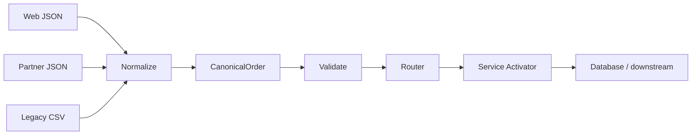

### Mục tiêu học tập

Sau bài này, bạn có thể:

1. Phân biệt **Normalizer Pattern**, **Transformer**, **Content Enricher**, **Filter** và **Adapter**.
2. Thiết kế canonical payload tối thiểu, có ngữ nghĩa và version rõ ràng.
3. Chuẩn hóa trường dữ liệu, tiền tệ, thời điểm, ID và kiểu dữ liệu từ nhiều nguồn.
4. Sử dụng Java records và Spring Integration Java DSL để nối nhiều input flows về một channel.
5. Kiểm thử ba nguồn tạo ra cùng **kiểu canonical**, không nhầm “cùng kiểu” với “cùng business event”.
6. Nhận diện lỗi validation, unknown schema, duplicate và retry.
7. Bảo toàn business correlation, source provenance, idempotency identity và các headers cần thiết.
8. Xử lý schema evolution, multi-tenant security, observability và vận hành bất đồng bộ.

## 2. Normalizer là gì trong Enterprise Integration Patterns?

**Normalizer** (thường được gọi là *Canonical Data Model Normalization*) chuẩn hóa nhiều biểu diễn của dữ liệu cùng loại thành một **canonical format** để các bước tiếp theo xử lý đồng nhất.

Ví dụ:

```text
WebOrderV1           ┐
PartnerOrderV2       ├── Normalize ──> CanonicalOrder
LegacyCsvOrderV1     ┘
```

Sau normalizer, downstream không cần biết bản ghi đến từ nguồn nào để tính tiền, chọn route hoặc ghi DB — trừ các quyết định thật sự phụ thuộc nguồn.

### Một Normalizer làm những công việc nào?

- Đổi tên trường: `externalOrderRef` → `orderId`.
- Đổi định dạng: chuỗi thập phân → minor units dạng số nguyên.
- Đổi múi giờ: offset/local time → `Instant`.
- Chuẩn hóa enum/code: `"usd"` → `"USD"`.
- Chuẩn hóa identity: xác định `sourceSystem`, `sourceEventId` và namespace.
- Kiểm tra invariant: amount hợp lệ, currency hỗ trợ, timestamp parse được.
- Giữ provenance: biết nguồn nào và schema version nào đã được chuyển đổi.
- Tạo một payload nhất quán và bất biến.

### Normalizer không nên làm gì?

- Không đoán dữ liệu quan trọng bị thiếu mà không có quy tắc được phê duyệt.
- Không âm thầm làm tròn số tiền sai độ chính xác.
- Không đổi business identity chỉ để “khớp” một model.
- Không gửi email, ghi sổ hoặc gọi PSP như side effect của hàm mapping.
- Không giấu lỗi schema bằng một payload nửa hợp lệ.
- Không tự coi mọi record có cùng `orderId` là duplicate mà chưa xét namespace/nguồn/version.
- Không biến giá trị client tự khai thành metadata đã được xác thực.

Normalizer tốt là một **ranh giới dữ liệu rõ ràng**, có thể gọi nhiều lần với cùng input và có kết quả ổn định.

## 3. Normalizer liên hệ thế nào với Spring Integration?

Spring Integration triển khai các EIP thông qua channels, endpoint, adapters, transformers, routers, filters và message handlers.

**Normalizer là một pattern/kiến trúc canonicalization**; trong một ứng dụng Spring Integration, nó thường được hiện thực bằng **một hoặc nhiều Transformer/MessageHandler**, không nhất thiết bằng một endpoint Java tên chính xác là `Normalizer`.

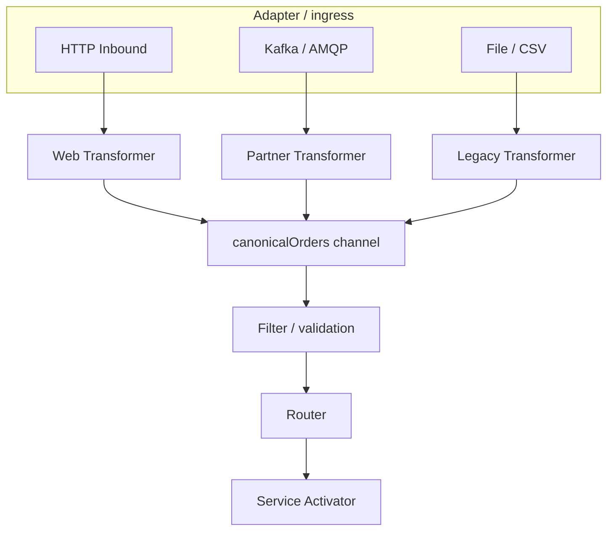

### Phân biệt các thành phần dễ nhầm

| Thành phần | Câu hỏi nó giải quyết | Ví dụ |
| --- | --- | --- |
| **Adapter** | Làm sao nhận/gửi dữ liệu qua transport? | HTTP, Kafka, AMQP, file |
| **Deserializer** | Làm sao parse bytes thành một object có schema? | JSON → `PartnerOrderV2` |
| **Normalizer** | Làm sao đưa các schema tương đương về cùng canonical contract? | `PartnerOrderV2` → `CanonicalOrder` |
| **Transformer** | Làm sao chuyển payload từ dạng này sang dạng khác? | Đổi `String` sang `BigDecimal`, xây record |
| **Content Enricher** | Cần thêm dữ liệu từ nguồn phụ nào? | Tra customer tier từ CRM |
| **Filter** | Có tiếp tục xử lý message này không? | Loại record không thuộc phạm vi |
| **Router** | Message được gửi tới nhánh nào? | Retail order → retail handler |
| **Aggregator** | Những message nào được gom và khi nào đủ nhóm? | Gom kết quả các dòng đơn |
| **Gateway** | Giao diện request/reply giữa caller và flow? | Gọi xử lý đơn, chờ `OrderResult` |

Một normalizer **có thể sử dụng Transformer** ở bên trong. Đây là mối quan hệ tự nhiên, không phải hai EIP loại trừ nhau.

### Canonical model không có nghĩa mọi nguồn có đủ thông tin

Một nguồn có thể chỉ gửi customer ID; nguồn khác có customer name. Nếu canonical contract yêu cầu customer name nhưng dữ liệu nguồn không có, cần quyết định:

1. Field có thực sự bắt buộc không?
2. Có được dùng `null`/`Optional` hoặc trạng thái `UNKNOWN` theo contract không?
3. Có lookup bằng Content Enricher được phép không?
4. Nguồn nào là authoritative khi dữ liệu mâu thuẫn?
5. Thiếu field phải fail/quarantine hay xử lý partial?

Không gán chuỗi `"UNKNOWN"` vào mọi field thiếu nếu downstream sẽ hiểu nhầm đó là dữ liệu thật.

## 4. Vì sao cần một Canonical Data Model?

Nếu có ba schema đầu vào và bốn business handlers, triển khai từng handler hỗ trợ mọi schema có thể cần tới **3 × 4** nhóm mapping/branch logic.

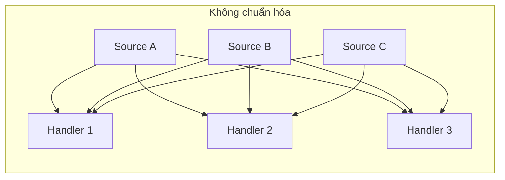

Với canonical schema, mỗi source chỉ map **một lần** và mỗi handler chỉ xử lý một cấu trúc:

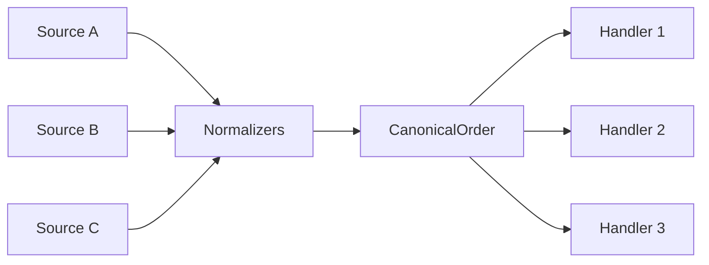

### Lợi ích

- Thêm nguồn mới mà không sửa toàn bộ downstream handlers.
- Quy tắc tiền tệ, timestamp và identity nằm ở một ranh giới có thể kiểm thử.
- Consumer dựa vào một canonical schema, không phụ thuộc tên trường riêng của partner.
- Dễ đo tỷ lệ lỗi mapping theo source và schema version.
- Giảm coupling giữa workflow EIP và transport/source format.

### Chi phí và giới hạn

- Canonical model có thể trở nên quá lớn nếu cố phục vụ mọi domain.
- Thay đổi canonical schema cần migration và compatibility policy.
- Không nên cưỡng ép các domain khác nhau thành một record giả thống nhất.
- Mapping làm mất chi tiết riêng của nguồn nếu không lưu provenance hoặc extension fields.
- Một change upstream có thể làm normalization fail; cần schema monitoring.

**Khuyến nghị kiến trúc:** canonical model theo *bounded context* (ví dụ order intake), không một DTO toàn hệ thống chứa hàng trăm optional fields.

## 5. Ba nguồn: chỉ cùng mục đích, không cùng kiểu dữ liệu

### 5.1. Web Checkout V1

```java
package example.integration;

public record WebOrderV1(
    String tenantId,
    String orderId,
    String eventId,
    long amountMinorUnits,
    String currency,
    String occurredAt,
    String customerId
) {}
```

Ví dụ `amountMinorUnits=12345`, `currency=USD` nghĩa là **123,45 USD** vì USD có hai chữ số thập phân trong hợp đồng ví dụ.

### 5.2. Partner B2B V2

```java
package example.integration;

public record PartnerOrderV2(
    String partnerTenant,
    String externalOrderRef,
    String eventUuid,
    String grossAmount,
    String currencyCode,
    String eventTimeWithOffset,
    String buyerRef
) {}
```

Partner dùng chuỗi `grossAmount="123.45"`. Nếu chuyển bằng `double` hoặc làm tròn mặc định, có thể sai yêu cầu đối soát. Nên dùng `BigDecimal`, xác minh scale và chuyển chính xác sang minor units.

### 5.3. Legacy CSV V1

```java
package example.integration;

public record LegacyCsvOrderV1(
    String tenant,
    String orderNumber,
    String recordKey,
    String amountVnd,
    String localCreatedAt,
    String customerCode
) {}
```

Legacy dùng `amountVnd="450000"` (đồng Việt Nam nguyên), `localCreatedAt="2026-11-21 15:30:00"`. Theo contract giả định, thời gian này ở `Asia/Ho_Chi_Minh`.

**Không giả định** mọi số tiền là hai chữ số thập phân: VND và USD khác nhau trong mô hình ví dụ. Các currency/precision khác cần quy tắc được khai báo, không để formatter tự đoán.

### Về file Java

Các `public record` trong bài là các **file .java riêng** trong dự án Java 17+. Chúng được trình bày cạnh nhau để dễ đọc. Nếu dự án đang dùng Java thấp hơn hoặc yêu cầu Spring Integration version khác, cần điều chỉnh cú pháp trong bước QA kỹ thuật.

## 6. CanonicalOrder: một mô hình thống nhất có provenance

Chọn một record canonical rõ ý nghĩa:

```java
package example.integration;

import java.time.Instant;

public record CanonicalOrder(
    String tenantId,
    String orderId,
    String customerId,
    long totalMinorUnits,
    String currency,
    Instant occurredAt,
    String sourceSystem,
    String sourceEventId,
    int sourceSchemaVersion,
    int canonicalSchemaVersion
) {
    public CanonicalOrder {
        if (tenantId == null || tenantId.isBlank()
                || orderId == null || orderId.isBlank()
                || customerId == null || customerId.isBlank()
                || sourceSystem == null || sourceSystem.isBlank()
                || sourceEventId == null || sourceEventId.isBlank()
                || currency == null || currency.isBlank()
                || occurredAt == null) {
            throw new IllegalArgumentException(
                "CanonicalOrder thiếu trường bắt buộc");
        }

        if (totalMinorUnits < 0
                || sourceSchemaVersion <= 0
                || canonicalSchemaVersion <= 0) {
            throw new IllegalArgumentException(
                "CanonicalOrder có số liệu/version không hợp lệ");
        }
    }
}
```

### Giải nghĩa từng nhóm field

| Field | Ngữ nghĩa | Điều không được nhầm |
| --- | --- | --- |
| `tenantId` | Namespace nghiệp vụ đã được xác minh | Quyền truy cập mặc định |
| `orderId` | Định danh đơn hàng trong tenant | ID unique của từng delivery event |
| `customerId` | Khách hàng theo canonical contract | Luôn tồn tại ở mọi domain |
| `totalMinorUnits` | Số nguyên theo minor unit quy định | Chuỗi decimal hay floating point |
| `currency` | Mã currency chuẩn hóa | Currency exponent/precision tự động hợp lệ |
| `occurredAt` | Thời điểm sự kiện trên timeline UTC | Chuỗi giờ local chưa có zone |
| `sourceSystem` | Tên nguồn tin cậy | Giá trị client tự khai tùy ý |
| `sourceEventId` | ID sự kiện theo nguồn | `MessageHeaders.id` |
| `sourceSchemaVersion` | Version format nguồn | Version canonical schema |
| `canonicalSchemaVersion` | Version hợp đồng canonical | Release version của ứng dụng |

### Tại sao giữ sourceSystem/sourceEventId?

Với dữ liệu từ nhiều nguồn, cùng `orderId` có thể xuất hiện trong Web và Partner, có thể do hệ thống chuyển tiếp hoặc do hai business events riêng. Provenance giúp:

- Theo dõi nguồn đã tạo event.
- Chọn idempotency scope `(tenant, sourceSystem, sourceEventId, operationType)`.
- Điều tra dữ liệu mâu thuẫn giữa hai nguồn.
- Replay về đúng schema/parser khi cần.
- Tính metric lỗi normalize theo source.

**Normalizer không tự thực hiện deduplication.** Canonical record mang đủ thông tin để một Idempotent Receiver downstream đưa ra quyết định.

## 7. Hợp đồng chuẩn hóa: không chỉ đổi tên field

Với cùng ý nghĩa “đơn hàng có giá 123,45 USD vào thời điểm 08:30 UTC”:

| Nguồn | Trường gốc | Quy tắc | Canonical |
| --- | --- | --- | --- |
| Web | `amountMinorUnits=12345` | Kiểm tra currency và range | `totalMinorUnits=12345` |
| Partner | `grossAmount="123.45"` | `BigDecimal`, scale USD=2, exact conversion | `totalMinorUnits=12345` |
| Legacy | `amountVnd="450000"` | VND scale=0, exact conversion | `totalMinorUnits=450000` |
| Web | `occurredAt="...Z"` | Parse ISO offset | `Instant` |
| Partner | `eventTimeWithOffset="...+07:00"` | Parse offset rồi đổi UTC | `Instant` |
| Legacy | `localCreatedAt="yyyy-MM-dd HH:mm:ss"` | Parse với zone theo contract | `Instant` |
| Partner | `currencyCode="usd"` | Trim và upper-case theo `Locale.ROOT` | `"USD"` |
| Các nguồn | ID theo schema | Validate, giữ source identity | `sourceEventId` |

**Những trường như tiền, thời gian và identity cần quy tắc riêng**. Cùng một tên field không đảm bảo có cùng ngữ nghĩa.

### Một ví dụ lỗi tiền tệ dễ bỏ sót

```text
Partner: grossAmount = "123.456"
Currency: USD
Contract: USD tối đa 2 chữ số thập phân

Đúng: reject / quarantine với lý do INVALID_MONEY_SCALE.
Sai: tự làm tròn thành 123.46 nếu upstream không cho phép.
```

Nếu nghiệp vụ có chính sách rounding chính thức, hãy đặt tên policy rõ, version hóa và test ranh giới. Không dùng `double` rồi nhân 100 và cast sang `long` một cách mặc định.

## 8. Hợp đồng thời gian: cùng instant, ba biểu diễn khác nhau

Ba chuỗi:

```text
2026-11-21T08:30:00Z          (UTC)
2026-11-21T15:30:00+07:00     (offset +07)
2026-11-21 15:30:00           (local time Asia/Ho_Chi_Minh)
```

theo quy tắc nguồn của bài đều mô tả một thời điểm:

```text
Instant = 2026-11-21T08:30:00Z
```

### Phân biệt ba khái niệm

- **Instant:** một điểm trên timeline UTC, không chứa timezone display.
- **OffsetDateTime:** local date-time + offset cụ thể từ UTC.
- **LocalDateTime:** ngày/giờ không có zone hoặc offset; không xác định được một Instant nếu thiếu contract ngoài.

Với legacy CSV, phải **gán zone được xác định từ nguồn**; không dùng `ZoneId.systemDefault()` vì hai server có timezone khác nhau có thể chuẩn hóa ra hai instants khác nhau.

### Không tự đoán timezone

Nếu nguồn gửi `2026-11-21 15:30:00` nhưng không có tài liệu nó ở zone nào, hệ thống không thể tự biết đó là giờ Việt Nam hay UTC. Cần một source contract, channel configuration hoặc enrichment đáng tin.

### DST và thời gian không tồn tại/nhập nhằng

Một số timezone có daylight saving time tạo local time trùng lặp hoặc không tồn tại. Nếu nhận local date-time từ một zone như vậy, phải có policy reject/resolve rõ. Bài dùng `Asia/Ho_Chi_Minh` cho legacy và ngày minh họa không phát sinh vấn đề đó, nhưng production không nên áp dụng rule này cho mọi nguồn.

## 9. Các invariant nên kiểm tra trước và sau normalize

### Trước normalize

- Có xác định được source schema/version không?
- Payload có parse được và đúng kiểu trường?
- Tenant/source identity có được xác thực?
- Event ID có rỗng hay bị giả mạo không?
- Currency có được hỗ trợ không?
- Amount có hợp lệ theo quy tắc nguồn?
- Timestamp có zone/offset hoặc contract rõ?
- Các enum/state có giá trị được công bố?

### Sau normalize

- Payload có đúng `CanonicalOrder` không?
- Currency đã chuẩn hóa đúng không?
- `totalMinorUnits` không âm và không tràn `long`?
- `occurredAt` là `Instant` hợp lệ?
- `sourceSystem` và `sourceEventId` còn nguyên provenance?
- `canonicalSchemaVersion` được đặt nhất quán?
- Message headers dành cho correlation/tracing có giữ đúng?
- Có đánh dấu lỗi bất thường thay vì tạo object im lặng sai?

### Quy tắc giữ tính thuần

Normalizer nên có đặc tính:

```text
normalize(input, sourceContract)
    = canonicalOutput
```

cho cùng input và source contract version, không phụ thuộc vào lần gọi thứ mấy, thread nào, thời điểm hiện tại hay cấu hình biến động giữa chừng.

Nếu conversion rule thay đổi, lưu `normalizationPolicyVersion` hoặc `canonicalSchemaVersion` khi cần replay deterministic và audit chính xác.

## 10. Viết SourceOrderNormalizer bằng Java 17+

Ta viết một class thuần Java gồm ba mapping methods. Với ba nguồn có schema khác nhau, mỗi hàm nhận **đúng type của nguồn** và trả cùng type `CanonicalOrder`.

```java
package example.integration;

import java.math.BigDecimal;
import java.time.Instant;
import java.time.LocalDateTime;
import java.time.OffsetDateTime;
import java.time.ZoneId;
import java.time.format.DateTimeFormatter;
import java.util.Locale;
import java.util.Set;

public final class SourceOrderNormalizer {

    private static final int CANONICAL_VERSION = 1;

    private static final ZoneId LEGACY_ZONE =
        ZoneId.of("Asia/Ho_Chi_Minh");

    private static final DateTimeFormatter LEGACY_DATE_TIME =
        DateTimeFormatter.ofPattern("uuuu-MM-dd HH:mm:ss");

    private static final Set<String> SUPPORTED_CURRENCIES =
        Set.of("USD", "VND");

    public CanonicalOrder fromWeb(WebOrderV1 web) {
        String currency = normalizeCurrency(web.currency());

        return new CanonicalOrder(
            required(web.tenantId(), "tenantId"),
            required(web.orderId(), "orderId"),
            required(web.customerId(), "customerId"),
            web.amountMinorUnits(),
            currency,
            parseOffsetDateTime(
                web.occurredAt(), "occurredAt"),
            "WEB_CHECKOUT",
            required(web.eventId(), "eventId"),
            1,
            CANONICAL_VERSION);
    }

    public CanonicalOrder fromPartner(PartnerOrderV2 partner) {
        String currency =
            normalizeCurrency(partner.currencyCode());

        return new CanonicalOrder(
            required(partner.partnerTenant(), "partnerTenant"),
            required(
                partner.externalOrderRef(), "externalOrderRef"),
            required(partner.buyerRef(), "buyerRef"),
            decimalToMinorUnits(
                partner.grossAmount(), currency),
            currency,
            parseOffsetDateTime(
                partner.eventTimeWithOffset(),
                "eventTimeWithOffset"),
            "PARTNER_B2B",
            required(partner.eventUuid(), "eventUuid"),
            2,
            CANONICAL_VERSION);
    }

    public CanonicalOrder fromLegacy(LegacyCsvOrderV1 legacy) {
        return new CanonicalOrder(
            required(legacy.tenant(), "tenant"),
            required(legacy.orderNumber(), "orderNumber"),
            required(legacy.customerCode(), "customerCode"),
            decimalToMinorUnits(legacy.amountVnd(), "VND"),
            "VND",
            parseLegacyLocalTime(
                legacy.localCreatedAt()),
            "LEGACY_CSV",
            required(legacy.recordKey(), "recordKey"),
            1,
            CANONICAL_VERSION);
    }

    private static String required(String value, String field) {
        if (value == null || value.isBlank()) {
            throw new IllegalArgumentException(
                "Thiếu trường: " + field);
        }
        return value.trim();
    }

    private static String normalizeCurrency(String currency) {
        String normalized = required(currency, "currency")
            .toUpperCase(Locale.ROOT);

        if (!SUPPORTED_CURRENCIES.contains(normalized)) {
            throw new IllegalArgumentException(
                "Currency chưa được hỗ trợ: " + normalized);
        }

        return normalized;
    }

    private static int scaleFor(String currency) {
        return switch (currency) {
            case "USD" -> 2;
            case "VND" -> 0;
            default -> throw new IllegalArgumentException(
                "Currency chưa được hỗ trợ: " + currency);
        };
    }

    private static long decimalToMinorUnits(
            String decimal,
            String currency) {

        BigDecimal amount = new BigDecimal(
            required(decimal, "decimal amount"));

        // longValueExact từ chối phần lẻ của minor unit
        // và giá trị ngoài phạm vi long; không tự làm tròn.
        long minorUnits = amount
            .movePointRight(scaleFor(currency))
            .longValueExact();

        if (minorUnits < 0) {
            throw new IllegalArgumentException(
                "Amount phải không âm");
        }

        return minorUnits;
    }

    private static Instant parseOffsetDateTime(
            String raw,
            String field) {

        return OffsetDateTime.parse(required(raw, field))
            .toInstant();
    }

    private static Instant parseLegacyLocalTime(String raw) {
        LocalDateTime local = LocalDateTime.parse(
            required(raw, "localCreatedAt"),
            LEGACY_DATE_TIME);

        return local.atZone(LEGACY_ZONE).toInstant();
    }
}
```

### Đọc các quyết định kỹ thuật

**1. Nhiều source types, một result type.** Các hàm `fromWeb`, `fromPartner`, `fromLegacy` mang nhiệm vụ riêng, tránh một method khổng lồ có hàng chục `if (sourceType...)`.

**2. Không tự phát side effect.** Tất cả methods trả DTO mới; không gọi API, không cập nhật DB. Nhờ đó có thể test mapping độc lập.

**3. Không dùng số thực nhị phân để xử lý tiền.** `BigDecimal` với `longValueExact` từ chối số tiền không biểu diễn chính xác theo minor units.

**4. Không phụ thuộc timezone của host.** CSV local time được gắn `ZoneId.of("Asia/Ho_Chi_Minh")` theo contract rõ.

**5. Không tin currency bất kỳ.** Ví dụ whitelist `USD`/`VND` và scale tương ứng. Production sẽ quản lý một danh sách currency/exponent dựa trên business policy, version và nguồn đáng tin.

**6. Giữ source provenance.** Canonical payload có `sourceSystem`, `sourceEventId` và source schema version.

**7. Không tự xác thực tenant.** `tenantId` trong ví dụ được giả định đã được kiểm tra trước khi vào flow. Trong hệ thống thật, cần so nó với principal/route/source identity; record constructor không thay authentication.

### Những tình huống cần thêm chính sách

- Với partner trả `amount="123.450"` cho USD: chuyển đổi vẫn chính xác thành 12345 minor units; nếu schema cấm hơn hai chữ số thập phân kể cả số 0, thêm kiểm tra `BigDecimal.scale()` trước conversion.
- Với `amount="123.456"` USD: `longValueExact` ném lỗi; không tự làm tròn.
- Với `amount="1E3"`: `BigDecimal` có thể parse notation khoa học; nếu protocol nguồn cấm định dạng này, cần validation lexical trước parse.
- Với currency exponent thay đổi hoặc token không phải fiat currency: phải áp dụng mapping được version hóa, không ép vào bảng USD/VND của demo.
- Với trường `customerId` thiếu: code reject. Nếu có luồng cho phép missing, cần thiết kế canonical contract thay vì tự tạo placeholder.
- Với sự kiện correction/refund: đừng gán `totalMinorUnits` âm rồi dùng cùng `CanonicalOrder` nếu hợp đồng nói order total không âm; tạo event type và semantics rõ hơn.

## 11. Unit test: ba nguồn khác nhau đều trả CanonicalOrder

Dùng JUnit 5 để kiểm tra mapping theo từng nguồn. Không cần chạy Spring context cho các hàm thuần này.

```java
package example.integration;

import static org.junit.jupiter.api.Assertions.*;

import java.time.Instant;

import org.junit.jupiter.api.Test;

class SourceOrderNormalizerTest {

    private final SourceOrderNormalizer normalizer =
        new SourceOrderNormalizer();

    @Test
    void webOrderUsesAlreadyNormalizedMinorUnits() {
        WebOrderV1 input = new WebOrderV1(
            "shop-01", "ORD-101", "WEB-9001",
            12_345L, "USD",
            "2026-11-21T08:30:00Z", "C-11");

        CanonicalOrder order = normalizer.fromWeb(input);

        assertEquals("ORD-101", order.orderId());
        assertEquals(12_345L, order.totalMinorUnits());
        assertEquals("USD", order.currency());
        assertEquals(
            Instant.parse("2026-11-21T08:30:00Z"),
            order.occurredAt());
        assertEquals("WEB_CHECKOUT", order.sourceSystem());
        assertEquals("WEB-9001", order.sourceEventId());
        assertEquals(1, order.sourceSchemaVersion());
        assertEquals(1, order.canonicalSchemaVersion());
    }

    @Test
    void partnerDecimalAndOffsetNormalizePrecisely() {
        PartnerOrderV2 input = new PartnerOrderV2(
            "shop-01", "ORD-102", "PARTNER-9002",
            "123.45", "usd",
            "2026-11-21T15:30:00+07:00", "C-12");

        CanonicalOrder order =
            normalizer.fromPartner(input);

        assertEquals(12_345L, order.totalMinorUnits());
        assertEquals("USD", order.currency());
        assertEquals(
            Instant.parse("2026-11-21T08:30:00Z"),
            order.occurredAt());
        assertEquals("PARTNER_B2B", order.sourceSystem());
        assertEquals(2, order.sourceSchemaVersion());
    }

    @Test
    void legacyCsvVndAndVietnamTimeNormalize() {
        LegacyCsvOrderV1 input = new LegacyCsvOrderV1(
            "shop-01", "ORD-103", "CSV-9003",
            "450000", "2026-11-21 15:30:00", "C-13");

        CanonicalOrder order =
            normalizer.fromLegacy(input);

        assertEquals(450_000L, order.totalMinorUnits());
        assertEquals("VND", order.currency());
        assertEquals(
            Instant.parse("2026-11-21T08:30:00Z"),
            order.occurredAt());
        assertEquals("LEGACY_CSV", order.sourceSystem());
        assertEquals("CSV-9003", order.sourceEventId());
    }
}
```

Test chứng minh các source formats khác nhau được đưa về:

- Cùng kiểu `CanonicalOrder`.
- Cùng cách biểu diễn tiền là minor units.
- Cùng kiểu thời gian `Instant`.
- Cùng quy tắc currency uppercase.
- Có provenance để audit/debug.

**Không hiểu sai:** Ba input trong ví dụ là **ba đơn hàng khác nhau** (`ORD-101`, `ORD-102`, `ORD-103`). Chúng cho cùng **schema canonical**, không bắt buộc ra cùng payload hoặc cùng idempotency key.

## 12. Kiểm thử tương đương về ngữ nghĩa

Một test mạnh hơn là tạo **ba biểu diễn của cùng business facts** rồi so sánh những trường canonical liên quan. Source provenance sẽ khác nhau có chủ ý.

Ví dụ cùng order ID, amount USD ở Web và Partner:

```java
@Test
void webAndPartnerRepresentSameBusinessFacts() {
    WebOrderV1 web = new WebOrderV1(
        "shop-01", "ORD-SAME", "WEB-E1",
        12_345L, "USD",
        "2026-11-21T08:30:00Z", "C-1");

    PartnerOrderV2 partner = new PartnerOrderV2(
        "shop-01", "ORD-SAME", "PARTNER-E9",
        "123.45", "usd",
        "2026-11-21T15:30:00+07:00", "C-1");

    CanonicalOrder a = normalizer.fromWeb(web);
    CanonicalOrder b = normalizer.fromPartner(partner);

    assertEquals(a.tenantId(), b.tenantId());
    assertEquals(a.orderId(), b.orderId());
    assertEquals(a.customerId(), b.customerId());
    assertEquals(a.totalMinorUnits(), b.totalMinorUnits());
    assertEquals(a.currency(), b.currency());
    assertEquals(a.occurredAt(), b.occurredAt());

    // Provenance khác nhau là đúng: không bỏ mất nguồn!
    assertNotEquals(a.sourceSystem(), b.sourceSystem());
    assertNotEquals(a.sourceEventId(), b.sourceEventId());
}
```

**Mục tiêu của test:** khẳng định canonicalization bảo toàn **business meaning** trong các trường hợp có thể đối chiếu. Không cố ép hai events từ hai nguồn thành cùng `sourceEventId` chỉ để đạt `record.equals(...)`.

### Test tính determinism

```java
@Test
void sameSourceInputProducesSameCanonicalPayload() {
    WebOrderV1 source = new WebOrderV1(
        "shop-01", "ORD-1", "EV-1",
        1_000L, "USD",
        "2026-11-21T00:00:00Z", "C-1");

    CanonicalOrder first = normalizer.fromWeb(source);
    CanonicalOrder second = normalizer.fromWeb(source);

    assertEquals(first, second);
}
```

Vì normalizer không đọc clock/system timezone/current thread, cùng input ổn định tạo output bằng nhau. Đây là một tính chất rất có giá trị khi retry và replay.

## 13. Test lỗi: số tiền không chính xác, timezone mơ hồ, schema thiếu

Một normalizer tốt **không biến input lỗi thành canonical hợp lệ giả**.

### 13.1. USD có quá nhiều phần lẻ

```java
@Test
void rejectsFractionalMinorUnitWithoutRounding() {
    PartnerOrderV2 input = new PartnerOrderV2(
        "shop-01", "ORD-ERR", "PARTNER-E3",
        "123.456", "USD",
        "2026-11-21T15:30:00+07:00", "C-12");

    assertThrows(ArithmeticException.class, () ->
        normalizer.fromPartner(input));
}
```

Lỗi có thể được chuyển thành mã `INVALID_MONEY_SCALE` ở boundary xử lý error. Không nên công bố toàn bộ exception string cho bên ngoài nếu có dữ liệu nhạy cảm.

### 13.2. Currency chưa hỗ trợ

```java
@Test
void rejectsUnsupportedCurrency() {
    PartnerOrderV2 input = new PartnerOrderV2(
        "shop-01", "ORD-ERR", "PARTNER-E4",
        "123.45", "XYZ",
        "2026-11-21T15:30:00+07:00", "C-12");

    assertThrows(IllegalArgumentException.class, () ->
        normalizer.fromPartner(input));
}
```

### 13.3. Offset time thiếu zone

```java
@Test
void rejectsPartnerTimestampWithoutOffset() {
    PartnerOrderV2 input = new PartnerOrderV2(
        "shop-01", "ORD-ERR", "PARTNER-E5",
        "123.45", "USD",
        "2026-11-21T15:30:00", "C-12");

    assertThrows(
        java.time.format.DateTimeParseException.class,
        () -> normalizer.fromPartner(input));
}
```

### 13.4. Web amount âm

```java
@Test
void rejectsNegativeWebAmount() {
    WebOrderV1 input = new WebOrderV1(
        "shop-01", "ORD-ERR", "WEB-E6",
        -1L, "USD",
        "2026-11-21T08:30:00Z", "C-11");

    assertThrows(IllegalArgumentException.class, () ->
        normalizer.fromWeb(input));
}
```

### 13.5. Legacy timestamp sai format

```java
@Test
void rejectsMalformedLegacyDate() {
    LegacyCsvOrderV1 input = new LegacyCsvOrderV1(
        "shop-01", "ORD-ERR", "CSV-E7",
        "450000", "21/11/2026 15:30", "C-13");

    assertThrows(
        java.time.format.DateTimeParseException.class,
        () -> normalizer.fromLegacy(input));
}
```

### Nên kiểm thử thêm gì?

| Đầu vào | Kỳ vọng |
| --- | --- |
| `grossAmount="1.2.3"` | Invalid decimal |
| `grossAmount="NaN"` | Invalid decimal |
| `grossAmount` lớn hơn `Long.MAX_VALUE` theo minor units | Overflow/reject |
| Amount âm | Reject theo contract order total |
| Currency `usd` | Normalize thành `USD` |
| Currency rỗng | Reject |
| Source event ID rỗng | Reject |
| Partner local time thiếu offset | Reject |
| Legacy local time đúng contract | Parse với zone đã khai báo |
| JSON có field type lạ | Deserialization error trước normalizer |
| Source schema version chưa hỗ trợ | Quarantine/migration policy |
| Tenant mismatch với identity đã xác thực | Security rejection trước normalizer |

Các test validation nên chạy nhanh ở cấp unit; parser, adapter, error routing và multi-thread behavior cần integration tests riêng.

## 14. Spring Integration Java DSL: ba input flows, một canonical output

Ta sử dụng ba `DirectChannel` độc lập và một `QueueChannel` chứa canonical outputs để kiểm thử.

```java
package example.integration;

import org.springframework.context.annotation.Bean;
import org.springframework.context.annotation.Configuration;
import org.springframework.integration.channel.DirectChannel;
import org.springframework.integration.channel.QueueChannel;
import org.springframework.integration.config.EnableIntegration;
import org.springframework.integration.dsl.IntegrationFlow;
import org.springframework.messaging.MessageChannel;

@Configuration
@EnableIntegration
public class OrderNormalizationConfiguration {

    @Bean
    public MessageChannel webOrdersInput() {
        return new DirectChannel();
    }

    @Bean
    public MessageChannel partnerOrdersInput() {
        return new DirectChannel();
    }

    @Bean
    public MessageChannel legacyOrdersInput() {
        return new DirectChannel();
    }

    @Bean
    public QueueChannel canonicalOrders() {
        return new QueueChannel();
    }

    @Bean
    public SourceOrderNormalizer sourceOrderNormalizer() {
        return new SourceOrderNormalizer();
    }

    @Bean
    public IntegrationFlow normalizeWebOrders(
            SourceOrderNormalizer normalizer) {

        return IntegrationFlow.from("webOrdersInput")
            .transform(WebOrderV1.class, normalizer::fromWeb)
            .channel("canonicalOrders")
            .get();
    }

    @Bean
    public IntegrationFlow normalizePartnerOrders(
            SourceOrderNormalizer normalizer) {

        return IntegrationFlow.from("partnerOrdersInput")
            .transform(
                PartnerOrderV2.class, normalizer::fromPartner)
            .channel("canonicalOrders")
            .get();
    }

    @Bean
    public IntegrationFlow normalizeLegacyOrders(
            SourceOrderNormalizer normalizer) {

        return IntegrationFlow.from("legacyOrdersInput")
            .transform(
                LegacyCsvOrderV1.class, normalizer::fromLegacy)
            .channel("canonicalOrders")
            .get();
    }
}
```

### Giải thích flow

- Mỗi input channel tiếp nhận **đúng source DTO** đã được deserialize theo contract.
- Mỗi Transformer phụ trách một source schema, tạo `CanonicalOrder`.
- Tất cả flow đổ về `canonicalOrders` để downstream dùng chung format.
- `QueueChannel` phục vụ integration test: `receive(timeout)` để lấy output.
- Code không cấu hình HTTP/Kafka/File adapter thực; chúng là **bước ngoài ingress**.
- Các ví dụ chưa có authentication, persistent broker, transaction, DLQ hay retry advice.

Đây là một cách trực tiếp để triển khai Normalizer bằng Spring Integration Java DSL. Nếu project dùng phiên bản khác và overload `transform(Class, GenericTransformer)` có thay đổi, cần điều chỉnh trong bước QA chuyên môn theo dependency thực tế.

### Vì sao không cho mọi source đi chung một channel đầu tiên?

Có thể dùng một channel chung rồi route theo type/header, nhưng điều đó làm tăng rủi ro input bị định danh sai nguồn hoặc schema:

```text
rawInput
   -> trustedSourceType router
   -> source-specific deserializer/normalizer
   -> canonicalOrders
```

Với ít nguồn, tách ba ingress flows làm **biên giới schema rõ hơn**. Với nhiều nguồn, có thể dùng registry của normalizers và routing được kiểm soát, nhưng phải giữ trường source identity bất biến và test mapping theo version.

## 15. JUnit 5: ba nguồn hội tụ về cùng một QueueChannel

```java
package example.integration;

import static org.junit.jupiter.api.Assertions.*;

import java.time.Instant;
import java.util.Set;

import org.junit.jupiter.api.Test;
import org.springframework.beans.factory.annotation.Autowired;
import org.springframework.beans.factory.annotation.Qualifier;
import org.springframework.integration.channel.QueueChannel;
import org.springframework.messaging.Message;
import org.springframework.messaging.MessageChannel;
import org.springframework.messaging.support.MessageBuilder;
import org.springframework.test.annotation.DirtiesContext;
import org.springframework.test.context.junit.jupiter.SpringJUnitConfig;

@SpringJUnitConfig(OrderNormalizationConfiguration.class)
@DirtiesContext(
    classMode = DirtiesContext.ClassMode.AFTER_EACH_TEST_METHOD)
class OrderNormalizationFlowTest {

    @Autowired
    @Qualifier("webOrdersInput")
    private MessageChannel web;

    @Autowired
    @Qualifier("partnerOrdersInput")
    private MessageChannel partner;

    @Autowired
    @Qualifier("legacyOrdersInput")
    private MessageChannel legacy;

    @Autowired
    @Qualifier("canonicalOrders")
    private QueueChannel canonical;

    @Test
    void normalizesThreeDifferentSourcesIntoCanonicalOrders() {
        WebOrderV1 a = new WebOrderV1(
            "shop-01", "ORD-101", "WEB-9001",
            12_345L, "USD",
            "2026-11-21T08:30:00Z", "C-11");

        PartnerOrderV2 b = new PartnerOrderV2(
            "shop-01", "ORD-102", "PARTNER-9002",
            "123.45", "usd",
            "2026-11-21T15:30:00+07:00", "C-12");

        LegacyCsvOrderV1 c = new LegacyCsvOrderV1(
            "shop-01", "ORD-103", "CSV-9003",
            "450000", "2026-11-21 15:30:00", "C-13");

        assertTrue(web.send(
            MessageBuilder.withPayload(a).build()));
        assertTrue(partner.send(
            MessageBuilder.withPayload(b).build()));
        assertTrue(legacy.send(
            MessageBuilder.withPayload(c).build()));

        Message<?> out1 = canonical.receive(1_000);
        Message<?> out2 = canonical.receive(1_000);
        Message<?> out3 = canonical.receive(1_000);

        assertNotNull(out1);
        assertNotNull(out2);
        assertNotNull(out3);

        assertInstanceOf(
            CanonicalOrder.class, out1.getPayload());
        assertInstanceOf(
            CanonicalOrder.class, out2.getPayload());
        assertInstanceOf(
            CanonicalOrder.class, out3.getPayload());

        CanonicalOrder webOrder =
            (CanonicalOrder) out1.getPayload();
        CanonicalOrder partnerOrder =
            (CanonicalOrder) out2.getPayload();
        CanonicalOrder legacyOrder =
            (CanonicalOrder) out3.getPayload();

        assertEquals("ORD-101", webOrder.orderId());
        assertEquals(12_345L, webOrder.totalMinorUnits());

        assertEquals("ORD-102", partnerOrder.orderId());
        assertEquals(12_345L, partnerOrder.totalMinorUnits());

        assertEquals("ORD-103", legacyOrder.orderId());
        assertEquals(450_000L, legacyOrder.totalMinorUnits());
        assertEquals("VND", legacyOrder.currency());

        assertEquals(
            Set.of("WEB_CHECKOUT", "PARTNER_B2B", "LEGACY_CSV"),
            Set.of(
                webOrder.sourceSystem(),
                partnerOrder.sourceSystem(),
                legacyOrder.sourceSystem()));

        assertEquals(
            Instant.parse("2026-11-21T08:30:00Z"),
            legacyOrder.occurredAt());

        assertNull(canonical.receive(0));
    }
}
```

**Phạm vi test:** ba input sources được gửi đồng bộ theo thứ tự Web → Partner → Legacy; vì `DirectChannel` chuyển đổi trực tiếp và output là `QueueChannel`, các assertions theo thứ tự đó phù hợp cho cấu hình demo.

**Nếu thêm ExecutorChannel hoặc broker**, global order giữa nguồn không còn là bảo đảm. Test nên lấy một **tập** canonical outputs rồi index theo `sourceEventId`/`orderId`, thay vì ép Web luôn ra đầu tiên.

### Tại sao @DirtiesContext?

Test có queue và state ứng dụng; dùng context mới sau mỗi test giúp không lẫn outputs từ test trước. Trong test suite lớn, có thể sử dụng fixtures/reset riêng; đây là lựa chọn đơn giản cho ví dụ học tập.

## 16. Kiểm thử header propagation và correlation

Một Transformer trong Spring Integration thường có cơ chế giữ/copy những message headers thích hợp. Tuy nhiên, adapter, custom `MessageBuilder` hoặc serialization boundary có thể làm metadata quan trọng mất đi.

Test một business correlation ID:

```java
@Test
void preservesBusinessCorrelationThroughNormalizingFlow() {
    WebOrderV1 input = new WebOrderV1(
        "shop-01", "ORD-201", "WEB-9201",
        20_000L, "USD",
        "2026-11-21T08:30:00Z", "C-21");

    Message<WebOrderV1> message = MessageBuilder
        .withPayload(input)
        .setHeader("businessCorrelationId", "order:ORD-201")
        .setHeader("traceMarker", "trace-abc")
        .build();

    assertTrue(web.send(message));

    Message<?> output = canonical.receive(1_000);
    assertNotNull(output);
    assertInstanceOf(
        CanonicalOrder.class, output.getPayload());

    assertEquals(
        "order:ORD-201",
        output.getHeaders().get("businessCorrelationId"));
    assertEquals(
        "trace-abc",
        output.getHeaders().get("traceMarker"));
}
```

Method này đặt trong `OrderNormalizationFlowTest` của phần trước.

### Không sao chép tất cả header vô điều kiện

`replyChannel` và `errorChannel` có thể là channel objects nội bộ. Khi chuyển message qua HTTP/broker hoặc lưu bền vững, những object này có thể không serialize được hoặc không còn hiệu lực sau restart.

Nên xác định:

- Header business nào được phép mang qua các bước?
- Header kỹ thuật nào chỉ có nghĩa trong JVM?
- Header nào được xây lại từ xác thực hiện tại?
- Header nguồn nào không đáng tin?
- `correlationId` và `sequenceNumber` đến từ Splitter hay do client gửi?
- Khi Transformer trả `Message<?>` thay vì payload, cần merge precedence thế nào?

Canonicalization **không tự quyết định** toàn bộ message envelope. Hãy kiểm thử cả payload và metadata khi workflow sử dụng Aggregator, Gateway hoặc tracing.

## 17. Từ JSON/CSV bytes đến source DTO: parser khác normalizer

Ví dụ Java DSL bắt đầu ở các source DTO, không nhận raw bytes. Đây là sự tách trách nhiệm có chủ đích:

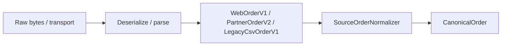

### JSON adapter

Adapter nhận payload JSON và dùng serializer/message converter để tạo `WebOrderV1` hoặc `PartnerOrderV2`. Thất bại ở bước parse (ví dụ field expected number nhưng nhận object) là **deserialization error**, không phải lỗi nghiệp vụ của normalizer.

### CSV parser

Một dòng CSV có thể chứa dấu phẩy trong field được quote, newline, escape và encoding khác nhau. **Không dùng `line.split(",")` cho CSV tổng quát**; dùng thư viện parser có RFC/style tương thích contract nguồn, kiểm tra số cột và schema.

Ví dụ:

```text
"shop-01","ORD-103","CSV-9003","450000",
"2026-11-21 15:30:00","Customer, East"
```

Dùng `String.split(",")` sẽ tách sai tên khách hàng ở cột cuối.

### File lớn

Khi có file CSV hàng triệu dòng, có thể dùng streaming reader, Splitter và backpressure để không tải toàn bộ vào RAM; mỗi row được parse thành source DTO rồi normalize độc lập.

**Không mở file khác trong worker này để triển khai parser thật**; tài liệu chỉ mô tả kiến trúc và code cần thực hiện trong một project ở giai đoạn áp dụng.

## 18. Nguồn được xác định ở đâu? Đừng tin mỗi sourceType do client gửi

Một common anti-pattern là cho client tùy ý gửi:

```json
{
  "sourceType": "TRUSTED_PARTNER",
  "tenantId": "shop-01",
  "payload": { "orderId": "ORD-1" }
}
```

rồi Router tin field `sourceType` để chọn deserializer/normalizer với quyền của đối tác.

Khi đó client có thể giả dạng nguồn được ưu tiên.

### Thiết kế đáng tin

- HTTP route + authentication xác định source/client identity.
- Kafka topic và producer identity/ACL xác định source.
- File directory/feed được gắn owner qua quy trình tiếp nhận.
- Partner schema version được ràng buộc vào connection/credential đã được xác minh.
- Trong envelope canonical, `sourceSystem` được normalizer đặt từ nhánh tin cậy chứ không lấy chuỗi bất kỳ từ input.

```text
Verified ingress identity
  -> Select source parser/normalizer
  -> Validate payload claims against verified tenant
  -> CanonicalOrder(sourceSystem from trusted configuration)
```

**Payload normalization không thay thế authorization.** Cần so `tenantId` từ payload với principal/tenant mapping đã xác thực, trước khi lưu hoặc gửi xuống business handler.

### Test authorization cần tách khỏi unit test mapping

Trong ví dụ đơn giản, normalizer đọc `tenantId` từ source DTO. Test `fromWeb(...)` không thể chứng minh tenant đã được xác thực. Integration test ingress production phải giả lập:

```text
authenticated tenant = shop-01
payload tenant = shop-02
expected = reject / security error
```

Không dùng cùng object `CanonicalOrder` để hợp thức hóa một payload đến từ tenant khác.

## 19. Xử lý lỗi chuẩn hóa: không đưa dữ liệu hỏng vào luồng chính

Có nhiều loại lỗi mà code thường gộp sai vào một khối `catch (Exception)`:

| Giai đoạn | Ví dụ | Loại lỗi | Gợi ý |
| --- | --- | --- | --- |
| Transport | Kết nối Kafka/HTTP thất bại | Infrastructure | Retry/backoff theo adapter |
| Deserialization | JSON sai cú pháp, CSV thiếu cột | Input/schema | Reject/quarantine, không retry mãi |
| Schema version | Partner gửi V3 chưa được hỗ trợ | Compatibility | Chọn parser mới hoặc DLQ có thể replay |
| Semantic validation | Amount âm, currency lạ | Data contract | Reject có reason |
| Money conversion | USD có 3 chữ số lẻ không biểu diễn exact | Data contract | Không làm tròn mù |
| Time conversion | Timestamp không offset | Data contract | Reject/enrich theo nguồn authoritative |
| Tenant check | Payload khai tenant khác principal | Security | Từ chối và audit |
| Downstream | DB timeout sau khi đã normalize | Infrastructure/business | Retry có idempotency |
| Serialization output | Canonical DTO không tương thích consumer | Schema/deploy | Rollback/migration |

### Lưu ý về kênh lỗi Spring Integration

Trong một `DirectChannel` đồng bộ, exception từ Transformer có thể quay về caller của `send(...)`. Sau một endpoint bất đồng bộ hoặc inbound adapter, lỗi có thể đi qua `errorChannel`/`ErrorMessage` tùy cấu hình. **Không được giả định mọi lỗi Java đều tự động xuất hiện ở global `errorChannel` trong mọi topology.**

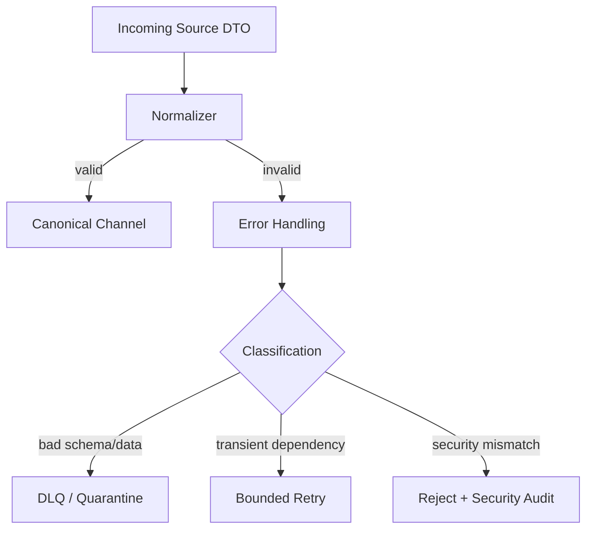

### Payload lỗi nên giữ gì?

Một failure envelope có thể ghi:

```java
public record NormalizationFailure(
    String sourceSystem,
    String sourceEventId,
    String reasonCode,
    String messageReference,
    String correlationId,
    String parserVersion
) {}
```

Tránh lưu nguyên raw payload chứa PII, access token hoặc dữ liệu nhạy cảm vào log/DLQ không có kiểm soát. Nếu cần replay raw input, dùng kho được cấp quyền và ghi một `messageReference`, checksum/version, TTL và retention policy.

### Mã lỗi có cấu trúc

Ví dụ:

```text
INVALID_SCHEMA
UNSUPPORTED_SOURCE_VERSION
INVALID_CURRENCY
INVALID_MONEY_SCALE
INVALID_TIMESTAMP
TENANT_MISMATCH
MISSING_REQUIRED_FIELD
PAYLOAD_TOO_LARGE
```

Điều này dễ đo đạc và retry/recovery hơn so với việc chỉ xem `e.getMessage()` tự do.

## 20. Không retry vô hạn một lỗi dữ liệu có tính quyết định

Nếu một Partner message có `grossAmount="123.456"` và hợp đồng USD yêu cầu minor units chính xác, thử lại cùng payload sẽ luôn lỗi.

```text
Input unchanged
  -> fromPartner()
  -> ArithmeticException
  -> retry same input
  -> same ArithmeticException
  -> ...
```

Đây là trường hợp **non-retryable** trừ khi có một dependency ngoài thay đổi hoặc policy migration rõ ràng. Retry mù sẽ làm nghẽn queue, tăng consumer lag và khiến message hợp lệ chờ.

### Phân loại retry

- **Retryable:** metadata service/DB không sẵn sàng nếu normalizer thật sự phụ thuộc nó, hoặc transport timeout.
- **Non-retryable:** currency không hỗ trợ, schema thiếu field bắt buộc, timestamp sai cú pháp, tenant mismatch.
- **Reprocessable after correction:** partner phát phiên bản schema mới được hỗ trợ hoặc một operator đã sửa/duyệt mapping.
- **Uncertain outcome:** nếu đã đi qua boundary có side effect sau normalization, cần kiểm tra idempotency trước replay.

Nếu normalizer thuần không gọi I/O, đa số lỗi mapping là deterministic theo input và policy version. Điều đó giúp phân loại retry đơn giản hơn.

## 21. Normalizer và Idempotent Receiver: hai bước khác mục đích

Hai bản ghi JSON có thể khác format, nhưng cùng mô tả một business event; ngược lại, hai payload chuẩn hóa trông giống nhau có thể là **hai sự kiện độc lập hợp lệ**.

```text
Web event E-1:
  orderId=ORD-100
  total=12345

Partner event E-9:
  orderId=ORD-100
  total=12345
```

Normalizer chỉ tạo canonical records. Nó không tự quyết định `E-1` và `E-9` có phải cùng một operation.

### Idempotency key theo transport event

```text
(tenantId, sourceSystem, sourceEventId, operationType)
```

Khóa này giúp phát hiện source gửi lại **cùng event**. Vì `sourceSystem` có namespace riêng, event IDs giống nhau giữa hai nguồn sẽ không bị chặn nhầm.

### Business uniqueness có thể khác

Nếu hai nguồn cùng báo một đơn hàng đã được tạo, DB business constraint có thể cần:

```text
(tenantId, orderId, businessOperation)
```

để tránh tạo hai đơn thật, trong khi vẫn giữ audit của hai events riêng. Chọn một hay cả hai cấp idempotency phải dựa trên contract nghiệp vụ.

### Đặt Idempotent Receiver ở đâu?

Một flow thường có dạng:

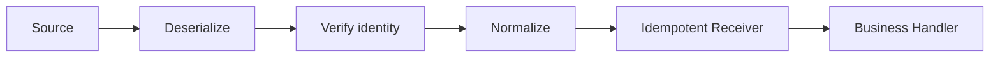

Lợi ích: key ở downstream có schema nhất quán. Nhưng nếu raw messages cực lớn hoặc deserialization tốn kém, có thể chống replay thô tại ingress **bằng một ID đã xác minh** trước normalizer, rồi vẫn duy trì idempotency của business effect ở downstream.

**Không dùng `MessageHeaders.id` làm business idempotency key:** khi redelivery hoặc Transformer tạo message mới, Spring Message ID có thể thay đổi.

## 22. Correlation: chuẩn hóa payload không phải đổi group key tùy ý

Một hệ thống có thể nhận từng `OrderLine` từ nhiều nguồn và gom theo đơn sau normalizer.

```text
Partner:
  order_ref = ORD-101
  line_no   = 2

Web:
  orderId   = ORD-101
  lineIndex = 1

Canonical:
  tenantId
  orderId
  lineIndex
```

CorrelationStrategy của Aggregator có thể dùng:

```text
GroupKey(tenantId, orderId, workflowRunId)
```

Normalizer phải bảo toàn/chuẩn hóa identity đúng scope. Nếu một nguồn gọi `externalOrderRef` là ID của đơn **bên đối tác**, không chắc bằng `orderId` nội bộ; cần mapping authoritative thay vì tự coi hai string giống nhau.

### Business correlation và technical correlation

| Field/header | Vai trò |
| --- | --- |
| `sourceEventId` | Nhận diện logical input event ở nguồn |
| `orderId` | Định danh đơn theo domain canonical |
| `businessCorrelationId` | Tracing liên dịch vụ |
| `correlationId` | Key của MessageGroup trong một endpoint |
| `workflowRunId` | Tách các lần xử lý/replay |
| `MessageHeaders.id` | Định danh một Spring Message |

Một normalizer không nên ghi đè `correlationId` của Splitter/Aggregator nếu không hiểu hợp đồng nhóm. Nếu cần group theo nội dung, dùng custom CorrelationStrategy tại endpoint phù hợp hoặc gắn header đã xác minh ở bước riêng.

## 23. Router sau Normalizer đơn giản hơn nhưng vẫn cần business rules

Không chuẩn hóa, Router có thể phải viết:

```text
Web:     currency == "USD"
Partner: currencyCode.lowercase() == "usd"
Legacy:  always "VND"
```

Sau normalize, Router chỉ cần:

```text
CanonicalOrder.currency == "USD" -> usdOrders
CanonicalOrder.currency == "VND" -> vndOrders
```

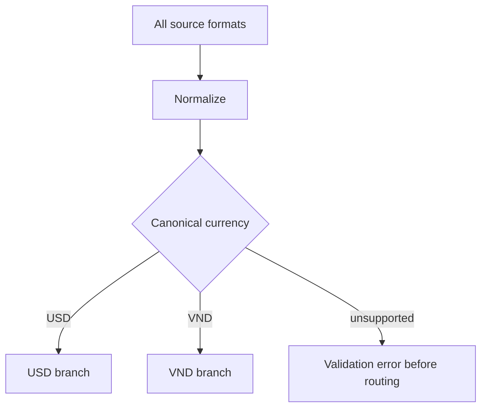

Có thể viết Java DSL đoạn minh họa:

```java
// Nối sau canonical channel bằng một flow riêng
// khi canonicalOrders là DirectChannel trong ứng dụng thật.

IntegrationFlow routeCanonicalOrders() {
    return IntegrationFlow.from("canonicalOrders")
        .route(CanonicalOrder.class,
            CanonicalOrder::currency,
            spec -> spec
                .channelMapping("USD", "usdOrders")
                .channelMapping("VND", "vndOrders"))
        .get();
}
```

**Không nối nguyên văn flow này vào `QueueChannel canonicalOrders` ở phần 14 mà không điều chỉnh topology.** QueueChannel dùng cho test; ở production có thể dùng DirectChannel hoặc message broker/adapter phù hợp để chuyển sang Router.

### Không nhầm việc chọn route với nhiệm vụ Normalizer

Normalizer cung cấp `currency` đúng; Router quyết định gửi tới handler nào. Một source-specific business rule (ví dụ đơn từ Partner cần review) vẫn có thể dựa trên `sourceSystem` một cách rõ ràng; không vì canonical mà phải xoá hết provenance.

## 24. Content Enricher: chỉ tra dữ liệu mà nguồn không cung cấp

Giả sử business handler cần `customerTier`, nhưng ba nguồn chỉ cung cấp `customerId`. Đó là một nhiệm vụ của **Content Enricher**, không nhất thiết phải đặt vào Normalizer.

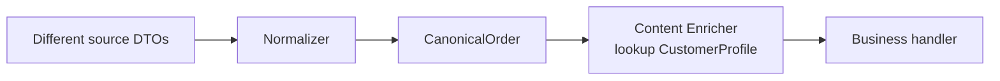

### Khi nào enrich trước normalize?

Có những trường hợp không thể normalize nếu thiếu một metadata authoritative:

- Partner `externalOrderRef` cần ánh xạ sang internal order ID.
- Tenant không nằm trong payload nhưng được xác định từ connection.
- Currency không hiện diện trong record mà nằm trong cấu hình của source feed.
- Local timestamp cần timezone từ source configuration.

Khi đó có thể làm một bước **source-specific enrichment/verification trước normalizer**. Quan trọng là xác định nguồn dữ liệu đáng tin và version policy.

### Khi nào enrich sau normalize?

Khi lookup dùng các canonical fields đã được chuẩn hóa (`customerId`, `tenantId`, `currency`), enrich sau normalize thường tiết kiệm việc viết nhiều mapping cho từng nguồn.

### Giới hạn của mapping thuần

Nếu Normalizer phải gọi nhiều DB/API để resolve thiếu field, code không còn deterministic/fast theo input thuần. Có thể tách ra hai bước và checkpoint/tracing riêng:

```text
Validate source
  -> Enrich authoritative context
  -> Normalize deterministically
  -> Enrich business domain
```

Không biến những lỗi mạng từ Enricher thành “invalid payload” một cách vô tình.

## 25. Splitter và Aggregator: normalize từng phần trước khi gom

Một partner có thể gửi một batch có N dòng đơn, mỗi dòng mang payload khác với source Web.

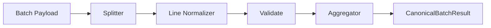

Nếu Splitter đã gắn:

```text
correlationId = group-101
sequenceNumber = 1..N
sequenceSize = N
```

thì Transformer/Normalizer cần **giữ những headers kỹ thuật phù hợp** để Aggregator biết từng line thuộc nhóm nào và khi nào đủ.

### Lỗi thường gặp: Filter drop một child trước Aggregator

Giả sử N=3, line 2 invalid và normalizer throw error, nên Aggregator chỉ nhận line 1 và 3.

```text
Splitter emits: 1/3, 2/3, 3/3
Normalizer:
  1 -> valid
  2 -> INVALID_MONEY_SCALE (not forwarded)
  3 -> valid
Aggregator sees:
  1/3, 3/3 -> group never complete
```

Giải pháp tùy contract:

- Tạo `NormalizedLineOutcome(status=FAILED, index=2)` để Aggregator nhận đủ kết quả của ba child.
- Hoặc fail toàn batch, dừng/cleanup group và báo error có cấu trúc.
- Hoặc thiết kế partial aggregation có missing index/deadline rõ.
- Không tự giảm `sequenceSize` trên những child còn lại vì metadata sẽ mâu thuẫn.

### Khác biệt giữa normalize và aggregate

- Normalize mỗi contribution thành **định dạng chung**.
- Aggregate quyết định **các contribution nào cùng group** và **khi nào có result cuối**.

Không xây một normalizer thuần đơn giản thành bộ gom nhóm có state mà không có yêu cầu rõ.

## 26. Gateway request-reply: canonical output và lỗi có contract

Một Gateway có thể tiếp nhận một loại input cụ thể và trả một canonical order hoặc business result:

```text
Caller
   |
   v
OrderGateway.submit(...)
   |
   v
Source normalization flow
   |
   v
CanonicalOrder or ValidationFailure
   |
   v
Gateway reply / error
```

Nếu caller đang chờ reply:

- Normalizer tạo `CanonicalOrder` hợp lệ thì flow downstream có thể xử lý và trả business result.
- Validation fail cần có lỗi/response contract, không để caller timeout mà không biết lý do.
- Gateway `replyChannel`/`errorChannel` là metadata của request hiện tại, không phải source business ID.
- Sau adapter/broker cần reply mapping phù hợp, không serialize tùy tiện Spring MessageChannel object.
- Với xử lý lâu, có thể trả `ACCEPTED/PENDING` và hoàn tất bất đồng bộ.

### Tại sao không dùng một Gateway cho mọi unknown raw type?

Có thể làm, nhưng API nên công bố rõ type, schema/version hoặc envelope protocol. Nếu Gateway nhận `Object` bất kỳ rồi đoán type bằng các field trùng tên, lỗi runtime và ambiguity sẽ tăng. Đặt validation/deserialization ở ingress trước khi business logic nhận canonical object.

## 27. Schema evolution: khi Partner chuyển từ V2 sang V3

Normalizer phải thay đổi khi source schema thay đổi, nhưng downstream không nhất thiết phải thay đổi cùng lúc.

```text
Partner V2 ----> fromPartnerV2() ---┐
                                    +--> CanonicalOrder V1
Partner V3 ----> fromPartnerV3() ---┘
```

### Các dạng thay đổi

| Thay đổi upstream | Rủi ro | Cách ứng xử |
| --- | --- | --- |
| Thêm optional field | Consumer cũ có thể vẫn parse | Xác định unknown-field policy |
| Đổi tên field | Parser/mapping cũ sai | Versioned adapter |
| Đổi kiểu amount từ string sang integer | Sai scale/money meaning | Schema contract + test |
| Đổi timezone | Chênh giờ, lệch thứ tự | Versioned time policy |
| Đổi currency exponent | Tính sai tiền | Canonical policy version |
| Đổi ý nghĩa orderId | Trộn identity | New mapping/migration |
| Xóa field bắt buộc | Validation fail | Fail/negotiated migration |
| Thêm loại event khác domain | Canonical model không phù hợp | Event type mới / bounded context |

### Versioning chiến lược

Dùng ít nhất hai thông tin độc lập:

```text
sourceSchemaVersion = 2
canonicalSchemaVersion = 1
```

Khi canonical contract thực sự đổi (ví dụ `amount` trước đây có thể âm, nay không), phải quản lý compatibility với downstream. Không tự thay semantic mà giữ nguyên version để tránh replay cho kết quả khác khó giải thích.

### Migration tăng dần

Một giai đoạn chuyển tiếp có thể chạy cả V2 và V3 normalizers nhưng cùng tạo Canonical V1. Sau đó mới nâng canonical V2 với compatibility tests.

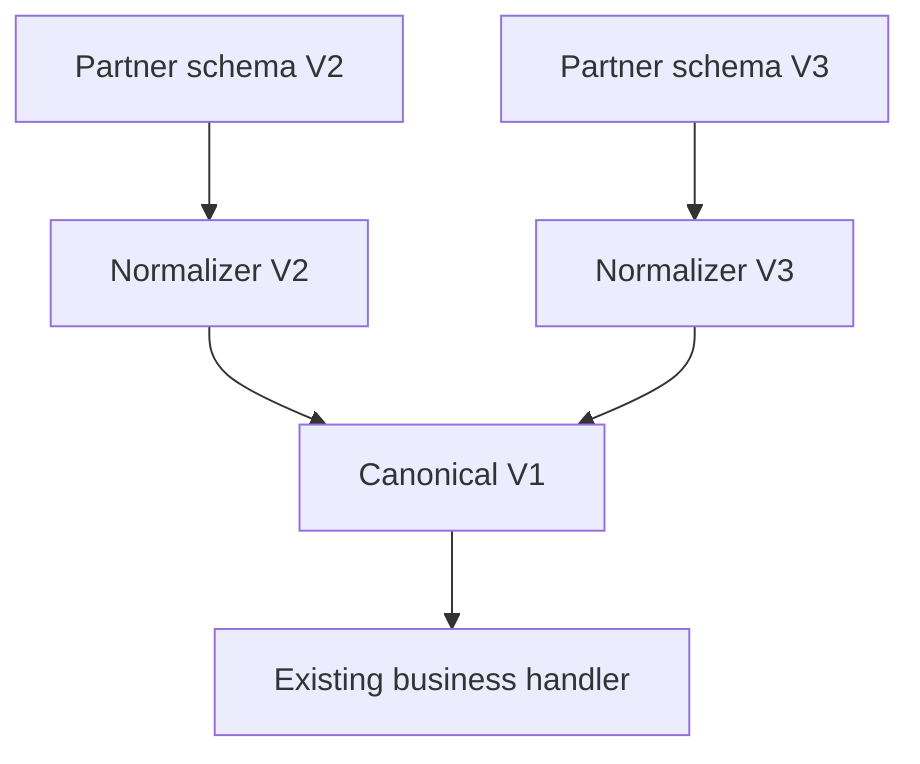

Có thể theo dõi tỷ lệ input còn V2 trước khi ngừng hỗ trợ. Đừng xóa parser cũ khi broker/DLQ vẫn có thể replay dữ liệu V2 trong retention window.

## 28. Chọn schema version dựa trên dữ liệu đáng tin

Một message JSON có thể có trường `"schemaVersion": 3`. Tuy nhiên, nếu client không được cấp phép phát schema V3 thì không thể chỉ tin giá trị tự khai để chọn parser có quyền hơn.

Một kiến trúc tốt:

1. Xác thực producer/connection identity.
2. Giới hạn danh sách schema versions được phép cho producer đó.
3. Đọc version theo protocol: registry ID, envelope type, header trusted hoặc endpoint.
4. Deserialize đúng source DTO.
5. Normalize theo rule dành cho version đó.
6. Ghi provenance/metrics của parser và schema version.

### Unknown version nên ra đâu?

```text
Partner sends schemaVersion=9
Supported versions=[2,3]

-> UNSUPPORTED_SOURCE_VERSION
-> Quarantine/DLQ with reference
-> Alert + owner
-> No false CanonicalOrder
```

Không cố parse mọi version mới như version cũ rồi âm thầm bỏ những trường có semantic mới, đặc biệt với tiền, identity, authorization và trạng thái thanh toán.

## 29. Canonicalization và data loss: giữ gì, bỏ gì?

Không phải mọi field nguồn đều được đưa vào canonical record. Ví dụ Partner có thêm `campaignCode` và `partnerInternalNote`; Web không có những trường đó.

### Nguyên tắc thiết kế

- Field phục vụ nghiệp vụ chung: đưa vào canonical schema với semantic rõ.
- Field chỉ phục vụ tracing/audit: có thể giữ trong provenance/envelope riêng.
- Field nguồn cần cho reconciliation: lưu raw source reference hoặc mapping metadata phù hợp.
- Field nhạy cảm không cần thiết: không tiếp tục phát vào mọi channel.
- Field không có semantic tương đương: không ép thành field gần giống nhưng sai nghĩa.

### Raw data retention

Nếu cần replay khi normalizer mapping được sửa, giữ raw input hoặc một reference tới nó theo chính sách bảo mật/retention. Khi canonical V1 được tạo từ source V2, lưu được `sourceEventId` và sourceSchemaVersion giúp tìm lại record để kiểm tra.

Một cách tổ chức:

```text
Raw source record (restricted storage)
   |
   +-- sourceEventId / checksum / schemaVersion
   |
   v
Normalizer
   |
   v
CanonicalOrder + provenance
```

Không log toàn bộ raw payload chứa PII để “dễ debug”. Nên log các mã lỗi và reference đủ đối chiếu, kết hợp data retention phù hợp.

## 30. Chuẩn hóa đồng thời: không dùng mutable global “currentSource”

Giả sử ba input flows chạy ở ba threads. Một phản mẫu là lưu source hiện tại trong biến static:

```java
// Phản mẫu: không dùng trạng thái global giữa nhiều message.
static String currentSource;

void beforeNormalize(String source) {
    currentSource = source;
}

CanonicalOrder normalize(Object payload) {
    // Nếu thread khác sửa currentSource trước khi đọc,
    // payload Web có thể bị coi là Partner.
    return mapBySource(currentSource, payload);
}
```

Dưới concurrency, `currentSource` có thể bị thread khác ghi đè. Thay vào đó, mỗi source normalizer **có hàm/type rõ** hoặc source identity là tham số/envelope bất biến của message đã được xác minh.

### Concurrency-friendly normalizer

`SourceOrderNormalizer` trong bài chỉ dùng constants và local variables, không lưu mutable state theo request. Có thể dùng một singleton bean an toàn ở mức method logic **nếu các collaborator sau này cũng thread-safe**.

Không có nghĩa mọi Mapper/ObjectMapper/date formatter tùy biến đều tự động thread-safe; kiểm tra tài liệu của từng dependency và cách cấu hình object trước khi chia sẻ.

### Không cần lock toàn pipeline

Nếu mỗi normalize call là hàm thuần, các message khác nhau có thể chuẩn hóa song song mà không cần một `synchronized` bao toàn bộ method. Việc lock không cần thiết làm giảm throughput và không thay được validation/correlation.

## 31. Kiểm thử ba nguồn gửi đồng thời

Một test tốt nên khẳng định **tập canonical outputs** chứ không bắt global arrival order giữa ba nguồn khi xử lý concurrency.

Thêm method dưới đây vào `OrderNormalizationFlowTest` từ mục 15:

```java
@Test
void concurrentSourcesStillProduceThreeIndependentOrders()
        throws Exception {

    var sourceInputs = java.util.List.of(
        (Runnable) () -> web.send(MessageBuilder
            .withPayload(new WebOrderV1(
                "shop-01", "ORD-W", "WEB-E1",
                1_000L, "USD",
                "2026-11-21T08:30:00Z", "C-W"))
            .build()),

        (Runnable) () -> partner.send(MessageBuilder
            .withPayload(new PartnerOrderV2(
                "shop-01", "ORD-P", "PARTNER-E2",
                "25.00", "USD",
                "2026-11-21T15:30:00+07:00", "C-P"))
            .build()),

        (Runnable) () -> legacy.send(MessageBuilder
            .withPayload(new LegacyCsvOrderV1(
                "shop-01", "ORD-L", "CSV-E3",
                "450000", "2026-11-21 15:30:00", "C-L"))
            .build())
    );

    var pool = java.util.concurrent.Executors
        .newFixedThreadPool(3);

    var ready = new java.util.concurrent.CountDownLatch(3);
    var start = new java.util.concurrent.CountDownLatch(1);
    var futures = new java.util.ArrayList<
        java.util.concurrent.Future<?>>();

    try {
        for (Runnable submit : sourceInputs) {
            futures.add(pool.submit(() -> {
                ready.countDown();

                if (!start.await(
                        5, java.util.concurrent.TimeUnit.SECONDS)) {
                    throw new IllegalStateException("Start timeout");
                }

                submit.run();
                return null;
            }));
        }

        assertTrue(ready.await(
            5, java.util.concurrent.TimeUnit.SECONDS));
        start.countDown();

        for (var future : futures) {
            future.get(5, java.util.concurrent.TimeUnit.SECONDS);
        }

        var received = new java.util.HashMap<
            String, CanonicalOrder>();

        for (int i = 0; i < 3; i++) {
            Message<?> m = canonical.receive(2_000);
            assertNotNull(m);

            CanonicalOrder order =
                (CanonicalOrder) m.getPayload();

            assertNull(received.put(order.orderId(), order));
        }

        assertEquals(
            java.util.Set.of("ORD-W", "ORD-P", "ORD-L"),
            received.keySet());

        assertEquals(
            1_000L,
            received.get("ORD-W").totalMinorUnits());

        assertEquals(
            2_500L,
            received.get("ORD-P").totalMinorUnits());

        assertEquals(
            450_000L,
            received.get("ORD-L").totalMinorUnits());

        assertNull(canonical.receive(0));
    } finally {
        start.countDown();
        pool.shutdownNow();
    }
}
```

### Điều test này chứng minh

- Ba source flows có thể nhận đồng thời trong một JVM.
- Normalizer không dùng shared mutable `currentSource`.
- Payload Web/Partner/CSV không bị tráo mapping.
- Mỗi output có `orderId` và amount đúng.
- Test không yêu cầu một thứ tự toàn cục giữa nguồn độc lập.

### Điều test chưa chứng minh

- Kafka/AMQP adapters hoạt động sau restart.
- Multiple pods cùng nhận raw events.
- Message delivery/ack là exactly once.
- Authorization/tenant isolation từ inbound transport.
- Canonical schema ổn định qua deploy versions.
- DB side effects được commit đúng số lần.

Các yêu cầu đó cần integration/end-to-end tests với hạ tầng thực và failure injection.

## 32. Hiệu năng và backpressure: normalize nhanh không đủ nếu ingress quá tải

Một Normalizer thường cần xử lý nhanh, nhưng nguồn có thể phát lượng dữ liệu lớn:

```text
Web: 500 msg/s
Partner: 200 msg/s
Legacy import: 10,000 msg/s (batch spike)
Total: 10,700 msg/s
```

Các số chỉ là minh họa, không phải benchmark.

Nếu tất cả đổ vào một channel/consumer không có backpressure, batch import có thể làm chậm order events thời gian thực.

### Các biện pháp

- Giới hạn concurrency và queue depth theo nguồn.
- Dùng bounded executor và rejection policy rõ ràng.
- Tách ingestion rate limits cho partner và legacy import.
- Giới hạn kích thước payload/row.
- Tránh I/O chậm trong normalizer nếu không cần thiết.
- Với CSV lớn, dùng streaming parser và batching có kiểm soát.
- Bảo đảm lỗi schema không bị retry vô hạn và chiếm tài nguyên.
- Có metric nguồn lỗi và tỷ lệ normalize thành công theo source version.
- Nếu cần, dùng bulkhead để một nguồn lỗi không làm nghẽn toàn hệ thống.

### Canonical channel là điểm hội tụ và cũng là điểm nghẽn tiềm năng

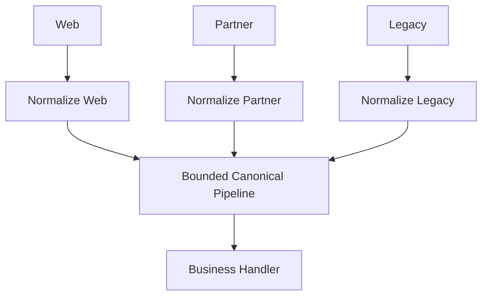

Dùng một canonical schema **không bắt buộc** gom mọi traffic vào một JVM hoặc một queue vật lý. Có thể phân vùng theo tenant/order và giữ cùng schema để scale ngang.

## 33. Observability: đo được nguồn nào làm sai dữ liệu

Nếu chỉ ghi “normalization failed”, đội vận hành khó xác định lỗi nằm ở partner V2 hay legacy CSV.

Nên log các trường không nhạy cảm:

```text
stage=NORMALIZATION_STARTED
sourceSystem=PARTNER_B2B
sourceSchemaVersion=2
sourceEventId=PARTNER-9002
businessCorrelationId=order:ORD-102

stage=NORMALIZATION_COMPLETED
sourceSystem=PARTNER_B2B
canonicalSchemaVersion=1
currency=USD
resultType=CanonicalOrder

stage=NORMALIZATION_REJECTED
sourceSystem=PARTNER_B2B
sourceSchemaVersion=2
reasonCode=INVALID_MONEY_SCALE
messageReference=raw:...
```

Log trên là minh họa cho application logging, không phải Spring Integration sinh nguyên văn.

### Metrics đề xuất

| Metric | Ý nghĩa |
| --- | --- |
| `normalize.received` | Số source records nhận được |
| `normalize.success` | Số canonical messages tạo thành công |
| `normalize.failed` | Số records không chuẩn hóa được |
| `normalize.latency` | Độ trễ theo source/schema |
| `normalize.invalid_money` | Lỗi scale/currency |
| `normalize.invalid_timestamp` | Lỗi thời gian |
| `normalize.unknown_version` | Nguồn dùng schema chưa hỗ trợ |
| `normalize.tenant_mismatch` | Lỗi identity/security |
| `normalize.output_size` | Kích thước canonical message |
| `normalize.retry_count` | Số retry thực |
| `normalize.dlq_backlog` | Số lỗi chờ xử lý |
| `canonical.consumer_lag` | Backlog sau điểm hội tụ |

Các label hữu ích: `sourceSystem`, `schemaVersion`, `reasonCode` (ít giá trị cố định). Tránh đưa `orderId`, `eventId`, `customerId` hoặc `tenantId` có cardinality lớn vào metric labels tùy tiện; dùng logs/traces với policy bảo mật phù hợp.

### Đừng nhầm normalize success với business success

```text
RECEIVED:
  adapter nhận message

PARSED:
  raw bytes hợp lệ theo source schema

NORMALIZED:
  tạo được CanonicalOrder

PROCESSED:
  business handler chạy xong

COMMITTED:
  DB/external side effect được xác nhận
```

Một message có thể normalize thành công nhưng bị business handler từ chối hoặc DB rollback. Dashboard phải theo dõi các mốc riêng thay vì báo doanh số/đơn hàng thành công chỉ từ metric normalization.

## 34. Những lỗi thường gặp

### 34.1. Đổi tên field nhưng bỏ qua semantic

`grossAmount` có thể gồm thuế, còn `amountMinorUnits` có thể không. Nếu ý nghĩa hai trường khác nhau, không thể map cả hai vào `totalMinorUnits` mà không có policy/lookup xác định.

### 34.2. Dùng double cho tiền

Số thực nhị phân có sai số biểu diễn; nhân và ép `long` có thể làm mất đơn vị nhỏ nhất. Dùng `BigDecimal` và conversion exact.

### 34.3. Dùng giờ mặc định của server

Cùng local time được parse khác nhau giữa các máy. Dùng offset/zone từ source contract.

### 34.4. Tin nguồn từ payload tự khai

Attacker có thể chọn normalizer của đối tác đáng tin hoặc giả tenant. Source identity đến từ ingress đã xác thực.

### 34.5. Gán giá trị mặc định cho field bắt buộc mà không ghi reason

Ví dụ customerId trống được thay bằng `"UNKNOWN"` rồi DB coi đó là người dùng thật. Cần optional/unknown state có contract hoặc reject.

### 34.6. Không giữ provenance

Sau normalize không còn `sourceSystem` hoặc `sourceEventId` thì khó replay, debug và deduplicate.

### 34.7. Dùng canonicalSchemaVersion thay sourceSchemaVersion

Khi partner V3 phát lỗi, không biết dùng parser nào vì chỉ ghi canonical V1. Lưu cả hai.

### 34.8. Để handler downstream tự biết mọi source DTO

Khi thêm nguồn mới phải sửa nhiều handler; đã bỏ lỡ lợi ích của Canonical Data Model.

### 34.9. Một normalizer duy nhất có mutable currentSource

Concurrent messages có thể bị gán nhầm nguồn. Dùng các mapping functions thuần theo type và trusted context.

### 34.10. Chỉ test happy path một nguồn

Không phát hiện tiền VND, offset time, schema lỗi, multi-source interleaving hoặc metadata mất.

### 34.11. Drop một child trước Aggregator mà không báo

Nhóm đang đợi `sequenceSize` cố định sẽ thiếu phần tử. Thiết kế failure outcome hoặc partial/expiry policy.

### 34.12. Coi normalization như idempotency

Hai records canonical giống nhau về business fields chưa chắc là duplicate; và một logical event có thể được replay qua Message IDs khác nhau. Cần key riêng cho Idempotent Receiver.

### 34.13. Retry non-retryable validation error

Input `amount="abc"` sẽ lỗi mãi nếu không đổi dữ liệu. Nên quarantine với reason code và owner.

### 34.14. Thay canonical schema mà không xét replay

Một payload lịch sử có thể ra giá trị khác theo rule mới; cần versioning và migration/compatibility tests.

### 34.15. Không phân biệt JSON parser với Normalizer

Malformed JSON phải được phát hiện ở deserialization boundary; semantic mismatch sau parse thuộc normalizer/domain validation.

### 34.16. Giả định QueueChannel demo là persistent broker

`QueueChannel` trong cấu hình học tập phục vụ test, không mang đảm bảo durability hoặc cross-process một cách mặc định.

## 35. Bài thực hành: tiếp nhận ba nguồn đơn hàng

**Bối cảnh:** `SPRING_INTEGRATION_PATTERN` nhận sự kiện đơn hàng từ một web checkout, một partner B2B và một import CSV cũ. Ba nguồn đều cần được đưa vào một handler ghi nhận đơn hàng, nhưng source schemas, tiền tệ và thời gian khác nhau.

### Phần A — Canonical model

1. Tạo `CanonicalOrder` bất biến có order ID, tenant, customer ID, amount minor units, currency, `Instant` và provenance.
2. Định nghĩa source DTOs cho Web V1, Partner V2 và CSV V1.
3. Ghi rõ contract của từng nguồn: amount unit, timestamp, identity, schema version.
4. Không dùng system default timezone; chọn source timezone theo tài liệu.
5. Xác định nguồn nào cung cấp field bắt buộc và field nào cần enrichment.

### Phần B — Normalizer

6. Viết `SourceOrderNormalizer.fromWeb`.
7. Viết `fromPartner` dùng `BigDecimal` và exact conversion.
8. Viết `fromLegacy` parse VND/timezone theo contract.
9. Không gọi DB/external API trong mapping thuần.
10. Gắn `sourceSystem` và `sourceEventId` rõ ràng.
11. Kiểm tra currency whitelist, âm tiền, overflow và missing fields.
12. Cố ý gửi decimal USD có 3 chữ số lẻ khác 0 và xác nhận reject.

### Phần C — Spring Integration

13. Tạo ba `DirectChannel` source input.
14. Tạo ba source-specific Transformer flows.
15. Đưa cả ba tới một `canonicalOrders` channel.
16. Kiểm thử cả ba output đều là `CanonicalOrder`.
17. Kiểm thử business correlation header được giữ.
18. Thêm Router theo canonical currency.
19. Thêm Idempotent Receiver theo source event ID và business action.
20. Thêm error flow phân loại invalid data và transient failure.
21. Dùng một Content Enricher để tra customer tier sau canonicalization.
22. Nếu dùng Splitter/Aggregator, bảo toàn correlation/sequence metadata.

### Phần D — Edge cases và vận hành

23. Gửi Web/Partner/Legacy input đồng thời, không assert global arrival order.
24. Kiểm tra cùng business facts từ Web/Partner cho các canonical business fields bằng nhau.
25. Kiểm tra source provenance vẫn khác nhau.
26. Test malformed JSON, CSV quote/escape và unsupported schema version.
27. Test tenant mismatch từ ingress đã xác thực.
28. Test partner nâng schema lên V3 nhưng canonical vẫn V1.
29. Đo normalization latency/error rate theo source version.
30. Thiết kế DLQ/quarantine có source owner, raw reference và replay policy.
31. Kiểm tra canonical schema evolution/backward compatibility với consumer cũ.
32. Đánh giá backpressure khi legacy CSV import tăng đột biến.

### Bảng kết quả mong đợi

| Input | Canonical output/behavior |
| --- | --- |
| Web 12345 minor USD | `totalMinorUnits=12345`, `currency=USD` |
| Partner "123.45" usd | `totalMinorUnits=12345`, `currency=USD` |
| Legacy "450000" VND | `totalMinorUnits=450000`, `currency=VND` |
| Partner `15:30+07` | `occurredAt=08:30Z` |
| Legacy `15:30` theo Asia/Ho_Chi_Minh | `occurredAt=08:30Z` |
| Partner "123.456" USD | Reject invalid money precision |
| Partner timestamp không offset | Reject hoặc đúng contract khác, không đoán |
| Unknown currency/schema | Structured error/quarantine |
| Hai sources cùng business facts | Canonical business fields nhất quán |
| Hai sourceEventIds khác nhau | Provenance khác, dedup xét riêng |
| Ba nguồn gửi cùng lúc | Ba CanonicalOrders đúng, order arrival bất định |
| CSV child invalid trước Aggregator | Failure outcome/batch error, không chờ vô hạn |
| Tenant payload khác principal | Security rejection |
| Client retry cùng logical event | Idempotency downstream, không lặp effect |

## 36. Câu hỏi tự đánh giá

**Câu 1.** Normalizer khác Transformer như thế nào?

*Normalizer là pattern đưa các source formats khác nhau về một canonical contract. Trong Spring Integration, thường triển khai normalizer bằng các Transformer riêng cho mỗi nguồn.*

**Câu 2.** Vì sao `BigDecimal` phù hợp hơn `double` khi chuyển amount string thành minor units?

*Vì cần bảo toàn độ chính xác thập phân và từ chối số tiền không biểu diễn exact theo minor units. `longValueExact` giúp phát hiện mất phần lẻ hoặc overflow.*

**Câu 3.** Có thể parse legacy local timestamp bằng `ZoneId.systemDefault()` không?

*Không nên. Kết quả phụ thuộc server; cần timezone được khai báo và xác minh trong source contract.*

**Câu 4.** Khi Web và Partner cho ra `CanonicalOrder` giống nhau về business fields, có thể kết luận cùng event không?

*Không. Cần provenance, source IDs, business identity và idempotency policy; hai events độc lập có thể có cùng dữ liệu.*

**Câu 5.** Vì sao nên giữ sourceSchemaVersion và canonicalSchemaVersion?

*Để biết phiên bản parser/rule đã dùng và quản lý tương thích giữa nguồn và downstream khi schema thay đổi.*

**Câu 6.** Sau Normalizer, Gateway có tự nhận kết quả xử lý nghiệp vụ không?

*Không. Normalizer tạo canonical payload, còn downstream handler/reply flow phải trả business response theo hợp đồng Gateway.*

**Câu 7.** Nếu một part bị reject trước Aggregator, chuyện gì có thể xảy ra?

*Aggregator có thể không đủ contributions và chờ vô hạn. Cần failure result, batch error hoặc timeout/partial policy.*

**Câu 8.** Tại sao test ba nguồn đồng thời không nên assert Web luôn ra trước Partner?

*Vì khi xử lý song song, arrival/completion order giữa các nguồn độc lập không được bảo đảm. Nên assert tập outputs và identity của từng item.*

**Câu 9.** Tại sao không tin `sourceType` do client tự gửi?

*Vì có thể giả mạo nguồn/tenant để chọn parser/privileged flow. Source identity phải đến từ ingress được xác thực.*

**Câu 10.** Lỗi malformed JSON có phải lỗi normalizer không?

*Thông thường là lỗi deserialization trước normalizer; error taxonomy nên phân biệt parse failures và semantic validation failures.*

## 37. Checklist triển khai production

- **Canonical scope:** một bounded context và semantics rõ, không một mega-DTO.
- **Source contracts:** mapping cho field, amount unit, currency, timezone và schema version.
- **Schema versions:** giữ cả source version lẫn canonical version.
- **Trust boundary:** kiểm tra tenant/source từ principal/connection, không từ input tự khai.
- **Validation:** mandatory fields, amount range, money scale, timestamp, enum values.
- **Money:** BigDecimal/exact conversion, không rounding mù hoặc double.
- **Time:** Instant canonical, timezone/offset nguồn đáng tin.
- **Identity:** order/customer ID theo namespace, không tự hợp nhất external/internal IDs.
- **Provenance:** sourceSystem, sourceEventId, parser/version và trace context.
- **Purity:** normalizer hạn chế side effects và external I/O.
- **Idempotency:** downstream dùng logical event/business action keys, không dùng Message ID.
- **Correlation:** không ghi đè technical group headers tùy tiện.
- **Routing:** dùng canonical fields nhưng vẫn giữ source-specific rules có chủ đích.
- **Enrichment:** tách source lookup và domain enrichment ở boundary phù hợp.
- **Errors:** phân biệt parse, validation, security, transport và business failures.
- **Retry:** không retry vô hạn một lỗi dữ liệu deterministic.
- **DLQ:** giữ reference an toàn, reason code và replay policy.
- **CSV:** parser thực sự hỗ trợ quoting/escaping và encoding.
- **Concurrency:** stateless mappings, bounded queues và backpressure.
- **Transport:** header mapper/serializer/version được kiểm thử end-to-end.
- **Schema evolution:** V2/V3 compatibility và regression tests.
- **Observability:** success/failure/latency theo source/version, tránh PII/high-cardinality labels.
- **Tests:** từng nguồn, semantic equivalence, edge cases, concurrent flows, retry và replay.
- **Security:** không tin raw payload, kiểm soát data retention và provenance.

## 38. Kết luận

**Chuẩn hóa payload từ nhiều nguồn** không chỉ là việc đổi tên các trường JSON. Đó là bước xác định một **hợp đồng canonical thống nhất** về dữ liệu, đơn vị tiền, thời gian, identity, version và provenance để những bước Router, Filter, Transformer, Splitter, Aggregator, Gateway hay Service Activator không phải hiểu mọi định dạng upstream.

Với Spring Integration, Normalizer thường được hiện thực bằng những **source-specific Transformer flows** cùng đưa về một channel chứa `CanonicalOrder`. Các hàm mapping nên thuần, có validation rõ và được kiểm thử ở hai mức: unit tests cho từng quy tắc nguồn, integration tests chứng minh cả ba nguồn hội tụ đúng, kể cả khi xử lý đồng thời.

Cuối cùng, cần thiết kế đủ cả **error handling, schema evolution, tenant security, correlation, idempotency, retry và observability**. Khi các hợp đồng này được xác định và kiểm thử, thêm nguồn mới hoặc nâng version nguồn sẽ ít tác động tới downstream business logic, giúp pipeline EIP dễ mở rộng và đáng tin cậy hơn.
