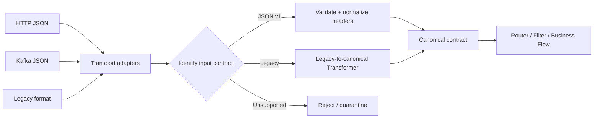
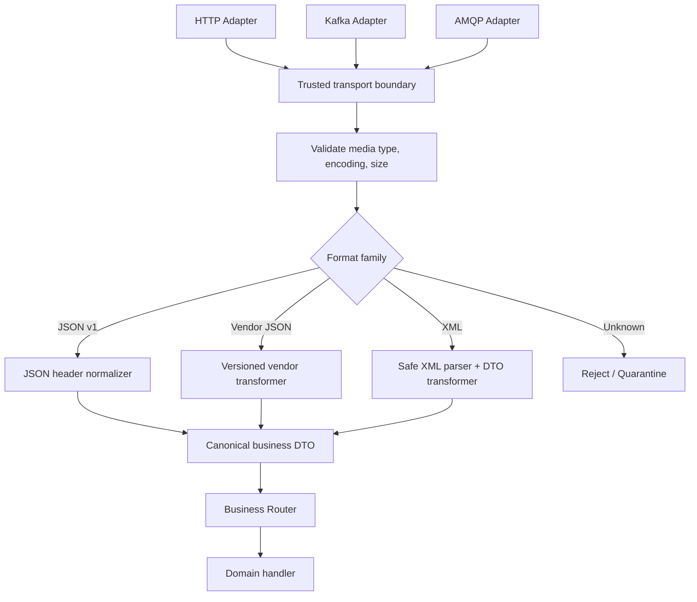
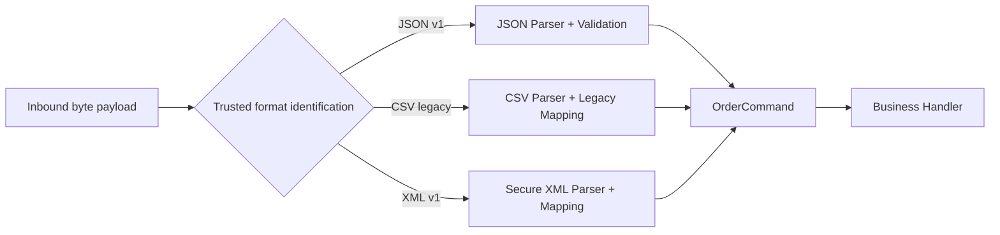
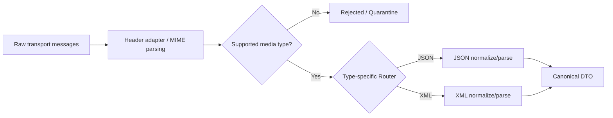
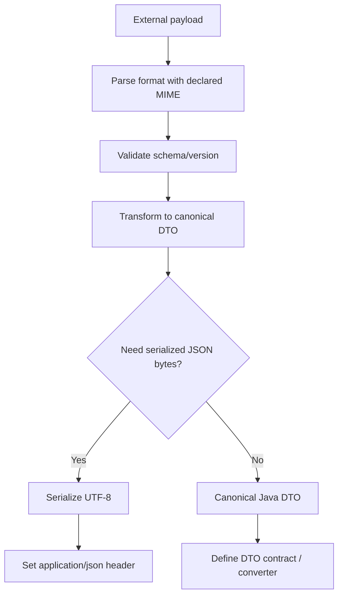

# Chuẩn hóa header và content type

Một hệ thống tích hợp đơn hàng nhận cùng một loại sự kiện từ nhiều nguồn: REST API gửi JSON với header `Content-Type: application/json; charset=UTF-8`, một producer Kafka gửi `contentType=application/json`, một adapter AMQP chuyển media type thành chuỗi, còn dịch vụ cũ gửi `application/vnd.company.order+json`. Payload và header có thể khác kiểu, cách viết và metadata dù tất cả cùng biểu diễn **một nghiệp vụ**. Nếu cho những message chưa thống nhất này đi thẳng vào Router, Transformer hoặc consumer, hệ thống dễ định tuyến sai, parse không đúng charset, làm mất correlation ID hoặc vô tình coi một header do client tự khai là thông tin đáng tin.

Mẫu **Normalizer** trong **Enterprise Integration Patterns (EIP)** đưa các biểu diễn khác nhau về **một hợp đồng message thống nhất**. Thông thường, Normalizer có **Router nhận diện loại đầu vào**, một hay nhiều **Transformer chuyển đổi dữ liệu**, và **đầu ra canonical** mà downstream có thể xử lý mà không cần biết hệ thống nguồn. Trong Spring Integration, ta có thể hiện thực Normalizer bằng `IntegrationFlow`, `Transformer`, `Message Filter`, `Header Enricher` và các channel được đặt tên rõ.

Bài **“Chuẩn hóa header và content type”** thuộc chương **Normalizer** trong module `SPRING_INTEGRATION_PATTERN`. Theo định hướng học triển khai Enterprise Integration Patterns với Spring Integration để xây dựng luồng thông điệp ít phụ thuộc, dễ mở rộng, nội dung tập trung vào header contract, MIME type, encoding, trust boundary, Router/Filter/Transformer, correlation, retry/error channel, Gateway, Splitter/Aggregator, kiểm thử JUnit 5 và giám sát các nhánh xử lý.

> **Tư tưởng chính:** Chuẩn hóa **không đơn thuần là đổi tên `Content-Type` thành `contentType`**. Phải biết payload thực sự ở định dạng nào, header do nguồn nào cung cấp, những metadata nào cần được giữ, và định dạng **đầu ra** đã được chuyển đổi hay chỉ mới được gắn nhãn. Một message mang header `application/json` nhưng chứa XML hoặc Java object chưa serialize **không tự trở thành JSON hợp lệ**.

## 1. Vấn đề: cùng ý nghĩa, khác dạng kỹ thuật

Ba producer có thể gửi:

```text
Producer HTTP:
  Content-Type: application/json; charset=UTF-8
  X-Request-ID: req-101
  Body: {"orderId":"ORD-101","quantity":2}

Producer Kafka:
  contentType (header bytes): application/json
  event_id: evt-101
  Value: {"orderId":"ORD-101","quantity":2}

Legacy adapter:
  payloadFormat: JSON
  encoding: utf8
  message_body: {"orderId":"ORD-101","quantity":2}
```

Nếu downstream phải biết `Content-Type`, `contentType`, `payloadFormat` và `encoding` của từng producer, nó trở nên phụ thuộc vào **chi tiết transport**. Khi bổ sung nguồn mới, nhiều handler phải sửa thay vì chỉ sửa lớp tích hợp ở ingress.

Mục tiêu của Normalizer là đưa về một hợp đồng, ví dụ:

```text
Normalized inbound envelope:
  body: byte[] chứa JSON UTF-8 đã được xác thực
  headers.contentType: MimeType(application/json)
  headers.schemaVersion: 1
  trusted correlation / tenant context: do ingress cấp hoặc xác thực
```

Sau đó một **JSON-to-domain Transformer** có thể chuyển bytes sang `OrderCommand` và các business handler chỉ làm việc với DTO canonical.



### 1.1. Chuẩn hóa gồm những quyết định nào?

| Quyết định | Câu hỏi cần trả lời |
| --- | --- |
| **Content detection** | Message khai JSON, XML, CSV, Protobuf hay Java DTO? |
| **Header mapping** | HTTP `Content-Type` được adapter map thành Spring `contentType` như thế nào? |
| **Canonical media type** | Downstream cần `application/json` hay một vendor media type có version? |
| **Content encoding** | Payload thực sự là UTF-8, UTF-16 hay đã gzip? |
| **Schema/version** | Cùng JSON nhưng là sự kiện v1 hay v2? |
| **Trusted metadata** | Tenant, correlation, operation ID và source identity đến từ đâu? |
| **Payload conversion** | Chỉ đổi header hay còn phải parse/serialize sang định dạng khác? |
| **Failure contract** | Khi không hỗ trợ content type/charset thì reject, quarantine hay retry? |

**Một normalized message phải có contract có thể kiểm thử**. Đừng chỉ viết “đổi mọi thứ về chuẩn” mà không mô tả chuẩn đó là gì.

## 2. Normalizer khác Transformer, Filter và Router

Normalizer là một **mẫu tổ hợp**, không nhất thiết là một class hoặc endpoint tên `Normalizer` có sẵn cho mọi dạng message.

| Pattern/thành phần | Vai trò | Trong một Normalizer |
| --- | --- | --- |
| **Router** | Chọn nhánh dựa trên format/type/source. | Chọn JSON, XML, legacy adapter hoặc unsupported. |
| **Transformer** | Đổi payload hoặc message representation. | JSON bytes → canonical DTO; legacy DTO → canonical DTO. |
| **Header Enricher** | Thêm/sửa metadata theo quy tắc. | Đặt `contentType` canonical, schema version, trusted source. |
| **Filter/Validator** | Chặn dữ liệu không đạt hợp đồng. | Không cho vào business flow nếu invalid. |
| **Normalizer** | Kết hợp các bước trên để xuất cùng hợp đồng. | Các nhánh hợp lệ đều đưa về một canonical channel/type. |
| **Content-Based Router** | Route theo dữ liệu nghiệp vụ. | Thường nằm **sau** khi payload được chuẩn hóa. |
| **Aggregator/Resequencer** | Gom hoặc sắp thứ tự message. | Cần giữ correlation/sequence khi normalizing part/reply. |

**Ví dụ:** Một Router chỉ gửi XML vào `xml.in` và JSON vào `json.in` chưa đủ gọi là Normalizer nếu hai nhánh đầu ra vẫn là hai kiểu payload không thống nhất. Cần những Transformer giúp cùng đưa tới **một hợp đồng đầu ra**.

### 2.1. Nên normalize ở đâu?

```text
External bytes / transport headers
    → Authentication + source validation
    → Deserialize/parse + normalize format/header
    → Validate canonical DTO
    → Business routing / processing
```

Đặt tại **trusted ingress** giúp các handler phía sau không phải hiểu từng transport. Nhưng **không xóa bừa metadata nghiệp vụ** khi normalize một message đã qua Splitter hoặc Aggregator. Ở ranh giới bên ngoài, việc whitelist header mạnh tay thường thích hợp; ở giữa flow nội bộ, cần bảo toàn các header kỹ thuật đáng tin đang dùng.

## 3. `Content-Type` có ý nghĩa gì?

Một media type thường có dạng:

```text
type/subtype; parameter=value
```

Ví dụ:

| Giá trị | Ý nghĩa/điểm cần kiểm tra |
| --- | --- |
| `application/json` | Nội dung JSON theo hợp đồng. |
| `application/json; charset=UTF-8` | JSON với charset được khai. |
| `application/xml` | XML, **không thể đổi nhãn thành JSON**. |
| `text/csv; charset=UTF-8` | CSV text, cần parser và dialect contract. |
| `application/octet-stream` | Bytes không xác định schema; không tự đoán JSON. |
| `application/vnd.company.order+json` | Vendor media type có cấu trúc JSON, có thể mang semantics/version riêng. |
| `application/cloudevents+json` | Structured CloudEvents JSON, **không đồng nghĩa** body là trực tiếp một OrderCommand. |
| `text/plain; charset=ISO-8859-1` | Text dạng Latin-1 theo khai báo, không thể mặc nhiên decode UTF-8. |

Trong HTTP, header wire thường được viết `Content-Type`. Trong Spring Messaging, tên header chuẩn là **`MessageHeaders.CONTENT_TYPE`**, thường có tên nội bộ **`contentType`**. Value có thể là `MimeType`, `String` hoặc được biểu diễn khác sau adapter/serialization. Không tự coi sự khác nhau về kiểu value là hai loại nghiệp vụ.

### 3.1. Content type không bảo đảm bytes hợp lệ

Producer có thể gửi:

```text
contentType = application/json
payload     = <order><id>ORD-101</id></order>
```

Header nói JSON nhưng bytes là XML. Nếu Normalizer chỉ sửa header rồi pass, parser JSON sẽ lỗi muộn. Cần parse/validate format trước khi tuyên bố message đã đạt canonical contract.

Ngược lại, bytes JSON hợp lệ với `contentType=application/octet-stream` **không mặc nhiên được cho qua** nếu hợp đồng yêu cầu producer khai đúng format. **Không nên tự sniff dữ liệu chưa tin cậy để bỏ qua lỗi metadata** trừ khi đã thiết kế một legacy compatibility path có kiểm soát.

### 3.2. MIME type có thể phân biệt bằng cấu trúc

Trong Spring Framework có `org.springframework.util.MimeType` và `MimeTypeUtils`:

```java
import org.springframework.util.MimeType;
import org.springframework.util.MimeTypeUtils;

MimeType json = MimeTypeUtils.parseMimeType(
    "application/json; charset=UTF-8");

System.out.println(json.getType());    // application
System.out.println(json.getSubtype()); // json
System.out.println(json.getCharset()); // UTF-8
```

**Không dùng so sánh chuỗi tuyệt đối** `"application/json".equals(rawHeader)` vì tham số charset và cách viết có thể khác mà vẫn biểu thị nội dung JSON hợp lệ. Đồng thời đừng chấp nhận mọi `application/*` bằng wildcard vì XML, protobuf hoặc binary không thể parse như JSON.

### 3.3. Media type và schema version là hai khái niệm khác nhau

`application/json` chỉ cho biết **format**. Hai payload JSON:

```json
{"schemaVersion":1,"orderId":"ORD-101","quantity":2}
```

và

```json
{"schemaVersion":2,"order":{"id":"ORD-101"},"lines":[{"sku":"PEN-01","qty":2}]}
```

đều là JSON nhưng **không cùng schema nghiệp vụ**. Normalizer cần biết **parser/schema transformer nào** phải dùng. Nếu dùng vendor media type có version, chỉ được chuẩn hóa về `application/json` khi đã bảo toàn/validate **ý nghĩa version** ở nơi khác.

## 4. Content type khác charset và content encoding

### 4.1. Charset quyết định cách diễn giải bytes thành ký tự

`application/json; charset=UTF-8` có thể dùng UTF-8, nhưng header chỉ là lời khai. Nếu bytes không hợp lệ:

```text
Producer claims UTF-8
Bytes contain malformed sequence
→ Decoder phải báo lỗi, không được âm thầm tạo ký tự thay thế
```

Trong Java, một số cách tạo String từ byte[] có thể **thay byte hỏng bằng replacement character**, gây thay đổi identifier hoặc chữ ký. Đối với boundary yêu cầu UTF-8 chuẩn, hãy dùng decoder với `CodingErrorAction.REPORT` hoặc parser được kiểm soát.

### 4.2. Content encoding là một lớp khác

`Content-Encoding: gzip` cho biết bytes có thể đã được **nén**, không phải được parse trực tiếp như JSON. Một payload gzip **không được** đưa tới JSON parser chỉ vì `Content-Type=application/json`.

```text
Wire:
  Content-Type: application/json
  Content-Encoding: gzip
  compressed bytes

Trusted adapter:
  verify size/limit
  decompress with bound
  parse JSON
  normalize media type and metadata
```

Nén có nguy cơ **decompression bomb**; phải giới hạn cả kích thước compressed và decompressed, depth của JSON, số bản ghi và deadline.

### 4.3. Không được “chữa” byte sai bằng cách đổi nhãn

| Hiện trạng | Chỉ sửa header? | Cần làm gì? |
| --- | --- | --- |
| JSON UTF-8 hợp lệ, header String `application/json;charset=utf-8` | Có thể, nếu đã validate. | Parse media type và đặt header canonical. |
| JSON hợp lệ, header thiếu | Không mặc định. | Reject hoặc chọn compatibility rule cho nguồn tin cậy. |
| XML payload, header `application/xml` | **Không.** | Parse XML và transform sang DTO/JSON canonical nếu có contract. |
| Java `OrderCommand` object, header `application/json` | Không phản ánh bytes hiện tại. | Serialize trước khi tuyên bố payload wire là JSON hoặc định nghĩa rõ in-memory representation. |
| Gzip bytes, content type JSON | **Không.** | Decompress an toàn rồi parse. |
| JSON charset không được hỗ trợ | Không. | Reject hoặc decode và re-encode chính xác theo policy. |
| Vendor-specific `+json` | Chỉ khi hợp đồng cho phép. | Giữ vendor semantics/schema version và explicit mapping. |

**Bài học:** Header normalization và **payload transformation** là hai bước có thể tách, nhưng trạng thái output phải có nghĩa nhất quán.

## 5. Chuẩn hóa header: ưu tiên tính toàn vẹn và nguồn đáng tin

Header thường có hai nhóm:

1. **Protocol/transport metadata:** HTTP header, AMQP properties, Kafka headers, JMS properties.
2. **Spring Messaging/internal metadata:** `MessageHeaders.ID`, `MessageHeaders.TIMESTAMP`, `MessageHeaders.CONTENT_TYPE`, correlation, sequence, reply/error channel...

Khi đi qua adapter, **không phải header nào cũng được map qua nguyên vẹn**. Header có thể bị đổi tên, chuyển thành `byte[]`, bị chặn bởi mapper hoặc bị tái tạo. Vì vậy, một Normalizer nên có **header mapping contract** rõ.

### 5.1. Ví dụ bảng mapping

| Nguồn | Giá trị ngoài | Header/field canonical | Quy tắc |
| --- | --- | --- | --- |
| HTTP | `Content-Type` | `contentType` = `MimeType` | Parse, validate whitelist. |
| HTTP | `X-Request-ID` | `requestRef` (opaque) | Chỉ dùng làm correlation nếu được xác minh/đăng ký. |
| Kafka | `contentType` bytes | `contentType` = `MimeType` | Decode đúng charset và parse MIME. |
| AMQP | `contentType` property | `contentType` = `MimeType` | Mapping từ adapter, không dùng làm auth. |
| Legacy | `payloadFormat=JSON` | `contentType=application/json` | Chỉ qua compatibility path được allowlist. |
| Trusted ingress | Authenticated tenant | `trustedTenantId` | Cấp theo security context, không tin payload tự khai. |
| Trusted workflow | Business operation ID | `operationId` | Giữ stable qua retry cùng operation. |

**Không có một mapper mặc định duy nhất bao phủ mọi transport**. Với Kafka, một header thường là bytes; HTTP thường là String; AMQP có thuộc tính chuyên biệt. Cần kiểm thử **adapter thật** cùng converter/header mapper đang cấu hình.

### 5.2. Header không phải bằng chứng quyền

Ví dụ message từ client:

```text
X-Tenant-ID: ADMIN
X-Role: APPROVER
correlationId: another-tenant-group
replyChannel: internal.secretChannel
```

Nếu Normalizer copy tất cả header vào message nội bộ, một Router/Gateway phía sau có thể vô tình tin dữ liệu giả mạo. Cần **allowlist**, giới hạn loại/độ dài, và **server-side trusted context** cho những giá trị điều khiển.

Các header kỹ thuật như `replyChannel`, `errorChannel`, `correlationId` hay `priority` đặc biệt cần thận trọng. **Không cho nguồn không đáng tin chọn tên bean/channel nội bộ**.

### 5.3. Header bất biến của message và cách tạo message mới

Spring `Message<?>` về cơ bản được thiết kế theo kiểu **payload/header snapshot**, không nên sửa trực tiếp map headers. Để thay đổi nội dung:

```java
import org.springframework.messaging.Message;
import org.springframework.messaging.MessageHeaders;
import org.springframework.messaging.support.MessageBuilder;
import org.springframework.util.MimeTypeUtils;

Message<?> normalizeContentTypeOnTrustedMessage(
        Message<?> trustedMessage) {
    return MessageBuilder.fromMessage(trustedMessage)
        .setHeader(MessageHeaders.CONTENT_TYPE,
            MimeTypeUtils.APPLICATION_JSON)
        .build();
}
```

**Cảnh báo về đoạn code:** nó chỉ minh họa API sửa header khi message **đã được tin cậy và payload đã được xác minh là JSON**, không phải một validator và không nên chạy trên mọi payload. `fromMessage(...)` giữ nhiều header gốc: phù hợp với một **nhánh nội bộ đáng tin** nhưng có thể **không an toàn ở ingress ngoài**. Ở ingress ngoài, tạo message mới từ payload và **chỉ copy các header được phép** thường phù hợp hơn.

### 5.4. Đừng lẫn ID kỹ thuật và correlation

Khi tạo message mới, `MessageHeaders.ID`/`TIMESTAMP` có thể thay đổi tùy cách build. Đừng dùng chúng làm business idempotency key nếu producer đã có `eventId/operationId` ổn định; cũng đừng tự copy `correlationId` chưa xác thực của external caller vào Aggregator.

## 6. Thiết kế canonical contract trước khi implement

Ví dụ học tập chọn:

```text
Accepted input:
  payload: byte[] (JSON UTF-8)
  contentType: "application/json" hoặc
               "application/json; charset=UTF-8"
  body schemaVersion: 1
  body orderId: non-blank String
  body quantity: positive int <= 100

Normalized output:
  payload: byte[] giữ nguyên JSON UTF-8 đã được parse kiểm tra
  headers.contentType: MimeType(application/json)
  headers.schemaVersion: Integer(1)
  KHÔNG copy arbitrary external headers
```

Vì output **vẫn là byte[] JSON**, header `application/json` mô tả đúng representation. Transformer tiếp theo mới có thể chuyển `byte[] → OrderCommand`. Nếu muốn canonical **DTO**, hãy thiết kế hợp đồng DTO riêng và cân nhắc việc loại/đổi header mô tả wire representation.

### 6.1. Vì sao không chấp nhận `application/*+json` mặc định?

`application/vnd.company.order+json` có thể chứa JSON thật, nhưng **schema semantics** không mặc nhiên giống `application/json` cho `OrderCommand`. Ví dụ tương tự là CloudEvents structured JSON: body có **envelope metadata** và trường `data`, không phải trực tiếp order fields. Muốn hỗ trợ, phải thêm **nhánh versioned Transformer** được kiểm thử.

### 6.2. Chuẩn hóa header không phải canonical hóa toàn bộ JSON

Một payload:

```json
{"orderId":"ORD-101","quantity":2}
```

và:

```json
{
  "quantity": 2,
  "orderId": "ORD-101"
}
```

có thể cùng ý nghĩa nghiệp vụ nhưng **khác bytes**. Đặt cùng header `application/json` **không làm byte arrays bằng nhau**. Nếu downstream cần chữ ký, hash/dedup hoặc deterministic serialization, phải định nghĩa **canonical JSON serialization** riêng (field order, whitespace, numeric format, Unicode normalization, duplicate-key handling) và version contract phù hợp.

## 7. Luồng xử lý đề xuất cho hệ thống nhiều nguồn



**Chú ý:** Sơ đồ thể hiện hệ thống đầy đủ có nhiều format. Để kiểm thử dễ, phần code dưới đây triển khai trước **nhánh JSON v1 trên `byte[]`**. XML và vendor format cần parser/Transformer riêng; không được chỉ route về cùng output mà bỏ qua việc chuyển đổi.

### 7.1. Điểm kiểm tra trước router

1. Adapter đã **parse transport header** đúng chưa?
2. Message có nguồn/protocol đáng tin và không vượt quota chưa?
3. Content type được hỗ trợ không?
4. Charset/content encoding có đúng policy không?
5. Payload có parse được theo format khai không?
6. Schema version và required fields đúng chưa?
7. Header nào được phép vào canonical flow?
8. Nếu validation thất bại, consumer sẽ **ack/retry/quarantine** như thế nào?

### 7.2. Kết quả từ chối phải có hợp đồng

Ví dụ kết quả ứng dụng:

```json
{
  "status": "REJECTED",
  "errorCode": "UNSUPPORTED_CONTENT_TYPE",
  "requestRef": "opaque-req-101"
}
```

Đây không phải response tự động của Spring Integration. Với HTTP có thể map thành 415 Unsupported Media Type; payload không parse được có thể thành 400; với Kafka/AMQP, cần chính sách reject/DLT/ack riêng. Lỗi connection tới schema registry/DB thường là **technical transient failure**, không phải unsupported type cố định.

## 8. Java: một Transformer chuẩn hóa content type an toàn tại ingress

Ví dụ tạo **JSON header normalizer** nhận `Message<?>`, kiểm tra rằng:

- Payload thực sự là `byte[]`.
- Kích thước không vượt giới hạn demo.
- `contentType` có dạng `MimeType` hoặc String hợp lệ và **đúng `application/json`**.
- Charset nếu được khai phải là UTF-8.
- Bytes là UTF-8 hợp lệ và parse được thành JSON object.
- Schema version, order ID và quantity đáp ứng hợp đồng.
- Output chỉ giữ **byte[] đã kiểm tra** và **header canonical đã được cấp nội bộ**; không copy arbitrary header từ nguồn ngoài.

### 8.1. Exception mang mã lỗi ổn định

```java
// InvalidInboundMessageException.java
public final class InvalidInboundMessageException
        extends RuntimeException {

    private final String code;

    public InvalidInboundMessageException(String code) {
        super(code);
        this.code = code;
    }

    public String code() {
        return code;
    }
}
```

Trong hệ thống thật có thể cần error hierarchy phân biệt **permanent input error** và **transient infrastructure error**. Demo chỉ ném exception cho lỗi contract; không để exception chứa raw header, toàn bộ JSON hoặc bí mật.

### 8.2. Implementation dùng `Transformer` của Spring Integration

```java
// JsonHeaderNormalizer.java
import com.fasterxml.jackson.databind.JsonNode;
import com.fasterxml.jackson.databind.ObjectMapper;
import java.io.IOException;
import java.nio.ByteBuffer;
import java.nio.charset.CharacterCodingException;
import java.nio.charset.CodingErrorAction;
import java.nio.charset.StandardCharsets;
import java.util.Arrays;
import org.springframework.integration.transformer.Transformer;
import org.springframework.messaging.Message;
import org.springframework.messaging.MessageHeaders;
import org.springframework.messaging.support.MessageBuilder;
import org.springframework.util.MimeType;
import org.springframework.util.MimeTypeUtils;

public final class JsonHeaderNormalizer implements Transformer {

    private static final int MAX_BYTES = 16 * 1024;
    private final ObjectMapper mapper;

    public JsonHeaderNormalizer(ObjectMapper mapper) {
        this.mapper = mapper;
    }

    @Override
    public Message<?> transform(Message<?> incoming) {
        if (!(incoming.getPayload() instanceof byte[] source)) {
            throw new InvalidInboundMessageException(
                "PAYLOAD_MUST_BE_BYTES");
        }
        if (source.length == 0 || source.length > MAX_BYTES) {
            throw new InvalidInboundMessageException(
                "INVALID_PAYLOAD_SIZE");
        }

        MimeType type = parseContentType(
            incoming.getHeaders().get(MessageHeaders.CONTENT_TYPE));

        if (!"application".equalsIgnoreCase(type.getType())
                || !"json".equalsIgnoreCase(type.getSubtype())) {
            throw new InvalidInboundMessageException(
                "UNSUPPORTED_CONTENT_TYPE");
        }
        if (type.getCharset() != null
                && !StandardCharsets.UTF_8.equals(type.getCharset())) {
            throw new InvalidInboundMessageException(
                "UNSUPPORTED_CHARSET");
        }

        ensureUtf8(source);

        JsonNode tree;
        try {
            tree = mapper.readTree(source);
        } catch (IOException ex) {
            throw new InvalidInboundMessageException("INVALID_JSON");
        }

        if (tree == null || !tree.isObject()) {
            throw new InvalidInboundMessageException(
                "EXPECTED_JSON_OBJECT");
        }
        JsonNode version = tree.path("schemaVersion");
        JsonNode orderId = tree.path("orderId");
        JsonNode quantity = tree.path("quantity");

        if (!version.isInt() || version.intValue() != 1) {
            throw new InvalidInboundMessageException(
                "UNSUPPORTED_SCHEMA_VERSION");
        }
        if (!orderId.isTextual() || orderId.asText().isBlank()
                || orderId.asText().length() > 64) {
            throw new InvalidInboundMessageException(
                "INVALID_ORDER_ID");
        }
        if (!quantity.isInt() || quantity.intValue() < 1
                || quantity.intValue() > 100) {
            throw new InvalidInboundMessageException(
                "INVALID_QUANTITY");
        }

        // Ở boundary ngoài: không copy tất cả raw headers.
        // Tạo snapshot mới và gắn header đã được validate.
        return MessageBuilder
            .withPayload(Arrays.copyOf(source, source.length))
            .setHeader(MessageHeaders.CONTENT_TYPE,
                MimeTypeUtils.APPLICATION_JSON)
            .setHeader("schemaVersion", 1)
            .build();
    }

    private static MimeType parseContentType(Object value) {
        if (value instanceof MimeType mimeType) {
            return mimeType;
        }
        if (value instanceof String raw) {
            try {
                return MimeTypeUtils.parseMimeType(raw);
            } catch (IllegalArgumentException ex) {
                throw new InvalidInboundMessageException(
                    "INVALID_CONTENT_TYPE");
            }
        }
        throw new InvalidInboundMessageException(
            "MISSING_CONTENT_TYPE");
    }

    private static void ensureUtf8(byte[] bytes) {
        try {
            StandardCharsets.UTF_8.newDecoder()
                .onMalformedInput(CodingErrorAction.REPORT)
                .onUnmappableCharacter(CodingErrorAction.REPORT)
                .decode(ByteBuffer.wrap(bytes));
        } catch (CharacterCodingException ex) {
            throw new InvalidInboundMessageException(
                "INVALID_UTF8");
        }
    }
}
```

**Giải thích chính xác:**

1. `parseContentType(...)` chấp nhận **String hoặc `MimeType`**, giúp không phụ thuộc vào cách một adapter biểu diễn giá trị; nó từ chối kiểu khác.
2. Chỉ hỗ trợ `application/json` cho ví dụ. `application/vnd...+json` bị từ chối **có chủ đích**, cho đến khi triển khai một nhánh schema-specific.
3. `ensureUtf8(...)` kiểm tra bytes và báo lỗi nếu UTF-8 không hợp lệ, thay vì thay ký tự hỏng.
4. `ObjectMapper.readTree(...)` kiểm tra payload có thể parse thành JSON; các kiểm tra `JsonNode` áp đặt schema/demo invariants.
5. Output giữ JSON bytes đã được kiểm tra và đặt `MessageHeaders.CONTENT_TYPE` thành `MimeType` canonical `application/json`.
6. `Arrays.copyOf(...)` tạo bản copy để tránh dùng chung mảng bytes có thể bị sửa sau đó.
7. Code **không copy correlation, replyChannel, security headers hoặc arbitrary adapter headers**. Đây là lựa chọn an toàn cho **một ingress chưa tin cậy**, nhưng **chưa đủ** cho hệ thống cần một workflow correlation đã được xác thực. Sẽ phải thêm allowlist/trusted metadata ở tầng adapter nội bộ.

**Phạm vi phiên bản:** Đây là code minh họa cho Java hiện đại, Jackson và Spring Integration. Cần kiểm tra Spring/Jackson version, dependency và converter trên project thực tế trước khi dùng production. Bài STEP 4 NEW không chạy Gradle hoặc Content QA.

### 8.3. Hai mức chặt chẽ khác nhau

Ví dụ trên kiểm tra **JSON hợp lệ và những field được quan tâm**; nó **chưa** kiểm tra toàn bộ schema, unknown fields, duplicate JSON keys, maximum nesting, Unicode normalization hay chữ ký số.

Đối với boundary nhạy cảm:

- Cấu hình Jackson để **fail trên duplicate fields/trailing tokens** nếu hợp đồng yêu cầu.
- Giới hạn độ sâu, số token, số phần tử và payload size ở parser/adapter.
- Xác định **unknown-field policy** và schema version.
- Xác thực chữ ký/checksum trước khi biến đổi bytes nếu producer có ký payload.
- Không serialize lại payload rồi dùng chữ ký cũ trên bytes đã thay đổi.

**Không tuyên bố normalizer này đã là JSON canonicalizer đầy đủ**. Nó chủ yếu chuẩn hóa **header representation** và bảo đảm những invariants đã khai.

## 9. Spring Integration Java DSL: đặt Normalizer trước business flow

```java
// JsonNormalizerConfiguration.java
import com.fasterxml.jackson.databind.ObjectMapper;
import org.springframework.context.annotation.Bean;
import org.springframework.context.annotation.Configuration;
import org.springframework.integration.channel.QueueChannel;
import org.springframework.integration.config.EnableIntegration;
import org.springframework.integration.dsl.IntegrationFlow;

@Configuration
@EnableIntegration
public class JsonNormalizerConfiguration {

    @Bean
    ObjectMapper normalizerObjectMapper() {
        return new ObjectMapper();
    }

    @Bean
    JsonHeaderNormalizer jsonHeaderNormalizer(
            ObjectMapper normalizerObjectMapper) {
        return new JsonHeaderNormalizer(normalizerObjectMapper);
    }

    @Bean("orders.json.normalized")
    QueueChannel normalizedJsonQueue() {
        return new QueueChannel(16);
    }

    @Bean
    IntegrationFlow normalizeJsonIngress(
            JsonHeaderNormalizer jsonHeaderNormalizer) {
        return IntegrationFlow.from("orders.raw.json.in")
            .transform(jsonHeaderNormalizer)
            .channel("orders.json.normalized")
            .get();
    }
}
```

**Dòng chảy:**

```text
orders.raw.json.in
    → JsonHeaderNormalizer
        ├─ lỗi content-type / UTF-8 / JSON / schema
        │    → exception (theo sync/async/error handling)
        └─ hợp lệ
             → Message<byte[]> với MimeType(application/json)
             → orders.json.normalized
```

Đây là một **flow nội bộ phục vụ kiểm thử**; `QueueChannel` chứa output để test đọc dễ. Chưa có consumer phía sau, HTTP/Kafka adapter, error channel riêng, durable queue hoặc transaction. Không coi `MessageChannel.send(...) == true` là bằng chứng business handler đã xử lý xong.

**Về `Transformer`:** `JsonHeaderNormalizer` hiện thực contract nhận một `Message<?>` và trả một `Message<?>` mới. Khi transformer trả message, các header/payload output đã được nó quyết định; do đó cần kiểm thử việc **không copy raw header** và metadata được cấp lại.

### 9.1. Có nên dùng `Header Enricher` thay vì Transformer?

Nếu payload **đã được kiểm tra bởi adapter đáng tin** và chỉ thiếu một header canonical, một Header Enricher có thể đủ:

```java
// Pseudocode DSL cho message nội bộ đã validate:
// .enrichHeaders(h -> h.header(
//     MessageHeaders.CONTENT_TYPE,
//     MimeTypeUtils.APPLICATION_JSON))
```

Nhưng **không** đặt header `application/json` cho bytes bất kỳ mà bỏ qua parser. `Header Enricher` tập trung vào metadata; `Transformer` hoặc converter cần được dùng khi phải đổi representation.

### 9.2. Nếu output là `OrderCommand` Java object

Sau `orders.json.normalized` có thể deserialize sang một DTO canonical:

```java
// OrderCommand.java
public record OrderCommand(
    int schemaVersion,
    String orderId,
    int quantity
) {}
```

```java
// Ví dụ chuyển đổi tại tầng riêng có error handling:
import com.fasterxml.jackson.databind.ObjectMapper;
import java.io.IOException;

OrderCommand toOrderCommand(
        byte[] verifiedJsonBytes, ObjectMapper mapper)
        throws IOException {
    return mapper.readValue(
        verifiedJsonBytes, OrderCommand.class);
}
```

**Không đánh đồng DTO với wire JSON.** Nếu output đã là `Message<OrderCommand>`, hãy mô tả contract là **Java object payload**; header `contentType=application/json` chỉ còn có nghĩa khi converter/outbound adapter được cấu hình rõ để serialize nó. Không để một AMQP/Kafka adapter suy đoán payload bytes từ một header sai representation.

## 10. JUnit 5: header String và MimeType phải được hiểu như nhau

Unit test tập trung trực tiếp vào Transformer, giúp kiểm tra hành vi mà không phụ thuộc vào HTTP/Kafka adapter.

```java
// JsonHeaderNormalizerTest.java
import static org.junit.jupiter.api.Assertions.*;

import com.fasterxml.jackson.databind.ObjectMapper;
import java.nio.charset.StandardCharsets;
import org.junit.jupiter.api.Test;
import org.springframework.messaging.Message;
import org.springframework.messaging.MessageHeaders;
import org.springframework.messaging.support.MessageBuilder;
import org.springframework.util.MimeTypeUtils;

class JsonHeaderNormalizerTest {

    private final JsonHeaderNormalizer normalizer =
        new JsonHeaderNormalizer(new ObjectMapper());

    private static byte[] json() {
        return """
            {"schemaVersion":1,"orderId":"ORD-101","quantity":2}
            """.getBytes(StandardCharsets.UTF_8);
    }

    @Test
    void convertsStringMediaTypeToCanonicalMimeType() {
        Message<byte[]> input = MessageBuilder
            .withPayload(json())
            .setHeader(MessageHeaders.CONTENT_TYPE,
                "application/json; charset=utf-8")
            .setHeader("untrustedRole", "ADMIN")
            .build();

        Message<?> output = normalizer.transform(input);

        assertEquals(MimeTypeUtils.APPLICATION_JSON,
            output.getHeaders().get(MessageHeaders.CONTENT_TYPE));
        assertEquals(1, output.getHeaders().get("schemaVersion"));
        assertArrayEquals(json(), (byte[]) output.getPayload());
        assertNull(output.getHeaders().get("untrustedRole"));
    }

    @Test
    void acceptsAnExistingMimeTypeValue() {
        Message<byte[]> input = MessageBuilder
            .withPayload(json())
            .setHeader(MessageHeaders.CONTENT_TYPE,
                MimeTypeUtils.APPLICATION_JSON)
            .build();

        Message<?> output = normalizer.transform(input);
        assertArrayEquals(json(), (byte[]) output.getPayload());
    }

    @Test
    void rejectsWrongMediaTypeEvenIfBodyLooksLikeJson() {
        Message<byte[]> input = MessageBuilder
            .withPayload(json())
            .setHeader(MessageHeaders.CONTENT_TYPE, "application/xml")
            .build();

        InvalidInboundMessageException error = assertThrows(
            InvalidInboundMessageException.class,
            () -> normalizer.transform(input));
        assertEquals("UNSUPPORTED_CONTENT_TYPE", error.code());
    }

    @Test
    void rejectsMalformedJsonWithJsonHeader() {
        Message<byte[]> input = MessageBuilder
            .withPayload("<order/>".getBytes(StandardCharsets.UTF_8))
            .setHeader(MessageHeaders.CONTENT_TYPE, "application/json")
            .build();

        InvalidInboundMessageException error = assertThrows(
            InvalidInboundMessageException.class,
            () -> normalizer.transform(input));
        assertEquals("INVALID_JSON", error.code());
    }

    @Test
    void rejectsUnsupportedCharset() {
        Message<byte[]> input = MessageBuilder
            .withPayload(json())
            .setHeader(MessageHeaders.CONTENT_TYPE,
                "application/json;charset=ISO-8859-1")
            .build();

        InvalidInboundMessageException error = assertThrows(
            InvalidInboundMessageException.class,
            () -> normalizer.transform(input));
        assertEquals("UNSUPPORTED_CHARSET", error.code());
    }
}
```

Test kiểm tra **content type canonical**, **whitelist headers**, **payload bytes không đổi**, **không đổi nhãn XML thành JSON**, và **không bỏ qua charset sai**. Hãy thêm test về missing header, unknown header type, empty/oversized payload, invalid UTF-8, unknown version và quantity ngoài phạm vi.

### 10.1. Test flow từ input channel tới output queue

```java
import static org.junit.jupiter.api.Assertions.*;

import java.nio.charset.StandardCharsets;
import org.junit.jupiter.api.Test;
import org.springframework.beans.factory.annotation.Autowired;
import org.springframework.context.ApplicationContext;
import org.springframework.integration.channel.QueueChannel;
import org.springframework.messaging.Message;
import org.springframework.messaging.MessageChannel;
import org.springframework.messaging.MessageHeaders;
import org.springframework.messaging.support.MessageBuilder;
import org.springframework.test.context.junit.jupiter.SpringJUnitConfig;
import org.springframework.util.MimeTypeUtils;

@SpringJUnitConfig(JsonNormalizerConfiguration.class)
class JsonNormalizerFlowTest {

    @Autowired ApplicationContext context;

    @Test
    void publishesOnlyTheVerifiedCanonicalRepresentation() {
        MessageChannel input = context.getBean(
            "orders.raw.json.in", MessageChannel.class);
        byte[] body = """
            {"schemaVersion":1,"orderId":"ORD-777","quantity":3}
            """.getBytes(StandardCharsets.UTF_8);

        assertTrue(input.send(MessageBuilder
            .withPayload(body)
            .setHeader(MessageHeaders.CONTENT_TYPE, "application/json")
            .setHeader("x-unsafe", "not-forwarded")
            .build()));

        QueueChannel output = context.getBean(
            "orders.json.normalized", QueueChannel.class);
        Message<?> normalized = output.receive(0);

        assertNotNull(normalized);
        assertArrayEquals(body, (byte[]) normalized.getPayload());
        assertEquals(MimeTypeUtils.APPLICATION_JSON,
            normalized.getHeaders().get(MessageHeaders.CONTENT_TYPE));
        assertNull(normalized.getHeaders().get("x-unsafe"));
        assertNull(output.receive(0));
    }
}
```

**Giới hạn:** test local này không chứng minh adapter HTTP/Kafka đã map header đúng, cũng chưa kiểm thử async errors/DLT/acks. Chỉ một test chạy qua integration channel sẽ phát hiện được các lỗi wiring cơ bản; muốn kết luận transport mapping phải test đúng **inbound adapter/header mapper/converter** đang dùng.

### 10.2. Thử mảng bytes bị sửa sau khi normalize

Vì Java `byte[]` mutable, một test có thể:

1. Tạo `source` với JSON hợp lệ.
2. Gọi `normalizer.transform(...)`.
3. Sửa một byte trong `source` ban đầu.
4. Assert `normalized.payload` giữ **snapshot cũ**.

Điều này có ích nếu các message được gửi qua nhiều thread. Lưu ý sau khi lấy `byte[]` từ output, code khác vẫn có thể sửa nó; một hệ thống yêu cầu bất biến tuyệt đối có thể dùng immutable DTO hoặc defensive copy ở mỗi boundary nhạy cảm.

## 11. Các định dạng khác: Normalizer phải chuyển đổi thật

Ví dụ một legacy producer dùng CSV:

```text
ORD-101,2
```

hoặc XML:

```xml
<order>
  <orderId>ORD-101</orderId>
  <quantity>2</quantity>
</order>
```

Nếu canonical contract là `OrderCommand`, cần các parser riêng:



### 11.1. Một số rule theo format

| Format | Rủi ro thường gặp | Đối sách |
| --- | --- | --- |
| JSON | Duplicate keys, unknown schema, depth/size, number overflow. | Strict parser + versioned schema/DTO validator. |
| XML | XXE/external entities, entity expansion, schema mismatch. | Disable external entities/DTD theo policy; parser an toàn và giới hạn. |
| CSV | Delimiter/quotes/newline/charset, CSV formula injection ở export. | Explicit dialect và escaping khi xuất báo cáo. |
| Protobuf/Avro | Schema registry/version, backward compatibility. | Registry/client contract, không đổi schema tùy tiện. |
| Binary/zip | Decompression bomb, path traversal trong archive. | Size/depth/quota, validate contents và paths. |
| Java serialized object | Deserialization gadget/security, version drift. | Tránh arbitrary Java deserialization từ nguồn không đáng tin. |

**Không thể có một transformer “đổi Content-Type thành application/json” rồi coi tất cả các định dạng trên là đã normalized.**

### 11.2. Thứ tự mapping và verification

Với một XML legacy cần chuyển sang canonical JSON bytes:

```text
Untrusted XML bytes
  → validate content-type XML + size
  → secure XML parsing + schema validation
  → map to canonical OrderCommand
  → Bean/Business validation
  → JSON serialization UTF-8
  → set contentType to application/json
```

**Đặt header JSON sau bước serialize** nếu output là JSON bytes, không đặt trước rồi để payload XML đi tiếp. Nếu yêu cầu ký số, chữ ký gốc phải được xác thực trên bytes gốc trước mapping, còn output có thể cần chữ ký mới.

## 12. Correlation, sequence và idempotency khi normalize header

Một Normalizer có thể nằm **trước** hoặc **sau** các EIP khác. Điều này quyết định những header cần được giữ.

| Metadata | Mục đích | Quy tắc |
| --- | --- | --- |
| `correlationId` | Nhóm reply/part cùng một workflow. | Giữ nếu do trusted flow cấp; không tin raw correlation từ client chưa xác thực. |
| `sequenceNumber` | Vị trí part trong Splitter/Resequencer. | Giữ đúng số và kiểu ở đường nội bộ; không tự renumber khi đổi content type. |
| `sequenceSize` | Số phần dự kiến của nhóm. | Không sửa chỉ vì Filter loại message; phải thay group contract nếu cần. |
| `eventId` | Identity ổn định của logical event. | Không sinh UUID mới mỗi lần normalize/redelivery. |
| `operationId` | Identity nghiệp vụ để chống side effect lặp. | Giữ qua retry cùng operation; bảo vệ owner/scope. |
| `replyChannel` | Nơi trả lời Gateway trong một request–reply flow. | Chỉ giữ khi channel đã được tạo/truyền bởi trusted runtime. |
| `errorChannel` | Nơi xử lý lỗi tương ứng flow. | Không nhận tùy ý channel object/name từ external caller. |
| `tenantId` | Phân tách quyền và dữ liệu. | Gắn từ authenticated context, không tin header ngoài. |
| `traceId` | Quan sát đường đi qua nhiều service. | Chỉ propagated theo tracing policy, không dùng thay idempotency/correlation. |

### 12.1. Vì sao ví dụ ở mục 8 cố tình không copy correlation?

`JsonHeaderNormalizer` ở mục 8 là **untrusted ingress variant**: nó không biết nguồn của raw header. Do đó nó chọn **chỉ phát payload/header đã được kiểm tra**. Trong hệ thống thật:

1. Transport/security adapter xác thực producer và cấp **trusted workflow context**.
2. JSON normalizer validate content type và payload, không đọc/copy header tùy ý.
3. Một bước **trusted header enricher** gắn tenant/correlation/operation ID từ context đó.
4. Business flow mới dùng metadata để route/gather/retry.

Hoặc khi Normalizer được dùng **giữa hai trusted internal endpoints**, có thể xây một biến thể **giữ các header đã được cấp bởi runtime** và thay đổi đúng content type. Hai ranh giới phải được mô tả khác nhau, không dùng một “copy all headers” cho mọi nguồn.

### 12.2. Không được làm mất correlation sau Splitter

Ví dụ Splitter tạo:

```text
part 1/3: correlationId=GROUP-X, sequenceNumber=1, sequenceSize=3
part 2/3: correlationId=GROUP-X, sequenceNumber=2, sequenceSize=3
part 3/3: correlationId=GROUP-X, sequenceNumber=3, sequenceSize=3
```

Nếu mỗi part đi qua một Transformer tạo message mới chỉ có `contentType`, Aggregator phía sau có thể:

- Không tìm thấy group key.
- Chia một batch thành nhiều group sai.
- Không biết expected size.
- Không release hoặc release sai.

Nếu Normalizer ở giữa một flow đã tin cậy, hãy dùng **header propagation policy có chọn lọc**. Ví dụ:

```java
// Ví dụ cho message NỘI BỘ đã xác thực correlation/sequence.
// Trong flow ngoài chưa tin cậy, KHÔNG copy máy móc như thế này.
import org.springframework.integration.IntegrationMessageHeaderAccessor;
import org.springframework.messaging.Message;
import org.springframework.messaging.MessageHeaders;
import org.springframework.messaging.support.MessageBuilder;
import org.springframework.util.MimeTypeUtils;

Message<byte[]> keepTrustedSequence(
        Message<byte[]> trustedSource, byte[] validatedJson) {

    var original = trustedSource.getHeaders();
    var builder = MessageBuilder
        .withPayload(validatedJson)
        .setHeader(MessageHeaders.CONTENT_TYPE,
            MimeTypeUtils.APPLICATION_JSON);

    for (String key : new String[] {
            IntegrationMessageHeaderAccessor.CORRELATION_ID,
            IntegrationMessageHeaderAccessor.SEQUENCE_NUMBER,
            IntegrationMessageHeaderAccessor.SEQUENCE_SIZE
    }) {
        if (original.containsKey(key)) {
            builder.setHeader(key, original.get(key));
        }
    }
    return builder.build();
}
```

Ví dụ chỉ mô tả một **allowlist hẹp** và giả định header đã được một Splitter nội bộ đáng tin tạo. Nếu có `batchId`/`partId` nghiệp vụ trong payload, vẫn cần giữ đúng các field đó qua mapping. Không dùng `correlationId` làm idempotency key cho tất cả part vì nhiều operation khác nhau có thể thuộc cùng group.

### 12.3. Duplicate sau normalize phải vẫn là duplicate

```text
Producer eventId=EVT-101
  → delivery 1 → normalizer → OrderCommand
  → delivery 2 → normalizer → OrderCommand
```

Nếu normalizer tạo `eventId=UUID.randomUUID()` ở mỗi delivery, **Idempotent Receiver phía sau không nhận ra lặp**. Một event ID ổn định phải được cấp ở nguồn có hợp đồng hoặc từ business identity được trusted ingress xác định; normalizer chỉ validate và propagate.

## 13. Header normalization khi kết hợp Router và Filter

Nếu Router dùng `contentType` để phân luồng parser, cần xác định **kiểu của header** trước khi chạy router.

```text
Kafka:
  contentType = byte[] "application/json"

HTTP:
  contentType = String "application/json; charset=UTF-8"

Internal:
  contentType = MimeType(application/json)
```

Một biểu thức so sánh chuỗi trực tiếp có thể sai với hai trường hợp trong ba, dù cùng JSON. Thường nên có:



### 13.1. ContentTypeRouter giải quyết gì?

Spring Integration có khả năng **route theo content type** (ví dụ các router dựa trên `contentType`). Router phù hợp để chọn nhánh xử lý, nhưng:

- Header phải được parse/normalize theo type của nó.
- Destination phải được map qua **allowlist**; không route tùy tiện theo chuỗi client.
- Router không tự chứng minh body là định dạng đã khai.
- Với unknown type, cần **default/reject route** và error outcome rõ.
- Sau parser, mọi nhánh phải cùng trả một **canonical payload schema** nếu mục tiêu là Normalizer.

**Một ContentTypeRouter đứng một mình chưa phải Normalizer hoàn chỉnh.**

### 13.2. Filter và chính sách loại message

Một Filter có thể chỉ cho JSON hợp lệ đi tiếp:

```java
// Pseudocode: chỉ nên áp dụng khi header đã được validate.
// .filter(Message.class, msg ->
//     MimeTypeUtils.APPLICATION_JSON.equals(
//         msg.getHeaders().get(MessageHeaders.CONTENT_TYPE)))
```

**Không dùng predicate `false` để âm thầm bỏ một business command** khi Gateway đang đợi reply hoặc khi Aggregator đang đợi một part. Lựa chọn:

- Trả error code `UNSUPPORTED_CONTENT_TYPE` cho caller.
- Gửi rejected outcome vào channel có consumer thực sự.
- Quarantine malformed record với audit/retention.
- Nếu Filter chỉ là **điều kiện chọn nhánh**, chuyển sang alternative route thay vì coi là invalid.

## 14. Transformer và Header Enricher: thứ tự rất quan trọng

Sơ đồ:



### 14.1. Trường hợp lỗi thứ tự

```text
XML bytes
  → enrich header contentType=application/json
  → Router thấy JSON
  → JSON parser lỗi
```

Đúng hơn:

```text
XML bytes + application/xml
  → secure XML parser
  → canonical OrderCommand
  → optional JSON serializer
  → contentType=application/json
```

### 14.2. Đừng giữ header content type cũ khi payload đã đổi

Một Transformer từ `byte[]` JSON sang `OrderCommand` có thể vẫn mang `contentType=application/json` do header propagation. Một số downstream converter hiểu đó là yêu cầu serialize JSON, trong khi handler khác lại coi message như bytes JSON sẵn có.

Không có một cách duy nhất phù hợp mọi ứng dụng; hãy chọn **một contract rõ**:

- **Domain pipeline:** payload là `OrderCommand`, những handler tiếp theo không dựa vào header `contentType` để đoán kiểu Java.
- **Wire-ready pipeline:** payload là `byte[]` JSON và header `application/json` mô tả bytes.
- **Converter-driven pipeline:** payload DTO, outbound adapter có converter chọn `application/json` theo hợp đồng cụ thể.

Test **cả converter ở điểm cuối**, không chỉ test message in-memory sau Transformer.

## 15. Normalizer cùng Splitter, Aggregator và Resequencer

Một batch gồm ba part có hai format đầu vào. Nếu normalize một part rồi tạo lại message mà làm mất sequence metadata:

```text
Batch X
  part 1/3: JSON bytes
  part 2/3: legacy XML bytes
  part 3/3: JSON bytes

Normalizer → canonical OrderLine
Aggregator → BatchResult
```

Cần bảo đảm:

1. **Cùng một group key** trước/sau normalize.
2. **Sequence number/size** được giữ khi required.
3. **Một logical result mỗi part** kể cả rejected outcome, nếu Aggregator chờ đủ.
4. **Duplicate** từ retry không được tính như part mới.
5. **Normalizer failure** có một đường terminal/retry/expiry rõ, không để group chờ vô hạn.

### 15.1. Một part không parse được

```text
part 1: normalized OK
part 2: INVALID_XML
part 3: normalized OK
```

Nếu phần 2 bị Filter drop và không có terminal outcome, Aggregator dùng expected size 3 có thể **chờ mãi**. Nếu hợp đồng batch cho phép partial result, hãy phát:

```json
{
  "batchId": "BATCH-X",
  "partId": "LINE-2",
  "status": "REJECTED",
  "errorCode": "INVALID_XML"
}
```

với **group/part identity đáng tin**; Aggregator nhận đủ outcome và tạo summary `PARTIAL_FAILURE`. Nếu batch là **all-or-nothing**, nên validate toàn bộ trước khi phát part có side effect. Đừng xử lý hai part thành công rồi mới phát hiện cần rollback toàn batch mà không có transaction/compensation.

### 15.2. Resequencer cần thứ tự sau normalizer

Nếu normalizer xử lý JSON nhanh và XML chậm, part đến Resequencer theo `2,3,1` thay vì `1,2,3`. Việc đưa payload về cùng DTO **không bảo đảm thứ tự hoàn tất**. Resequencer có thể phát theo `sequenceNumber` khi metadata hợp lệ và có group timeout/late policy. Đừng dùng **thời điểm normalize xong** để thay sequence number nghiệp vụ.

### 15.3. Scatter–Gather và những reply format khác nhau

Pricing có thể trả JSON, Inventory trả XML. Normalizer có thể đưa về một `ProviderOutcome` canonical:

```java
public record ProviderOutcome(
    String requestId,
    String role,
    String status,
    String detail
) {}
```

Sau đó Gather:

- Nhóm theo **requestId/trusted workflow key**.
- Release khi đủ **required roles**, không chỉ `group.size()`.
- Không lấy `contentType` làm correlation: nhiều request đều JSON.
- Đảm bảo lỗi parse tại một provider tạo outcome terminal hoặc group expiry phù hợp.

**Normalizer chuẩn hóa representation; Gather quyết định tập reply có hoàn tất không.** Hai trách nhiệm không thay thế nhau.

## 16. Gateway request–reply: chuẩn hóa cả request lẫn reply

Một Gateway cung cấp facade Java:

```java
import org.springframework.integration.annotation.MessagingGateway;

@MessagingGateway(defaultRequestChannel = "orders.commands.in")
interface OrderGateway {
    OrderReceipt submit(OrderCommand command);
}

// OrderReceipt do ứng dụng định nghĩa; flow thật cần reply path.
```

Nếu caller gửi JSON qua HTTP, inbound adapter có thể decode thành DTO rồi Gateway nhận `OrderCommand`. Tuy nhiên:

- Gateway không tự normalize mọi header của Kafka/HTTP/AMQP.
- Một lệnh `send(...)` thành công không đồng nghĩa business đã hoàn tất.
- Không dùng `contentType=application/json` như bằng chứng authorization.
- Gateway reply timeout **khác** thời gian lookup converter hoặc schema validation.
- Output reply có thể cần **serialize và set content type đúng** ở outbound HTTP/AMQP/Kafka adapter.
- Khi lỗi normalizer xảy ra trước Gateway, mapping ra HTTP status phải được xử lý ở HTTP boundary.

### 16.1. Response format cũng cần canonical contract

Giả sử handler trả `OrderReceipt` Java object, caller HTTP muốn JSON:

```text
OrderReceipt (Java object)
    → Response MessageConverter
    → JSON UTF-8 bytes
    → HTTP Content-Type: application/json
```

Không chỉ gắn response header `application/json` rồi trả `OrderReceipt.toString()`. `toString()` không phải JSON serializer chuẩn.

### 16.2. Correlation và replyChannel

Nếu Normalizer đặt ở giữa một request–reply flow, **không làm mất trusted `replyChannel` hoặc correlation context cần thiết**. Một Gateway có thể timeout dù business đã xử lý nếu reply path bị mất sau khi tạo message mới. Ngược lại, **không lấy `replyChannel` raw do HTTP client khai** để định tuyến vào bean nội bộ.

## 17. Claim Check và Normalizer

Với payload lớn, hệ thống có thể lưu original message vào Claim Check store rồi chỉ gửi token qua nhiều bước:

```text
Large original payload
    → Claim Check In
    → small token message
    → Router / Approval
    → Claim Check Out
    → normalize restored payload
```

**Token không có cùng content type với payload gốc.** Nếu original là XML nhưng token là UUID/String, không được copy `contentType=application/xml` lên token rồi ép mọi handler parse UUID thành XML.

Khi Check Out:

- Khôi phục original payload cùng những metadata cần thiết/được phép.
- Xác thực token và owner/tenant.
- Chọn đúng Normalizer theo **content type của dữ liệu được khôi phục**.
- Giữ business correlation/idempotency identity.
- Không xóa claim quá sớm nếu retry còn cần bản gốc.

**Claim ID là tham chiếu dữ liệu; correlation ID là group identity; content type mô tả representation.** Không trộn ba khái niệm thành cùng một header.

## 18. Header mapping qua transport: cần test end-to-end

### 18.1. HTTP

HTTP dùng `Content-Type` để mô tả request/response representation. Nhưng một controller có `@RequestBody OrderCommand` có thể đã deserialize xong trước khi Spring Integration nhận message. Lúc đó:

```text
HTTP request bytes + Content-Type
    → MVC/WebFlux body decoder + validation
    → OrderCommand Java object
    → Integration Gateway / MessageChannel
```

Không ép converter parse lại `OrderCommand` như bytes JSON. Chuẩn hóa phù hợp **đường đã được decode**: giữ content/schema intent có kiểm soát và đưa vào DTO canonical.

### 18.2. Kafka

Kafka headers có thể được biểu diễn dưới dạng **bytes**, nên việc nhận `contentType` có thể cần **decode UTF-8, validate và map sang `MimeType`**. Nếu payload Kafka value đã được deserializer chuyển thành `OrderCommand`, content type bytes không thể dùng để giả định nó vẫn là raw JSON.

Một hệ thống có thể dùng schema registry/Avro/Protobuf: khi đó việc nhận diện schema thường gắn với **serializer/registry contract**, không chỉ từ `contentType`.

### 18.3. RabbitMQ/AMQP

AMQP có những properties dành cho content type và content encoding. Spring AMQP adapter/message converter có thể chuyển chúng sang Spring Messaging headers/payload với behavior tùy cấu hình.

Kiểm thử **thực tế**:

1. Producer publish payload và properties.
2. Inbound adapter đọc và map headers.
3. Normalizer nhận đúng String/MimeType/byte[] representation.
4. Converter/Transformer parse đúng body.
5. Outbound adapter emit đúng properties/bytes nếu cần gửi tiếp.

### 18.4. JMS

JMS có message properties và body types khác nhau (TextMessage, BytesMessage, ObjectMessage...). **Không tự dùng arbitrary JMS property `contentType` để quyết định deserialize Java object không đáng tin**. Chọn converter/allowlist và security policy phù hợp, ưu tiên schema data formats được kiểm soát.

### 18.5. File/SFTP

Một file đuôi `.json` có thể không chứa JSON hợp lệ. Filename/extension chỉ là **gợi ý**, không bảo đảm content type. Kiểm tra size, encoding, parser, schema, checksum và quarantine; tránh parse file vô hạn hoặc ZIP bombs.

## 19. Error channel, rejected outcome và retry

Các lỗi normalizer có thể chia:

| Trạng thái | Ví dụ | Có nên retry nguyên payload? |
| --- | --- | --- |
| **Permanent input invalid** | `UNSUPPORTED_CONTENT_TYPE`, invalid JSON, sai charset. | Thường **không**, nếu bytes/contract không đổi. |
| **Schema/version không hỗ trợ** | JSON v99 trên consumer v1. | Không retry vô hạn; quarantine/migrate/upgrade. |
| **Security violation** | Untrusted producer khai tenant khác. | Reject/audit; không retry theo cùng identity. |
| **Transient infrastructure** | Schema registry unavailable, config store timeout. | Có thể retry/backoff có hạn. |
| **Resource pressure** | Queue full, DB unavailable. | Backpressure và retry budget, không lờ đi. |
| **Business conflict** | Command đã final, state version không khớp. | Domain outcome/reconciliation; không trộn với parser error. |

### 19.1. Error handling phụ thuộc execution boundary

Ở một `DirectChannel`/flow đồng bộ, exception của `JsonHeaderNormalizer` có thể truyền ngược tới caller. Với poller, executor hoặc messaging adapter, exception có thể được xử lý thành `ErrorMessage` đưa tới `errorChannel` **khi cấu hình phù hợp**.

**Không khẳng định mọi exception của `.transform(...)` đều tự đi vào global `errorChannel`.** Phải kiểm tra:

- Inbound adapter chạy đồng bộ hay async?
- Có `errorChannel` được gắn vào endpoint/message không?
- Có advice/transaction interceptor nào bắt hoặc bọc exception?
- Broker sẽ ack, nack, requeue hay DLT khi parser/transform fail?
- Error handler có lỡ “nuốt lỗi” khiến adapter ACK dù chưa xử lý?

### 19.2. Reject flow thay vì exception cho mọi input xấu

Một ứng dụng có thể thiết kế:

```text
Raw bytes
  → normalizeAndValidate
      ├─ Accepted(normalizedMessage)
      └─ Rejected(code, sourceRef, schemaVersion)
           → rejected channel / response / quarantine
```

`Accepted/Rejected` là **application DTO**, không tự sinh bởi Spring Integration. Với dữ liệu sai phổ biến, việc route một rejected outcome có mã ổn định giúp observability và tránh retry poison message; với lỗi hạ tầng nên có một **technical error path** riêng.

### 19.3. Retry không sửa được malformed payload

```text
Kafka record: body=<not-json>
contentType=application/json

attempt 1 → INVALID_JSON
attempt 2 → INVALID_JSON
attempt 3 → INVALID_JSON
...
```

Nếu consumer requeue vô hạn, nó có thể làm nghẽn partition/queue. Cần permanent rejection/DLT hoặc một repair workflow. Không đưa raw bí mật vào DLQ/log công khai; có thể lưu reference và metadata có kiểm soát.

### 19.4. Retry normalization và idempotency

Nếu producer gửi lại cùng logical event:

- **Giữ eventId/operationId** ổn định.
- Normalizer cần có semantics **deterministic** đối với cùng input/schema/policy version.
- Nếu policy/schema thay đổi giữa hai attempt, phải có versioning hoặc kết quả conflict rõ.
- Sau khi business commit, redelivery cần Idempotent Receiver ở boundary side effect.
- Không tạo mới operation ID chỉ vì message được reparse.

**Chuẩn hóa không tự bảo đảm exactly-once**. Nó chỉ làm representation nhất quán để các thành phần bảo vệ identity hoạt động đúng.

## 20. Security: content type là metadata chưa đáng tin

Một producer có thể khai `application/json` nhưng gửi dữ liệu không hợp lệ, hoặc khai một vendor type để kích hoạt parser không đúng:

```text
Content-Type: application/x-java-serialized-object
Body: arbitrary serialized bytes
```

Nếu receiver tự deserialize bất cứ class name nào do header chỉ định, có thể sinh lỗi bảo mật. Normalizer nên:

1. Chỉ hỗ trợ **allowlist** media types/schema versions thật sự cần.
2. Không chọn arbitrary Java class/bean/channel từ header do client khai.
3. Giới hạn **raw size, decompressed size, parser depth, list count và timeout**.
4. Dùng XML parser an toàn, vô hiệu hóa external entities theo policy.
5. Tránh arbitrary Java object deserialization ở trusted boundary.
6. Bảo vệ authentication/authorization **trước khi** tin tenant, sender hoặc role.
7. Không copy `Authorization`, cookies, secrets hoặc reply channel chưa đáng tin.
8. Phân biệt `contentType` với `contentEncoding`; không bỏ qua gzip/encoding layers.
9. Đặt quyền read/write, retention và quota cho rejected messages/DLT.
10. Có audit cho các yêu cầu malformed/unauthorized với ID mờ.

### 20.1. Type confusion và content sniffing

Một file có thể bắt đầu bằng các bytes trông giống JSON nhưng thực chất chứa thêm dữ liệu không mong đợi hoặc có nhiều cách diễn giải bởi các parser khác nhau. Đừng lấy vài byte đầu để khẳng định format nếu chưa parse toàn bộ theo hợp đồng.

Với API upload/download, còn cần cấu hình **response Content-Type**, `Content-Disposition` và browser MIME sniffing protection khi thích hợp. Không dùng trực tiếp filename hoặc một header tự khai để quyết định trình duyệt chạy content như HTML/script.

### 20.2. Canonicalization không tự tạo authorization

Một message:

```json
{
  "tenantId": "TENANT-ADMIN",
  "orderId": "ORD-101",
  "quantity": 1
}
```

có thể parse thành JSON hoàn toàn hợp lệ và được gắn header canonical, nhưng vẫn **không có quyền** thuộc tenant đó. Authentication/authorization phải dựa trên identity đã xác thực, không dựa trên việc JSON đã được normalize.

### 20.3. Không ghi dữ liệu xấu vào logs để “debug”

Khi một payload bị từ chối, không log raw bytes, toàn bộ header hoặc nội dung JSON chứa secrets/PII. Nên log:

```text
event=message_normalization_rejected
flow=orderIngress
source=kafka
error_code=INVALID_CONTENT_TYPE
input_format=unrecognized
payload_bytes=1432
request_ref=opaque-req-ref
```

Đây là **format gợi ý do ứng dụng định nghĩa**, không phải log mặc định của framework. `request_ref` nên là ID mờ, phân quyền truy cập; không dùng token có thể truy hồi secret trực tiếp.

## 21. Observability: chứng minh Normalizer làm đúng việc

Đo **cả các message thành công lẫn bị từ chối**:

| Tín hiệu đề xuất | Ý nghĩa |
| --- | --- |
| `normalizer_received_total` | Số message tới boundary. |
| `normalizer_accepted_total` | Số input đạt canonical contract. |
| `normalizer_rejected_total` theo code | Số input sai MIME/charset/JSON/schema. |
| `normalizer_unsupported_media_types_total` | Media type không được hỗ trợ. |
| `normalizer_schema_version_total` | Số event theo version được hỗ trợ. |
| `normalizer_parse_latency_seconds` | p95/p99 thời gian parse/validate. |
| `normalizer_payload_bytes` | Phân bố kích thước raw payload. |
| `normalizer_transformed_bytes` | Số bytes sau chuyển đổi format (nếu có). |
| `normalizer_header_mapping_failures_total` | Header bị thiếu/sai kiểu/sai adapter mapping. |
| `normalizer_output_failures_total` | Không chuyển được canonical message vào downstream. |
| `normalizer_quarantined_total` | Message vào quarantine/DLT theo policy. |
| `normalizer_technical_failures_total` | Lỗi registry/store/dependency khác invalid input. |
| `normalizer_replays_total` | Số lần cùng logical event được reprocess. |
| `normalizer_unknown_source_total` | Producer chưa được trust/allowlist. |
| `normalizer_correlation_missing_total` | Trusted correlation context bị mất ở flow cần nó. |

Các tên metric chỉ là **đề xuất**, không phải tất cả được Spring Integration sinh tự động khi gọi `.transform(...)`. Nên dùng labels **có cardinality hữu hạn** như `format=json`, `source=amqp`, `error_code=UNSUPPORTED_CHARSET` và `schema_version=1`. Không dùng mỗi `requestId/eventId` riêng thành metric label.

### 21.1. Hai cảnh báo vận hành quan trọng

**Cảnh báo A — Rejection rate tăng sau deploy.** Có thể một producer mới gửi `application/vnd.company.order+json` chưa được allowlist, hoặc adapter thay đổi kiểu contentType từ String thành byte[]. Không nên sửa bằng cách “accept everything” rồi bỏ validate.

**Cảnh báo B — Accepted rate vẫn cao nhưng downstream parse fail.** Header canonical có thể **không khớp payload thực tế**; có thể một Transformer/adapter đã đổi bytes sau validation hoặc giữ header cũ sau khi chuyển payload sang object. Kiểm tra bước biến đổi tiếp theo, chứ không chỉ nhìn normalizer input.

### 21.2. Log cùng một request qua các ranh giới

```text
event=normalization_started
flow=orders
source=http
media_type=application/json
payload_bytes=236
trace_ref=opaque-trace
```

```text
event=normalization_completed
flow=orders
source=http
normalized_media_type=application/json
schema_version=1
result=ACCEPTED
trace_ref=opaque-trace
```

Log cả **media type thực tế đã parse** và **media type canonical** giúp thấy mapping thay đổi. Nhưng tránh log raw header chứa attacker-controlled bytes; giới hạn độ dài và sanitize các giá trị đưa vào log.

## 22. Kiểm thử negative cases và transport mapping

### 22.1. Ma trận kiểm thử logic của Normalizer

| Input | Expected outcome |
| --- | --- |
| JSON v1 hợp lệ, `MimeType(application/json)` | Accept; header canonical. |
| JSON v1 hợp lệ, String `application/json; charset=UTF-8` | Accept; header `MimeType` canonical. |
| JSON v1 hợp lệ, String có khoảng trắng/case hợp lệ theo parser | Accept nếu MIME parser chấp nhận và không đổi semantics. |
| JSON v1 nhưng `application/xml` | Reject `UNSUPPORTED_CONTENT_TYPE`. |
| XML bytes nhưng `application/json` | Reject `INVALID_JSON`. |
| JSON bytes nhưng không có contentType | Reject `MISSING_CONTENT_TYPE` theo strict policy. |
| Header contentType có kiểu không hỗ trợ | Reject có code; không `ClassCastException` mơ hồ. |
| JSON khai charset khác UTF-8 | Reject `UNSUPPORTED_CHARSET` trong ví dụ. |
| Bytes UTF-8 malformed | Reject `INVALID_UTF8`. |
| JSON `schemaVersion=99` | Reject `UNSUPPORTED_SCHEMA_VERSION`. |
| JSON array thay vì object | Reject `EXPECTED_JSON_OBJECT`. |
| JSON thiếu `orderId` | Reject `INVALID_ORDER_ID`. |
| JSON `quantity=-1` | Reject `INVALID_QUANTITY`. |
| Payload trống/quá 16 KiB | Reject `INVALID_PAYLOAD_SIZE`. |
| Header `untrustedRole=ADMIN` | Không propagate vào canonical message. |
| Output contentType | Giá trị đúng `MimeTypeUtils.APPLICATION_JSON`, không chỉ String tương tự. |
| Output payload | Byte[] vẫn biểu diễn JSON hợp lệ, không bị thay bởi nhãn mới. |

Một số trường hợp như duplicate keys, JSON trailing tokens và deeply nested arrays cần parser config **cứng hơn code demo** ở mục 8; nếu hợp đồng bắt buộc thì bổ sung tests tương ứng.

### 22.2. Ma trận kiểm thử hạ tầng

| Ranh giới | Kiểm thử cần có |
| --- | --- |
| HTTP request binding | `Content-Type` không hỗ trợ, `@RequestBody` parse error, body size limit. |
| Kafka adapter | Header `contentType` bytes → MIME canonical, poison record/DLT offset. |
| AMQP adapter | AMQP contentType/contentEncoding → parser đúng, ack/nack/requeue. |
| JMS adapter | Không tự deserialize arbitrary type từ untrusted properties. |
| Legacy source | `payloadFormat=JSON` chỉ được map trong allowlist source/contract. |
| JSON→DTO | Content type header không bị dùng sai khi payload đã thành object. |
| DTO→JSON outbound | Converter tạo đúng JSON bytes và response media type. |
| Splitter→Normalizer→Aggregator | Correlation/sequence được giữ từ trusted flow; invalid part có terminal outcome. |
| Scatter–Gather | Required role reply được correlate dù các provider dùng format khác nhau. |
| Gateway | Reply path/timeout không bị mất do tạo message mới. |
| Retry/redelivery | Stable eventId không được tái cấp ngẫu nhiên khi normalizing. |
| Multi-instance | Contract và parser config giống nhau ở các pod. |
| Rolling deploy | Producer cũ/mới và schema versions được route đúng. |
| Security | Spoofed tenant/channel/role headers không vào business flow. |

### 22.3. Failure injection: header mapping bị mất

Một thay đổi Kafka header mapper có thể khiến `contentType` từ `String` thành `byte[]`. Với normalizer strict ở mục 8, kết quả là `MISSING_CONTENT_TYPE` vì không chấp nhận kiểu lạ. Điều đó **có chủ đích để fail closed**, chứ không âm thầm đoán.

Giải pháp:

1. Đặt **transport-specific adapter converter** trước canonical normalizer.
2. Decode header bytes theo charset/hợp đồng đúng, giới hạn độ dài.
3. Chuyển thành String hoặc `MimeType`.
4. Để normalizer tiếp tục parse và validate.
5. Thêm contract test cho adapter khi cập nhật dependency/mapper.

**Không thêm nhánh `String.valueOf(byte[])`**; với Java, cách đó thường chỉ tạo tên kiểu/identity string, **không decode bytes thành media type**.

## 23. Multi-instance, schema version và rolling deployment

Một Normalizer stateless thường dễ scale theo số instance, nhưng **các pod có thể đang chạy những version khác nhau**:

```text
Pod A: accepts JSON schema v1 only
Pod B: accepts JSON schema v1 and v2
Kafka consumer group dispatch:
  v2 event may land on A → rejection
  same logical event may land on B → accepted
```

Đây là rủi ro **policy/config drift**. Một hệ thống production cần:

- Khai báo các **supported media types và schema versions** theo release.
- Triển khai compatibility windows khi producer/consumer rolling deploy.
- Đưa unknown version vào quarantine có chủ đích, không retry vô hạn.
- Xem xét **versioned canonical envelope** nếu downstream không thể đổi cùng lúc.
- Dùng contract tests giữa hai version đang sống đồng thời.
- Đo rejection theo schema version để phát hiện lỗi.
- Không biến normalized header thành nguồn duy nhất để đoán schema nếu nội dung cũng có version.

### 23.1. Một hàm normalize nên deterministic

Với **cùng input, cùng trusted context và cùng schema/policy version**, normalizer lý tưởng trả **cùng nội dung canonical**. Nếu schema policy phụ thuộc thời gian hoặc feature flag thay đổi, replay lịch sử có thể cho kết quả khác. Hãy ghi nhận version contract của những phép mapping quan trọng.

### 23.2. Converter phụ thuộc locale/timezone

Trong normalization rộng hơn header/content type, các field ngày giờ và số thập phân có thể được parse khác nhau nếu dựa trên default locale/timezone. Nên dùng format chính xác như ISO 8601 cùng offset, numeric representation rõ và timezone/locale explicit. Tuy nhiên **không ép các rule chuyển ngày giờ vào header normalizer** nếu bước này chỉ chịu trách nhiệm format metadata; tách các tầng để dễ kiểm thử.

### 23.3. Nhiều instance không tự bảo đảm ordering

Normalizer xử lý nhanh/chậm tùy media type. Một JSON event `seq=2` có thể normalize xong trước một XML event `seq=1`. Nếu downstream cần thứ tự theo key, sử dụng **Resequencer, partitioning hoặc version guard**. Normalizer không thay ordering/resequencing.

## 24. Những sai lầm thường gặp

### Sai lầm 1 — “Chỉ cần set `contentType=application/json` là đã normalize”

**Sai.** Payload có thể là XML, gzip hoặc Java object. Phải parse/chuyển đổi representation thực.

### Sai lầm 2 — “HTTP `Content-Type` và Spring `contentType` luôn là cùng key/string”

**Không mặc nhiên.** Adapter/header mapper có thể chuyển tên, kiểu và giá trị. Kiểm thử transport thực.

### Sai lầm 3 — “Nếu String header khác chính xác `application/json` thì reject”

**Thiếu.** MIME type có thể có charset parameters và case hợp lệ. Parse có cấu trúc, nhưng vẫn validate allowlist.

### Sai lầm 4 — “Mọi `application/*+json` đều là OrderCommand JSON”

**Sai.** Vendor/CloudEvents structured JSON có thể dùng schema/envelope khác. Cần versioned branch riêng.

### Sai lầm 5 — “Có header JSON thì payload đã là JSON”

**Sai.** Header là lời khai; parse/validate bytes và schema.

### Sai lầm 6 — “JSON parse được thì client được phép gửi message”

**Sai.** Authentication/authorization, tenant ownership và source permission là trách nhiệm riêng.

### Sai lầm 7 — “Copy mọi header ngoài vào Spring Message cho tiện”

**Nguy hiểm.** Có thể copy credential, replyChannel, tenant/role hoặc correlation giả mạo. Dùng allowlist/trusted ingress.

### Sai lầm 8 — “Tạo Message mới không ảnh hưởng gì đến Aggregator”

**Sai.** Có thể làm mất `correlationId/sequenceNumber/sequenceSize`. Cần giữ metadata đáng tin theo scope.

### Sai lầm 9 — “Content type là routing key hoặc correlation key”

**Sai.** Nhiều message JSON thuộc nhiều group. Content type mô tả representation; routing/group identity theo hợp đồng khác.

### Sai lầm 10 — “Mọi charset khác nhau có thể đổi nhãn thành UTF-8”

**Sai.** Phải decode/re-encode đúng, hoặc reject. Đổi nhãn không làm thay bytes.

### Sai lầm 11 — “Gzip data có `Content-Type=application/json` thì parse trực tiếp JSON”

**Sai.** Cần xử lý content encoding, giới hạn kích thước giải nén và validate bytes sau giải nén.

### Sai lầm 12 — “Khi Filter loại part invalid thì Aggregator tự giảm expected count”

**Sai.** Có thể khiến group kẹt. Thiết kế rejected outcome hoặc validate trước Splitter.

### Sai lầm 13 — “ErrorChannel mặc định nhận mọi exception”

**Sai.** Exception behavior phụ thuộc sync/async/poller/adapter và cấu hình error handling.

### Sai lầm 14 — “Retry malformed JSON nhiều lần rồi sẽ thành công”

**Sai.** Với cùng bytes và policy, đây thường là permanent error. Cần reject/quarantine/repair.

### Sai lầm 15 — “Mỗi lần normalize nên sinh eventId mới”

**Sai.** Làm mất stable identity, khiến Idempotent Receiver không phát hiện redelivery.

### Sai lầm 16 — “Normalizer có thể thay thế business validation”

**Sai.** Schema/representation hợp lệ không chứng minh stock đủ, user có quyền, hoặc state chưa thay đổi.

### Sai lầm 17 — “Thêm `@Valid` là mọi flow tự validate”

**Không mặc nhiên.** Bean Validation cần điểm kích hoạt thực tế trên adapter, controller hoặc endpoint đã cấu hình.

### Sai lầm 18 — “Log raw payload khi parse lỗi luôn an toàn”

**Sai.** Input chưa tin cậy có thể chứa PII, token, payload khổng lồ hoặc log injection. Log mã lỗi và metadata tối thiểu.

## 25. Bài tập thực hành

**Bài 1 — Nhận diện format.** Một HTTP client gửi JSON UTF-8 với `Content-Type: application/json; charset=UTF-8`. Giải thích vì sao so sánh chuỗi tuyệt đối có thể reject sai và cách parse `MimeType`.

**Bài 2 — Header normalization.** Chạy `JsonHeaderNormalizerTest`, sửa content type từ String sang `MimeTypeUtils.APPLICATION_JSON`, xác minh output có cùng hợp đồng.

**Bài 3 — Giả mạo content type.** Gửi XML bytes với header JSON. Xác minh `INVALID_JSON`, không forward vào canonical business channel.

**Bài 4 — Charset.** Gửi JSON có byte sequence không phải UTF-8 hợp lệ. Xác minh decoder báo `INVALID_UTF8`; không dùng replacement character rồi tiếp tục.

**Bài 5 — Unsupported schema.** Gửi `schemaVersion=2` cho normalizer chỉ chấp nhận v1. Thiết kế rejection và một versioned Transformer riêng để hỗ trợ v2.

**Bài 6 — Legacy adapter.** Producer cũ dùng `payloadFormat=JSON`. Thiết kế trusted adapter converter để cấp `contentType` chuẩn, nhưng không cho client ngoài tự khai legacy flags.

**Bài 7 — Header allowlist.** Gửi `untrustedRole=ADMIN`, `Authorization` và `replyChannel` raw. Xác minh không header chưa đáng tin nào đi qua ingress normalizer.

**Bài 8 — Correlation.** Splitter sinh ba part cùng group, một part đi qua XML-to-DTO Transformer. Thiết kế allowlist giữ `correlationId/sequenceNumber/sequenceSize` cho **trusted internal flow**.

**Bài 9 — Idempotency.** Kafka redeliver event hai lần, mỗi lần có MessageHeaders.ID mới. Giữ eventId gốc và chứng minh Idempotent Receiver xử lý side effect một lần.

**Bài 10 — Routing.** Normalizer hỗ trợ JSON, CSV, XML. Vẽ Router + Transformer cho mỗi nhánh để cùng tạo `OrderCommand`; bổ sung unsupported branch.

**Bài 11 — Filter/Aggregator.** Batch có ba line, line 2 invalid XML. Đưa ra hai policy: reject toàn batch trước split hoặc phát `LineOutcome(REJECTED)` cho Aggregator.

**Bài 12 — Scatter–Gather.** Pricing reply JSON, Inventory reply XML; normalize thành `ProviderOutcome` rồi release theo required roles, không theo content type.

**Bài 13 — Gateway reply.** Xây API trả `OrderReceipt` dưới dạng JSON bytes. Kiểm tra HTTP `Content-Type` khớp converter thực sự sử dụng.

**Bài 14 — Claim Check.** Token String mang claim reference nhưng original là PDF. Giải thích vì sao không được giữ `contentType=application/pdf` rồi đưa token vào PDF parser.

**Bài 15 — Broker mapping.** Kafka header bytes chứa media type, AMQP dùng contentType property. Viết integration test xác minh normalize về cùng `MimeType`.

**Bài 16 — Retry/DLT.** JSON malformed khiến poller ném exception. Thiết kế permanent error classification, DLT/ack strategy và repair replay giữ eventId.

**Bài 17 — XML security.** Bổ sung một nhánh XML parser vô hiệu hóa external entity/DTD và áp quota; verify một XML malicious không gây đọc file ngoài.

**Bài 18 — Rolling deploy.** Pod A chấp nhận v1, pod B chấp nhận v1/v2. Thiết kế rollout và alert để không có các v2 event bị reject ngẫu nhiên.

**Bài 19 — Observability.** Dựng dashboard accepted/rejected theo media type, schema version, parse latency, technical failures; không dùng requestId làm metric label.

**Bài 20 — Fault injection.** Giả lập header mapper trả contentType `byte[]`, output queue full và schema registry không khả dụng. Phân biệt lỗi contract, adapter mapping và hạ tầng.

## 26. Checklist trước khi triển khai Normalizer

| Câu hỏi | Điều cần chứng minh |
| --- | --- |
| Có canonical contract rõ không? | Output payload type, media type, schema version và header allowlist được mô tả. |
| Có phân biệt header với payload không? | Đổi nhãn không thay parse/serialization. |
| Có phân biệt content type và content encoding không? | Xử lý charset, gzip và compressed size đúng ranh giới. |
| Media type được parse có cấu trúc không? | String/MimeType/adapter types được xử lý có chủ đích. |
| Có supported type allowlist? | Không accept arbitrary vendor/binary/Java serialization. |
| Có schema/version validation? | JSON v1/v2 hoặc XML/CSV có parser đúng hợp đồng. |
| Có size/depth/quota trước parser? | Không cấp phát vô hạn với payload xấu. |
| Header ngoài có được tin mù quáng không? | Không copy arbitrary tenant, role, replyChannel, secret. |
| Trusted context được gắn thế nào? | AuthN/AuthZ/tenant/correlation có nguồn thẩm quyền. |
| Có header canonical `MimeType` không? | Output là đúng kiểu/value theo contract. |
| Payload đã được validate thực sự chưa? | Có test XML giả JSON, charset sai, JSON malformed. |
| Converter sau normalize có đúng không? | DTO/bytes/JSON serialization không bị đánh tráo. |
| Có Router/Filter dựa trên content type không? | Route allowlist, rejection path có consumer. |
| Có Splitter/Aggregator/Resequencer không? | Giữ sequence/correlation đáng tin, invalid part không làm group kẹt. |
| Có Scatter–Gather không? | Normalize reply về chung DTO và release theo required roles. |
| Có Gateway không? | Reply path, request/response media type và timeout được kiểm thử. |
| Có Claim Check không? | Token và original data có content type riêng đúng representation. |
| Có Idempotent Receiver không? | Stable event/operation identity được giữ qua retry. |
| Có lỗi hạ tầng nào bị báo invalid không? | Có permanent/transient failure classification rõ. |
| Có DLT/replay/ack policy không? | Không retry poison message vô hạn và không ack trước xử lý hợp lệ. |
| Có multi-instance hoặc rolling deploy không? | Các pod cùng hiểu media types/schema versions trong compatibility window. |
| Có security/PII control không? | Auth, allowlist, XML hardening, quotas, log masking. |
| Có observability không? | Accepted/rejected/latency/technical errors theo nhãn hữu hạn. |
| Có negative/transport tests không? | Unit, DSL flow, HTTP/Kafka/AMQP mapping, failure injection. |

## Kết luận

**Chuẩn hóa header và content type** là một bước quan trọng của **Normalizer** trong Spring Integration: giúp message từ HTTP, Kafka, RabbitMQ, JMS hoặc nguồn legacy có **một hợp đồng metadata và representation thống nhất** trước khi đi vào business flow. Normalizer có thể kết hợp **Router để chọn định dạng, Transformer để chuyển đổi payload, Header Enricher để gắn metadata canonical, Filter/Validator để chặn dữ liệu sai**, nhưng phải luôn giữ đúng ý nghĩa của dữ liệu thay vì chỉ thay tên hay giá trị header.

Hãy **phân biệt `Content-Type` với charset, content encoding và schema version**; kiểm tra JSON/XML/CSV thực sự trước khi cấp nhãn canonical; không copy header chưa đáng tin; giữ correlation/sequence/idempotency metadata đã được xác thực khi normalizing giữa các EIP; và thiết kế rejection, retry, error channel, Gateway reply, group expiry, bảo mật, giám sát cùng kiểm thử cả trường hợp lỗi. Khi những ranh giới đó được xác định rõ, downstream có thể **xử lý một dạng message nhất quán mà không phụ thuộc vào sự khác nhau của từng transport hoặc producer**.
