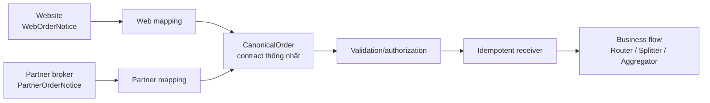
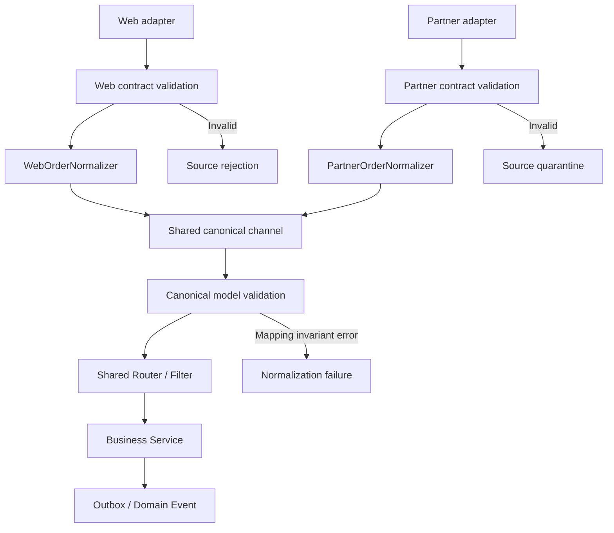
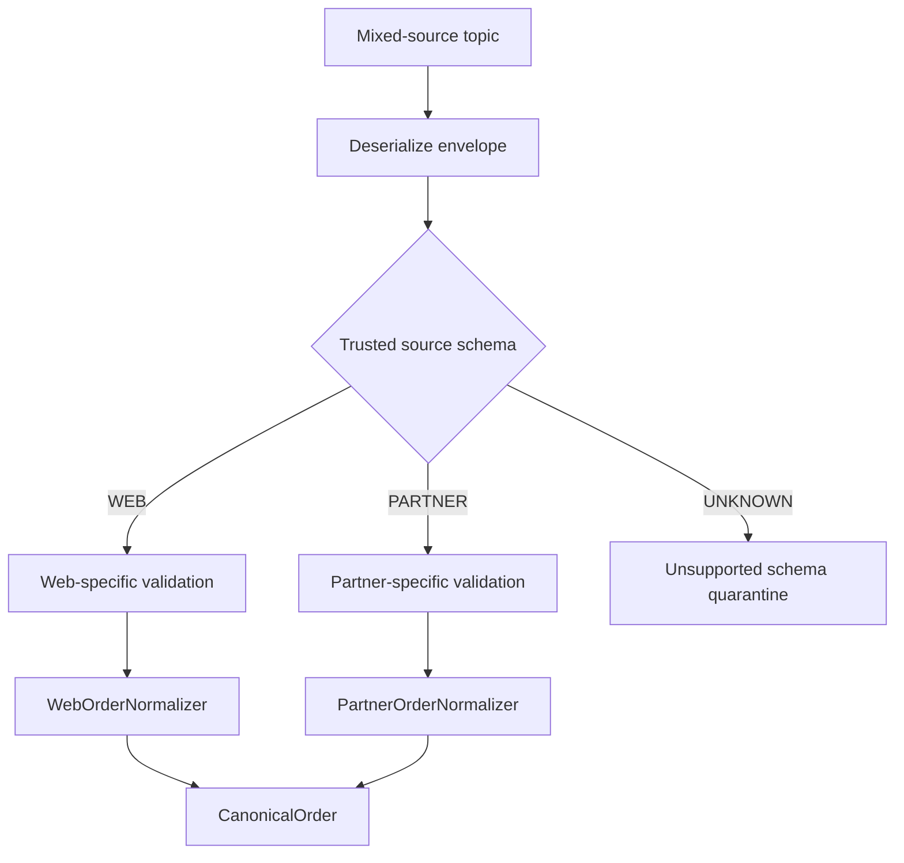
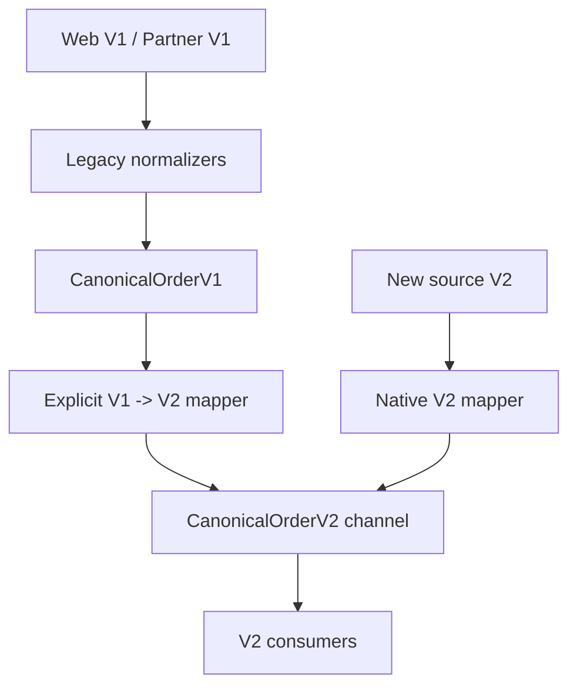

# Đặt canonical model trong integration flow

## 1. Bài toán: nhiều định dạng đầu vào, một luồng xử lý chung

Một hệ thống tiếp nhận đơn hàng từ **website nội bộ** và **đối tác qua broker**. Hai nguồn mô tả cùng một nghiệp vụ — khách đặt những sản phẩm với số lượng và đơn giá — nhưng đặt tên trường, định dạng thời gian, mã sản phẩm và kiểu dữ liệu khác nhau:

Payload `WebOrderNotice` từ website:

```json
{
  "tenantId": "tenant-a",
  "eventId": "web-event-105",
  "orderId": "WEB-105",
  "createdAt": "2026-11-21T04:00:00Z",
  "lines": [
    {"sku": "SKU-A", "quantity": 2, "unitPriceVnd": 25000}
  ]
}
```

Payload `PartnerOrderNotice` từ đối tác:

```json
{
  "partnerAccount": "merchant-7",
  "eventRef": "partner-event-77",
  "purchaseRef": "PO-77",
  "occurredAtIso": "2026-11-21T11:00:00+07:00",
  "details": [
    {"productCode": "PART-A7", "units": "2", "priceVndMinor": "25000"}
  ]
}
```

Nếu để mọi Service Activator, Router, Aggregator và consumer hiểu cả hai schema, số nhánh xử lý tăng theo số nguồn. Mỗi thay đổi của đối tác buộc logic nghiệp vụ biết về định dạng transport. Ngược lại, nếu chuẩn hóa hai nguồn thành **một canonical model** trước luồng xử lý chung, downstream chỉ làm việc với một hợp đồng nội bộ.

**Normalizer** là Enterprise Integration Pattern (EIP) nhận nhiều dạng message biểu thị những dữ liệu tương đương rồi đưa chúng về một dạng thống nhất để downstream xử lý. Thông thường Normalizer kết hợp **Message Router** để chọn nguồn/loại thông điệp với các **Message Transformer** cho từng định dạng. **Canonical Data Model** (mô hình dữ liệu chuẩn nội bộ) là hợp đồng đích mà Normalizer tạo ra.

Trong chương **Normalizer** của module **SPRING_INTEGRATION_PATTERN**, người học triển khai Enterprise Integration Patterns với Spring Integration để xây luồng message ít phụ thuộc, dễ mở rộng; kết hợp Router, Filter, Transformer, Splitter, Aggregator, Gateway, retry, error channel và correlation, đồng thời kiểm thử và theo dõi các nhánh xử lý.



**Câu hỏi chính của bài:** Đặt canonical model **ở điểm nào** trong integration flow, để các nguồn được tách biệt nhưng luồng nghiệp vụ chung không bị phụ thuộc vào DTO riêng của từng nguồn?

## 2. Phân biệt Normalizer, Transformer, Adapter và Canonical Model

Các khái niệm có liên hệ nhưng không đồng nghĩa:

| Khái niệm | Trách nhiệm | Ví dụ |
| --- | --- | --- |
| **Inbound adapter** | Nhận message từ HTTP, broker, file, database và chuyển về Spring Message | Nhận JSON đối tác qua message broker |
| **Message Converter** | Deserialize bytes thành một kiểu Java nguồn | JSON thành `PartnerOrderNotice` |
| **Transformer** | Chuyển một kiểu payload sang một kiểu khác | `PartnerOrderNotice → CanonicalOrder` |
| **Normalizer** | Đưa **nhiều nguồn/format** về cùng một hình dạng | Web + Partner → `CanonicalOrder` |
| **Canonical Data Model** | Định nghĩa ngôn ngữ nội bộ chung của một ranh giới | `tenantId`, `sourceOrderId`, `occurredAt`, `lines` |
| **Validator** | Kiểm tra một object đúng contract không | SKU bắt buộc, quantity dương |
| **Content-Based Router** | Chọn kênh theo thông tin message | Đưa kết quả hợp lệ sang xử lý, lỗi sang quarantine |
| **Business Enricher** | Bổ sung thông tin mà payload không có | Tra giá được phép bán từ catalog |
| **Idempotent Receiver** | Tránh thực hiện side effect hai lần cho cùng logical event | Không trừ kho lần nữa khi broker redeliver |

**Một Transformer không mặc nhiên là Normalizer.** Trong mô hình Normalizer, có *nhiều phép biến đổi nguồn* cùng trả về một canonical contract. Normalizer cũng **không phải** Aggregator: nó không gom nhiều message thành một summary chỉ vì nhiều nguồn chảy vào cùng channel.

### 2.1. Anti-corruption layer ở ranh giới

Normalizer đóng vai trò **anti-corruption layer**: cô lập ngôn ngữ/định dạng của hệ thống ngoài, không cho những chi tiết như `purchaseRef` hoặc `priceVndMinor` len vào mọi service nghiệp vụ.

Thay vì code chung:

```java
// PHẢN MẪU: business service biết trực tiếp mọi định dạng nguồn.
void process(Object input) {
    if (input instanceof WebOrderNotice web) {
        // web-specific rules
    } else if (input instanceof PartnerOrderNotice partner) {
        // partner-specific rules
    }
    // Thêm một nguồn mới sẽ phải sửa service này.
}
```

Ta hướng đến:

```java
interface CanonicalOrderService {
    void process(CanonicalOrder order);
}
```

Phần nhận nguồn chịu trách nhiệm chuyển đổi; business service chỉ biết `CanonicalOrder`.

### 2.2. Không nên tạo “canonical model của cả doanh nghiệp” quá sớm

Canonical model hữu ích trong **một bounded context hoặc một ranh giới tích hợp có phạm vi rõ**. Không cần buộc mọi service trên hệ thống dùng một schema khổng lồ, nhiều trường optional và nhiều kiểu nghiệp vụ không liên quan.

Một canonical model tốt:
- Đủ chung cho **những nguồn và nghiệp vụ thực sự cần chia sẻ**.
- Có ý nghĩa rõ ràng cho đơn vị tiền, múi giờ, identity và trạng thái.
- Có contract/version và policy evolution.
- Không phụ thuộc tên field lạ của một đối tác cụ thể.
- Không bị biến thành DTO database/JPA entity chỉ vì tiện reuse.

## 3. Nên đặt canonical model ở đâu trong flow?

Vị trí phổ biến:

```text
External Source
  -> Inbound Adapter / Deserialize
  -> Source-Specific Structural Validation
  -> Source-Specific Normalizer / Mapping
  -> Canonical Validation & Provenance Check
  -> Shared Canonical Channel
  -> Business Router / Filter / Enricher
  -> Idempotent Receiver / Side Effects
  -> Downstream Event / Gateway Reply
```

Normalizer được đặt **sau điểm đã nhận dạng format nguồn và trước những bước nghiệp vụ dùng chung**. Mục tiêu là giảm số nơi phải biết input format.



**Tùy workflow**, có thể normalization trước một bước validation trên canonical model nếu input structure đã đủ để parse. Nhưng luôn cần một lớp bảo vệ trước việc truy cập field nguy hiểm hoặc thao tác nguồn. Không để một message được deserialized sai trở thành canonical “hợp lệ” chỉ nhờ tự điền giá trị mặc định.

### 3.1. Hai cách wiring hợp lệ

**Cách A — Một channel riêng cho mỗi nguồn:**

```text
orders.web.in      -> WebOrderNormalizer      ┐
                                            ├-> orders.canonical
orders.partner.in  -> PartnerOrderNormalizer ┘
```

Phù hợp khi adapter nguồn đã biết message type. Mỗi channel có owner/validation rõ, không cần Router đoán kiểu payload.

**Cách B — Một input đa hình:**

```text
orders.raw
  -> Router by trusted source/type
       -> orders.web.normalize
       -> orders.partner.normalize
  -> orders.canonical
```

Phù hợp khi một adapter nhận nhiều event types, nhưng phải xác định loại từ **schema/type metadata đáng tin**, không dùng một header do caller tùy ý khai để cast payload không đúng.

Bài này ưu tiên **Cách A** để Java DSL đơn giản và type-safe. Có thể thêm Router khi các nguồn cùng đi qua một inbound topic.

### 3.2. Đặt sai vị trí sẽ gây điều gì?

| Đặt Normalizer | Hậu quả |
| --- | --- |
| Quá muộn, sau nhiều business handlers | Mỗi handler phải hiểu DTO riêng của các nguồn |
| Quá sớm, trước khi biết schema/version | Không biết cần map kiểu dữ liệu nào |
| Sau một Filter phụ thuộc source-specific fields | Filter tiếp tục dính chặt vào format ngoài |
| Trước bước xác thực nguồn mà tin tenant header | Có nguy cơ cross-tenant spoofing |
| Sau khi đã ghi DB/đã phát event | Dữ liệu không nhất quán có thể đã gây side effect |
| Trong từng consumer riêng | Lặp mapping logic, khó đồng bộ version |

Chọn điểm normalize giúp mô hình chung xuất hiện **một lần**, ở ranh giới ingress của phạm vi đó.

## 4. Thiết kế canonical contract: ý nghĩa quan trọng hơn tên field

Ta chọn một contract nội bộ nhỏ, dành riêng cho thông điệp **đơn hàng mới**:

```text
CanonicalOrder
  tenantId           : String
  source             : WEB | PARTNER
  sourceOrderId      : String
  sourceEventId      : String
  occurredAt         : Instant (UTC instant)
  lines              : List<CanonicalLine>
  totalVnd           : long (đơn vị VND nguyên)
  
CanonicalLine
  sku                : String (mã SKU nội bộ)
  quantity           : int (>0)
  unitPriceVnd       : long (>=0)
  lineTotalVnd()     : quantity * unitPriceVnd
```

Giải thích quyết định:

- `tenantId` thuộc phạm vi khách hàng và **phải được đối chiếu với identity đã xác thực**.
- `source` là enum nguồn, không dùng tùy tiện một String do client gửi để gán nhãn.
- `sourceOrderId` và `sourceEventId` giữ identity gốc **trong namespace của source**; không giả vờ các nguồn đều tạo ID toàn cục.
- `occurredAt` là `Instant` để biểu thị **một thời điểm xác định**, không phải chuỗi giờ địa phương thiếu timezone.
- `sku` là mã nội bộ đã được mapping, không phải mọi alias từ vendor đều hợp lệ.
- `totalVnd` tính từ các dòng trong canonical model; không tin ngay vào tổng khai báo chưa xác thực.
- `long` chỉ dùng do ví dụ tính tiền nguyên đơn vị VND. Với đa tiền tệ nên dùng `Money(currency, minorUnits)` và định nghĩa precision/conversion; không trộn USD với VND.

### 4.1. Canonical model bất biến trong Java

```java
import java.time.Instant;
import java.util.List;
import java.util.Objects;

enum OrderSource {
    WEB, PARTNER
}

record CanonicalLine(
        String sku,
        int quantity,
        long unitPriceVnd) {

    CanonicalLine {
        if (sku == null || !sku.matches("[A-Z0-9-]{1,32}")
                || quantity <= 0 || unitPriceVnd < 0) {
            throw new IllegalArgumentException(
                    "INVALID_CANONICAL_LINE");
        }
    }

    long lineTotalVnd() {
        return Math.multiplyExact(
                (long) quantity, unitPriceVnd);
    }
}

record CanonicalOrder(
        String tenantId,
        OrderSource source,
        String sourceOrderId,
        String sourceEventId,
        Instant occurredAt,
        List<CanonicalLine> lines,
        long totalVnd) {

    CanonicalOrder {
        if (tenantId == null || tenantId.isBlank()
                || source == null
                || sourceOrderId == null || sourceOrderId.isBlank()
                || sourceEventId == null || sourceEventId.isBlank()
                || occurredAt == null
                || lines == null || lines.isEmpty()) {
            throw new IllegalArgumentException(
                    "INVALID_CANONICAL_ORDER");
        }

        lines = List.copyOf(lines);

        long expected = 0L;
        for (CanonicalLine line : lines) {
            expected = Math.addExact(
                    expected, line.lineTotalVnd());
        }
        if (totalVnd != expected) {
            throw new IllegalArgumentException(
                    "CANONICAL_TOTAL_MISMATCH");
        }
    }

    static CanonicalOrder create(
            String tenantId,
            OrderSource source,
            String sourceOrderId,
            String sourceEventId,
            Instant occurredAt,
            List<CanonicalLine> lines) {

        Objects.requireNonNull(lines, "lines");
        long sum = 0L;
        for (CanonicalLine line : lines) {
            sum = Math.addExact(sum, line.lineTotalVnd());
        }

        return new CanonicalOrder(
                tenantId, source, sourceOrderId,
                sourceEventId, occurredAt, lines, sum);
    }
}
```

**Điểm đáng chú ý:**

1. `List.copyOf` tạo snapshot collection; nếu line records chỉ chứa String và primitives bất biến, downstream không thể tự sửa danh sách.
2. Một client gọi constructor trực tiếp với `totalVnd` sai sẽ bị từ chối. Các mapper thông thường dùng factory `create` để tính lại.
3. `Math.multiplyExact` và `Math.addExact` phát hiện overflow, tránh âm thầm tạo tổng âm.
4. Số lượng dương và unit price không âm được kiểm tra ngay ở canonical line.
5. `sourceEventId` là business identity để phối hợp idempotency, không phải `MessageHeaders.ID`.
6. `occurredAt` dùng Instant; formatter/timezone chỉ nằm ở biên input/output.

### 4.2. Canonical model không đồng nghĩa object database

Không đặt annotation JPA hay biến `CanonicalOrder` thành một entity mutable chỉ để dễ lưu. Canonical message là **hợp đồng vận chuyển giữa các thành phần tích hợp**, còn aggregate/domain entity có lifecycle và tính bất biến riêng. Một business service có thể biến CanonicalOrder thành command/domain object sau khi kiểm tra điều kiện nghiệp vụ.

### 4.3. Hợp đồng danh tính của canonical event

Một key idempotency ví dụ:

```text
(consumerName, tenantId, source, sourceEventId)

("stock-reservation", "tenant-a", WEB, "web-event-105")
("stock-reservation", "tenant-a", PARTNER, "partner-event-77")
```

Đừng dùng `sourceOrderId` đơn độc nếu cùng order có thể phát nhiều logical events (created, revised, cancelled). Đừng dùng `sourceEventId` đơn độc nếu các nguồn có vùng ID trùng nhau. Một retry cùng event cần giữ những trường identity này ổn định.

## 5. Hai source models: chỉ mô tả dữ liệu ở ranh giới

### 5.1. Website schema

```java
import java.time.Instant;
import java.util.List;

record WebOrderLine(
        String sku,
        int quantity,
        long unitPriceVnd) {}

record WebOrderNotice(
        String tenantId,
        String eventId,
        String orderId,
        Instant createdAt,
        List<WebOrderLine> lines) {}
```

Schema website đã gần canonical nhưng vẫn khác: nó có field `orderId`/`eventId`, chưa chứa provenance enum hoặc tổng tiền nội bộ.

### 5.2. Partner schema

```java
import java.util.List;

record PartnerOrderLine(
        String productCode,
        String units,
        String priceVndMinor) {}

record PartnerOrderNotice(
        String partnerAccount,
        String eventRef,
        String purchaseRef,
        String occurredAtIso,
        List<PartnerOrderLine> details) {}
```

Ở nguồn này:
- `units` và `priceVndMinor` là **chuỗi**, phải parse theo rule chặt chẽ.
- `productCode` là mã riêng của partner, phải tra mapping sang canonical SKU.
- `occurredAtIso` là chuỗi thời gian có offset.
- `partnerAccount` cần được đối chiếu với **tài khoản đối tác đã xác thực ở ingress**, không được coi là thông tin tự chứng minh tenant.
- Giá được định nghĩa rõ là **số nguyên đơn vị VND**, không phải decimal USD hay một loại tiền không xác định.

Hai source classes không nên lọt qua `orders.canonical`. Khi thêm đối tác thứ ba, tạo một mapper riêng để convert từ schema đối tác ấy, không sửa business service của mọi consumer.

## 6. Ranh giới lỗi normalization: parse failure không phải infrastructure failure

Một normalizer có thể gặp lỗi:
- Không có order ID, không có lines, quantity âm.
- Chuỗi `units="two"` thay vì một số nguyên.
- ISO timestamp không có timezone hoặc không parse được.
- Mã sản phẩm của vendor chưa có mapping.
- Catalog/tenant directory không truy cập được do timeout.

Cần tách hai nhóm:

| Nhóm | Ví dụ | Chính sách |
| --- | --- | --- |
| **Contract/data error** | Missing ID, invalid quantity, malformed time | Terminal reject/quarantine; không retry vô hạn cùng payload |
| **Mapping không được khai báo** | Vendor SKU không tồn tại trong bảng mapping | Quarantine hoặc chờ sửa mapping có chủ đích |
| **Infrastructure/transient** | Directory/DB timeout | Retry có giới hạn và backoff |
| **Authorization** | Partner A gửi account của partner B | Deny, security audit; không “sửa” tenant |
| **Internal bug** | NullPointerException bất ngờ trong mapper | Báo lỗi application, không che thành input invalid |
| **Overflow** | Giá trị tiền vượt miền `long` | Reject hoặc đổi numeric model theo hợp đồng |

Một exception chứa **mã lỗi ổn định** để downstream nhận biết lỗi mà không phải parse lại thông báo chứa raw payload.

```java
final class NormalizationFailure
        extends IllegalArgumentException {

    private final String reasonCode;

    NormalizationFailure(String reasonCode) {
        super(reasonCode);
        this.reasonCode = reasonCode;
    }

    String reasonCode() {
        return reasonCode;
    }
}
```

Không đưa raw order, PII, access token hoặc identifier nhạy cảm vào exception message/metric label. Khi cần sửa dữ liệu, có thể lưu nguyên bản trong một quarantine storage được phân quyền rồi liên kết bằng tracking ID thay vì phát toàn bộ body trong lỗi.

## 7. WebOrderNormalizer: nguồn gần chuẩn vẫn cần kiểm tra

Một mapper nguồn website nên:
1. Xác nhận source payload không null và các trường bắt buộc hiện diện.
2. Duyệt lines, tạo canonical lines bất biến.
3. Không dùng caller-provided total để tính lại ngầm; canonical factory tính tổng.
4. Giữ provenance và business IDs.
5. Để authorization kiểm tra `tenantId` so với người gửi đã xác thực.

```java
import java.util.ArrayList;
import org.springframework.stereotype.Component;

@Component
final class WebOrderNormalizer {

    CanonicalOrder normalize(WebOrderNotice input) {
        if (input == null
                || input.tenantId() == null
                || input.eventId() == null
                || input.orderId() == null
                || input.createdAt() == null
                || input.lines() == null
                || input.lines().isEmpty()) {
            throw new NormalizationFailure(
                    "WEB_REQUIRED_FIELD_MISSING");
        }

        var normalizedLines =
                new ArrayList<CanonicalLine>();

        for (WebOrderLine line : input.lines()) {
            if (line == null) {
                throw new NormalizationFailure(
                        "WEB_NULL_LINE");
            }
            try {
                normalizedLines.add(new CanonicalLine(
                        line.sku(),
                        line.quantity(),
                        line.unitPriceVnd()));
            } catch (IllegalArgumentException ex) {
                throw new NormalizationFailure(
                        "WEB_LINE_INVALID");
            }
        }

        try {
            return CanonicalOrder.create(
                    input.tenantId(),
                    OrderSource.WEB,
                    input.orderId(),
                    input.eventId(),
                    input.createdAt(),
                    normalizedLines);
        } catch (IllegalArgumentException ex) {
            throw new NormalizationFailure(
                    "WEB_ORDER_INVALID");
        }
    }
}
```

Mã ví dụ chủ động map lỗi dữ liệu về reason code, không log SKU/giá sai. `ArithmeticException` do overflow không được nuốt thành lỗi null; ở production có thể chuyển nó thành reason code riêng `AMOUNT_OUT_OF_RANGE` hoặc dùng kiểu số lớn hơn nếu business yêu cầu.

**Ranh giới bảo mật:** Website adapter cần ràng buộc tenant được xác thực với `input.tenantId()`. Một String không rỗng không có nghĩa caller được phép gửi đơn cho tenant đó. Việc kiểm tra quyền phải diễn ra trước khi business side effect, có thể trước hoặc sau normalization tùy nơi giữ verified principal.

## 8. PartnerOrderNormalizer: mapping phải explicit và có hợp đồng

Với partner, cần hai loại tra cứu được **đặt trong abstraction**, không trộn logic vào domain service:

```java
interface PartnerTenantDirectory {
    String requireTenantId(String partnerAccount);
}

interface PartnerSkuDirectory {
    String requireCanonicalSku(
            String partnerAccount, String partnerSku);
}
```

Giả định integration adapter đã xác thực danh tính đối tác (chứng thư, broker principal, ký message...) và chỉ chấp nhận `partnerAccount` **khớp với identity đã xác thực**. Hai interfaces trên tra mapping đã được đăng ký, không coi một mã do caller tự khai là quyền truy cập. Nếu directory phụ thuộc network, lỗi timeout phải được phân biệt với mã sản phẩm chưa được định nghĩa.

### 8.1. Chuyển units, giá tiền và thời điểm một cách chặt chẽ

```java
import java.time.Instant;
import java.time.format.DateTimeParseException;
import java.util.ArrayList;
import java.util.Objects;
import org.springframework.stereotype.Component;

@Component
final class PartnerOrderNormalizer {

    private final PartnerTenantDirectory tenants;
    private final PartnerSkuDirectory skus;

    PartnerOrderNormalizer(
            PartnerTenantDirectory tenants,
            PartnerSkuDirectory skus) {
        this.tenants = Objects.requireNonNull(tenants);
        this.skus = Objects.requireNonNull(skus);
    }

    CanonicalOrder normalize(PartnerOrderNotice input) {
        if (input == null
                || isBlank(input.partnerAccount())
                || isBlank(input.eventRef())
                || isBlank(input.purchaseRef())
                || isBlank(input.occurredAtIso())
                || input.details() == null
                || input.details().isEmpty()) {
            throw new NormalizationFailure(
                    "PARTNER_REQUIRED_FIELD_MISSING");
        }

        String tenantId =
                tenants.requireTenantId(input.partnerAccount());

        Instant occurredAt;
        try {
            occurredAt = Instant.parse(input.occurredAtIso());
        } catch (DateTimeParseException ex) {
            throw new NormalizationFailure(
                    "PARTNER_TIME_INVALID");
        }

        var lines = new ArrayList<CanonicalLine>();
        for (PartnerOrderLine raw : input.details()) {
            if (raw == null
                    || isBlank(raw.productCode())
                    || isBlank(raw.units())
                    || isBlank(raw.priceVndMinor())) {
                throw new NormalizationFailure(
                        "PARTNER_LINE_MISSING_FIELD");
            }

            int quantity = parseQuantity(raw.units());
            long price = parsePrice(raw.priceVndMinor());

            // Đối tác dùng mã riêng, không tự UPPERCASE
            // hay thay dấu rồi giả định đó là SKU nội bộ.
            String sku = skus.requireCanonicalSku(
                    input.partnerAccount(), raw.productCode());

            try {
                lines.add(new CanonicalLine(
                        sku, quantity, price));
            } catch (IllegalArgumentException ex) {
                throw new NormalizationFailure(
                        "PARTNER_LINE_INVALID");
            }
        }

        try {
            return CanonicalOrder.create(
                    tenantId,
                    OrderSource.PARTNER,
                    input.purchaseRef(),
                    input.eventRef(),
                    occurredAt,
                    lines);
        } catch (IllegalArgumentException ex) {
            throw new NormalizationFailure(
                    "PARTNER_ORDER_INVALID");
        }
    }

    private static int parseQuantity(String raw) {
        try {
            int value = Integer.parseInt(raw);
            if (value <= 0) {
                throw new NumberFormatException();
            }
            return value;
        } catch (NumberFormatException ex) {
            throw new NormalizationFailure(
                    "PARTNER_QUANTITY_INVALID");
        }
    }

    private static long parsePrice(String raw) {
        try {
            long value = Long.parseLong(raw);
            if (value < 0) {
                throw new NumberFormatException();
            }
            return value;
        } catch (NumberFormatException ex) {
            throw new NormalizationFailure(
                    "PARTNER_PRICE_INVALID");
        }
    }

    private static boolean isBlank(String value) {
        return value == null || value.isBlank();
    }
}
```

Mã dùng `Instant.parse` để chỉ chấp nhận timestamp mang ngữ nghĩa instant và có đủ thông tin offset/timezone theo chuẩn mà parser hỗ trợ. Nếu partner gửi `"2026-11-21 11:00"` không có timezone, **không tự giả định UTC hoặc giờ Việt Nam**: cần contract rõ hoặc một adapter version riêng có timezone được cấu hình.

`Integer.parseInt` và `Long.parseLong` yêu cầu chữ số thập phân dạng integer; dữ liệu `"2.0"` hay `"25,000"` bị từ chối theo hợp đồng này. Nếu nhà cung cấp chính thức định nghĩa dấu phân cách/decimal khác, bổ sung parser nguồn theo version đã phê duyệt, không đoán theo locale đang chạy.

### 8.2. Directory lookup có thể thất bại vì hai lý do

- **Unknown mapping:** partner SKU chưa được đăng ký → dừng hoặc quarantine; không tự dùng mã vendor như mã nội bộ.
- **Directory unavailable:** DB/network không truy cập được → lỗi hạ tầng, retry backoff nếu policy cho phép.

Hai interface được dùng như **hợp đồng**; code ví dụ không bắt/catch mọi RuntimeException từ chúng, để lỗi transient không bị âm thầm phân loại thành lỗi input. Nếu directory cung cấp mã lỗi typed, một error classifier ở inbound adapter có thể đưa từng nhóm đến đúng retry/quarantine path.

### 8.3. Không tự đổi tiền tệ

Tên `priceVndMinor` ở adapter nguồn minh họa đơn vị nguyên VND theo hợp đồng đã biết. Nếu nguồn thứ ba gửi tiền USD theo cents, **không** nhân/chia tùy tiện để thành VND. Cần quy tắc conversion có tỷ giá, thời điểm hiệu lực, rounding, source và version. Một canonical contract hỗ trợ đa tiền tệ có thể dùng `Money(currency, amountMinorUnits)`, còn contract bài này rõ ràng chỉ nhận VND.

## 9. Spring Integration Java DSL: hai nguồn hội tụ tại canonical channel

Ta nối hai normalizer vào cùng integration flow. Mỗi inbound channel nhận một kiểu nguồn đã deserialize, nhưng downstream chỉ tiêu thụ `CanonicalOrder`:

```java
import org.springframework.context.annotation.Bean;
import org.springframework.context.annotation.Configuration;
import org.springframework.integration.channel.DirectChannel;
import org.springframework.integration.config.EnableIntegration;
import org.springframework.integration.dsl.IntegrationFlow;
import org.springframework.messaging.MessageChannel;

@Configuration
@EnableIntegration
class CanonicalOrderFlowConfiguration {

    @Bean("orders.web.in")
    MessageChannel webOrders() {
        return new DirectChannel();
    }

    @Bean("orders.partner.in")
    MessageChannel partnerOrders() {
        return new DirectChannel();
    }

    @Bean("orders.canonical")
    MessageChannel canonicalOrders() {
        return new DirectChannel();
    }

    @Bean
    IntegrationFlow normalizeWebOrders(
            WebOrderNormalizer normalizer) {
        return IntegrationFlow.from("orders.web.in")
                .transform(WebOrderNotice.class,
                        normalizer::normalize)
                .channel("orders.canonical")
                .get();
    }

    @Bean
    IntegrationFlow normalizePartnerOrders(
            PartnerOrderNormalizer normalizer) {
        return IntegrationFlow.from("orders.partner.in")
                .transform(PartnerOrderNotice.class,
                        normalizer::normalize)
                .channel("orders.canonical")
                .get();
    }

    @Bean
    IntegrationFlow processCanonicalOrders(
            CanonicalOrderService service) {
        return IntegrationFlow.from("orders.canonical")
                .handle(CanonicalOrder.class, (order, headers) -> {
                    service.process(order);
                    return null; // One-way handler.
                })
                .get();
    }
}
```

`CanonicalOrderService` là interface ở mục 2, do ứng dụng cung cấp implementation có authorization, business validation, transaction và idempotency phù hợp. API `.transform(Class<T>, transformer)` thuộc Java DSL; cần đối chiếu dependency version thực tế ở vòng QA/compile chuyên môn.

**Luồng xử lý:**

1. Adapter website gửi `WebOrderNotice` tới `orders.web.in` sau khi xác thực nguồn và parse.
2. `normalizeWebOrders` tạo canonical payload.
3. Adapter partner gửi `PartnerOrderNotice` tới `orders.partner.in`, chạy lookup/mapping riêng.
4. Hai nhánh đều phát `CanonicalOrder` vào `orders.canonical`.
5. Common handler không biết tên `purchaseRef`, `productCode` hoặc string quantity của đối tác.

**Phạm vi minh họa:** Các channel là `DirectChannel` đồng bộ trong một JVM. Không có broker adapter, transactional outbox, Gateway reply hoặc retry policy trong đoạn code này. Khi chạy thực cần tích hợp các thành phần tương ứng.

### 9.1. Nếu đầu vào dùng cùng một topic

Khi một broker topic trộn nhiều event types, có thể thêm Router dựa trên **type/schema/provenance đáng tin**:



Không cast `PartnerOrderNotice` chỉ vì caller tự gắn `source=PARTNER`. Adapter phải xác thực schema trước khi tạo typed payload. Trong ví dụ có hai input channel riêng nên không cần thêm Router để quyết định loại message.

### 9.2. Giữ normalizer độc lập với DSL wiring

Nếu mọi phép parse, lookup, validate và ánh xạ nằm trong một lambda DSL dài:
- Khó unit test các tình huống edge case;
- Khó tái sử dụng khi thay HTTP bằng broker;
- Một thay đổi của partner có thể phá luồng chung;
- Dễ bắt nhầm exception và làm mất cause/reason code;
- Khó đảm bảo normalizer không có side effect nghiệp vụ.

Một mapper kiểu `PartnerOrderNormalizer` tách riêng có thể test bằng fake directories. DSL chỉ mô tả cách **nối các endpoint**.

### 9.3. Đặt bước validation ở phía nào?

Thông thường cần **hai cấp kiểm tra**:

1. **Source-specific validation:** schema, required fields, data types, authentication, source version.
2. **Canonical validation:** invariant chung của `CanonicalOrder`, tiền, tenant, identity, line totals, semantic contract.

Các compact constructors trong bài bảo vệ một số invariant, nhưng không thay thế Bean Validation, authorization hoặc business rule (ví dụ kiểm tra giá từ catalog). Đặc biệt việc tính `totalVnd` theo giá mà producer cung cấp **không chứng minh đơn giá ấy đã được phê duyệt**.

## 10. Rẽ nhánh lỗi một cách có kiểm soát

Một normalizer không map được dữ liệu cần thông báo rõ vì sao. Trong `DirectChannel`, `NormalizationFailure` có thể lan ngược về sender. Trong broker listener/poller/executor, exception và ACK/NACK/DLQ phụ thuộc adapter/error handling.

| Outcome | Ví dụ | Hướng xử lý |
| --- | --- | --- |
| **NORMALIZED** | Đúng schema, mapped thành `CanonicalOrder` | Chuyển vào shared flow |
| **REJECTED_INPUT** | Quantity text không parse được | Rejection/quarantine, không retry vô hạn |
| **UNKNOWN_MAPPING** | Vendor SKU chưa khai báo | Sửa mapping hoặc quarantine có replay |
| **TRANSIENT_FAILURE** | Directory DB timeout | Bounded retry/backoff |
| **UNAUTHORIZED** | Partner giả mạo account/tenant | Security audit và reject |
| **UNSUPPORTED_VERSION** | Source schema ngoài contract | Quarantine hoặc migration |
| **PROGRAMMING_BUG** | Exception bất ngờ do code | Alert/error channel, không giả là lỗi dữ liệu |

### 10.1. Typed normalization outcome

Một lựa chọn là chuyển dữ liệu invalid thành message kết quả **không chứa raw payload**:

```java
sealed interface NormalizationOutcome
        permits NormalizedOrder, RejectedSourceOrder {}

record NormalizedOrder(CanonicalOrder order)
        implements NormalizationOutcome {}

record RejectedSourceOrder(
        String trackingId,
        String reasonCode)
        implements NormalizationOutcome {}
```

Ví dụ adapter boundary:

```java
NormalizationOutcome normalizeSafely(
        WebOrderNotice input,
        String trustedTrackingId,
        WebOrderNormalizer mapper) {

    try {
        return new NormalizedOrder(mapper.normalize(input));
    } catch (NormalizationFailure invalidInput) {
        return new RejectedSourceOrder(
                trustedTrackingId, invalidInput.reasonCode());
    }
}
```

**Chỉ bắt `NormalizationFailure` cho dữ liệu invalid.** Các exception như `DataAccessException`, network timeout hoặc programming bug không được biến thành rejection rồi ACK như không thể phục hồi.

### 10.2. Dùng Router cho hai outcome

```text
normalization.outcomes
  -> Router by outcome type
      -> NormalizedOrder
           -> unwrap CanonicalOrder
           -> orders.canonical
      -> RejectedSourceOrder
           -> orders.quarantine / source reply
```

Đường accepted cần **unwrap** đối tượng để business flow thật sự nhận `CanonicalOrder`; không chuyển nguyên `NormalizedOrder` tới handler chỉ nhận CanonicalOrder. Đường rejected phải lưu/đáp lỗi theo contract. Nếu Gateway đang chờ, đừng âm thầm Filter bỏ message rồi để caller timeout.

### 10.3. Khi Filter nằm giữa Splitter và Aggregator

Nếu một batch có 5 phần tử mà 2 item malformed bị loại, Aggregator downstream vẫn đợi `sequenceSize=5` thì có thể mắc kẹt. Có hai lựa chọn:
- Chuyển **cả accepted/rejected outcomes** thành các kết quả theo sourceIndex để Coordinator biết đã xử lý đủ 5.
- Hoặc dùng completion marker/expected accepted count đáng tin thay vì count ban đầu.

Normalizer không tự giải quyết correlation/release, nhưng lỗi normalization phải được phản ánh trong policy của toàn flow.

## 11. Canonical payload và header propagation

Trong Spring Integration, `Message<T>` gồm payload và headers. Normalizer đổi payload sang `CanonicalOrder` nhưng framework có thể giữ nhiều headers của inbound message qua Transformer.

```text
Web message
  payload = WebOrderNotice(...)
  headers = eventId, contentType, source, replyChannel, traceId...

After normalization
  payload = CanonicalOrder(...)
  headers = ? (theo endpoint, adapter và mapping policy)
```

**Payload chuẩn không đồng nghĩa headers đã chuẩn.** Nếu nhận `eventId` trong header khác `sourceEventId` của canonical payload, Idempotent Receiver có thể dùng nhầm business key. Hãy chọn nguồn chân lý tường minh.

| Header | Policy nên có |
| --- | --- |
| `trustedTenantId` | Xác minh với payload và security principal |
| `eventId` | Derive/đối chiếu với `sourceEventId` |
| `sourceSystem` | Derive từ enum `OrderSource` |
| `schemaVersion` | Giữ version đã parse thành công |
| `traceId` | Qua tracing policy/library |
| `CORRELATION_ID` | Chỉ giữ nếu group semantics vẫn đúng |
| `SEQUENCE_NUMBER/SIZE` | Không giả mạo hoặc thay bừa |
| `replyChannel` | Giữ theo Gateway request-reply contract |
| `errorChannel` | Điều phối lỗi được cấu hình rõ |
| Raw token / credentials | Không chuyển ra ngoài nếu không cần |

**Phản mẫu:** dùng `copyHeaders(input.getHeaders())` với mọi message của nguồn thứ ba, đưa cả transport-specific object, thông tin nhạy cảm hoặc sequence metadata cũ vào downstream.

Trong luồng chuyển qua broker/HTTP, nên dùng **header allowlist** hoặc một mapper kiểm soát header rõ, rồi test đầu ra thực tế của endpoint. Với response từ Gateway phải giữ đúng đường reply; không tùy tiện xóa `replyChannel` trong cùng JVM nếu framework đang cần nó.

### 11.1. Idempotency key thuộc nghiệp vụ

```java
record CanonicalEventKey(
        String consumerName,
        String tenantId,
        OrderSource source,
        String sourceEventId) {}

CanonicalEventKey keyFor(
        String consumerName, CanonicalOrder order) {
    return new CanonicalEventKey(
            consumerName,
            order.tenantId(),
            order.source(),
            order.sourceEventId());
}
```

Một nguồn có thể tạo hai sự kiện khác nhau cho cùng `sourceOrderId`. Vì vậy không dùng chỉ order ID để chặn tất cả. Nếu một eventId tồn tại với payload khác, đó là **idempotency key conflict**, không được coi là duplicate hợp lệ. Khi lưu key trong DB, dùng composite columns hoặc canonical encoding có version thay vì nối chuỗi thiếu escape.

## 12. Tiền, thời gian, SKU và giá trị mặc định

### 12.1. Tiền phải có unit rõ

`totalVnd` trong ví dụ là **nguyên đơn vị VND**; `long` chỉ phù hợp khi range được giới hạn. Nếu nguồn khác gửi USD cents hoặc một số decimal, không nhân/chia tùy tiện thành VND. Cần conversion có nguồn tỷ giá, thời điểm hiệu lực, rounding và version.

```java
// Mô hình khác khi cần đa tiền tệ.
record Money(String currency, long minorUnits) {}

record PricedCanonicalLine(
        String sku,
        int quantity,
        Money unitPrice) {}
```

Nếu dùng kiểu này phải validate currency theo hợp đồng và tránh cộng `Money` khác currency. Cũng không tin price từ client chỉ vì hợp lệ về số học: giá bán cuối cùng cần được business service đối chiếu với catalog/quote đáng tin.

### 12.2. Hai timestamp có thể cùng một thời điểm

```text
Web:     2026-11-21T04:00:00Z
Partner: 2026-11-21T11:00:00+07:00
Canonical occurredAt:
         2026-11-21T04:00:00Z
```

Cùng một instant có thể được biểu diễn bằng nhiều offset. Nếu đối tác chỉ gửi `"2026-11-21 11:00"` không có timezone, không được tự lấy timezone của server đang chạy để điền. Yêu cầu nguồn cung cấp offset hoặc hợp đồng timezone có version; kiểm tra cả trường hợp DST nếu vùng có daylight saving.

### 12.3. SKU mapping phải có provenance/version

Hôm nay partner mã `PART-A7` là `SKU-A`, tháng sau catalog mapping thay đổi do hợp nhất mặt hàng. Nếu replay cùng event và tra bảng mapping mới, canonical payload có thể khác lần trước.

Cần cân nhắc:
- Lưu source mapping version/revision đã dùng.
- Snapshot canonical result khi cần audit/replay chính xác.
- Làm rõ replay cùng event khác với một event revision mới.
- Không cho một lookup “latest” thay đổi quyết định đã được commit mà không có migration.

### 12.4. Null không phải lúc nào cũng có default

Những tự sửa sai nguy hiểm:
- `quantity=null → 1` dù nguồn không quy định;
- `unitPrice=null → 0` khiến tổng tiền bằng 0;
- `tenantId=null → defaultTenant` gây sai quyền;
- `occurredAt=null → Instant.now()` khiến replay có timestamp mới;
- `unknownSku → rawPartnerCode` khiến alias ngoài lọt vào nghiệp vụ.

Chỉ áp dụng default được **định nghĩa trong contract có version**, rồi test deterministic output. Khi thiếu thông tin bắt buộc, trả reason code và quarantine.

## 13. Quản lý canonical schema và source versions

Canonical model giảm coupling với nguồn nhưng có thể trở thành điểm coupling mới nếu mọi thay đổi đều áp đặt lên tất cả consumer.

| Thay đổi | Phạm vi nên tác động |
| --- | --- |
| Thêm nguồn thứ ba cùng ý nghĩa đơn hàng | Mapper nguồn mới + tests |
| Đối tác đổi field ở API v2 | DTO/parser/mapper partner v2 |
| Thêm field canonical optional thật sự có ích | Contract tests cho consumers |
| Đổi total từ VND sang USD hoặc cents | **Breaking semantic change** |
| Đổi identity của `sourceEventId` | Breaking idempotency/correlation |
| Thêm chương trình giá khuyến mãi | Business policy, không tự nhét tùy ý vào parser |
| Đổi partner SKU mapping | Mapping version/replay policy |

### 13.1. Tránh “God Canonical DTO”

```text
CanonicalOrder:
  webOrderId?
  partnerPurchaseRef?
  legacyOrderRowId?
  platformAOnlyTax?
  platformBOnlyCampaign?
  ... 80 optional fields
```

Nếu downstream vẫn phải viết `if (order.source()==PARTNER)` để đọc những field riêng mà lẽ ra đã chuẩn hóa, model chưa giúp giảm coupling. Những field chỉ phục vụ audit nên nằm ở source envelope/storage riêng; những sự kiện khác ý nghĩa nên có canonical type khác hoặc bounded context khác.

### 13.2. Cách nâng từ V1 sang V2



Có thể deploy dual-read, đo tỷ lệ V1/V2, migrate dần consumer, sau đó đóng V1 khi hết thời hạn hỗ trợ. Không thay semantic meaning của một field ở version cũ rồi để replay lịch sử sai mà không biết.

### 13.3. Schema registry chưa bảo đảm ngữ nghĩa

JSON Schema, Avro hoặc Protobuf có thể kiểm tra shape và compatibility của payload; nhưng schema không tự chứng minh:
- Giá tiền đúng currency/precision;
- Tenant thuộc quyền của producer;
- Partner SKU được map đúng hàng hóa;
- Event ID ổn định khi retry;
- Timezone hoặc business policy version chính xác.

Phải có **contract tests ở cấp ngữ nghĩa**, không chỉ schema validation.

## 14. Unit test hai normalizer độc lập

Các mapper phải có thể kiểm thử **không cần khởi động Spring context**. Unit tests nên chứng minh:
- Hai nguồn cùng diễn tả một đơn hàng tạo **cùng phần dữ liệu nghiệp vụ chuẩn**.
- Provenance và source IDs vẫn phân biệt đúng.
- Sai dữ liệu tạo reason code cụ thể.
- Timestamp được chuẩn hóa về cùng instant.
- Mã SKU bên đối tác được tra mapping, không dùng alias trực tiếp.
- Canonical records không bị thay đổi do mutable source list.
- Overflow không tạo tổng tiền sai.

### 14.1. JUnit 5: cùng nội dung, khác format nguồn

```java
import java.time.Instant;
import java.util.List;
import org.junit.jupiter.api.Test;

import static org.junit.jupiter.api.Assertions.*;

class CanonicalOrderNormalizerTest {

    private final WebOrderNormalizer web =
            new WebOrderNormalizer();

    private final PartnerTenantDirectory tenants = account -> {
        if ("merchant-7".equals(account)) {
            return "tenant-a";
        }
        throw new NormalizationFailure(
                "UNKNOWN_PARTNER_ACCOUNT");
    };

    private final PartnerSkuDirectory skus =
            (account, partnerSku) -> {
                if ("merchant-7".equals(account)
                        && "PART-A7".equals(partnerSku)) {
                    return "SKU-A";
                }
                throw new NormalizationFailure(
                        "UNKNOWN_PARTNER_SKU");
            };

    private final PartnerOrderNormalizer partner =
            new PartnerOrderNormalizer(tenants, skus);

    @Test
    void sameBusinessContentHasSameCanonicalShape() {
        var fromWeb = web.normalize(new WebOrderNotice(
                "tenant-a", "web-event-105", "WEB-105",
                Instant.parse("2026-11-21T04:00:00Z"),
                List.of(new WebOrderLine(
                        "SKU-A", 2, 25_000L))));

        var fromPartner = partner.normalize(
                new PartnerOrderNotice(
                        "merchant-7", "partner-event-77", "PO-77",
                        "2026-11-21T11:00:00+07:00",
                        List.of(new PartnerOrderLine(
                                "PART-A7", "2", "25000"))));

        assertEquals(OrderSource.WEB, fromWeb.source());
        assertEquals(OrderSource.PARTNER, fromPartner.source());

        assertEquals("tenant-a", fromWeb.tenantId());
        assertEquals("tenant-a", fromPartner.tenantId());
        assertEquals(50_000L, fromWeb.totalVnd());
        assertEquals(50_000L, fromPartner.totalVnd());
        assertEquals(fromWeb.lines(), fromPartner.lines());
        assertEquals(fromWeb.occurredAt(),
                fromPartner.occurredAt());

        // Không xóa mất provenance của từng nguồn.
        assertEquals("WEB-105", fromWeb.sourceOrderId());
        assertEquals("PO-77", fromPartner.sourceOrderId());
        assertEquals("web-event-105", fromWeb.sourceEventId());
        assertEquals("partner-event-77",
                fromPartner.sourceEventId());
    }

    @Test
    void partnerQuantityMustBePositiveInteger() {
        var input = new PartnerOrderNotice(
                "merchant-7", "partner-event-77", "PO-77",
                "2026-11-21T11:00:00+07:00",
                List.of(new PartnerOrderLine(
                        "PART-A7", "2.5", "25000")));

        var error = assertThrows(NormalizationFailure.class,
                () -> partner.normalize(input));

        assertEquals("PARTNER_QUANTITY_INVALID",
                error.reasonCode());
    }

    @Test
    void unknownPartnerSkuIsNotSilentlyAccepted() {
        var input = new PartnerOrderNotice(
                "merchant-7", "partner-event-78", "PO-78",
                "2026-11-21T11:00:00+07:00",
                List.of(new PartnerOrderLine(
                        "UNMAPPED", "2", "25000")));

        var error = assertThrows(NormalizationFailure.class,
                () -> partner.normalize(input));

        assertEquals("UNKNOWN_PARTNER_SKU",
                error.reasonCode());
    }

    @Test
    void missingTimezoneDoesNotUseServerDefault() {
        var input = new PartnerOrderNotice(
                "merchant-7", "partner-event-79", "PO-79",
                "2026-11-21 11:00:00",
                List.of(new PartnerOrderLine(
                        "PART-A7", "2", "25000")));

        var error = assertThrows(NormalizationFailure.class,
                () -> partner.normalize(input));

        assertEquals("PARTNER_TIME_INVALID",
                error.reasonCode());
    }
}
```

**Hai payload canonical không nhất thiết phải `equals` toàn bộ**: chúng giữ `source`, `sourceOrderId` và `sourceEventId` khác nhau, vì đó là provenance có nghĩa. Điều cần tương đương ở test là **hình dạng, kiểu dữ liệu, canonical lines, unit và instant**. Không ép hai logical events khác nguồn thành cùng identity chỉ vì cùng hàng hóa và tổng tiền.

### 14.2. Test bất biến của collection

```java
import java.time.Instant;
import java.util.ArrayList;
import java.util.List;
import org.junit.jupiter.api.Test;
import static org.junit.jupiter.api.Assertions.*;

class CanonicalOrderImmutabilityTest {
    @Test
    void inputListMutationDoesNotChangeCanonicalOrder() {
        var mutable = new ArrayList<CanonicalLine>();
        mutable.add(new CanonicalLine("SKU-A", 2, 25_000L));

        var order = CanonicalOrder.create(
                "tenant-a", OrderSource.WEB,
                "WEB-105", "web-event-105",
                Instant.parse("2026-11-21T04:00:00Z"),
                mutable);

        mutable.clear(); // Sau khi tạo object.

        assertEquals(1, order.lines().size());
        assertEquals(50_000L, order.totalVnd());
        assertThrows(UnsupportedOperationException.class,
                () -> order.lines().add(
                        new CanonicalLine("SKU-B", 1, 10_000L)));
    }

    @Test
    void rejectsOverflowRatherThanWrappingLong() {
        var huge = new CanonicalLine(
                "SKU-A", 2, Long.MAX_VALUE);

        assertThrows(ArithmeticException.class,
                () -> huge.lineTotalVnd());
    }
}
```

Với payload chứa `byte[]` hoặc mutable nested objects, `List.copyOf` chưa đủ bảo vệ **nội dung bên trong**: cần defensive copy hoặc immutable subtypes. Các records trong ví dụ chỉ chứa String, enum, `Instant`, primitive và những record bất biến nên thuận tiện hơn.

### 14.3. Bảng edge cases nên kiểm thử

| Input nguồn | Kết quả kỳ vọng |
| --- | --- |
| Web `lines=null` | `WEB_REQUIRED_FIELD_MISSING` |
| Web `lines=[]` | Không tạo canonical order |
| Web SKU trống | `WEB_LINE_INVALID` |
| Web quantity âm | `WEB_LINE_INVALID` |
| Partner `units="two"` | `PARTNER_QUANTITY_INVALID` |
| Partner `units="2.5"` | `PARTNER_QUANTITY_INVALID` |
| Partner `priceVndMinor="-10"` | `PARTNER_PRICE_INVALID` |
| Partner timestamp thiếu offset | `PARTNER_TIME_INVALID` |
| Partner SKU không có mapping | Không dùng alias raw làm canonical SKU |
| Directory timeout | Error hạ tầng; không masquerade là malformed |
| Total overflow | Không phát tổng sai |
| Partner đổi mapping revision | Test replay/version behavior |
| Same event ID, payload khác | Idempotency conflict ở receiver |
| Source list bị mutate sau normalization | Canonical order không đổi |

## 15. Integration test: hai input channels, một common consumer

Unit test chỉ chứng minh mapper trả đúng object. Cần test **wiring thật** để biết cả hai nguồn đi vào cùng `orders.canonical` và cùng business handler.

Để ví dụ hoàn chỉnh, đăng ký configuration cùng hai normalizer và fake directory beans. Chúng ta dùng Mockito để quan sát một consumer duy nhất, không thực hiện side effect DB.

### 15.1. Spring test cấu hình dependencies

```java
import java.time.Instant;
import java.util.List;
import org.junit.jupiter.api.AfterEach;
import org.junit.jupiter.api.Test;
import org.mockito.ArgumentCaptor;
import org.springframework.beans.factory.annotation.Autowired;
import org.springframework.beans.factory.annotation.Qualifier;
import org.springframework.context.annotation.Bean;
import org.springframework.context.annotation.Configuration;
import org.springframework.messaging.MessageChannel;
import org.springframework.messaging.support.MessageBuilder;
import org.springframework.test.context.junit.jupiter.SpringJUnitConfig;

import static org.junit.jupiter.api.Assertions.*;
import static org.mockito.Mockito.*;

@SpringJUnitConfig(classes = {
        CanonicalOrderFlowConfiguration.class,
        WebOrderNormalizer.class,
        PartnerOrderNormalizer.class,
        CanonicalOrderFlowIT.Dependencies.class
})
class CanonicalOrderFlowIT {

    @Autowired
    @Qualifier("orders.web.in")
    MessageChannel webInput;

    @Autowired
    @Qualifier("orders.partner.in")
    MessageChannel partnerInput;

    @Autowired
    CanonicalOrderService service;

    @AfterEach
    void clearMocks() {
        reset(service);
    }

    @Test
    void bothSourcesReachOneCanonicalConsumer() {
        var web = new WebOrderNotice(
                "tenant-a", "web-event-105", "WEB-105",
                Instant.parse("2026-11-21T04:00:00Z"),
                List.of(new WebOrderLine(
                        "SKU-A", 2, 25_000L)));

        var partner = new PartnerOrderNotice(
                "merchant-7", "partner-event-77", "PO-77",
                "2026-11-21T11:00:00+07:00",
                List.of(new PartnerOrderLine(
                        "PART-A7", "2", "25000")));

        assertTrue(webInput.send(
                MessageBuilder.withPayload(web).build()));
        assertTrue(partnerInput.send(
                MessageBuilder.withPayload(partner).build()));

        var captor =
                ArgumentCaptor.forClass(CanonicalOrder.class);
        verify(service, times(2)).process(captor.capture());

        List<CanonicalOrder> received =
                captor.getAllValues();
        assertEquals(2, received.size());
        assertEquals(OrderSource.WEB,
                received.get(0).source());
        assertEquals(OrderSource.PARTNER,
                received.get(1).source());
        assertEquals(50_000L,
                received.get(0).totalVnd());
        assertEquals(50_000L,
                received.get(1).totalVnd());
    }

    @Test
    void invalidPartnerInputNeverCallsBusinessService() {
        var bad = new PartnerOrderNotice(
                "merchant-7", "partner-event-78", "PO-78",
                "2026-11-21T11:00:00+07:00",
                List.of(new PartnerOrderLine(
                        "PART-A7", "invalid", "25000")));

        // Lỗi có thể được Spring Messaging wrap trong
        // MessageHandlingException / MessageTransformationException.
        assertThrows(Exception.class, () ->
                partnerInput.send(
                        MessageBuilder.withPayload(bad).build()));

        verifyNoInteractions(service);
    }

    @Configuration
    static class Dependencies {
        @Bean
        PartnerTenantDirectory tenantDirectory() {
            return account -> {
                if ("merchant-7".equals(account)) {
                    return "tenant-a";
                }
                throw new NormalizationFailure(
                        "UNKNOWN_PARTNER_ACCOUNT");
            };
        }

        @Bean
        PartnerSkuDirectory skuDirectory() {
            return (account, rawSku) -> {
                if ("merchant-7".equals(account)
                        && "PART-A7".equals(rawSku)) {
                    return "SKU-A";
                }
                throw new NormalizationFailure(
                        "UNKNOWN_PARTNER_SKU");
            };
        }

        @Bean
        CanonicalOrderService canonicalOrderService() {
            return mock(CanonicalOrderService.class);
        }
    }
}
```

Vì `DirectChannel` thực thi đồng bộ và class test không tạo executor, assertion với Mockito có thể chạy sau `send()`. Khi đổi sang Kafka/RabbitMQ, `ExecutorChannel` hoặc poller, test cần chờ bằng latch/Awaitility với timeout hữu hạn; không dùng `Thread.sleep` không có điều kiện.

**Lưu ý khi triển khai:** Nếu Spring context đã component-scan `@Component` normalizers, không đăng ký trùng cùng class qua hai cơ chế. Test trên dùng class registration tường minh. Cần dependency JUnit 5, Spring Test, Mockito và Spring Integration phù hợp với phiên bản project. Các code block là hướng dẫn viết test, **chưa được build/chạy trong bước này**.

### 15.2. Bảo vệ canonical channel khỏi payload sai kiểu

Trong một hệ thống có nhiều publisher, không nên coi tên channel là hàng rào type safety tuyệt đối: `MessageChannel.send(Message<?>)` vẫn là API generic. Cần:
- Giới hạn publishers được phép gửi vào `orders.canonical`.
- Type validation tại shared endpoint khi cần.
- Không cho một inbound adapter không tin cậy bypass normalizer.
- Test một raw `PartnerOrderNotice` không thể đi tới business handler như canonical order.
- Với broker chung, schema registry/content-type/type header phải được validate trước khi deserialize thành canonical.

Một cách thực tế là tách canonical channel nội bộ khỏi public topic và chỉ các normalized producers được phép publish.

## 16. Retry, correlation, idempotency và downstream side effects

Normalizer nên **gần như là một phép biến đổi xác định**: cùng source event và cùng mapping version tạo cùng canonical object. Nó không nên:
- Trừ tồn kho;
- Ghi hóa đơn;
- Gửi email;
- Cấp `sourceEventId` mới cho mỗi delivery;
- Tự lấy `Instant.now()` thay thời điểm nguồn;
- Tự thêm bản ghi nghiệp vụ vào DB rồi mới trả payload.

### 16.1. Quy trình khi broker redeliver một nguồn

```text
Broker receives WebOrderNotice(eventId=web-event-105)
  -> WebOrderNormalizer -> CanonicalOrder(sourceEventId=web-event-105)
  -> Idempotent Receiver -> commit business state
  -> ACK lost

Broker redelivers same source event
  -> WebOrderNormalizer -> same canonical identity
  -> Idempotent Receiver -> stored outcome / no second side effect
  -> ACK
```

Nếu normalizer tạo UUID mới cho mỗi attempt, Idempotent Receiver sẽ coi mỗi delivery là event mới. Vì vậy **provenance và business event ID phải được giữ ổn định**; `MessageHeaders.ID` không đủ cho trường hợp replay.

### 16.2. Lookup mapping ở normalizer và tính quyết định

Tra `PartnerSkuDirectory` có thể phụ thuộc vào state ngoài. Nếu dữ liệu directory đổi giữa hai lần thử cùng event, canonical output có thể khác. Những lựa chọn:

- Gắn `mappingVersion` vào source/canonical metadata và yêu cầu lookup theo version.
- Lưu normalized snapshot sau lần đầu trước side effect rồi dùng lại qua redelivery.
- Áp dụng version hóa event rõ khi đổi mapping theo nghiệp vụ.
- Tách lỗi tạm thời (directory down) khỏi thay đổi mapping có chủ đích.

Không dùng cache không version và mặc định nó luôn phản ánh cùng semantics trên mọi instance; nếu cache stale, hai worker có thể normalize khác nhau.

### 16.3. Interaction với Router/Filter

Khi các message đã là CanonicalOrder, Router có thể viết:

```java
// Minh họa predicate nghiệp vụ trên canonical model.
boolean isLargeOrder(CanonicalOrder order) {
    return order.totalVnd() >= 1_000_000L;
}
```

Router không cần biết giá nguồn là string, timestamp có offset nào, hay mã vendor là gì. Nhưng `totalVnd` là tổng theo đơn giá nguồn; business service vẫn phải xác minh giá đáng tin trước khi quyết định tín dụng/thu tiền.

Nếu Filter loại một canonical item trong luồng Splitter/Aggregator, phải thiết kế completion/rejection outcome; không tự xóa message và làm group downstream chờ vô hạn.

### 16.4. Interaction với Gateway và reply

Khi một Gateway đồng bộ gửi `WebOrderNotice` và đợi một result, cần một reply path có contract cho **cả thành công lẫn lỗi normalization**. Configuration ở mục 9 là **one-way**; nếu áp dụng y nguyên cho Gateway, caller có thể timeout. Có thể tạo `NormalizationRejectedReply` với reason code hoặc ném typed exception được Gateway/error handler map thành kết quả thích hợp.

Không copy replyChannel từ một child bất kỳ của Splitter hay dùng headers của source làm global response routing.

### 16.5. Transaction và external effects

Không mở một DB transaction dài để parse payload hoặc chờ lookup remote nếu không cần. Phần normalize/read-only mapping nên chạy trước một transaction ngắn của business handler. Với những hiệu ứng có thể lặp sau broker redelivery, dùng **Inbox/idempotency key** và, khi phát event downstream, **transactional outbox** nếu cùng database transaction khả thi.

Normalizer chỉ kiểm soát **định dạng và ngữ nghĩa dữ liệu đầu vào**, không tự tạo exactly-once.

## 17. Quan sát và vận hành normalizer

### 17.1. Metrics nên có

| Metric gợi ý | Ý nghĩa |
| --- | --- |
| `normalizer.input.received` | Số message theo source/schema version |
| `normalizer.output.created` | Số canonical messages hợp lệ |
| `normalizer.duration` | P50/P95/P99 thời gian normalize |
| `normalizer.invalid.input` | Lỗi cấu trúc/parsing |
| `normalizer.unknown.sku` | Alias nguồn chưa có mapping |
| `normalizer.directory.failure` | Lookup infrastructure timeout |
| `normalizer.tenant.mismatch` | Source và authenticated tenant không khớp |
| `normalizer.unsupported.version` | Schema version chưa hỗ trợ |
| `normalizer.amount.overflow` | Giá/quantity vượt numeric range |
| `normalizer.quarantine.backlog` | Dữ liệu cần sửa và replay |
| `normalizer.canonical.validation.failure` | Output không thỏa invariant |
| `normalizer.mapping.version.skew` | Các instance dùng mapping version lệch |

Các tên metric trên là **gợi ý instrumentation của ứng dụng**, không mặc định Spring Integration tự sinh đầy đủ.

### 17.2. Log không được chứa raw payload nhạy cảm

Nên log:
- Trusted tracking ID, source system, schema version.
- `sourceEventId`/tenant theo security policy, không phải metric label cardinality cao.
- Reason code ổn định, latency, mapping version.
- Trace/correlation IDs nếu phù hợp.
- Số dòng / kích thước message (không dump từng dòng).
- Outcome NORMALIZED/REJECTED/RETRY.

Không log:
- Toàn bộ payload đơn hàng.
- Token, personal data, credential.
- Raw header map chưa sanitize.
- Nội dung khách gửi trong exception message tùy tiện.
- Những field có thể chứa dữ liệu cá nhân hoặc tài chính ngoài mục đích.

### 17.3. Triệu chứng thường gặp

| Triệu chứng | Nguyên nhân khả dĩ | Hướng điều tra |
| --- | --- | --- |
| Unknown SKU tăng sau deploy | Alias mới hoặc mapping đổi | Catalog/mapper version |
| Cùng event normalize khác nhau trên hai node | Cache/directory version skew | Mapping snapshot, cache invalidation |
| Quarantine tăng với parse number | Đối tác đổi units format | Source schema negotiation |
| Sai thời gian xử lý | Thiếu timezone/offset hoặc parser tự default | Source timestamp contract |
| Business handler phải kiểm tra source-specific DTO | Normalizer đặt quá muộn | Chuyển shared flow về CanonicalOrder |
| Gateway timeout khi data invalid | Lỗi bị Filter silently drop | Rejection reply path |
| Cùng event chạy side effect hai lần | Không có Inbox/idempotency hoặc key không ổn định | SourceEventId và transaction |
| Payload canon chứa tenant giả | Thiếu trusted identity check | Ingress auth + tenant mapping |
| CPU/memory cao trước khi normalize | Payload rất lớn/parse quá sâu | Ingress limits, batching/streaming |

### 17.4. Contract health checks

Khi một nguồn nâng API version, chạy canary bằng **dữ liệu synthetic** để:
1. Deserialize schema nguồn;
2. Source-specific validation;
3. Normalize;
4. Canonical invariants;
5. So sánh dự kiến các trường nghiệp vụ;
6. Truyền thử vào consumer không có side effect;
7. Kiểm tra errors, tracing và mapping version.

Lỗi tăng đột biến sau deploy thường là dấu hiệu source contract thay đổi, không nên xử lý bằng việc tự bỏ validation hàng loạt.

## 18. Các phản mẫu thường gặp

1. **Đưa DTO đối tác thẳng vào business service** khiến mọi consumer biết format bên ngoài.
2. **Đặt Normalizer quá muộn**, sau khi Router/Filter/Service Activator đã phụ thuộc source fields.
3. **Tạo một canonical DTO với hàng chục field optional dành riêng cho từng nguồn**, không thật sự chuẩn hóa.
4. **Dùng `Object`, `Map<String,Object>` trong common flow** rồi ép kiểu bằng nhiều điều kiện.
5. **Đoán timezone bằng mặc định của máy chủ** khi nguồn chỉ có local timestamp.
6. **Coi USD cents và VND nguyên đơn vị là cùng một số long**.
7. **Tự UPPERCASE/replace product code của vendor** mà không xác nhận mã SKU nội bộ.
8. **Gán `tenantId=default` khi thiếu**, tạo nguy cơ cross-tenant.
9. **Tạo event ID mới ở mỗi retry**, khiến Idempotent Receiver không chặn trùng.
10. **Không giữ source provenance/version**, replay không thể giải thích.
11. **Copy mọi headers từ nguồn sang canonical message**, kể cả raw credential/replyChannel/sequence cũ.
12. **Chuyển mọi exception thành invalid input**, nuốt cả DB/network timeout.
13. **Filter silently drop malformed item**, khiến Gateway/Aggregator mất phản hồi/part.
14. **Normalizer gọi business DB update**, phá nguyên tắc separation of concerns.
15. **Cho canonical payload mutable** và chia sẻ cùng List/byte array qua fan-out.
16. **Không phát hiện overflow**, tạo tổng tiền sai hoặc âm.
17. **Map một alias thiếu nghĩa thành SKU=UNKNOWN rồi xử lý tiếp**, gây mất dữ liệu.
18. **Thay semantic meaning của field canonical mà không tăng version**, consumer cũ hiểu sai.
19. **Chỉ test mỗi mapper**, bỏ qua thử routing/headers ở output channel.
20. **Chỉ test end-to-end happy path**, không test mapping miss, tenant mismatch, invalid time và replay.
21. **Tin rằng Normalizer tự cung cấp idempotency/authorization**, trong khi nó chỉ chuyển định dạng.
22. **Dùng schema registry rồi bỏ qua semantic validation**, giá/identity vẫn có thể sai.

## 19. Bài tập thực hành và tự đánh giá

**Bài tập:** Một hệ thống thanh toán nhận giao dịch từ ba nguồn: Web, POS và đối tác qua webhook. Mỗi nguồn có định dạng amount/timezone/customer identifier khác nhau nhưng downstream cần một `CanonicalPaymentRequested` rõ ràng.

1. Lập bảng mapping từ ba source DTOs tới một canonical contract có tenant, source, eventId, occurredAt, amount, currency và reference.
2. Quyết định canonical amount dùng minor units hay BigDecimal, viết rõ precision và currency semantics.
3. Tạo typed Java records bất biến, defensive copy với collection/binary nếu có.
4. Đặt Normalizer **sau xác thực/deserialization nguồn** và trước shared routing/business service.
5. Viết ba mapper riêng, không cho shared service tham chiếu nguồn-specific classes.
6. Xử lý timestamp có offset đúng; reject hoặc parse bằng timezone contract nếu thiếu offset.
7. Map customer/merchant alias từ directory có version, không dùng raw ID làm canonical ID khi chưa xác thực.
8. Tách lỗi malformed, unknown mapping, unauthorized tenant và infrastructure timeout.
9. Dùng typed outcomes accepted/rejected và Router, không silently drop khi Gateway đang chờ.
10. Định nghĩa header allowlist, correlation policy và event identity khi chuyển qua broker.
11. Tạo `CanonicalEventKey(consumer, tenant, source, eventId)` cho Idempotent Receiver.
12. Viết unit tests chứng minh cùng business facts từ các nguồn có cùng canonical semantics nhưng khác provenance.
13. Test null, quantity/amount overflow, wrong currency, unknown alias và invalid timezone.
14. Viết integration test chứng minh cả ba input channels hội tụ vào **một handler canonical**.
15. Gắn source schema version và normalization rule version để replay được giải thích.
16. Thiết kế upgrade từ Canonical V1 sang V2 mà không đổi meaning ngầm.
17. Giả lập broker redelivery sau business DB commit; xác nhận side effect không lặp.
18. Quan sát accepted/rejected rates, mapping errors, latency và schema version skew.
19. Đề xuất một phương án quarantine có quyền truy cập/retention cho raw malformed payload.
20. Giải thích vì sao Normalizer không nên tự gọi ngân hàng hay gửi email.

**Câu hỏi tự kiểm tra:** Vì sao canonical model nên đặt trước shared Router/consumer? Một Transformer có đủ để tạo Normalizer không? Hai source events cùng tổng tiền có nên dùng cùng `sourceEventId` không? Vì sao `Instant.parse` tốt hơn việc lấy local time mặc định? Nếu partner SKU mapping đổi giữa hai lần replay, điều gì có thể thay đổi? `MessageHeaders.ID` có thay cho business eventId được không? Nếu một child bị normalizer loại mà Aggregator vẫn chờ đủ `sequenceSize`, hệ thống sẽ ra sao?

**Đặt canonical model trong integration flow** là lựa chọn kiến trúc giúp nhiều định dạng nguồn hội tụ về một hợp đồng nghiệp vụ nội bộ thống nhất. Với Spring Integration, các source-specific transformers/normalizers nên nằm ở ranh giới ingress đã xác thực, trước các bước Router, Filter, Splitter, Aggregator và consumer dùng chung. Canonical model cần có identity, tiền, thời gian, provenance và version rõ nghĩa; kết hợp validation, error routing, idempotency, contract tests và observability để tránh biến việc đổi tên field thành một phép chuyển đổi âm thầm làm sai nghiệp vụ.
