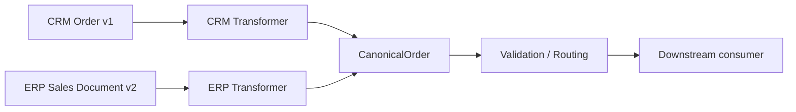
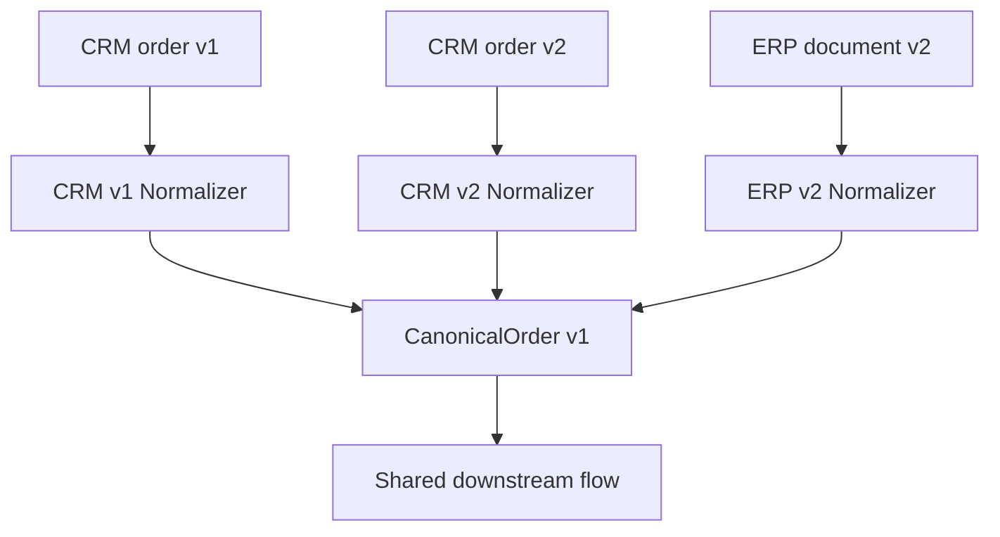
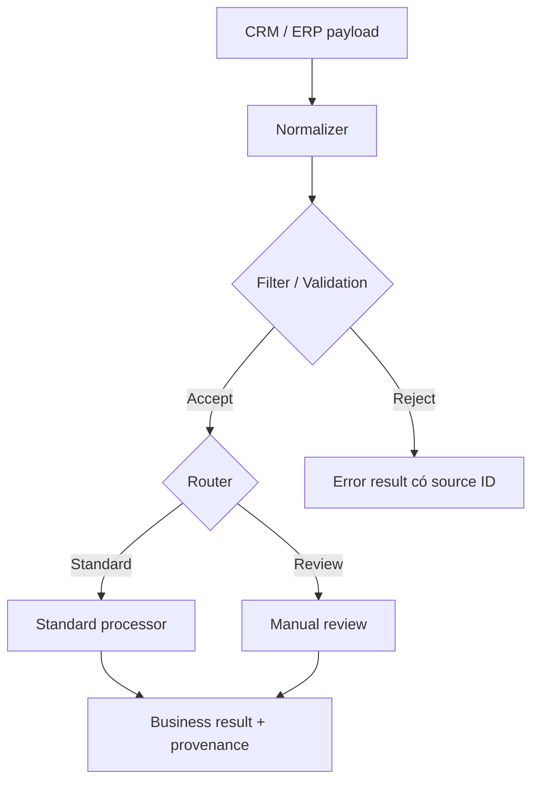

# Giữ thông tin nguồn sau normalization

Khi một ứng dụng tích hợp nhận đơn hàng từ hai hệ thống CRM và ERP, dữ liệu đầu vào thường khác nhau: CRM gửi `externalOrderId`, tiền ở dạng chuỗi thập phân và thời điểm theo ISO 8601; ERP gửi `documentNumber`, tiền theo đơn vị nhỏ nhất và thời điểm dưới dạng epoch milliseconds. **Normalizer** giúp chuyển các biểu diễn khác nhau về một mô hình chung như `CanonicalOrder`, để downstream không phải viết logic riêng cho từng hệ thống nguồn.

Nhưng nếu sau normalization chỉ còn `CanonicalOrder(orderId, amount, currency)` mà **không biết đơn hàng đến từ đâu**, hệ thống sẽ khó trả lời những câu hỏi quan trọng: bản ghi nào của ERP gây lỗi, schema nguồn phiên bản nào cần sửa, một Message là bản phát lại hay sự kiện mới, dữ liệu đã bị biến đổi bằng quy tắc nào, và khi phải replay thì lấy lại nguồn ở đâu?

Vì vậy, một Normalizer đáng tin cậy phải **chuẩn hóa dữ liệu nghiệp vụ nhưng vẫn giữ nguồn gốc (*provenance*) đủ để truy vết, kiểm thử, kiểm soát trùng lặp và xử lý sự cố**. Điều này không đồng nghĩa giữ nguyên mọi field của payload nguồn hoặc sao chép toàn bộ header kỹ thuật; thông tin nguồn phải được lựa chọn theo một hợp đồng rõ ràng, có giới hạn và tuân thủ ranh giới bảo mật.

Bài **Giữ thông tin nguồn sau normalization** thuộc chương **Normalizer** của module `SPRING_INTEGRATION_PATTERN`. Module hướng tới triển khai Enterprise Integration Patterns bằng Spring Integration để tạo luồng Message ít phụ thuộc, dễ mở rộng; thực hành Router, Filter, Transformer, Splitter, Aggregator, Gateway, retry, error channel và correlation, đồng thời kiểm thử và theo dõi các nhánh. Bài này tập trung vào **mô hình nguồn gốc, thiết kế canonical payload/envelope, Java Transformer cho nhiều nguồn, bảo toàn provenance qua transport, idempotency, replay, xử lý lỗi và observability**.

## 1. Normalizer giải quyết vấn đề gì?

Normalizer là mẫu Enterprise Integration Patterns giúp **các Message có định dạng khác nhau được biến đổi thành một định dạng chuẩn** trước khi đi qua những bước chung. Một cách triển khai thường gặp gồm:

1. Phân biệt nguồn hoặc kiểu Message.
2. Chọn Transformer phù hợp cho từng nguồn.
3. Đưa kết quả vào một **canonical data model** thống nhất.
4. Cho Router, Filter, Aggregator và các consumer phía sau xử lý dựa trên hợp đồng chuẩn.



Spring Integration không yêu cầu phải có một endpoint tên `Normalizer` duy nhất. Ta có thể tạo Normalizer bằng **Router + những Message Transformer tương ứng**, hoặc bằng nhiều inbound channel/adapter cùng xuất Message chuẩn tới một channel chung.

### 1.1. Chỉ chuẩn hóa tên field chưa đủ

Ví dụ hai nguồn:

| Ý nghĩa | CRM | ERP | Canonical |
| --- | --- | --- | --- |
| Mã đơn hàng | `externalOrderId` | `documentNumber` | `orderId` |
| Mã khách hàng | `crmCustomerRef` | `accountCode` | `customerRef` |
| Tiền | `"49.95"` | `4995` cents | `BigDecimal("49.95")` |
| Đơn vị tiền | `"USD"` | `"USD"` | `currency="USD"` |
| Thời điểm | ISO string | epoch milliseconds | `Instant` |
| Định danh delivery | `sourceEventId` | `deliveryId` | `sourceMessageId` trong provenance |

`sourceMessageId` không phải field nghiệp vụ thay thế `orderId`. Đó là một ID phục vụ **truy xuất nguồn, deduplication và audit**. Một đơn hàng có thể có nhiều sự kiện cập nhật hợp lệ, hoặc được quan sát bởi nhiều hệ thống nguồn.

## 2. Sau normalization cần giữ những thông tin nguồn nào?

Một bộ metadata thực tế thường gồm:

| Field provenance | Ý nghĩa | Ví dụ |
| --- | --- | --- |
| `sourceSystem` | Hệ thống phát hoặc hệ thống mà dữ liệu được xác thực thuộc về | `CRM` |
| `sourceMessageId` | ID ổn định của event/delivery logic ở nguồn | `crm-event-91` |
| `sourceSchemaVersion` | Phiên bản định dạng đầu vào đã được giải mã | `crm-order-v1` |
| `sourceOccurredAt` | Thời điểm sự kiện do nguồn khai báo | `2026-11-20T10:00:00Z` |
| `normalizedAt` | Thời điểm Normalizer hoàn thành mapping | `2026-11-21T02:15:00Z` |
| `normalizationRuleVersion` | Phiên bản quy tắc mapping đã áp dụng | `order-normalizer-v1` |
| `tenantId` | Phạm vi tenant đã được xác minh | `tenant-7` |
| `sourceRecordId` (nếu có) | Khóa tra cứu record gốc | `ERP-DOC-124` |
| `rawPayloadRef` (tùy chọn) | Tham chiếu tới dữ liệu gốc được giữ theo chính sách | `archive/ref/...` |

**Đây là hợp đồng provenance do ứng dụng thiết kế**, không phải danh sách header mặc định của Spring Integration.

### 2.1. Giữ đủ, không giữ tất cả

Một payload nguồn có thể chứa email, số điện thoại, địa chỉ, số tài khoản và các token mà consumer chuẩn hóa không cần dùng. Không nên sao chép toàn bộ chúng vào metadata hoặc log chỉ để “sau này còn tìm lại”.

Nên ưu tiên:

- ID nguồn ổn định để có thể truy cứu.
- Phiên bản schema/rule để có thể giải thích việc mapping.
- Thời điểm nguồn và thời điểm xử lý với ngữ nghĩa khác nhau.
- Correlation/business key tối thiểu cần cho workflow.
- Tham chiếu tới bản raw được quản lý độc lập, **chỉ nếu** yêu cầu nghiệp vụ/điều tra đòi hỏi.

Nếu cần lưu raw event, áp dụng kiểm soát quyền, mã hóa, retention và lifecycle riêng. **Giữ provenance không đồng nghĩa lưu raw payload vĩnh viễn.**

## 3. Bốn loại định danh khác nhau không nên nhập nhằng

| Định danh | Câu hỏi nó trả lời | Có thể thay đổi giữa hai Message? |
| --- | --- | --- |
| `sourceMessageId` | Sự kiện/delivery logic nào từ nguồn? | Có, giữa những sự kiện nguồn khác nhau |
| `orderId` | Đơn hàng nghiệp vụ nào? | Không, khi cập nhật cùng đơn |
| `correlationId` / `batchAttemptId` | Các Message nào thuộc cùng lượt xử lý/nhóm? | Có, giữa hai workflow attempt |
| `MessageHeaders.ID` | Đây là object Message cụ thể nào trong Spring Messaging? | Có thể thay khi tạo lại Message |

Ví dụ:

```text
orderId          = ORD-1001
sourceSystem     = CRM
sourceMessageId  = crm-event-91
batchAttemptId   = validation-run-01

orderId          = ORD-1001
sourceSystem     = CRM
sourceMessageId  = crm-event-92
batchAttemptId   = validation-run-02
```

Hai sự kiện cập nhật cùng order có thể **đều hợp lệ và đều cần xử lý**. Nếu dedupe chỉ theo `orderId`, sự kiện thứ hai sẽ bị loại sai. Nếu Aggregator group chỉ theo `sourceMessageId`, các Message con từ cùng batch có thể bị tách sai. Mỗi EIP cần khóa đúng **phạm vi** của nó.

### 3.1. ID của nguồn phải ổn định qua redelivery

Nếu CRM không có một event ID ổn định, mỗi lần adapter nhận lại payload rồi gọi `UUID.randomUUID()` sẽ tạo **sourceMessageId mới**, khiến dedupe khó biết đó là cùng sự kiện. Khi thiếu ID nguồn, cần hợp đồng từ producer, hoặc chiến lược định danh dựa trên business key + version/offset đã được chứng minh ổn định theo transport.

Không nên hứa idempotency chỉ nhờ thêm một trường `sourceMessageId` nếu giá trị đó không được bảo đảm.

## 4. Source provenance khác processing history

Khi Message đi qua nhiều Transformer, có hai lớp thông tin:

```text
Origin:
  sourceSystem=ERP
  sourceMessageId=erp-change-71
  sourceSchemaVersion=erp-order-v2

Processing history:
  decoded by erp-adapter-v3
  normalized by order-normalizer-v1
  validated by order-validator-v2
  enriched by customer-enricher-v5
```

**Origin** trả lời “dữ liệu đến từ đâu”. **Processing history** trả lời “đã xử lý dữ liệu bằng các bước nào”. Trong một chuỗi Enricher/Transformer, không được thay `sourceSystem=ERP` bằng `sourceSystem=Normalizer`, vì Normalizer là một bước xử lý, **không phải nguồn nghiệp vụ ban đầu**.

### 4.1. Có cần nhét toàn bộ history vào mỗi Message không?

Không nhất thiết. Một header `processing.history` cứ nối thêm hàng trăm bước sẽ làm Message lớn, vượt giới hạn transport và bộc lộ topology nội bộ. Những sự kiện audit chi tiết có thể được lưu trong tracing/audit store; trên canonical payload chỉ giữ **phiên bản normalization đang áp dụng** và trace/correlation ID cần thiết.

### 4.2. Dữ liệu đã được normalizer khác biến đổi

Nếu service B nhận một `CanonicalOrder` đã qua service A, service B không nên tự đổi provenance gốc thành `B`; nó có thể thêm bản ghi xử lý riêng, hoặc nâng `canonicalSchemaVersion`/`normalizationRuleVersion` theo hợp đồng. Phải phân biệt **nguồn origin** với **source system của hop hiện tại**.

## 5. Header, payload hay envelope: giữ provenance ở đâu?

Có ba lựa chọn phổ biến:

| Vị trí | Ưu điểm | Giới hạn |
| --- | --- | --- |
| **Message headers** | Thuận tiện cho Router, Filter, tracing và correlation | Header mapper/adapter có thể đổi hoặc bỏ; rủi ro spoofing và lộ dữ liệu |
| **Canonical payload** | Theo schema nghiệp vụ, dễ serialize qua broker/HTTP | Consumer phải hiểu field provenance, schema thay đổi cần version |
| **Envelope chung** | Tách `data` khỏi `meta`, dùng chung nhiều event type | Tăng số DTO và yêu cầu mọi producer/consumer thống nhất |

Một mẫu envelope:

```json
{
  "schemaVersion": 1,
  "data": {
    "orderId": "ORD-1001",
    "amount": "49.95",
    "currency": "USD"
  },
  "provenance": {
    "sourceSystem": "CRM",
    "sourceMessageId": "crm-event-91",
    "sourceSchemaVersion": "crm-order-v1",
    "normalizationRuleVersion": "order-normalizer-v1"
  }
}
```

Khi provenance quan trọng cho audit/replay xuyên broker hoặc restart, đặt thông tin tối thiểu **trong envelope/payload có schema rõ ràng** thường bền hơn việc chỉ dựa vào các header nội bộ của một JVM.

### 5.1. Có thể đồng thời có payload và headers không?

Có. Ví dụ payload chứa `provenance.sourceSystem` bền vững, còn header `normalized.sourceSystem` giúp Router chọn nhánh nhanh. Tuy nhiên phải xác định **nguồn sự thật**:

- Provenance trong payload được xây bởi Normalizer đáng tin cậy.
- Header là **bản sao kỹ thuật có thể tái tạo**, không phải nơi bất kỳ upstream nào được phép sửa.
- Nếu hai giá trị khác nhau, không âm thầm chọn một giá trị không rõ quyền; nên từ chối và điều tra.

## 6. Ranh giới tin cậy: ai có quyền nói Message đến từ đâu?

Một producer bên ngoài có thể gửi:

```text
sourceSystem = "TRUSTED_ERP"
sourceMessageId = "already-approved"
```

Nếu Normalizer tin nguyên các header do client tự khai, một đối tượng không có quyền có thể **giả mạo nguồn** để được Router đưa vào nhánh ưu tiên hoặc làm hỏng audit.

Để gắn `sourceSystem` đáng tin:

1. Xác thực inbound adapter (credentials, mTLS, topic ACL hoặc cơ chế tương đương).
2. Gán danh tính nguồn từ **điểm vào đã được cấu hình/xác thực**, không chỉ từ header tùy ý của payload.
3. Validate `sourceMessageId`, tenant và schema version theo hợp đồng của nguồn.
4. Strip hoặc overwrite các header provenance do client không được phép khai báo.
5. Giới hạn việc sửa `sourceSystem`/`sourceMessageId` ở các bước downstream.
6. Test cố tình gửi một header giả để bảo đảm payload canonical không bị giả mạo.

Trong ví dụ dưới đây, các Message đi vào `crmOrdersInput` luôn được normalizer CRM gán `sourceSystem="CRM"`, bất kể input gửi kèm header `sourceSystem` nào. **Điều kiện tiền đề** là chỉ adapter CRM đã được xác thực mới có quyền gửi vào channel đó.

## 7. Thiết kế canonical model và provenance bằng Java 17+

Ví dụ dùng record để tạo DTO bất biến. `SourceProvenance` sống cùng `CanonicalOrder`, nên khi payload được serialize đúng schema, thông tin nguồn không phụ thuộc riêng vào header Spring Integration.

```java
package example.integration;

import java.math.BigDecimal;
import java.time.Instant;

public final class NormalizerModel {

    private NormalizerModel() {
    }

    // Hợp đồng CRM v1: số tiền dạng decimal string, ISO timestamp.
    public record CrmOrder(
            String tenantId,
            String externalOrderId,
            String crmCustomerRef,
            String amountText,
            String currency,
            String sourceEventId,
            String occurredAtIso) {
    }

    // Hợp đồng ERP v2: số tiền dạng cents, epoch milliseconds.
    public record ErpOrder(
            String tenantCode,
            String documentNumber,
            String accountCode,
            long amountCents,
            String currency,
            String deliveryId,
            long occurredAtEpochMillis) {
    }

    public record SourceProvenance(
            String sourceSystem,
            String sourceMessageId,
            String sourceSchemaVersion,
            Instant sourceOccurredAt,
            Instant normalizedAt,
            String normalizationRuleVersion) {
    }

    public record CanonicalOrder(
            String tenantId,
            String orderId,
            String customerRef,
            BigDecimal amount,
            String currency,
            String canonicalSchemaVersion,
            SourceProvenance provenance) {
    }
}
```

Trong production có thể bổ sung validation ở constructor, mapping DTO theo Jackson/Avro/Protobuf và schema registry. Những quyết định đó phụ thuộc hệ sinh thái transport; ở đây tập trung vào **ngữ nghĩa provenance**.

### 7.1. Vì sao có hai schema version?

- `sourceSchemaVersion="crm-order-v1"` trả lời **đầu vào được đọc bằng hợp đồng nào**.
- `canonicalSchemaVersion="canonical-order-v1"` trả lời **đầu ra đang có dạng nào**.
- `normalizationRuleVersion="order-normalizer-v1"` trả lời **logic chuyển đổi được áp dụng theo quy tắc nào**.

Ba phiên bản có thể tiến hóa độc lập. Ví dụ CRM chuyển từ v1 sang v2 nhưng canonical schema không đổi; lúc đó normalizer CRM v2 được triển khai mà consumer canonical không cần sửa.

### 7.2. Phân biệt nguồn phát sinh và thời điểm xử lý

`sourceOccurredAt` đến từ nguồn và có thể không chính xác do clock skew hoặc input sai; `normalizedAt` là thời điểm dịch vụ thực hiện mapping. Nếu cần **thời điểm ingress chính xác**, hãy đóng dấu `receivedAt` ở inbound adapter đáng tin cậy và giữ riêng. Không tự gọi `normalizedAt` là `receivedAt` vì Message có thể nằm chờ trong queue trước khi tới Normalizer.

## 8. Spring Integration: hai nguồn, một canonical output

Ví dụ Java DSL/channel kết hợp `@Transformer`:

```text
crmOrdersInput ── CRM Transformer ─┐
                                  ├─ canonicalOrdersOutput
erpOrdersInput ── ERP Transformer ─┘
```

Mỗi nguồn dùng một channel ingress riêng. Điều này đóng vai trò **chọn Transformer** cho đúng dạng dữ liệu, tương tự một Router phân nhánh theo loại/source Message. Consumer phía sau chỉ đọc `CanonicalOrder`.

### 8.1. Cấu hình Java

```java
package example.integration;

import java.math.BigDecimal;
import java.time.Instant;
import java.time.format.DateTimeParseException;

import org.springframework.context.annotation.Bean;
import org.springframework.context.annotation.Configuration;
import org.springframework.integration.annotation.Transformer;
import org.springframework.integration.channel.DirectChannel;
import org.springframework.integration.channel.QueueChannel;
import org.springframework.integration.config.EnableIntegration;
import org.springframework.messaging.Message;
import org.springframework.messaging.MessageChannel;
import org.springframework.messaging.PollableChannel;
import org.springframework.messaging.support.MessageBuilder;

import example.integration.NormalizerModel.*;

@Configuration
@EnableIntegration
public class SourceAwareNormalizerConfiguration {

    private static final String RULE_VERSION = "order-normalizer-v1";
    private static final String CANONICAL_SCHEMA = "canonical-order-v1";

    @Bean
    public MessageChannel crmOrdersInput() {
        return new DirectChannel();
    }

    @Bean
    public MessageChannel erpOrdersInput() {
        return new DirectChannel();
    }

    @Bean
    public PollableChannel canonicalOrdersOutput() {
        return new QueueChannel(20);
    }

    @Transformer(
            inputChannel = "crmOrdersInput",
            outputChannel = "canonicalOrdersOutput")
    public Message<CanonicalOrder> fromCrm(Message<CrmOrder> input) {
        CrmOrder source = input.getPayload();

        String tenantId = requiredId(source.tenantId(), "tenantId");
        String orderId = requiredId(
                source.externalOrderId(), "externalOrderId");
        String customer = requiredId(
                source.crmCustomerRef(), "crmCustomerRef");
        String eventId = requiredId(
                source.sourceEventId(), "sourceEventId");

        BigDecimal amount = parseCrmAmount(source.amountText());
        String currency = requireUsd(source.currency());
        Instant occurredAt = parseIsoTime(source.occurredAtIso());

        SourceProvenance provenance = new SourceProvenance(
                "CRM",
                eventId,
                "crm-order-v1",
                occurredAt,
                Instant.now(),
                RULE_VERSION);

        CanonicalOrder normalized = new CanonicalOrder(
                tenantId, orderId, customer, amount, currency,
                CANONICAL_SCHEMA, provenance);
        return outboundMessage(normalized);
    }

    @Transformer(
            inputChannel = "erpOrdersInput",
            outputChannel = "canonicalOrdersOutput")
    public Message<CanonicalOrder> fromErp(Message<ErpOrder> input) {
        ErpOrder source = input.getPayload();

        String tenantId = requiredId(
                source.tenantCode(), "tenantCode");
        String orderId = requiredId(
                source.documentNumber(), "documentNumber");
        String customer = requiredId(
                source.accountCode(), "accountCode");
        String eventId = requiredId(
                source.deliveryId(), "deliveryId");

        if (source.amountCents() < 0) {
            throw new IllegalArgumentException("ERP_AMOUNT_INVALID");
        }
        BigDecimal amount = BigDecimal.valueOf(source.amountCents(), 2);
        String currency = requireUsd(source.currency());
        Instant occurredAt = Instant.ofEpochMilli(
                source.occurredAtEpochMillis());

        SourceProvenance provenance = new SourceProvenance(
                "ERP",
                eventId,
                "erp-order-v2",
                occurredAt,
                Instant.now(),
                RULE_VERSION);

        CanonicalOrder normalized = new CanonicalOrder(
                tenantId, orderId, customer, amount, currency,
                CANONICAL_SCHEMA, provenance);
        return outboundMessage(normalized);
    }

    private static Message<CanonicalOrder> outboundMessage(
            CanonicalOrder normalized) {
        // Chỉ đặt các header được xây từ provenance chuẩn hóa.
        // Payload cũng mang provenance để không phụ thuộc header mapper.
        return MessageBuilder.withPayload(normalized)
                .setHeader("normalized.sourceSystem",
                        normalized.provenance().sourceSystem())
                .setHeader("normalized.sourceMessageId",
                        normalized.provenance().sourceMessageId())
                .setHeader("normalized.schemaVersion",
                        normalized.canonicalSchemaVersion())
                .build();
    }

    private static String requiredId(String value, String field) {
        if (value == null
                || !value.matches("[A-Za-z0-9_-]{1,80}")) {
            throw new IllegalArgumentException(
                    "INVALID_ID_" + field);
        }
        return value;
    }

    private static String requireUsd(String value) {
        // Demo chỉ nhận USD, nơi 1 dollar = 100 cents.
        if (!"USD".equals(value)) {
            throw new IllegalArgumentException(
                    "UNSUPPORTED_CURRENCY");
        }
        return value;
    }

    private static BigDecimal parseCrmAmount(String raw) {
        // Không cho số âm, exponent hoặc hơn 2 chữ số thập phân.
        if (raw == null || !raw.matches(
                "[0-9]+(\\.[0-9]{1,2})?")) {
            throw new IllegalArgumentException(
                    "CRM_AMOUNT_INVALID");
        }
        return new BigDecimal(raw).setScale(2);
    }

    private static Instant parseIsoTime(String value) {
        try {
            return Instant.parse(value);
        } catch (DateTimeParseException | NullPointerException ex) {
            // Không nội suy raw value vào exception,
            // tránh dữ liệu đầu vào xuất hiện trong log công khai.
            throw new IllegalArgumentException(
                    "CRM_TIMESTAMP_INVALID", ex);
        }
    }
}
```

**Phạm vi ví dụ:** các Transformer minh họa ý nghĩa provenance và canonical format. `DirectChannel` xử lý đồng bộ; `QueueChannel(20)` giữ output trong RAM và không tạo durability. Các method của Java/Spring Integration cần được kiểm thử với dependency thật của dự án trong bước QA/test; ở đây chưa chạy build.

### 8.2. Vì sao `sourceSystem` được gán cứng theo endpoint?

Method `fromCrm(...)` gắn nguồn `CRM`, `fromErp(...)` gắn `ERP`. Giá trị này đến từ **channel ingress được kỳ vọng xác thực** và không lấy từ header `sourceSystem` mà client có thể tự gửi.

Tuy nhiên, một dữ liệu giả **được phép đi nhầm vào channel CRM** vẫn sẽ được xem là CRM. Vì vậy, phân quyền adapter/channel đầu vào và xác thực producer là **điều kiện tiên quyết**; không thể chỉ dựa vào `@Transformer` để có authentication.

### 8.3. Vì sao không dùng `MessageBuilder.fromMessage(input)`?

`fromMessage(input)` hữu ích khi muốn bảo toàn headers hiện có, nhưng nó cũng có thể sao chép **headers không mong muốn**, gồm dữ liệu riêng tư, header giả mạo hoặc object nội bộ của JVM.

Ví dụ dùng `MessageBuilder.withPayload(normalized)` để thể hiện chính sách **tạo Message mới với các header được chủ động chọn**. Dù vậy, hành vi truyền/merge header cuối cùng còn phụ thuộc endpoint và adapter; bảo mật ở biên giới ngoài vẫn phải dùng **allowlist/header mapper và test serialization thực tế**, không chỉ dựa vào một lời gọi builder.

### 8.4. Vì sao demo chỉ nhận USD?

Vì ERP cung cấp `amountCents`, ta chọn một loại tiền có **hai chữ số phần thập phân** để minh họa chính xác:

```text
CRM amountText = "49.95"  -> 49.95 USD
ERP amountCents = 4995   -> 49.95 USD
```

Không được áp dụng mặc định `movePointLeft(2)` cho mọi đồng tiền. Ví dụ một số tiền tệ có 0 hoặc 3 chữ số phần thập phân theo ISO 4217; trong production phải xác định currency và đơn vị tiền của **từng hợp đồng nguồn**, kiểm tra range, rounding và precision trước khi chuẩn hóa.

## 9. Demo chạy: cùng dữ liệu chuẩn, provenance khác nhau

Đoạn code sử dụng cấu hình ở mục 8 và gửi hai Message từ CRM và ERP:

```java
package example.integration;

import java.time.Instant;

import org.springframework.context.annotation.AnnotationConfigApplicationContext;
import org.springframework.messaging.Message;
import org.springframework.messaging.MessageChannel;
import org.springframework.messaging.PollableChannel;
import org.springframework.messaging.support.MessageBuilder;

import example.integration.NormalizerModel.*;

public class SourceAwareNormalizerDemo {

    public static void main(String[] args) {
        try (var context = new AnnotationConfigApplicationContext(
                SourceAwareNormalizerConfiguration.class)) {

            MessageChannel crm = context.getBean(
                    "crmOrdersInput", MessageChannel.class);
            MessageChannel erp = context.getBean(
                    "erpOrdersInput", MessageChannel.class);
            PollableChannel output = context.getBean(
                    "canonicalOrdersOutput", PollableChannel.class);

            Instant eventTime =
                    Instant.parse("2026-11-20T10:00:00Z");

            crm.send(MessageBuilder.withPayload(new CrmOrder(
                    "tenant-7", "ORD-1001", "CUS-9",
                    "49.95", "USD",
                    "crm-event-91", eventTime.toString()))
                    .build());

            erp.send(MessageBuilder.withPayload(new ErpOrder(
                    "tenant-7", "ORD-1001", "CUS-9",
                    4995L, "USD",
                    "erp-change-71", eventTime.toEpochMilli()))
                    .build());

            Message<?> crmMessage = output.receive(0);
            Message<?> erpMessage = output.receive(0);
            if (crmMessage == null || erpMessage == null) {
                throw new IllegalStateException(
                        "Expected two canonical messages");
            }

            CanonicalOrder a =
                    (CanonicalOrder) crmMessage.getPayload();
            CanonicalOrder b =
                    (CanonicalOrder) erpMessage.getPayload();

            System.out.println(a.amount()); // 49.95
            System.out.println(b.amount()); // 49.95
            System.out.println(a.provenance().sourceSystem()); // CRM
            System.out.println(b.provenance().sourceSystem()); // ERP
        }
    }
}
```

Hai Message có thể có **cùng dữ liệu canonical** về order, customer và amount nhưng **provenance khác nhau**:

```text
Canonical A:
  orderId = ORD-1001
  amount = 49.95
  sourceSystem = CRM
  sourceMessageId = crm-event-91

Canonical B:
  orderId = ORD-1001
  amount = 49.95
  sourceSystem = ERP
  sourceMessageId = erp-change-71
```

Điều đó **không tự chứng minh** chúng là cùng một event nghiệp vụ. Có thể một đơn được đồng bộ sang ERP, hoặc có hai nguồn độc lập; muốn xác định quan hệ, cần business rules và event identity rõ ràng.

## 10. JUnit 5: hai schema vào cùng format nhưng không mất nguồn

Một test nên kiểm tra **cả canonical data và provenance**. Nếu chỉ kiểm tra `amount == 49.95`, một Transformer có thể vô tình bỏ hết thông tin nguồn mà test vẫn PASS.

```java
package example.integration;

import static org.junit.jupiter.api.Assertions.*;

import java.math.BigDecimal;
import java.time.Instant;

import org.junit.jupiter.api.Test;
import org.springframework.context.annotation.AnnotationConfigApplicationContext;
import org.springframework.messaging.Message;
import org.springframework.messaging.MessageChannel;
import org.springframework.messaging.PollableChannel;
import org.springframework.messaging.support.MessageBuilder;

import example.integration.NormalizerModel.*;

class SourceAwareNormalizerIntegrationTest {

    @Test
    void twoDifferentSourceSchemasKeepDistinctProvenance() {
        try (var context = new AnnotationConfigApplicationContext(
                SourceAwareNormalizerConfiguration.class)) {

            MessageChannel crm = context.getBean(
                    "crmOrdersInput", MessageChannel.class);
            MessageChannel erp = context.getBean(
                    "erpOrdersInput", MessageChannel.class);
            PollableChannel output = context.getBean(
                    "canonicalOrdersOutput", PollableChannel.class);

            Instant occurred =
                    Instant.parse("2026-11-20T10:00:00Z");

            assertTrue(crm.send(MessageBuilder.withPayload(
                    new CrmOrder(
                            "tenant-7", "ORD-1001", "CUS-9",
                            "49.95", "USD", "crm-event-91",
                            occurred.toString()))
                    .build()));

            assertTrue(erp.send(MessageBuilder.withPayload(
                    new ErpOrder(
                            "tenant-7", "ORD-1001", "CUS-9",
                            4995L, "USD", "erp-change-71",
                            occurred.toEpochMilli()))
                    .build()));

            Message<?> first = output.receive(0);
            Message<?> second = output.receive(0);
            assertNotNull(first);
            assertNotNull(second);

            CanonicalOrder crmOrder =
                    (CanonicalOrder) first.getPayload();
            CanonicalOrder erpOrder =
                    (CanonicalOrder) second.getPayload();

            assertEquals("ORD-1001", crmOrder.orderId());
            assertEquals(crmOrder.orderId(), erpOrder.orderId());
            assertEquals(new BigDecimal("49.95"), crmOrder.amount());
            assertEquals(crmOrder.amount(), erpOrder.amount());
            assertEquals("USD", erpOrder.currency());

            assertEquals("CRM",
                    crmOrder.provenance().sourceSystem());
            assertEquals("ERP",
                    erpOrder.provenance().sourceSystem());
            assertEquals("crm-event-91",
                    crmOrder.provenance().sourceMessageId());
            assertEquals("erp-change-71",
                    erpOrder.provenance().sourceMessageId());
            assertEquals("crm-order-v1",
                    crmOrder.provenance().sourceSchemaVersion());
            assertEquals("erp-order-v2",
                    erpOrder.provenance().sourceSchemaVersion());
            assertEquals(occurred,
                    crmOrder.provenance().sourceOccurredAt());
            assertEquals(occurred,
                    erpOrder.provenance().sourceOccurredAt());
            assertEquals("order-normalizer-v1",
                    crmOrder.provenance().normalizationRuleVersion());
            assertEquals("canonical-order-v1",
                    erpOrder.canonicalSchemaVersion());
            assertNotNull(crmOrder.provenance().normalizedAt());
            assertNotNull(erpOrder.provenance().normalizedAt());
            assertNull(output.receive(0));
        }
    }
}
```

Test này chứng minh trong **một Spring application context**: hai Transformer cho hai nguồn vẫn tạo đúng DTO canonical và giữ provenance khác nhau.

Vì input dùng `DirectChannel` đồng bộ, sau hai lần `send()` output queue có thể được đọc ngay bằng `receive(0)`. Với executor, poller hoặc broker, test phải đợi có timeout hữu hạn và group/correlation phù hợp. Test này chưa chứng minh persistence qua restart, external adapter header mapping hay xử lý concurrent deduplication.

## 11. JUnit: không tin header nguồn do client tự khai

Giả sử client gửi payload CRM nhưng tự khai header `sourceSystem=ERP`. Bài test phải chứng minh **nguồn trong canonical payload không bị đánh tráo**:

```java
// Đặt method vào SourceAwareNormalizerIntegrationTest.
@Test
void forgedSourceHeaderDoesNotOverrideVerifiedSourceInPayload() {
    try (var context = new AnnotationConfigApplicationContext(
            SourceAwareNormalizerConfiguration.class)) {

        MessageChannel crm = context.getBean(
                "crmOrdersInput", MessageChannel.class);
        PollableChannel output = context.getBean(
                "canonicalOrdersOutput", PollableChannel.class);

        var input = new CrmOrder(
                "tenant-7", "ORD-1001", "CUS-9",
                "49.95", "USD", "crm-event-91",
                "2026-11-20T10:00:00Z");

        assertTrue(crm.send(MessageBuilder.withPayload(input)
                .setHeader("sourceSystem", "ERP")
                .setHeader("normalized.sourceSystem", "ERP")
                .build()));

        Message<?> message = output.receive(0);
        assertNotNull(message);
        CanonicalOrder normalized =
                (CanonicalOrder) message.getPayload();

        assertEquals("CRM",
                normalized.provenance().sourceSystem());
        assertEquals("crm-event-91",
                normalized.provenance().sourceMessageId());
        assertEquals("CRM", message.getHeaders()
                .get("normalized.sourceSystem"));
        assertNull(output.receive(0));
    }
}
```

**Giới hạn của test:** nó xác minh mapping provenance và header có tên `normalized.sourceSystem` tại output của flow minh họa. Nó không chứng minh mọi header lạ đều bị xóa trong mọi framework/adapter. Tại **biên giới outbound**, phải cấu hình allowlist và test không có `sourceSystem` giả, secrets hoặc header nội bộ không được phép lọt sang hệ thống ngoài.

## 12. JUnit: dữ liệu nguồn sai phải bị phát hiện, không tạo provenance giả

Nếu CRM gửi `"amountText": "abc"`, Normalizer không nên gán `amount=0` rồi xuất `CanonicalOrder` trông có vẻ hợp lệ.

```java
// Đặt method vào SourceAwareNormalizerIntegrationTest.
@Test
void invalidSourceAmountDoesNotProduceCanonicalOrder() {
    try (var context = new AnnotationConfigApplicationContext(
            SourceAwareNormalizerConfiguration.class)) {

        MessageChannel crm = context.getBean(
                "crmOrdersInput", MessageChannel.class);
        PollableChannel output = context.getBean(
                "canonicalOrdersOutput", PollableChannel.class);

        CrmOrder invalid = new CrmOrder(
                "tenant-7", "ORD-1001", "CUS-9",
                "not-a-number", "USD", "crm-event-91",
                "2026-11-20T10:00:00Z");

        assertThrows(RuntimeException.class, () ->
                crm.send(MessageBuilder.withPayload(invalid).build()));
        assertNull(output.receive(0));
    }
}
```

Ở đường `DirectChannel` đồng bộ, exception từ transformer thường lan ngược về caller (có thể được bọc trong exception của Spring Messaging). Vì vậy test không khóa cứng tên class exception cụ thể. Trong flow bất đồng bộ, `send()` có thể đã thành công trước khi mapper lỗi; cần quan sát `errorChannel`/retry/DLQ đúng tầng.

### 12.1. Đừng đưa raw input vào exception công khai

Lỗi nên có `errorCode="CRM_AMOUNT_INVALID"` hoặc `SOURCE_TIMESTAMP_INVALID`, không phải:

```text
Could not parse amount "customer private data ..." from raw payload ...
```

Khi log, giữ ID nguồn được kiểm soát và mã lỗi; chi tiết raw chỉ nằm trong kho chẩn đoán có phân quyền nếu thực sự cần.

## 13. Source schema version và canonical schema version tiến hóa độc lập

Một ứng dụng có thể cùng nhận CRM v1, CRM v2 và ERP v2:



Nếu CRM v2 đổi `amountText` sang `amountMinorUnits`, normalizer CRM v2 phải **hiểu đúng đơn vị**, không lấy parser v1 rồi trông chờ nó tự chạy. Song song, canonical schema v1 có thể không thay đổi.

### 13.1. Vì sao lưu rule version?

Giả sử một bản ghi CRM cũ đã được chuẩn hóa bằng `order-normalizer-v1` có lỗi rounding. Sau khi sửa lên v2, một người cần biết:

- Output cũ được tạo bằng rule nào?
- Replay raw event có ra giá trị khác không?
- Nên backfill những event nào?
- Cần so sánh output v1 và v2 theo cách nào?

`normalizationRuleVersion` giúp **liên hệ kết quả với logic mapping** đã áp dụng, nhưng chưa thay thế git revision, release metadata hoặc audit pipeline khi cần tái lập chính xác mọi điều kiện.

### 13.2. Version nên ổn định qua build và triển khai

Không đặt rule version bằng timestamp của từng Message; điều đó khiến cùng một bộ quy tắc có vô hạn giá trị. Nên dùng version/release ID có ý nghĩa, cho phép nhóm các Message chịu cùng bộ quy tắc.

## 14. Event time, ingest time và normalize time

Trong pipeline tích hợp, thường có ít nhất ba mốc:

```text
sourceOccurredAt = sự kiện xảy ra ở CRM lúc 09:00
receivedAt       = adapter nhận lúc 09:01
normalizedAt     = transformer chạy lúc 09:05
```

Chúng không tương đương:

| Mốc | Dùng cho | Rủi ro nếu dùng sai |
| --- | --- | --- |
| `sourceOccurredAt` | Sắp xếp sự kiện theo nguồn, phân tích lịch sử | Clock nguồn sai, time zone/format không rõ |
| `receivedAt` | Độ trễ từ nguồn tới ingress | Không có nếu adapter không đóng dấu |
| `normalizedAt` | Độ trễ xử lý normalization | Không phản ánh đúng thời điểm sự kiện sinh ra |

Một Message có thể được phát lại sau nhiều giờ. Khi replay, `normalizedAt` thay đổi nhưng `sourceOccurredAt` của **cùng sự kiện** cần giữ ổn định theo hợp đồng dữ liệu.

### 14.1. Time zone phải được xác định, không suy đoán

Ví dụ source time `"2026-11-20 10:00:00"` không có zone/offset thì chưa đủ để chuyển chắc chắn sang `Instant`. Phải có quy tắc nguồn đã công bố như `Asia/Ho_Chi_Minh`, hoặc từ chối timestamp không rõ vùng thời gian. Không âm thầm dùng timezone của server JVM.

### 14.2. Timestamp từ nguồn không phải bằng chứng đáng tin tuyệt đối

Nên kiểm tra range và clock skew phù hợp SLA. Tuy nhiên, nếu pipeline phục vụ backfill, không thể từ chối mọi event cũ chỉ vì thời điểm xảy ra quá xa hiện tại. Chính sách realtime và lịch sử cần được phân biệt.

## 15. Giữ provenance khi qua Splitter và Aggregator

Một canonical order có thể được chia thành các Message con:

```text
CanonicalOrder:
  provenance.sourceSystem = CRM
  provenance.sourceMessageId = crm-event-91
  orderId = ORD-1001
  lines = [L1, L2, L3]

Splitter:
  LineTask L1 + origin CRM/crm-event-91
  LineTask L2 + origin CRM/crm-event-91
  LineTask L3 + origin CRM/crm-event-91
```

Nếu các Message con không còn provenance và có thể đi qua broker khác, Aggregator khi nhận đủ kết quả sẽ không biết batch xuất phát từ nguồn nào.

### 15.1. Provenance ở cấp cha và cấp con

- `sourceMessageId` của cha: ID event đầu vào của batch.
- `childId`: ID một phần tử/tác vụ con, ví dụ `(parentEventId, lineNumber)`.
- `batchAttemptId`: ID lượt split/process.
- `correlationId`: khóa nhóm để Aggregator gom các child thuộc cùng batch.

**Không nhất thiết dùng `sourceMessageId` làm correlation key.** Một source event có thể tạo nhiều nhóm xử lý khác nhau; mỗi batch attempt phải được phân biệt rõ.

### 15.2. Aggregator nhận nhiều nguồn

Nếu Aggregator gom kết quả từ `INVENTORY`, `PRICING` và `SHIPPING`, provenance của từng kết quả **có thể khác** nhau. Output nên:

1. Giữ **origin của request chính** khi đó là ý nghĩa nghiệp vụ.
2. Hoặc tạo **tập provenance của các contributor** có giới hạn, nếu kết quả tổng cần lineage nhiều nguồn.
3. Không tùy tiện lấy `sourceSystem` của Message đến đầu tiên làm nguồn duy nhất của cả group.

Ví dụ:

```json
{
  "batchAttemptId": "attempt-01",
  "approved": true,
  "contributors": [
    {"sourceSystem": "INVENTORY", "sourceMessageId": "inv-31"},
    {"sourceSystem": "PRICING", "sourceMessageId": "pr-18"},
    {"sourceSystem": "SHIPPING", "sourceMessageId": "ship-77"}
  ]
}
```

Danh sách contributor cần hạn mức kích thước. Với hàng triệu phần tử, lưu lineage chi tiết bên ngoài và đặt một `lineageRef` có kiểm soát thay vì nhét hết vào Message.

## 16. Router, Filter, Content Enricher và Claim Check

Provenance hữu ích ở nhiều EIP:



### 16.1. Filter

Khi Filter từ chối dữ liệu, ít nhất nên có `sourceSystem`, `sourceMessageId` và `errorCode` **an toàn** để điều tra. Không nên bỏ Message rồi chỉ log `"invalid input"` vì rất khó truy tìm sự kiện nguồn.

Nhưng nếu nguyên nhân chứa dữ liệu khách hàng, hãy dùng **mã lỗi từ catalog**, không sao chép raw exception hoặc raw payload vào headers.

### 16.2. Router

Router có thể chọn route theo `CanonicalOrder.currency`, `tenantId` hoặc `provenance.sourceSystem`. Khi route dựa trên `sourceSystem`, cần bảo đảm provenance đã được xác thực và người gửi không thể tự đặt nhãn nguồn để né kiểm tra.

### 16.3. Content Enricher

Một Enricher có thể bổ sung dữ liệu từ nguồn thứ ba. Nên phân biệt **origin của order** với **nguồn dữ liệu mới được enrich**; ví dụ:

```text
order origin: CRM
customer rating: CUSTOMER_PROFILE_SERVICE
```

Không ghi đè origin CRM thành CUSTOMER_PROFILE_SERVICE chỉ vì bước enrich chạy cuối.

### 16.4. Claim Check

Nếu phải gửi Message qua tuyến không phù hợp cho payload lớn, Claim Check có thể lưu bản gốc vào `MessageStore` và gửi claim ID. Provenance có thể chứa **tham chiếu đến bản gốc** nhưng phải giữ được liên hệ qua checkout, kiểm soát quyền tra cứu và cleanup. Claim ID không thay thế `sourceMessageId`.

## 17. Idempotency: provenance là đầu vào, không phải toàn bộ giải pháp

Một broker có thể giao lại cùng event:

```text
E = CRM / crm-event-91
Lần 1: Normalize -> CanonicalOrder -> Business update -> COMMIT
Lần 2: Normalize lại cùng E do ACK thất lạc
```

Một idempotency key có thể là:

```text
tenantId + ":" + sourceSystem + ":" + sourceMessageId
    + ":" + operationType
```

Điều kiện:

- `sourceMessageId` đủ ổn định qua các lần giao lại.
- ID được namespace theo tenant và source.
- `operationType` phân biệt các handler khác nhau cùng tiêu thụ event.
- Cùng key nhưng payload mâu thuẫn phải được phát hiện, không chỉ bỏ âm thầm.
- Idempotency marker và side effect nghiệp vụ phải có transaction/consistency policy phù hợp.

### 17.1. Vì sao `orderId` không phải dedupe key toàn năng?

Cùng `ORD-1001` có thể có một event tạo đơn, một event sửa đơn và một event hủy đơn. Chặn tất cả theo `orderId` sẽ làm mất các cập nhật hợp lệ.

### 17.2. Vì sao cần phân biệt hai nguồn?

CRM có `sourceMessageId="91"` và ERP cũng có `"91"`. Nếu chỉ dedupe bằng `"91"`, hai event độc lập có thể đụng nhau.

### 17.3. Cùng một nghiệp vụ nhưng hai nguồn phát?

Hai event từ CRM và ERP mô tả cùng một order **không mặc nhiên là duplicate**. Cross-source dedupe cần định nghĩa logic business reconciliation/ownership (ví dụ nguồn nào authoritative, revision nào mới hơn), không thể suy ra từ việc hai payload canonical bằng nhau.

## 18. Retry, replay và bản ghi nguồn gốc

Provenance giúp hỗ trợ replay bằng cách trả lời:

```text
Tìm nguồn event:
  sourceSystem = CRM
  sourceMessageId = crm-event-91

Xác định mapping đã dùng:
  sourceSchemaVersion = crm-order-v1
  normalizationRuleVersion = order-normalizer-v1

Chạy lại:
  đọc raw hoặc tìm lại event nguồn được cấp quyền
  chọn mapping version thích hợp
  sinh canonical output mới
```

Tuy nhiên, giữ các ID **không bảo đảm raw event còn tồn tại**. Replay cần retention từ producer/broker hoặc raw archive có quyền truy cập. Nếu data source đã xóa record và không có archive, chỉ một sourceMessageId không thể khôi phục payload gốc.

### 18.1. Determinism khi replay

Nếu normalization phụ thuộc:

- Tỷ giá hối đoái ở thời điểm hiện tại.
- Thời gian `Instant.now()` cho cả giá trị nghiệp vụ.
- Dữ liệu tra cứu/enrichment có thể thay đổi.
- Rule version mới tự động chọn khác version trước.

thì replay có thể cho kết quả khác, ngay cả khi raw payload giống nhau. Cần quyết định replay nhằm **tái tạo đúng output lịch sử** hay **tính lại bằng rule mới** và ghi nhận điều đó. `normalizedAt` khác nhau khi replay là hợp lệ; dữ liệu nghiệp vụ phụ thuộc clock thì phải được quy định riêng.

### 18.2. Replay không được phá idempotency

Nếu replay chỉ để khắc phục việc mất output sau business commit, không được tạo side effect lần hai. Thiết kế có thể dùng idempotent receiver, outbox và completion tracking theo logical event/operation.

## 19. Transaction boundary và cửa sổ lỗi giữa Normalizer và downstream

Normalizer thường không lưu state của riêng mình, nhưng nằm trong đường xử lý có thể có transaction và broker ACK.

```text
Inbound broker -> Normalizer -> Business DB -> Outbound broker
```

Một vài failure window:

| Điểm lỗi | Khả năng xảy ra | Cần làm gì? |
| --- | --- | --- |
| Normalizer lỗi trước khi xuất Message | Input có thể được giao lại | Retry/quarantine theo loại lỗi |
| Canonical Message chỉ ở queue RAM rồi crash | Có thể mất Message chuẩn | Durable transport hoặc replay từ input |
| DB commit thành công, input ACK chưa gửi | Input có thể được redeliver | Dedupe theo provenance + operation |
| Outbound broker đã nhận, DB chưa commit | Có thể phát output không tương ứng state | Transactional outbox/consistency policy |
| Outbox phát thành công, relay chưa mark done | Output có thể phát trùng | Downstream idempotent consumer |

Lưu provenance đầy đủ **không tự bảo đảm exactly-once**. Nó cung cấp định danh giúp xây dựng idempotency và truy xuất, còn atomicity phụ thuộc transaction boundaries, nguồn bền vững và cách xử lý redelivery.

### 19.1. Header và transaction là hai bài toán khác nhau

Một Message có `sourceMessageId` đúng vẫn có thể bị xử lý hai lần nếu dedupe marker nằm ngoài transaction DB. Ngược lại, một transaction DB đúng chưa đủ nếu khi retry producer tự tạo sourceMessageId khác.

## 20. Header mapping khi qua HTTP, Kafka và AMQP

Ở Spring Integration trong cùng JVM, một số header có thể đi theo Message qua Transformer/Router. Nhưng khi qua HTTP, Kafka, AMQP hoặc storage, **adapter/header mapper quyết định tên, kiểu và những header nào được chuyển**.

Ví dụ policy outbound:

```text
Allowed:
  normalized.sourceSystem
  normalized.sourceMessageId
  normalized.schemaVersion
  traceId / correlationId (khi đã xác thực và cần thiết)

Not allowed by default:
  rawPayload
  authentication token
  internal replyChannel/errorChannel object
  full exception/stackTrace
  arbitrary client headers
```

Đây là **chính sách đề xuất**, không phải một API mapper dùng chung cho mọi adapter. Với một consumer bên ngoài JVM, nên ưu tiên serialize `CanonicalOrder` có provenance trong schema đã công bố; các header được giữ là tối ưu kỹ thuật hoặc routing metadata.

### 20.1. Message headers không được coi là kho dữ liệu vô hạn

Broker có giới hạn riêng cho kích thước headers. Không đặt raw JSON nguồn, file nhị phân, exception hoặc danh sách lịch sử hàng nghìn bước vào header. Nếu cần bản raw, lưu ở kho có lifecycle phù hợp và truyền **tham chiếu truy xuất có kiểm soát**.

### 20.2. Cần test header mapping thật

Một integration test có adapter thực tế nên gửi:

- `normalized.sourceSystem=CRM` từ phía server.
- Một header giả `sourceSystem=ERP` của client.
- Một header nhạy cảm giả định.

Sau serialization, kiểm tra **header giả không được xuất**, header được phép còn đúng và payload canonical vẫn có provenance. Không suy ra hành vi transport chỉ từ unit test của `MessageBuilder`.

## 21. Error handling: thiếu provenance thì xử lý thế nào?

Trường hợp nguồn gửi thiếu `sourceEventId` hoặc timestamp sai:

```json
{
  "externalOrderId": "ORD-1001",
  "sourceEventId": "",
  "occurredAtIso": "not-a-date"
}
```

Normalizer không nên tạo:

```text
sourceMessageId = UNKNOWN
sourceOccurredAt = Instant.now()
```

và xem đó như một canonical event chính xác. Nhiều Message lỗi có thể bị gộp nhầm vào một ID `"UNKNOWN"`, còn timestamp giả khiến audit và ordering sai.

### 21.1. Các nhánh xử lý lỗi

| Tình huống | Phân loại | Hướng xử lý |
| --- | --- | --- |
| Thiếu event ID bắt buộc | Lỗi hợp đồng nguồn | Reject/quarantine, thông báo producer |
| Timestamp không parse được | Lỗi dữ liệu nguồn | Reject, mã lỗi an toàn |
| Chưa hỗ trợ schema version | Không tương thích schema | DLQ/quarantine và nâng cấp mapper |
| DB enrichment timeout | Lỗi kỹ thuật có thể tạm thời | Retry giới hạn và error channel |
| Consumer lỗi sau normalization | Lỗi downstream | Dedupe/retry theo ranh giới riêng |
| Producer giả mạo source | Lỗi bảo mật | Từ chối trước khi normalize |

Một `ErrorMessage` mang exception qua `errorChannel` **không tự tương đương** với một bản `CanonicalOrder` có provenance hợp lệ. Nếu cần phản hồi lỗi cho caller, hãy tạo DTO chứa `errorCode`, source ID đã xác thực (nếu có), request ID và nội dung an toàn.

### 21.2. Không mất dấu nguồn khi reject sớm

Khi payload lỗi không parse được, có thể chưa có `sourceMessageId` trong body. Ingress adapter vẫn có thể ghi nhận **transport offset, partition, delivery tag hoặc requestId** đã được xác thực để phục vụ điều tra. Chúng là metadata của transport, không nên ghi nhầm là ID nghiệp vụ của event.

## 22. Logging, tracing và metrics với provenance

Một structured log đề xuất:

```json
{
  "stage": "order-normalization",
  "sourceSystem": "ERP",
  "sourceMessageId": "erp-change-71",
  "sourceSchemaVersion": "erp-order-v2",
  "canonicalSchemaVersion": "canonical-order-v1",
  "normalizationRuleVersion": "order-normalizer-v1",
  "result": "SUCCESS",
  "durationMs": 11
}
```

Đây là **schema log ứng dụng tự định nghĩa**, không phải fields mặc định của Spring Integration. Đối với ID và dữ liệu nghiệp vụ, cần chính sách access/retention; tránh đưa payload gốc hoặc thông tin nhạy cảm vào log chung.

### 22.1. Metric đề xuất

| Metric | Ý nghĩa |
| --- | --- |
| `normalization.events.received` | Số Message được đưa vào Normalizer |
| `normalization.events.success` | Số Message chuyển đổi thành công |
| `normalization.events.rejected` | Dữ liệu nguồn không hợp lệ |
| `normalization.events.technical_failure` | Lỗi phụ thuộc/hạ tầng |
| `normalization.latency` | Thời gian mapping |
| `normalization.source_schema.unsupported` | Event từ schema chưa hỗ trợ |
| `normalization.provenance.missing` | Thiếu ID nguồn hoặc trường bắt buộc |
| `normalization.replay.count` | Số Message replay |
| `normalization.duplicates.detected` | Số event trùng theo logical key |
| `normalization.output.delivery_failure` | Lỗi đưa canonical Message downstream |

Tên metric là **gợi ý để instrument**, không phải metric mặc định chắc chắn Spring Integration/Micrometer cung cấp. Những tag có cardinality thấp có thể là `sourceSystem`, `sourceSchemaVersion`, `result`, `ruleVersion`; không dùng `sourceMessageId`, `orderId` hay `customerRef` làm tags.

### 22.2. Phân biệt truy vết và privacy

Một provenance ID có thể gián tiếp liên hệ tới khách hàng. Vì vậy, ngay cả khi không chứa email, nó vẫn có thể là thông tin cần hạn chế quyền. Có thể dùng **tokenization/hashed lookup key** phù hợp khi quan sát rộng, còn liên kết chi tiết tới record nguồn được bảo vệ trong hệ thống audit.

## 23. Khi raw payload lớn hoặc nhạy cảm

Giữ một bản raw giúp đối chiếu việc mapping nhưng có chi phí:

```text
S3/object storage, database hoặc kho dữ liệu kiểm soát
    raw event (encrypted, TTL, ACL)
       |
       +--- rawPayloadRef (ID tham chiếu được kiểm soát)
                |
           CanonicalOrder provenance
```

Nếu cần replay, hãy lưu:

- ID nguồn và version được xác thực.
- Tham chiếu raw bền vững có TTL/retention theo hợp đồng.
- Checksum hoặc fingerprint, nếu cần kiểm tra toàn vẹn.
- Quyền truy cập có thể kiểm toán.
- Chính sách xóa và xử lý backup theo yêu cầu dữ liệu.

**Không lưu pre-signed URL dài hạn, token hoặc credential trong provenance.** Nếu truyền `rawPayloadRef`, consumer phải dùng quyền riêng để đổi tham chiếu thành truy cập dữ liệu; chỉ biết ID không nên tự động cấp quyền xem mọi raw payload.

Một số hệ thống không cần giữ raw event; khi đó có thể giữ source ID/version đủ để quay lại hệ thống nguồn hoặc dựa trên retention của broker, miễn mô hình khôi phục được đánh giá đúng.

## 24. Kiểm thử nhiều hop và trường hợp khó

JUnit ở mục 10–12 chỉ là tầng đầu. Một bộ kiểm thử đầy đủ cần thêm:

| Kịch bản | Điều cần xác minh |
| --- | --- |
| CRM v1 đầu vào chuẩn | Canonical fields đúng, sourceSystem=CRM |
| ERP v2 đầu vào chuẩn | Canonical fields đúng, sourceSystem=ERP |
| Hai nguồn có cùng orderId | Không làm mất sự khác biệt source ID |
| Header `sourceSystem` bị giả | Provenance đáng tin không bị ghi đè |
| CRM amount lỗi format | Không phát canonical hợp lệ giả |
| ERP cents âm | Reject với error code cố định |
| Currency khác USD trong demo | Từ chối, không tự chia 100 |
| Timestamp thiếu zone | Không tự đoán timezone |
| Source event ID thiếu | Không gán `UNKNOWN` |
| Source schema v3 chưa được hỗ trợ | Quarantine/error flow |
| Transformer phía sau đổi payload | Provenance vẫn được bảo toàn hoặc map vào envelope mới |
| Splitter tạo nhiều child | Mỗi child mang origin của parent và child identity |
| Aggregator gom nhiều contributor | Provenance từng nguồn không bị tráo thành nguồn của Message đầu tiên |
| Broker header mapping | Chỉ field được phép được export |
| Retry cùng event ID | Idempotency theo source + tenant + operation |
| Replay mapping v1/v2 | Ghi rõ rule version và mục tiêu replay |
| Restart và outbox | Dữ liệu đã commit còn, output không bị mất ngoài policy |
| Source spoofing tại ingress | Message không được giả mạo danh tính nguồn |
| Log và tracing | Không lộ raw payload, token hoặc dữ liệu khách hàng |

### 24.1. Tách test thuần với integration test

**Unit test** có thể gọi trực tiếp logic parse/normalize DTO nếu tách mapper ra thành class thuần. **Integration test** kiểm tra các `@Transformer`, channel, output Message và header propagation. **Adapter test** kiểm tra serialization và allowlist thực tế; **failure-injection test** kiểm tra broker ACK, DB transaction và replay.

Một test unit mapper PASS không chứng minh metadata sẽ sống qua mọi middleware.

## 25. Các lỗi thiết kế thường gặp

| Triệu chứng | Nguyên nhân | Cách khắc phục |
| --- | --- | --- |
| Không biết event đến từ CRM hay ERP | Chỉ giữ canonical business fields | Thêm provenance được xác thực |
| Replay không tái lập kết quả cũ | Không ghi schema/rule version | Ghi và kiểm soát mapping version |
| Dedupe chặn nhầm event khác nguồn | Chỉ dùng sourceMessageId | Namespace theo tenant/source/operation |
| Dedupe chặn mọi cập nhật cùng đơn | Chỉ dùng `orderId` | Dùng logical event ID/version |
| Một Message từ CRM bị gắn nhãn ERP | Tin header client tự khai | Xác thực ingress, server gán source |
| Aggregator gom nhầm hai lượt | Dùng source ID thay batchAttemptId hoặc key quá rộng | Chọn correlation theo workflow |
| Source ID mất khi qua Kafka | Chỉ dựa vào header không được map | Provenance trong payload/envelope + mapper |
| Time lộn xộn | Dùng normalize time thay event time | Giữ thời điểm có ngữ nghĩa riêng |
| Tiền ERP lệch 100 lần | Quên cents/USD scale | Mapping theo hợp đồng đơn vị và currency |
| Downstream log đầy PII | Copy raw payload vào provenance | Data minimization, raw archive riêng |
| Lỗi parser lộ raw input | Ghép exception message vào response | Catalog mã lỗi an toàn |
| Header cứ lớn dần | Append toàn bộ processing history | Tracing/audit store ngoài Message |
| Rule mới làm event cũ đổi giá trị | Replay không kiểm soát version | Quy định replay-as-was hoặc reprocess-as-new |
| Outbox còn phát trùng | Relay redelivery | Consumer idempotent theo event ID |
| Normalizer thành điểm nghẽn | Tất cả nguồn chung một handler rối rắm | Tách Transformer theo source/schema |
| Cùng order của hai tenant bị trộn | Key thiếu tenant | Namespace và tenant authorization |

## 26. Checklist triển khai giữ thông tin nguồn

- **Xác định canonical model:** những field downstream cần, kiểu và đơn vị.
- **Định nghĩa provenance:** `sourceSystem`, `sourceMessageId`, schema version, source time, normalization version.
- **Không nhập nhằng ID:** source event, order, workflow attempt, message ID.
- **Xác thực nguồn ở ingress:** không tin header do client tự khai.
- **Không biến origin thành tên service trung gian:** bước normalize là processing history.
- **Chọn nơi lưu provenance:** payload/envelope cho hợp đồng bền vững, headers có kiểm soát cho routing/trace.
- **Định nghĩa nguồn sự thật khi có cả payload và header.**
- **Giới hạn dữ liệu:** không copy raw payload, token, exception hay PII không cần thiết.
- **Chốt schema/rule version:** hỗ trợ replay, migration và điều tra lỗi mapping.
- **Chuẩn hóa kiểu dữ liệu đúng:** amount/currency/timezone/ID.
- **Giữ thời điểm khác ngữ nghĩa:** event, received và normalized.
- **Giữ provenance qua Splitter/Transformer/Aggregator** nếu workflow cần lineage.
- **Dedupe theo logical event và operation**, không chỉ order ID.
- **Có error/quarantine policy:** không tạo canonical event giả từ input lỗi.
- **Cấu hình header mapping outbound allowlist**, kiểm tra serialization thực tế.
- **Có raw data retention policy nếu cần replay:** ID tham chiếu không tự khôi phục được raw.
- **Kiểm thử multi-source và header spoofing** bằng Spring Integration channel.
- **Theo dõi theo source/schema/rule:** metric cardinality thấp, log có bảo mật.

## 27. Bài tập thực hành: nguồn bị mất sau một bước Transformer

Một hệ thống nhận hai event:

```json
{
  "sourceSystem": "CRM",
  "sourceMessageId": "crm-601",
  "externalOrderId": "ORD-9001",
  "amountText": "120.00",
  "currency": "USD"
}
```

```json
{
  "sourceSystem": "ERP",
  "sourceMessageId": "erp-742",
  "documentNumber": "ORD-9001",
  "amountCents": 12000,
  "currency": "USD"
}
```

Sau bước chuyển đổi, một Transformer chỉ trả:

```json
{
  "orderId": "ORD-9001",
  "amount": "120.00",
  "currency": "USD"
}
```

Hãy giải thích:

1. Vì sao kết quả canonical không đủ cho dedupe và audit?
2. Nên lưu những field provenance tối thiểu nào?
3. Nếu CRM và ERP cùng có `sourceMessageId="601"`, khóa idempotency nên bao gồm gì?
4. Tại sao `normalizedAt` không thay được `sourceOccurredAt`?
5. Nếu một header `sourceSystem="ERP"` được client gửi vào channel CRM, nên tin giá trị nào?
6. Khi một Aggregator gom ba nhánh từ ba hệ thống phụ, làm gì để không gán toàn bộ group cho nguồn của Message đầu tiên?

Một hướng trả lời hợp lý: **đặt provenance trong payload/envelope**, với source system đã xác thực, source message ID, schema/rule version và timestamps có ngữ nghĩa rõ. Dedupe cần namespace theo tenant + source + logical event/operation; input header không được quyền tự gắn origin; Aggregator giữ contributor lineage khi nghiệp vụ cần. Việc tạo một canonical shape thống nhất **không được đánh đổi bằng việc mất khả năng truy vết nguồn**.

---

**Normalizer làm dữ liệu khác dạng trở nên thống nhất; provenance giữ cho dữ liệu thống nhất đó vẫn có thể được giải thích, kiểm toán và phục hồi.** Khi nguồn được xác thực, các ID/schema/timestamp/rule version được lưu có kiểm soát và các Transformer bảo toàn lineage qua từng EIP, hệ thống Spring Integration có thể xử lý một canonical format chung mà không làm mất thông tin quan trọng về nơi Message được tạo ra và cách nó được chuyển đổi.
