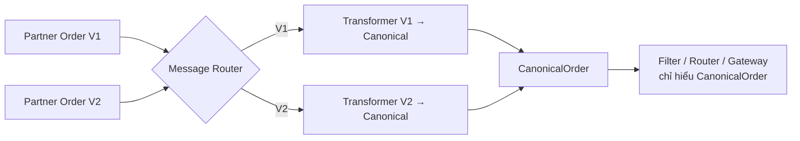
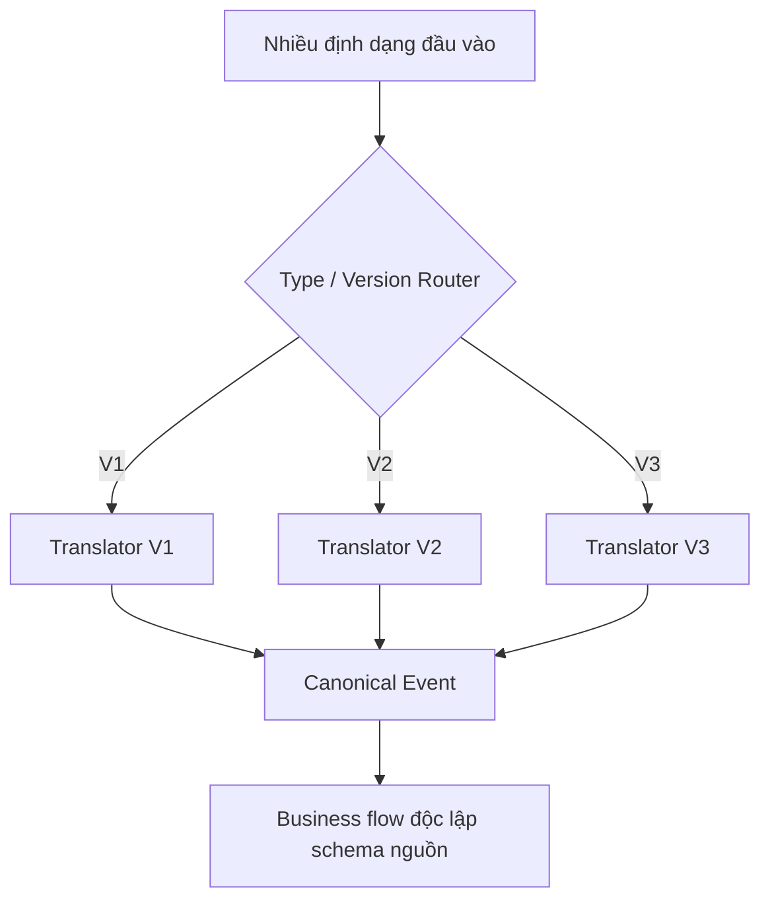
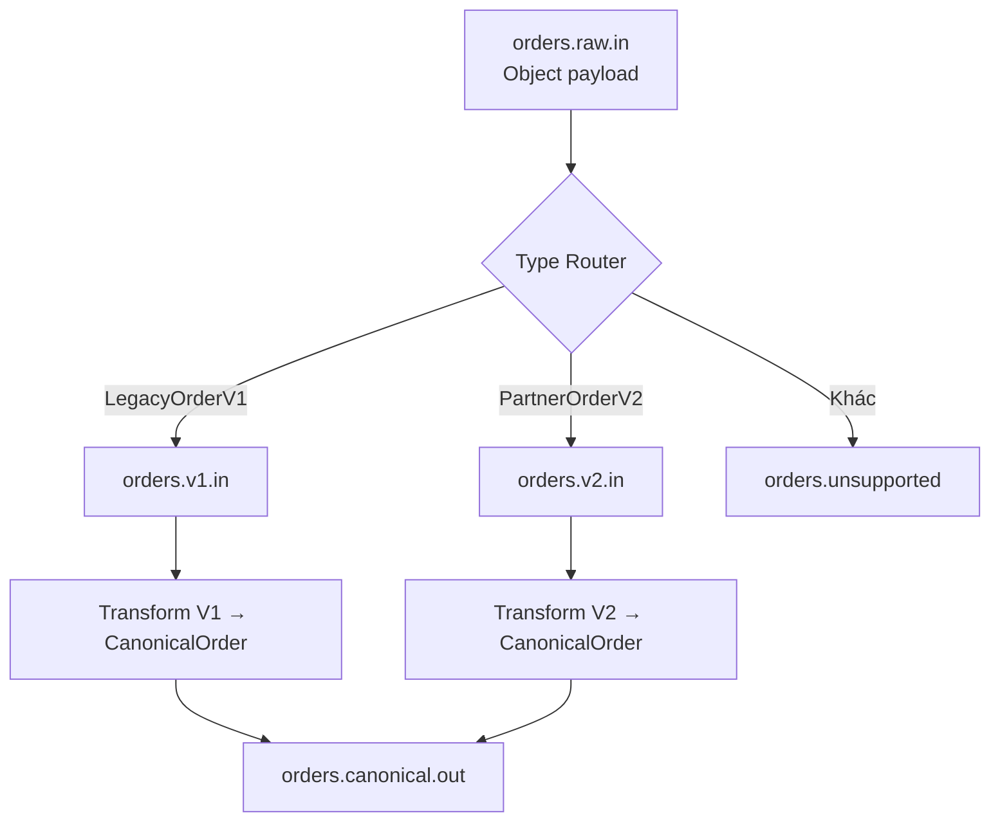
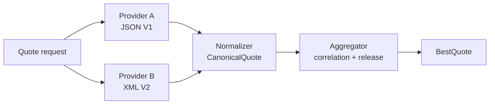

# So sánh normalizer với transformer

## 1. Một đơn hàng, hai định dạng đầu vào

Một ứng dụng bán hàng nhận message từ cùng một đối tác nhưng đối tác đang chuyển đổi API:

**Định dạng V1** dùng số nguyên cent:

```json
{
  "orderId": "O-204",
  "buyerRef": "C-09",
  "totalCents": 1995,
  "currencyCode": "USD"
}
```

**Định dạng V2** dùng chuỗi tiền thập phân:

```json
{
  "externalOrderCode": "O-204",
  "customerReference": "C-09",
  "amountDecimal": "19.95",
  "isoCurrency": "USD"
}
```

Cả hai biểu diễn **cùng dữ liệu nghiệp vụ**: đơn `O-204` của khách `C-09` trị giá 19,95 USD. Tuy nhiên tên field, kiểu dữ liệu và cách biểu diễn số tiền khác nhau.

Nếu đưa cả hai payload thẳng vào Router, Filter, Aggregator và Gateway, mỗi endpoint phải hiểu cả V1 lẫn V2:

```text
Order V1 ─┐
          ├─► Router biết V1/V2
Order V2 ─┘    └─► Filter biết V1/V2
                    └─► Business handler biết V1/V2
                            └─► Audit biết V1/V2
```

Một cách tốt hơn là đặt một **Normalizer** ở ranh giới tích hợp:



**Transformer** là thao tác **chuyển đổi một biểu diễn**. **Normalizer** là **mẫu thiết kế để quy nhiều biểu diễn khác nhau về cùng một biểu diễn chuẩn**, thường bằng Router và nhiều Transformer.

Đó là khác biệt quan trọng nhất của bài **“So sánh normalizer với transformer”**, thuộc chương **Normalizer** trong module **SPRING_INTEGRATION_PATTERN**. Module tập trung thực hành Enterprise Integration Patterns với Spring Integration để xây dựng các luồng thông điệp ít phụ thuộc, dễ mở rộng; kết hợp Router, Filter, Transformer, Splitter, Aggregator, Gateway, retry, error channel, correlation và kiểm thử, theo dõi các nhánh xử lý.

Sau bài học, bạn có thể:

1. Trình bày chính xác vai trò của Normalizer và Transformer theo Enterprise Integration Patterns.
2. Chọn giữa một Transformer đơn, một Transformer có nhiều nhánh, hay một Normalizer gồm Router và các Transformer chuyên biệt.
3. Thiết kế **canonical message contract** giữ nguyên nghĩa nghiệp vụ, không chỉ đổi tên field.
4. Viết Spring Integration Java DSL định tuyến payload V1/V2, biến đổi riêng và hợp nhất đầu ra.
5. Kiểm thử hai nguồn tương đương, phiên bản không hỗ trợ, dữ liệu không hợp lệ, header/correlation và thứ tự xử lý.
6. Hiểu những rủi ro khi chuẩn hóa số tiền, đơn vị đo, thời gian, ID, schema version và tenant.
7. Tách Normalizer khỏi validation, idempotency, Aggregator, Content Enricher và authorization.
8. Lên kế hoạch vận hành, quan sát, migration và loại bỏ định dạng cũ có kiểm soát.

## 2. Transformer là gì?

**Message Transformer** là một Enterprise Integration Pattern dùng để đổi **biểu diễn của một message** sao cho bên nhận có thể sử dụng dữ liệu.

Trong Spring Integration, ta thường triển khai bằng một Transformer endpoint hoặc toán tử `.transform(...)` trong Java DSL.

Ví dụ đơn giản:

```java
record LegacyPrice(long cents) {}
record CanonicalPrice(java.math.BigDecimal dollars) {}

CanonicalPrice convert(LegacyPrice input) {
    return new CanonicalPrice(
        java.math.BigDecimal.valueOf(input.cents(), 2));
}
```

Với cùng đầu vào `LegacyPrice(1995)`, Transformer trả `CanonicalPrice(19.95)`.

Một Transformer có thể:

- Đổi payload type: `String → OrderDto`.
- Đổi schema: `LegacyOrder → CanonicalOrder`.
- Đổi đơn vị: `cents → BigDecimal dollars`.
- Đổi trường/nesting: `buyer.ref → customerId`.
- Chuyển dữ liệu thành JSON, XML, Avro hoặc object đã có kiểu.
- Đổi mô hình riêng của hệ thống A sang mô hình riêng của hệ thống B.

**Transformer không yêu cầu phải có nhiều định dạng đầu vào.** Khi chỉ có một loại message nguồn và một đích, một Transformer có thể là đủ.

### Transformer có tạo message mới không?

Một transformer trong Spring Integration thường xử lý một `Message<?>` và tạo output payload hoặc `Message<?>` mới, tùy API và implementation. Framework hỗ trợ truyền/copy header trong nhiều trường hợp, nhưng **header nào được giữ, ghi đè hoặc loại bỏ phụ thuộc cách transform và các thành phần tiếp theo**. Khi business phụ thuộc `correlationId`, `requestId` hoặc provenance, phải kiểm thử propagation thay vì giả định mọi header luôn giữ nguyên.

## 3. Normalizer là gì?

Theo Enterprise Integration Patterns, **Normalizer** giải quyết câu hỏi:

> Làm thế nào xử lý các message mang ý nghĩa tương tự nhưng có cấu trúc khác nhau mà không bắt mọi consumer hiểu mọi dạng?

Cấu trúc kinh điển:

1. **Message Router** nhận diện định dạng/loại đầu vào.
2. Các **Message Translator/Transformer** chuyên biệt chuyển từng loại sang **common format**.
3. Các message sau chuyển đổi cùng đi vào **một logical output channel**.
4. Consumer phía sau chỉ cần một contract thống nhất.



Normalizer là **một pattern tổng hợp (composed pattern)**, không nhất thiết là một class Spring Integration duy nhất tên `Normalizer`. Trong Java DSL, ta thường lắp ghép `route(...)` và `transform(...)`; cũng có thể có các kênh ingress riêng cho từng định dạng, mỗi kênh có Transformer riêng rồi hội tụ về một channel chuẩn.

### Tại sao Normalizer có nhiều Transformer bên trong?

Vì cách hiểu từng định dạng thường khác nhau:

- V1: `totalCents=1995` cần chia theo tỷ lệ 100.
- V2: `amountDecimal="19.95"` cần parse decimal chính xác.
- V3: có thể có `gross, discount, tax`; phải xác định ngữ nghĩa của “total” trước khi map.

Một Transformer khổng lồ chứa tất cả `if/else` có thể vẫn cho ra canonical output, nhưng khi số phiên bản tăng, nó khó sở hữu, kiểm thử và ngừng hỗ trợ từng nhánh hơn một Normalizer có cấu trúc rõ.

## 4. So sánh nhanh

| Tiêu chí | Transformer | Normalizer |
| --- | --- | --- |
| **Bản chất** | Một pattern chuyển đổi biểu diễn message | Pattern phối hợp định tuyến và chuyển đổi |
| **Đầu vào** | Thường một contract nguồn cho mỗi transformer | Nhiều contract/phiên bản/đối tác khác nhau |
| **Đầu ra** | Một định dạng đích tùy bài toán | **Một common/canonical contract** |
| **Thành phần cốt lõi** | Hàm/endpoint biến đổi | Router và các Translator/Transformer |
| **Quyết định biến thể** | Có thể không cần | Phải xác định đúng converter theo nguồn |
| **Mở rộng thêm nguồn** | Thêm/sửa logic transform | Thêm route và transformer phù hợp |
| **Người tiêu thụ** | Có thể là consumer cụ thể | Nhiều consumer dùng chung kiểu canonical |
| **Vị trí thường gặp** | Bất kỳ đoạn flow nào cần đổi format | Ingress/integration boundary/anti-corruption layer |
| **Lỗi chính** | Sai mapping/schema/đơn vị | Sai mapping cộng sai route, nhầm version, mất semantics |
| **Có giải quyết idempotency?** | Không | Không |
| **Có gom nhiều message thành một?** | Không mặc định | Không; đó thường là Aggregator |
| **Có tự xác thực nguồn/tenant?** | Không | Không; phải có trust boundary riêng |

**Không nên coi chúng là hai kỹ thuật loại trừ nhau.** Normalizer **dùng Transformer**; một Transformer cũng có thể đóng vai trò chuẩn hóa nếu hệ thống chỉ có một biến thể nguồn.

## 5. Lúc nào chỉ cần một Transformer?

Một Transformer đơn thường đủ khi:

- Chỉ có **một schema nguồn có thẩm quyền**.
- Không có nhiều phiên bản hoạt động song song.
- Quy tắc chuyển đổi nhỏ, ổn định và dễ test.
- Consumer chỉ cần đổi type/đơn vị/format.
- Không cần route theo loại message.
- Thay đổi không gây ảnh hưởng nhiều consumer.

Ví dụ:

```java
@Bean
IntegrationFlow legacyOnly() {
    return IntegrationFlow.from("legacy.orders.in")
        .transform(LegacyOrderV1.class,
            OrderNormalizationRules::fromV1)
        .channel("orders.canonical")
        .get();
}
```

Đây vẫn là một Transformer tạo **canonical output**. Nếu không có V2, thêm Router chỉ để gọi cùng một hàm có thể làm flow dài hơn mà không tạo giá trị.

### Đừng “pattern hóa” quá mức

Một hệ thống nhận đúng một kiểu `OrderCreatedV1` rồi map sang `CanonicalOrder` không cần phải dựng ba channel, hai Router và một sơ đồ phân lớp phức tạp. Hãy dùng **cấu trúc nhỏ nhất làm rõ hợp đồng**.

Điểm quyết định không phải tên class `Normalizer` hay `Transformer`, mà là **bạn có nhiều dạng đầu vào cần thống nhất hay không**.

## 6. Khi nào nên dùng Normalizer?

Normalizer đặc biệt hữu ích khi:

- Một partner duy trì song song V1/V2 trong thời gian migration.
- Hệ thống hợp nhất webhook JSON từ nhiều nhà cung cấp.
- Cùng sự kiện đến qua REST, CSV import và broker.
- Dữ liệu legacy lưu ở nhiều schema lịch sử.
- Một downstream nghiệp vụ có nhiều upstream team triển khai khác nhau.
- Consumer không nên có điều kiện `if (sourceVersion == ...)`.
- Muốn tách trách nhiệm mapping từng nguồn và test contract độc lập.
- Có nhu cầu theo dõi version nào đang được dùng trước khi loại bỏ.

Ví dụ:

```text
External feed A ─► Transformer A ─┐
                                   │
External feed B ─► Transformer B ──┼─► CanonicalOrder ─► Business flow
                                   │
CSV batch       ─► Transformer CSV ┘
```

Các connector có thể tự nhận dạng variant rồi gửi vào channel riêng. Khi đó **Router có thể nằm ngoài Normalizer flow được thể hiện bằng code**, nhưng chức năng pattern vẫn có: **phân loại đúng variant + chuyển từng variant về cùng contract**.

## 7. Canonical model phải giữ nghĩa, không chỉ đổi tên field

Đổi:

```text
buyerRef → customerId
totalCents → totalAmount
```

là phép mapping đơn giản về hình thức. Nhưng một Normalizer đúng phải trả lời thêm:

1. `buyerRef` của V1 và `customerReference` của V2 có **cùng phạm vi định danh khách** không?
2. `totalCents` có phải **USD cents** hay minor unit của đồng tiền ghi trên message?
3. `amountDecimal` là giá **trước hay sau thuế/discount**?
4. Có trường `orderRevision`/`eventId` để phân biệt retry và bản cập nhật không?
5. Currency code và timezone có cùng chuẩn?
6. Có cần giữ source provenance để audit?
7. Các trường bị bỏ có ảnh hưởng đến quyết định kinh doanh phía sau không?
8. Hai schema có cùng semantics khi một trường bị thiếu/null không?

Nếu V1 ghi **gross price** còn V2 ghi **net price**, việc map chúng vào cùng `CanonicalOrder.total` sẽ làm mất ngữ nghĩa. Khi đó cần một canonical model phong phú hơn, hoặc yêu cầu enrichment có dữ liệu đủ để tính cùng định nghĩa tiền.

### Canonical hóa không phải xóa mọi khác biệt

Một model chuẩn cần đủ thông tin cho consumer, không nhất thiết chứa **tất cả field từng xuất hiện** trong mọi schema. Có thể tách:

- **Core domain payload**: các trường consumer thật sự dùng.
- **Provenance metadata**: source system, schema version, input record ID.
- **Audit reference**: nơi lưu nguyên gốc nếu cần đối chiếu.
- **Processing headers**: request/correlation/trace/tenant đã xác thực.

Không tự bỏ các trường cần cho compliance, reconciliation hoặc idempotency chỉ vì chúng không hiện trong DTO của ví dụ.

## 8. Schema chuẩn và những giả định được công bố

Ví dụ xuyên suốt dùng **một đối tác giả lập** tên `PARTNER_ALPHA` có hai schema đầu vào. Hai schema đã được thống nhất là cùng nghĩa:

- `orderId` và `externalOrderCode` là cùng ID đơn hàng từ partner.
- `buyerRef` và `customerReference` là cùng ID khách hàng trong namespace partner.
- `totalCents` biểu diễn **USD cents**.
- `amountDecimal` là chuỗi tiền USD với đúng hai chữ số sau dấu thập phân.
- Tiền là **tổng giá trị phải thanh toán** sau khi các chính sách giá liên quan đã áp dụng.
- V1/V2 có thể cùng tồn tại trong giai đoạn migration.
- Mỗi input message đại diện cho **một logical order event**; Normalizer không tự loại duplicate.
- Tenant/source identity trong production phải lấy từ **ingress đã xác thực**, không chỉ từ JSON của đối tác.

Canonical payload:

```java
import java.math.BigDecimal;

record CanonicalOrder(
    String sourceSystem,
    String orderId,
    String customerId,
    BigDecimal total,
    String currencyCode) {}
```

Hai input về **cùng order, cùng dữ liệu nghiệp vụ** phải tạo `CanonicalOrder` có giá trị bằng nhau. Khác biệt schema/version có thể giữ trong **trusted headers/provenance** mà không làm thay đổi payload nghiệp vụ.

Không dùng `CanonicalOrder` này làm chuẩn cho mọi lĩnh vực: đơn hàng có nhiều line, tax, promotion, địa chỉ và trạng thái có thể cần model đầy đủ hơn. Mục tiêu là so sánh pattern, không thiết kế toàn bộ commerce domain.

## 9. Các DTO nguồn và điểm khác nhau

```java
// Schema cũ: tiền tính bằng integer cents.
record LegacyOrderV1(
    String orderId,
    String buyerRef,
    long totalCents,
    String currencyCode) {}

// Schema mới: tiền dưới dạng decimal String.
record PartnerOrderV2(
    String externalOrderCode,
    String customerReference,
    String amountDecimal,
    String isoCurrency) {}
```

Ta không đưa hai kiểu này vào business handler. Chúng chỉ tồn tại tại integration boundary để phản ánh hợp đồng của partner.

### Một bảng mapping có chủ ý

| Canonical | V1 | V2 | Quy tắc |
| --- | --- | --- | --- |
| `sourceSystem` | Trusted partner ingress | Trusted partner ingress | Trong demo gán `PARTNER_ALPHA` |
| `orderId` | `orderId` | `externalOrderCode` | Không tự trim/lowercase |
| `customerId` | `buyerRef` | `customerReference` | Cùng namespace partner |
| `total` | `totalCents` | `amountDecimal` | USD cents → dollars hoặc parse decimal |
| `currencyCode` | `currencyCode` | `isoCurrency` | Demo chỉ chấp nhận USD |

**Cẩn thận:** Với các đồng tiền không có hai chữ số thập phân (ví dụ JPY) hoặc có ba chữ số (ví dụ KWD), không thể mặc định mọi “minor unit” chia 100. Nếu mở rộng currency, cần định nghĩa thang đo theo hợp đồng của từng nguồn, không dùng hàm `BigDecimal.valueOf(cents, 2)` chung cho mọi đồng tiền.

## 10. Code chuyển đổi: mỗi định dạng có Transformer riêng

Lớp sau có ba nhiệm vụ: nhận diện variant, chuyển V1 và chuyển V2. Quy tắc conversion là **pure function**: không gọi mạng, không đổi shared state và không phụ thuộc thời gian hiện tại.

```java
import java.math.BigDecimal;
import java.math.RoundingMode;

final class OrderNormalizationRules {

    private static final String SOURCE = "PARTNER_ALPHA";

    private OrderNormalizationRules() {}

    static String detectVersion(Object payload) {
        if (payload instanceof LegacyOrderV1) {
            return "V1";
        }
        if (payload instanceof PartnerOrderV2) {
            return "V2";
        }
        return "UNSUPPORTED";
    }

    static CanonicalOrder fromV1(LegacyOrderV1 order) {
        if (order == null) {
            throw new IllegalArgumentException(
                "V1 order must not be null");
        }

        requireIdentifier(order.orderId(), "orderId");
        requireIdentifier(order.buyerRef(), "buyerRef");
        requireUsd(order.currencyCode());

        if (order.totalCents() <= 0) {
            throw new IllegalArgumentException(
                "totalCents must be positive");
        }

        BigDecimal amount =
            BigDecimal.valueOf(order.totalCents(), 2);

        return new CanonicalOrder(
            SOURCE,
            order.orderId(),
            order.buyerRef(),
            amount,
            "USD");
    }

    static CanonicalOrder fromV2(PartnerOrderV2 order) {
        if (order == null) {
            throw new IllegalArgumentException(
                "V2 order must not be null");
        }

        requireIdentifier(
            order.externalOrderCode(), "externalOrderCode");
        requireIdentifier(
            order.customerReference(), "customerReference");
        requireUsd(order.isoCurrency());

        // Contract demo: decimal dương, chính xác hai chữ số,
        // tối đa 9 chữ số trước dấu chấm, không dùng exponent.
        String text = order.amountDecimal();
        if (text == null
                || !text.matches("[0-9]{1,9}\\.[0-9]{2}")) {
            throw new IllegalArgumentException(
                "Invalid decimal amount");
        }

        BigDecimal amount = new BigDecimal(text)
            .setScale(2, RoundingMode.UNNECESSARY);

        if (amount.signum() <= 0) {
            throw new IllegalArgumentException(
                "Amount must be positive");
        }

        return new CanonicalOrder(
            SOURCE,
            order.externalOrderCode(),
            order.customerReference(),
            amount,
            "USD");
    }

    private static void requireIdentifier(
            String value,
            String name) {
        if (value == null
                || !value.matches("[A-Z0-9-]{1,40}")) {
            throw new IllegalArgumentException(
                "Invalid " + name);
        }
    }

    private static void requireUsd(String currencyCode) {
        if (!"USD".equals(currencyCode)) {
            throw new IllegalArgumentException(
                "Only USD is supported by this demo");
        }
    }
}
```

### Vì sao dùng BigDecimal?

Tiền thường không nên tính bằng `double` vì biểu diễn nhị phân có thể không lưu chính xác các phân số thập phân. `BigDecimal.valueOf(1995, 2)` tạo giá trị 19.95 với scale 2. `new BigDecimal("19.95")` cũng tạo giá trị thập phân chính xác.

Hai nhánh không dùng cùng một thao tác parse vì **format nguồn khác nhau**. Đó là lý do tốt để tách thành hai Transformer.

### Vì sao không silently round?

Nếu nguồn gửi `"19.955"` mà contract yêu cầu hai chữ số thập phân, làm tròn mặc định có thể tạo giao dịch sai tiền. Ví dụ kiểm tra định dạng trước khi tạo giá trị. Trong production cần quy định rounding theo từng loại thao tác và không tự chọn quy tắc không được phê duyệt.

### Những gì code chưa giải quyết

- Authentication của partner, tenant authorization và source provenance.
- Kích thước payload và schema version của JSON adapter.
- Các loại tiền khác USD.
- Tax, discount, refund, status hoặc nhiều order lines.
- Deduplication khi V1 và V2 cùng phát một logical event.
- External service lookups để giải mã customer reference.
- Error response hoặc dead-letter retention.
- Transaction/side effect downstream.

Các vấn đề đó cần layer riêng; không nhét hết vào một phép chuyển đổi chỉ vì class có tên `Normalizer`.

## 11. Spring Integration Java DSL: Router + hai Transformer

Trong ví dụ này, một kênh `orders.raw.in` nhận hai payload type. Router chọn đúng nhánh; hai nhánh biến đổi về `CanonicalOrder` và ghi vào một channel output chung.



Cấu hình mẫu dùng Spring Integration Java DSL:

```java
import org.springframework.context.annotation.Bean;
import org.springframework.context.annotation.Configuration;
import org.springframework.integration.channel.DirectChannel;
import org.springframework.integration.channel.QueueChannel;
import org.springframework.integration.config.EnableIntegration;
import org.springframework.integration.dsl.IntegrationFlow;

@Configuration
@EnableIntegration
public class OrderNormalizerConfig {

    @Bean("orders.raw.in")
    DirectChannel rawOrders() {
        return new DirectChannel();
    }

    @Bean("orders.v1.in")
    DirectChannel v1Orders() {
        return new DirectChannel();
    }

    @Bean("orders.v2.in")
    DirectChannel v2Orders() {
        return new DirectChannel();
    }

    @Bean("orders.unsupported")
    QueueChannel unsupportedOrders() {
        return new QueueChannel();
    }

    @Bean("orders.canonical.out")
    QueueChannel canonicalOrders() {
        return new QueueChannel();
    }

    @Bean
    IntegrationFlow detectOrderVersion() {
        return IntegrationFlow.from("orders.raw.in")
            .route(
                Object.class,
                OrderNormalizationRules::detectVersion,
                spec -> spec
                    .channelMapping("V1", "orders.v1.in")
                    .channelMapping("V2", "orders.v2.in")
                    .defaultOutputChannel(
                        "orders.unsupported"))
            .get();
    }

    @Bean
    IntegrationFlow normalizeOrderV1() {
        return IntegrationFlow.from("orders.v1.in")
            .transform(
                LegacyOrderV1.class,
                OrderNormalizationRules::fromV1)
            .channel("orders.canonical.out")
            .get();
    }

    @Bean
    IntegrationFlow normalizeOrderV2() {
        return IntegrationFlow.from("orders.v2.in")
            .transform(
                PartnerOrderV2.class,
                OrderNormalizationRules::fromV2)
            .channel("orders.canonical.out")
            .get();
    }
}
```

### Điều quan trọng về cấu hình

- `route(...)` **chọn translator**, không tự chuyển đổi dữ liệu.
- Mỗi `transform(...)` **chỉ xử lý một schema nguồn**.
- Hai branch hội tụ về cùng contract `CanonicalOrder`.
- `orders.unsupported` nhận **message có payload type chưa được nhận diện**; đây không phải cơ chế catch mọi exception.
- `orders.canonical.out` là `QueueChannel` phục vụ test; trong production có thể là channel đưa sang validation/domain service, không nhất thiết là queue không bền vững.
- Các `DirectChannel` dùng cho ví dụ đồng bộ; lỗi transform có thể lan về sender, không mặc nhiên đi vào `orders.unsupported`.
- Không dùng một `DirectChannel` với hai service activator subscriber và tưởng cả hai nhận message; DirectChannel có cơ chế dispatch point-to-point. Router ở đây đưa message rõ ràng tới đúng branch.
- Overload của DSL và các endpoint spec cần được kiểm chứng với version Spring Integration thực tế khi build; STEP 4 hiện không chạy biên dịch.

### Vì sao channel output chung không phải Aggregator?

Mỗi input V1 hoặc V2 được chuyển thành **một output riêng**. Channel chung chỉ là điểm hội tụ (*fan-in*) của các loại message đã chuẩn hóa, **không chờ nhóm đủ N message** và không tạo summary của nhiều message.

Đây là **Normalizing Message Flow**, không phải Aggregation. Nếu business muốn gom 10 dòng đơn vào một order total, cần thêm Splitter/Aggregator và correlation/release policy riêng.

## 12. Không nhất thiết phải có Router được viết trong cùng flow

Một topology khác có hai adapter/ingress độc lập:

```text
HTTP /legacy/order → LegacyOrderV1 → Transformer V1 ─┐
                                                      ├→ CanonicalOrder
Kafka topic order-v2 → PartnerOrderV2 → Transformer V2 ┘
```

Mỗi transport đã xác định variant theo endpoint/topic/schema ID. Khi đó không cần một Router chạy `instanceof` trong app. **Về mặt pattern, hệ thống vẫn thực hiện normalization** vì nhiều biểu diễn nguồn được dịch ra một contract chung.

Có thể viết:

```java
@Bean
IntegrationFlow legacyIngress() {
    return IntegrationFlow.from("partner.legacy.in")
        .transform(LegacyOrderV1.class,
            OrderNormalizationRules::fromV1)
        .channel("orders.canonical.out")
        .get();
}

@Bean
IntegrationFlow modernIngress() {
    return IntegrationFlow.from("partner.modern.in")
        .transform(PartnerOrderV2.class,
            OrderNormalizationRules::fromV2)
        .channel("orders.canonical.out")
        .get();
}
```

Không nên đăng ký **đồng thời** cấu hình thay thế ở trên và cấu hình mục 11 với cùng channel/bean name trong một context mà không thiết kế topology. Đây là **phương án kiến trúc để so sánh**, không phải khối code bắt buộc thêm vào cấu hình mẫu.

## 13. Một Transformer đa nhánh có thể thay cho Normalizer không?

Có thể viết một Transformer nhận `Object`:

```java
CanonicalOrder convert(Object payload) {
    if (payload instanceof LegacyOrderV1 v1) {
        return OrderNormalizationRules.fromV1(v1);
    }
    if (payload instanceof PartnerOrderV2 v2) {
        return OrderNormalizationRules.fromV2(v2);
    }
    throw new IllegalArgumentException(
        "Unsupported order payload");
}
```

Sau đó dùng một endpoint `.transform(Object.class, this::convert)`.

**Về chức năng**, điều này vẫn bình thường hóa các variant về canonical model. Nhưng về **cấu trúc pattern**:

- Quy tắc phân nhánh bị nhúng trong một Transformer.
- Khi tăng 10–20 phiên bản, class có thể phình lớn.
- Khó định tuyến variant không hỗ trợ tới một rejection channel riêng.
- Dễ vô tình trộn validation, routing, mapping và retry.
- Team sở hữu từng partner/version khó thay đổi độc lập.

**Không phải lúc nào cũng sai.** Với đúng hai variant đơn giản, một Transformer đa nhánh có thể đủ dễ đọc và test. Chọn Router + translators khi **tính đa dạng, quyền sở hữu và khả năng mở rộng** làm việc tách nhánh có giá trị.

### Quy tắc lựa chọn

| Nhu cầu | Lựa chọn gợi ý |
| --- | --- |
| Một source schema → một target schema | Một Transformer |
| Hai variant nhỏ, ít thay đổi | Transformer đa nhánh hoặc Router + Transformers |
| Nhiều version/partner với policy khác | Normalizer có Router và mapping chuyên biệt |
| Input đã chia theo topic/endpoint | Nhiều ingress + Transformers cùng output |
| Cần provenance/error flow riêng cho từng variant | Normalizer có branch rõ ràng |
| Cần tổng hợp nhiều message | Aggregator, không phải Normalizer |
| Cần làm phong phú từ dữ liệu ngoài | Content Enricher + validation, không chỉ renaming |
| Cần lọc message không hợp lệ | Validation/Filter, không gọi mọi Filter là Normalizer |

## 14. Integration test: V1/V2 cùng sinh CanonicalOrder

Dùng JUnit 5, Spring Test và AssertJ. Test tạo hai input version có cùng nghĩa, gửi qua Router và đọc output chung.

```java
import static org.assertj.core.api.Assertions.assertThat;

import org.junit.jupiter.api.Test;
import org.springframework.beans.factory.annotation.Autowired;
import org.springframework.beans.factory.annotation.Qualifier;
import org.springframework.integration.channel.QueueChannel;
import org.springframework.messaging.Message;
import org.springframework.messaging.MessageChannel;
import org.springframework.messaging.support.MessageBuilder;
import org.springframework.test.context.junit.jupiter.SpringJUnitConfig;

@SpringJUnitConfig(OrderNormalizerConfig.class)
class OrderNormalizerFlowTest {

    @Autowired
    @Qualifier("orders.raw.in")
    MessageChannel input;

    @Autowired
    @Qualifier("orders.canonical.out")
    QueueChannel normalized;

    @Autowired
    @Qualifier("orders.unsupported")
    QueueChannel unsupported;

    private LegacyOrderV1 legacy(String orderId) {
        return new LegacyOrderV1(
            orderId, "C-09", 1995, "USD");
    }

    private PartnerOrderV2 modern(String orderId) {
        return new PartnerOrderV2(
            orderId, "C-09", "19.95", "USD");
    }

    private void send(Object payload, String traceId) {
        assertThat(input.send(
            MessageBuilder.withPayload(payload)
                .setHeader("requestId", traceId)
                .build())).isTrue();
    }

    @Test
    void equivalentV1AndV2BecomeSameCanonicalOrder() {
        send(legacy("O-204"), "request-v1");
        send(modern("O-204"), "request-v2");

        Message<?> first = normalized.receive(1_000);
        Message<?> second = normalized.receive(1_000);

        assertThat(first).isNotNull();
        assertThat(second).isNotNull();
        assertThat(first.getPayload())
            .isInstanceOf(CanonicalOrder.class);
        assertThat(second.getPayload())
            .isInstanceOf(CanonicalOrder.class);

        CanonicalOrder canonicalV1 =
            (CanonicalOrder) first.getPayload();
        CanonicalOrder canonicalV2 =
            (CanonicalOrder) second.getPayload();

        assertThat(canonicalV1)
            .isEqualTo(canonicalV2);

        assertThat(canonicalV1.orderId()).isEqualTo("O-204");
        assertThat(canonicalV1.customerId()).isEqualTo("C-09");
        assertThat(canonicalV1.currencyCode()).isEqualTo("USD");
        assertThat(canonicalV1.total())
            .isEqualByComparingTo(
                new java.math.BigDecimal("19.95"));

        assertThat(first.getHeaders().get("requestId"))
            .isEqualTo("request-v1");
        assertThat(second.getHeaders().get("requestId"))
            .isEqualTo("request-v2");

        assertThat(normalized.receive(0)).isNull();
    }

    @Test
    void unsupportedVersionIsSeparatedFromCanonicalOutput() {
        record OrderV3(String eventId) {}

        send(new OrderV3("evt-3"), "request-unsupported");

        Message<?> rejected = unsupported.receive(1_000);
        assertThat(rejected).isNotNull();
        assertThat(rejected.getPayload())
            .isInstanceOf(OrderV3.class);

        assertThat(normalized.receive(0)).isNull();
    }

    @Test
    void eachValidInputCreatesOneOutputMessage() {
        send(legacy("O-205"), "req-205");
        send(modern("O-206"), "req-206");

        CanonicalOrder a = (CanonicalOrder)
            normalized.receive(1_000).getPayload();
        CanonicalOrder b = (CanonicalOrder)
            normalized.receive(1_000).getPayload();

        assertThat(a.orderId()).isEqualTo("O-205");
        assertThat(b.orderId()).isEqualTo("O-206");
        assertThat(normalized.receive(0)).isNull();
    }
}
```

### Test này chứng minh điều gì?

- Router chọn Transformer đúng cho hai payload type.
- Hai Transformer tạo ra cùng một **canonical contract**.
- Dữ liệu tiền được convert từ cents và decimal chính xác.
- Message của variant không được hỗ trợ **không đi vào canonical channel**.
- Trong flow đồng bộ mẫu, header `requestId` được truyền qua transform để quan sát.
- Một input hợp lệ tạo một output; **không có bước gom group**.

### Những gì test không chứng minh

- Adapter JSON thực sự bind đúng schema V1/V2.
- Partner identity/tenant được xác thực.
- Store/broker durable, ordering hay retry qua nhiều instance.
- Tính idempotent khi V1 và V2 cùng gửi **một logical event**.
- Header mapping khi message đi qua Kafka/AMQP/HTTP.
- Schema evolution/rolling deploy ngoài bộ test mô phỏng.
- Side effect downstream đã commit đúng một lần.

Cần bổ sung integration tests tại adapter/broker/storage thực nếu hệ thống yêu cầu.

### Cách giữ test độc lập

`QueueChannel` có thể được dùng chung khi Spring Test cache context; các test phải tiêu thụ message của mình, dùng ID khác nhau hoặc cô lập fixture. Nếu chạy test song song, cần context/channel riêng để tránh hai test đọc output của nhau. Không dựa vào thứ tự JUnit.

## 15. Unit test mỗi Transformer riêng

Trong thực tế, Normalizer rất phù hợp để áp dụng **contract tests cho từng variant**.

```java
import static org.assertj.core.api.Assertions.assertThat;
import static org.assertj.core.api.Assertions.assertThatThrownBy;

import java.math.BigDecimal;

import org.junit.jupiter.api.Test;

class OrderNormalizationRulesTest {

    @Test
    void v1CentsAndV2DecimalHaveEquivalentMeaning() {
        CanonicalOrder v1 = OrderNormalizationRules.fromV1(
            new LegacyOrderV1("O-204", "C-09", 1995, "USD"));

        CanonicalOrder v2 = OrderNormalizationRules.fromV2(
            new PartnerOrderV2(
                "O-204", "C-09", "19.95", "USD"));

        assertThat(v1).isEqualTo(v2);
        assertThat(v1.total())
            .isEqualByComparingTo(new BigDecimal("19.95"));
    }

    @Test
    void rejectsZeroOrNegativeAmounts() {
        assertThatThrownBy(() ->
            OrderNormalizationRules.fromV1(
                new LegacyOrderV1(
                    "O-204", "C-09", 0, "USD")))
            .isInstanceOf(IllegalArgumentException.class);

        assertThatThrownBy(() ->
            OrderNormalizationRules.fromV2(
                new PartnerOrderV2(
                    "O-204", "C-09", "-19.95", "USD")))
            .isInstanceOf(IllegalArgumentException.class);
    }

    @Test
    void rejectsUnexpectedCurrency() {
        assertThatThrownBy(() ->
            OrderNormalizationRules.fromV1(
                new LegacyOrderV1(
                    "O-204", "C-09", 1995, "JPY")))
            .isInstanceOf(IllegalArgumentException.class);
    }

    @Test
    void rejectsV2AmountWithExtraFractionalDigit() {
        assertThatThrownBy(() ->
            OrderNormalizationRules.fromV2(
                new PartnerOrderV2(
                    "O-204", "C-09", "19.955", "USD")))
            .isInstanceOf(IllegalArgumentException.class);
    }

    @Test
    void detectsKnownTypesOnly() {
        assertThat(OrderNormalizationRules.detectVersion(
            new LegacyOrderV1(
                "O-204", "C-09", 1995, "USD")))
            .isEqualTo("V1");

        assertThat(OrderNormalizationRules.detectVersion(
            new PartnerOrderV2(
                "O-204", "C-09", "19.95", "USD")))
            .isEqualTo("V2");

        assertThat(OrderNormalizationRules.detectVersion(
            "unknown payload"))
            .isEqualTo("UNSUPPORTED");
    }
}
```

**Không cần chạy toàn bộ Spring context để kiểm tra từng field mapping.** Một bộ unit test thuần Java có thể bao phủ boundary values, nulls, type mismatch và scale nhanh hơn. Integration test Spring tập trung vào **routing, channel wiring, error path và header propagation**.

## 16. Test invalid V2 không biến thành unsupported variant

Một phân biệt quan trọng:

- **Unsupported variant:** payload thuộc kiểu/schema mà ứng dụng **không biết converter nào**.
- **Invalid content:** payload có kiểu đã biết (V2) nhưng dữ liệu của nó **không hợp lệ**.

Ví dụ:

```text
PartnerOrderV2(amountDecimal="ABC")
  → Router chọn V2 đúng.
  → Transformer V2 không parse được.
  → Validation/transform exception.
  ≠ Unsupported schema.
```

Nếu tất cả lỗi bị chuyển về chung channel `orders.unsupported`, vận hành có thể hiểu sai rằng hệ thống thiếu adapter khi thật ra partner gửi nội dung sai.

Với flow đồng bộ, một integration test:

```java
@Test
void invalidKnownVariantFailsBeforeCanonicalOutput() {
    PartnerOrderV2 invalid = new PartnerOrderV2(
        "O-207", "C-09", "19.955", "USD");

    assertThatThrownBy(() -> input.send(
        MessageBuilder.withPayload(invalid).build()))
        .isInstanceOf(RuntimeException.class);

    assertThat(normalized.receive(0)).isNull();
}
```

Đặt test này **bên trong** `OrderNormalizerFlowTest` và thêm static import:

```java
import static org.assertj.core.api.Assertions.assertThatThrownBy;
```

Trong Spring Integration, exception có thể được bọc bởi `MessageTransformationException`, `MessageHandlingException` hoặc exception khác theo endpoint/adapter. Test kiểm tra **hành vi fail và không tạo canonical output**, không nên phụ thuộc message text của exception wrapper.

## 17. Error handling cho Normalizer nhiều biến thể

Normalizer có thêm một nơi gây lỗi so với Transformer đơn: **bước phân loại đầu vào**.

| Trường hợp | Điểm phát hiện | Phản ứng gợi ý |
| --- | --- | --- |
| Unknown schema/version | Router | Unsupported input channel, quarantine, version metric |
| Known schema nhưng field sai | Transformer/validation | Reject với field code và schema version |
| Schema version giả mạo | Trusted ingress/router | Deny/audit, không tự đoán từ content |
| Tiền không thể chuyển chính xác | Transformer | Reject, không silently round |
| Mapping semantics không rõ | Contract/test/review | BLOCK release phiên bản mới hoặc đẩy review |
| Dependency lookup unavailable | Enricher/adapter | Bounded retry/backoff theo deadline |
| External consumer unavailable | Downstream Gateway | Retry output với idempotency key |
| Correlation mất sau transform | Integration test/header mapping | Sửa mapping/provenance, không tự tạo ID ngẫu nhiên |
| Duplicate event từ V1 và V2 | Idempotent Receiver/downstream | Dùng stable event/business identity |
| Message không cùng tenant | Authentication/authorization boundary | Reject security, không normalize chéo tenant |
| Oversized input/schema bomb | Adapter/ingress limit | Reject trước expensive parsing |
| Canonical model không hợp business | Domain validation | Fail hoặc quarantine, không tạo fake default |

**Không mặc định mọi exception tự đi tới global `errorChannel`.** Qua `DirectChannel` đồng bộ, exception thường lan về sender; qua poller, executor, broker listener, lỗi được xử lý theo error flow/recovery của endpoint. Cần test đường lỗi thật và xác định ACK/retry/DLQ.

### Không nên tạo CanonicalOrder giả để “flow không gãy”

Một anti-pattern:

```java
try {
    return fromV2(order);
} catch (Exception ex) {
    return new CanonicalOrder(
        "PARTNER_ALPHA", "UNKNOWN",
        "UNKNOWN", BigDecimal.ZERO, "USD");
}
```

Consumer phía sau có thể hiểu đó là đơn hợp lệ có giá 0 và thực hiện side effect sai. Nếu thiếu dữ liệu cốt lõi, **reject/quarantine có lý do** thường đúng hơn so với bịa payload mặc định.

## 18. Normalizer có thay thế validation không?

**Không.** Normalizer tập trung vào **đồng nhất biểu diễn**. Validation bảo vệ **hợp đồng dữ liệu**, có thể nằm trước, trong và sau quá trình chuyển đổi tùy điều kiện.

Gợi ý ranh giới:

```text
External payload
    │
    ├─ Trusted ingress: xác thực nguồn, schema size/version
    ▼
Version/Type Router
    │
    ├─ V1 Transformer: parse + kiểm tra invariant V1
    └─ V2 Transformer: parse + kiểm tra invariant V2
    ▼
CanonicalOrder (typed, immutable)
    │
    ├─ Domain validation: invariant nghiệp vụ mới
    ▼
Business flow / side effect
```

Không cần chạy **cùng regex `orderId`** sau mỗi Transformer, Router và Gateway nếu giá trị đã được chứng minh trong phạm vi tin cậy và không đổi. Nhưng khi message **đến từ nguồn khác**, **bị thay đổi** hoặc **được dùng để quyết định có hậu quả**, validation có thể cần thiết.

### Canonical invariant

Nên xác định canonical DTO luôn có:

- `orderId/customerId` khác rỗng và đúng namespace.
- `total` dương, đúng scale/precision theo currency.
- `currencyCode` là mã được hỗ trợ.
- `sourceSystem` được xác thực ở ingress.
- Không có trường bắt buộc nào bị điền giá trị “UNKNOWN” để che lỗi.

Có thể đưa invariant vào validated factory/value object thay vì nhân bản Filter trên mọi channel.

## 19. Normalizer không phải Content Enricher

Một Transformer thường có thể map những trường **đã có**. Nhưng đôi khi đầu vào thiếu dữ liệu để tạo canonical model:

```text
V1:
  customerRef = 81

Canonical:
  customerId = "C-009"
```

Nếu ánh xạ 81 → C-009 cần truy vấn directory API, việc chuẩn hóa phải phối hợp **Content Enricher** hoặc một lookup service có hợp đồng.

Cần xử lý:

- Key của lookup có namespace tenant/source.
- API trả 404, stale, timeout hay phiên bản mapping mới.
- Cùng logical event replay sau một ngày có tạo **canonical value khác** không?
- Có snapshot/version để bảo đảm reproducibility?
- Có thể batch/cache lookup giảm N+1 calls không?
- Khi directory unavailable, có nên retry thay vì tạo `customerId="UNKNOWN"`?

**Normalizer** có thể **chứa bước enrichment** khi cần, nhưng Normalizer không có nghĩa là mọi data enrichment đều là một phép format conversion thuần. Khi cần external lookup, nêu rõ state/dependency/retry và failure handling.

## 20. Normalizer không phải Aggregator hoặc Resequencer

| Pattern | Vấn đề giải quyết | Ví dụ |
| --- | --- | --- |
| Transformer | Một message đổi biểu diễn | `totalCents → BigDecimal` |
| Normalizer | Nhiều định dạng cùng nghĩa về một contract | V1/V2/CSV → `CanonicalOrder` |
| Aggregator | **Nhiều message** thành **một kết quả** | 3 line events → `OrderSummary` |
| Resequencer | Phát lại các phần của một chuỗi đúng thứ tự | 3,1,2 → 1,2,3 |
| Router | Chọn đường đi của message | `schemaVersion=2` → V2 converter |
| Filter | Chọn accept/reject | Bỏ order không đủ điều kiện |
| Claim Check | Thay payload lớn bằng claim reference | Lưu 12 MB, chuyển token |
| Idempotent Receiver | Không áp dụng cùng logical operation nhiều lần | Event bị redeliver nhưng side effect không lặp |

Một Normalizer có thể đứng **trước Aggregator** để các phần tới từ nhiều provider có cùng schema trước khi gom. Nhưng Aggregator vẫn cần correlation, expected parts và release strategy.

### Ví dụ phối hợp trong Scatter-Gather



Nếu chỉ chuẩn hóa payload rồi Aggregator release theo `group.size()==2`, hai duplicate reply của Provider A có thể bị tính là hai nguồn. Normalizer **không làm thay** responder identity, deduplication, correlation hoặc group lifecycle.

## 21. Idempotency: hai message canonical giống nhau không luôn là duplicate

Trong migration, partner có thể gửi **một order event** qua V1 và V2:

```text
V1 eventId=evt-77 → CanonicalOrder(O-204, 19.95 USD)
V2 eventId=evt-77 → CanonicalOrder(O-204, 19.95 USD)
```

Normalizer xử lý cả hai thành hai message canonical có payload bằng nhau. **Điều đó là đúng về representation**. Nhưng nếu downstream dùng cả hai để tạo hai lệnh thanh toán, đó là lỗi **idempotency**.

Một idempotency key cần định danh **logical event/operation**, ví dụ:

```text
(tenantId, sourceSystem, logicalEventId, handlerOperation)
```

Không dựa vào:

- `MessageHeaders.ID` mới sau Transformer.
- Header delivery attempt hoặc timestamp.
- Hash toàn canonical payload khi hai order hợp lệ có thể cùng tiền và trường.
- `orderId` trơ trọi khi một order có nhiều update/revisions hoặc nhiều actions.

Nếu V1 và V2 thiếu stable eventId, Normalizer không thể tự suy ra chắc chắn hai message là duplicate chỉ từ content giống nhau. Cần contract với producer hoặc authoritative operation ledger.

### Mapping không được vô tình thay idempotency semantics

V2 có thể thêm `eventRevision` hoặc `operationId`. Nếu mapper bỏ chúng đi, downstream có thể không phân biệt:

- Redelivery của cùng một update.
- Một update mới trên cùng order.
- Một lần reprocessing có chủ đích.

Có thể giữ idempotency identity trong header hoặc canonical envelope có schema rõ, nhưng phải bảo đảm header mapping qua adapter và trust boundary.

## 22. Headers, correlation và provenance khi chuyển đổi

Một message nghiệp vụ có ít nhất hai lớp:

```text
Message:
  payload: PartnerOrderV2(...)
  headers:
    requestId
    correlationId
    sourceSystem
    sourceSchemaVersion
    tenantId (trusted)
    eventId
    traceId
```

Sau normalization, thường muốn:

```text
Message:
  payload: CanonicalOrder(...)
  headers:
    requestId, correlationId, sourceSystem,
    sourceSchemaVersion, tenantId, eventId, traceId
```

**Không phải header nào cũng luôn được bảo toàn tự động.** Một Transformer trả payload sẽ được framework bọc thành message theo semantics của endpoint; một Transformer trả hẳn `Message<?>` có thể chủ động kiểm soát header. Adapter qua network có thể áp dụng mapper riêng.

Các điểm cần test:

| Metadata | Tác dụng | Rủi ro |
| --- | --- | --- |
| `requestId` | Tracing request | Mất sau manual message construction |
| `correlationId` | Gom nhóm reply/parts | Aggregator tạo nhóm sai |
| `sequenceNumber/sequenceSize` | Splitter/Resequencer | Không release hoặc sai thứ tự |
| `eventId` | Idempotency | Consumer sinh ID mới và xử lý lặp |
| `sourceSchemaVersion` | Audit/migration | Không biết mapping nào được sử dụng |
| `sourceSystem` | Provenance/tenant authorization | Client giả mạo nguồn |
| `tenantId` | Phân vùng dữ liệu | Header không đáng tin dẫn tới trộn tenant |
| `replyChannel/errorChannel` | Định tuyến request–reply/lỗi | Object channel không serializable qua transport |

**Quy tắc:** business identity và trusted context phải có ownership và propagation contract rõ, không dựa vào phép map field tự nhiên sẽ giữ nguyên mọi header.

## 23. Không xác định version bằng cách đoán thiếu field

Một anti-pattern:

```java
String detect(Map<String, Object> map) {
    return map.containsKey("buyerRef") ? "V1" : "V2";
}
```

Vấn đề:

- Một V1 invalid thiếu `buyerRef` bị hiểu nhầm là V2.
- Schema V3 có trường mới cũng bị đoán là V2.
- Một payload hợp lệ có thể chứa cả field cũ và mới.
- Producer có thể tự thêm unknown fields.
- Nếu phiên bản quyết định mapping tiền, đoán sai có thể tạo số tiền sai.

**Ưu tiên** xác định variant từ một nguồn có thẩm quyền:

1. Endpoint/route/topic/partner account.
2. Content-Type hoặc schema registry ID đã xác minh.
3. `schemaVersion` thuộc envelope có validation và authorization.
4. Payload type đã được deserialize bằng **adapter tương ứng**.

Type Router ở ví dụ chạy sau khi payload đã được tạo thành `LegacyOrderV1` hoặc `PartnerOrderV2`. Nó **không** giải quyết một JSON string chưa biết version. Raw JSON cần được parse/route theo contract ở ingress trước khi trở thành typed payload.

### Nếu phải sniff dữ liệu

Đôi khi nguồn legacy không có version. Khi đó:

- Định nghĩa một detector có ambiguity handling rõ.
- Trường hợp không xác định được → reject/quarantine, không mặc định loại mới.
- Có contract tests với payload lịch sử.
- Ghi metric detector confidence/ambiguous payload.
- Ưu tiên sửa protocol để producer gửi schema/version.
- Không cho user tự khai variant để bypass validation ở branch ít nghiêm hơn.

## 24. Hợp nhất đầu ra và ownership

Có hai cách tổ chức channel output:

**Một canonical channel:** mọi branch đưa `CanonicalOrder` vào `orders.canonical.out`. Consumer downstream subscribe/poll ở đây. Đơn giản khi contract chung ổn định.

**Nhiều canonical domain streams:** nếu partner phát các event không cùng nghĩa (OrderCreated, OrderCancelled, RefundRequested), không ép tất cả thành `CanonicalOrder` chỉ vì tên schema có chữ “order”. Có thể chuẩn hóa từng **event type** riêng:

```text
LegacyOrderCreated  ─┐
ModernOrderCreated  ─┼─► CanonicalOrderCreated
CSVOrderCreated     ─┘

LegacyOrderCancelled ─┐
ModernOrderCancelled ─┼─► CanonicalOrderCancelled
```

Đây là nguyên tắc thiết kế canonical model theo **semantics**, không theo sự thuận tiện của một bảng dữ liệu chứa mọi field nullable.

### Tránh “god canonical DTO”

Một schema chung với 100 trường và 80 trường tùy chọn dễ dẫn tới:

- Consumer không biết field nào đáng tin ở variant nào.
- Mapping silent null khiến nghiệp vụ sai.
- Mỗi schema mới làm DTO chung phình lớn.
- Những version mới có nghĩa khác nhau bị ép vào một model.
- Thay đổi ở một partner ảnh hưởng mọi consumer.

Thay vào đó, chia **canonical event types** theo domain và dùng versioned contract có compatibility policy.

## 25. Schema evolution: thêm V3 đúng cách

Giả sử đối tác công bố V3:

```json
{
  "order": "O-204",
  "buyer": {"ref": "C-09"},
  "subTotal": "18.00",
  "tax": "1.95",
  "total": "19.95",
  "currency": "USD"
}
```

Nếu `total` đã có cùng nghĩa với canonical `total`, có thể thêm:

1. DTO `PartnerOrderV3` với schema chính xác.
2. Transformer V3 → CanonicalOrder, kiểm tra `subTotal+tax==total` nếu business contract yêu cầu.
3. Router mapping V3.
4. Test vector V3 và equivalence với V1/V2 khi cùng dữ liệu nghiệp vụ.
5. Test invalid/missing fields và header propagation.
6. Feature flag/canary và metrics adoption.
7. Retention và rollback tương thích V1/V2.

**Đừng thêm một `else` gộp V3 vào V2 chỉ vì tên field gần giống.** Mỗi version nên có translator riêng hoặc một adapter được version hóa có test.

### Khi không thể chuyển V3 mà không mất nghĩa

Giả sử V3 có discount logic khiến `total` không còn tương đương V1. Có ba lựa chọn:

- **Mở rộng canonical contract** để biểu diễn nghĩa mới có tương thích.
- **Tạo canonical event type mới** và route downstream phù hợp.
- **Từ chối/đánh dấu unsupported** cho tới khi có thiết kế nghiệp vụ.

Không silently bỏ trường quan trọng rồi tuyên bố “Normalizer đã hỗ trợ V3”.

## 26. Thay đổi canonical model và rolling deployment

Khi canonical schema đổi, impact có thể lan tới mọi consumer. Ví dụ thêm `taxInclusive` và đổi ý nghĩa `total`.

Cần versioning trên hai trục riêng:

| Trục | Ví dụ | Quy tắc |
| --- | --- | --- |
| **Source schema** | V1, V2, V3 | Mỗi translator biết đúng contract nguồn |
| **Canonical schema** | canonical-v1, canonical-v2 | Consumer có compatibility/migration riêng |

Một partner nâng V2 → V3 **không buộc** canonical contract phải thay nếu semantics vẫn đủ. Nhưng đổi nghĩa canonical `total` là thay đổi nghiệp vụ chung, không thể coi chỉ là refactor mapping.

### Kịch bản rolling deploy

```text
Instance A: supports input V1/V2 → canonical-v1
Instance B: supports input V1/V2/V3 → canonical-v1

Sau đó:
Instance C: supports V2/V3 → canonical-v2
```

Nếu caller gửi V3 qua load balancer tới A, A phải **reject/quarantine an toàn**; không đoán là V2. Nếu consumer chưa đọc canonical-v2 mà nhận event mới, cần version negotiation hoặc compatibility plan.

Cần:

- Golden fixtures cho từng source schema.
- Contract tests cho từng canonical event type.
- Quan sát tỷ lệ version thực tế trước khi remove branch V1.
- Theo dõi DLQ/replay còn chứa message V1.
- Có kế hoạch replay event lịch sử qua converter cũ.
- Tránh để version route thay đổi semantics của cùng logical event giữa các instance.

## 27. Performance: chuẩn hóa ở đâu cho tiết kiệm?

Normalizer có thể làm giảm độ phức tạp downstream:

Không chuẩn hóa:

```text
3 source formats × 5 consumers ≈ 15 nơi hiểu/mapping biến thể.
```

Có một Normalizer:

```text
3 source mappers + 5 canonical consumers ≈ 8 contract boundaries.
```

Đó là **ví dụ tư duy về số điểm phụ thuộc**, không phải công thức đo hiệu năng hay bằng chứng code giảm tuyến tính. Normalizer có thêm chi phí routing và chuyển đổi, nhưng thường làm giảm logic rải rác và lỗi schema.

### Tránh những chi phí không cần thiết

- Chuyển JSON → String → Map → JSON → DTO nhiều lần.
- Gọi remote API trong mỗi Transformer khi có thể enrich ở bước có batch/cache hợp lệ.
- Serialize rồi deserialize cùng object chỉ để đổi class.
- Sao chép payload lớn nhiều lần khi có thể dùng streaming hoặc Claim Check.
- Đưa mọi message qua một centralized service bottleneck nếu mapping thuần và có thể scale theo partition.
- Tạo canonical object với quá nhiều trường không cần cho event type.
- Log raw payload nhạy cảm của mọi nguồn để debug conversion.
- Lặp validation cùng invariant sau mỗi endpoint khi dữ liệu không đổi.

Nhưng **không hy sinh đúng nghĩa nghiệp vụ** chỉ để tối ưu throughput. Trong xử lý tiền, timezone hoặc địa chỉ, kiểm tra không mất precision quan trọng hơn một số microsecond.

## 28. Đo lường và observability

Một Normalizer chỉ lành mạnh khi ta thấy được phiên bản, nhánh, lỗi và canonical output.

Gợi ý structured log:

```text
event=normalization_completed
sourceSystem=PARTNER_ALPHA
sourceSchemaVersion=V2
canonicalSchemaVersion=canonical-v1
requestRef=req-204
result=SUCCESS
converter=OrderV2Translator
durationMs=3
```

Với lỗi:

```text
event=normalization_rejected
sourceSystem=PARTNER_ALPHA
sourceSchemaVersion=V2
errorCode=AMOUNT_FORMAT_INVALID
retryable=false
```

Đây là schema metric/log **ứng dụng đề xuất**, không phải framework tự sinh. Tránh log đầy đủ payload chứa PII, token hoặc dữ liệu tài chính nhạy cảm.

| Metric | Câu hỏi |
| --- | --- |
| `normalizer.input.total{source,version}` | Tỷ lệ phiên bản đầu vào |
| `normalizer.output.total{canonicalType}` | Bao nhiêu canonical event đã tạo? |
| `normalizer.unsupported.total{source}` | Có variant không hỗ trợ không? |
| `normalizer.invalid.total{version,reason}` | Field nào thường sai? |
| `normalizer.duration{version}` | Mapper nào chậm? |
| `normalizer.mapping.conflict.total` | Có semantic mismatch/inconsistent version? |
| `normalizer.schema.version.usage` | V1/V2/V3 migration tiến triển tới đâu? |
| `normalizer.downstream.error.total` | Consumer canonical gặp lỗi gì? |
| `normalizer.duplicate.event.total` | Có logical event được phát từ nhiều variant không? |
| `normalizer.header.missing.total{header}` | Có mất provenance/correlation không? |

Các metric name chỉ mang tính minh họa. Không đặt `orderId`, `customerId`, `eventId` hay trace ID thành metric label có cardinality cao.

### Tracing

Span/tags hữu ích:

```text
span: order.normalize
tags:
  source.system=PARTNER_ALPHA
  source.schema=V2
  canonical.schema=canonical-v1
  route=orders.v2.in
  outcome=SUCCESS
```

Truy vết được đường V1/V2 giúp phân biệt lỗi **routing** với lỗi **conversion**, tránh sửa nhầm Transformer khi vấn đề nằm ở schema detector.

## 29. Những lỗi thường gặp

| Triệu chứng | Nguyên nhân có thể | Hướng kiểm tra |
| --- | --- | --- |
| V1 cho tiền lớn hơn V2 100 lần | Quên chia cents cho 100 | Contract minor units, BigDecimal scale |
| JPY bị xử lý như USD cents | Hard-code scale 2 cho mọi currency | Minor-unit semantics riêng theo currency/source |
| Một JSON hợp lệ rơi vào V2 sai | Đoán version qua field thiếu | Trusted schema discriminator |
| V2 invalid bị báo unsupported | Dồn validation exception vào channel unsupported | Tách unknown type và invalid content |
| Converter V3 bỏ tax/discount | Canonical không đủ biểu đạt | Semantic mapping review |
| Message sau transform mất correlationId | Header không được map/copy | Integration test header propagation |
| Một order được xử lý hai lần | Partner gửi V1 và V2 cùng event | Idempotent Receiver/operation ID |
| Hai order bị coi duplicate | Hash payload kinh tế làm key | Stable business identity |
| Output bị treo trong queue | Không có consumer/poller hoặc capacity | Kiểm tra channel topology |
| Hai branch cùng nhận một input ngoài ý muốn | Sai PublishSubscribe/Router topology | Kiểm tra channel semantics và subscriptions |
| Nhiều consumer không đọc được canonical-v2 | Deployment lệch schema | Compatibility/rolling migration |
| Không thể replay DLQ V1 | Đã xóa converter cũ quá sớm | Retention/version support |
| Consumer phải kiểm tra V1/V2 | Normalizer không đặt đúng boundary | Đưa canonicalization trước business flow |
| Một source giả mạo tenant | Tin JSON/header nguồn | Trusted ingress/authentication |
| Test pass, production lỗi khi broker | Header mapping/serialization khác | Test transport thực, error handler |
| Latency tăng nhanh | N+1 enrichment/parse nhiều lần | Đo converter latency/dependency calls |

## 30. Checklist thiết kế trước production

- [ ] Mỗi input schema/version có contract và nguồn được xác thực.
- [ ] Biết rõ vì sao hai biến thể được xem là **cùng nghĩa nghiệp vụ**.
- [ ] Canonical event type có semantics, field ownership và version rõ ràng.
- [ ] Không dùng một God DTO với hàng chục field nullable.
- [ ] Router chọn variant theo metadata/type đáng tin, không đoán khi thiếu field.
- [ ] Unsupported type và invalid content có hai đường lỗi khác nhau.
- [ ] Mỗi Transformer có unit test và fixture cho edge cases.
- [ ] Có test V1/V2 equivalence trên bộ dữ liệu đại diện.
- [ ] Tiền tệ, minor units, rounding, timezone và units được xử lý chính xác.
- [ ] Không silently drop field có ảnh hưởng nghiệp vụ hoặc compliance.
- [ ] Có header/provenance propagation contract qua conversion và adapters.
- [ ] Tenant/source identity được xác minh ở ingress; không tin field tự khai.
- [ ] Không nhầm Normalizer với Aggregator, Content Enricher hoặc Idempotent Receiver.
- [ ] Có stable event/operation ID khi nhiều version có thể cùng phát một event.
- [ ] Có compatibility/migration plan cho source schema và canonical schema.
- [ ] Có rollback/canary khi thêm V3 hoặc ngừng V1.
- [ ] Có khả năng replay DLQ/history với converter tương thích.
- [ ] Có retry/error flow cho transient dependency nhưng không retry vô hạn dữ liệu invalid.
- [ ] Có metrics route, mapping, invalid, unsupported, latency và duplicate.
- [ ] Có test integration trên topology channel/transport thật nếu SLA yêu cầu.
- [ ] Không thêm Router nếu một Transformer đơn đã giải quyết gọn bài toán.

## 31. Bài tập thực hành

### Bài 1 — Phân biệt pattern

Cho ba tình huống:

1. Chuyển `"19.95"` sang `BigDecimal`.
2. Nhận ba dạng CSV/XML/JSON, tạo một `CanonicalOrder`.
3. Nhận ba OrderLine event rồi gom thành OrderSummary.

Chỉ ra từng pattern phù hợp: Transformer, Normalizer hay Aggregator. Giải thích vì sao “đều tạo output mới” không làm chúng cùng một pattern.

### Bài 2 — Cài đặt Transformer đơn

Dùng `OrderNormalizationRules.fromV1()` với một flow nhận chỉ `LegacyOrderV1`. Kiểm tra `totalCents=1995` thành `BigDecimal("19.95")`, currency USD và ID được giữ nguyên.

### Bài 3 — Chuyển từ Transformer sang Normalizer

Thêm `PartnerOrderV2` và Router vào flow. Test cả V1/V2 về cùng CanonicalOrder; downstream không cần biết source version.

### Bài 4 — Unknown type khác invalid data

Gửi một `OrderV3` chưa hỗ trợ, rồi gửi V2 với `amountDecimal="ABC"`. Yêu cầu case đầu đi vào unsupported channel; case sau là validation/transform error. Đừng trả CanonicalOrder mặc định hoặc swallow lỗi.

### Bài 5 — Semantic equivalence với tiền

Viết các test:

- V1 cents 1995 ↔ V2 decimal "19.95".
- V1 cents 1 ↔ V2 decimal "0.01".
- V2 "19.955" bị từ chối.
- Currency khác USD bị từ chối trong demo.
- V1 và V2 có `customerReference` khác nhau → canonical không bằng nhau.

Sau đó mở rộng hỗ trợ một currency có minor unit khác và xác định input contract chính xác trước khi sửa mapper.

### Bài 6 — Version V3 có tax

Định nghĩa `PartnerOrderV3` có `subtotal, tax, total`. Viết translator và tests đảm bảo tổng đúng. Nếu `total` là net thay vì gross, chọn canonical schema phù hợp; không bỏ nghĩa chỉ để đạt test equality.

### Bài 7 — Headers và correlation

Gửi `requestId`, `correlationId` và `eventId` qua hai nhánh. Assert header nào còn sau transform. Mô phỏng một adapter chỉ map một số header, sửa header mapper hoặc canonical envelope cần thiết.

### Bài 8 — Idempotency xuyên migration

Một logical event `evt-77` được gửi ở cả V1 và V2. Normalizer xuất hai message canonical giống nhau. Thêm Idempotent Receiver theo `(tenant,source,eventId,operation)`, chứng minh side effect được áp dụng một lần nhưng hai event mới hợp lệ cùng amount không bị chặn nhầm.

### Bài 9 — Splitter/Aggregator phía sau Normalizer

Các variant khác nhau cùng mô tả OrderLine result. Chuẩn hóa từng part thành `CanonicalLine`, sau đó Aggregator gom theo trusted `orderId + revision`, release dựa vào unique line IDs. Test duplicate part không làm release sớm.

### Bài 10 — Loại bỏ V1

Lập kế hoạch deprecate V1 theo số liệu thực. Kiểm tra broker retention, DLQ replay, historical events, canary và rollback. Không xóa translator trước khi chắc rằng không còn message V1 hợp lệ cần xử lý.

### Bài 11 — Nhiều nguồn/tenant

Partner A và Partner B cùng dùng `orderId=O-204`. Thiết kế provenance và canonical identity sao cho không ghép nhầm hai đơn. Giải thích vì sao nguồn/tenant phải được xác minh trước normalization.

### Bài 12 — Observability và runbook

Xây dashboard cho route count theo version, rejected invalid, unsupported, converter latency, missing header và canonical output. Khi tiền từ V1 cao gấp 100 lần, xác định lỗi ở mapping minor units chứ không ở Router hay Aggregator.

**Tiêu chí hoàn thành:** người học có thể mô tả **Transformer chuyển một dạng thành dạng khác**, **Normalizer hợp nhất nhiều dạng thành một contract**, cho thấy **thông tin ngữ nghĩa được giữ**, viết test equivalence và phân biệt lỗi route/transform/domain.

## 32. Những câu hỏi ôn tập nhanh

**1. Normalizer có phải một class bắt buộc trong Spring Integration không?**

Không. Trong EIP, nó là một mẫu tổng hợp. Có thể cấu thành từ Router + các Transformer hoặc nhiều input adapters/transformer flows hội tụ vào một canonical channel. Các API cụ thể tùy phiên bản/framework.

**2. Một Transformer tạo CanonicalOrder có được gọi là normalizing không?**

Có thể nói nó *chuẩn hóa một input*, nhưng nếu chỉ có một định dạng, pattern Transformer là cách mô tả đơn giản hơn. Khi hệ thống có nhiều định dạng tương đương, Normalizer thể hiện mục tiêu kiến trúc rõ hơn.

**3. Normalizer có tự loại duplicate không?**

Không. Hai message nguồn có cùng nghĩa vẫn có thể tạo hai canonical messages. Idempotency cần event/operation identity và state/recovery riêng.

**4. Có phải cứ Router + Transformer là Normalizer?**

Không nhất thiết. Nếu Router phân nhánh theo business rule nhưng các branch tạo các kết quả **khác nghĩa** và không hội tụ về một common contract, đó là routing/transformation nói chung, không nhất thiết Normalizer pattern.

**5. Normalizer có làm mất dữ liệu nguồn không?**

Một canonical model không cần chứa mọi field nguồn. Nhưng không được âm thầm bỏ **ngữ nghĩa quan trọng**, provenance hoặc identity cần cho downstream, audit và compliance.

**6. Tại sao cần tách source schema version và canonical schema version?**

Vì producer có thể thay format mà business contract không đổi; ngược lại domain model chuẩn có thể đổi mà không phụ thuộc riêng một partner. Tách hai trục giúp migration và tương thích.

**7. Khi nào nên từ chối thay vì cố normalize?**

Khi variant không được hỗ trợ, dữ liệu vi phạm contract, currency/timezone/units không rõ, source không đáng tin, hoặc mapping có nguy cơ thay đổi nghĩa nghiệp vụ.

## 33. Tổng kết

**Transformer** là phép đổi biểu diễn của một message. **Normalizer** tổ chức việc phân loại **nhiều định dạng đầu vào tương đương** rồi dùng các Transformer phù hợp để tạo **một mô hình chuẩn nhất quán**.

Trong Spring Integration, cấu trúc thường là:

```text
Heterogeneous inputs
      ↓
Router by trusted type/schema
      ├── Transformer V1 ─┐
      ├── Transformer V2 ─┼──► Canonical message ─► Business flow
      └── Transformer V3 ─┘
```

Giá trị kiến trúc của Normalizer nằm ở việc **cắt sự phụ thuộc của business flow vào schema của từng producer**, chứ không phải thêm số lượng endpoint. Nhưng muốn đúng trong production, cần:

- Một canonical contract **giữ nghĩa nghiệp vụ**.
- Một converter/test riêng cho từng schema quan trọng.
- Định danh biến thể và nguồn có thể tin cậy.
- Chính sách lỗi, provenance, header/correlation, idempotency và migration.
- Validation cho semantic mismatch, không chỉ map tên field.

**Hãy dùng một Transformer khi một chuyển đổi là đủ; dùng Normalizer khi nhiều ngôn ngữ dữ liệu cần cùng nói một ngôn ngữ nghiệp vụ.**

## Tài liệu tham khảo

- [Enterprise Integration Patterns — Normalizer](https://www.enterpriseintegrationpatterns.com/patterns/messaging/Normalizer.html)
- [Enterprise Integration Patterns — Message Translator](https://www.enterpriseintegrationpatterns.com/patterns/messaging/MessageTranslator.html)
- [Enterprise Integration Patterns — Content-Based Router](https://www.enterpriseintegrationpatterns.com/patterns/messaging/ContentBasedRouter.html)
- [Spring Integration Reference — Message Transformation](https://docs.spring.io/spring-integration/reference/transformer.html)
- [Spring Integration Reference — Message Routing](https://docs.spring.io/spring-integration/reference/router.html)
- [Spring Integration Reference — Java DSL](https://docs.spring.io/spring-integration/reference/dsl.html)
- [Spring Integration Reference — Message Channels](https://docs.spring.io/spring-integration/reference/channel.html)
- [Spring Integration Reference — Error Handling](https://docs.spring.io/spring-integration/reference/error-handling.html)
- [Spring Integration Reference — Idempotent Receiver](https://docs.spring.io/spring-integration/reference/handler-advice/idempotent-receiver.html)
- [Spring Integration Reference — Aggregator](https://docs.spring.io/spring-integration/reference/aggregator.html)

Ví dụ sử dụng Java 17+ (record, pattern matching cho `instanceof`), Spring Integration Java DSL và JUnit 5/AssertJ để minh họa; nguồn tiền V1/V2 được **giả định cùng nghĩa** và chỉ dùng USD theo contract của bài. Khi triển khai thực, cần kiểm chứng API/overload Spring Integration theo dependency, schema của partner, authentication/tenant, header mapping, error handling, transaction/transport và các test qua adapter thật. Theo phạm vi STEP 4 NEW, việc biên dịch, chạy tests trên hạ tầng và Content QA chuyên môn được thực hiện ở giai đoạn riêng.
