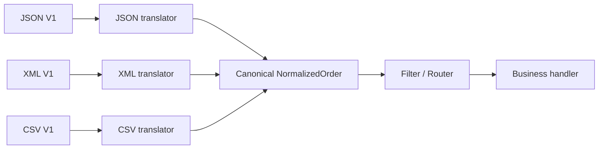
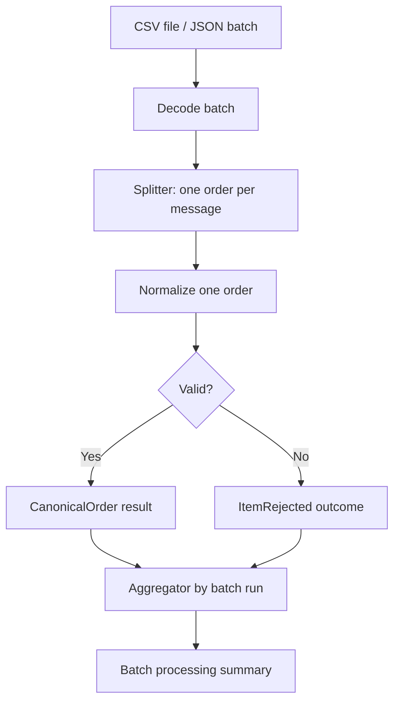
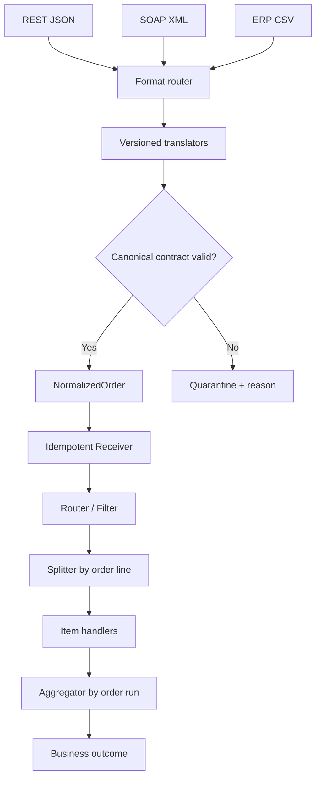

# Kiểm thử nhiều định dạng đầu vào

Một hệ thống tích hợp thường không có quyền yêu cầu mọi đối tác sử dụng cùng một định dạng. Đối tác A gửi **JSON**, hệ thống cũ gửi **XML**, nhà cung cấp khác xuất **CSV**; đôi khi một đối tác còn thay đổi phiên bản schema mà không thể triển khai đồng thời với tất cả consumer. Nếu mỗi nhánh nghiệp vụ tự hiểu định dạng của từng nguồn, Router, Filter, Aggregator và các handler sẽ nhanh chóng bị gắn chặt vào cấu trúc bên ngoài.

**Normalizer** là một Enterprise Integration Pattern (EIP) giải quyết vấn đề này: **định tuyến các biểu diễn đầu vào khác nhau tới những bộ chuyển đổi thích hợp, sau đó đưa tất cả về một mô hình thông điệp chuẩn (canonical model)**. Tuy nhiên, chỉ viết ba parser chưa chứng minh hệ thống hoạt động đúng. Cần kiểm thử rằng **ba biểu diễn cùng một sự kiện tạo ra cùng một ý nghĩa nghiệp vụ**, rằng dữ liệu sai bị từ chối có lý do, và rằng sự khác biệt về encoding, schema version, thứ tự bản ghi hoặc retry không gây sai kết quả.

Bài **“Kiểm thử nhiều định dạng đầu vào”** thuộc chương **Normalizer** của module `SPRING_INTEGRATION_PATTERN`. Phạm vi là học triển khai Enterprise Integration Patterns bằng Spring Integration để xây dựng luồng message ít phụ thuộc, dễ mở rộng; phối hợp Router, Filter, Transformer, Splitter, Aggregator, Gateway, retry, error channel, correlation, đồng thời kiểm thử và quan sát các nhánh xử lý.

**Mục tiêu học tập**

- Phân biệt **normalization** với parsing, schema validation, Transformer đơn lẻ, Splitter và Aggregator.
- Định nghĩa **canonical contract** cùng các bất biến để biết khi nào JSON/XML/CSV tương đương về nghiệp vụ.
- Thiết kế bộ **golden fixtures** và test độc lập từng adapter trước khi test Spring Integration flow.
- Viết ví dụ Java 17+ chuẩn hóa JSON/XML/CSV thành `NormalizedOrder`, có validation, giới hạn kích thước và phân loại lỗi.
- Kiểm thử trường hợp sai format, sai version, thiếu trường, trùng header, số vượt giới hạn, dữ liệu nhiều đơn trong CSV và XML không an toàn.
- Kiểm thử routing/channel, headers, correlation, idempotency, retry, concurrency, performance và schema evolution.
- Nhận biết những giới hạn của demo và lựa chọn integration/end-to-end test phù hợp môi trường production.

## 1. Vấn đề: một nghiệp vụ, ba biểu diễn dữ liệu

Giả sử hệ thống nhập đơn hàng từ ba nguồn:

```text
Partner A -> JSON order event
Partner B -> XML order document
Legacy ERP -> CSV export
```

Đầu ra mong muốn của Normalizer là **một dạng duy nhất**:

```text
NormalizedOrder(
  eventId=E-100,
  tenantId=T-1,
  orderId=O-100,
  currency=VND,
  lines=[
    {sku=A, quantity=2, unitPriceMinor=12500},
    {sku=B, quantity=1, unitPriceMinor=5000}
  ],
  totalMinor=30000
)
```

Từ đây, các bước phía sau chỉ cần xử lý `NormalizedOrder`:



Ba message raw có thể khác nhau về tên field, tag, CSV header và thứ tự dòng. Nhưng nếu biểu diễn **cùng một đơn với cùng ý nghĩa**, normalized result phải tuân theo cùng contract.

**Đối tượng kiểm thử quan trọng nhất không phải chuỗi JSON/XML/CSV đầu ra**, mà là **ý nghĩa của DTO chuẩn sau khi chuyển đổi**, cộng với metadata bắt buộc được bảo toàn.

## 2. Những điều Normalizer không tự giải quyết

| Thành phần | Chịu trách nhiệm chính | Quan hệ với Normalizer |
| --- | --- | --- |
| Parser/Deserializer | Đọc JSON/XML/CSV thành dữ liệu có cấu trúc. | Là một bước bên trong từng nhánh. |
| Schema Validator | Kiểm tra cấu trúc, kiểu, version và giới hạn. | Phải hoạt động trước hoặc trong translator tương ứng. |
| Transformer | Chuyển một biểu diễn thành biểu diễn khác. | Mỗi nhánh của Normalizer thường là một Transformer. |
| Router | Chọn nhánh theo format/source đã xác định. | Đưa dữ liệu tới đúng translator. |
| **Normalizer** | Hội tụ nhiều định dạng thành **một contract chuẩn**. | Là pattern phối hợp routing + translation. |
| Filter | Quyết định có cho message đi tiếp hay không. | Chạy sau khi có các trường canonical đáng tin cậy, hoặc trước khi đưa dữ liệu vào nếu kiểm tra boundary. |
| Splitter | Tách một file/batch thành nhiều message. | CSV có nhiều đơn có thể cần split trước hoặc sau normalize. |
| Aggregator | Gom những message thuộc cùng group. | Không tự thay normalization. |
| Content Enricher | Bổ sung dữ liệu thiếu từ nguồn khác. | Không nên dùng để che dữ liệu raw sai contract. |
| Idempotent Receiver | Ngăn xử lý lặp một sự kiện nghiệp vụ. | Dựa trên ID bền vững đã được xác minh. |

**Một message parse được không có nghĩa normalized đúng.** Ví dụ `amount=125.00` có thể là đồng, xu hoặc đơn vị nội bộ. Nếu translator đoán sai đơn vị, dữ liệu vẫn hợp lệ về kiểu nhưng sai nghiệp vụ.

## 3. Định nghĩa trước canonical contract và tính tương đương

Trước khi viết JUnit, cần định nghĩa **điều gì được coi là hai kết quả tương đương**.

Trong bài này, hợp đồng chuẩn:

- `eventId` xác định sự kiện do producer phát, dùng để liên kết retry/replay.
- `tenantId` là danh tính phạm vi nghiệp vụ; không tự là bằng chứng quyền khi chỉ lấy từ payload.
- `orderId` định danh đơn hàng.
- `currency` chỉ hỗ trợ `"VND"` trong ví dụ để tránh trộn đơn vị.
- `lines` là tập dòng có `sku`, `quantity > 0`, `unitPriceMinor >= 0`.
- `totalMinor` **được tính lại** từ quantity và unit price, không lấy theo một trường raw tùy ý.
- Thứ tự dòng **không có ý nghĩa nghiệp vụ trong contract của ví dụ**: canonical result được sắp theo `sku`.
- Một đơn không có `sku` trùng trong ví dụ. Nếu nghiệp vụ cho phép nhiều dòng cùng SKU với ưu đãi khác nhau, phải thay đổi contract và test.
- Một payload chỉ đại diện **một đơn**; file chứa nhiều đơn phải đi qua thiết kế batch/split riêng.

Bất biến tổng tiền:

\[
\text{totalMinor}=\sum_{i=1}^{n}
\text{quantity}_i\times \text{unitPriceMinor}_i
\]

Vì phép tính tiền dùng số nguyên ở đơn vị nhỏ nhất theo contract, test cần kiểm tra **overflow** thay vì im lặng tràn `long`.

### Tương đương theo ý nghĩa, không nhất thiết byte-for-byte

Hai JSON có thứ tự field khác nhau có thể tương đương. CSV có thứ tự dòng đảo ngược vẫn có thể tương đương nếu order of lines không quan trọng. XML có whitespace/indent khác vẫn có thể mang cùng dữ liệu.

Nhưng những khác biệt sau **không được tự coi là tương đương**:

- `currency=VND` so với `USD` dù số tiền giống nhau.
- Quantity là `2` so với `200`.
- Một giá nhập theo **minor units** so với giá nhập theo đơn vị chính mà không có quy tắc đổi rõ.
- `eventId` khác nhau nếu chúng đại diện **hai sự kiện hợp lệ riêng biệt**.
- Một dòng bị thiếu hoặc được nhân đôi.
- `tenantId` thuộc chủ thể khác.

**Bài test phải thể hiện rõ lựa chọn nghiệp vụ**, tránh tự động dùng `toString()` hoặc byte equality để kết luận chính xác.

## 4. Ba golden fixtures cho cùng một đơn hàng

### 4.1. JSON V1

```json
{
  "schemaVersion": 1,
  "eventId": "E-100",
  "tenantId": "T-1",
  "orderId": "O-100",
  "currency": "VND",
  "lines": [
    {"sku": "A", "quantity": 2, "unitMinor": 12500},
    {"sku": "B", "quantity": 1, "unitMinor": 5000}
  ]
}
```

### 4.2. XML V1

```xml
<order version="1"
       eventId="E-100"
       tenantId="T-1"
       orderId="O-100"
       currency="VND">
  <item sku="A" quantity="2" unitMinor="12500"/>
  <item sku="B" quantity="1" unitMinor="5000"/>
</order>
```

### 4.3. CSV V1

```csv
event_id,tenant_id,order_id,currency,sku,quantity,unit_minor
E-100,T-1,O-100,VND,A,2,12500
E-100,T-1,O-100,VND,B,1,5000
```

Trong hợp đồng CSV này, **mỗi dòng là một item thuộc cùng một đơn**. Tất cả các dòng phải có cùng `event_id`, `tenant_id`, `order_id` và `currency`. Nếu một file chứa hai đơn khác nhau, Normalizer **không được ghép nhầm** chúng thành một `NormalizedOrder`.

**Golden fixture** nên được lưu như test data có thể review, với output expected rõ. Ở bài học này ta biểu diễn trực tiếp trong Java test để minh họa; khi đưa vào dự án lớn có thể dùng tài nguyên test versioned.

## 5. Ma trận kiểm thử phải có cho ba định dạng

| Đặc tính | JSON | XML | CSV |
| --- | --- | --- | --- |
| Message hợp lệ | Đúng schema version/field. | Đúng element/attribute. | Đúng header và một đơn. |
| Field thiếu | Thiếu `eventId`, `lines`. | Thiếu `orderId`, `item`. | Thiếu cột hoặc giá trị. |
| Sai kiểu | `"quantity":"2"` thay integer. | Attribute quantity không parse được thành số. | Ô quantity không phải số. |
| Version | `schemaVersion=9`. | `version="9"`. | CSV format label/version không hỗ trợ. |
| Nhiều bản ghi | Array lines. | Nhiều `<item>`. | Nhiều hàng cùng đơn; file khác đơn bị reject. |
| Ký tự đặc biệt | Escaping JSON. | XML entities an toàn/encoding. | Dấu phẩy và quote trong field. |
| Security | Nested/oversized JSON. | XXE/DOCTYPE/entity expansion. | Formula injection khi xuất ra bảng tính; quá nhiều hàng. |
| Trùng | Duplicate JSON key/line. | Duplicate item/attribute tùy parser. | Duplicate header/row/item. |
| Giới hạn số | Số nguyên cực lớn. | Số vượt `long`/`int`. | Số vượt range, notation bất hợp lệ. |
| Metadata | `eventId` trong payload. | `eventId` trong attribute. | `event_id` ở mỗi row. |

Không cần viết ba bộ business tests hoàn toàn độc lập nếu đã có **shared invariant tests** trên canonical model. Nhưng parser của mỗi format phải có **format-specific tests** đủ mạnh vì cách sai dữ liệu khác nhau.

## 6. Xác định nguồn format trước khi parse

Một cách điển hình là adapter đưa vào một envelope:

```text
RawOrder {
  format = JSON_V1 | XML_V1 | CSV_V1
  body = bytes
  auditId = ingress identifier
}
```

`format` phải đến từ **transport contract hoặc metadata đã được xác minh**, không chỉ đoán theo chuỗi bắt đầu bằng `{` hoặc `<`. Nếu client được tự khai `Content-Type`, nó vẫn phải được **kiểm tra tương ứng bytes** và policy authorization.

Một `.csv` chứa JSON hoặc một HTTP request khai `application/xml` nhưng body là JSON phải bị xử lý theo **format mismatch** rõ, không âm thầm thử lần lượt mọi parser cho đến khi có một parser “chấp nhận”.

### Khi nào có thể sniff content?

Với file drop cũ không có metadata, một lớp phát hiện format có thể cần thiết. Khi đó test phải bao gồm **ambiguous input, BOM, whitespace, content-type sai và dữ liệu độc hại**. Sniff chỉ nên chọn nhánh parser; **không thay kiểm tra schema/semantic**.

Một khi đã chọn format/version, nên giữ `sourceFormat`/`schemaVersion` trong metadata quan sát thay vì làm thay đổi semantic identity của `NormalizedOrder`.

## 7. Java 17: mô hình raw và canonical

Ví dụ dưới đây chọn ba định dạng và một contract thống nhất. Mã dùng Java 17 records và kiểm tra defensive copy để tránh người gọi sửa byte array sau khi gửi.

```java
import java.util.List;
import java.util.Objects;

enum IncomingFormat {
    JSON_V1,
    XML_V1,
    CSV_V1
}

record RawOrder(
        IncomingFormat format,
        byte[] bytes,
        String auditId
) {
    RawOrder {
        Objects.requireNonNull(format, "format");
        Objects.requireNonNull(bytes, "bytes");
        bytes = bytes.clone();
    }

    @Override
    public byte[] bytes() {
        return bytes.clone();
    }
}

record NormalizedLine(
        String sku,
        int quantity,
        long unitPriceMinor
) {}

record NormalizedOrder(
        String eventId,
        String tenantId,
        String orderId,
        String currency,
        List<NormalizedLine> lines,
        long totalMinor
) {
    NormalizedOrder {
        lines = List.copyOf(lines);
    }
}

final class NormalizationFailure extends RuntimeException {
    private final String reasonCode;

    NormalizationFailure(String reasonCode) {
        super(reasonCode);
        this.reasonCode = reasonCode;
    }

    String reasonCode() {
        return reasonCode;
    }
}
```

**Lưu ý:** `RawOrder` chỉ là wrapper trong flow. Một hệ thống thật cần xác thực `tenantId`, kiểm tra size limit ở adapter **trước khi toàn bộ file được nạp vào RAM**, đồng thời tránh log raw payload. Record immutable ở cấp reference không có nghĩa **mọi nested object** đều bất biến; `List.copyOf` và `bytes.clone()` giúp hạn chế hai lỗi phổ biến trong ví dụ.

## 8. Xây dựng `OrderNormalizer`: chọn đúng translator

Một service có thể có entry point như sau:

```java
final class OrderNormalizer {
    private static final int MAX_BYTES = 64 * 1024;

    NormalizedOrder normalize(RawOrder input) {
        if (input.bytes().length == 0
                || input.bytes().length > MAX_BYTES) {
            throw new NormalizationFailure("BODY_SIZE_INVALID");
        }

        return switch (input.format()) {
            case JSON_V1 -> fromJson(input.bytes());
            case XML_V1  -> fromXml(input.bytes());
            case CSV_V1  -> fromCsv(input.bytes());
        };
    }

    // fromJson, fromXml, fromCsv và shared validation
    // được trình bày trong các mục tiếp theo.
}
```

Đoạn trên là **khung lớp** để định vị các phương thức ở các mục sau, chưa thể biên dịch độc lập nếu chưa bổ sung các method. Trong thực tế, có thể dùng `FormatRouter → JsonTranslator/XmlTranslator/CsvTranslator → canonicalChannel` thay vì switch trong một class.

**Mục tiêu của test:** Bất kể đi qua topology nào, `normalize(RawOrder)` phải tạo **cùng `NormalizedOrder`** cho ba fixture tương đương và **cùng mã lỗi chuẩn hóa** cho một loại vi phạm tương ứng.

### Không phụ thuộc thứ tự arrival

Nếu ba nguồn đến qua Kafka, AMQP hoặc executor, thứ tự xử lý có thể thay đổi. Normalizer nên là **hàm thuần về mặt nghiệp vụ**, không dựa vào một biến mutable ghi “format đang xử lý” hoặc “event trước đó” để quyết định cách parse message tiếp theo.

## 9. Adapter JSON: strict type trước khi map DTO

Với JSON, một nguy cơ phổ biến là Jackson hoặc một thư viện mapping **coerce** chuỗi thành số. Nếu contract yêu cầu `quantity` là JSON integer, `"2"` không được coi như `2` chỉ vì mapper chuyển đổi thành công.

Dưới đây là phần phương thức cho lớp `OrderNormalizer` ở mục 8, dùng `JsonNode` để kiểm tra shape trước khi tạo canonical line:

```java
// Các imports bổ sung cho OrderNormalizer:
import com.fasterxml.jackson.databind.JsonNode;
import com.fasterxml.jackson.databind.ObjectMapper;
import java.io.IOException;
import java.util.ArrayList;
import java.util.List;

private final ObjectMapper jsonMapper = new ObjectMapper();

private NormalizedOrder fromJson(byte[] bytes) {
    try {
        JsonNode root = jsonMapper.readTree(bytes);

        if (root == null || !root.isObject()) {
            throw new NormalizationFailure("JSON_ROOT_INVALID");
        }

        JsonNode version = root.path("schemaVersion");
        if (!version.isIntegralNumber()
                || version.intValue() != 1) {
            throw new NormalizationFailure("UNSUPPORTED_VERSION");
        }

        String eventId = requiredText(root, "eventId");
        String tenantId = requiredText(root, "tenantId");
        String orderId = requiredText(root, "orderId");
        String currency = requiredText(root, "currency");

        JsonNode lines = root.path("lines");
        if (!lines.isArray()
                || lines.isEmpty()
                || lines.size() > 100) {
            throw new NormalizationFailure("LINES_INVALID");
        }

        List<NormalizedLine> canonicalLines = new ArrayList<>();
        for (JsonNode line : lines) {
            if (!line.isObject()) {
                throw new NormalizationFailure("LINE_NOT_OBJECT");
            }

            JsonNode qty = line.path("quantity");
            JsonNode unit = line.path("unitMinor");
            if (!qty.isIntegralNumber()
                    || !qty.canConvertToInt()
                    || !unit.isIntegralNumber()
                    || !unit.canConvertToLong()) {
                throw new NormalizationFailure("NUMERIC_TYPE_INVALID");
            }

            canonicalLines.add(new NormalizedLine(
                    requiredText(line, "sku"),
                    qty.intValue(),
                    unit.longValue()));
        }

        return assemble(eventId, tenantId, orderId,
                currency, canonicalLines);

    } catch (IOException ex) {
        throw new NormalizationFailure("JSON_PARSE_FAILED");
    }
}

private static String requiredText(
        JsonNode root, String field) {
    JsonNode value = root.path(field);
    if (!value.isTextual()
            || value.textValue().isBlank()
            || value.textValue().length() > 128) {
        throw new NormalizationFailure(
                "REQUIRED_TEXT_INVALID");
    }
    return value.textValue();
}
```

`requiredText`, `assemble` và `NormalizationFailure` là helper/kiểu trong ví dụ. Đây là **một parser minh họa các field thiết yếu**, không phải implementation đầy đủ của JSON Schema Draft 2020-12: nó chưa xử lý toàn bộ unknown fields, duplicate JSON keys, trailing tokens và giới hạn nesting.

### Test đặc thù cho JSON

- `quantity` là integer `2` → chấp nhận.
- `quantity` là string `"2"` → reject `NUMERIC_TYPE_INVALID`.
- `quantity=2.0` → reject nếu contract yêu cầu integer JSON.
- `unitMinor` vượt phạm vi `long` → reject, không truncate.
- Thiếu `eventId` → reject, không tạo ID mới thay producer.
- Root `[]` hoặc `null` → reject.
- Duplicate key quan trọng → parser phải được cấu hình strict hoặc có policy rõ.
- JSON có trailing tokens → không âm thầm chấp nhận document đầu nếu policy không cho phép.
- JSON quá sâu/quá lớn → chặn bằng parser/ingress limits.

**Trong production**, hãy cấu hình Jackson `StreamReadConstraints`, duplicate-key detection và chính sách coercion/unknown field phù hợp. Test phải bao gồm cả byte encoding và không chỉ test `JsonNode` đã được dựng sẵn.

## 10. Adapter XML: bảo toàn nghĩa, đồng thời chống XXE

XML có attribute, element, namespace, entity và whitespace. Nếu XML parser được cấu hình thiếu an toàn, dữ liệu từ đối tác có thể chứa DTD/external entity và gây **XXE/SSRF/file disclosure hoặc entity expansion**.

Một adapter nội bộ theo contract ở mục 4 có thể đọc các attribute của `<order>` và `<item>`:

```java
// Imports bổ sung:
import java.io.ByteArrayInputStream;
import javax.xml.XMLConstants;
import javax.xml.parsers.DocumentBuilderFactory;
import org.w3c.dom.Document;
import org.w3c.dom.Element;
import org.w3c.dom.Node;
import org.w3c.dom.NodeList;

private NormalizedOrder fromXml(byte[] bytes) {
    try {
        DocumentBuilderFactory factory =
                DocumentBuilderFactory.newInstance();

        factory.setFeature(
                XMLConstants.FEATURE_SECURE_PROCESSING, true);
        factory.setFeature(
                "http://apache.org/xml/features/disallow-doctype-decl",
                true);
        factory.setFeature(
                "http://xml.org/sax/features/external-general-entities",
                false);
        factory.setFeature(
                "http://xml.org/sax/features/external-parameter-entities",
                false);
        factory.setFeature(
                "http://apache.org/xml/features/nonvalidating/load-external-dtd",
                false);

        factory.setXIncludeAware(false);
        factory.setExpandEntityReferences(false);
        factory.setAttribute(
                XMLConstants.ACCESS_EXTERNAL_DTD, "");
        factory.setAttribute(
                XMLConstants.ACCESS_EXTERNAL_SCHEMA, "");

        Document document = factory.newDocumentBuilder()
                .parse(new ByteArrayInputStream(bytes));
        Element root = document.getDocumentElement();

        if (!"order".equals(root.getTagName())) {
            throw new NormalizationFailure(
                    "XML_ROOT_INVALID");
        }
        if (!"1".equals(root.getAttribute("version"))) {
            throw new NormalizationFailure(
                    "UNSUPPORTED_VERSION");
        }

        List<NormalizedLine> lines = new java.util.ArrayList<>();
        NodeList children = root.getChildNodes();
        for (int i = 0; i < children.getLength(); i++) {
            Node child = children.item(i);
            if (child instanceof Element item) {
                if (!"item".equals(item.getTagName())) {
                    throw new NormalizationFailure(
                            "UNKNOWN_XML_ELEMENT");
                }
                lines.add(new NormalizedLine(
                        item.getAttribute("sku"),
                        parseInt(item.getAttribute("quantity")),
                        parseLong(item.getAttribute("unitMinor"))));
            }
        }

        return assemble(
                root.getAttribute("eventId"),
                root.getAttribute("tenantId"),
                root.getAttribute("orderId"),
                root.getAttribute("currency"),
                lines);

    } catch (NormalizationFailure ex) {
        throw ex;
    } catch (Exception ex) {
        // Includes parser configuration/parse failures;
        // fail closed if secure XML settings are unsupported.
        throw new NormalizationFailure("XML_PARSE_FAILED");
    }
}
```

**Phạm vi:** ví dụ dùng `DocumentBuilderFactory` và XML **không namespace** theo contract của mục 4. Nếu đối tác có namespace, XSD, mixed content hoặc một encoding cụ thể, cần parser/validator và tests tương ứng. XML chỉ có tag/attribute “trông đúng” chưa chắc thỏa toàn bộ XSD.

### Test bảo mật bắt buộc

```xml
<!DOCTYPE order [
  <!ENTITY secret SYSTEM "file:///etc/passwd">
]>
<order version="1" eventId="E-X"
       tenantId="T-1" orderId="O-X" currency="VND">
  <item sku="&secret;" quantity="1" unitMinor="1"/>
</order>
```

Input chứa DOCTYPE trên **phải bị reject** bởi cấu hình parser. Tuyệt đối không dựa vào việc trong máy test có hay không file được nêu, không log nội dung entity và không cho XML parser truy cập mạng/filesystem tùy ý.

Cần thêm test:

- Thiếu `orderId` hoặc `version`.
- XML sai well-formedness.
- XML có namespace không được contract hỗ trợ.
- XML có `<item>` lồng sai vị trí.
- XML chứa BOM/encoding khác; chấp nhận hoặc từ chối theo contract.
- XML có attribute quantity vượt range.
- XML có số lượng item vượt giới hạn.
- DTD/entity expansion bị chặn.
- Whitespace giữa các element không làm thay đổi canonical order.

## 11. Adapter CSV: một file có nhiều dòng nhưng vẫn một đơn

CSV đặc biệt nguy hiểm khi đọc bằng:

```java
String[] fields = line.split(",");
```

Mã này sẽ **sai** nếu SKU chứa dấu phẩy hoặc dấu quote hợp lệ, chẳng hạn `"SKU,A"`. Nên dùng parser hỗ trợ quoting/escaping theo RFC 4180 hoặc contract CSV cụ thể.

Ví dụ với **Apache Commons CSV**, cùng lớp `OrderNormalizer`:

```java
// Imports bổ sung:
import java.io.InputStreamReader;
import java.nio.charset.StandardCharsets;
import org.apache.commons.csv.CSVFormat;
import org.apache.commons.csv.CSVParser;
import org.apache.commons.csv.CSVRecord;

private NormalizedOrder fromCsv(byte[] bytes) {
    try (var reader = new InputStreamReader(
            new ByteArrayInputStream(bytes),
            StandardCharsets.UTF_8);
         CSVParser parser = CSVFormat.RFC4180.builder()
                 .setHeader()
                 .setSkipHeaderRecord(true)
                 .build()
                 .parse(reader)) {

        List<String> expectedHeaders = List.of(
                "event_id", "tenant_id", "order_id",
                "currency", "sku", "quantity", "unit_minor");

        if (!parser.getHeaderNames().equals(expectedHeaders)) {
            throw new NormalizationFailure(
                    "CSV_HEADER_INVALID");
        }

        String eventId = null;
        String tenantId = null;
        String orderId = null;
        String currency = null;
        List<NormalizedLine> lines = new java.util.ArrayList<>();

        for (CSVRecord row : parser) {
            if (!row.isConsistent() || lines.size() >= 100) {
                throw new NormalizationFailure(
                        "CSV_ROW_INVALID");
            }

            String currentEvent = row.get("event_id");
            String currentTenant = row.get("tenant_id");
            String currentOrder = row.get("order_id");
            String currentCurrency = row.get("currency");

            if (eventId == null) {
                eventId = currentEvent;
                tenantId = currentTenant;
                orderId = currentOrder;
                currency = currentCurrency;
            } else if (!eventId.equals(currentEvent)
                    || !tenantId.equals(currentTenant)
                    || !orderId.equals(currentOrder)
                    || !currency.equals(currentCurrency)) {
                throw new NormalizationFailure(
                        "CSV_MIXED_ORDERS");
            }

            lines.add(new NormalizedLine(
                    row.get("sku"),
                    parseInt(row.get("quantity")),
                    parseLong(row.get("unit_minor"))));
        }

        return assemble(eventId, tenantId, orderId,
                currency, lines);

    } catch (NormalizationFailure ex) {
        throw ex;
    } catch (Exception ex) {
        throw new NormalizationFailure("CSV_PARSE_FAILED");
    }
}
```

`CSVFormat.RFC4180` là một lựa chọn **về cú pháp**; nhiều hệ thống legacy dùng delimiter `;`, BOM, encoding khác, thừa dòng trắng hoặc header localized. Không âm thầm đổi quy tắc giữa các đối tác. Trong code thực, dùng builder/API tương thích với version Apache Commons CSV của dự án.

### Điều cần thống nhất cho CSV

- Có đúng một dòng header, tên/thứ tự cột thế nào?
- Có cho BOM UTF-8 hoặc encoding khác không?
- Giá trị trống khác với missing column thế nào?
- Quoting kiểu `""` có được hỗ trợ không?
- File có cho nhiều order khác nhau không?
- Có cho duplicate SKU trong cùng order không?
- Có bỏ dòng blank hay coi là vi phạm?
- Có giới hạn số rows và số bytes không?

**Ví dụ cố ý reject CSV chứa nhiều đơn**, vì hàm trả về **một** `NormalizedOrder`. Nếu hệ thống cần nhiều đơn trong một file, hãy đổi contract thành `List<NormalizedOrder>` hoặc tách batch bằng Splitter, kiểm soát correlation/sequence và lỗi partial. Không để `fromCsv` lặng lẽ lấy đơn đầu bỏ phần còn lại.

## 12. Shared validation: chặn sai nghĩa nghiệp vụ ngay sau parse

Ba parser đều gọi một hàm `assemble(...)` để áp cùng các bất biến:

```java
// Các method bổ sung vào OrderNormalizer:

private static int parseInt(String value) {
    try {
        return Integer.parseInt(value);
    } catch (NumberFormatException ex) {
        throw new NormalizationFailure(
                "NUMERIC_VALUE_INVALID");
    }
}

private static long parseLong(String value) {
    try {
        return Long.parseLong(value);
    } catch (NumberFormatException ex) {
        throw new NormalizationFailure(
                "NUMERIC_VALUE_INVALID");
    }
}

private static NormalizedOrder assemble(
        String eventId,
        String tenantId,
        String orderId,
        String currency,
        List<NormalizedLine> lines) {

    requireIdentifier(eventId);
    requireIdentifier(tenantId);
    requireIdentifier(orderId);

    if (!"VND".equals(currency)) {
        throw new NormalizationFailure(
                "UNSUPPORTED_CURRENCY");
    }
    if (lines == null || lines.isEmpty()
            || lines.size() > 100) {
        throw new NormalizationFailure("LINES_INVALID");
    }

    long total = 0;
    java.util.Set<String> seenSku =
            new java.util.HashSet<>();

    try {
        for (NormalizedLine line : lines) {
            requireIdentifier(line.sku());

            if (!seenSku.add(line.sku())) {
                throw new NormalizationFailure(
                        "DUPLICATE_SKU");
            }
            if (line.quantity() <= 0
                    || line.unitPriceMinor() < 0) {
                throw new NormalizationFailure(
                        "INVALID_LINE_VALUES");
            }

            long lineTotal = Math.multiplyExact(
                    line.quantity(), line.unitPriceMinor());
            total = Math.addExact(total, lineTotal);
        }
    } catch (ArithmeticException ex) {
        throw new NormalizationFailure("MONEY_OVERFLOW");
    }

    List<NormalizedLine> sorted =
            new java.util.ArrayList<>(lines);
    sorted.sort(java.util.Comparator.comparing(
            NormalizedLine::sku));

    return new NormalizedOrder(
            eventId, tenantId, orderId,
            currency, sorted, total);
}

private static void requireIdentifier(String value) {
    if (value == null || value.isBlank()
            || value.length() > 128) {
        throw new NormalizationFailure(
                "IDENTIFIER_INVALID");
    }
}
```

**Vì sao test shared validation quan trọng?** Nếu JSON branch chặn `quantity=0` nhưng CSV branch cho phép, output chuẩn không còn thực sự chuẩn. Shared assembler bảo đảm invariant bất kể nguồn dữ liệu.

### Những điều ví dụ không tự xử lý

- Không tự cấp quyền cho `tenantId`. Ở ingress, tenant phải được đối chiếu với **trusted authentication context**.
- Không hỗ trợ nhiều currency hoặc phép đổi tỷ giá. Tiền là **long minor units theo contract ví dụ**, không dùng số float.
- Không định nghĩa unicode normalization, case-folding, trim hoặc SKU aliasing; cần business policy trước khi thực hiện.
- Không chứng minh schema đầy đủ của JSON/XML/CSV; demo mới kiểm tra các field chính.
- Không có business lookup như “SKU này có tồn tại trong catalog hay không”.
- Không có kiểm soát dedup/retry/store side effects; đó là các bước tiếp theo của flow.

## 13. Bộ unit test quan trọng nhất: cùng ý nghĩa, cùng canonical model

Nếu phải chọn **một test thể hiện bản chất của Normalizer**, đó là: ba nguồn khác nhau cùng biểu diễn một đơn phải tạo **`NormalizedOrder` bằng nhau**.

```java
import static org.junit.jupiter.api.Assertions.assertEquals;

import java.nio.charset.StandardCharsets;
import org.junit.jupiter.api.Test;

class OrderNormalizerEquivalenceTest {

    private final OrderNormalizer normalizer =
            new OrderNormalizer();

    private RawOrder raw(IncomingFormat format, String body) {
        return new RawOrder(
                format,
                body.getBytes(StandardCharsets.UTF_8),
                "audit-test");
    }

    @Test
    void jsonXmlAndCsvProduceTheSameCanonicalOrder() {
        NormalizedOrder fromJson = normalizer.normalize(
                raw(IncomingFormat.JSON_V1, """
                  {
                    "schemaVersion": 1,
                    "eventId": "E-100",
                    "tenantId": "T-1",
                    "orderId": "O-100",
                    "currency": "VND",
                    "lines": [
                      {"sku": "B", "quantity": 1, "unitMinor": 5000},
                      {"sku": "A", "quantity": 2, "unitMinor": 12500}
                    ]
                  }
                  """));

        NormalizedOrder fromXml = normalizer.normalize(
                raw(IncomingFormat.XML_V1, """
                  <order version="1" eventId="E-100"
                         tenantId="T-1" orderId="O-100"
                         currency="VND">
                    <item sku="A" quantity="2" unitMinor="12500"/>
                    <item sku="B" quantity="1" unitMinor="5000"/>
                  </order>
                  """));

        NormalizedOrder fromCsv = normalizer.normalize(
                raw(IncomingFormat.CSV_V1, """
                  event_id,tenant_id,order_id,currency,sku,quantity,unit_minor
                  E-100,T-1,O-100,VND,A,2,12500
                  E-100,T-1,O-100,VND,B,1,5000
                  """));

        assertEquals(fromJson, fromXml);
        assertEquals(fromJson, fromCsv);
        assertEquals(30_000L, fromJson.totalMinor());
        assertEquals("A", fromJson.lines().get(0).sku());
        assertEquals("B", fromJson.lines().get(1).sku());
    }
}
```

**Lưu ý:** `NormalizedOrder` là Java record với `List<NormalizedLine>`, nên `assertEquals` so sánh các field theo `equals`, không phải địa chỉ object. Test có **đảo thứ tự lines của JSON** để chứng minh contract của ví dụ không phụ thuộc arrival/row order.

### Không nên so sánh bằng serialization output

Nếu test so JSON được serialize từ DTO, thứ tự field và cấu hình mapper có thể khiến test fail dù dữ liệu nghiệp vụ tương đương. Với Normalizer, nên assert **semantic fields và invariants**. Serialization output nên có contract test **riêng** cho outbound boundary.

## 14. Kiểm thử riêng từng định dạng và mã lỗi

Một Normalizer thực tế cần thông báo lỗi ổn định. Một bài test chỉ gọi `assertThrows(Exception.class)` không cho biết branch đã từ chối đúng lý do hay không.

```java
import static org.junit.jupiter.api.Assertions.*;

import org.junit.jupiter.api.Test;

class OrderNormalizerInvalidTest {

    private final OrderNormalizer normalizer =
            new OrderNormalizer();

    private static RawOrder raw(
            IncomingFormat format, String body) {
        return new RawOrder(format,
                body.getBytes(java.nio.charset.StandardCharsets.UTF_8),
                "audit-invalid");
    }

    private void rejects(
            IncomingFormat format, String body,
            String expectedReason) {

        NormalizationFailure failure = assertThrows(
                NormalizationFailure.class,
                () -> normalizer.normalize(raw(format, body)));

        assertEquals(expectedReason, failure.reasonCode());
    }

    @Test
    void jsonStringQuantityIsNotAnInteger() {
        rejects(IncomingFormat.JSON_V1, """
          {
            "schemaVersion": 1, "eventId": "E-200",
            "tenantId": "T-1", "orderId": "O-200",
            "currency": "VND",
            "lines": [
              {"sku": "A", "quantity": "2", "unitMinor": 12500}
            ]
          }
          """, "NUMERIC_TYPE_INVALID");
    }

    @Test
    void unsupportedXmlVersionIsRejected() {
        rejects(IncomingFormat.XML_V1, """
          <order version="9" eventId="E-200"
                 tenantId="T-1" orderId="O-200"
                 currency="VND">
            <item sku="A" quantity="2" unitMinor="12500"/>
          </order>
          """, "UNSUPPORTED_VERSION");
    }

    @Test
    void csvMustContainOnlyOneOrder() {
        rejects(IncomingFormat.CSV_V1, """
          event_id,tenant_id,order_id,currency,sku,quantity,unit_minor
          E-200,T-1,O-200,VND,A,2,12500
          E-201,T-1,O-201,VND,B,1,5000
          """, "CSV_MIXED_ORDERS");
    }

    @Test
    void malformedJsonIsRejected() {
        rejects(IncomingFormat.JSON_V1,
                "{\"schemaVersion\":1,",
                "JSON_PARSE_FAILED");
    }
}
```

### Lỗi từ cùng nguyên nhân có thể có mã khác nhau ở tầng parser

Ví dụ JSON có `"quantity":"2"` có thể là `NUMERIC_TYPE_INVALID`; XML có `quantity="two"` có thể thành `NUMERIC_VALUE_INVALID`. Tùy thiết kế, boundary có thể ánh xạ cả hai về mã business-level `INVALID_QUANTITY` và giữ **parser reason** làm thuộc tính phụ cho vận hành.

**Điều cốt lõi:** chuẩn hóa contract lỗi có chủ đích, không gửi raw exception/library text ra một API công khai.

## 15. Test CSV quoting, ký tự đặc biệt và file nhiều bản ghi

CSV tuân RFC 4180 cho phép dấu phẩy nằm trong field có quote:

```csv
event_id,tenant_id,order_id,currency,sku,quantity,unit_minor
E-300,T-1,O-300,VND,"SKU,A",2,1000
```

Nếu dùng `.split(",")`, một dòng trên sẽ bị hiểu sai số cột.

Test nên kiểm tra:

```java
@Test
void csvQuotedCommaDoesNotSplitSkuIntoColumns() {
    NormalizedOrder result = normalizer.normalize(
            raw(IncomingFormat.CSV_V1, """
              event_id,tenant_id,order_id,currency,sku,quantity,unit_minor
              E-300,T-1,O-300,VND,"SKU,A",2,1000
              """));

    assertEquals("SKU,A", result.lines().get(0).sku());
    assertEquals(2_000L, result.totalMinor());
}
```

Trong ví dụ test này, `raw(...)` là helper từ test class ở mục 13; khi viết test file thật, cần đặt test trong class có helper tương ứng.

Các case bổ sung:

| Dữ liệu CSV | Điều cần assert |
| --- | --- |
| Field SKU chứa dấu phẩy | Parser giữ nguyên một field, không tách nhầm. |
| SKU chứa dấu quote được escape `""` | Đọc đúng chuỗi. |
| Có CRLF thay LF | Hoạt động theo CSV dialect đã chọn. |
| Duplicate header `sku` | Reject hoặc xử lý rõ theo contract, không chọn cột ngẫu nhiên. |
| Một dòng thiếu cột | Reject `CSV_ROW_INVALID`. |
| Dòng trống cuối file | Chấp nhận hoặc reject theo CSV dialect được công bố. |
| Không có header | Reject `CSV_HEADER_INVALID`. |
| 101 items khi giới hạn 100 | Reject trước khi tích lũy vô hạn. |
| Hai event IDs trong một file | Reject `CSV_MIXED_ORDERS` hoặc chuyển qua batch/Splitter đã được thiết kế. |
| UTF-8 BOM | Có chính sách rõ; test byte input thật. |
| Giá vượt `long` | Reject `NUMERIC_VALUE_INVALID`. |
| Field bắt đầu `=`, `+`, `-`, `@` khi xuất sang spreadsheet | Đánh giá **formula injection** ở bước export; không ngầm thực thi hay bỏ ký tự trong canonical identity. |

**Formula injection** chủ yếu là vấn đề khi ứng dụng **xuất dữ liệu sang phần mềm bảng tính** hoặc UI khác diễn giải field như công thức. Parser CSV nhập không tự thực thi công thức, nhưng outbound layer cần escape/quote phù hợp môi trường đích.

## 16. Test XML an toàn và đúng schema

Một test của Normalizer XML phải **không chạm filesystem/network** dù payload độc hại chứa external entity. Ta kiểm tra rằng input có DOCTYPE bị từ chối:

```java
@Test
void xmlDoctypeCannotExpandExternalEntity() {
    String xml = """
      <!DOCTYPE order [
        <!ENTITY unsafe SYSTEM "file:///etc/passwd">
      ]>
      <order version="1" eventId="E-X"
             tenantId="T-1" orderId="O-X" currency="VND">
        <item sku="&unsafe;" quantity="1" unitMinor="100"/>
      </order>
      """;

    NormalizationFailure failure = assertThrows(
            NormalizationFailure.class,
            () -> normalizer.normalize(
                    raw(IncomingFormat.XML_V1, xml)));

    assertEquals("XML_PARSE_FAILED", failure.reasonCode());
}
```

Ngoài test XXE, cần kiểm tra **namespace contract**, sai root tag, nested element lạ, empty attribute, số item quá nhiều và integer overflow.

**Lưu ý khác biệt:** XML element/attribute có thể được schema XSD xác định chi tiết. Một DOM parser lấy `getAttribute("eventId")` **không tự validate XSD**. Khi production yêu cầu XSD, chọn validator phù hợp, khóa external schema resolution và test đúng phiên bản XSD.

### Cẩn trọng với encoding

XML có thể khai báo encoding trong prolog, trong khi file CSV/JSON thường theo contract riêng. Nếu cần hỗ trợ Windows-1258, UTF-16 hay BOM, hãy test **bytes thật**, không chỉ Java `String`. Với `InputStreamReader(... UTF_8)` ở ví dụ CSV, byte không hợp lệ có thể bị thay bằng ký tự replacement tùy decoder; production nên chọn `CodingErrorAction.REPORT` khi yêu cầu UTF-8 nghiêm ngặt.

## 17. Shared invariant tests: dữ liệu chuẩn phải luôn đúng

Không nên chỉ test rằng output không `null`. `NormalizedOrder` phải tuân theo các bất biến:

| Invariant | Assertion |
| --- | --- |
| ID không blank | `eventId`, `tenantId`, `orderId` có giá trị hợp lệ. |
| Currency đúng contract | Chỉ `VND` trong demo. |
| Lines không rỗng | `1 <= lines.size() <= 100`. |
| Quantity hợp lệ | Mọi dòng `quantity > 0`. |
| Unit minor hợp lệ | `unitPriceMinor >= 0`. |
| Không trùng SKU | Mỗi SKU chỉ xuất hiện một lần theo contract ví dụ. |
| Order ổn định | Lines được sắp theo SKU. |
| Total đúng | `sum(quantity * unitPriceMinor)` không overflow. |
| Nguồn format không lộ vào business identity | Semantic DTO không thay đổi chỉ vì JSON/XML/CSV. |

Có thể trích một helper test:

```java
static void assertCanonicalInvariants(
        NormalizedOrder order) {

    assertNotNull(order);
    assertFalse(order.eventId().isBlank());
    assertFalse(order.orderId().isBlank());
    assertFalse(order.tenantId().isBlank());
    assertEquals("VND", order.currency());
    assertFalse(order.lines().isEmpty());

    long recomputed = 0;
    String previousSku = null;

    for (NormalizedLine line : order.lines()) {
        assertTrue(line.quantity() > 0);
        assertTrue(line.unitPriceMinor() >= 0);

        if (previousSku != null) {
            assertTrue(previousSku.compareTo(line.sku()) < 0);
        }
        previousSku = line.sku();

        recomputed = Math.addExact(recomputed,
                Math.multiplyExact(line.quantity(),
                        line.unitPriceMinor()));
    }
    assertEquals(recomputed, order.totalMinor());
}
```

Điều kiện `previousSku.compareTo(...) < 0` chỉ đúng vì ví dụ **cấm duplicate SKU và sort theo SKU**. Nếu business cần giữ thứ tự dòng để tính khuyến mại hoặc số thứ tự hóa đơn, phải thay invariant/test và không tự sort.

## 18. Tích hợp Spring Integration: một điểm nhập, một kiểu output

Ở môi trường thật có thể dùng `Router` đưa message JSON/XML/CSV tới từng `Transformer`. Để bài học tập trung vào **kiểm thử nhiều định dạng**, ta bắt đầu với một Spring Integration flow nhận `RawOrder`, gọi `OrderNormalizer` và phát **một kiểu canonical duy nhất**.

```java
import org.springframework.context.annotation.Bean;
import org.springframework.context.annotation.Configuration;
import org.springframework.integration.channel.DirectChannel;
import org.springframework.integration.channel.QueueChannel;
import org.springframework.integration.config.EnableIntegration;
import org.springframework.integration.dsl.IntegrationFlow;

@Configuration
@EnableIntegration
class NormalizerFlowConfig {

    @Bean
    OrderNormalizer orderNormalizer() {
        return new OrderNormalizer();
    }

    @Bean
    DirectChannel rawOrders() {
        return new DirectChannel();
    }

    @Bean
    QueueChannel canonicalOrders() {
        return new QueueChannel();
    }

    @Bean
    IntegrationFlow normalizeOrders(OrderNormalizer normalizer) {
        return IntegrationFlow.from("rawOrders")
                .handle(RawOrder.class,
                        (payload, headers) ->
                                normalizer.normalize(payload))
                .channel("canonicalOrders")
                .get();
    }
}
```

Cấu hình trên cố ý dùng `DirectChannel` đồng bộ để test đơn giản và `QueueChannel` để quan sát output. **`QueueChannel` mặc định trong ví dụ không phải durable broker**, và việc `handle(...)` trả `NormalizedOrder` không tự ghi business DB.

### Cách tách Router + Transformer khi tăng số format

Một topology khác:

```text
rawOrders
  |
  +-- format=JSON_V1 --> jsonInput --> JsonTranslator --+
  +-- format=XML_V1  --> xmlInput  --> XmlTranslator  ---+--> canonicalOrders
  +-- format=CSV_V1  --> csvInput  --> CsvTranslator  --+
```

Các nhánh khác nhau có thể dùng:

```java
// Phác thảo Java DSL, không đăng ký cùng với flow mục 18
// trên cùng rawOrders khi chưa thay thế topology:
// .route(RawOrder.class, r -> r.format().name(),
//        m -> m.channelMapping("JSON_V1", "jsonInput")
//              .channelMapping("XML_V1", "xmlInput")
//              .channelMapping("CSV_V1", "csvInput"))
```

Router cần có **fallback/rejection** cho format chưa hỗ trợ; nếu upstream thêm `AVRO_V2`, không được route nhầm vào JSON branch. Test phải kiểm tra một message chỉ đi **một đúng translator** và output không bị lặp.

**Normalizer EIP là một cấu trúc điều phối**, không bắt buộc phải được cài đặt bằng một class có tên `Normalizer`. Cốt lõi là contract canonical và khả năng thay đổi input adapter mà không sửa business handlers.

## 19. Integration test: ba đường vào đều phát cùng canonical type

Ta kiểm thử chính Spring Integration endpoint, không chỉ gọi Java method.

```java
import static org.junit.jupiter.api.Assertions.*;

import java.nio.charset.StandardCharsets;
import org.junit.jupiter.api.Test;
import org.springframework.beans.factory.annotation.Autowired;
import org.springframework.beans.factory.annotation.Qualifier;
import org.springframework.integration.channel.QueueChannel;
import org.springframework.messaging.Message;
import org.springframework.messaging.MessageChannel;
import org.springframework.messaging.support.MessageBuilder;
import org.springframework.test.annotation.DirtiesContext;
import org.springframework.test.context.junit.jupiter.SpringJUnitConfig;

@SpringJUnitConfig(NormalizerFlowConfig.class)
@DirtiesContext(classMode = DirtiesContext.ClassMode.AFTER_EACH_TEST_METHOD)
class NormalizerFlowTest {

    @Autowired @Qualifier("rawOrders")
    MessageChannel input;

    @Autowired @Qualifier("canonicalOrders")
    QueueChannel output;

    private NormalizedOrder sendAndReceive(
            IncomingFormat format, String content) {

        RawOrder raw = new RawOrder(
                format,
                content.getBytes(StandardCharsets.UTF_8),
                "audit-integration");

        assertTrue(input.send(
                MessageBuilder.withPayload(raw).build()));

        Message<?> reply = output.receive(1_000);
        assertNotNull(reply);
        assertTrue(reply.getPayload() instanceof NormalizedOrder);

        return (NormalizedOrder) reply.getPayload();
    }

    @Test
    void eachFormatReachesCanonicalChannel() {
        NormalizedOrder json = sendAndReceive(
                IncomingFormat.JSON_V1, """
                  {"schemaVersion":1,"eventId":"E-101",
                   "tenantId":"T-1","orderId":"O-101",
                   "currency":"VND","lines":[
                     {"sku":"A","quantity":2,"unitMinor":12500}]}
                  """);

        NormalizedOrder xml = sendAndReceive(
                IncomingFormat.XML_V1, """
                  <order version="1" eventId="E-101"
                         tenantId="T-1" orderId="O-101"
                         currency="VND">
                    <item sku="A" quantity="2" unitMinor="12500"/>
                  </order>
                  """);

        NormalizedOrder csv = sendAndReceive(
                IncomingFormat.CSV_V1, """
                  event_id,tenant_id,order_id,currency,sku,quantity,unit_minor
                  E-101,T-1,O-101,VND,A,2,12500
                  """);

        assertEquals(json, xml);
        assertEquals(json, csv);
        assertEquals(25_000L, json.totalMinor());
        assertNull(output.receive(0));
    }
}
```

`@DirtiesContext` cô lập queue/context trong các test. Khi flow dùng `ExecutorChannel`, broker hoặc poller, cần bounded waits và có thể không được giả định output xuất hiện ngay sau `send`.

**Cần phân biệt hai tình huống:** Test dùng ba input khác format **cùng `eventId`** để so semantic equivalence. Trong production, nếu ba message cùng `eventId` đến thật, Idempotent Receiver có thể phải coi những bản đó là **duplicate delivery**; không nên ghi business side effect ba lần.

## 20. Kiểm thử failure path của IntegrationFlow

Với flow đồng bộ sử dụng `DirectChannel`, `NormalizationFailure` phát sinh trong `.handle(...)` có thể bị bọc trong `MessageHandlingException` hoặc lan theo cấu hình endpoint. Khi test, **không nên mặc định caller sẽ nhận trực tiếp cùng exception class** nếu framework có lớp wrapper.

Một test nên kiểm tra:

1. `rawOrders` nhận message invalid.
2. Không có `NormalizedOrder` sai đi vào `canonicalOrders`.
3. Exception/error được phân loại thành **mã lỗi ổn định**, ví dụ `CSV_MIXED_ORDERS`.
4. Error/rejection được quan sát bằng channel, HTTP error mapper hoặc quarantine handler đúng theo topology.
5. Không có business side effect nếu normalization thất bại.

### Một phương án tránh mất dữ liệu khi invalid

Thay vì để mọi lỗi đi chung exception path, service có thể trả:

```java
sealed interface NormalizeOutcome
        permits NormalizeAccepted, NormalizeRejected {}

record NormalizeAccepted(
        NormalizedOrder order) implements NormalizeOutcome {}

record NormalizeRejected(
        String auditId,
        String format,
        String reasonCode) implements NormalizeOutcome {}
```

Flow tiếp theo dùng Router:

```text
RawOrder -> normalize
             |
             +-- NormalizeAccepted -> canonical business flow
             |
             +-- NormalizeRejected -> quarantine/audit/error reply
```

Đây là **mô hình thiết kế**, không phải implementation đầy đủ ở cấu hình mục 18. Nếu dùng cách này, hãy test rằng mọi rejection đi tới **durable quarantine** khi contract yêu cầu, chứ không chỉ tồn tại trong một queue RAM.

### Không retry dữ liệu sai vô hạn

`CSV_MIXED_ORDERS`, `UNSUPPORTED_VERSION`, `JSON_PARSE_FAILED` là lỗi contract/permanent trong nhiều trường hợp; redelivery cùng bytes không làm chúng tự đúng. Một lỗi `SCHEMA_REGISTRY_UNAVAILABLE` hoặc object-store timeout lại có thể transient. Phải phân biệt để tránh poison-message retry loop.

## 21. Bảo toàn headers, correlation và source identity

Sau normalization, business handler cần payload canonical, nhưng một số metadata điều phối vẫn quan trọng:

| Metadata | Mục đích | Cách kiểm thử |
| --- | --- | --- |
| `auditId` / `ingressAuditId` | Điều tra source và lỗi raw. | Output hoặc rejection chứa reference tương ứng. |
| `eventId` | Business event identity để deduplicate. | Không tự đổi theo JSON/XML/CSV. |
| `tenantId` | Phạm vi nghiệp vụ. | Đối chiếu với authenticated principal trước khi tin. |
| `traceId` | Tracing xuyên nhánh. | Propagate theo adapter/executor đã chọn. |
| `correlationId` | Nhóm Splitter/Aggregator/Scatter–Gather. | Không đổi hoặc map có chủ đích khi contract cần. |
| `sequenceNumber` / `sequenceSize` | Vị trí và số phần tử nhóm. | Không dùng làm source format/version. |
| `replyChannel` | Đường request–reply của Gateway. | Kết quả trả về đúng nơi cần; không serialize object channel qua broker. |
| `sourceFormat` | Quan sát nhánh parse. | Có giá trị hữu hạn, không làm thay đổi business identity. |

**Bảo toàn không đồng nghĩa copy tất cả headers.** Một header đến từ nguồn ngoài có thể không đáng tin hoặc mang secret. Với broker/hệ thống khác JVM, `replyChannel` có thể không còn là tham chiếu hợp lệ. Phải có header mapper/envelope đúng transport thay vì serialize mù cả Spring message.

### Test idempotency sau normalization

Nếu JSON, XML và CSV thật sự biểu diễn **cùng một event nghiệp vụ**, `eventId` nên giữ nguyên để downstream deduplicate theo `(consumer, eventId)`. Nếu ba partner độc lập dùng cùng chuỗi ID nhưng không cùng sự kiện, phải thêm **source/tenant namespace** theo contract. `MessageHeaders.id` có thể khác nhau ở mỗi message sau transformation/replay, **không nên dùng làm business event ID duy nhất**.

## 22. Normalizer và Splitter/Aggregator: batch semantics phải rõ

Một file CSV có thể chứa 10.000 dòng của nhiều đơn; một XML document có thể chứa nhiều `<order>`; một JSON array cũng vậy. Nếu Normalizer trả **một** `NormalizedOrder`, không được lặng lẽ chỉ lấy phần tử đầu hoặc ghép các đơn khác nhau.

Có ba hợp đồng phổ biến:

1. **One input message → one canonical order.** Reject file chứa nhiều đơn, như ví dụ trong bài.
2. **One input message → `List<NormalizedOrder>`.** Một Transformer trả collection **không nhất thiết** tự phát nhiều message; cần Splitter để tách nếu downstream cần.
3. **One input batch → nhiều canonical messages.** Splitter tách từng record/order rồi mỗi phần được normalize/validate; Aggregator gom outcomes theo batch nếu cần.



**Chú ý:** nếu một item invalid bị Filter loại mà Aggregator vẫn chờ `sequenceSize=N`, group có thể treo. Cần **failure-as-result**, partial release hoặc reject cả batch trước split; test phải xác định lựa chọn.

Không dùng `claimId` của từng file/record hoặc `sourceFormat` làm correlation key chung khi một batch có nhiều đơn. `correlationId` phải nhận diện đúng batch/run theo thiết kế.

## 23. Money, numeric coercion và overflow

Đây là nhóm lỗi nghiêm trọng khi Normalizer chuyển giữa định dạng:

| Input | Lỗi tiềm ẩn |
| --- | --- |
| JSON number `12500.5` | Tự làm tròn thành `12500` dù contract yêu cầu minor-unit integer. |
| XML attribute `"12,500"` | Parse theo locale khác thành `12.5` hoặc 12500. |
| CSV `"00125"` | Nếu là ID thì mất số 0 đầu khi parse thành number. |
| CSV `"1e3"` | Parse khoa học không được contract hỗ trợ. |
| `quantity * price` vượt `long` | Tổng âm/dương sai do overflow. |
| `USD` so với `VND` | Đơn vị tiền khác nhau nhưng dữ liệu numeric giống. |
| Giá âm hoặc số lượng bằng 0 | Vẫn parse nhưng sai semantics. |

Trong bài, tiền dùng **`long` ở đơn vị minor theo contract riêng** và chỉ hỗ trợ VND; `Math.multiplyExact`/`addExact` ngăn overflow. Một hệ thống đa currency có thể cần `Money(currency, amountMinor)` hoặc `BigDecimal` với precision/rounding policy rõ ràng.

### Test kiểm tra overflow

```java
@Test
void multiplicationOverflowMustNotProduceWrongTotal() {
    String json = """
      {
        "schemaVersion": 1,
        "eventId": "E-OVERFLOW",
        "tenantId": "T-1",
        "orderId": "O-OVERFLOW",
        "currency": "VND",
        "lines": [
          {
            "sku": "A",
            "quantity": 10000,
            "unitMinor": 9223372036854775807
          }
        ]
      }
      """;

    NormalizationFailure ex = assertThrows(
            NormalizationFailure.class,
            () -> normalizer.normalize(
                    raw(IncomingFormat.JSON_V1, json)));

    assertEquals("MONEY_OVERFLOW", ex.reasonCode());
}
```

`normalizer` và `raw(...)` ở đây là fixture/helper của test class. Với `unitMinor=Long.MAX_VALUE` và `quantity=10000`, `Math.multiplyExact` phải ném `ArithmeticException`, được ánh xạ thành `MONEY_OVERFLOW`.

## 24. Schema evolution: test old/new producer cùng chạy

Một Normalizer thường cần hỗ trợ **nhiều phiên bản đầu vào cùng lúc**, nhưng chỉ có **một canonical output version** cho downstream.

```text
JSON_V1 ----+
JSON_V2 ----+
XML_V1 -----+--> CanonicalOrder V3
CSV_V1 -----+
CSV_V2 -----+
```

Ví dụ V2 có thể đổi:

```text
JSON V1: unitMinor
JSON V2: unit_price_minor
```

Nếu hai trường cùng chỉ một nghĩa, translator V2 cần map đúng mà không ảnh hưởng translator V1. Nếu V2 đổi từ minor unit sang decimal currency unit, đó là thay đổi **ngữ nghĩa**, phải có conversion/rounding test riêng.

### Compatibility matrix

| Producer / format | Supported? | Expected behavior |
| --- | --- | --- |
| JSON_V1 | Có | Map đúng canonical, không cảnh báo sai. |
| JSON_V2 | Có sau rollout | Map đúng canonical với mapping V2. |
| XML_V1 | Có | Map đúng canonical. |
| XML_V0 | Không | Reject/quarantine `UNSUPPORTED_VERSION` hoặc adapter legacy riêng. |
| CSV_V1 | Có | Header chính xác, một đơn/file. |
| CSV_V2 | Có nếu nâng cấp | Header mới qua translator versioned. |
| Unknown format | Không | Reject rõ; không route vào một adapter gần giống. |

**Không sửa âm thầm schema V1** để “chấp nhận V2” mà không kiểm thử backward/forward compatibility. Trong hệ thống có Kafka retention hoặc DLQ, dữ liệu V1 có thể được replay **sau khi V2 đã triển khai**, nên decoder cũ có thể vẫn phải tồn tại.

### Consumer-driven contract tests

Ngoài unit tests của Normalizer, có thể đặt **contract fixtures** được chia sẻ hoặc công bố với producer: mỗi định dạng/version có các mẫu valid/invalid, golden output, quy tắc unknown fields và version migration. Test này giúp phát hiện khi producer đổi tên field hoặc format separator trước khi hệ thống production bị ảnh hưởng.

## 25. Metamorphic và property-based testing

Golden fixtures giúp xác minh những trường hợp đã biết, nhưng dễ bỏ sót tổ hợp dữ liệu. Với Normalizer, **metamorphic tests** kiểm tra những phép thay đổi input mà **không được đổi semantic output**.

Ví dụ:

- Đổi thứ tự property JSON → canonical không đổi.
- Đổi indentation/whitespace XML → canonical không đổi.
- Đổi thứ tự dòng CSV của **cùng một đơn**, khi business không quan tâm thứ tự → canonical không đổi.
- CSV quote SKU có dấu phẩy → `sku` vẫn nguyên.
- Đổi thứ tự item JSON/XML → list canonical vẫn sắp theo SKU theo contract.
- Đổi tên một trường bắt buộc thành sai → phải reject.
- Tăng quantity từ `2` lên `3` → total tăng **đúng 1 × unitMinor**, không còn tương đương.
- Thay `eventId` → canonical event ID phải thay, không bị cache nhầm.
- Nhân đôi một SKU → reject theo contract ví dụ.

### Property-based invariants

Với thư viện như jqwik hoặc QuickTheories, có thể sinh các `NormalizedOrder` hợp lệ rồi encode vào từng format, normalize ngược và so sánh:

```text
for each generated canonical order:
  json = encodeJson(order)
  xml  = encodeXml(order)
  csv  = encodeCsv(order)

  assert normalize(json) == order
  assert normalize(xml)  == order
  assert normalize(csv)  == order
```

**Lưu ý:** Round-trip không phải lúc nào khả thi nếu nguồn legacy **không biểu diễn được mọi trường của canonical model** hoặc nếu normalization làm mất thông tin không cần thiết. Khi đó hãy sinh **chỉ những đơn trong domain giao nhau** và assert phần semantic tương đương đã được định nghĩa.

Một property test cần giữ seed khi thất bại để tái hiện; không chỉ chạy fuzz ngẫu nhiên rồi bỏ mẫu gây lỗi.

## 26. Fuzzing và kiểm thử giới hạn tài nguyên

Normalizer là boundary xử lý dữ liệu từ nhiều nguồn; invalid input có thể cố tình gây lỗi parser hoặc tiêu tốn tài nguyên.

Các tập fuzz hữu ích:

- JSON lồng hàng nghìn cấp, duplicate key, số cực dài, chuỗi Unicode bất hợp lệ.
- XML DTD/ENTITY, XML rất nhiều node, namespace bất ngờ, text nội dung cực lớn.
- CSV hàng triệu dòng, header trùng, số lượng cột thay đổi, quote chưa đóng, file vượt size.
- Bytes invalid UTF-8, BOM sai hoặc nội dung bị cắt giữa ký tự đa byte.
- Payload nén có tỷ lệ giải nén bất thường.
- Metadata khai `format=JSON_V1` nhưng bytes là XML/CSV.
- ID/sku cực dài hoặc chứa ký tự điều khiển.

### Điểm kiểm soát nằm ở đâu?

**Không đủ** để tạo `new byte[200_000_000]` rồi gọi Normalizer và assert bị reject. Ở thời điểm ấy test đã tiêu tốn RAM cho 200 MiB. Một hệ thống thật cần body/file/broker size limit và backpressure **trước khi nạp toàn bộ bytes vào memory**.

Parser cũng cần giới hạn nesting/attributes/number-length nếu thư viện hỗ trợ. Với XML, từ chối DTD, external entity và external schema resolution. Với CSV, giới hạn số records và kích thước từng cell trong quá trình streaming.

**Đo độ trễ và memory khi dữ liệu gần giới hạn hợp lệ**, không chỉ khi input nhỏ. Một Normalizer có logic đúng nhưng O(n²) trên danh sách item lớn vẫn có thể làm nghẽn consumer.

## 27. Concurrent requests, thread safety và state isolation

Một Normalizer tốt thường không lưu trạng thái mutable giữa các request. Trong ví dụ, `OrderNormalizer` có `ObjectMapper` được dùng cho đọc, có thể được chia sẻ **sau khi đã cấu hình xong và không bị thay đổi runtime**; các parser XML/CSV được tạo theo từng invocation.

Không làm điều này:

```java
// Không nên: field này dùng chung giữa các request.
private String currentEventId;

NormalizedOrder normalize(RawOrder input) {
    currentEventId = parseEventId(input);
    // Một thread khác có thể ghi đè trước khi assemble.
    ...
}
```

### Test interleaving

Chạy hàng trăm request với:

- `eventId` khác nhau.
- Format JSON/XML/CSV xen kẽ.
- Tenant/order ID khác nhau.
- Một số payload invalid xen giữa valid.

Assert output giữ đúng identity, không mang item hoặc tổng tiền của request khác. Nếu dùng `ExecutorChannel`, test không nên phụ thuộc thứ tự arrival; đối chiếu theo `eventId` hoặc correlation key.

**Đừng dùng một fixture `QueueChannel` chia sẻ giữa các tests** mà không reset; message cũ có thể khiến test mới nhận sai output. Có thể dùng `@DirtiesContext`, test namespace hoặc reset queue/store có kiểm soát.

## 28. Retry, duplicate và idempotency sau normalization

Cùng một event có thể xuất hiện nhiều lần, ví dụ producer gửi lại JSON hoặc một raw CSV được replay sau khi broker mất ACK. Mỗi lần Normalizer chạy có thể tạo **một DTO mới** nhưng **cùng `eventId` nghiệp vụ**.

```text
raw JSON event E-100 -> normalized E-100 -> business handler
raw JSON event E-100 (redelivery) -> normalized E-100
```

Normalizer **không tự là Idempotent Receiver**. Để không gọi side effect hai lần, downstream cần receipt/idempotency key bền vững, ví dụ `(consumerName, tenantId, eventId)` hoặc `(businessOperation, commandId)` theo contract.

### Đặt dedup trước hay sau normalize?

| Vị trí | Lợi ích | Rủi ro |
| --- | --- | --- |
| Trước normalize theo broker record ID | Tránh parse lại đúng record bị redeliver nếu identity tin cậy. | Hai records khác nhau cùng business event có thể lọt qua. |
| Sau normalize theo validated event ID | Cùng semantics/identity qua JSON/XML/CSV. | Phải parse/validate trước mới dedup; input độc hại có thể tốn CPU. |
| Cả hai lớp | Giảm load poison retry + bảo vệ business side effect. | Cần phân biệt receipt vận chuyển với receipt nghiệp vụ. |

Không dùng `MessageHeaders.id` của Spring làm ID nghiệp vụ bền vững duy nhất. Với input sai schema không có `eventId`, dùng quarantine audit ID riêng, không tự cấp event ID rồi xử lý như business event hợp lệ.

### Khi lỗi normalize thì ACK thế nào?

Một parse/schema failure thường là **lỗi dữ liệu permanent** nếu bytes không đổi: nên đưa tới rejection/quarantine bền vững theo contract, không retry vô hạn. Một lỗi store/schema registry tạm thời lại có thể retry với backoff. Hành vi ACK/offset commit phụ thuộc Kafka/AMQP adapter và chính sách transactional/recovery, **không mặc định exception tự chuyển vào DLQ**.

## 29. Observability: phân biệt lỗi từng format

Khi JSON parser thành công 99,9% nhưng CSV parser chỉ thành công 60%, cần biết **định dạng nào đang trôi schema** hoặc producer nào đã thay header.

| Metric minh họa | Mục đích |
| --- | --- |
| `normalizer_received_total{format}` | Số raw messages theo format. |
| `normalizer_success_total{format}` | Số lần tạo canonical hợp lệ. |
| `normalizer_rejected_total{format,reason}` | Số lần reject theo mã lỗi hữu hạn. |
| `normalizer_duration_seconds{format}` | Thời gian parse + map + validate. |
| `normalizer_payload_bytes{format}` | Phân phối kích thước raw payload. |
| `normalizer_schema_version_total{source,version}` | Version nào đang được sử dụng. |
| `normalizer_unknown_format_total` | Format chưa được cấu hình. |
| `normalizer_invalid_encoding_total{format}` | Bytes/encoding sai. |
| `normalizer_oversized_input_total{format}` | Payload bị từ chối do vượt quota. |
| `normalizer_duplicate_event_total` | Business duplicate sau normalization. |
| `normalizer_quarantine_write_total{outcome}` | Ghi rejection bền vững thành công/lỗi. |

Tên metric là **gợi ý instrument của ứng dụng**, không phải Spring Integration tự cung cấp chính xác như bảng. Labels phải hữu hạn: `format`, `reason`, `sourceType`, `version`. **Không dùng `eventId`, raw order ID, tenant chưa kiểm soát, SKU hoặc payload text làm metric labels** vì high cardinality và rò rỉ dữ liệu.

Log ví dụ:

```text
auditId=ingress-a1
source=legacy-erp
format=CSV_V1
stage=NORMALIZE
outcome=REJECTED
reason=CSV_MIXED_ORDERS
traceId=trace-101
```

Với dữ liệu không parse được, `eventId` có thể chưa được xác minh. Dùng `auditId` của ingress và giữ raw payload (nếu cần điều tra) ở **kho quarantine có quyền/retention**, không đẩy nguyên file chứa dữ liệu khách hàng vào log.

## 30. Ma trận kiểm thử trước production

| Mã test | Dữ liệu/tình huống | Kỳ vọng |
| --- | --- | --- |
| EQ-01 | JSON/XML/CSV biểu diễn cùng đơn. | Cùng canonical DTO/total. |
| EQ-02 | Thứ tự item đảo. | Canonical lines ổn định theo contract. |
| JSON-01 | JSON V1 đúng schema. | Pass. |
| JSON-02 | `quantity` là chuỗi. | Reject đúng type. |
| JSON-03 | Root `null`/array. | Reject. |
| JSON-04 | Duplicate key/trailing tokens. | Theo strict parser policy, không accept mơ hồ. |
| XML-01 | XML V1 có whitespace/indent khác. | Pass và tương đương. |
| XML-02 | DOCTYPE/external entity. | Reject, không đọc file/mạng. |
| XML-03 | Sai root/attribute/version. | Reject đúng reason. |
| XML-04 | Namespace/encoding không được hỗ trợ. | Reject hoặc adapter riêng theo contract. |
| CSV-01 | CSV V1 có hai dòng cùng đơn. | Một canonical order đủ hai lines. |
| CSV-02 | SKU có dấu phẩy/quote. | Parser đọc đúng field. |
| CSV-03 | Header thiếu/thừa/trùng. | Reject hoặc mapping versioned đúng policy. |
| CSV-04 | Dòng có số cột sai. | Reject, không silent truncate. |
| CSV-05 | Hai đơn trong cùng file. | Reject `CSV_MIXED_ORDERS` hoặc split theo contract mới. |
| CSV-06 | BOM/CRLF/dòng trắng. | Hành vi đúng dialect đã công bố. |
| NUM-01 | Giá âm hoặc quantity=0. | Reject. |
| NUM-02 | Số vượt range `int`/`long`. | Reject. |
| NUM-03 | Tổng tiền overflow. | Reject `MONEY_OVERFLOW`. |
| SECURITY-01 | Raw tenant giả. | Không vượt quyền, phải đối chiếu principal. |
| SECURITY-02 | XML XXE/nested payload quá sâu. | Parser/limits bảo vệ. |
| VERSION-01 | Schema không hỗ trợ. | Reject/quarantine có reason. |
| VERSION-02 | JSON_V1 và JSON_V2 cùng tồn tại. | Map đúng contract canonical. |
| FLOW-01 | Spring Integration nhận ba format. | Mỗi input có đúng một output canonical. |
| FLOW-02 | Invalid input tại flow. | Không có canonical output; có rejection/error policy. |
| CORR-01 | Trace/correlation qua Transformer. | Headers cần thiết được giữ/map đúng. |
| BATCH-01 | Invalid item trong batch. | Failure-as-result/partial/reject batch theo policy. |
| IDEMP-01 | Cùng event ID bị replay. | Không tạo business side effect trùng. |
| CONC-01 | Nhiều format/request xen kẽ. | Không trộn state giữa requests. |
| PERF-01 | Payload sát ngưỡng size. | Xử lý bounded latency/memory. |
| RECOVERY-01 | Quarantine store lỗi. | Không ACK mất dữ liệu khi yêu cầu durability. |

**Không thể kết luận production-ready chỉ vì `NormalizerFlowTest` pass.** Phải kiểm tra adapter và broker thật, serializer/version, security boundaries, persistent quarantine/idempotency store và những lựa chọn transaction của hệ thống.

## 31. Tình huống thực hành: hội tụ dữ liệu đơn hàng từ ba đối tác

**Bối cảnh:** Công ty nhận `OrderCreated` từ một REST API JSON, một SOAP/XML adapter và một file CSV nhập từ ERP. Một số đơn có nhiều item; nguồn CSV có thể gửi hàng nghìn dòng. Sau normalization, hệ thống định tuyến theo trạng thái, dùng Splitter để cấp phát từng item và Aggregator gom kết quả. Broker có thể redeliver; đồng thời hai tenant có `orderId` giống nhau.



### Nhiệm vụ thực hành

1. **Contract canonical:** định nghĩa ID, tenant, currency, line identity, total, thứ tự item và schema version. Một `orderId` có thể xuất hiện ở hai tenant không?
2. **Format mapping:** lập bảng JSON/XML/CSV field → canonical field; xác định đơn vị tiền và conversion nếu có.
3. **Fixtures:** tạo ít nhất ba golden input đại diện cùng sự kiện, cùng expected canonical.
4. **Schema/version:** chuẩn bị JSON_V1/V2, XML_V1 và CSV_V1 với version detector đáng tin; unknown format có error route nào?
5. **Security:** từ chối XML DTD/entity, body quá lớn, invalid UTF-8; xác thực tenant từ ingress.
6. **CSV batch:** quyết định file có nhiều đơn → reject hay split. Nếu split, làm sao giữ `batchId`/sequence?
7. **Shared validation:** quantity >0, currency hợp lệ, tổng tiền overflow; mọi nhánh dùng cùng rule.
8. **Idempotency:** một order gửi lại từ nguồn JSON hoặc broker không được tạo hai nghiệp vụ, nhưng hai tenant cùng order ID vẫn độc lập.
9. **Error policy:** lỗi parse/schema permanent tới quarantine; lỗi storage transient retry có giới hạn; Gateway có reply lỗi cụ thể.
10. **Splitter/Aggregator:** một item invalid không làm batch treo vô hạn; có failure-as-result hoặc partial/release policy.
11. **Tests:** JUnit semantic equivalence, strict parser tests, CSV quoting, XXE, duplicate id, concurrency, random/metamorphic tests.
12. **Performance:** đo throughput/latency gần ngưỡng payload, kiểm soát file CSV lớn và memory của parser.
13. **Observability:** dashboard success/reject theo format/version/source, tuổi quarantine backlog và số event redelivery.
14. **Rollout:** hỗ trợ V1/V2 đồng thời; test consumer trước khi producer nâng version và có rollback plan.

### Câu hỏi tự đánh giá

**Câu 1:** Nếu JSON và XML parse thành công và đều có `orderId=O-100`, có thể kết luận chúng tương đương không? **Không.** Phải so tenant, event, currency, lines, unit price và các invariants cần thiết.

**Câu 2:** CSV có nhiều bản ghi thì Transformer trả `List<NormalizedOrder>` sẽ tự phát nhiều Spring messages không? **Không được mặc định.** Cần Splitter nếu muốn một message trên mỗi item/order.

**Câu 3:** Có thể dùng `MessageHeaders.id` làm khóa nghiệp vụ duy nhất để chống redelivery sau Normalizer không? **Không.** Message ID có thể đổi khi tạo message mới hoặc replay; cần ID nghiệp vụ bền vững.

**Câu 4:** XML có DOCTYPE nhưng parser đọc được, vậy message có được chấp nhận không? **Không nên.** Với dữ liệu không tin cậy, phải khóa DTD/external entity và test XXE.

**Câu 5:** JSON có `"quantity":"2"` được mapper chuyển thành số 2; nó đã đúng JSON Schema yêu cầu integer chưa? **Không.** Type coercion có thể che vi phạm; cần strict schema validation trước mapping hoặc cấu hình strict tương đương.

**Câu 6:** Nếu một item bị Filter loại trước Aggregator, group có tự tính đủ không? **Không.** Phải có failure-as-result, release/timeout policy hoặc reject cả batch phù hợp.

**Câu 7:** Một CSV chứa hai `orderId` khác nhau có được lặng lẽ lấy `orderId` đầu tiên và gom tất cả lines không? **Không.** Đó là trộn nghiệp vụ; phải reject hoặc thiết kế batch split.

**Câu 8:** `assertEquals(jsonResult, xmlResult)` là đủ cho mọi test của Normalizer chưa? **Chưa.** Còn phải test parser security, versioning, lỗi, headers, flow wiring, retry, concurrency và performance.

## 32. Checklist review trước khi triển khai

- [ ] Có một canonical model/version và mô tả semantic equivalence rõ ràng.
- [ ] Mỗi format/version có translator riêng, contract mapping được review.
- [ ] Format được chọn từ nguồn metadata đã kiểm chứng, không route mơ hồ.
- [ ] Có golden fixtures JSON/XML/CSV và expected canonical.
- [ ] Có test field thiếu/sai kiểu, version sai, quantity/price invalid và overflow.
- [ ] CSV parser hỗ trợ quoting, header validation, row limit và mixed-order policy.
- [ ] XML parser chặn DOCTYPE/XXE, external entity/schema resolution và oversized input.
- [ ] JSON parser có strict type/duplicate keys/trailing tokens/nesting policy.
- [ ] Ingress áp size/encoding quota trước khi dữ liệu lớn được cấp phát vào RAM.
- [ ] Shared validator giữ invariants giống nhau giữa mọi branch.
- [ ] Không coi client-supplied `tenantId` là quyền; authorization độc lập.
- [ ] Spring Integration flow chỉ sinh đúng một canonical output cho input một đơn.
- [ ] Invalid message có structured error/quarantine; không im lặng drop hoặc retry vô hạn.
- [ ] Correlation/reply/trace headers được truyền hoặc tái tạo theo transport contract.
- [ ] Batch Splitter/Aggregator có result/error release policy rõ.
- [ ] Idempotent Receiver chống duplicate business event sau normalization.
- [ ] Có property/metamorphic, concurrency, load và recovery tests phù hợp.
- [ ] Schema evolution V1/V2 có compatibility, rollout và rollback plan.
- [ ] Metrics theo format/source/version/reason với nhãn hữu hạn, không lộ dữ liệu.
- [ ] Chạy Content QA, biên dịch và integration tests với dependencies thật ở bước kiểm chứng chuyên môn riêng.

## Tổng kết

- **Normalizer** dùng các translator theo định dạng để biến nhiều message JSON/XML/CSV về **một canonical contract**; nó không chỉ là parse data và không tự thay Schema Validator, Splitter, Aggregator hoặc Idempotent Receiver.
- **Test cốt lõi** là so **tương đương ngữ nghĩa**: cùng một đơn hàng dưới ba biểu diễn phải có cùng tenant/order/event identity, currency, items, số lượng, giá và tổng tiền; khác format không được tạo khác business result.
- Phải có **format-specific tests** cho JSON strict types/version, XML XXE/DTD, CSV header/quoting/mixed orders; có **shared invariant tests** để ngăn một nhánh hợp lệ khác nhánh còn lại.
- **Một file chứa nhiều đơn** không được âm thầm gộp vào một `NormalizedOrder`. Chọn rõ one-message-one-order, list + Splitter hoặc batch flow có correlation/release policy.
- Kiểm thử Spring Integration **wiring và channel output** bên cạnh unit tests; invalid message phải đi theo error/quarantine policy đúng, không làm downstream side effect sai hoặc tạo retry vô hạn.
- Trong hệ thống phân tán, cần kiểm tra **headers/correlation, idempotency, schema evolution, concurrency, persistence và resource limits**; một test happy path pass chưa chứng minh toàn bộ integration đã đáng tin cậy.
