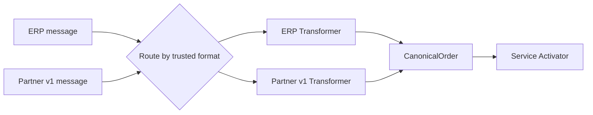
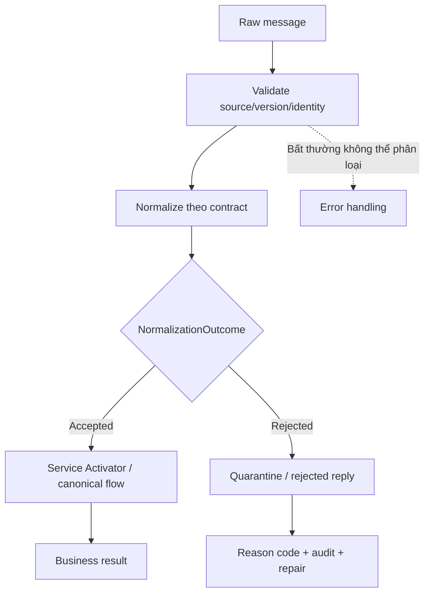
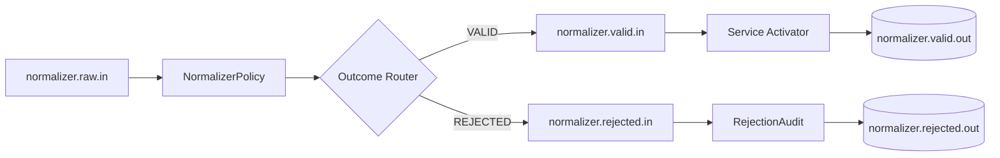
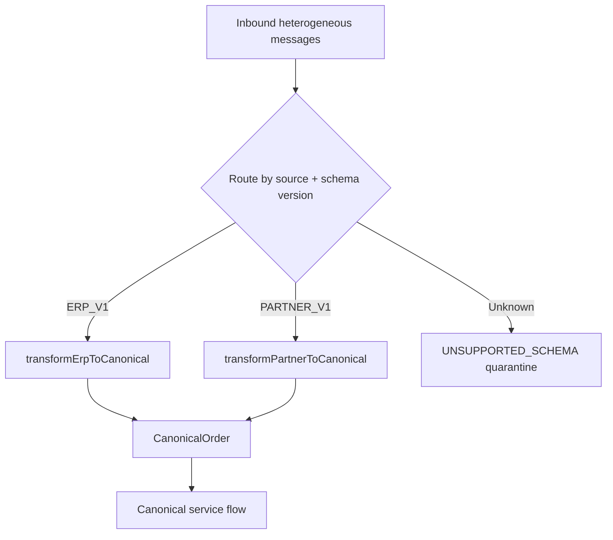
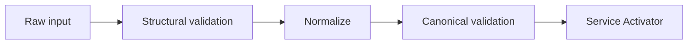
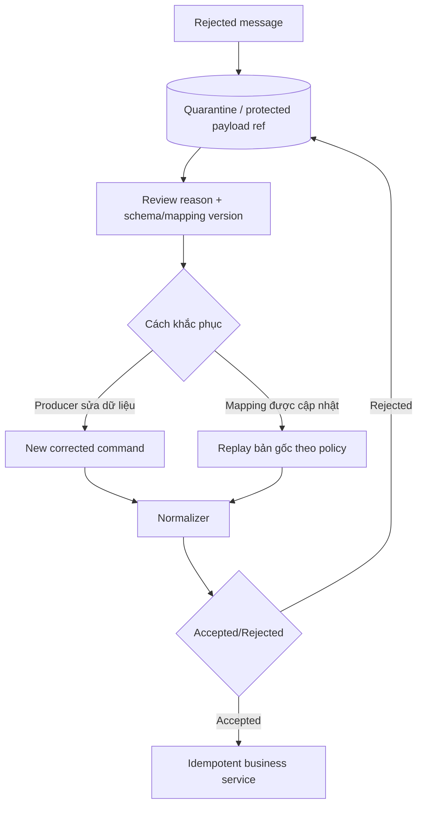

# Định tuyến message không thể normalize trong Spring Integration

## Mục tiêu bài học

Một nền tảng nhận đơn hàng từ hệ thống ERP và một đối tác giao dịch. ERP gửi số tiền theo dạng `"125000.50"`, đối tác phiên bản 1 dùng dấu phẩy thập phân như `"125000,50"`. Dữ liệu sau khi vào hệ thống cần quy về cùng một cấu trúc `CanonicalOrder` để Service Activator xử lý theo một hợp đồng thống nhất.

Nhưng sẽ có message **không thể normalize một cách an toàn**: thiếu mã đơn, không biết currency, source không được hỗ trợ, dữ liệu tiền mơ hồ, schema version lạ hoặc nội dung sai định dạng. Với những message này, cố đoán rồi xử lý tiếp có thể tạo **đơn hàng sai số tiền hoặc sai tenant**.

Bài học này tập trung vào một lựa chọn thiết kế quan trọng: **định tuyến rõ ràng những message không thể normalize sang một luồng từ chối/quarantine**, trong khi những message chuyển đổi được sẽ tới Service Activator. Không dùng một giá trị mặc định tùy ý để biến dữ liệu sai thành “hợp lệ”, cũng không đánh đồng lỗi dữ liệu không thể xử lý với lỗi DB/network tạm thời.

Bài nằm trong chương **Normalizer** của module **SPRING_INTEGRATION_PATTERN**, thuộc lộ trình triển khai Enterprise Integration Patterns bằng Spring Integration: Router, Filter, Transformer, Splitter, Aggregator, Gateway, retry, error channel, correlation và kiểm thử, theo dõi nhiều nhánh xử lý. Mục tiêu là xây luồng thông điệp ít phụ thuộc, dễ mở rộng nhưng vẫn giữ nguyên nhân từ chối và khả năng điều tra.

Sau khi học, bạn có thể:

1. Giải thích **Normalizer = chọn mapping phù hợp + chuẩn hóa thành mô hình chung** và lý do phải có nhánh dữ liệu không thể chuẩn hóa.
2. Phân biệt **business rejection** dự kiến với **exception kỹ thuật** và **vi phạm an toàn**.
3. Dùng một kiểu kết quả tường minh (`Accepted`/`Rejected`) rồi `route(...)` theo kết quả thay vì nuốt exception hoặc drop im lặng.
4. Viết Java DSL với hai nhánh `valid`/`rejected` và kiểm thử **message sai không gọi Service Activator**.
5. Thiết kế mã lỗi, ngữ cảnh truy nguyên, quarantine/DLQ, retry có phân loại và quy trình sửa/replay.
6. Bảo vệ correlation ID, tenant identity, dữ liệu nhạy cảm và idempotency khi phát lại một message.
7. Hiểu tác động của Filter, Gateway, Splitter/Aggregator và các adapter bất đồng bộ tới luồng rejected.

---

## 1. Normalizer là gì?

Trong Enterprise Integration Patterns, **Normalizer** thường dùng một **Router** chọn cách chuyển đổi thích hợp và một hoặc nhiều **Transformer** biến các định dạng khác nhau thành **canonical message format**.



Bên nhận không cần biết hai nguồn dùng dấu chấm/dấu phẩy, tên trường hoặc schema khác nhau như thế nào. Service Activator chỉ nhận một DTO có định nghĩa rõ:

```text
CanonicalOrder(
    tenantId,
    sourceSystem,
    externalOrderId,
    amount: BigDecimal,
    currency: "VND" | "USD"
)
```

**Điểm cốt lõi:** Normalizer không có nghĩa “luôn tạo ra output bằng mọi giá”. Một message chỉ có thể được normalize khi có **mapping đã được định nghĩa** và dữ liệu đủ tin cậy để chuyển đổi mà **không tự bịa thông tin**.

### Một số đầu vào

| Nguồn | Dữ liệu gốc | Kết quả |
| --- | --- | --- |
| ERP | amountText=`"125000.50"`, currency=USD | Chuẩn hóa được |
| Partner v1 | amountText=`"125000,50"`, currency=usd | Chuẩn hóa được nếu hợp đồng cho phép lowercase |
| ERP | amountText=`"1,250.50"` | **Không**; không hỗ trợ thousands separator |
| Partner v1 | amountText=`"1.250,50"` | **Không**; chưa có mapping cho định dạng này |
| Nguồn khác | sourceSystem=`"UNKNOWN"` | **Không**; thiếu mapping được chấp thuận |
| ERP | currency=`"XYZ"` | **Không**; mã currency không được hỗ trợ |
| ERP | externalOrderId=`""` | **Không**; thiếu identity nghiệp vụ |
| ERP | amountText=`"-10"` | **Không** theo contract nhập đơn của bài |

Dấu phẩy trong một payload có thể là dấu thập phân hoặc phân cách hàng nghìn tùy locale. Nếu không có contract, **không đoán ý người gửi**.

## 2. Vì sao cần nhánh “không thể normalize”?

Một thiết kế chỉ có đường thành công thường xuất hiện một trong ba lỗi:

1. **Dữ liệu sai bị biến thành giá trị mặc định:** currency không biết được đặt thành VND; số tiền parse lỗi được thay bằng 0.
2. **Message biến mất:** Filter trả false rồi im lặng drop; producer không biết phải sửa gì.
3. **Lỗi dữ liệu bị đưa vào retry chung:** một malformed payload bị tiêu thụ và NACK liên tục, tạo poison-message loop.

Một đường xử lý rõ ràng:



Ở đây **Rejected** là một **kết quả nghiệp vụ hợp lệ của bước normalization**, không phải thông báo “đã xử lý nghiệp vụ thành công”. Nó có thể được dùng để dừng sớm, phản hồi lỗi hoặc đưa message vào khu vực cần sửa dữ liệu.

### Phân biệt “không normalize được” với “không được phép”

Một message đúng schema và chuyển đổi được **không có nghĩa người gửi được quyền tạo đơn**. Authentication/authorization phải được áp dụng tại ranh giới tin cậy và service. Ngược lại, một message bị từ chối vì sai format **không nên** bị ghi thành `NETWORK_TIMEOUT` hoặc trả stack trace của Java cho client.

## 3. Phân loại failure trước khi routing

| Tình huống | Loại | Ví dụ | Hành động hợp lý |
| --- | --- | --- | --- |
| Thiếu field bắt buộc | Permanent input rejection | Không có externalOrderId | Rejected + field error |
| Không nhận biết source/schema | Mapping unavailable | partnerVersion=99 | Rejected/quarantine để cập nhật contract |
| Giá trị trái contract | Semantic rejection | currency=XYZ, amount ≤0 | Rejected + reasonCode |
| Không xác định cách diễn giải | Ambiguous input | `"1,000"` không có locale | Rejected, không tự suy đoán |
| Không có quyền | Security denial | Tenant giả mạo | Deny/audit, không vào Service Activator |
| Mất kết nối kho mapping | Transient infrastructure | Registry chưa phản hồi | Error flow/retry giới hạn |
| Lỗi code normalizer | Unexpected failure | NullPointerException do bug | Error channel, alert, không gắn là lỗi input |
| DB không ghi được canonical order | Downstream failure | Deadlock/timeout | Retry tại Service Activator với idempotency |
| Duplicate command hợp lệ | Idempotency policy | Redelivery cùng order command | Replay result hoặc xử lý theo ledger |

**Không catch tất cả `Exception` rồi trả `Rejected("INVALID_FORMAT")`.** Làm như vậy che bug/lỗi hạ tầng, khiến retry và cảnh báo bị sai loại.

### Permanent không đồng nghĩa không bao giờ sửa được

Một payload malformed không tự trở nên đúng khi retry **không thay đổi**. Nhưng nó có thể được người vận hành sửa, hoặc hệ thống được deploy một parser/mapping mới. Vì vậy nhánh rejected vẫn cần metadata để **repair/replay có kiểm soát**.

## 4. Hợp đồng kết quả tường minh

Khi có thể mô hình hóa lỗi dữ liệu dự kiến, ta cho normalizer trả một trong hai kết quả:

```java
sealed interface NormalizationOutcome
    permits Accepted, Rejected { }

record Accepted(CanonicalOrder order)
    implements NormalizationOutcome { }

record Rejected(
    String sourceSystem,
    String tenantId,
    String externalOrderId,
    String reasonCode
) implements NormalizationOutcome { }
```

Đây là **mẫu mô hình dữ liệu**; phần code chạy được bên dưới khai báo các kiểu này dưới dạng nested types trong class cấu hình.

### Vì sao dùng outcome thay vì chỉ `null`?

- `Accepted` cho biết có canonical DTO hợp lệ.
- `Rejected` giữ **mã lý do** có thể audit/test.
- `null` không giúp phân biệt thiếu payload, mapping không có hay lỗi code.
- Lỗi dữ liệu không còn buộc phải dùng exception để điều khiển mọi nhánh.
- Java 17 `sealed interface` giới hạn những trường hợp mà router phải xem xét.

Một `Rejected` trong ví dụ chỉ giữ **metadata tối thiểu**. Không đưa nguyên payload nhạy cảm vào mọi reject event hoặc log. Nếu thực sự cần lưu bản gốc để sửa, hãy dùng kho quarantine/claim check được bảo vệ riêng.

### Mã lỗi phải ổn định

| Mã | Nghĩa |
| --- | --- |
| `SOURCE_REQUIRED` | Chưa có nguồn/loại contract |
| `SOURCE_UNSUPPORTED` | Không có mapping cho source |
| `TENANT_INVALID` | Tenant field sai contract; **không thay cho AuthZ** |
| `ORDER_ID_REQUIRED` | Thiếu mã đơn |
| `ORDER_ID_INVALID` | Mã đơn sai định dạng |
| `AMOUNT_REQUIRED` | Thiếu số tiền |
| `AMOUNT_TOO_LONG` | Số tiền vượt giới hạn input length |
| `AMOUNT_FORMAT_INVALID` | Không khớp cú pháp số theo source |
| `AMOUNT_NOT_POSITIVE` | Giá trị ≤ 0 |
| `AMOUNT_EXCEEDS_LIMIT` | Vượt ngưỡng demo cho phép |
| `CURRENCY_UNSUPPORTED` | Currency không có mapping được hỗ trợ |
| `AMOUNT_SCALE_INVALID` | Số chữ số phần lẻ không đúng currency |

Cần tránh mã lỗi chứa chính giá trị người dùng nhập. Có thể trả `field`, `reasonCode` và một `correlationId` an toàn để caller liên hệ hỗ trợ.

## 5. Hợp đồng canonical phải xác định trước

Những quyết định cần rõ:

- Currency nào được hỗ trợ?
- Đơn vị của `amount` là tiền nguyên, decimal hay minor units?
- Có cho phép thousands separator không?
- Có cho phép số âm cho refund không?
- Độ chính xác tiền tệ là bao nhiêu?
- Có được trim, uppercase hoặc đổi dấu thập phân không?
- Schema source có phiên bản rõ không?
- Trường nào bắt buộc đủ để xác định business identity?

Trong ví dụ:

- Source được chấp nhận là `ERP` hoặc `PARTNER_V1`.
- ERP dùng dấu chấm thập phân, ví dụ `125000.50`.
- PARTNER_V1 dùng dấu phẩy thập phân, ví dụ `125000,50`.
- Không chấp nhận dấu phân cách hàng nghìn, scientific notation hoặc giá trị không rõ nghĩa.
- Currency cho phép `VND`/`USD`, và mã có thể viết lowercase; uppercase được xem là normalization đã được chấp thuận.
- VND phải có giá trị chính xác đến đồng nguyên; USD tối đa hai chữ số thập phân **có ý nghĩa**.
- Số tiền phải dương và không vượt 1.000.000.000.000 đơn vị tiền.
- ID chỉ chấp nhận ký tự chữ/số, dấu gạch dưới/gạch nối theo hợp đồng mẫu.

**Đây là chính sách của bài thực hành**, không phải quy định chung cho mọi hệ thống tiền tệ hoặc đối tác.

### Chuẩn hóa khác “sửa dữ liệu sai”

```text
"usd"     -> "USD"       // mapping đã được phê duyệt
"125,50"  -> "125.50"    // chỉ cho PARTNER_V1
"XYZ"     -> "VND"      // SAI: đoán currency
"1,250"   -> "1250"     // SAI khi không biết dấu phân cách
""        -> "UNKNOWN"  // SAI: bịa mã đơn
```

Một hệ thống nhận dạng định dạng bằng heuristic có thể có ích trong khâu gợi ý sửa dữ liệu, nhưng **không được âm thầm biến gợi ý thành giao dịch thật**.

## 6. Demo Java DSL: normalize rồi route vào hai nhánh

### Kiến trúc ví dụ



Các class/bean:

- `RawOrder` là envelope chung tại ingress, bao gồm source và field gốc. Adapter nguồn thực tế có thể làm bước chuyển đổi JSON/XML/CSV sang envelope này.
- `NormalizerPolicy.normalize` trả `Accepted(CanonicalOrder)` hoặc `Rejected(reasonCode)`.
- `IntegrationFlow.normalizeAndRoute` quyết định channel theo outcome.
- `AcceptedFlow` chỉ gọi service sau khi có `CanonicalOrder`.
- `RejectedFlow` chỉ ghi nhận rejection và gửi sang output quan sát; **không gọi business service**.
- `QueueChannel` cuối chỉ là test sink, **không phải hệ thống quarantine bền vững**.

### Cấu hình đầy đủ (Java 17+, Spring Integration 6.x/7.x)

```java
import java.math.BigDecimal;
import java.math.RoundingMode;
import java.util.Locale;
import java.util.Set;
import java.util.concurrent.atomic.AtomicInteger;
import java.util.regex.Pattern;

import org.springframework.context.annotation.Bean;
import org.springframework.context.annotation.Configuration;
import org.springframework.integration.channel.DirectChannel;
import org.springframework.integration.channel.QueueChannel;
import org.springframework.integration.config.EnableIntegration;
import org.springframework.integration.dsl.IntegrationFlow;
import org.springframework.messaging.MessageChannel;
import org.springframework.messaging.PollableChannel;

@Configuration
@EnableIntegration
public class NormalizerRoutingConfig {

    public record RawOrder(
        String sourceSystem,
        String tenantId,
        String externalOrderId,
        String amountText,
        String currencyText
    ) {}

    public record CanonicalOrder(
        String sourceSystem,
        String tenantId,
        String externalOrderId,
        BigDecimal amount,
        String currency
    ) {}

    public sealed interface Outcome permits Accepted, Rejected {}

    public record Accepted(CanonicalOrder order)
            implements Outcome {}

    public record Rejected(
        String sourceSystem,
        String tenantId,
        String externalOrderId,
        String reasonCode
    ) implements Outcome {}

    public static final class NormalizerPolicy {
        private static final Pattern SAFE_ID =
            Pattern.compile("[A-Za-z0-9_-]{1,80}");

        private static final Pattern ERP_MONEY =
            Pattern.compile("[0-9]+(\\.[0-9]+)?");

        private static final Pattern PARTNER_MONEY =
            Pattern.compile("[0-9]+(,[0-9]+)?");

        private static final BigDecimal MAX_AMOUNT =
            new BigDecimal("1000000000000");

        private static boolean validId(String value) {
            return value != null
                && SAFE_ID.matcher(value).matches();
        }

        private static Rejected reject(RawOrder raw, String code) {
            return new Rejected(
                raw == null ? null : raw.sourceSystem(),
                raw == null ? null : raw.tenantId(),
                raw == null ? null : raw.externalOrderId(),
                code);
        }

        public Outcome normalize(RawOrder raw) {
            if (raw == null) {
                return reject(null, "INPUT_REQUIRED");
            }
            if (raw.sourceSystem() == null ||
                    raw.sourceSystem().isBlank()) {
                return reject(raw, "SOURCE_REQUIRED");
            }

            String source = raw.sourceSystem().trim();
            if (!Set.of("ERP", "PARTNER_V1").contains(source)) {
                return reject(raw, "SOURCE_UNSUPPORTED");
            }

            if (!validId(raw.tenantId())) {
                return reject(raw, "TENANT_INVALID");
            }

            if (raw.externalOrderId() == null
                    || raw.externalOrderId().isBlank()) {
                return reject(raw, "ORDER_ID_REQUIRED");
            }
            if (!validId(raw.externalOrderId())) {
                return reject(raw, "ORDER_ID_INVALID");
            }

            if (raw.currencyText() == null) {
                return reject(raw, "CURRENCY_UNSUPPORTED");
            }
            String currency = raw.currencyText()
                .trim().toUpperCase(Locale.ROOT);

            if (!Set.of("VND", "USD").contains(currency)) {
                return reject(raw, "CURRENCY_UNSUPPORTED");
            }

            if (raw.amountText() == null
                    || raw.amountText().isBlank()) {
                return reject(raw, "AMOUNT_REQUIRED");
            }

            String amountText = raw.amountText().trim();
            if (amountText.length() > 32) {
                return reject(raw, "AMOUNT_TOO_LONG");
            }

            boolean formatMatches = "ERP".equals(source)
                ? ERP_MONEY.matcher(amountText).matches()
                : PARTNER_MONEY.matcher(amountText).matches();

            if (!formatMatches) {
                return reject(raw, "AMOUNT_FORMAT_INVALID");
            }

            String decimalDot = "ERP".equals(source)
                ? amountText : amountText.replace(',', '.');

            // Regex đã validate chữ số và đúng một dấu thập phân,
            // nhưng vẫn bắt NumberFormatException để fail safely.
            BigDecimal parsed;
            try {
                parsed = new BigDecimal(decimalDot);
            } catch (NumberFormatException ex) {
                return reject(raw, "AMOUNT_FORMAT_INVALID");
            }

            if (parsed.signum() <= 0) {
                return reject(raw, "AMOUNT_NOT_POSITIVE");
            }
            if (parsed.compareTo(MAX_AMOUNT) > 0) {
                return reject(raw, "AMOUNT_EXCEEDS_LIMIT");
            }

            int scale = "VND".equals(currency) ? 0 : 2;
            BigDecimal canonical;
            try {
                // Không làm tròn ngầm: chỉ giảm phần lẻ bằng 0.
                canonical = parsed.setScale(
                    scale, RoundingMode.UNNECESSARY);
            } catch (ArithmeticException ex) {
                return reject(raw, "AMOUNT_SCALE_INVALID");
            }

            return new Accepted(new CanonicalOrder(
                source,
                raw.tenantId(),
                raw.externalOrderId(),
                canonical,
                currency));
        }
    }

    public static final class OrderService {
        private final AtomicInteger calls = new AtomicInteger();

        public CanonicalOrder process(CanonicalOrder order) {
            calls.incrementAndGet();

            // Demo không ghi DB hoặc gọi nhà cung cấp thật.
            return order;
        }

        public int invocations() {
            return calls.get();
        }
    }

    public static final class RejectionAudit {
        private final AtomicInteger calls = new AtomicInteger();

        public Rejected record(Rejected rejection) {
            calls.incrementAndGet();

            // Demo: không lưu payload; production cần audit/quarantine
            // bền vững, phân quyền và cơ chế retry/ack rõ ràng.
            return rejection;
        }

        public int invocations() {
            return calls.get();
        }
    }

    static String destination(Outcome outcome) {
        if (outcome instanceof Accepted) {
            return "VALID";
        }
        if (outcome instanceof Rejected) {
            return "REJECTED";
        }
        throw new IllegalArgumentException("UNKNOWN_OUTCOME_TYPE");
    }

    @Bean
    NormalizerPolicy normalizerPolicy() {
        return new NormalizerPolicy();
    }

    @Bean
    OrderService orderService() {
        return new OrderService();
    }

    @Bean
    RejectionAudit rejectionAudit() {
        return new RejectionAudit();
    }

    @Bean("normalizer.raw.in")
    MessageChannel rawInput() {
        return new DirectChannel();
    }

    @Bean("normalizer.valid.in")
    MessageChannel validInput() {
        return new DirectChannel();
    }

    @Bean("normalizer.rejected.in")
    MessageChannel rejectedInput() {
        return new DirectChannel();
    }

    @Bean("normalizer.valid.out")
    PollableChannel validOutput() {
        return new QueueChannel();
    }

    @Bean("normalizer.rejected.out")
    PollableChannel rejectedOutput() {
        return new QueueChannel();
    }

    @Bean
    IntegrationFlow normalizeAndRoute(NormalizerPolicy policy) {
        return IntegrationFlow.from("normalizer.raw.in")
            .transform(RawOrder.class, policy::normalize)
            .route(
                Outcome.class,
                NormalizerRoutingConfig::destination,
                mapping -> mapping
                    .channelMapping(
                        "VALID", "normalizer.valid.in")
                    .channelMapping(
                        "REJECTED", "normalizer.rejected.in"))
            .get();
    }

    @Bean
    IntegrationFlow acceptedFlow(OrderService service) {
        return IntegrationFlow.from("normalizer.valid.in")
            .handle(Accepted.class, (accepted, headers) ->
                service.process(accepted.order()))
            .channel("normalizer.valid.out")
            .get();
    }

    @Bean
    IntegrationFlow rejectedFlow(RejectionAudit audit) {
        return IntegrationFlow.from("normalizer.rejected.in")
            .handle(Rejected.class, (rejected, headers) ->
                audit.record(rejected))
            .channel("normalizer.rejected.out")
            .get();
    }
}
```

### Vì sao tách hai nhánh thành hai IntegrationFlow?

Với `DirectChannel`, một subscriber nhận message từ route đã chọn. Flow `acceptedFlow` định nghĩa kiểu payload `Accepted`, trong khi `rejectedFlow` định nghĩa kiểu `Rejected`. Tách rõ giúp:

- Service Activator không phải kiểm tra `if (payload.invalid())` lặp đi lặp lại.
- Rejected message không thể vô tình được truyền đến `OrderService.process`.
- Mỗi nhánh có test, metric và retention riêng.
- Khi chuyển sang Kafka/AMQP/DB quarantine, chỉ thay adapter/flow của nhánh rejected.
- Policy đã chấp nhận một DTO canonical trước khi đến service.

**Một nguồn input ở đây đi vào một router**, không phải hai handler cùng subscribe trực tiếp `normalizer.raw.in` rồi trông chờ mỗi handler tự lọc đúng kiểu.

### Điều gì xảy ra với header?

`.transform(...)` trả về một payload `Outcome`, còn Spring Integration tạo message ở flow tiếp theo theo quy tắc truyền header của endpoint. Với ví dụ trong một process, các header được hỗ trợ như `traceId` và `correlationId` có thể được giữ. Tuy nhiên:

- Không dùng raw `headers['tenantId']` làm bằng chứng người gửi thuộc tenant tương ứng.
- Không copy vô điều kiện `replyChannel`, `errorChannel` hoặc token qua broker/HTTP boundary.
- Nếu tách process, kiểm tra header mapper và DTO contract ở mỗi ranh giới.
- Rejected branch nên có `sourceId`, `requestId`, `correlationId` phù hợp, nhưng tránh phát nguyên dữ liệu nhạy cảm chỉ để debug.

### Vì sao demo cố ý không tự retry?

Message `AMOUNT_FORMAT_INVALID` sẽ **không trở thành hợp lệ** khi nhận lại cùng payload và cùng mapping. Bài thực hành dùng outcome để phân biệt đây là **dữ liệu cần sửa hoặc mapping cần triển khai**, không phải một sự cố mạng. Lỗi hạ tầng sẽ được giải quyết riêng ở phần error handling.

## 7. Kiểm thử tích hợp JUnit: sai không chạm Service Activator

Chúng ta cần kiểm tra **không chỉ route đúng** mà còn **không có side effect** của handler nghiệp vụ.

### JUnit 5 + AssertJ

```java
import static org.assertj.core.api.Assertions.assertThat;

import java.math.BigDecimal;

import org.junit.jupiter.api.Test;
import org.springframework.beans.factory.annotation.Autowired;
import org.springframework.beans.factory.annotation.Qualifier;
import org.springframework.messaging.Message;
import org.springframework.messaging.MessageChannel;
import org.springframework.messaging.PollableChannel;
import org.springframework.messaging.support.MessageBuilder;
import org.springframework.test.annotation.DirtiesContext;
import org.springframework.test.context.junit.jupiter.SpringJUnitConfig;

@SpringJUnitConfig(NormalizerRoutingConfig.class)
@DirtiesContext(
    classMode = DirtiesContext.ClassMode.AFTER_EACH_TEST_METHOD)
class NormalizerRoutingFlowTest {

    @Autowired
    @Qualifier("normalizer.raw.in")
    MessageChannel input;

    @Autowired
    @Qualifier("normalizer.valid.out")
    PollableChannel accepted;

    @Autowired
    @Qualifier("normalizer.rejected.out")
    PollableChannel rejected;

    @Autowired
    NormalizerRoutingConfig.OrderService service;

    @Autowired
    NormalizerRoutingConfig.RejectionAudit audit;

    private void send(
        String source,
        String orderId,
        String amount,
        String currency
    ) {
        var raw = new NormalizerRoutingConfig.RawOrder(
            source, "tenant-a", orderId, amount, currency);

        assertThat(input.send(
            MessageBuilder.withPayload(raw)
                .setHeader("traceId", "trace-42")
                .setHeader("correlationId", "WORKFLOW-42")
                .build()
        )).isTrue();
    }

    @Test
    void erpAmountReachesBusinessService() {
        send("ERP", "ORD-101", "125000.50", "USD");

        Message<?> result = accepted.receive(2_000);
        assertThat(result).isNotNull();

        var canonical = (NormalizerRoutingConfig.CanonicalOrder)
            result.getPayload();

        assertThat(canonical.amount())
            .isEqualByComparingTo(new BigDecimal("125000.50"));
        assertThat(canonical.currency()).isEqualTo("USD");
        assertThat(canonical.externalOrderId())
            .isEqualTo("ORD-101");
        assertThat(service.invocations()).isEqualTo(1);
        assertThat(audit.invocations()).isZero();
        assertThat(rejected.receive(0)).isNull();
        assertThat(accepted.receive(0)).isNull();

        assertThat(result.getHeaders().get("correlationId"))
            .isEqualTo("WORKFLOW-42");
    }

    @Test
    void partnerDecimalCommaIsNormalized() {
        send("PARTNER_V1", "ORD-102", "49,90", "usd");

        Message<?> result = accepted.receive(2_000);
        assertThat(result).isNotNull();

        var canonical = (NormalizerRoutingConfig.CanonicalOrder)
            result.getPayload();

        assertThat(canonical.amount())
            .isEqualByComparingTo(new BigDecimal("49.90"));
        assertThat(canonical.currency()).isEqualTo("USD");
        assertThat(service.invocations()).isEqualTo(1);
        assertThat(rejected.receive(0)).isNull();
    }

    private NormalizerRoutingConfig.Rejected rejectedResult() {
        Message<?> result = rejected.receive(2_000);
        assertThat(result).isNotNull();
        assertThat(result.getPayload())
            .isInstanceOf(NormalizerRoutingConfig.Rejected.class);
        return (NormalizerRoutingConfig.Rejected)
            result.getPayload();
    }

    @Test
    void unknownSourceIsRoutedToRejectedFlow() {
        send("UNREGISTERED", "ORD-201", "100", "USD");

        assertThat(rejectedResult().reasonCode())
            .isEqualTo("SOURCE_UNSUPPORTED");
        assertThat(service.invocations()).isZero();
        assertThat(audit.invocations()).isEqualTo(1);
        assertThat(accepted.receive(0)).isNull();
    }

    @Test
    void ambiguousNumberNeverCallsBusinessService() {
        send("ERP", "ORD-202", "1,250.00", "USD");

        assertThat(rejectedResult().reasonCode())
            .isEqualTo("AMOUNT_FORMAT_INVALID");
        assertThat(service.invocations()).isZero();
        assertThat(audit.invocations()).isEqualTo(1);
        assertThat(accepted.receive(0)).isNull();
    }

    @Test
    void unknownCurrencyIsNotSilentlyReplaced() {
        send("ERP", "ORD-203", "1000", "XYZ");

        assertThat(rejectedResult().reasonCode())
            .isEqualTo("CURRENCY_UNSUPPORTED");
        assertThat(service.invocations()).isZero();
        assertThat(audit.invocations()).isEqualTo(1);
        assertThat(accepted.receive(0)).isNull();
    }

    @Test
    void unsupportedPrecisionIsRejectedWithoutRounding() {
        send("PARTNER_V1", "ORD-204", "12,345", "USD");

        assertThat(rejectedResult().reasonCode())
            .isEqualTo("AMOUNT_SCALE_INVALID");
        assertThat(service.invocations()).isZero();
        assertThat(accepted.receive(0)).isNull();
    }
}
```

Bộ test dùng `@DirtiesContext(AFTER_EACH_TEST_METHOD)` để không trộn bộ đếm và nội dung `QueueChannel` giữa các test. `DirectChannel` giúp lời gọi đồng bộ trong ví dụ. Với flow bất đồng bộ/broker, phải dùng assertion theo sự kiện và timeout phù hợp.

**Điều chứng minh được:** dữ liệu hợp lệ được chuẩn hóa thành `CanonicalOrder`; dữ liệu không thể normalize đi vào rejected branch có lý do; `OrderService` **không được gọi** cho message bị từ chối.

**Điều chưa chứng minh:** consumer đã commit DB, retry across restart, exactly-once effect, durability của quarantine, tracing qua broker hoặc policy bảo mật đa tenant. Những nội dung đó cần integration/fault tests riêng.

## 8. Unit test nhanh cho normalizer

Logic mapping nên là **hàm thuần**, không cần khởi động Spring để kiểm thử từng input.

```java
import static org.assertj.core.api.Assertions.assertThat;

import java.math.BigDecimal;

import org.junit.jupiter.api.Test;

class NormalizerPolicyTest {

    private final NormalizerRoutingConfig.NormalizerPolicy policy =
        new NormalizerRoutingConfig.NormalizerPolicy();

    private NormalizerRoutingConfig.RawOrder raw(
        String source, String amount, String currency
    ) {
        return new NormalizerRoutingConfig.RawOrder(
            source, "tenant-a", "ORD-U",
            amount, currency);
    }

    @Test
    void acceptedResultUsesCanonicalDecimalScale() {
        var result = policy.normalize(
            raw("ERP", "12.5", "USD"));

        assertThat(result)
            .isInstanceOf(NormalizerRoutingConfig.Accepted.class);
        var accepted = (NormalizerRoutingConfig.Accepted) result;

        assertThat(accepted.order().amount())
            .isEqualTo(new BigDecimal("12.50"));
    }

    @Test
    void vndAllowsTrailingZerosButNotFractionalValue() {
        var good = policy.normalize(
            raw("ERP", "120.00", "VND"));
        var bad = policy.normalize(
            raw("ERP", "120.50", "VND"));

        assertThat(good)
            .isInstanceOf(NormalizerRoutingConfig.Accepted.class);
        assertThat(bad)
            .isInstanceOf(NormalizerRoutingConfig.Rejected.class);
        assertThat(
            ((NormalizerRoutingConfig.Rejected) bad).reasonCode()
        ).isEqualTo("AMOUNT_SCALE_INVALID");
    }

    @Test
    void invalidIdCannotSneakIntoCanonicalOrder() {
        var invalid = new NormalizerRoutingConfig.RawOrder(
            "ERP", "tenant-a", "ORD|OTHER",
            "50.00", "USD");

        assertThat(policy.normalize(invalid))
            .isInstanceOf(NormalizerRoutingConfig.Rejected.class);
    }

    @Test
    void unsupportedSourceNeverFallsBackToErp() {
        var result = policy.normalize(
            raw("PARTNER_V99", "50,00", "USD"));

        assertThat(result)
            .isInstanceOf(NormalizerRoutingConfig.Rejected.class);
        assertThat(
            ((NormalizerRoutingConfig.Rejected) result).reasonCode()
        ).isEqualTo("SOURCE_UNSUPPORTED");
    }
}
```

### Test theo bảng quyết định

Ngoài các test ví dụ, nên có parameterized tests cho:

| Source | Amount | Currency | Expected |
| --- | --- | --- | --- |
| ERP | `"1500.20"` | USD | Accepted 1500.20 |
| PARTNER_V1 | `"1500,20"` | USD | Accepted 1500.20 |
| ERP | `"1500,20"` | USD | Rejected FORMAT |
| PARTNER_V1 | `"1500.20"` | USD | Rejected FORMAT |
| ERP | `"1000.00"` | VND | Accepted 1000 |
| ERP | `"1000.01"` | VND | Rejected SCALE |
| ERP | `"0"` | VND | Rejected NON_POSITIVE |
| ERP | `"-10"` | VND | Rejected FORMAT theo parser này |
| ERP | `"1e3"` | VND | Rejected FORMAT |
| ERP | `"9999999999999"` | VND | Rejected EXCEEDS_LIMIT |
| UNKNOWN | `"10"` | USD | Rejected SOURCE |

Với trường hợp `"-10"`, ví dụ hiện tại trả `AMOUNT_FORMAT_INVALID` vì regex chỉ cho phép chữ số dương; không phải `AMOUNT_NOT_POSITIVE`. Việc mã lỗi ưu tiên thế nào là một **quy tắc contract**, cần test nhất quán.

## 9. Lựa chọn khác: Router theo source trước các Transformer

Khi mỗi nguồn có payload/schema riêng:

```text
Message<ErpOrderV1>
Message<PartnerOrderV1>
Message<LegacyCsvRecord>
```

Ta có thể định tuyến **theo loại/schema đáng tin** trước rồi mới transform:



**Đây là Normalizer theo cấu trúc Router + nhiều Transformer**. Ví dụ Java DSL mục 6 gói hai phép chuyển đổi vào `NormalizerPolicy` sau một envelope chung để bài tập ngắn, dễ kiểm thử; về ý nghĩa nghiệp vụ, nó vẫn thực hiện chọn mapping theo source và chuẩn hóa kết quả.

### Router có default output rõ ràng

Với một `HeaderValueRouter` hoặc Router dựa trên source:

- Map `ERP_V1` sang ERP normalization flow.
- Map `PARTNER_V1` sang Partner normalization flow.
- Có nhánh **unknown-source** tường minh, không để message mất vì channel mapping thiếu.
- Nếu input không tin cậy, không cho header `sourceType` tùy ý quyết định truy cập endpoint có quyền cao.

Một pattern quan trọng: **đường không có mapping không được tự động đi vào Service Activator với một kiểu “gần đúng”**.

### Có nên dùng Filter để bỏ unsupported source?

Có thể dùng `MessageFilter` khi yêu cầu là “chỉ quan tâm các nguồn được hỗ trợ, phần còn lại cố ý bỏ”. Nhưng với input là **command cần hồi đáp** hoặc batch cần đối soát, Filter drop âm thầm dễ gây mất công việc hoặc Gateway timeout. Router tới rejected flow có **mã lỗi và trạng thái terminal** thường phù hợp hơn.

## 10. Khi nào ném exception thay vì trả Rejected?

Không phải mọi trường hợp đều nên được biểu diễn bằng outcome.

### Trả `Rejected` khi

- Source/schema không được hỗ trợ theo hợp đồng.
- Thiếu hoặc sai field của input.
- Dữ liệu không thể đổi currency/amount một cách chắc chắn.
- Vi phạm một rule tĩnh đã định nghĩa rõ.
- Producer cần biết phải sửa gì, hoặc cần giữ bản gốc để repair.

### Ném exception hoặc dùng error channel khi

- Kho metadata/schema registry không phản hồi.
- Lỗi serialization do hạ tầng mà ứng dụng dự kiến retry.
- Lỗi lập trình không lường trước.
- Lỗi kết nối DB/HTTP của downstream.
- Mất quyền/vi phạm bảo mật cần mapping riêng, không nên tiết lộ thông tin.

Một Java Transformer throw exception trên `DirectChannel` thường làm exception truyền ngược tới caller; trong poller/executor/broker topology, nó có thể được chuyển vào error flow theo adapter/configuration. **Không giả định mọi exception tự có `ErrorMessage` ở một `errorChannel` duy nhất.**

### Tránh catch-all

```java
// PHẢN VÍ DỤ: che giấu cả lỗi hạ tầng và bug.
try {
    return normalizeWithExternalMapping(raw);
} catch (Exception ex) {
    return new Rejected(
        raw.sourceSystem(), raw.tenantId(),
        raw.externalOrderId(), "BAD_INPUT");
}
```

Nếu external mapping service outage, việc nói `BAD_INPUT` là sai; operator có thể bỏ message thay vì retry khi mapping service phục hồi.

### Phân loại lỗi

```text
Permanent mapping/input issue:
  -> Rejected outcome / quarantine / repair

Transient infrastructure issue:
  -> exception + bounded retry + backoff

Programming defect / unexpected:
  -> error channel / alert / investigation

Unauthorized access:
  -> deny + security audit, do not reveal sensitive details
```

Một app thực tế có thể thêm lỗi typed `NormalizationRejectedException` nếu muốn framework error flow xử lý nhánh rejected. Tuy nhiên, phải nhất quán: **outcome dự kiến** và **exception bất thường** không nên bị nhập làm một.

## 11. Khác biệt rejected channel, discard channel, error channel và DLQ

| Khái niệm | Bản chất | Dùng cho trường hợp |
| --- | --- | --- |
| **Rejected branch** | Flow ứng dụng xử lý `Rejected` có reasonCode | Mapping/input không thể normalize |
| `discardChannel` | Message bị Filter/Idempotent Receiver loại theo policy | Chủ động loại message từ endpoint |
| `errorChannel` | Điểm xử lý `ErrorMessage` theo cách endpoint/adapter cấu hình | Exception khi xử lý |
| **DLQ** | Khu vực lưu message không xử lý được trên broker | Redelivery thất bại hoặc reject có chủ đích |
| **Quarantine store** | Kho riêng có dữ liệu và metadata phục vụ sửa/replay | Message cần sửa hoặc chờ schema mapping |
| **Business rejection reply** | Phản hồi cho Gateway/API caller | Invalid request cần thông báo kết quả |

Không xem năm khái niệm trên là một loại channel. Một `QueueChannel` trong ví dụ **không tự đảm bảo durability, TTL, backpressure hoặc quyền truy cập**.

### Thiết kế quarantine đủ thông tin nhưng ít nhạy cảm

Một record minh họa:

```json
{
  "rejectionId": "REJ-42",
  "sourceSystem": "PARTNER_V1",
  "requestId": "REQ-42",
  "reasonCode": "AMOUNT_FORMAT_INVALID",
  "schemaVersion": "1",
  "mappingVersion": "v3",
  "receivedAt": "2026-11-21T10:00:00Z",
  "rawPayloadRef": "protected-store-reference"
}
```

Đây là **định dạng ứng dụng tự thiết kế**, không phải DTO tự động của Spring Integration. `rawPayloadRef` nên là một tham chiếu được kiểm soát quyền, không phải raw dữ liệu nhạy cảm trong log.

### Khi nào cần lưu bản gốc?

- Khi đối tác có thể sửa và gửi lại.
- Khi mapping version mới được triển khai.
- Khi cần điều tra một tranh chấp dữ liệu.
- Khi yêu cầu audit/tuân thủ.

Nhưng phải đặt TTL/retention, encryption, RBAC và chính sách xóa. **Không lưu vô hạn mọi payload sai** vì điều đó tạo kho dữ liệu nhạy cảm ngoài kiểm soát.

## 12. Gateway và reply cho message không thể normalize

Nếu luồng được gọi qua Messaging Gateway:

```text
Caller -> Gateway -> Normalizer
                       |
                       +-- Accepted -> Service -> Success reply
                       |
                       +-- Rejected -> Rejection result / mapped error
```

Flow có thể trả một trong hai kiểu:

- `OrderAccepted` với canonical order ID/status.
- `NormalizationRejected` với `reasonCode` và danh sách field lỗi thích hợp.

Nếu chỉ đưa rejected message vào một queue và **không trả reply**, Gateway đồng bộ có thể chờ đến timeout. Đoạn `QueueChannel` trong demo là test sink, không phải giải pháp hoàn chỉnh cho request-reply API.

### Hai hợp đồng phổ biến

**A. Rejection là một reply bình thường**

```java
sealed interface OrderIntakeResult
    permits OrderAccepted, OrderRejected { }
```

Một endpoint Gateway trả `OrderIntakeResult`. Consumer phân biệt accepted/rejected và hiển thị lý do, không cần để exception đại diện cho mọi input không hợp lệ.

**B. Rejection là exception có mapping**

Một `NormalizationRejectedException` được map thành HTTP 4xx hoặc lỗi theo hợp đồng của adapter. Lỗi hạ tầng vẫn có mã 5xx/retry phù hợp.

Chọn cách nào phụ thuộc giao thức và caller. **Không tự suy HTTP status từ việc gọi `.route(...)` hoặc tạo một `Rejected` record.**

### Khi có hai nhánh cùng trả lời

Nếu routing/phát message không đúng cấu hình và cả accepted lẫn rejected cùng cố reply cho một request, caller có thể nhận phản hồi không xác định hoặc reply đến muộn. Dùng router **exclusive** cho một outcome và kiểm thử đúng một nhánh có kết quả terminal.

## 13. Filter không thay thế Normalizer

Filter phù hợp để quyết định message nào được giữ. Nó không tự giải quyết:

- Chọn mapping source/version.
- Parse, validate và chuẩn hóa currency/amount.
- Cung cấp reason code khi mapping thất bại.
- Lưu original payload/metadata phục vụ repair.
- Phân biệt permanent vs transient lỗi hạ tầng.

Một flow đơn giản:

```java
.filter(RawOrder.class, raw ->
    Set.of("ERP", "PARTNER_V1")
        .contains(raw.sourceSystem()))
```

Nếu Filter drop message `SOURCE_UNSUPPORTED`, producer không biết nên thay nguồn hay update mapping. Khi giao thức là fire-and-forget và có policy bỏ các sự kiện không quan tâm, đó có thể là hành vi có chủ đích. Nhưng với command có side effect, **bảo toàn thông tin bị từ chối** thường quan trọng hơn việc giảm vài message.

### Nếu vẫn dùng Filter

Cấu hình `discardChannel`/`throwExceptionOnRejection` và thiết kế rejected flow phù hợp. Đừng bật retry cho mọi rejection cố định.

## 14. Validation trước và sau normalization

Có hai lớp validation:



- **Structural validation:** có field source, version, độ dài, cú pháp theo source.
- **Canonical validation:** DTO chung không có null bất hợp lệ, money precision đúng, tenant identity đã xác thực, các invariants đầu vào thỏa.
- **Business validation tại service/DB:** trạng thái đơn, tồn kho, hạn mức còn đúng tại lúc commit.

Một message có thể đúng cú pháp ERP nhưng sau chuyển đổi lại vi phạm canonical contract. Đừng coi `"parser không throw"` là đủ để gọi Service Activator.

### Bean Validation với canonical DTO

Có thể dùng `jakarta.validation.Validator` để kiểm tra DTO sau normalize. Chẳng hạn:

```java
public record CanonicalOrderValidated(
    @jakarta.validation.constraints.NotBlank String orderId,
    @jakarta.validation.constraints.NotNull
    @jakarta.validation.constraints.Positive
    java.math.BigDecimal amount
) {}
```

Annotation chỉ khai báo constraint. Phải **gọi `validator.validate(...)` thực sự** hoặc cấu hình Method Validation và kiểm thử tại đúng endpoint; chỉ ghi annotation lên record không chứng minh flow tự chạy validation.

### “Không thể normalize” không phải “không đủ tồn kho”

Một canonical order hợp lệ nhưng kho hết hàng không phải lỗi mapping. Đây là kết quả nghiệp vụ của Service Activator/Inventory service. Gắn `AMOUNT_FORMAT_INVALID` cho “hết hàng” khiến metric, xử lý lỗi và trách nhiệm team bị sai.

## 15. Correlation và header propagation giữa hai nhánh

Một message có thể mang:

```text
correlationId = shop-a|ORD-42|run-1
traceId       = trace-xyz
sourceId      = partner-ingress
requestId     = REQ-42
schemaVersion = 1
```

Những header này hỗ trợ:

- Tìm lại message gốc sau normalization/rejection.
- Liên kết rejected outcome với producer.
- Theo dõi mapping version và thời điểm xử lý.
- Theo dõi retry và lỗi hạ tầng.
- Liên kết các branch nếu message là part của một Scatter-Gather.

| Header | Vai trò | Không được nhầm |
| --- | --- | --- |
| `correlationId` | Group các message liên quan | Không tự là quyền truy cập |
| `traceId` | Theo dõi span/latency | Không thay business identity |
| `requestId` | Hợp đồng với caller | Không nhất thiết là idempotency key |
| `schemaVersion` | Chọn mapping tương ứng | Không được tự suy từ tên file |
| `sourceId` | Nguồn kỹ thuật đã xác minh | Không đồng nghĩa principal |
| `idempotencyKey` | Bảo vệ một side effect | Không tự sinh từ message ID ngẫu nhiên |

Khi trả `Rejected`, giữ **correlation key** giúp operator nhìn thấy nguyên nhân mà không phải đọc raw payload. Nếu input hỏng đến mức không thể tính business correlation, dùng ingress request ID, broker offset hoặc transport metadata đáng tin.

### Đừng tin source/tenant trong payload như chứng nhận

`sourceSystem="ERP"` trong `RawOrder` của demo chỉ dùng **để chọn mapping**. Trong production, nguồn thực phải được xác thực từ adapter, client credential hoặc channel được kiểm soát. Nếu client bất kỳ gửi `"ERP"`, đó chưa phải bằng chứng họ là ERP.

Tương tự, `tenantId` cần đối chiếu với principal/service identity đã xác thực. Một input được normalize thành công **không làm nó được cấp quyền** tới dữ liệu của tenant khác.

## 16. Retry và poison-message loop

Giả sử nhận một amount sai:

```text
T0 PARTNER_V1 amountText="1.250,50"
T1 Normalizer -> Rejected(AMOUNT_FORMAT_INVALID)
T2 Broker redeliver cùng payload sau NACK
T3 Normalizer -> Rejected(AMOUNT_FORMAT_INVALID)
T4 Lặp mãi...
```

Nếu mapping vẫn như cũ, retry tự động chỉ tạo thêm tải và đầy DLQ.

### Phân loại retry

| Loại | Retry? | Lý do |
| --- | --- | --- |
| Unsupported source/schema | Thường không retry ngay | Cần cập nhật contract/mapping |
| Missing/invalid field | Không retry nguyên payload vô hạn | Cần sửa dữ liệu |
| Ambiguous number/currency | Không tự đoán | Cần người/producer xác nhận |
| Registry/config service timeout | Có thể retry có giới hạn | Lỗi transient |
| DB/network outage sau normalize | Retry ở service phù hợp | Data canonical vẫn hợp lệ |
| Program bug làm NPE | Alert/sửa bug, có thể replay sau deploy | Retry nóng liên tục không giúp |
| Security denial | Không retry như hạ tầng | Cần auth/permission hợp lệ |

### ACK/NACK thuộc adapter, không tự do Router quyết định

Một `Rejected` được đưa sang rejected channel **chưa chắc đã được lưu bền**. Với broker consumer, phải xác định khi nào ACK message gốc:

- Sau khi rejected event/quarantine đã được lưu thành công.
- Hoặc sau khi trả một terminal reply có bằng chứng audit phù hợp.
- Hoặc theo chính sách at-most-once chấp nhận rủi ro mất.

Nếu ACK trước khi ghi quarantine thành công, hệ thống có thể **mất message**. Nếu NACK sau khi đã ghi, broker redelivery có thể tạo **hai rejection records**; cần idempotency.

## 17. Repair và replay một rejected message

Một quy trình hỗ trợ vận hành:



### Quy trình nên có

1. Nhận diện `rejectionId`, `sourceId`, `requestId` và business identity.
2. Đọc lý do reject, schema/mapping version và thời gian nhận.
3. Xác định đây là **sửa payload** hay **cập nhật mapping**.
4. Duyệt quyền người thao tác và giới hạn số lần replay.
5. Dùng idempotency key ổn định cho **cùng command logic**; nếu correction là command mới, dùng generation/version theo contract.
6. Gắn `replayAttempt` và ghi audit trạng thái cũ/mới.
7. Không khởi chạy Service Activator trước khi dữ liệu đã pass normalization/canonical validation.
8. Có cách trả outcome cho producer/caller nếu request trước đó từng bị từ chối.

**Không phát lại vô hạn chỉ vì mapping được triển khai mới.** Schema mới có thể thay đổi nghĩa của những message cũ; cần version pinning và test để tránh xử lý sai lịch sử.

### Mức độ giữ lại raw payload

Một protected reference kiểu Claim Check có thể giảm việc chuyển payload nhạy cảm qua nhiều handler, nhưng ticket **không tự là cơ chế phân quyền**. Người đọc kho gốc phải được xác thực/ủy quyền, có TTL và audit.

## 18. Idempotency trong cả accepted và rejected flow

Có hai loại duplicate:

1. **Input redelivery:** broker giao lại cùng raw message.
2. **Replay sau repair:** một rejection được đưa lại vào flow sau thay đổi mapping.

Ở accepted flow, cần ngăn side effect lặp: cùng `tenant + operation + commandId` chỉ được commit theo hợp đồng. Với rejected flow, cũng cần tránh tạo hàng nghìn bản ghi quarantine trùng khi message bị gửi lại.

### Key gợi ý

```text
Business command key:
  tenantId + "|" + sourceSystem + "|" + externalOrderId + "|" + generation

Rejection key:
  rawEventId + "|" + mappingVersion + "|" + reasonCode
```

Các key trên là **gợi ý**; nếu một externalOrderId có thể được tái sử dụng cho command mới, phải bổ sung ID phiên giao dịch/attempt phù hợp. Không dùng `MessageHeaders.ID` làm idempotency key xuyên redelivery khi producer có thể dựng message khác ID.

### Tình huống ACK bị mất

```text
T1 Accepted flow ghi DB thành công.
T2 Response/ACK bị mất.
T3 Broker redeliver raw order.
T4 Normalize được cùng CanonicalOrder.
T5 Service phải trả kết quả đã commit, không tạo đơn thứ hai.
```

Một normalizer xác định cho cùng input **không tự bảo đảm Service Activator idempotent**. Bảo vệ ở DB có thể dùng unique constraint/transaction/outbox; với API bên ngoài cần provider idempotency key/reconciliation.

## 19. Splitter/Aggregator: invalid part có thể làm group chờ mãi

Một batch gồm ba bản ghi:

```text
Splitter tạo seqSize=3
  Part #1 -> normalize thành công
  Part #2 -> Rejected
  Part #3 -> normalize thành công
```

Nếu Aggregator phía sau chỉ nhận accepted parts, nó sẽ thấy **2/3** và có thể chờ vô hạn.

### Phương án A — Terminal outcome cho mọi part

```text
Part #1 -> PartOutcome(SUCCEEDED)
Part #2 -> PartOutcome(REJECTED, reasonCode)
Part #3 -> PartOutcome(SUCCEEDED)

Aggregator -> BatchSummary(
  processed=2, rejected=1, total=3)
```

Ở thiết kế này, mỗi part có một kết quả terminal giữ `correlationId`, `sequenceNumber` và các metadata phù hợp. Aggregator gom đúng số phần và có thể trả summary cho caller.

### Phương án B — Lọc trước Splitter

Nếu policy cho phép loại record trước khi xác định size, chỉ split những record đã pass normalization/validation. Khi đó `sequenceSize` phản ánh những part thực sự được gửi đi.

### Phương án C — Custom release/timeout

Nếu số part có thể thay đổi và summary chấp nhận partial, cần `ReleaseStrategy` theo tập part terminal hoặc deadline rõ. Không sửa `sequenceSize` tùy ý cho từng message đã phát.

### Scatter-Gather

Một supplier không thể normalize reply **không phải** supplier chưa bao giờ trả lời. Đưa kết quả `SupplierOutcome(REJECTED)` về gatherer nếu hợp đồng cần một terminal outcome mỗi supplier; ranking chỉ xét các offer canonical hợp lệ. Nếu đơn giản drop reply sai, gatherer có thể chờ đến timeout dù supplier đã phản hồi.

## 20. Router và Transformer: làm rõ ranh giới lỗi

Trong một topology lớn:

```text
Inbound Adapter
    -> Validate envelope/source identity
    -> Normalizer (route + transform)
    -> Accepted/Rejected router
    -> Service Activator or Quarantine Handler
```

Một nguồn có thể có nhiều version:

```text
ERP_V1 -> ErpV1Transformer
ERP_V2 -> ErpV2Transformer
PARTNER_V1 -> PartnerV1Transformer
UNKNOWN -> UnsupportedSchema Rejected
```

Khi thêm phiên bản mới, không nên thay parser cũ bằng một parser “đọc được hết” mà không có test regression. Mapping version phải có trace/audit; dữ liệu quá cũ có thể cần migration/replay sau duyệt.

### Không dùng một default route nguy hiểm

Một lỗi nguy hiểm:

```text
Unknown source -> default route = ERP
```

Nếu payload unknown tình cờ parse được, hệ thống có thể tạo giao dịch sai schema. Default branch nên là `SOURCE_UNSUPPORTED`, không phải “thử parser gần đúng nhất” khi có side effect.

### Một Router có thể làm mất message

Nếu Router không tìm thấy channel tương ứng và policy cho phép bỏ, message có thể mất hoặc phát exception tùy cấu hình. Hãy viết **tường minh** nhánh fallback và test unknown mapping. Trong demo, `destination(...)` luôn trả `VALID` hoặc `REJECTED`, và hai giá trị đều được map tới channel.

## 21. Security: quarantine và logging có thể trở thành đường rò rỉ

Một message không thể normalize có thể chứa thông tin cá nhân, địa chỉ, tài khoản hoặc payload chưa được validate. Đó là dữ liệu **đáng nghi và có thể nhạy cảm**.

Không nên:

- Ghi nguyên raw payload vào log khi parse lỗi.
- Để rejected channel đi tới dashboard không hạn chế quyền.
- Trả cả stack trace/parser exception cho client.
- Sử dụng `sourceSystem` do client tự khai để chọn handler có quyền cao hơn.
- Lưu vô hạn các message sai vào một QueueChannel trong RAM.
- Forward `replyChannel`/`errorChannel` nội bộ như object qua broker.
- Dùng một UUID claim ticket như bằng chứng người sở hữu có quyền đọc.

Nên:

1. Xác thực principal/tenant ở ingress.
2. Dùng allowlist schema/source được cấu hình phía server.
3. Giới hạn kích thước payload, độ dài field và độ sâu cấu trúc.
4. Cảnh báo nếu tỷ lệ reject tăng đột ngột, không lộ nguyên input.
5. Mã hóa/quản lý quyền của quarantine store và backup.
6. Redact thông tin nhạy cảm trong log, error message, trace, metrics.
7. Cho phép replay chỉ qua giao diện/API được phân quyền và có audit.
8. Giới hạn rate của message unsupported để giảm nguy cơ DoS.

## 22. Quan sát cả thành công, thất bại và replay

Một bộ metric minh họa:

| Metric gợi ý | Ý nghĩa |
| --- | --- |
| `normalizer_received_total{source}` | Bao nhiêu input theo nguồn đáng tin? |
| `normalizer_accepted_total{source}` | Bao nhiêu input được normalize? |
| `normalizer_rejected_total{reason}` | Bao nhiêu input bị từ chối theo mã? |
| `normalizer_unknown_source_total` | Bao nhiêu message không có mapping? |
| `normalizer_duration_seconds{source}` | Thời gian normalize |
| `normalizer_service_invoked_total` | Bao nhiêu canonical message tới handler? |
| `normalizer_quarantine_written_total` | Bao nhiêu rejection đã lưu bền? |
| `normalizer_quarantine_failed_total` | Có mất khả năng lưu rejection không? |
| `normalizer_replay_total{outcome}` | Bao nhiêu message replay thành công/thất bại? |
| `normalizer_mapping_version_total{version}` | Có những policy/mapping version nào? |
| `normalizer_transport_failure_total` | Lỗi adapter/broker, khác lỗi input |
| `normalizer_duplicate_command_total` | Bao nhiêu replay/redelivery command trùng? |

Đây là **metric do ứng dụng có thể định nghĩa**, không phải Spring Integration mặc định xuất tất cả đúng tên trên. Kết hợp Micrometer/Observation, structured logging và audit business.

### Structured log an toàn

```text
traceId=trace-42 requestId=REQ-42 source=PARTNER_V1
event=normalization_rejected reason=AMOUNT_FORMAT_INVALID
mappingVersion=v3 rawPayloadRef=<redacted>

traceId=trace-43 requestId=REQ-43 source=ERP
event=normalization_accepted currency=USD mappingVersion=v3
canonicalOrderRef=<redacted>

traceId=trace-44 requestId=REQ-42
event=normalization_replayed attempt=2 outcome=ACCEPTED
```

Đừng dùng raw `orderId`, `requestId` hoặc `correlationId` làm metric tag cardinality cao. Đưa ID cụ thể vào log/audit có quyền truy cập phù hợp.

### Chỉ số quan trọng để chẩn đoán

- Tỷ lệ accepted/rejected theo source và schema version.
- Top reason codes.
- Lỗi quarantine writer tách khỏi input rejects.
- Số message cần sửa và tuổi tồn kho quarantine.
- Số lần replay sau deploy mapping mới.
- Số lỗi service **sau khi** normalize thành công.
- Số input không thể phân loại do source identity bị thiếu.
- Độ trễ nhận → normalization → business commit.

## 23. Bảng chẩn đoán sự cố

| Hiện tượng | Nguyên nhân có thể | Hướng xử lý |
| --- | --- | --- |
| Message sai vẫn vào Service Activator | Không có routing gate, default route sai | Tách Accepted/Rejected trước handler |
| Không có rejected record khi input sai | Filter drop im lặng hoặc throw không map | Explicit rejected outcome/quarantine |
| Normalizer retry vô hạn malformed amount | Phân loại permanent sai thành transient | Dừng retry nóng, repair theo contract |
| ERP format bị xử lý như Partner | Source mapping không đáng tin/nhầm version | Validate source/version tại ingress |
| Currency lạ bị tự gán VND | Unsafe default value | Rejected CURRENCY_UNSUPPORTED |
| USD bị mất xu | Làm tròn/parse qua double | BigDecimal + scale policy không round |
| Rất nhiều rejected cùng message | Broker redelivery và quarantine thiếu dedup | Rejection idempotency key + ACK boundary |
| Gateway timeout khi invalid | Rejected flow không reply | Typed rejection reply hoặc error mapping |
| Batch Aggregator không đủ sequence | Rejected part bị bỏ không tạo terminal outcome | Emit PartOutcome(REJECTED) |
| Không truy lại input đã reject | Thiếu requestId/raw payload ref | Protected quarantine + trace/audit |
| Lỗi registry bị báo thành malformed | catch-all Exception | Phân loại lỗi hạ tầng tách khỏi input |
| Replay tạo hai đơn hàng | Service thiếu idempotency | Unique business key + transaction/outbox |
| Message từ tenant B xử lý như tenant A | Tin header/payload tenant tự khai | AuthN/AuthZ tại ingress + service |
| Quarantine chứa dữ liệu nhạy cảm công khai | Không phân quyền/encryption/redaction | RBAC, retention, encryption |
| Sau deploy mới tỷ lệ rejected tăng | Mapping version sai hoặc producer đổi schema | Version pinning + contract regression tests |
| Queue rejected đầy | Không có consumer/backpressure/retention | Durable store/consumer và capacity policy |
| Correlation mất ở broker | Header mapper/serialization không đúng | Boundary contract test và trusted metadata |

## 24. Bài tập thực hành

### Bài 1 — Đường đi hai kết quả

Tạo `NormalizerRoutingConfig`. Gửi ERP order hợp lệ, xác nhận `normalizer.valid.out` nhận `CanonicalOrder`; rejected queue rỗng và Service Activator chạy một lần.

### Bài 2 — Nguồn không được hỗ trợ

Gửi source `UNKNOWN`. Kiểm tra `SOURCE_UNSUPPORTED`, `RejectionAudit` được gọi và Service Activator có số lần gọi bằng 0.

### Bài 3 — Không suy đoán số tiền

Gửi ERP `"1,250.00"` và PARTNER_V1 `"1.250,00"`. Đảm bảo cả hai vào rejected flow với `AMOUNT_FORMAT_INVALID` thay vì tự loại dấu phân cách.

### Bài 4 — Currency và precision

Thử `VND=120.00`, `VND=120.50`, `USD=12.345` và `USD=12.30`. Kiểm tra kết quả không làm tròn ngoài hợp đồng.

### Bài 5 — Kết quả rejected có mã field

Mở rộng `Rejected` thêm `fieldName` và `schemaVersion`. Đặt mức ưu tiên lỗi để cùng input có nhiều lỗi được trả một cách nhất quán.

### Bài 6 — Tách Router + Transformer per source

Tạo hai flow ERP_V1/PARTNER_V1 riêng và một fallback flow. So sánh với policy-based normalizer trong demo; kiểm tra cùng input cho cùng canonical DTO.

### Bài 7 — Gateway

Đặt Gateway trước normalizeAndRoute. Cho invalid input và xác nhận caller nhận `OrderRejected` hoặc lỗi được map, **không timeout**.

### Bài 8 — Error channel

Cho một dependency của normalizer ném exception timeout. Kiểm tra exception được phân loại transient và xử lý qua retry/error flow, không gắn `AMOUNT_FORMAT_INVALID`.

### Bài 9 — Quarantine thật

Thay `QueueChannel` rejected bằng handler ghi database/broker có mã `rejectionId`. Giả lập ghi lỗi trước ACK và kiểm tra redelivery không làm mất rejection.

### Bài 10 — Repair/replay

Lưu payload có `SOURCE_UNSUPPORTED`, thêm mapping version mới theo đề bài, replay bằng quyền được kiểm soát; kiểm tra audit của mapping cũ/mới và idempotency của accepted flow.

### Bài 11 — Splitter/Aggregator

Một batch ba part có một part rejected. Thiết kế `PartOutcome(REJECTED)` giữ correlation/sequence để Aggregator tạo BatchSummary đầy đủ.

### Bài 12 — Multi-tenant

Cho caller `tenant-b` gửi payload có `tenantId=tenant-a`. Xác minh gate bảo mật ở ingress từ chối; việc normalizer chấp nhận cú pháp tenant ID **không cấp quyền**.

### Bài 13 — Duplicate/retry

Gửi lại cùng raw message sau khi business order đã được ghi. Xác nhận Service Activator dùng idempotency key/ledger để không commit đơn hai lần. Thử cả redelivery của rejection.

### Bài 14 — Observability

Tạo bảng theo source, reasonCode, mappingVersion và replay outcome. Alert khi rejected rate tăng vượt ngưỡng, nhưng không đưa raw payload hoặc ID cardinality cao vào metrics.

## 25. Checklist đưa vào production

1. **Input nào là normalize được, input nào phải rejected?** Có business contract rõ?
2. Đã phân biệt **mapping không tồn tại**, **field sai**, **ambiguous data**, **security denial** và **transient exception**?
3. Source/schema version có lấy từ ranh giới đáng tin, không chỉ header client?
4. Có schema/structural validation trước mapping và canonical validation sau mapping?
5. Có **nhánh Rejected tường minh** với reasonCode, không drop im lặng?
6. Router có fallback/unknown-source mapping an toàn, không thử default ERP?
7. Cả accepted và rejected path có consumer, deadline, backpressure/retention phù hợp?
8. Message rejected có đủ correlation, schemaVersion, mappingVersion và requestId để điều tra?
9. Có **không để Service Activator chạy** khi rejected, đã viết integration test?
10. `BigDecimal`, currency, locale và scale có xử lý không đoán/không round ngoài policy?
11. Nếu là Gateway, rejected path có reply/error mapping để caller không timeout?
12. Khi dùng broker, ACK/NACK có dựa trên ghi nhận rejection thành công?
13. Lỗi permanent không bị retry vô hạn; lỗi transient có backoff và alert?
14. Quarantine có encryption, RBAC, payload reference, TTL và audit?
15. Replay có giới hạn quyền, mapping version và business idempotency key?
16. Từng bước có giữ correlation/trace và tránh lộ raw dữ liệu nhạy cảm?
17. Nếu dùng Splitter/Aggregator, rejected part có terminal outcome để group không chờ mãi?
18. Service có transaction/unique constraint để tránh redelivery tạo side effect trùng?
19. Có theo dõi accepted/rejected, nguyên nhân, mapping version, quarantine backlog và replay?
20. Có regression tests khi thêm source/schema/mapping version và khi dữ liệu mơ hồ?

### Ghi nhớ

**Normalizer** chuẩn hóa nhiều định dạng đầu vào thành một canonical model, thường tương đương **Router + Transformer**. Nhưng một hệ thống tích hợp đáng tin **không cố normalize mọi payload**: source không được hỗ trợ, dữ liệu thiếu, amount mơ hồ hoặc currency không biết phải được **định tuyến sang nhánh rejected/quarantine có mã lý do rõ ràng**, thay vì gán mặc định nguy hiểm hoặc làm message biến mất.

Trong Spring Integration, có thể dùng một Transformer trả `Accepted(CanonicalOrder)` hoặc `Rejected(reasonCode)`, rồi một `.route(...)` đưa hai outcome tới hai flow riêng. Khi rejected, **Service Activator không được gọi**. Lỗi dữ liệu có thể sửa/replay khác lỗi hạ tầng cần retry; rejected branch cũng phải có audit, retention, bảo mật và idempotency.

Tính đúng đắn không dừng ở việc “message đã tới đúng channel”: cần bảo đảm **canonical contract**, phản hồi rõ cho Gateway, có kết quả terminal cho các phần batch, chống duplicate side effects và truy nguyên được từng trường hợp không thể chuẩn hóa.

### Tài liệu tham khảo

- [Enterprise Integration Patterns — Normalizer](https://www.enterpriseintegrationpatterns.com/patterns/messaging/Normalizer.html)
- [Spring Integration Reference — Router](https://docs.spring.io/spring-integration/reference/router.html)
- [Spring Integration Reference — Transformer](https://docs.spring.io/spring-integration/reference/transformer.html)
- [Spring Integration Reference — Message Filter](https://docs.spring.io/spring-integration/reference/filter.html)
- [Spring Integration Reference — Error Handling](https://docs.spring.io/spring-integration/reference/error-handling.html)
- [Spring Integration Reference — Service Activator](https://docs.spring.io/spring-integration/reference/service-activator.html)
- [Spring Integration Reference — Java DSL](https://docs.spring.io/spring-integration/reference/dsl.html)
- [Spring Integration Reference — Aggregator](https://docs.spring.io/spring-integration/reference/aggregator.html)
