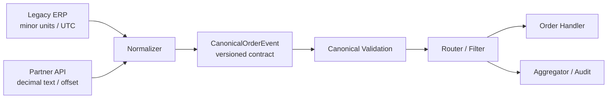
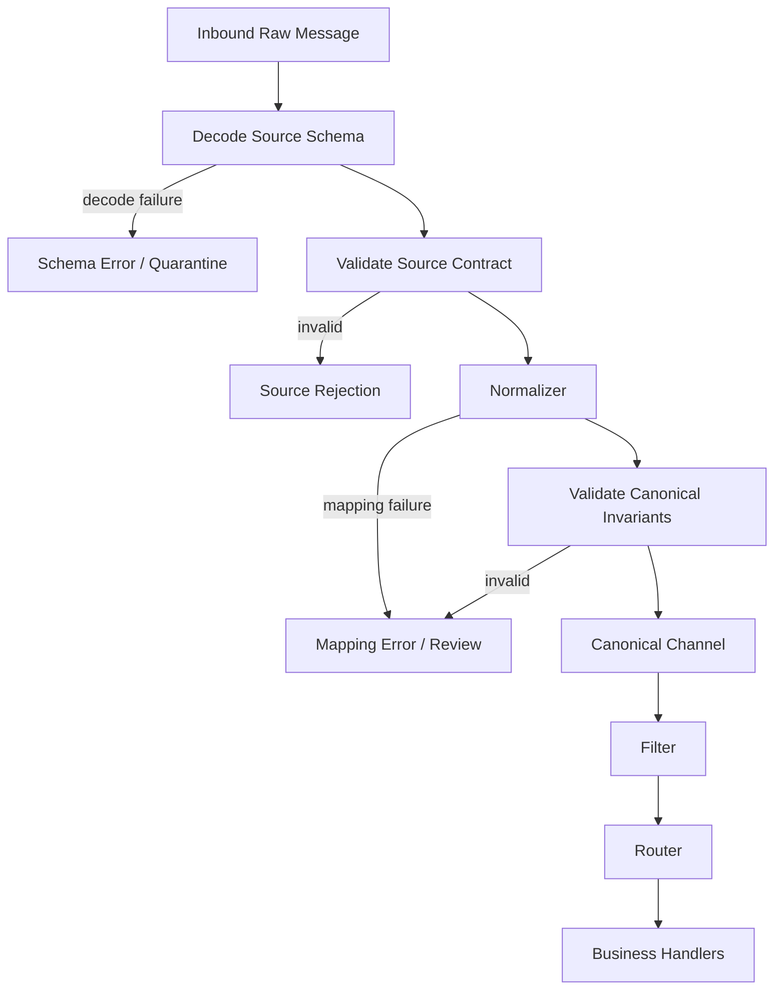
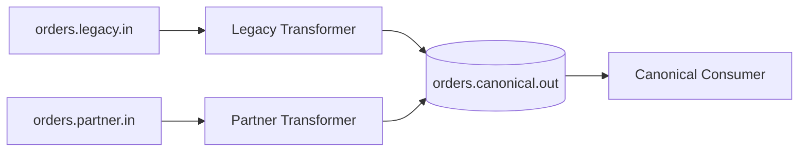
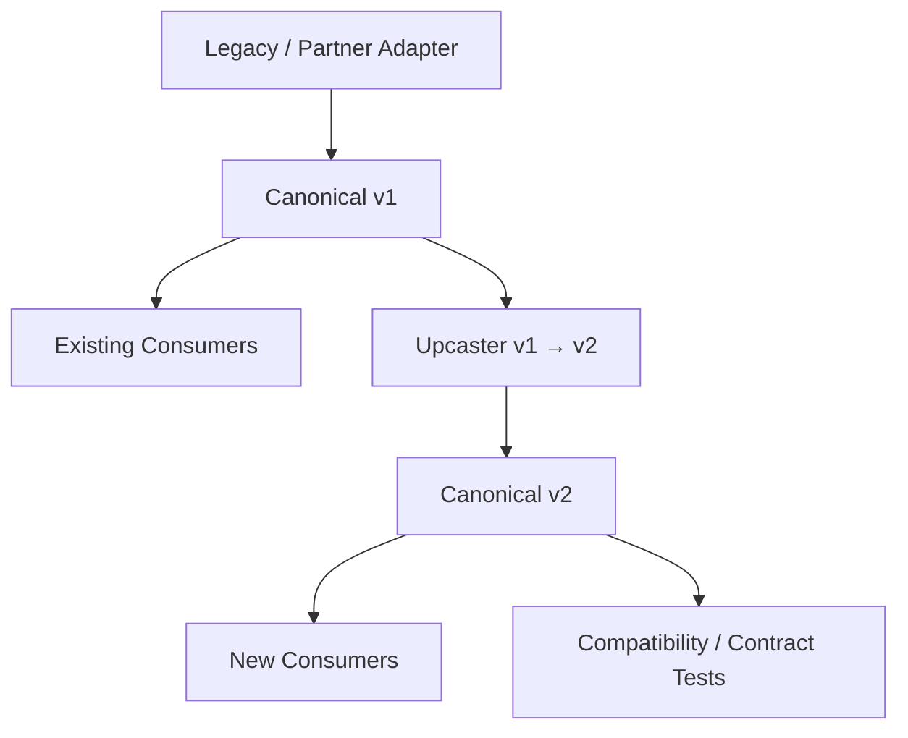
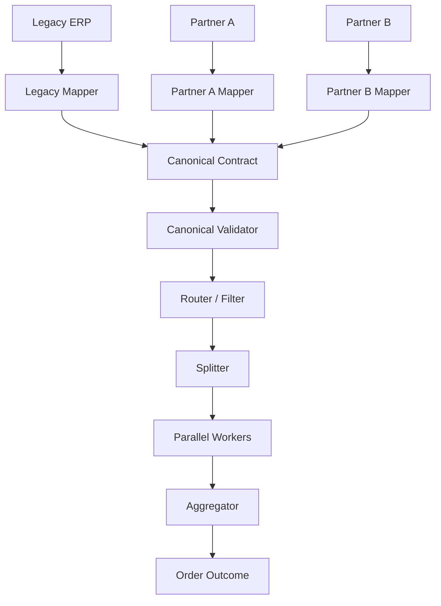

# Đảm bảo canonical model ổn định

**Normalizer** là một Enterprise Integration Pattern (EIP) dùng để đưa các dạng message khác nhau về **một mô hình chung (canonical model)** mà các bước xử lý phía sau có thể hiểu nhất quán. Thay vì bắt mọi Router, Filter, Aggregator hoặc service nghiệp vụ biết hàng loạt format từ hệ thống cũ, đối tác và API mới, ta đặt logic chuyển đổi tại ranh giới tích hợp.

Nhưng tạo ra một Java record chung chưa đủ. Nếu hôm nay `amount=100` có nghĩa là **100 USD**, ngày mai lại bị hiểu là **100 cent**, hoặc `eventTime` đôi khi là giờ UTC, đôi khi là giờ địa phương, mô hình tuy có cùng tên field vẫn **không ổn định về ngữ nghĩa**. Hệ thống sẽ có lỗi khó phát hiện: tính tiền sai, ghép nhầm message, chạy duplicate, áp dụng sự kiện sai thứ tự hoặc tạo báo cáo lệch sau một đợt nâng cấp adapter.

Bài **“Đảm bảo canonical model ổn định”** thuộc chương **Normalizer**, module **SPRING_INTEGRATION_PATTERN**. Module học triển khai Enterprise Integration Patterns với Spring Integration để xây dựng luồng thông điệp ít phụ thuộc, dễ mở rộng; thực hành Router, Filter, Transformer, Splitter, Aggregator, Gateway, retry, error channel và correlation, đồng thời kiểm thử các nhánh xử lý.

**Mục tiêu bài học:** thiết kế một canonical contract bền vững theo thời gian; xác định các bất biến của ID, tiền tệ, thời gian, enum và provenance; viết adapter chuẩn hóa dữ liệu từ nhiều nguồn bằng Java và Spring Integration DSL; xử lý input sai mà không sinh canonical giả; kiểm thử tính xác định, tương thích ngược, replay và chuyển đổi giữa các phiên bản.

## 1. Normalizer giải quyết vấn đề gì?

Giả sử một hệ thống đặt hàng nhận hai nguồn:

- **Legacy ERP** gửi đơn dưới dạng `LegacyOrderEvent` với tổng tiền theo đơn vị nhỏ nhất, timestamp UTC và mã đơn `orderNo`.
- **Partner API** gửi `PartnerOrderEvent` với tổng tiền dưới dạng decimal text, timestamp có offset, và mã đơn `externalOrderRef`.

Hai hệ thống biểu diễn cùng khái niệm nghiệp vụ nhưng không dùng cùng schema.



Nếu không có Normalizer, mỗi downstream consumer có thể chứa logic như `if (source == "ERP") ... else ...`. Khi thêm đối tác thứ ba, toàn bộ các nơi ấy phải thay đổi.

Khi có Normalizer, mỗi nguồn chịu trách nhiệm **dịch vào canonical contract**, còn downstream chỉ hiểu một mô hình đã thống nhất.

Tuy vậy, Normalizer **không phải bộ vá dữ liệu tùy tiện**. Nó không được âm thầm “đoán” tiền tệ, tạo một `orderId` mới khi thiếu ID, hoặc đổi thời điểm nguồn sang `Instant.now()` chỉ để output luôn có dữ liệu.

## 2. Canonical model ổn định nghĩa là gì?

Một canonical model được xem là ổn định khi các consumer có thể dựa vào **cùng một ý nghĩa của từng field và từng bất biến**, kể cả khi adapter được nâng cấp hoặc thêm nguồn.

Có bốn tầng ổn định cần phân biệt:

| Tầng | Ví dụ | Yêu cầu |
| --- | --- | --- |
| **Cấu trúc (structural)** | Field `orderId` luôn là chuỗi; `totalMinor` luôn là số nguyên | Schema/type không đổi bất ngờ |
| **Ngữ nghĩa (semantic)** | `totalMinor` luôn tính theo minor unit của `currency` | Không âm thầm đổi nghĩa |
| **Định danh (identity)** | `tenantId + sourceSystem + eventId` nhận diện cùng một sự kiện nguồn | Retry/replay không tạo identity khác |
| **Vòng đời/evolution** | Consumer v1 còn đọc được dữ liệu theo hợp đồng v1 khi v2 được phát hành | Version, migration và compatibility có quy tắc |

**Ổn định không có nghĩa là “mô hình không bao giờ được đổi”.** Nó có nghĩa thay đổi được quản lý bằng contract, version, migration và test; consumer không phải đoán nghĩa của payload.

Ví dụ về sai lệch ngữ nghĩa:

```text
Old mapping:
  totalMinor = 2599
  currency = USD
  meaning = 25.99 USD

Accidentally changed mapping:
  totalMinor = 2599
  currency = USD
  meaning = 2599 USD

JSON shape is unchanged; business meaning is broken.
```

**Schema validation chỉ kiểm tra được một phần hợp đồng**. Nó có thể xác minh `totalMinor` là số nguyên dương, nhưng không tự biết adapter đã nhân/chia số tiền sai hay chưa.

## 3. Vị trí của Normalizer trong kiến trúc Spring Integration

Một kiến trúc dễ quản lý thường chia rõ:

1. **Inbound adapter/decoder:** đọc HTTP, Kafka, JMS hoặc file, kiểm tra định dạng vật lý.
2. **Source-specific validation:** kiểm tra đúng schema, kiểu dữ liệu và tiền điều kiện của nguồn.
3. **Normalizer/Transformer:** chuyển các khái niệm nguồn sang canonical field có ý nghĩa thống nhất.
4. **Canonical validation:** kiểm tra bất biến của output, không mặc định mapper luôn đúng.
5. **Business flow:** Router, Filter, Splitter, Aggregator, Gateway, handler chỉ hiểu canonical model.
6. **Output adapter:** khi cần, dịch canonical model sang format của hệ thống đích.



Trong Spring Integration, ta có thể triển khai Normalizer bằng **Transformer endpoint** hoặc một số flow riêng chuyển từ từng nguồn vào channel canonical. Normalizer là **trách nhiệm kiến trúc**; không nên giả định tồn tại một component duy nhất tự động hiểu mọi business schema.

### Normalizer khác Router và Aggregator

- **Router** chọn nhánh/đích xử lý; không phải nơi cất giữ mọi quy tắc đổi nghĩa dữ liệu.
- **Transformer** là cơ chế đổi payload/message; một Normalizer có thể gồm nhiều Transformer cùng hướng về một canonical contract.
- **Aggregator** tập hợp các message liên quan và quyết định khi nào release; không sửa lỗi schema bằng cách ghép ngẫu nhiên.
- **Resequencer** khôi phục thứ tự các message; không tự thống nhất ID hoặc currency.
- **Gateway** cung cấp hợp đồng request-reply; không tự bảo đảm payload sau gateway đã được chuẩn hóa.

Dùng pattern đúng trách nhiệm giúp sửa mapping ở một nơi mà không kéo logic tương tự qua nhiều downstream consumer.

## 4. Xác lập chủ sở hữu canonical contract

Nếu mỗi team tự diễn giải model chung, “canonical” chỉ còn là tên gọi. Cần có người chịu trách nhiệm cho:

- **Tên và ý nghĩa** từng field.
- **Đơn vị đo lường**: tiền, khối lượng, thời gian.
- **Bất biến**: bắt buộc, optional, range, uniqueness.
- **Quy tắc identity** và idempotency.
- **Phiên bản schema** và thay đổi tương thích.
- **Chính sách enum/unknown values**.
- **Dữ liệu nhạy cảm** và trust boundary.
- **Fixture hợp đồng** mà các source adapter phải vượt qua.

Một bản contract đủ rõ để trả lời:

> Nếu hai adapter nhận hai biểu diễn khác nhau của cùng một sự kiện nghiệp vụ, những field canonical nào phải giống nhau? Những field nào cố ý giữ khác, như `originSystem` hoặc `sourceEventId`?

Tùy business, hai nguồn có thể phản ánh **hai sự kiện riêng** chứ không phải cùng một event; khi đó không ép chúng có cùng idempotency key chỉ vì có cùng `orderId`.

## 5. Thiết kế một canonical model có bất biến rõ ràng

Ta chọn canonical order event với các trường sau:

| Field | Type | Quy ước canonical | Bất biến |
| --- | --- | --- | --- |
| `schemaVersion` | `int` | Version contract của payload | Luôn xác định, ví dụ `1` |
| `tenantId` | `String` | Tenant identity đã được xác minh | Không rỗng, tách tenant |
| `orderId` | `String` | Mã đơn theo hệ thống nguồn đã mapping chính xác | Không rỗng, không suy từ timestamp |
| `sourceEventId` | `String` | Event ID ổn định của nguồn | Không đổi trên retry cùng event |
| `occurredAt` | `Instant` | Thời điểm tuyệt đối UTC | Không được tự thay bằng giờ nhận |
| `currency` | ISO code | Currency đã xác minh | Không suy từ locale của server |
| `totalMinor` | `long` | Số lượng **minor units** của currency | Dương, không overflow |
| `originSystem` | `String`/enum | Provenance có kiểm soát | Bắt nguồn từ adapter đáng tin cậy |

Chỉ số `schemaVersion=1` nghĩa là record tuân thủ **canonical contract v1**, không phải “source A đang dùng mapping version 1”.

### JSON canonical minh họa

```json
{
  "schemaVersion": 1,
  "tenantId": "tenant-a",
  "orderId": "ORD-7",
  "sourceEventId": "evt-99",
  "occurredAt": "2026-11-21T02:05:00Z",
  "currency": "USD",
  "totalMinor": 159900,
  "originSystem": "LEGACY_ERP"
}
```

Giá trị `159900` ở đây mang nghĩa **1.599,00 USD**, vì USD có hai chữ số thập phân trong ví dụ. Với VND, cùng số `159900` biểu diễn **159.900 VND** khi dùng quy ước 0 chữ số thập phân.

**Không được diễn giải `totalMinor` mà không biết `currency`**. Khi hệ thống có tài sản không thuộc ISO currency hoặc loại tiền đặc biệt, phải định nghĩa bảng unit và precision riêng, không áp tùy tiện các quy tắc USD/VND.

## 6. Những gì không nên đưa vào canonical model lõi

Càng nhét nhiều chi tiết của từng nguồn vào canonical, càng khó giữ nó ổn định:

- Tên field đặc thù `erpOrderNr`, `partnerDocId` nếu đã có identity chung.
- `rawPayload` không giới hạn; mang PII và khóa consumer với định dạng nguồn.
- Object Java `MessageChannel`, `replyChannel` hoặc adapter-specific implementation.
- Hàng chục trường `partnerXFlag` không có ý nghĩa nghiệp vụ chung.
- Giá trị tạm như `workerThreadId`, `receivedAtLocal` để mặc định thành business timestamp.
- Header nội bộ không tồn tại qua broker nhưng consumer lại phụ thuộc.
- Cờ `isValid` không gắn quy tắc/version và không được kiểm chứng sau mapping.

Nếu cần lưu dữ liệu gốc cho audit, cân nhắc **Claim Check hoặc source archive** có phân quyền và retention riêng. Canonical model chỉ mang **tham chiếu hợp lệ hoặc metadata tối thiểu** theo contract.

Điều này không có nghĩa bỏ hết provenance. Có thể giữ `originSystem`, `sourceEventId` hoặc `mappingRevision` ở **envelope/audit metadata** đủ để điều tra mà không nhiễm business model.

## 7. Ví dụ hai nguồn có biểu diễn khác nhau

**Nguồn legacy:**

```json
{
  "tenantId": "tenant-a",
  "orderNo": "ORD-7",
  "eventRef": "evt-99",
  "createdAtUtc": "2026-11-21T02:05:00Z",
  "currencyCode": "USD",
  "totalMinor": 159900
}
```

**Nguồn partner:**

```json
{
  "partnerTenant": "tenant-a",
  "externalOrderRef": "ORD-7",
  "eventRef": "partner-event-88",
  "occurredAtWithOffset": "2026-11-21T09:05:00+07:00",
  "isoCurrency": "usd",
  "amountDecimal": "1599.00"
}
```

Hai message có thể phản ánh cùng một thời điểm/tổng tiền sau khi chuẩn hóa. Nhưng **`eventRef` và `originSystem` khác** vì chúng là các event do hai nguồn phát; nếu thật sự là cùng một business event, phải có **một mapping identity đáng tin** chứ không tự kết luận từ tổng tiền và order ID giống nhau.

Bảng mapping:

| Canonical | Legacy source | Partner source |
| --- | --- | --- |
| `tenantId` | `tenantId`, đối chiếu trusted source | `partnerTenant`, ánh xạ qua partner authorization |
| `orderId` | `orderNo` | `externalOrderRef` |
| `sourceEventId` | `eventRef` | `eventRef` |
| `occurredAt` | parse UTC `Instant` | parse offset rồi đổi sang `Instant` |
| `currency` | ISO uppercase theo hợp đồng | uppercase theo contract partner cho phép |
| `totalMinor` | Đã là minor units | Decimal string → minor units chính xác |
| `originSystem` | `LEGACY_ERP` | `PARTNER_API` |

**Chỉ map sau khi đã xác thực nguồn**. Một chuỗi tenant do caller tự khai không được tự động coi là tenant có quyền.

## 8. Tiền tệ: đừng chỉ đổi tên field

Đổi `amountDecimal` thành `totalMinor` bằng cách copy nguyên số có thể là lỗi tài chính nghiêm trọng.

| Nguồn | Raw value | Currency | Canonical minor units |
| --- | --- | --- | ---: |
| Legacy | `159900` minor | USD | 159900 |
| Partner | `"1599.00"` major | USD | 159900 |
| Partner | `"159900"` major | VND | 159900 |
| Partner | `"1.599"` major | USD | **Không hợp lệ** nếu chỉ cho đúng cent |
| Partner | `"1.5"` major | VND | **Không hợp lệ** trong quy ước ví dụ |
| Partner | `"-10.00"` | USD | **Không hợp lệ** cho đơn hàng dương |

### Nguyên tắc tiền tệ

- Dùng `BigDecimal` khi parse decimal text, không dùng `double` rồi nhân 100.
- Xác định fraction digits từ **currency policy** phù hợp; không luôn dùng 2 cho mọi currency.
- Không tự làm tròn một số có độ chính xác sai nếu hợp đồng yêu cầu exact amount.
- Kiểm tra overflow trước khi đổi sang `long`.
- Không cho amount âm nếu event type là đơn mua hàng dương; sự kiện hoàn tiền có thể cần **model/event type khác**, không ép bằng một giá trị âm thiếu ngữ nghĩa.
- Nếu currency là null hoặc không hỗ trợ, **reject** thay vì lấy currency mặc định theo locale.
- Nếu nguồn dùng minor units nhưng metadata không nói currency, không thể biết nên diễn giải nó theo scale nào.

Với contract nghiêm ngặt, `"1599.000"` cho USD có thể được chấp nhận vì không có phần cent dư thực sự; `"1599.001"` phải bị từ chối nếu không cho làm tròn. Điều này là **quy tắc policy**, cần test đúng chứ không để phụ thuộc vào một conversion ngẫu nhiên.

## 9. Thời gian: chuẩn hóa instant, không đổi nghĩa sự kiện

`2026-11-21T02:05:00Z` và `2026-11-21T09:05:00+07:00` diễn đạt **cùng một thời điểm tuyệt đối**. Canonical model dùng `Instant` để tránh nhầm timezone.

```text
Legacy UTC:
  2026-11-21T02:05:00Z

Partner offset:
  2026-11-21T09:05:00+07:00

Canonical Instant:
  2026-11-21T02:05:00Z
```

Không dùng `LocalDateTime` mà không có timezone/offset khi nguồn chỉ ghi “09:05”: một thời điểm địa phương có thể mơ hồ tại ngày đổi DST. Không tự đoán timezone bằng timezone của container.

Phân biệt:

- `occurredAt`: thời điểm sự kiện xảy ra theo nguồn đáng tin.
- `receivedAt`: thời điểm adapter nhận.
- `processedAt`: thời điểm Normalizer/handler xử lý.
- `committedAt`: thời điểm side effect được commit.

Các giá trị này **không thay thế cho nhau**. Nếu nguồn thiếu `occurredAt` mà downstream cần biết thời điểm nghiệp vụ, lựa chọn an toàn thường là **reject/hold** hoặc sử dụng một policy fallback **được ghi rõ version**, không lén dùng `Instant.now()` khiến replay đổi output.

## 10. Định danh: chuẩn hóa nhưng không làm mất identity

Một số “chuẩn hóa” có thể gây hại:

```text
"ORD-007" -> "ORD-7"         // có thể mất identity
"Tenant-A" -> "tenant-a"     // có thể nhập hai tenant khác nhau
"00123" -> "123"             // có thể làm trùng mã khách hàng
"À" -> "A"                   // có thể đổi nghĩa tên riêng
"ref A " -> "ref A"          // chỉ hợp lệ nếu source contract cho trim
```

Không coi các biến đổi như lowercase, trim, Unicode normalization và bỏ leading zeros là vô hại cho **mọi business key**.

Hướng thiết kế:

1. Nguồn nào cho phép trim/case-fold phải được tài liệu hóa riêng.
2. Tenant identity lấy từ **authenticated source mapping**, không chỉ chuỗi body.
3. Nếu upstream có nhiều hệ ID, có **ID mapping table** do domain quản lý.
4. Định danh mới chỉ được tạo khi contract thật sự định nghĩa một entity/sự kiện mới.
5. Không dùng một ID ngẫu nhiên mới cho mỗi lần retry của cùng event.
6. Không dùng hash của toàn payload làm business event ID vì payload có thể chứa timestamp hoặc field phụ thay đổi.

Nếu một order ID không đáp ứng canonical contract, hãy báo **invalid identity**; đừng cố sửa để output luôn “hợp lệ” nhưng trỏ sang một đơn hàng khác.

## 11. Java model cho hai nguồn và canonical

Trong ví dụ, mỗi adapter nhận một DTO đã deserialize đúng type:

```java
import java.time.Instant;

record LegacyOrderEvent(
    String tenantId,
    String orderNo,
    String eventRef,
    String createdAtUtc,
    String currencyCode,
    long totalMinor
) {}

record PartnerOrderEvent(
    String partnerTenant,
    String externalOrderRef,
    String eventRef,
    String occurredAtWithOffset,
    String isoCurrency,
    String amountDecimal
) {}

record CanonicalOrderEvent(
    int schemaVersion,
    String tenantId,
    String orderId,
    String sourceEventId,
    Instant occurredAt,
    String currency,
    long totalMinor,
    String originSystem
) {}
```

`CanonicalOrderEvent` là DTO canonical **version 1**. Nếu cần metadata bản sửa đổi mapper mà không đổi ý nghĩa payload, có thể giữ `mappingRevision` trong envelope/audit hoặc trường contract được quản lý rõ, thay vì làm consumer vô tình phụ thuộc vào tên class mapper.

**Đừng cho rằng Java record tự đảm bảo toàn bộ bất biến**. Mapping và canonical validator phải kiểm tra field. Bản ghi có thể vẫn được tạo với `orderId=""` nếu không có bước kiểm chứng.

### Loại lỗi mapping không chứa dữ liệu thô

```java
final class CanonicalMappingException extends RuntimeException {
    private final String field;
    private final String reasonCode;

    CanonicalMappingException(String field, String reasonCode) {
        super("Canonical mapping failed: " + field
              + "/" + reasonCode);
        this.field = field;
        this.reasonCode = reasonCode;
    }

    String field() {
        return field;
    }

    String reasonCode() {
        return reasonCode;
    }
}
```

Thông điệp lỗi chỉ có **tên field + mã lý do**, không nối raw value hoặc payload có thể chứa PII. Với lỗi không thể phân loại, dùng error path hạ tầng riêng; không biến một bug `NullPointerException` thành lỗi input không hợp lệ.

## 12. Java Normalizer: hai nguồn cùng phát CanonicalOrderEvent

Bộ mapper dưới đây thực hiện:

- Kiểm tra ID theo format ví dụ (chữ/số/`_`/`-`, tối đa 64 ký tự).
- Không đổi case hoặc xóa leading zero của ID.
- Parse timestamps thành `Instant`.
- Dùng currency allowlist `USD`/`VND` và precision tương ứng.
- Kiểm tra amount dương và conversion exact.
- Gắn `schemaVersion=1` và source provenance cố định.
- **Không tạo ID hay timestamp dựa vào thời điểm chạy**, để replay đầu vào giống nhau cho output giống nhau.

```java
import java.math.BigDecimal;
import java.time.Instant;
import java.time.OffsetDateTime;
import java.time.format.DateTimeParseException;
import java.util.Currency;
import java.util.Locale;
import java.util.Set;
import java.util.regex.Pattern;

final class CanonicalOrderNormalizer {
    private static final int SCHEMA_VERSION = 1;
    private static final Pattern ID =
        Pattern.compile("[A-Za-z0-9_-]{1,64}");
    private static final Set<String> CURRENCIES =
        Set.of("USD", "VND");

    CanonicalOrderEvent fromLegacy(LegacyOrderEvent source) {
        if (source == null) {
            throw new CanonicalMappingException(
                "payload", "REQUIRED");
        }

        String tenant = id(source.tenantId(), "tenantId");
        String order = id(source.orderNo(), "orderNo");
        String event = id(source.eventRef(), "eventRef");
        String currency = currency(
            source.currencyCode(), false);

        long totalMinor = positive(
            source.totalMinor(), "totalMinor");

        return new CanonicalOrderEvent(
            SCHEMA_VERSION, tenant, order, event,
            parseInstant(source.createdAtUtc(), "createdAtUtc"),
            currency, totalMinor, "LEGACY_ERP"
        );
    }

    CanonicalOrderEvent fromPartner(PartnerOrderEvent source) {
        if (source == null) {
            throw new CanonicalMappingException(
                "payload", "REQUIRED");
        }

        // Ví dụ này giả định hợp đồng partner CHO PHÉP
        // currency chữ thường. Không áp dụng ngầm cho mọi field.
        String currency = currency(
            source.isoCurrency(), true);

        return new CanonicalOrderEvent(
            SCHEMA_VERSION,
            id(source.partnerTenant(), "partnerTenant"),
            id(source.externalOrderRef(), "externalOrderRef"),
            id(source.eventRef(), "eventRef"),
            parseOffsetTime(
                source.occurredAtWithOffset(),
                "occurredAtWithOffset"),
            currency,
            decimalToMinor(
                source.amountDecimal(), currency),
            "PARTNER_API"
        );
    }

    private static String id(String raw, String field) {
        if (raw == null || !ID.matcher(raw).matches()) {
            throw new CanonicalMappingException(
                field, "INVALID_ID");
        }
        return raw;
    }

    private static String currency(
            String raw, boolean normalizePartnerCase) {
        if (raw == null) {
            throw new CanonicalMappingException(
                "currency", "REQUIRED");
        }

        String result = normalizePartnerCase
            ? raw.toUpperCase(Locale.ROOT)
            : raw;

        if (!CURRENCIES.contains(result)) {
            throw new CanonicalMappingException(
                "currency", "UNSUPPORTED_CURRENCY");
        }
        return result;
    }

    private static long positive(long amount, String field) {
        if (amount <= 0) {
            throw new CanonicalMappingException(
                field, "MUST_BE_POSITIVE");
        }
        return amount;
    }

    private static long decimalToMinor(
            String decimalText, String currency) {
        if (decimalText == null || decimalText.isBlank()) {
            throw new CanonicalMappingException(
                "amountDecimal", "REQUIRED");
        }

        try {
            // USD = 2, VND = 0 theo ISO currency policy
            // dùng trong ví dụ này.
            int fractionDigits = Currency
                .getInstance(currency)
                .getDefaultFractionDigits();

            BigDecimal minorUnits =
                new BigDecimal(decimalText)
                    .movePointRight(fractionDigits);

            return positive(
                minorUnits.longValueExact(), "amountDecimal");
        } catch (NumberFormatException | ArithmeticException ex) {
            throw new CanonicalMappingException(
                "amountDecimal", "NOT_EXACT_MINOR_UNITS");
        }
    }

    private static Instant parseInstant(
            String raw, String field) {
        try {
            return Instant.parse(raw);
        } catch (DateTimeParseException | NullPointerException ex) {
            throw new CanonicalMappingException(
                field, "INVALID_TIMESTAMP");
        }
    }

    private static Instant parseOffsetTime(
            String raw, String field) {
        try {
            return OffsetDateTime.parse(raw).toInstant();
        } catch (DateTimeParseException | NullPointerException ex) {
            throw new CanonicalMappingException(
                field, "INVALID_TIMESTAMP");
        }
    }
}
```

### Giới hạn của code mẫu

- `Currency.getDefaultFractionDigits()` là policy dùng ISO currency, **không đại diện mọi asset/đối tác**. Các hệ thống có cash rounding, settlement precision hoặc crypto assets cần contract riêng.
- `Currency.getInstance(...)` trong ví dụ chỉ nhận USD/VND đã qua allowlist. Production phải đánh giá trường hợp không hỗ trợ/default fraction digits bất thường.
- Format ID cố ý giới hạn để dễ minh họa. Không dùng regex ấy để “sửa” customer ID thực tế nếu business cho phép dấu cách, Unicode hoặc các mã khác.
- `partnerTenant` **chỉ hợp lệ sau authentication/authorization** của producer; mapper không tự kiểm chứng nguồn.
- Source schema chưa có line items, tax, discount, versioned references; muốn thêm phải định nghĩa **semantics đầy đủ** thay vì đoán.
- Exception được chuẩn hóa cho invalid field, nhưng lỗi hạ tầng/bug không được swallow hoặc gán thành input invalid.
- Mã cần chạy build/test cùng phiên bản JDK, Spring Integration và dependencies thật ở vòng QA sau.

## 13. Kiểm tra canonical invariants sau mapper

Không nên tin rằng vì mỗi mapper viết bằng Java nên output luôn đúng. Một lớp **canonical validator** độc lập bảo vệ điểm dùng chung.

```java
import java.util.Set;

final class CanonicalOrderValidator {
    private static final Set<String> CURRENCIES =
        Set.of("USD", "VND");

    void validate(CanonicalOrderEvent event) {
        if (event == null) {
            throw new CanonicalMappingException(
                "canonical", "REQUIRED");
        }
        if (event.schemaVersion() != 1) {
            throw new CanonicalMappingException(
                "schemaVersion", "UNSUPPORTED_VERSION");
        }
        if (event.tenantId() == null
                || event.tenantId().isBlank()
                || event.orderId() == null
                || event.orderId().isBlank()
                || event.sourceEventId() == null
                || event.sourceEventId().isBlank()) {
            throw new CanonicalMappingException(
                "identity", "REQUIRED");
        }
        if (event.occurredAt() == null) {
            throw new CanonicalMappingException(
                "occurredAt", "REQUIRED");
        }
        if (event.currency() == null
                || !CURRENCIES.contains(event.currency())
                || event.totalMinor() <= 0) {
            throw new CanonicalMappingException(
                "money", "INVALID_VALUE");
        }
        if (event.originSystem() == null
                || !Set.of("LEGACY_ERP", "PARTNER_API")
                .contains(event.originSystem())) {
            throw new CanonicalMappingException(
                "originSystem", "INVALID_PROVENANCE");
        }
    }
}
```

Khi contract đòi ID format nghiêm ngặt, validator cũng phải kiểm tra format đó, không chỉ nonblank. Khi canonical model thêm invariant mới, cần version hóa tương ứng; nếu không, một consumer cũ có thể nhận v1 payload hợp lệ ở version cũ nhưng bị validator mới từ chối.

### “Không hợp lệ” và “chưa đủ dữ liệu” không giống nhau

Nếu nguồn không có currency, không được tự phát canonical `currency="USD"` trừ khi có một **nguồn bổ sung đáng tin và policy rõ ràng**. Nếu API tỷ giá không sẵn sàng, đó là **mapping enrichment unavailable**, không phải `UNSUPPORTED_CURRENCY`.

Có thể có ba kết quả:

| Kết quả | Ví dụ | Cách xử lý |
| --- | --- | --- |
| `NORMALIZED` | Mọi bất biến đạt | Phát canonical event |
| `REJECTED` | ID sai, amount không exact, timestamp không có offset | Typed rejection/quarantine |
| `UNAVAILABLE` | Store ánh xạ tenant hoặc service tham chiếu bị lỗi | Retry/backoff/hold có giới hạn |

Không nên phát bản ghi “tạm hợp lệ” đến business handler rồi sửa sau khi hệ thống đã tạo side effect.

## 14. Determinism: cùng input phải cho cùng output

Một tính chất quan trọng của Normalizer là **deterministic mapping**:

\[
normalize(x, v) = normalize(x, v)
\]

với cùng nguồn dữ liệu `x` và cùng quy tắc mapping `v`, trong điều kiện không có dữ liệu tham chiếu thay đổi không được quản lý.

Ví dụ không deterministic:

```java
// Không nên làm để lấp trường nguồn còn thiếu:
String eventId = java.util.UUID.randomUUID().toString();
Instant occurredAt = Instant.now();
```

Nếu retry cùng event, mapper tạo ID và timestamp khác; downstream có thể coi đó là một event mới. Điều này phá idempotency, correlation và test hồi quy.

Một mapper deterministic nên:

- Nhận dữ liệu nguồn và mapping policy version được xác định.
- Không tự gọi random clock hoặc tạo UUID khi đang chuẩn hóa **cùng một event nguồn**.
- Với reference data thay đổi theo thời gian, ghi nhận version/snapshot và dùng dữ liệu phù hợp với thời điểm sự kiện.
- Không dựa vào iteration order của `HashMap` nếu thứ tự các phần tử là một phần canonical contract.
- Không dựa vào locale/timezone mặc định của JVM.
- Không dùng số thực nhị phân để “làm gần đúng” giá tiền exact.

Tuy vậy, **determinism không tự đảm bảo mapping đúng**: một hàm luôn nhân số tiền sai 100 lần cũng có thể deterministic. Cần thêm golden tests và kiểm tra semantic invariants.

## 15. Stable identity, retry và event replay

Một canonical event có thể chứa:

```text
tenantId       = tenant-a
originSystem   = PARTNER_API
sourceEventId  = partner-event-88
orderId        = ORD-7
```

Một khóa idempotency gợi ý cho consumer:

```text
(tenantId, originSystem, sourceEventId, consumerScope)
```

Nếu partner redeliver **cùng sự kiện**, tuple này phải giữ nguyên. Nhưng nếu cùng order được cập nhật lần hai, nó phải có **event ID/version mới**, không bị chặn nhầm như duplicate chỉ vì `orderId` giống nhau.

Nếu hai nguồn độc lập gửi **cùng business effect**, dùng hai source event IDs có thể khiến effect chạy hai lần. Khi đó cần **domain uniqueness/business operation key** hoặc mapping equivalence từ nguồn đáng tin cậy. Không suy ra equivalence chỉ từ `orderId + amount`, vì hai giao dịch hợp lệ có thể cùng giá trị.

### Không dùng message ID của framework làm business key

Spring Message có `MessageHeaders.ID`, nhưng Transformer và adapter có thể tạo message mới. Nó không phải bằng chứng rằng hai message là cùng một event nghiệp vụ. Hãy giữ `sourceEventId` riêng, mapping qua transport theo schema rõ ràng.

## 16. Spring Integration Java DSL: hai nguồn về một canonical channel

Một cách dễ hiểu là tạo hai flow, mỗi flow dùng **source-specific transformer**, rồi gửi kết quả đến cùng channel.



Ví dụ Java DSL:

```java
import org.springframework.context.annotation.Bean;
import org.springframework.context.annotation.Configuration;
import org.springframework.integration.channel.DirectChannel;
import org.springframework.integration.channel.QueueChannel;
import org.springframework.integration.config.EnableIntegration;
import org.springframework.integration.dsl.IntegrationFlow;
import org.springframework.messaging.MessageChannel;
import org.springframework.messaging.PollableChannel;

@Configuration
@EnableIntegration
class CanonicalNormalizerFlows {

    @Bean("orders.legacy.in")
    MessageChannel legacyOrdersInput() {
        return new DirectChannel();
    }

    @Bean("orders.partner.in")
    MessageChannel partnerOrdersInput() {
        return new DirectChannel();
    }

    @Bean("orders.canonical.out")
    PollableChannel canonicalOrdersOutput() {
        // Queue trong RAM để quan sát output khi học/test.
        return new QueueChannel();
    }

    @Bean
    CanonicalOrderNormalizer canonicalOrderNormalizer() {
        return new CanonicalOrderNormalizer();
    }

    @Bean
    IntegrationFlow normalizeLegacyOrder(
            CanonicalOrderNormalizer normalizer) {
        return IntegrationFlow.from("orders.legacy.in")
            .transform(LegacyOrderEvent.class,
                normalizer::fromLegacy)
            .channel("orders.canonical.out")
            .get();
    }

    @Bean
    IntegrationFlow normalizePartnerOrder(
            CanonicalOrderNormalizer normalizer) {
        return IntegrationFlow.from("orders.partner.in")
            .transform(PartnerOrderEvent.class,
                normalizer::fromPartner)
            .channel("orders.canonical.out")
            .get();
    }
}
```

**Các điều kiện của ví dụ:**

1. Input channels chỉ được nhận DTO đúng kiểu từ decoder/trusted ingress.
2. Hai Transformer xuất **cùng kiểu `CanonicalOrderEvent`** và cùng contract v1.
3. `orders.canonical.out` là `QueueChannel` đơn giản để test; **không tự bền vững** và không cam kết consumer order/transaction.
4. `CanonicalOrderValidator` phải được gắn vào điểm dùng chung ở production hoặc chạy ngay sau mỗi transformation; mẫu tối giản ở đây chỉ minh họa routing hai nguồn về một channel.
5. Các overload DSL `transform(Class, ...)` cần được đối chiếu với phiên bản Spring Integration đang dùng.
6. Nếu muốn nhận raw Kafka/HTTP payload, phải thêm decoder/adapter **trước** các channel nguồn.
7. Không cho client điều khiển `replyChannel`, `errorChannel` hoặc tên channel bằng headers tự khai.

### Không tạo một “mẫu dùng chung” làm mất lỗi nguồn

Có thể viết một flow nhận `Object`, kiểm tra `instanceof` rồi dispatch. Nhưng nếu số loại nguồn tăng, nó dễ trở thành một transformer khổng lồ, coupling với tất cả DTO. Hai flow riêng giúp phân quyền, validate và giám sát **theo nguồn** rõ hơn.

Khi cần Router định tuyến nhiều định dạng, mỗi nhánh vẫn nên có source adapter riêng; canonical output **không được phụ thuộc loại input** ngoài provenance đã công bố.

## 17. Kiểm tra và chặn output canonical sai

Nếu CanonicalOrderValidator được dùng như một **handler một chiều**, nó có thể vô tình làm kết thúc flow. Nên bảo đảm endpoint kiểm tra **và cho payload đi tiếp**.

Một phương án đơn giản trong flow là sử dụng Filter pass-through:

```java
@Bean
IntegrationFlow canonicalValidationFlow(
        CanonicalOrderValidator validator) {
    return IntegrationFlow.from("orders.canonical.check")
        .filter(CanonicalOrderEvent.class, event -> {
            validator.validate(event);
            return true;
        })
        .channel("orders.canonical.accepted")
        .get();
}
```

Đây là **đoạn cấu hình thay thế minh họa**, yêu cầu đăng ký hai channel `orders.canonical.check` và `orders.canonical.accepted`; không nối nó vào flow mục 16 mà thiếu channel/consumer. Ở production có thể **dùng một shared canonical validation subflow** nhận từ hai transformer, sau đó phát tới business channel.

**Không dùng `.handle(event -> { validate(event); })` rồi mong message tự đi tiếp**, vì một Service Activator một chiều không có output sẽ dừng luồng.

### Canonical filter không tự xử lý mọi validation failure

Nếu `validator.validate` ném exception:

- Trong `DirectChannel` đồng bộ, exception có thể truyền về sender.
- Trong executor/poller/adapter async, error handler có thể publish Spring `ErrorMessage` tới error channel theo cấu hình.
- Một Filter trả `false` có thể discard mà không tự tạo `ErrorMessage`.
- Lỗi mapping deterministic thường cần typed rejection với field/reason code; lỗi dependency unavailable cần retry/recovery riêng.

Hãy dùng contract output phù hợp, đừng để consumer hiểu một mapping exception là “không có đơn” rồi retry mù.

## 18. Header và payload: cái gì là canonical?

Trong Spring Integration, message gồm payload và headers. Một payload canonical không có nghĩa mọi header gốc cũng được chuẩn hóa hoặc được phép truyền đi.

| Header/metadata | Hành động đề xuất |
| --- | --- |
| `sourceEventId` | Giữ ổn định trong payload hoặc envelope được version hóa |
| `businessGroupKey` | Tạo từ identity đã xác minh, kiểm tra với canonical payload |
| `correlationId` | Giữ khi vẫn cùng scope của batch/workflow |
| `sequenceNumber`/`sequenceSize` | Giữ khi vẫn là cùng phần tử của sequence |
| `replyChannel`/`errorChannel` | Không copy qua trust boundary như giá trị từ client |
| `tenantId` từ raw client | Không tin; xác minh bằng producer principal |
| `contentType` | Cập nhật nếu payload đã chuyển từ raw JSON sang object/format khác |
| `traceId` | Dùng quan sát, không dùng thay identity nghiệp vụ |

Một Transformer có thể giữ một phần headers tùy Spring Integration endpoint và cách trả kết quả. Nếu tự tạo `Message<?>`, hãy kiểm tra propagation/merge thực tế thay vì giả định giữ hoặc xóa toàn bộ.

### Canonical payload và transport envelope

Khi phát qua Kafka/JMS/HTTP:

- Payload canonical cần schema/wire format có version.
- Header mapper có thể không truyền được object Java nội bộ.
- Correlation và idempotency metadata nên có cách deserialize rõ.
- Không tùy tiện gắn raw header của source A lên event đã chuẩn hóa rồi để consumer B hiểu sai.
- Nếu một field bắt buộc cho consumer sau broker, cân nhắc đưa nó vào **versioned envelope** thay vì một header mơ hồ.

**Ổn định canonical** bao gồm cả việc chứng minh ý nghĩa output **sau khi serialize/deserialize**, không chỉ so sánh hai Java records trong cùng JVM.

## 19. Unit test mapping hai nguồn và cùng thời điểm

Với JUnit 5:

```java
import static org.junit.jupiter.api.Assertions.*;
import java.time.Instant;
import org.junit.jupiter.api.Test;

class CanonicalOrderNormalizerTest {

    private final CanonicalOrderNormalizer normalizer =
        new CanonicalOrderNormalizer();

    @Test
    void mapsLegacyMinorUnitsWithoutChangingAmount() {
        var legacy = new LegacyOrderEvent(
            "tenant-a", "ORD-7", "evt-99",
            "2026-11-21T02:05:00Z", "USD", 159_900L);

        CanonicalOrderEvent result =
            normalizer.fromLegacy(legacy);

        assertEquals(1, result.schemaVersion());
        assertEquals("tenant-a", result.tenantId());
        assertEquals("ORD-7", result.orderId());
        assertEquals("evt-99", result.sourceEventId());
        assertEquals("USD", result.currency());
        assertEquals(159_900L, result.totalMinor());
        assertEquals(
            Instant.parse("2026-11-21T02:05:00Z"),
            result.occurredAt());
        assertEquals("LEGACY_ERP", result.originSystem());
    }

    @Test
    void mapsPartnerDecimalAndOffsetIntoCanonical() {
        var partner = new PartnerOrderEvent(
            "tenant-a", "ORD-7", "partner-event-88",
            "2026-11-21T09:05:00+07:00",
            "usd", "1599.00");

        CanonicalOrderEvent result =
            normalizer.fromPartner(partner);

        assertEquals("USD", result.currency());
        assertEquals(159_900L, result.totalMinor());
        assertEquals(
            Instant.parse("2026-11-21T02:05:00Z"),
            result.occurredAt());
        assertEquals("PARTNER_API", result.originSystem());
    }

    @Test
    void sameSourceEventProducesSameCanonicalOutput() {
        var input = new LegacyOrderEvent(
            "tenant-a", "ORD-7", "evt-99",
            "2026-11-21T02:05:00Z", "USD", 159_900L);

        assertEquals(
            normalizer.fromLegacy(input),
            normalizer.fromLegacy(input));
    }
}
```

Hai nguồn có `totalMinor` và `occurredAt` **bằng nhau** trong ví dụ, nhưng **không nên assert toàn bộ record bằng nhau** vì `sourceEventId` và `originSystem` cố ý khác.

Tính deterministic được kiểm tra trên **cùng nguồn input và cùng mapping version**. Nếu một source bổ sung metadata khác, contract phải nói rõ những field nào được phép khác.

## 20. Negative tests: sai tiền, thiếu thời gian, ID không hợp lệ

Một số test quan trọng:

```java
import static org.junit.jupiter.api.Assertions.*;
import org.junit.jupiter.api.Test;

class CanonicalOrderNormalizerNegativeTest {
    private final CanonicalOrderNormalizer normalizer =
        new CanonicalOrderNormalizer();

    private PartnerOrderEvent partner(String amount) {
        return new PartnerOrderEvent(
            "tenant-a", "ORD-7", "p-event-1",
            "2026-11-21T09:05:00+07:00", "USD", amount);
    }

    @Test
    void rejectsFractionOfCentInsteadOfRoundingSilently() {
        var error = assertThrows(
            CanonicalMappingException.class,
            () -> normalizer.fromPartner(partner("1.999")));

        assertEquals("NOT_EXACT_MINOR_UNITS",
            error.reasonCode());
    }

    @Test
    void rejectsNegativeAmount() {
        var error = assertThrows(
            CanonicalMappingException.class,
            () -> normalizer.fromPartner(partner("-5.00")));

        assertEquals("MUST_BE_POSITIVE",
            error.reasonCode());
    }

    @Test
    void rejectsMissingTimestamp() {
        var invalid = new LegacyOrderEvent(
            "tenant-a", "ORD-7", "evt-1",
            null, "USD", 1L);

        assertEquals("INVALID_TIMESTAMP",
            assertThrows(CanonicalMappingException.class,
                () -> normalizer.fromLegacy(invalid))
                .reasonCode());
    }

    @Test
    void rejectsUntrustedIdentityFormat() {
        var invalid = new LegacyOrderEvent(
            "tenant|other", "ORD-7", "evt-1",
            "2026-11-21T02:05:00Z", "USD", 1L);

        assertEquals("INVALID_ID",
            assertThrows(CanonicalMappingException.class,
                () -> normalizer.fromLegacy(invalid))
                .reasonCode());
    }
}
```

**Các test phía trên kiểm tra format**, không thay thế authentication/authorization. Input `tenant-a` đúng regex vẫn có thể là tenant mà caller không được phép truy cập.

### Những ca biên nên bổ sung

| Trường hợp | Kỳ vọng |
| --- | --- |
| `"1.00"` USD | `100` minor units |
| `"1.001"` USD | Reject fraction-of-cent |
| `"1.000"` USD | Chính sách có thể chấp nhận exact 100 minor |
| `"100"` VND | `100` minor units |
| `"1.5"` VND | Reject fractional đồng trong ví dụ |
| Số quá giới hạn `long` | Reject overflow |
| `"NaN"` hoặc `"Infinity"` | Reject format |
| Currency `null`/không hỗ trợ | Reject, không đoán |
| Offset `+07:00` | Parse sang đúng UTC instant |
| Timestamp không có offset | Reject hoặc xử lý theo nguồn policy riêng |
| ID `ORD-007` | Giữ nguyên leading zeros |
| ID có dấu phân cách trái phép | Reject, không tự “sửa” |
| Event replay giống hệt | Canonical output deterministic |
| Mapper đổi revision | Golden tests và migration policy bắt lỗi |

Không dùng `double`/`float` để test giá trị tiền exact; chính bản thân kiểu đó có thể tạo sai số trước khi đưa vào mapper.

## 21. Parameterized tests cho money và currency

```java
import static org.junit.jupiter.api.Assertions.*;
import org.junit.jupiter.params.ParameterizedTest;
import org.junit.jupiter.params.provider.CsvSource;

class CanonicalMoneyParameterizedTest {
    private final CanonicalOrderNormalizer normalizer =
        new CanonicalOrderNormalizer();

    @ParameterizedTest
    @CsvSource({
        "USD, 1.00, 100",
        "USD, 1599.00, 159900",
        "USD, 0.01, 1",
        "VND, 100, 100",
        "VND, 159900, 159900"
    })
    void convertsSupportedCurrenciesExactly(
            String currency, String amount, long expectedMinor) {
        var input = new PartnerOrderEvent(
            "tenant-a", "ORD-7", "evt-1",
            "2026-11-21T09:05:00+07:00",
            currency, amount);

        assertEquals(expectedMinor,
            normalizer.fromPartner(input).totalMinor());
    }

    @ParameterizedTest
    @CsvSource({
        "USD, 1.001",
        "USD, -1.00",
        "USD, 0",
        "VND, 1.5",
        "USD, 9223372036854775808.00"
    })
    void rejectsInvalidOrUnrepresentableAmounts(
            String currency, String amount) {
        var input = new PartnerOrderEvent(
            "tenant-a", "ORD-7", "evt-2",
            "2026-11-21T09:05:00+07:00",
            currency, amount);

        assertThrows(CanonicalMappingException.class,
            () -> normalizer.fromPartner(input));
    }
}
```

Các case cần phản ánh **currency policy của bài**, không tự coi là chính sách giá tiền chuẩn cho tất cả quốc gia/đối tác. Một số business dùng fractional minor units, ví dụ đo lường/tính cước; khi đó cần mô hình khác, không ép `long totalMinor` cho mọi trường hợp.

## 22. Integration test hai flow cùng phát một kiểu canonical

Test ở mức Spring Integration cần chứng minh **hai input channels thật** đều tạo được `CanonicalOrderEvent` và cùng vào output channel.

```java
import static org.junit.jupiter.api.Assertions.*;
import org.junit.jupiter.api.Test;
import org.springframework.beans.factory.annotation.Autowired;
import org.springframework.beans.factory.annotation.Qualifier;
import org.springframework.messaging.Message;
import org.springframework.messaging.MessageChannel;
import org.springframework.messaging.PollableChannel;
import org.springframework.messaging.support.MessageBuilder;
import org.springframework.test.context.junit.jupiter.SpringJUnitConfig;

@SpringJUnitConfig(CanonicalNormalizerFlows.class)
class CanonicalFlowIntegrationTest {

    @Autowired
    @Qualifier("orders.legacy.in")
    MessageChannel legacyInput;

    @Autowired
    @Qualifier("orders.partner.in")
    MessageChannel partnerInput;

    @Autowired
    @Qualifier("orders.canonical.out")
    PollableChannel canonicalOutput;

    @Test
    void bothSourcesEmitVersionedCanonicalOrderEvents() {
        legacyInput.send(MessageBuilder.withPayload(
            new LegacyOrderEvent(
                "tenant-a", "ORD-7", "evt-99",
                "2026-11-21T02:05:00Z", "USD", 159_900L))
            .build());

        partnerInput.send(MessageBuilder.withPayload(
            new PartnerOrderEvent(
                "tenant-a", "ORD-7", "partner-event-88",
                "2026-11-21T09:05:00+07:00",
                "USD", "1599.00"))
            .build());

        Message<?> first = canonicalOutput.receive(1_000);
        Message<?> second = canonicalOutput.receive(1_000);

        assertNotNull(first);
        assertNotNull(second);

        assertInstanceOf(
            CanonicalOrderEvent.class, first.getPayload());
        assertInstanceOf(
            CanonicalOrderEvent.class, second.getPayload());

        CanonicalOrderEvent fromLegacy =
            (CanonicalOrderEvent) first.getPayload();
        CanonicalOrderEvent fromPartner =
            (CanonicalOrderEvent) second.getPayload();

        assertEquals(1, fromLegacy.schemaVersion());
        assertEquals(1, fromPartner.schemaVersion());
        assertEquals(fromLegacy.totalMinor(),
            fromPartner.totalMinor());
        assertEquals(fromLegacy.occurredAt(),
            fromPartner.occurredAt());
        assertNull(canonicalOutput.receive(50));
    }
}
```

**Giới hạn test:** các channel ví dụ dùng `DirectChannel` và `QueueChannel`; test không chứng minh durability, transport serialization hay thứ tự xử lý khi thay channel bằng executor/broker.

Nếu test chạy song song trên cùng ApplicationContext và output queue, cần **cô lập fixture hoặc lọc bằng ID** để không đọc nhầm message từ test khác. Với mapper async, nên dùng latch/await có deadline thay vì giả định output đã có ngay.

## 23. Contract tests và golden fixtures

Một canonical contract ổn định cần test không chỉ theo một mapper từng thời điểm mà còn theo **bộ dữ liệu bất biến qua các đợt deploy**.

Ví dụ golden fixture:

```json
{
  "caseId": "partner-usd-offset-001",
  "source": {
    "partnerTenant": "tenant-a",
    "externalOrderRef": "ORD-7",
    "eventRef": "partner-event-88",
    "occurredAtWithOffset": "2026-11-21T09:05:00+07:00",
    "isoCurrency": "usd",
    "amountDecimal": "1599.00"
  },
  "expectedCanonical": {
    "schemaVersion": 1,
    "tenantId": "tenant-a",
    "orderId": "ORD-7",
    "sourceEventId": "partner-event-88",
    "occurredAt": "2026-11-21T02:05:00Z",
    "currency": "USD",
    "totalMinor": 159900,
    "originSystem": "PARTNER_API"
  }
}
```

Nếu refactor làm fixture này đổi `totalMinor` từ 159900 sang 1599, test phải FAIL ngay. Không cập nhật golden fixture chỉ vì output implementation hiện tại đã đổi; cần đánh giá **contract hay mapper đang sai**.

Bộ fixture nên bao gồm:

- Mỗi source format hợp lệ.
- Các currency/timezone/enum chính.
- Giá trị biên và các lỗi bắt buộc.
- Leading zeros và identity scope.
- Dữ liệu lịch sử vẫn cần replay.
- Các trường optional và behavior khi thiếu.
- Schema versions cũ còn được hỗ trợ.
- Thay đổi mapping revision đã có phê duyệt.

**Golden tests bảo vệ ngữ nghĩa cụ thể**, còn property tests bảo vệ những tính chất tổng quát (như không âm, output deterministic, không trộn tenant).

## 24. Property-based tests cho các bất biến

Ngoài ví dụ cụ thể, có thể phát sinh một tập input trong miền hợp lệ và kiểm tra:

1. `normalizer.fromLegacy(input).totalMinor() == input.totalMinor()` khi legacy dùng đúng currency/contract.
2. `normalizer.fromPartner(input).currency()` thuộc allowlist.
3. `normalizer.fromPartner(input).occurredAt()` bằng instant tương ứng của offset timestamp.
4. Với cùng input, mapper trả kết quả `equals` trên nhiều lần chạy.
5. Không có canonical event `totalMinor <= 0` khi input được chấp nhận.
6. Tenant và source event ID không biến đổi ngoài contract.
7. Input thiếu/vi phạm format luôn bị từ chối có mã lỗi, không sinh canonical record.
8. Số tiền vượt biên của `long` không wrap hoặc làm tròn.
9. Reordering các field JSON không đổi nghĩa event sau deserialize.
10. Replay với cùng mapping revision không tạo business key mới.

Các framework property testing như jqwik/QuickTheories có thể hữu ích, nhưng **không bắt buộc** cho STEP 4. Điều quan trọng là đặc tả invariant đủ rõ để thực hiện trong bất kỳ test framework phù hợp nào.

### Ví dụ một invariant có thể hiểu bằng công thức

Với nguồn partner, currency USD và giá trị decimal `a` phù hợp:

\[
minor(a, USD) = 100a
\]

nhưng phép biến đổi phải **chính xác và tạo được integer**. Không cho phép mọi `a` tùy ý rồi làm tròn. Với VND trong policy ví dụ:

\[
minor(a, VND) = a
\]

với điều kiện kết quả là số nguyên dương. Nếu ISO hoặc settlement policy thay đổi, formula và test phải được version hóa/đánh giá lại.

## 25. Schema evolution: ổn định không có nghĩa bất biến mãi

Sau một thời gian, downstream có thể cần thêm `salesChannel`, `taxAmountMinor` hoặc `orderCategory`. Thêm field tưởng nhỏ vẫn có thể phá consumer cũ nếu không thiết kế.

| Thay đổi | Có thể tương thích? | Cần kiểm tra |
| --- | --- | --- |
| Thêm field **optional** có default rõ | Thường có thể | Consumer cũ có chấp nhận unknown field không? |
| Thêm field bắt buộc mới | Có nguy cơ breaking | Producer cũ lấy đâu ra giá trị? |
| Đổi `totalMinor` từ minor sang major | **Breaking semantic** | Phải dùng contract/version khác |
| Đổi tên `orderId` thành `id` | Có thể breaking | Serializer/deserializer, event consumers |
| Đổi `Instant` thành local date text | Breaking semantic | Offset/timezone, replay |
| Thêm enum value | Có thể breaking | Consumer switch/unknown handling |
| Đổi ID case-folding | Có thể breaking identity | Collision và idempotency |
| Xóa field downstream còn dùng | Breaking | Migration/dual-read |
| Đổi optional null thành chuỗi trống | Có thể breaking | Null semantics và business rules |
| Đổi default currency | Nguy hiểm | Không tự đoán dữ liệu thiếu |

Không nên chỉ tăng version khi thay đổi field; **đổi nghĩa một field giữ nguyên tên cũng phải được xem xét như breaking change**.

### Canonical version khác source version

Ví dụ:

```text
Source Legacy schema v4
    -> Adapter mapping revision 12
    -> CanonicalOrderEvent v1

Source Partner schema v2
    -> Adapter mapping revision 7
    -> CanonicalOrderEvent v1
```

Hai adapter có thể được nâng cấp độc lập mà vẫn xuất canonical v1. Nếu canonical contract cần thay đổi breaking, cần có v2 hoặc migration rõ ràng.

Đừng nhầm:

- **Source schema version:** format của hệ thống gửi.
- **Mapping revision:** phiên bản logic chuyển đổi.
- **Canonical schema version:** hợp đồng dùng chung của hệ thống.
- **Business event version:** thế hệ/sự kiện thay đổi trạng thái.
- **Trace/span ID:** chỉ phục vụ quan sát.

## 26. Chiến lược migration canonical v1 sang v2

Có thể có ba hướng:

1. **Expand/contract:** thêm field optional trước, consumer thích nghi, rồi mới bắt buộc khi tất cả nguồn đã cung cấp.
2. **Dual-publish có kiểm soát:** phát canonical v1 và v2 vào các channel/schema subjects khác nhau; downstream chọn theo version.
3. **Upcaster/compatibility transformer:** đọc v1 cũ, chuyển thành v2 bằng **quy tắc có thể chứng minh**, nhất là khi replay lịch sử.



Không phải mọi dữ liệu v1 đều có thể upcast hợp lệ. Nếu v2 yêu cầu một field **không tồn tại trong lịch sử** và không thể suy ra tin cậy, một upcaster không nên tự bịa giá trị.

### Rolling deployment cần chú ý

Một số instance đang phát v1, một số phát v2. Nếu cùng channel/topic nhưng schema không được version hóa, consumer có thể nhận hỗn hợp không dự đoán được.

Cần quy định:

- Version trong payload/envelope hoặc schema registry.
- Consumer chấp nhận những version nào.
- Khi nào được ngừng phát v1.
- Idempotency và correlation key có thay đổi giữa v1/v2 hay không.
- Cách replay event lịch sử không làm side effect hai lần.
- Cơ chế rollback nếu mapping v2 có lỗi.

**Nếu mapping sửa lỗi tiền tệ của các event quá khứ**, cần cả quy trình đối soát business outcome, không chỉ chạy replay rồi kỳ vọng mọi thứ tự sửa.

## 27. Source-specific mapping rules và reference data

Nhiều adapter cần bảng ánh xạ:

```text
partnerTenant X -> internalTenant A
legacyStatus "C" -> canonicalStatus CONFIRMED
partnerCurrencyCode "US$" -> USD
externalWarehouseCode -> internal warehouse ID
```

Các mapping có thể thay đổi. Nếu lookup bảng ở runtime mà không version hóa, cùng event cũ khi replay sau sáu tháng có thể được ánh xạ sang tenant/warehouse khác.

Hướng an toàn hơn:

- Lưu **mappingRevision/referenceVersion** đã dùng cho event/outcome quan trọng.
- Khi replay audit, khôi phục mapping theo hiệu lực tại thời điểm có liên quan.
- Tách **đổi owner/thực thể** hợp lệ khỏi **sửa lỗi mapping**.
- Nếu mapping table unavailable, dùng lỗi `NORMALIZATION_UNAVAILABLE` hoặc hold; không chọn “tenant mặc định”.
- Cache reference data có TTL/version và kiểm tra tính mới khi business yêu cầu.
- Ánh xạ một-một, nhiều-một và alias có chính sách collision rõ ràng.
- Có test regression cho mã đã bị xóa khỏi bảng alias.

**Tính deterministic phải tính cả version dữ liệu tham chiếu** nếu kết quả mapping phụ thuộc nó.

## 28. Error handling: không cho canonical giả đi qua

Khi mapper gặp dữ liệu sai, có các lựa chọn:

- **Source rejection:** dữ liệu nguồn vi phạm contract; phát typed outcome như `CanonicalMappingRejected` với field/reason code.
- **Quarantine:** giữ message lỗi trong kho có phân quyền, hỗ trợ sửa nguồn hoặc đối soát.
- **Temporary dependency failure:** retry có giới hạn, backoff và error channel phù hợp.
- **Unknown outcome:** nếu có side effect ở nơi khác, đối soát trước khi replay.
- **Unsupported schema version:** reject hoặc route sang adapter tương ứng, không parse bằng version gần giống mà không kiểm chứng.

Ví dụ typed rejection:

```json
{
  "source": "PARTNER_API",
  "sourceEventId": "partner-event-88",
  "errorCode": "CANONICAL_MAPPING_REJECTED",
  "field": "amountDecimal",
  "reasonCode": "NOT_EXACT_MINOR_UNITS",
  "mappingRevision": "partner-map-7",
  "retryable": false
}
```

Đây là **schema ứng dụng đề xuất**, không phải output mặc định của Spring Integration Transformer. Không phát stack trace hoặc raw payload nhạy cảm.

### ErrorMessage không tự xuất hiện trong mọi trường hợp

- Nếu Transformer ném exception khi xử lý trên `DirectChannel`, exception thường lan tới người gọi `send(...)`.
- Trong executor/poller/adapter bất đồng bộ, một error handler có thể publish `ErrorMessage` chứa `Throwable` theo error channel được cấu hình.
- Global `errorChannel` không tự bắt mọi exception đồng bộ.
- Một typed `CanonicalMappingRejected` không tự trở thành Spring `ErrorMessage`; ứng dụng phải gửi đến destination phù hợp.

Khi test, khẳng định **đúng đường xử lý lỗi** thay vì chỉ assert một exception message text.

## 29. Normalizer và bảo mật đa tenant

Normalizer không phải một authorization service. Một partner gửi:

```json
{
  "partnerTenant": "tenant-victim",
  "externalOrderRef": "ORD-7",
  "eventRef": "forged-event",
  "occurredAtWithOffset": "2026-11-21T09:05:00+07:00",
  "isoCurrency": "USD",
  "amountDecimal": "1599.00"
}
```

Các field này có thể **đúng kiểu, đúng regex**, nhưng caller có thể không có quyền phát order event cho `tenant-victim`.

Cần xác minh:

1. Producer/service đã authenticated bằng credential đáng tin.
2. Partner account được phép thao tác tenant nào.
3. Mã tenant từ nguồn được ánh xạ với ownership đã chứng minh.
4. Order ID thuộc phạm vi tenant/partner đó.
5. Event ID chưa được dùng để giả mạo/replay action không hợp lệ.
6. Quy tắc này được thực thi **trước side effect** và khi cần trước Normalizer.
7. Không copy raw `replyChannel`/`errorChannel`/route header từ client vào nội bộ.

Một canonical model sạch có thể giảm diện tích dữ liệu cần truyền, nhưng **không tự làm dữ liệu đáng tin**. Nếu Normalizer chỉ copy `tenantId` vào payload chung, có thể khiến downstream **tin nhầm identity được chứng thực**. Đánh dấu provenance/trust boundary và test negative cases rõ ràng.

## 30. Correlation, Splitter, Aggregator và Resequencer

Canonical model ổn định hỗ trợ các EIP khác:

### Với Router và Filter

Router có thể chọn đích theo `currency` hoặc `originSystem` vì ý nghĩa các field đã cố định. Filter có thể dùng `totalMinor > 0` mà không phải phân biệt source gửi major/minor units.

**Không dùng currency để quyết định tenant authorization**: đó là hai thuộc tính khác nhau.

### Với Splitter

Nếu canonical event chứa line items và Splitter tách N phần, mỗi part cần giữ **correlation/sequence metadata** đúng cho batch. Khi input từ nhiều nguồn khác nhau đã được normalizer về cùng schema, Splitter có thể áp dụng một contract chung.

Nếu Normalizer làm thay đổi danh sách item bằng cách bỏ một item “không hợp lệ” mà không ghi nhận, `sequenceSize` và manifest có thể sai. Cần validation/rejection/manifest policy trước hoặc trong bước split.

### Với Aggregator

Aggregator cần một khóa group identity ổn định như `(tenantId, batchId, generationId)`. Nếu một adapter làm `tenantId` lowercase còn adapter khác giữ case, group có thể bị trộn/fragmentation.

Nếu GroupStore nhận cả canonical v1 và v2, cần chiến lược correlation/release có khả năng hiểu version; không tự coi hai event cùng key là cùng schema.

### Với Resequencer

Resequencer dùng sequence metadata để đưa message về thứ tự. Normalizer không tự sinh `sequenceNumber` từ thời gian đến hoặc từ thứ tự worker hoàn tất. Nếu source không có sequence, cần một sequence contract riêng, không tạo số thứ tự tùy tiện rồi tuyên bố đã phục hồi business order.

### Với Gateway/error channel

Một Gateway có thể chờ canonical reply. Khi normalization fail, cần typed error/reply theo API contract để tránh Gateway timeout bị hiểu là “đơn không tồn tại”. Error channel xử lý exception khi được công bố theo execution context, không thay thế dữ liệu rejection nghiệp vụ.

## 31. Observability để phát hiện semantic drift

Nhiều lỗi canonical vẫn qua được compile và JSON schema validation. Vì vậy cần quan sát chất lượng mapping.

Metrics gợi ý:

```text
normalization_events_total{source="legacy",outcome="success"}
normalization_events_total{source="partner",outcome="rejected"}
normalization_events_total{source="partner",outcome="unavailable"}
normalization_errors_total{reason="NOT_EXACT_MINOR_UNITS"}
normalization_errors_total{reason="INVALID_TIMESTAMP"}
normalization_duration_seconds{source="partner"}
canonical_schema_version_total{version="1"}
canonical_currency_total{currency="USD"}
canonical_mapping_revision_total{revision="partner-map-7"}
```

Đây là **tên metric do ứng dụng có thể instrument**, không phải Spring Integration metric tự động. Không đưa `orderId`, `tenantId`, `eventId` hoặc raw payload vào metric labels do cardinality cao và nguy cơ lộ dữ liệu.

Log audit có kiểm soát:

```json
{
  "event": "canonical_normalization_completed",
  "source": "PARTNER_API",
  "sourceEventId": "partner-event-88",
  "mappingRevision": "partner-map-7",
  "canonicalSchemaVersion": 1,
  "currency": "USD",
  "outcome": "SUCCESS"
}
```

Một số cảnh báo hữu ích:

- Tỷ lệ `NOT_EXACT_MINOR_UNITS` tăng đột ngột.
- Nhiều timestamp từ nguồn mới thiếu offset.
- Source adapter phát currency không nằm trong allowlist.
- Tỷ lệ canonical rejection tăng sau deployment mapping revision.
- Cùng sourceEventId xuất hiện canonical payload khác nhau khi replay.
- Group timeout tăng sau thay đổi cách chuẩn hóa ID.
- Domain unique constraint bắt duplicate sau khi mapping revision đổi.
- Downstream ghi nhận tổng tiền lệch so với nguồn đối soát.

**Không lấy một metric success count làm chứng cứ business value đúng**; cần đối soát ngữ nghĩa theo mẫu và theo domain data.

## 32. Test matrix bảo vệ canonical stability

| ID | Kịch bản | Kỳ vọng |
| --- | --- | --- |
| C01 | Legacy amount minor USD | Giữ nguyên totalMinor |
| C02 | Partner decimal USD | Convert exact thành minor units |
| C03 | Partner VND không phần thập phân | Convert đúng 0-digit policy |
| C04 | Partner USD fraction-of-cent | Reject, không làm tròn |
| C05 | Amount âm/0 | Reject theo event contract |
| C06 | Overflow vượt long | Reject, không wrap |
| C07 | Currency không hỗ trợ | Reject, không mặc định |
| C08 | UTC và offset cùng instant | `occurredAt` bằng nhau |
| C09 | Timestamp thiếu offset | Reject/theo policy đã version hóa |
| C10 | Mapping replay cùng input | Canonical equals deterministic |
| C11 | ID có leading zero | Giữ đúng source identity |
| C12 | ID trái format | Reject, không tạo identity giả |
| C13 | Hai tenant cùng orderId | Không trộn ownership/correlation |
| C14 | Một client giả tenant | Authorization reject ở ingress |
| C15 | Missing eventRef | Reject, không generate UUID mới |
| C16 | Legacy và Partner vào channel chung | Cùng `CanonicalOrderEvent` v1 |
| C17 | Payload sai kiểu ở source channel | Contract error/type guard |
| C18 | Missing/invalid schema version | Reject hoặc route đúng mapper |
| C19 | Header bị mất qua broker | Contract test mapper/serialization |
| C20 | Mapping revision đổi | Golden fixtures phát hiện drift |
| C21 | V1 event replay ở V2 runtime | Upcaster/compatibility được test |
| C22 | Reference data unavailable | UNAVAILABLE, không fake canonical |
| C23 | Retry duplicate event | Business ID/idempotency ổn định |
| C24 | Splitter có rejected item | Manifest/sequence không sai |
| C25 | Aggregator sau canonical upgrade | Không trộn group khác version/scope |
| C26 | Error flow có PII | Không log failed payload thô |
| C27 | Một nguồn bị overload | Backpressure/quota hợp lệ |
| C28 | Consumer deserialize canonical JSON | Cùng nghĩa sau wire roundtrip |
| C29 | Unknown enum value | Không silently map thành giá trị sai |
| C30 | Cùng amount nhưng event khác | Không tự dedup nhầm |
| C31 | Deploy v1/v2 xen kẽ | Compatibility/rollout được kiểm chứng |
| C32 | Downstream commit error sau normalize | Idempotency/recovery đúng contract |

Không cần chạy toàn bộ trong một test class. Chia thành **unit mapping**, **property/golden**, **Spring Integration flow**, **transport contract**, **security/correlation**, và **replay/migration tests**.

## 33. Các sai lầm thường gặp

**“Cùng schema JSON nghĩa là canonical ổn định.”** Sai nếu unit, timezone, identity hoặc enum semantics đổi.

**“Mọi nguồn phải copy field nguyên xi.”** Sai; cần chuyển đổi có contract. Nhưng cũng không nên “sửa” ID tùy tiện.

**“Dùng double để đổi số tiền rồi round.”** Nguy cơ mất độ chính xác và tạo nghĩa mới không được phê duyệt.

**“Giờ địa phương không có timezone cũng đổi sang Instant được.”** Không có đủ thông tin nếu source không quy định timezone rõ.

**“Thiếu eventId thì generate UUID.”** Retry cùng event trở thành event mới, phá idempotency.

**“Tenant trong payload là đáng tin nếu regex hợp lệ.”** Format validation không phải authorization.

**“Schema v1 giữ nguyên thì mapper sửa sao cũng được.”** Semantic change có thể breaking dù không đổi tên field.

**“Thêm field optional luôn an toàn.”** Consumer strict deserializer, signed payload hoặc mapper cũ có thể không chấp nhận.

**“Normalizer trả Java record đúng type là đã pass.”** Còn canonical invariants, header mapping và downstream business constraints.

**“Filter bỏ một item không ảnh hưởng Aggregator.”** Có thể làm nhóm thiếu sequence/reply và timeout.

**“Chỉ cần MessageHeaders.ID để chống duplicate.”** ID framework không phải business event identity ổn định xuyên mọi transport.

**“Có `errorChannel` thì mọi exception đều thành ErrorMessage.”** Đường đồng bộ có thể ném ngược tới caller; async error handler tùy cấu hình.

**“Replay sau sửa mapping luôn sửa được dữ liệu cũ.”** Có thể tạo side effect trùng hoặc làm thay đổi history nếu không version/reconcile.

**“Dùng một fallback currency mặc định để giảm rejection.”** Có thể tạo đơn sai số tiền mà người dùng không nhận ra.

**“Golden fixtures chỉ cần test với source gần đây.”** Dữ liệu lịch sử vẫn có thể bị replay; cần fixture phản ánh schema cũ còn được hỗ trợ.

## 34. Bài tập: chuẩn hóa đơn hàng giữa ERP và đối tác

Một nền tảng thương mại có ba nguồn:

- ERP cũ gửi amount dưới dạng minor units, UTC timestamp.
- Partner A gửi decimal amount, timestamp có offset, currency lowercase.
- Partner B gửi amount theo một quy ước riêng và timestamp không có offset nhưng có `sourceTimezone` được xác minh.

Sau Normalizer, downstream cần: Router theo currency, Filter theo amount, Splitter theo line items, Aggregator kết quả tồn kho và Gateway trả trạng thái.



**Yêu cầu thiết kế:**

1. Định nghĩa ý nghĩa `totalMinor` cho USD, VND và currency bên thứ ba.
2. Nếu Partner B thiếu timezone thật, có được tự lấy timezone của server không?
3. Vì sao `orderId="00123"` không nên tự chuyển thành `"123"`?
4. Khi source không có event ID, bạn có quyền tạo ID mới không? Nếu có, phải xác định **identity ổn định** bằng nguồn đáng tin hoặc một bước phát hành được lưu bền thế nào?
5. Hai source cùng gửi một business event, cần dedup ở mức source event hay domain operation?
6. Phân biệt source schema version, mapping revision và canonical schema version.
7. Khi mapping revision đổi cách parse decimal, test nào phát hiện money drift?
8. Viết test chứng minh UTC và offset cùng instant tạo cùng `occurredAt`.
9. Viết test cho amount `1.001` USD phải reject thay vì round.
10. Chọn một strategy khi Partner B có enum không map được.
11. Kiểm tra `tenantId` từ payload và principal theo ranh giới nào?
12. Nếu canonical v2 thêm trường bắt buộc mà sự kiện v1 không có, upcaster xử lý thế nào?
13. Nếu một item bị Filter reject sau Splitter, Aggregator có bị thiếu reply không?
14. Nếu mapping thất bại trong DirectChannel, Gateway/API trả lỗi như thế nào?
15. Nếu dữ liệu nguồn chứa token/PII, log lỗi và quarantine được bảo vệ ra sao?
16. Khi replay lịch sử, làm sao biết mapper revision nào đã được dùng ở thời điểm phát hành?
17. Nếu deploy rolling v1/v2, client/downstream chọn đúng schema qua metadata nào?
18. Định nghĩa test matrix tối thiểu đủ để cho phép rollout mapper mới.

**Tiêu chí hoàn thành:** Có canonical contract với unit/time/identity chính xác, mapper deterministic, source-specific validation, canonical validator độc lập, migration/version policy, tests cho semantics và transport, cùng bảo vệ idempotency/tenant/recovery.

## 35. Checklist triển khai canonical model ổn định

- [ ] Canonical field có **ý nghĩa**, type, unit và phạm vi rõ.
- [ ] Có một owner và version policy cho contract.
- [ ] Nguồn nào cũng có mapping được kiểm chứng vào cùng contract.
- [ ] Source schema và canonical schema không bị nhầm version.
- [ ] Mapping revision được quan sát/lưu khi cần replay.
- [ ] Currency/amount dùng exact decimal conversion, không round ngầm.
- [ ] Quy tắc minor units được định nghĩa theo currency policy.
- [ ] Timestamp có offset/timezone tin cậy trước khi thành Instant.
- [ ] `occurredAt` khác `receivedAt`/`processedAt` và không bị gán bừa.
- [ ] ID không mất leading zero/case/Unicode ngoài contract.
- [ ] Tenant và producer provenance được authentication/authorization.
- [ ] Event ID/idempotency key giữ ổn định qua retry/replay.
- [ ] Không coi MessageHeaders.ID hoặc trace ID là business identity.
- [ ] Normalizer từ chối input thiếu/không xác minh được thay vì bịa default.
- [ ] Mapping deterministic với cùng source và policy version.
- [ ] Có canonical validator sau mapping.
- [ ] Error/rejection và unavailable được phân biệt.
- [ ] Header correlation/sequence được bảo toàn theo scope phù hợp.
- [ ] Qua broker có schema version và mapping của header/metadata.
- [ ] Có test serializer/deserializer roundtrip.
- [ ] Có unit tests cho mỗi nguồn và mọi field quan trọng.
- [ ] Có parameterized tests cho money/time/ID boundaries.
- [ ] Có golden fixtures và regression tests cho lịch sử.
- [ ] Có test compatibility/rollout v1-v2/upcaster.
- [ ] Có test hai source cùng ra một canonical type.
- [ ] Có test duplicate, multi-tenant, Splitter/Aggregator.
- [ ] Có metrics cho schema version, mapping failures và semantic drift.
- [ ] Không đưa raw PII/secret vào error message, metrics hay trace.
- [ ] Đã đối chiếu Java DSL và dependencies với phiên bản thực tế trước khi publish.

## Ghi nhớ

**Đảm bảo canonical model ổn định** không chỉ là chuyển nhiều JSON về một class Java. Đó là việc giữ **cùng một hợp đồng ngữ nghĩa** cho các consumer: tiền tệ được biểu diễn đúng đơn vị, thời gian là đúng instant, ID không bị đổi ngầm, correlation/idempotency giữ ổn định, và dữ liệu không hợp lệ không được âm thầm sửa thành một sự kiện sai.

Trong Spring Integration, dùng **Normalizer qua các Transformer/source adapter riêng** để đưa nhiều nguồn về một canonical channel, kiểm chứng lại invariants, bảo vệ tenant/provenance và phân loại lỗi rõ ràng. Khi contract tiến hóa, hãy quản lý source schema, mapping revision, canonical schema version, golden fixtures và migration policy thay vì đổi nghĩa field trong im lặng.

Một Normalizer tốt giúp downstream đơn giản hơn **mà không đánh đổi tính đúng đắn**: cùng dữ liệu và cùng quy tắc tạo cùng kết quả, các nguồn được diễn giải nhất quán, và mọi thay đổi quan trọng đều có thể phát hiện bằng test trước khi gây sai lệch nghiệp vụ.

