# Envelope Wrapper thêm metadata quanh payload trong Spring Integration

> **Chương:** Envelope wrapper  
> **Bài học:** Envelope Wrapper thêm metadata quanh payload  
> **Module:** `SPRING_INTEGRATION_PATTERN` — học triển khai Enterprise Integration Patterns với Spring Integration để xây dựng luồng thông điệp ít phụ thuộc và dễ mở rộng. Bài học liên hệ Router, Filter, Transformer, Splitter, Aggregator, Gateway, retry, error channel, correlation và các phép kiểm thử theo từng nhánh.  
> **Phạm vi:** Java 17+, Spring Messaging, Spring Integration Java DSL và những hợp đồng cần thiết khi truyền dữ liệu giữa service.

## 1. Bài toán: payload nghiệp vụ cần đi kèm ngữ cảnh

Một hệ thống thương mại phát sự kiện **đơn hàng đã được tạo**. Payload nghiệp vụ có thể rất ngắn:

```json
{
  "orderId": "ORD-1042",
  "tenantId": "shop-01",
  "eventId": "EV-1042",
  "totalMinorUnits": 125000,
  "currency": "VND",
  "occurredAt": "2026-11-21T08:30:00Z"
}
```

Tại service ghi đơn, thông tin này có thể đủ. Nhưng khi message đi qua các bước khác, những câu hỏi mới xuất hiện:

- Message đến từ hệ thống nào?
- Đây là phiên bản schema nào?
- Message thuộc tenant nào, và tenant đã được xác thực ra sao?
- Cần dùng khóa nào để theo dõi toàn bộ workflow?
- Event này có phải kết quả của một event khác không?
- Consumer có thể phân biệt retry với một sự kiện mới hay không?
- Khi có lỗi, ta tra cứu phiên bản payload gốc và đường đi bằng cách nào?

Nếu mỗi team tự thêm `traceId`, `sourceSystem`, `schemaVersion`, `correlationId` vào chính record `OrderPlaced` theo cách riêng, domain model có thể dần chứa cả transport metadata. Nếu chỉ đặt metadata trong các header nội bộ của một JVM, chúng có thể không sống sót sau khi gửi qua Kafka, HTTP hoặc một định dạng JSON khác.

**Envelope Wrapper** giải quyết phần lớn vấn đề này bằng cách **bọc payload bên trong một đối tượng/envelope có các trường metadata** nhưng vẫn giữ payload nghiệp vụ như một đơn vị độc lập.

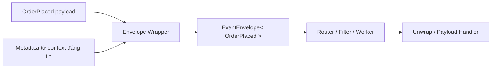

### Kết quả mong muốn

Thay vì chỉ gửi payload:

```json
{
  "orderId": "ORD-1042",
  "totalMinorUnits": 125000,
  "currency": "VND"
}
```

ta gửi một **message envelope** có cấu trúc:

```json
{
  "metadata": {
    "messageType": "order.placed",
    "schemaVersion": 1,
    "eventId": "EV-1042",
    "tenantId": "shop-01",
    "sourceSystem": "WEB_CHECKOUT",
    "businessCorrelationId": "order:ORD-1042",
    "causationId": null,
    "occurredAt": "2026-11-21T08:30:00Z",
    "envelopedAt": "2026-11-21T08:30:01Z"
  },
  "payload": {
    "orderId": "ORD-1042",
    "tenantId": "shop-01",
    "eventId": "EV-1042",
    "totalMinorUnits": 125000,
    "currency": "VND",
    "occurredAt": "2026-11-21T08:30:00Z"
  }
}
```

Trong ví dụ này, `metadata` giúp middleware quan sát, chọn route, kiểm tra version và quản lý vòng đời event; `payload` vẫn mô tả nghiệp vụ đơn hàng. Các field trùng như `eventId` và `tenantId` có thể cần được đối chiếu để phát hiện dữ liệu bất nhất — không nên tin hai bản sao mặc nhiên khớp nhau.

### Mục tiêu học tập

Sau bài này, bạn có thể:

1. Giải thích **Envelope Wrapper** là gì và nó giải quyết bài toán nào.
2. Phân biệt envelope trong **payload serialized** với `Message<?>` có `MessageHeaders` ở Spring.
3. Thiết kế `EventEnvelope<T>` và `EnvelopeMetadata` bất biến.
4. Gắn thông tin tenant, event ID, source, schema version, correlation/causation và timestamp theo nguồn đáng tin.
5. Triển khai wrap/unwrap bằng Spring Integration Transformer/Java DSL.
6. Kiểm thử round-trip giữ nguyên payload, metadata và business correlation.
7. Thiết kế header mapping khi đi qua HTTP/Kafka/AMQP.
8. Nhận diện sự khác nhau giữa tracing, correlation, idempotency và routing.
9. Xử lý schema evolution, invalid metadata, duplicate, retry, error channel và authorization.
10. Tích hợp với Splitter, Aggregator, Gateway, Filter, Router và Content Enricher.
11. Xác định khi nào **không cần envelope** để tránh lạm dụng thiết kế.

## 2. Envelope Wrapper trong EIP là gì?

**Envelope Wrapper** là pattern **bao quanh dữ liệu cần gửi bằng một lớp chứa các trường bổ sung**. Lớp ngoài có thể chứa routing information, version, security-related context, address, processing metadata hoặc tracing information mà người xử lý payload nghiệp vụ không nhất thiết cần biết.

```text
+----------------------------------------------------+
| EventEnvelope                                      |
| +------------------------------------------------+ |
| | Metadata                                       | |
| | - messageType                                  | |
| | - schemaVersion                                | |
| | - sourceSystem                                 | |
| | - businessCorrelationId                        | |
| | - eventId / causationId                        | |
| | - occurredAt / envelopedAt                     | |
| +------------------------------------------------+ |
| +------------------------------------------------+ |
| | Payload                                        | |
| | OrderPlaced(orderId, amount, currency, ...)    | |
| +------------------------------------------------+ |
+----------------------------------------------------+
```

Một envelope hữu ích khi:

- Nhiều loại event cần cùng tập metadata.
- Consumer muốn định tuyến hoặc theo dõi event mà không phụ thuộc schema riêng của từng payload.
- Payload phải đi qua một broker hoặc ranh giới ngôn ngữ/framework.
- Cần ghi rõ version, provenance và logical identity để replay.
- Cần phân biệt dữ liệu nghiệp vụ với thông tin dùng để vận hành integration.

### Pattern không nhất thiết có một class tên `EnvelopeWrapper`

Trong Spring Integration, Envelope Wrapper thường được triển khai bằng **Transformer** hoặc một component chuyển đổi message thành DTO envelope. Không nên mặc định tồn tại một Java DSL operator độc lập có tên `.envelopeWrapper()`.

Một implementation có thể là:

```text
Message<OrderPlaced>
    -> Transformer.wrap(...)
    -> Message<EventEnvelope<OrderPlaced>>
    -> outbound adapter
```

Điểm quan trọng là **hợp đồng dạng envelope**, không phải tên class/framework API.

## 3. Envelope Wrapper khác Spring Message Headers thế nào?

Đây là phân biệt quan trọng nhất trong Spring Integration.

### 3.1. Spring Message vốn đã có payload và headers

```java
org.springframework.messaging.Message<T>
    getPayload()
    getHeaders()
```

Một message nội bộ có thể là:

```text
Message<OrderPlaced>
  payload = OrderPlaced(...)
  headers:
    id = 29c4...
    timestamp = ...
    businessCorrelationId = order:ORD-1042
    replyChannel = ...
```

Các headers giúp Spring Integration routing, correlation, reply/error handling và propagation trong message pipeline. Nhưng **không mặc định tất cả headers được serialize vào JSON body** hoặc có ý nghĩa giữa nhiều platform.

### 3.2. Envelope Wrapper là một phần của data contract

```text
Message<EventEnvelope<OrderPlaced>>
  payload:
    metadata: ...
    payload: OrderPlaced(...)
  headers:
    id: ...
    timestamp: ...
    replyChannel: ...
```

Khi outbound adapter serialize payload envelope, những trường trong `metadata` có thể được đưa vào JSON/Avro/Protobuf theo schema chung, kể cả khi consumer không dùng Spring.

### 3.3. So sánh

| Tiêu chí | Spring `MessageHeaders` | Envelope trong serialized payload |
| --- | --- | --- |
| Vị trí | Header map của Spring Message | Field trong DTO/body |
| Scope tự nhiên | Spring Messaging/integration runtime | Hợp đồng dữ liệu liên dịch vụ |
| Dễ dùng với Router/Filter nội bộ | Có | Có, nhưng phải truy cập nested field |
| Đi qua HTTP/Kafka | Phụ thuộc header mapping và adapter | Đi trong body nếu serializer hỗ trợ |
| Có thể chứa `replyChannel` object | Có, trong nội bộ JVM | Không nên chứa |
| Versioning | Do giao thức/header policy | Thường đặt rõ trong envelope schema |
| Security | Cần xác minh header từ nguồn | Cũng cần xác minh metadata từ nguồn |
| Schema registry | Tùy transport | Có thể dùng schema của payload envelope |
| Binary attachment | Không phải mặc định | Cần thiết kế encoding/reference |
| Ownership | Framework và ứng dụng | Ứng dụng/protocol |

**Không có quy tắc rằng lúc nào cũng cần cả hai.** Trong pipeline nội bộ đơn giản, `MessageHeaders` có thể đủ. Khi nhiều service/language trao đổi event, một envelope được version hóa thường dễ quản lý hơn.

### 3.4. Header name giống metadata field không có nghĩa cùng nguồn chân lý

Nếu message có cả:

```text
Spring header:       correlationId = internal-group-17
Envelope metadata:   businessCorrelationId = order:ORD-1042
```

đó có thể là điều **đúng**: header `correlationId` phục vụ một Aggregator, còn metadata `businessCorrelationId` phục vụ tracing nghiệp vụ.

Không tự đồng nhất hai ID chỉ vì cùng từ “correlation”.

## 4. Envelope Wrapper khác Header Enricher thế nào?

**Header Enricher** thêm hoặc sửa headers của Spring Message, thường không thay payload.

**Envelope Wrapper** tạo một payload mới chứa **metadata và payload gốc**.

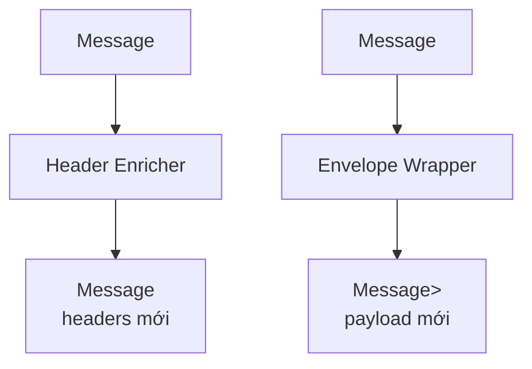

| Khía cạnh | Header Enricher | Envelope Wrapper |
| --- | --- | --- |
| Payload runtime | Thường không đổi | Đổi thành một DTO/envelope chứa payload gốc |
| Metadata | Trong MessageHeaders | Trong cấu trúc serialized |
| Consumer ngoài Spring | Cần header mapping | Đọc metadata từ body |
| Tác động tới handlers | Thường ít thay kiểu payload | Consumer phải hiểu envelope hoặc unwrap |
| Trường hợp phù hợp | Correlation/tracing trong flow nội bộ | Hợp đồng exchange giữa services |
| Rủi ro | Header mất khi adapter map thiếu | Payload lớn hơn, schema phức tạp hơn |

Một kiến trúc có thể dùng cả hai: Header Enricher tạo `verifiedTenantId`/`traceMarker` đáng tin trong JVM; Envelope Wrapper biến phần metadata được phép công bố thành các field portable trước khi publish.

## 5. Envelope Wrapper khác Normalizer và Content Enricher thế nào?

Ba pattern đều có thể tạo message mới, nhưng khác mục đích.

| Pattern | Tác động chính | Ví dụ |
| --- | --- | --- |
| **Envelope Wrapper** | Bọc payload trong lớp metadata | `OrderPlaced` → `EventEnvelope<OrderPlaced>` |
| **Normalizer** | Đưa nhiều source formats về canonical payload | `PartnerOrderV2` → `CanonicalOrder` |
| **Content Enricher** | Bổ sung dữ liệu nghiệp vụ còn thiếu | `OrderPlaced` + `CustomerTier` |
| **Transformer** | Cơ chế chuyển đổi message/payload | Java class thực hiện một trong các bước trên |
| **Claim Check** | Cất payload, gửi ticket thay cho payload lớn | `LargeDocument` → `ClaimTicket` |
| **Filter** | Quyết định message có tiếp tục qua flow hay không | Event không hợp lệ → discard/error |
| **Router** | Chọn channel/endpoint | `messageType` → consumer chuyên trách |

Ví dụ pipeline đầy đủ:

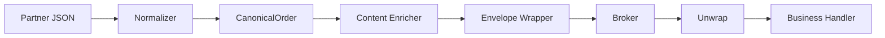

Không bắt buộc phải sử dụng tất cả pattern. Chỉ thêm một bước khi nó giải quyết yêu cầu cụ thể. Nếu normalizer đã tạo đủ metadata trong một canonical event contract có cấu trúc envelope, một wrapper nữa có thể chỉ tăng tầng lồng không cần thiết.

## 6. Những metadata nên và không nên đặt vào envelope

Các trường cần được phân loại theo **ngữ nghĩa và mức độ tin cậy**, không chỉ theo tên.

| Metadata | Mục đích | Nguồn tin cậy đề xuất |
| --- | --- | --- |
| `messageType` | Phân biệt loại event/command | Contract của producer adapter |
| `schemaVersion` | Deserialize/migrate đúng schema | Registry/protocol producer |
| `eventId` | Identity logical event | Source đã xác minh hoặc producer service |
| `tenantId` | Namespace/cô lập tenant | Authenticated principal và mapping |
| `sourceSystem` | Provenance | Trusted ingress configuration |
| `businessCorrelationId` | Truy vết workflow | Coordinator hoặc domain ID |
| `causationId` | Event/request gây ra event mới | Event parent đáng tin |
| `occurredAt` | Thời điểm sự kiện nghiệp vụ | Domain source |
| `envelopedAt` | Thời điểm wrap | Clock của service wrapper |
| `traceparent` | Distributed tracing | Tracing system với validation/sanitization |
| `idempotencyKey` | Chặn effect lặp | Identity ổn định theo operation |
| `contentType` | Chọn parser/serializer | Protocol/schema |
| `partitionKey` | Routing có thứ tự theo key | Routing/partitioning policy |

Không nên copy tùy tiện vào envelope:

- Spring `replyChannel`/`errorChannel` objects nội bộ.
- Mật khẩu, private token, signed URLs hoặc toàn bộ Authorization header.
- Raw security context hoặc claim quá nhạy cảm.
- Mọi HTTP headers của người dùng mà không có allowlist.
- Stack trace, access credentials, secret keys.
- Debug payload hoặc toàn bộ request headers chỉ để “dễ trace”.
- Timestamp `now()` làm idempotency key hoặc logical event ID.
- Session-scoped object không còn ý nghĩa sau khi consumer restart.

**Một envelope là một phần của trust boundary.** Các field trong nó không tự trở thành bằng chứng đã xác thực chỉ vì được gọi là `metadata`.

## 7. Domain payload và metadata có trách nhiệm khác nhau

Payload:

```java
public record OrderPlaced(
    String tenantId,
    String orderId,
    String eventId,
    long totalMinorUnits,
    String currency,
    java.time.Instant occurredAt
) {}
```

thể hiện **sự kiện nghiệp vụ**. Nó có thể được sử dụng trong domain handler ngay cả khi không biết HTTP, Kafka hoặc tracing.

Metadata:

```java
public record EnvelopeMetadata(
    String messageType,
    int schemaVersion,
    String eventId,
    String tenantId,
    String sourceSystem,
    String businessCorrelationId,
    String causationId,
    java.time.Instant occurredAt,
    java.time.Instant envelopedAt
) {}
```

thể hiện **hợp đồng vận chuyển/quan sát/quản lý event**. Bài viết cố ý đặt `eventId`, `tenantId` và `occurredAt` trong cả payload lẫn metadata để minh họa yêu cầu **đối chiếu nhất quán**.

### Vì sao metadata có thể trùng một số trường payload?

- Router muốn đọc loại event mà không cần hiểu domain payload cụ thể.
- Gateway/consumer muốn kiểm tra tenant trước khi parse một body lớn.
- Registry muốn định tuyến theo schema version.
- Logger muốn ghi correlation ID mà không log PII trong payload.
- Event ID trong metadata giúp consumer dedup dù payload thay schema.

Nhưng mỗi bản sao phải có quy tắc: **metadata bên ngoài được tạo từ payload/identity đáng tin và được kiểm tra khi unwrap**. Nếu khác nhau, đây là lỗi hợp đồng hoặc dấu hiệu giả mạo; không tự chọn ngẫu nhiên một bên.

## 8. Chọn cấu trúc envelope bất biến

Java 17 records phù hợp cho ví dụ vì immutable ở mức tham chiếu và có `equals/hashCode` theo các thành phần.

```java
package example.integration;

import java.util.Objects;

public record EventEnvelope<T>(
    EnvelopeMetadata metadata,
    T payload
) {
    public EventEnvelope {
        Objects.requireNonNull(metadata, "metadata");
        Objects.requireNonNull(payload, "payload");
    }
}
```

Ví dụ khai báo:

```java
EventEnvelope<OrderPlaced> envelope =
    new EventEnvelope<>(metadata, orderPlaced);
```

Generic `T` giúp cùng một schema metadata bọc nhiều business event types:

```text
EventEnvelope<OrderPlaced>
EventEnvelope<OrderCancelled>
EventEnvelope<InvoiceIssued>
EventEnvelope<ShipmentDispatched>
```

### Generic không tự là schema liên dịch vụ

Khi serialize JSON, runtime Java generic type có thể bị type erasure. Nếu consumer không biết loại payload, nó không thể chỉ nhìn một object `T` để suy ra class/JSON schema an toàn.

Cần một contract như:

```json
{
  "metadata": {
    "messageType": "order.placed",
    "schemaVersion": 1
  },
  "payload": {
    "orderId": "ORD-1042"
  }
}
```

Deserializer dùng **allowlist** ánh xạ `messageType + schemaVersion` sang schema/DTO được hỗ trợ, không cho input điều khiển tùy tiện class name.

## 9. Metadata không đồng nghĩa với mutable map tùy ý

Một thiết kế quá lỏng:

```java
record Envelope(
    java.util.Map<String, Object> metadata,
    Object payload
) {}
```

có thể phù hợp cho prototype, nhưng production gặp các lỗi:

- Field name khác nhau giữa producers.
- Type lúc là `String`, lúc là `Long`.
- `schemaVersion` bị thiếu/không được version hóa.
- Consumer cần ép kiểu không an toàn.
- Metadata bị sửa sau khi tạo nếu map mutable.
- Không có validation cho required fields.
- Không biết trường nào nhạy cảm hoặc được phép public.

Sử dụng typed record cho **metadata cốt lõi**, và nếu cần extension fields thì cấp namespace, quy định serializer và allowlist.

### Quy tắc đặt tên

Một hợp đồng dễ kiểm thử có thể dùng:

```text
metadata.messageType
metadata.schemaVersion
metadata.eventId
metadata.tenantId
metadata.sourceSystem
metadata.businessCorrelationId
metadata.causationId
metadata.occurredAt
metadata.envelopedAt
payload
```

Dùng một convention xuyên HTTP, Kafka, các JSON events và logs. Tránh mỗi service chọn tên `trace_id`, `traceId`, `TraceID` mà không có mapping.

## 10. Contract của version và message type

`messageType` trả lời: **đây là loại sự kiện nào**.  
`schemaVersion` trả lời: **đọc phần payload/envelope theo hợp đồng nào**.

```text
messageType = order.placed
schemaVersion = 1

messageType = order.cancelled
schemaVersion = 1

messageType = order.placed
schemaVersion = 2
```

Một consumer có thể hỗ trợ version 1 và 2 cho `order.placed` nhưng chỉ version 1 cho `order.cancelled`.

### Không nhầm version

| Version | Mục đích |
| --- | --- |
| Envelope schema version | Cấu trúc metadata và wrapper |
| Payload schema version | Cấu trúc business event body |
| Source schema version | Format đầu vào trước Normalizer |
| API/protocol version | Quy tắc endpoint/transport |
| Application release version | Phiên bản deploy của service |

Ví dụ đơn giản chỉ có một `schemaVersion` để giảm độ phức tạp. Khi envelope và payload evolve độc lập, có thể cần `envelopeSchemaVersion` và `payloadSchemaVersion` riêng, hoặc một schema registry ID xác định toàn bộ event schema.

### Unknown messageType phải xử lý thế nào?

```text
metadata.messageType = "java.lang.Runtime"
metadata.schemaVersion = 999
```

Không dùng `Class.forName(messageType)` để deserialize hoặc invoke handler theo input bên ngoài. Dùng registry/allowlist các loại event được phép và có `UNSUPPORTED_EVENT_TYPE` hoặc `UNSUPPORTED_SCHEMA_VERSION` khi không khớp.

## 11. Envelope Wrapper không tự bảo đảm độ tin cậy của metadata

Giả sử client gửi:

```json
{
  "metadata": {
    "tenantId": "shop-admin",
    "sourceSystem": "TRUSTED_PARTNER"
  },
  "payload": {
    "tenantId": "shop-01",
    "orderId": "ORD-1042"
  }
}
```

Nếu consumer chỉ tin `metadata.tenantId` để cấp quyền, attacker có thể giả mạo tenant. Cần xác thực principal/credential/service identity tại ingress và đối chiếu với metadata/payload.

**Quy trình an toàn hơn:**

1. Xác thực nguồn message bằng cơ chế của HTTP/broker/service identity.
2. Xác định tenant được phép và các source types được phát.
3. Parse envelope theo schema allowlist.
4. Kiểm tra metadata structure, version và required fields.
5. So metadata tenant với tenant được xác thực.
6. So payload identity với metadata khi có field tương ứng.
7. Chỉ khi hợp lệ mới đưa vào business Router/Filter/Handler.

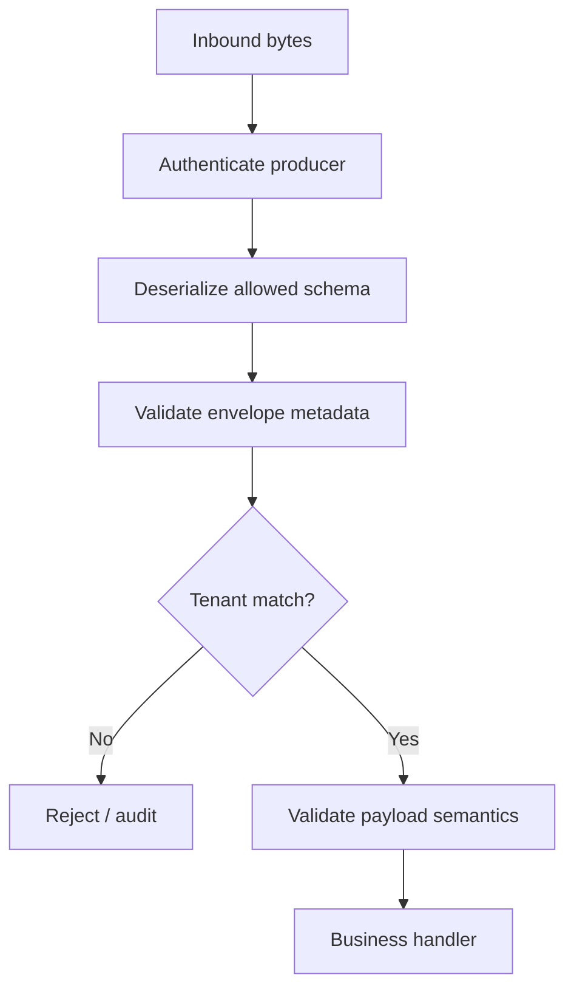

Cơ chế ký payload/envelope có thể giúp xác minh toàn vẹn và nguồn gốc khi vận chuyển qua các ranh giới không đáng tin, nhưng cần thiết kế key management, replay protection, canonical serialization và xác định **những field nào được ký**. Thêm một field `signature` đơn thuần không làm thông điệp tự an toàn.

## 12. Java 17: hoàn thiện các record bất biến và validation

Để xây ví dụ có thể mở rộng, tạo ba file Java trong một package ví dụ.

### 12.1. `OrderPlaced.java`

```java
package example.integration;

import java.time.Instant;

public record OrderPlaced(
    String tenantId,
    String orderId,
    String eventId,
    long totalMinorUnits,
    String currency,
    Instant occurredAt
) {
    public OrderPlaced {
        if (tenantId == null || tenantId.isBlank()
                || orderId == null || orderId.isBlank()
                || eventId == null || eventId.isBlank()
                || currency == null || currency.isBlank()
                || occurredAt == null) {
            throw new IllegalArgumentException(
                "OrderPlaced thiếu trường bắt buộc");
        }

        if (totalMinorUnits < 0) {
            throw new IllegalArgumentException(
                "Total không được âm");
        }
    }
}
```

Việc record kiểm tra `totalMinorUnits` và required fields không thay thế mọi business validation. Một đơn có thể cần kiểm tra currency, items, giá trị lớn nhất, trạng thái thanh toán hoặc idempotency theo policy riêng.

### 12.2. `EnvelopeMetadata.java`

```java
package example.integration;

import java.time.Instant;

public record EnvelopeMetadata(
    String messageType,
    int schemaVersion,
    String eventId,
    String tenantId,
    String sourceSystem,
    String businessCorrelationId,
    String causationId,
    Instant occurredAt,
    Instant envelopedAt
) {
    public EnvelopeMetadata {
        if (messageType == null || messageType.isBlank()
                || schemaVersion <= 0
                || eventId == null || eventId.isBlank()
                || tenantId == null || tenantId.isBlank()
                || sourceSystem == null || sourceSystem.isBlank()
                || businessCorrelationId == null
                || businessCorrelationId.isBlank()
                || occurredAt == null
                || envelopedAt == null) {
            throw new IllegalArgumentException(
                "EnvelopeMetadata không hợp lệ");
        }

        // causationId có thể null khi đây là root event.
    }
}
```

### 12.3. `EventEnvelope.java`

```java
package example.integration;

import java.util.Objects;

public record EventEnvelope<T>(
    EnvelopeMetadata metadata,
    T payload
) {
    public EventEnvelope {
        Objects.requireNonNull(metadata, "metadata");
        Objects.requireNonNull(payload, "payload");
    }
}
```

### Vì sao dùng record?

- Constructor buộc các trường bắt buộc có mặt.
- Getter theo tên như `metadata.eventId()` dễ đọc.
- Object không có setter để downstream vô tình đổi event identity.
- `equals/hashCode` giúp unit test so payload/envelope dễ hơn.
- Generic payload vẫn có thể giữ đúng Java type trong ứng dụng.

### Lưu ý về bất biến sâu

Record bảo vệ **tham chiếu field**, không tự biến một `byte[]` hay `List` mutable thành bất biến. Nếu payload có collection/blob:

```java
public record DocumentPayload(
    String documentId,
    byte[] content
) {
    public DocumentPayload {
        content = content.clone();
    }

    @Override
    public byte[] content() {
        return content.clone();
    }
}
```

Với dữ liệu lớn, thay vì copy `byte[]` liên tục, có thể tham chiếu object storage hoặc Claim Check theo hợp đồng phù hợp. Envelope chỉ thêm metadata, **không tự giảm payload size**.

## 13. Viết OrderEnvelopeTransformer: wrap theo nguồn đáng tin

Ta xây một Transformer nhận `Message<OrderPlaced>`, yêu cầu ingress đã gắn một header **`verifiedTenantId`** do thành phần đã xác thực tạo ra, rồi trả `Message<EventEnvelope<OrderPlaced>>`.

Đây là quy ước **của ứng dụng minh họa**, không phải header Spring Integration tự xác thực.

```java
package example.integration;

import java.time.Clock;
import java.util.Objects;

import org.springframework.messaging.Message;
import org.springframework.messaging.support.MessageBuilder;

public final class OrderEnvelopeTransformer {

    private final Clock clock;
    private final String sourceSystem;

    public OrderEnvelopeTransformer(
            Clock clock,
            String sourceSystem) {
        this.clock = Objects.requireNonNull(clock);
        this.sourceSystem = require(sourceSystem, "sourceSystem");
    }

    public Message<EventEnvelope<OrderPlaced>> wrap(
            Message<OrderPlaced> input) {

        OrderPlaced order = input.getPayload();

        String verifiedTenant =
            requiredHeader(input, "verifiedTenantId");

        if (!verifiedTenant.equals(order.tenantId())) {
            throw new SecurityException(
                "Payload tenant khác authenticated tenant");
        }

        String correlation = "order:"
            + verifiedTenant + ":" + order.orderId();

        EnvelopeMetadata metadata = new EnvelopeMetadata(
            "order.placed",
            1,
            order.eventId(),
            verifiedTenant,
            sourceSystem,
            correlation,
            null, // Root event không có causationId.
            order.occurredAt(),
            clock.instant());

        EventEnvelope<OrderPlaced> wrapped =
            new EventEnvelope<>(metadata, order);

        // Chỉ đưa vào header các trường cần dùng trong JVM.
        // Không copy mù replyChannel/errorChannel từ nguồn.
        return MessageBuilder.withPayload(wrapped)
            .setHeader(
                "businessCorrelationId",
                metadata.businessCorrelationId())
            .setHeader("envelopeEventId", metadata.eventId())
            .setHeader("envelopeSchemaVersion",
                metadata.schemaVersion())
            .build();
    }

    private static String requiredHeader(
            Message<?> message, String headerName) {

        Object value = message.getHeaders().get(headerName);

        if (!(value instanceof String text)
                || text.isBlank()) {
            throw new SecurityException(
                "Missing trusted header: " + headerName);
        }

        return text;
    }

    private static String require(
            String value, String field) {

        if (value == null || value.isBlank()) {
            throw new IllegalArgumentException(
                "Missing " + field);
        }

        return value;
    }
}
```

### Phân tích

**1. Source system gắn theo cấu hình bean.** `sourceSystem="WEB_CHECKOUT"` được đặt bởi service đã biết nguồn ingest, không do client tự khai.

**2. Verified tenant đến từ ingress.** Demo dùng `verifiedTenantId` trong header. Trên production, inbound adapter/security filter phải **xóa các headers tự khai trùng tên** và tự set nó từ authenticated context.

**3. Payload không bị đổi nội dung.** Wrapper tạo `EventEnvelope<>(metadata, order)`, giữ nguyên `OrderPlaced`.

**4. Business correlation có scope tenant.** `order:shop-01:ORD-1042` phân biệt một order ID trùng ở tenant khác.

**5. Enveloped timestamp khác event timestamp.** `occurredAt` ghi lúc event diễn ra; `envelopedAt` ghi lúc wrapper được tạo. Retry có thể tạo `envelopedAt` mới nếu wrap lại; không dùng nó làm logical event ID.

**6. Không copy mọi headers.** Reply/error channels nội bộ không được đưa vào serialized envelope; header nào cần truyền qua adapter phải được whitelist và chuyển vào protocol thích hợp.

### Có nên gắn `traceId` vào envelope?

Có thể nếu đây là hợp đồng tracing của tổ chức, nhưng phải dùng một định dạng chuẩn và xác định trust boundary. Ví dụ producer có thể dùng W3C `traceparent` header, được adapter xác minh/sanitize rồi truyền qua broker. Không nên tự sinh một “trace ID nghiệp vụ” bằng cách copy mọi header do client gửi và gọi đó là danh tính đã xác thực.

### Causation ID có thể lấy từ đâu?

Khi OrderPlaced là kết quả của một command/event trước đó:

```text
CheckoutConfirmed eventId=EV-900
    |
    v
OrderPlaced eventId=EV-1042
  causationId=EV-900
```

Causation ID liên kết nguyên nhân trực tiếp giữa messages; business correlation ID liên kết cả workflow. Chúng có thể khác nhau và không nên gán bằng nhau theo mặc định.

## 14. Unwrap an toàn: đối chiếu metadata, payload và tenant

Unwrap không nên chỉ lấy `envelope.payload()` mà bỏ qua metadata. Khi event đến từ network, cần kiểm tra:

- `messageType` có đúng consumer mong đợi?
- `schemaVersion` có được hỗ trợ?
- `tenantId` có khớp authenticated tenant?
- Payload có loại và required fields hợp lệ?
- `eventId`, `tenantId` và `occurredAt` ở metadata/payload có nhất quán?
- Business correlation ID có đúng hợp đồng nhóm nếu consumer dựa vào nó?
- Có chấp nhận event quá cũ/tương lai không? Nếu có, policy nào?

Bổ sung method sau vào `OrderEnvelopeTransformer` ở mục 13:

```java
public Message<OrderPlaced> unwrap(
        Message<EventEnvelope<OrderPlaced>> input) {

    EventEnvelope<OrderPlaced> envelope =
        input.getPayload();

    EnvelopeMetadata metadata = envelope.metadata();
    OrderPlaced order = envelope.payload();

    String authenticatedTenant =
        requiredHeader(input, "verifiedTenantId");

    if (!"order.placed".equals(metadata.messageType())
            || metadata.schemaVersion() != 1) {
        throw new IllegalArgumentException(
            "Unsupported envelope type or version");
    }

    if (!authenticatedTenant.equals(metadata.tenantId())
            || !authenticatedTenant.equals(order.tenantId())) {
        throw new SecurityException(
            "Cross-tenant envelope rejected");
    }

    if (!metadata.eventId().equals(order.eventId())
            || !metadata.occurredAt().equals(order.occurredAt())) {
        throw new IllegalArgumentException(
            "Envelope payload/metadata mismatch");
    }

    String expectedCorrelation = "order:"
        + authenticatedTenant + ":" + order.orderId();

    if (!expectedCorrelation.equals(
            metadata.businessCorrelationId())) {
        throw new IllegalArgumentException(
            "Unexpected business correlation identity");
    }

    return MessageBuilder.withPayload(order)
        .setHeader(
            "businessCorrelationId",
            metadata.businessCorrelationId())
        .setHeader("sourceEventId", metadata.eventId())
        .setHeader("sourceSystem", metadata.sourceSystem())
        .build();
}
```

**Chú ý:** đây là một contract cụ thể cho event `order.placed` với correlation dạng `order:<tenant>:<orderId>`. Trong các workflow khác, correlation ID có thể do coordinator tạo và không nhất thiết là order ID; cần kiểm tra theo contract thực tế, không hard-code cùng một công thức cho mọi event.

### Unwrap là phục hồi payload, không phải tự tái tạo toàn bộ Spring Message cũ

Method ở trên tạo một `Message<OrderPlaced>` mới và chỉ thêm các business headers cần thiết. Nó không khôi phục:

- Original Spring `MessageHeaders.id`.
- Original `replyChannel`/`errorChannel`.
- Mọi transport-specific headers.
- Header `correlationId` của một Splitter/Aggregator khác.
- Security context cũ của caller.

Những thông tin này có thể **không còn hợp lệ** sau một network hop hoặc restart. Nếu workflow hiện tại cần reply/group headers, chúng phải được truyền và ánh xạ theo protocol hiện tại một cách có kiểm soát.

### Chú ý type erasure và deserialization

Trong JSON adapter, `EventEnvelope<OrderPlaced>` không tự được tạo an toàn chỉ vì Java có generic. Trước khi gọi `unwrap`, adapter phải deserialize bằng schema/type được phép, kiểm tra `messageType/schemaVersion`. Không ép payload từ `Map<String,Object>` sang `OrderPlaced` mà không qua một converter/schema validation cụ thể.

## 15. Spring Integration Java DSL: hai flow wrap và unwrap

Chúng ta tạo hai luồng riêng để có thể kiểm thử cả outbound và inbound mà không cần broker thực:

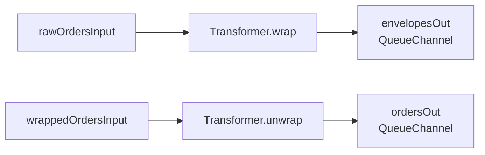

### Ví dụ cấu hình

```java
package example.integration;

import java.time.Clock;

import org.springframework.context.annotation.Bean;
import org.springframework.context.annotation.Configuration;
import org.springframework.integration.channel.DirectChannel;
import org.springframework.integration.channel.QueueChannel;
import org.springframework.integration.config.EnableIntegration;
import org.springframework.integration.dsl.IntegrationFlow;
import org.springframework.messaging.MessageChannel;

@Configuration
@EnableIntegration
public class EnvelopeWrapperConfiguration {

    @Bean
    public MessageChannel rawOrdersInput() {
        return new DirectChannel();
    }

    @Bean
    public QueueChannel envelopesOut() {
        return new QueueChannel();
    }

    @Bean
    public MessageChannel wrappedOrdersInput() {
        return new DirectChannel();
    }

    @Bean
    public QueueChannel ordersOut() {
        return new QueueChannel();
    }

    @Bean
    public OrderEnvelopeTransformer orderEnvelopeTransformer() {
        return new OrderEnvelopeTransformer(
            Clock.systemUTC(), "WEB_CHECKOUT");
    }

    @Bean
    public IntegrationFlow envelopeOutbound(
            OrderEnvelopeTransformer transformer) {

        return IntegrationFlow.from("rawOrdersInput")
            .transform(transformer, "wrap")
            .channel("envelopesOut")
            .get();
    }

    @Bean
    public IntegrationFlow envelopeInbound(
            OrderEnvelopeTransformer transformer) {

        return IntegrationFlow.from("wrappedOrdersInput")
            .transform(transformer, "unwrap")
            .channel("ordersOut")
            .get();
    }
}
```

### Vì sao dùng `.transform(transformer, "wrap")`?

Spring Integration Transformer endpoint có thể gọi method của một bean để chuyển đổi message. Ở đây bean dùng một method nhận `Message<OrderPlaced>` và trả `Message<EventEnvelope<OrderPlaced>>`. Endpoint inbound gọi method `unwrap` với chiều ngược lại.

Tên method chỉ là phần triển khai; **Envelope Wrapper là pattern**, không phải yêu cầu mỗi flow phải có operator DSL tên `.envelopeWrapper()`.

### Chú ý đối với phiên bản thư viện

API overload của Java DSL và cách resolution method nên được đối chiếu bằng build/tests ở dependency thật. Bài này trình bày hợp đồng và ví dụ Java 17; bước kiểm thử compile/integration trong dự án thực thuộc quy trình QA chuyên môn sau khi nội dung được tạo.

### Vì sao dùng QueueChannel cho output?

`QueueChannel` phù hợp để viết test kiểm tra `receive(timeout)`. Nó không tự trở thành persistent broker, không mặc định chia sẻ state giữa nhiều pod và không đưa ra bảo đảm exactly-once.

### Ingress authentication không nằm trong ví dụ DSL

Đoạn code cố ý không thêm fake authentication service. Các `verifiedTenantId` trong tests là **fixture giả định được gắn bởi thành phần tin cậy**. Trên production:

```text
HTTP/Kafka/AMQP inbound adapter
  -> authenticate producer
  -> set verifiedTenantId from authenticated context
  -> parse allowed DTO/schema
  -> wrap/unwrap transformer
```

Nếu cho user tự gửi header `verifiedTenantId` rồi tin nó, test “tenant match” không có giá trị bảo mật.

## 16. Unit test: wrap có metadata đúng và không đổi payload

Tạo test cho class transformer không cần Spring context. Dùng `Clock.fixed` để kiểm tra `envelopedAt` một cách xác định.

```java
package example.integration;

import static org.junit.jupiter.api.Assertions.*;

import java.time.Clock;
import java.time.Instant;
import java.time.ZoneOffset;

import org.junit.jupiter.api.Test;
import org.springframework.messaging.Message;
import org.springframework.messaging.support.MessageBuilder;

class OrderEnvelopeTransformerTest {

    private final Instant occurred =
        Instant.parse("2026-11-21T08:30:00Z");

    private final Instant wrappedAt =
        Instant.parse("2026-11-21T08:30:01Z");

    private final OrderEnvelopeTransformer transformer =
        new OrderEnvelopeTransformer(
            Clock.fixed(wrappedAt, ZoneOffset.UTC),
            "WEB_CHECKOUT");

    private OrderPlaced order() {
        return new OrderPlaced(
            "shop-01", "ORD-1042", "EV-1042",
            125_000L, "VND", occurred);
    }

    private Message<OrderPlaced> input() {
        return MessageBuilder.withPayload(order())
            .setHeader("verifiedTenantId", "shop-01")
            .build();
    }

    @Test
    void wrapsPayloadAndAddsStableMetadataFields() {
        Message<OrderPlaced> source = input();

        Message<EventEnvelope<OrderPlaced>> output =
            transformer.wrap(source);

        EventEnvelope<OrderPlaced> envelope =
            output.getPayload();

        // Không thay đổi các giá trị nghiệp vụ.
        assertEquals(source.getPayload(), envelope.payload());

        EnvelopeMetadata meta = envelope.metadata();

        assertEquals("order.placed", meta.messageType());
        assertEquals(1, meta.schemaVersion());
        assertEquals("EV-1042", meta.eventId());
        assertEquals("shop-01", meta.tenantId());
        assertEquals("WEB_CHECKOUT", meta.sourceSystem());
        assertEquals(
            "order:shop-01:ORD-1042",
            meta.businessCorrelationId());
        assertNull(meta.causationId());
        assertEquals(occurred, meta.occurredAt());
        assertEquals(wrappedAt, meta.envelopedAt());

        assertEquals(
            "order:shop-01:ORD-1042",
            output.getHeaders()
                .get("businessCorrelationId"));
    }
}
```

### Điều test chứng minh

- `OrderPlaced` được giữ nguyên.
- Metadata có đúng type/version/source/tenant/event ID.
- `occurredAt` khác `envelopedAt` đúng nghĩa.
- Business correlation ID được tính nhất quán theo tenant/order.
- Java Message vẫn có thể mang business header nếu flow nội bộ cần.

### Điều test không chứng minh

- JSON serialization cross-platform.
- Signed envelope hoặc authentication thực.
- Header mapping khi qua Kafka/HTTP.
- Idempotent processing sau retry.
- Database side effect.
- Correctness của nhiều message types/schema versions.

Những phạm vi đó cần thêm tests bên dưới.

## 17. Unit test: unwrap khôi phục domain payload

Thêm test trong `OrderEnvelopeTransformerTest`:

```java
@Test
void roundTripRestoresTheOriginalDomainPayload() {
    Message<OrderPlaced> original = input();

    Message<EventEnvelope<OrderPlaced>> wrapped =
        transformer.wrap(original);

    // Giả lập inbound adapter đã xác thực caller và gắn
    // trusted tenant header ở bối cảnh hiện tại.
    Message<EventEnvelope<OrderPlaced>> inbound =
        MessageBuilder.withPayload(wrapped.getPayload())
            .setHeader("verifiedTenantId", "shop-01")
            .build();

    Message<OrderPlaced> restored =
        transformer.unwrap(inbound);

    assertEquals(
        original.getPayload(),
        restored.getPayload());

    assertEquals(
        "order:shop-01:ORD-1042",
        restored.getHeaders()
            .get("businessCorrelationId"));

    assertEquals(
        "EV-1042",
        restored.getHeaders().get("sourceEventId"));

    assertEquals(
        "WEB_CHECKOUT",
        restored.getHeaders().get("sourceSystem"));
}
```

**Quan trọng:** test chứng minh khôi phục **domain payload và các business headers có chủ đích**. Nó không khẳng định `MessageHeaders.id` hay `replyChannel` của message ban đầu được giữ nguyên. Trong nhiều hệ thống, tái tạo message với ID runtime mới khi qua ranh giới là điều bình thường.

## 18. Test metadata sai tenant phải bị từ chối

Một envelope đến từ ngoài có thể khai tenant khác so với tenant đã được xác thực.

```java
@Test
void unwrapRejectsCrossTenantEnvelope() {
    Message<EventEnvelope<OrderPlaced>> wrapped =
        transformer.wrap(input());

    Message<EventEnvelope<OrderPlaced>> inbound =
        MessageBuilder.withPayload(wrapped.getPayload())
            .setHeader("verifiedTenantId", "shop-99")
            .build();

    assertThrows(SecurityException.class, () ->
        transformer.unwrap(inbound));
}
```

### Không chỉ tin header có tên “verified”

Tên header không làm nó đáng tin. Test giả lập inbound adapter/security layer đã làm đúng việc xác thực. Production cần chứng minh:

- Client không thể tự set `verifiedTenantId` được chấp nhận.
- Broker topic/producer identity được kiểm soát.
- Service account chỉ có quyền phát messages của phạm vi cho phép.
- Metadata/payload tenant được đối chiếu với authenticated identity.
- Consumer không rò rỉ thông tin tenant khác qua exception/log.

### Ngữ cảnh đa tenant

`orderId=ORD-1042` có thể xuất hiện ở `shop-01` và `shop-99`. Correlation nên có scope tenant khi business key không unique toàn cục. Cũng cần scope tenant trong idempotency key và DB unique constraints nếu domain yêu cầu.

## 19. Test metadata và payload không nhất quán

Một wrapper không nên biến các field mâu thuẫn thành “hai sự thật” khác nhau cho hai consumers.

```java
@Test
void unwrapRejectsMismatchedEventId() {
    Message<EventEnvelope<OrderPlaced>> wrapped =
        transformer.wrap(input());

    EventEnvelope<OrderPlaced> original =
        wrapped.getPayload();

    EnvelopeMetadata old = original.metadata();

    EnvelopeMetadata altered = new EnvelopeMetadata(
        old.messageType(),
        old.schemaVersion(),
        "EV-FORGED",
        old.tenantId(),
        old.sourceSystem(),
        old.businessCorrelationId(),
        old.causationId(),
        old.occurredAt(),
        old.envelopedAt());

    EventEnvelope<OrderPlaced> corrupted =
        new EventEnvelope<>(
            altered, original.payload());

    Message<EventEnvelope<OrderPlaced>> inbound =
        MessageBuilder.withPayload(corrupted)
            .setHeader("verifiedTenantId", "shop-01")
            .build();

    assertThrows(IllegalArgumentException.class, () ->
        transformer.unwrap(inbound));
}
```

### Các mâu thuẫn khác cần test

| Metadata hoặc payload | Vi phạm | Kỳ vọng |
| --- | --- | --- |
| `metadata.tenantId` | Khác tenant đã xác thực | Security rejection |
| `payload.tenantId` | Khác metadata tenant | Security rejection |
| `metadata.eventId` | Khác payload eventId | Contract violation |
| `metadata.occurredAt` | Khác payload occurredAt | Contract violation |
| `metadata.messageType` | Không phải `order.placed` | Unsupported event type |
| `metadata.schemaVersion` | Version không hỗ trợ | Schema error |
| `businessCorrelationId` | Không theo contract | Reject/mapping theo policy |
| `metadata.sourceSystem` | Giá trị giả mạo không được phép | Provenance/authz error ở ingress |
| `payload.currency` | Format không hợp lệ | Domain validation error |
| `eventId` bị dùng lại với payload khác | Business identity conflict | Idempotency conflict / quarantine |

Với hệ thống nhận nhiều versions, validator có thể chọn đúng schema mapper thay vì từ chối mọi version khác 1. Nhưng không được tự parse một version không biết bằng cách đoán field names.

## 20. Unit test: thiếu verified tenant header

Một producer không được cấp trust context có thể cố gửi payload có tenant hợp lệ nhưng **không có quyền được xác nhận**.

```java
@Test
void wrapRejectsMissingTrustedTenant() {
    Message<OrderPlaced> unverified =
        MessageBuilder.withPayload(order()).build();

    assertThrows(SecurityException.class, () ->
        transformer.wrap(unverified));
}
```

Một input có `tenantId=shop-01` trong payload không thay thế authentication. Test này giúp bảo đảm code không rơi vào fallback nguy hiểm như:

```java
// Không nên làm ở trust boundary:
String tenant = headerTrustedTenant != null
    ? headerTrustedTenant
    : payload.tenantId();
```

Nếu thiếu trust context, nên fail sớm và ghi reason code phù hợp.

## 21. Integration test: dùng Java DSL wrap flow thật

Unit test gọi Transformer trực tiếp chưa chứng minh endpoint Spring Integration kết nối đúng. Tạo một context test với cấu hình `EnvelopeWrapperConfiguration`:

```java
package example.integration;

import static org.junit.jupiter.api.Assertions.*;

import java.time.Instant;

import org.junit.jupiter.api.Test;
import org.springframework.beans.factory.annotation.Autowired;
import org.springframework.beans.factory.annotation.Qualifier;
import org.springframework.integration.channel.QueueChannel;
import org.springframework.messaging.Message;
import org.springframework.messaging.MessageChannel;
import org.springframework.messaging.support.MessageBuilder;
import org.springframework.test.annotation.DirtiesContext;
import org.springframework.test.context.junit.jupiter.SpringJUnitConfig;

@SpringJUnitConfig(EnvelopeWrapperConfiguration.class)
@DirtiesContext(
    classMode = DirtiesContext.ClassMode.AFTER_EACH_TEST_METHOD)
class EnvelopeWrapperFlowTest {

    @Autowired
    @Qualifier("rawOrdersInput")
    private MessageChannel rawInput;

    @Autowired
    @Qualifier("envelopesOut")
    private QueueChannel envelopesOut;

    @Autowired
    @Qualifier("wrappedOrdersInput")
    private MessageChannel wrappedInput;

    @Autowired
    @Qualifier("ordersOut")
    private QueueChannel ordersOut;

    private OrderPlaced event() {
        return new OrderPlaced(
            "shop-01", "ORD-1042", "EV-1042",
            125_000L, "VND",
            Instant.parse("2026-11-21T08:30:00Z"));
    }

    @Test
    void outboundFlowWrapsAndInboundFlowUnwraps() {
        Message<OrderPlaced> source = MessageBuilder
            .withPayload(event())
            .setHeader("verifiedTenantId", "shop-01")
            .build();

        assertTrue(rawInput.send(source));

        Message<?> out = envelopesOut.receive(1_000);
        assertNotNull(out);
        assertInstanceOf(
            EventEnvelope.class, out.getPayload());

        @SuppressWarnings("unchecked")
        EventEnvelope<OrderPlaced> envelope =
            (EventEnvelope<OrderPlaced>) out.getPayload();

        assertEquals("order.placed",
            envelope.metadata().messageType());

        Message<EventEnvelope<OrderPlaced>> inbound =
            MessageBuilder.withPayload(envelope)
                .setHeader("verifiedTenantId", "shop-01")
                .build();

        assertTrue(wrappedInput.send(inbound));

        Message<?> restored = ordersOut.receive(1_000);
        assertNotNull(restored);
        assertEquals(event(), restored.getPayload());

        assertNull(envelopesOut.receive(0));
        assertNull(ordersOut.receive(0));
    }
}
```

### Test này chứng minh gì?

- Spring Integration input → Transformer → output channel hoạt động như kỳ vọng.
- Wrapper thực sự trở thành payload của Spring Message.
- Unwrap tạo ra `OrderPlaced` cho downstream.
- Header `verifiedTenantId` được cung cấp tại đúng ingress boundary của từng flow.
- Một message hợp lệ tạo một output ở mỗi flow trong cấu hình đồng bộ demo.

### Điều không được suy ra

- Hai queues `QueueChannel` không phải Kafka/AMQP.
- Không có JSON serialization thực trong test này.
- Không bảo đảm message chỉ đến một lần.
- Không chứng minh security header đã được gắn từ authentication thật.
- Không có database commit, retry hay callback.
- Không phải test latency/throughput production.

## 22. Test nhiều envelope xen kẽ và không trộn metadata

Khi hai tenants gửi events cùng lúc, wrapper không được lưu một biến kiểu `currentTenant` để dùng giữa các messages.

```text
Input arrival:
  shop-01 / EV-A
  shop-02 / EV-B
  shop-01 / EV-C

Expected:
  Envelope A: tenant=shop-01, eventId=EV-A
  Envelope B: tenant=shop-02, eventId=EV-B
  Envelope C: tenant=shop-01, eventId=EV-C
```

Không nên implement:

```java
// Phản mẫu: shared mutable context.
static String currentTenant;
```

Thay vào đó, `wrap` tính metadata từ **input message và trusted context của chính input đó**.

### Test minh họa

```java
@Test
void differentTenantsKeepTheirOwnMetadata() {
    var events = java.util.List.of(
        new OrderPlaced("shop-01", "O-A", "EV-A",
            100L, "VND",
            Instant.parse("2026-11-21T00:00:00Z")),
        new OrderPlaced("shop-02", "O-B", "EV-B",
            200L, "VND",
            Instant.parse("2026-11-21T00:00:01Z")),
        new OrderPlaced("shop-01", "O-C", "EV-C",
            300L, "VND",
            Instant.parse("2026-11-21T00:00:02Z"))
    );

    for (OrderPlaced order : events) {
        Message<OrderPlaced> input = MessageBuilder
            .withPayload(order)
            .setHeader("verifiedTenantId", order.tenantId())
            .build();

        assertTrue(rawInput.send(input));
    }

    var byEventId = new java.util.HashMap<
        String, EnvelopeMetadata>();

    for (int i = 0; i < events.size(); i++) {
        Message<?> message = envelopesOut.receive(1_000);
        assertNotNull(message);

        @SuppressWarnings("unchecked")
        EventEnvelope<OrderPlaced> envelope =
            (EventEnvelope<OrderPlaced>) message.getPayload();

        byEventId.put(
            envelope.metadata().eventId(),
            envelope.metadata());
    }

    assertEquals("shop-01",
        byEventId.get("EV-A").tenantId());
    assertEquals("shop-02",
        byEventId.get("EV-B").tenantId());
    assertEquals("shop-01",
        byEventId.get("EV-C").tenantId());

    assertEquals(3, byEventId.size());
}
```

Method này được bổ sung vào `EnvelopeWrapperFlowTest` ở mục 21. Test gửi tuần tự vào một `DirectChannel`, nhưng đã kiểm tra **không trộn metadata** khi events xen kẽ tenant. Với ExecutorChannel/broker, không nên assert global output order; hãy index outputs theo event ID và xác minh tương quan từng item.

## 23. Envelope qua JSON: serialization là một hợp đồng riêng

Một `EventEnvelope<OrderPlaced>` trong JVM vẫn chỉ là object Java. Muốn trao đổi qua HTTP, Kafka hoặc AMQP, phải có serializer/deserializer thống nhất.

### Ví dụ JSON body được publish

```json
{
  "metadata": {
    "messageType": "order.placed",
    "schemaVersion": 1,
    "eventId": "EV-1042",
    "tenantId": "shop-01",
    "sourceSystem": "WEB_CHECKOUT",
    "businessCorrelationId": "order:shop-01:ORD-1042",
    "causationId": null,
    "occurredAt": "2026-11-21T08:30:00Z",
    "envelopedAt": "2026-11-21T08:30:01Z"
  },
  "payload": {
    "tenantId": "shop-01",
    "orderId": "ORD-1042",
    "eventId": "EV-1042",
    "totalMinorUnits": 125000,
    "currency": "VND",
    "occurredAt": "2026-11-21T08:30:00Z"
  }
}
```

Khi deserialize, consumer cần biết `metadata.messageType` và `schemaVersion` trước khi map payload sang `OrderPlaced`. Không tự gọi `Class.forName` trên chuỗi do producer gửi.

### Test serialization minh họa với Jackson

Nếu project sử dụng Jackson Databind và module Java Time, có thể kiểm tra JSON round-trip trong integration test:

```java
import static org.junit.jupiter.api.Assertions.*;

import com.fasterxml.jackson.databind.JavaType;
import com.fasterxml.jackson.databind.ObjectMapper;
import com.fasterxml.jackson.databind.json.JsonMapper;
import com.fasterxml.jackson.datatype.jsr310.JavaTimeModule;
import org.junit.jupiter.api.Test;

// Fragment test: cần dependency Jackson + JavaTimeModule.
@Test
void jsonRoundTripKeepsEnvelopeMetadataAndOrder() throws Exception {
    ObjectMapper mapper = JsonMapper.builder()
        .addModule(new JavaTimeModule())
        .build();

    EventEnvelope<OrderPlaced> original =
        transformer.wrap(input()).getPayload();

    String serialized = mapper.writeValueAsString(original);

    JavaType type = mapper.getTypeFactory()
        .constructParametricType(
            EventEnvelope.class, OrderPlaced.class);

    EventEnvelope<OrderPlaced> decoded =
        mapper.readValue(serialized, type);

    assertEquals(original, decoded);
}
```

Fragment được đặt trong `OrderEnvelopeTransformerTest` của mục 16 hoặc class test tương tự. Nó giả định `transformer` và `input()` là fixtures đã định nghĩa; không phải file độc lập copy là chạy ngay.

### Điều cần kiểm tra ngoài JSON round-trip

- `Instant` được serialize theo ISO 8601 hay epoch? Có nhất quán giữa Java, Node và Go không?
- Integer `totalMinorUnits` vượt vùng an toàn của JavaScript Number không?
- Trường unknown/optional được xử lý theo compatibility policy nào?
- Null `causationId` có bắt buộc hiện diện hay được phép bỏ?
- Có tương thích khi producer thêm `metadata.attributes` không?
- Tên field và casing có ổn định theo schema registry không?
- Consumer có xác minh `messageType/schemaVersion` trước khi bind type không?

**JSON round-trip trong một JVM không chứng minh tương thích liên ngôn ngữ.** Với hệ thống đa nền tảng, nên có contract tests và schemas được kiểm tra giữa producer và consumer.

## 24. Khi đi qua Kafka, AMQP hoặc HTTP: metadata nằm ở đâu?

Envelope Wrapper có thể được serialize vào body, còn transport/broker vẫn có các thuộc tính riêng:

```text
Kafka record
  key: shop-01:ORD-1042
  headers: content-type, trace context (theo policy)
  value: JSON EventEnvelope<OrderPlaced>

HTTP request
  headers: Authorization, Content-Type, traceparent
  body: JSON EventEnvelope<OrderPlaced>

Spring Message<EventEnvelope<OrderPlaced>>
  headers: internal runtime metadata
  payload: EventEnvelope<OrderPlaced>
```

### Không sao chép mọi thứ ở hai nơi

Nếu `businessCorrelationId` có cả trong body và transport header, phải quyết định:

1. Bên nào là authoritative?
2. Bên nào được kiểm tra khi bất đồng?
3. Khi forward qua service khác, ai được phép cập nhật?
4. Cả hai có cần được ký hoặc bảo vệ toàn vẹn không?
5. Khi lỗi, consumer reject hay có thể reconcile?

Nếu không có policy, hai consumers có thể tin hai giá trị khác nhau và xử lý cùng event theo hai nhóm khác nhau.

### Header mapper có thể làm mất metadata

Một adapter chỉ forward một số headers đã được allowlist. Vì vậy nếu workflow yêu cầu `schemaVersion` và `eventId` xuyên broker, đặt chúng trong schema envelope là một phương án portable. Nhưng điều đó **không thay thế** việc map content type, partitioning key, tracing headers hoặc identity của authenticated producer.

### Transport key và business correlation

Kafka record key thường dùng để partition; nó có thể là `tenantId:orderId` nhằm giúp events của một order nằm cùng partition. Đây là một **quyết định routing/ordering**, không tự bảo đảm message body không bị giả mạo. Tương tự, businessCorrelationId để tracing không tự tạo global ordering xuyên nhiều partitions.

### Không serialize Spring `replyChannel`

Một `replyChannel` object trong JVM không phải JSON field an toàn. Nếu muốn request-reply qua broker, dùng protocol correlation ID, reply destination được whitelist và timeout hợp lý.

## 25. Envelope Wrapper và Content-based Router

Router có thể chọn nhánh theo `messageType` mà không cần deserialize mọi payload business type.

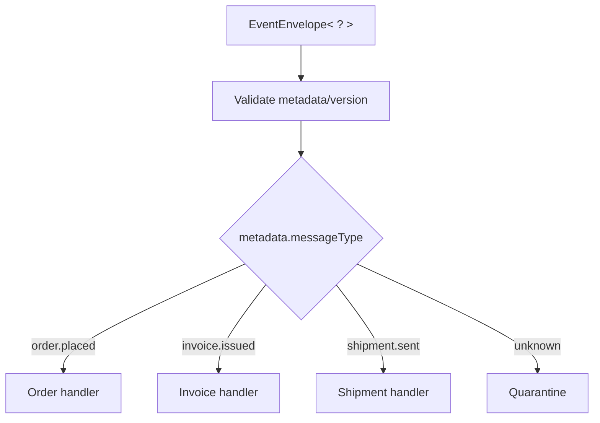

### Router đọc metadata từ payload

Ví dụ mô tả Java DSL:

```java
// Fragment: assumes input payload is a validated EventEnvelope<?>.
// Order, invoice và shipment output channels cần cấu hình riêng.

IntegrationFlow routeByEnvelopeType() {
    return IntegrationFlow.from("validatedEnvelopes")
        .route(EventEnvelope.class,
            envelope -> envelope.metadata().messageType(),
            spec -> spec
                .channelMapping("order.placed", "ordersChannel")
                .channelMapping("invoice.issued", "invoicesChannel")
                .channelMapping("shipment.sent", "shipmentsChannel"))
        .get();
}
```

Đây là ví dụ routing theo type, không phải toàn bộ producer-consumer configuration. Trong production, cần xử lý unknown mapping, versioning và DLQ có cấu trúc.

### Không chọn handler bằng class name do input cung cấp

Phản mẫu:

```java
// Không nên làm với dữ liệu bên ngoài.
String javaClassName = envelope.metadata().messageType();
Class<?> type = Class.forName(javaClassName);
```

Dùng một allowlist cố định giữa `messageType` với schema/handler được phép. Điều này giúp tránh deserialization không an toàn và giữ hợp đồng event minh bạch.

### Router và authorization

Một producer chỉ được phép phát `order.placed` không nên được phép tự sửa metadata thành `admin.action` để vào privileged handler. Routing theo metadata chỉ an toàn khi producer identity và loại message được phép phát đã được xác minh.

## 26. Envelope Wrapper và Filter: từ chối dữ liệu sai trước business effect

Filter có thể dùng metadata để loại events không phù hợp hoặc hết hạn theo chính sách.

```text
Envelope
  -> Validate schema/tenant
  -> Filter eventType == order.placed
  -> Unwrap
  -> Business Handler
```

Tuy nhiên, cần tách:

- **Security validation:** khác tenant, signature sai → reject + audit, không chỉ quietly discard.
- **Schema validation:** version không được hỗ trợ → structured error/quarantine.
- **Business Filter:** đơn hàng dưới một ngưỡng, trạng thái không phù hợp → điều kiện domain.
- **Duplicate Filter:** event đã xử lý → idempotency decision.

Không gộp các lý do này thành một `filteredOut` chung mà không có recovery contract.

### Check metadata mà không cần đọc full payload?

Với JSON body, phần metadata thường xuất hiện trước payload trong cấu trúc mẫu, nhưng **JSON object field order không tạo bảo đảm streaming/security**. Để thực sự kiểm tra metadata trước khi parse payload lớn, cần parser/envelope protocol hỗ trợ streaming hoặc metadata ở transport/record header được xác thực. Đừng hứa “metadata ở đầu JSON thì luôn tránh deserialize body”.

### Lỗi Filter trước Aggregator

Nếu một Splitter phát ba child nhưng Filter loại một child do metadata sai, Aggregator downstream có thể chờ vô hạn. Nên đưa failure outcome có sequence/group metadata đúng, hoặc fail toàn workflow, hoặc áp dụng partial/expiry policy rõ.

## 27. Correlation ID, causation ID, event ID và trace ID: bốn câu hỏi khác nhau

Một Envelope Wrapper thường chứa nhiều IDs, nhưng mỗi ID trả lời một câu hỏi.

| ID | Câu hỏi | Ví dụ |
| --- | --- | --- |
| `eventId` | Đây là logical event nào? | `EV-1042` |
| `businessCorrelationId` | Những events nào thuộc cùng workflow? | `order:shop-01:ORD-1042` |
| `causationId` | Event nào trực tiếp dẫn đến event này? | `EV-1039` |
| `traceId`/`traceparent` | Các spans nào thuộc cùng distributed trace? | Trace context được tạo bởi tracing system |
| `MessageHeaders.id` | Đây là message instance nào trong Spring? | UUID nội bộ |
| `correlationId` của Splitter | Các child nào thuộc cùng message group? | `split-group-77` |
| `idempotencyKey` | Operation nào không được thực thi lặp? | `shop-01:CAP-9:ledger` |

### Ví dụ workflow

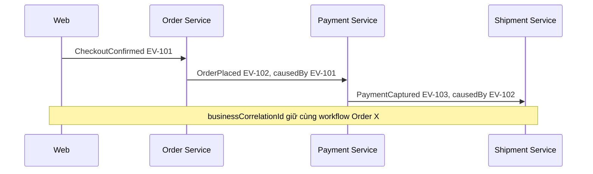

`eventId` khác nhau ở mỗi event. `businessCorrelationId` có thể giữ nguyên. `causationId` chỉ ra quan hệ trực tiếp, không phải danh sách toàn bộ ancestor events.

### Không dùng correlation ID làm key cho mọi child

Trong một `Splitter -> Aggregator`, các child cùng `correlationId` nhưng có `sequenceNumber` khác nhau. Nếu dùng mỗi correlationId để idempotent receiver, child thứ hai sẽ bị coi là duplicate của child thứ nhất.

Idempotency key cần thêm logical child ID hoặc operation identity theo hợp đồng.

## 28. Envelope Wrapper và Idempotent Receiver

Một broker có thể redeliver cùng event hai lần:

```text
Delivery #1:
  metadata.eventId=EV-1042
  metadata.envelopedAt=08:30:01Z
  payload.orderId=ORD-1042

Delivery #2:
  metadata.eventId=EV-1042
  metadata.envelopedAt=08:31:30Z
  payload.orderId=ORD-1042
```

Nếu event được rewrapped lúc retry, `envelopedAt` có thể khác. **Không sử dụng `envelopedAt` hoặc full-envelope JSON hash làm logical dedup key**.

Một idempotency key phù hợp có thể là:

```text
(tenantId, sourceSystem, eventId, operationType)
```

Trong workflow khác cần bảo vệ theo business action:

```text
(tenantId, orderId, ledgerEntryType)
```

Chọn key phải phù hợp side effect cần bảo vệ.

### Duplicate metadata khác nhau và conflict

Cùng `eventId` nhưng payload/amount khác có thể là lỗi producer, data corruption hoặc replay của một event đã bị sửa. Không tự ignore mà không có audit; có thể lưu fingerprint canonical của **business fields có ý nghĩa**:

```text
First event:
  key=K
  payloadFingerprint=HASH(canonical business fields)
  state=COMPLETED

Second event:
  key=K
  payloadFingerprint=same
  -> duplicate, no second effect

Second event:
  key=K
  payloadFingerprint=different
  -> conflict/quarantine
```

Không tính fingerprint từ `envelopedAt`, transient trace context hay transport headers thay đổi mỗi delivery.

### Không lầm với exactly-once effect

Một idempotent receiver có thể phát hiện duplicate ở input nhưng crash sau khi ghi key trước khi commit business effect, hoặc sau khi commit effect trước khi ack. Cần transaction, unique constraint/outbox hoặc downstream idempotency theo thiết kế. Envelope metadata cung cấp identity, **không tự bảo đảm transactional correctness**.

## 29. Retry và error channel: giữ envelope để điều tra lỗi

Một luồng có thể thất bại ở nhiều điểm:

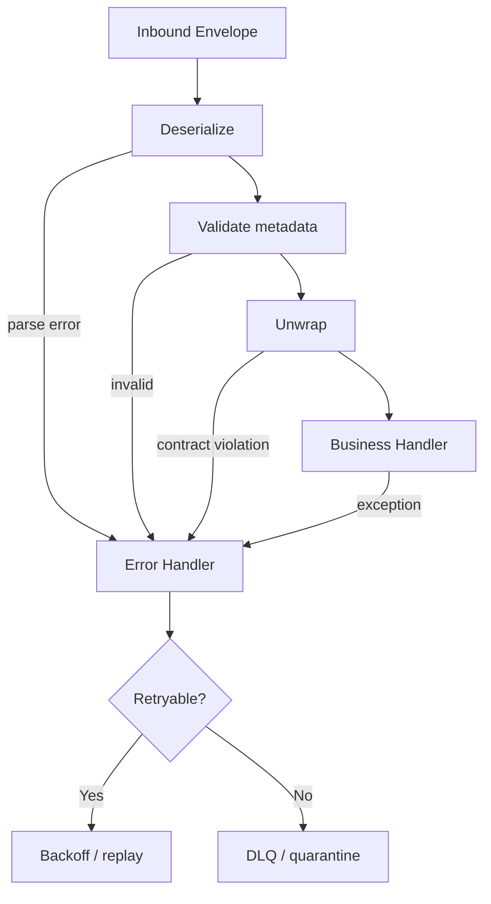

### Phân loại lỗi

| Lỗi | Ví dụ | Xử lý đề xuất |
| --- | --- | --- |
| `INVALID_JSON` | Body không parse được | Quarantine, tránh retry mù |
| `UNSUPPORTED_EVENT_TYPE` | `messageType` chưa đăng ký | Quarantine/owner schema |
| `UNSUPPORTED_SCHEMA_VERSION` | V3 chưa được hỗ trợ | Giữ raw reference để replay khi nâng cấp |
| `TENANT_MISMATCH` | Payload/metadata/auth identity khác nhau | Security rejection + audit |
| `METADATA_PAYLOAD_CONFLICT` | eventId khác nhau | Reject, đối soát nguồn |
| `SIGNATURE_INVALID` | Envelope ký sai | Reject, security alert |
| `TRANSIENT_STORE_FAILURE` | DB/tạm mất kết nối | Retry có giới hạn |
| `DOWNSTREAM_TIMEOUT` | Handler gọi API không phản hồi | Retry/reconcile theo idempotency |
| `DUPLICATE_COMPLETED` | Event đã commit | Replay result/ignore theo contract |
| `UNKNOWN_OUTCOME` | External effect có thể đã chạy | Reconciliation, không retry mù |

### Error channel có thể không xuất hiện trong luồng đồng bộ

Trong `DirectChannel` đồng bộ, exception từ Transformer có thể truyền về thread gửi; với listener/ExecutorChannel, error adapter hoặc `errorChannel` có thể tham gia theo cấu hình. Không giả định mọi exception tự vào một global error channel.

### Failure envelope có cần chứa toàn payload không?

Không nhất thiết. Một error record có thể giữ:

```java
public record EnvelopeFailure(
    String eventId,
    String sourceSystem,
    String messageType,
    int schemaVersion,
    String businessCorrelationId,
    String reasonCode,
    String rawMessageReference
) {}
```

Nếu payload có thông tin thanh toán/PII, nên giữ **rawMessageReference** trỏ tới kho hạn chế truy cập thay vì log toàn bộ body. Việc replay cần một provenance, checksum, retention và quyền truy cập rõ.

## 30. Outbox: tạo envelope trước khi publish message

Một vấn đề phổ biến:

```text
DB: CREATE Order
Broker: PUBLISH OrderPlaced envelope
```

Nếu DB commit thành công nhưng publish thất bại, consumer khác không nhận được event. Envelope wrapper **không tự giải quyết atomicity** giữa DB và broker.

### Transactional Outbox

Một thiết kế có thể là:

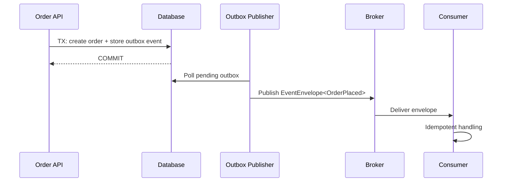

### Nguyên tắc

1. Tạo domain event ID ổn định trước khi ghi outbox.
2. Lưu event/envelope hoặc đủ dữ liệu để dựng **cùng logical event** trong outbox transaction.
3. Publisher có thể retry, không tạo event ID mới ở mỗi attempt.
4. `envelopedAt` cần có semantic rõ: lúc record được tạo hay lúc publish attempt. Nếu thay đổi theo retry, không dùng làm dedup identity.
5. Consumer có idempotency key và conflict handling.
6. Outbox event được đánh dấu published theo cơ chế retry/ack, không giả định broker gửi chính xác một lần.

Một JSON envelope làm thông điệp dễ diễn giải hơn, nhưng side effect chỉ an toàn khi có **business transaction and recovery protocol** phù hợp.

## 31. Splitter và Aggregator: metadata ngoài và group headers trong

Một đơn hàng có ba dòng:

```text
OrderPlaced envelope (businessCorrelationId=order:shop-01:ORD-1042)
  |
  v
Splitter
  -> Line 1 (correlationId=split-G, sequenceNumber=1/3)
  -> Line 2 (correlationId=split-G, sequenceNumber=2/3)
  -> Line 3 (correlationId=split-G, sequenceNumber=3/3)
  |
  v
Aggregator
  -> OrderLineSummary
```

Các child cùng **business correlation** nhưng cũng có **technical group correlation** do Splitter tạo.

### Tại sao không ghi đè technical correlation?

Nếu unwrap/wrap tạo Spring Message mới mà chỉ đặt `businessCorrelationId`, có thể làm mất các header `correlationId`, `sequenceNumber` và `sequenceSize` cần cho Aggregator.

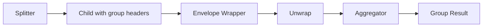

Đây là điểm cần thiết kế đặc biệt khi envelope nằm **giữa Splitter và Aggregator**.

### Các lựa chọn an toàn

- **Wrap trước Splitter:** các child do Splitter tạo group headers theo luồng hiện tại.
- **Wrap sau Aggregator:** giữ grouping nội bộ, chỉ envelope final business result.
- **Dùng envelope làm child payload:** nhưng giữ group headers trong Spring Message khi không qua network.
- **Qua broker:** encode group ID, sequence index/size thành protocol fields có version, rồi xây lại headers được kiểm chứng ở inbound adapter.
- **Content-based correlation:** nếu group key có trong payload/envelope và được xác thực, Aggregator có thể dùng custom CorrelationStrategy thay vì header của Splitter.

**Không sao chép tất cả MessageHeaders mù quáng qua network** chỉ để giữ `correlationId`, vì có thể mang cả reply/error channel objects hoặc metadata nhạy cảm. Hãy định nghĩa allowlist riêng cho những trường nhóm cần thiết.

### Filter giữa Splitter và Aggregator

Nếu Filter loại một child mà không phát failure outcome, Aggregator có thể không đủ N phần tử. Envelope Wrapper không sửa được sự mất mát này. Cần một completion/skip marker, partial release policy hoặc fail toàn group có cấu trúc.

## 32. Gateway request-reply và reply routing

Một `@MessagingGateway` có thể gọi flow và chờ kết quả. Khi gắn Envelope Wrapper, cần quyết định outbound request envelope khác inbound reply envelope thế nào.

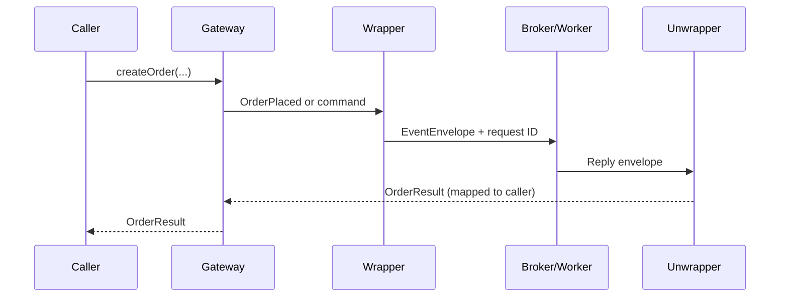

### Hai loại correlation không được nhầm

- **BusinessCorrelationId:** ví dụ `order:shop-01:ORD-1042` liên kết các events về một order.
- **Request correlation:** khóa map một reply tới đúng lời gọi Gateway đang chờ, có thể là request ID riêng.

Nếu hai clients cùng yêu cầu tra cứu order `ORD-1042`, chúng có thể có **hai request IDs khác nhau** nhưng cùng business correlation ID. Không nên dùng business ID để phân biệt mọi pending request.

### ReplyChannel không phải portable object

Trong JVM, một Gateway có thể gắn `replyChannel` vào Spring Message. Qua broker hoặc restart, một Java channel object không thể tự truyền đến service khác và giữ nghĩa.

Đối với async request-reply:

1. Dùng request/reply IDs và reply destination theo protocol.
2. Ánh xạ response tới caller còn sống hoặc persistent request context.
3. Cấu hình reply timeout và xử lý late response.
4. Không nhầm việc nhận một child message với final reply.
5. Không khôi phục stale `replyChannel` từ envelope hoặc persisted original message.

Với workflow dài, trả trạng thái `ACCEPTED/PENDING` rồi cho caller tra kết quả sau có thể hợp lý hơn giữ Gateway đồng bộ lâu.

## 33. Schema evolution: thêm metadata mà không phá consumer cũ

Envelope Wrapper là một hợp đồng chung; khi thay đổi nó, tác động có thể lan tới nhiều consumers.

### Những thay đổi thường gặp

| Thay đổi | Rủi ro | Cách tiếp cận |
| --- | --- | --- |
| Thêm optional `causationId` | Consumer nghiêm ngặt không nhận unknown field | Compatibility test, schema policy |
| Đổi `schemaVersion` từ int sang string | Deserialization fail | Version/migration rõ |
| Đổi tên `businessCorrelationId` | Tracing và grouping sai | Alias/migration có thời hạn |
| Đổi meaning của `occurredAt` | Sai ordering/SLA | Thay contract/version, không âm thầm đổi |
| Thêm `traceparent` | Có thể chứa untrusted baggage | Sanitize và limit size |
| Bỏ `eventId` | Dedup/replay không còn ID ổn định | Thay schema hoặc reject |
| Thêm payload field | Consumer cũ có thể không biết | Backward compatibility rules |
| Đổi tiền từ minor units sang decimal | Nghiệp vụ tính sai | Event schema version mới, explicit mapping |
| Thay tenant namespace | Cross-tenant collision | Migration + ownership validation |

### Hai loại version có thể cần độc lập

```text
envelopeSchemaVersion = 2
payloadSchemaVersion = 1
```

Nếu envelope metadata được chuẩn hóa cho nhiều event types, thay đổi schema envelope và thay đổi schema của `OrderPlaced` có thể xảy ra độc lập. Đặt một `schemaVersion` duy nhất không sai nếu contract coi toàn bộ envelope + payload là một đơn vị version; chỉ cần nhất quán.

### Một kế hoạch migrate an toàn

1. Thêm consumer có thể đọc schema cũ và mới.
2. Chạy producer mới với một tỷ lệ nhỏ traffic.
3. Theo dõi rejection/error theo `messageType/schemaVersion`.
4. Đảm bảo DLQ/replay còn đọc được version cũ.
5. Chỉ bỏ version cũ khi hết retention/replay window hoặc có chiến lược migration.
6. Không phá tính ổn định của event ID/correlation khi đổi serializer.

## 34. Multi-source và Content-based Correlation

Khi nhiều nguồn cùng phát sự kiện đơn hàng, envelope có thể chuẩn hóa metadata chung:

```text
WEB_CHECKOUT
  payload=WebOrderV1
  -> Normalizer -> OrderPlaced
  -> Envelope(sourceSystem=WEB_CHECKOUT)

PARTNER_B2B
  payload=PartnerOrderV2
  -> Normalizer -> OrderPlaced
  -> Envelope(sourceSystem=PARTNER_B2B)
```

Hai envelopes có thể có cùng `orderId` nhưng `sourceEventId/eventId` khác. Việc chúng có cùng order ID **không tự chứng minh là một logical event**.

### CorrelationStrategy theo nội dung

Một Aggregator có thể nhóm events theo:

```text
GroupKey(tenantId, orderId, workflowRunId)
```

Nhưng envelope demo không có `workflowRunId`; nếu ứng dụng xử lý nhiều lần cùng order, cần bổ sung field hoặc một coordinator ID đã xác minh.

### Không dùng một global mutable “currentEnvelope”

Khi hai nguồn phát xen kẽ:

```text
A: order:shop-01:O-1
B: order:shop-02:O-2
A: order:shop-01:O-1
```

Transformer phải tính metadata cho **từng message**, không lưu source/tenant “hiện tại” trong biến dùng chung. Class `OrderEnvelopeTransformer` ở ví dụ dùng trường bất biến `sourceSystem` do bean cấu hình và nhận tenant theo input đã xác thực, nên không phải cập nhật mutable `currentTenant` theo từng request.

Với nhiều nguồn, mỗi source có thể có transformer instance được cấu hình sourceSystem riêng, hoặc một factory chọn source từ trusted context; không cho producer tự khai nguồn để được ưu tiên.

## 35. Test concurrent wrapping: bảo toàn metadata theo message

Một bài kiểm tra concurrency nên dùng nhiều thread phát các events khác tenant/event ID cùng lúc, rồi kiểm tra **tập outputs**, không ép global order.

### Mẫu JUnit 5

Thêm method vào `EnvelopeWrapperFlowTest` ở mục 21:

```java
@Test
void concurrentWrapDoesNotMixTenantOrEventIdentity()
        throws Exception {

    var cases = java.util.List.of(
        new OrderPlaced("shop-01", "O-1", "EV-1",
            10L, "VND",
            Instant.parse("2026-11-21T00:00:00Z")),
        new OrderPlaced("shop-02", "O-2", "EV-2",
            20L, "VND",
            Instant.parse("2026-11-21T00:00:01Z")),
        new OrderPlaced("shop-03", "O-3", "EV-3",
            30L, "VND",
            Instant.parse("2026-11-21T00:00:02Z"))
    );

    var pool = java.util.concurrent.Executors
        .newFixedThreadPool(3);

    var ready = new java.util.concurrent.CountDownLatch(3);
    var start = new java.util.concurrent.CountDownLatch(1);

    var futures = new java.util.ArrayList<
        java.util.concurrent.Future<?>>();

    try {
        for (OrderPlaced order : cases) {
            futures.add(pool.submit(() -> {
                ready.countDown();

                if (!start.await(5,
                        java.util.concurrent.TimeUnit.SECONDS)) {
                    throw new IllegalStateException(
                        "Concurrent start timeout");
                }

                Message<OrderPlaced> input =
                    MessageBuilder.withPayload(order)
                        .setHeader(
                            "verifiedTenantId",
                            order.tenantId())
                        .build();

                assertTrue(rawInput.send(input));
                return null;
            }));
        }

        assertTrue(ready.await(
            5, java.util.concurrent.TimeUnit.SECONDS));

        start.countDown();

        for (var future : futures) {
            future.get(5, java.util.concurrent.TimeUnit.SECONDS);
        }

        var envelopesByEvent = new java.util.HashMap<
            String, EventEnvelope<OrderPlaced>>();

        for (int i = 0; i < cases.size(); i++) {
            Message<?> message = envelopesOut.receive(2_000);
            assertNotNull(message);

            @SuppressWarnings("unchecked")
            EventEnvelope<OrderPlaced> envelope =
                (EventEnvelope<OrderPlaced>) message.getPayload();

            assertNull(envelopesByEvent.put(
                envelope.metadata().eventId(), envelope));
        }

        for (OrderPlaced order : cases) {
            EventEnvelope<OrderPlaced> actual =
                envelopesByEvent.get(order.eventId());

            assertNotNull(actual);
            assertEquals(order, actual.payload());
            assertEquals(
                order.tenantId(),
                actual.metadata().tenantId());
        }

        assertEquals(cases.size(), envelopesByEvent.size());
    } finally {
        start.countDown();
        pool.shutdownNow();
    }
}
```

### Test này chứng minh gì?

- Ba threads có thể gọi flow cùng lúc trong một JVM.
- Event IDs và tenants không bị trộn lẫn.
- Không dựa vào arrival order khi lấy kết quả.
- Wrapper không dùng một mutable context toàn cục cho tenant/event.

**Không chứng minh:** header đã được authentication thật gắn, broker round-trip, durability, multi-pod exactly-once hoặc fault tolerance. Các test đó cần test environment và adapter phù hợp.

## 36. Observability: envelope giúp đọc log mà không mở payload

Khi message có metadata rõ ràng, middleware có thể log các trường có ích:

```text
stage=ENVELOPE_CREATED
messageType=order.placed
schemaVersion=1
eventId=EV-1042
tenant=shop-01
sourceSystem=WEB_CHECKOUT
businessCorrelationId=order:shop-01:ORD-1042

stage=ENVELOPE_VALIDATED
eventId=EV-1042
schemaVersion=1
result=PASS

stage=BUSINESS_COMPLETED
eventId=EV-1042
operation=CREATE_ORDER
result=SUCCESS
```

Đây là application log minh họa. Không giả định Spring Integration tự sinh chính xác định dạng này.

### Metrics đề xuất

| Metric | Câu hỏi |
| --- | --- |
| `envelope.created` | Có bao nhiêu events được wrapped? |
| `envelope.validated` | Có bao nhiêu envelope qua validation? |
| `envelope.rejected` | Lỗi metadata/schema/tenant có tăng? |
| `envelope.unknown_type` | Có messageType mới không được hỗ trợ? |
| `envelope.unsupported_version` | Producer/consumer lệch version? |
| `envelope.serialization_failed` | Có lỗi codec/format? |
| `envelope.unwrap_failed` | Có lỗi contract khi unwrap? |
| `envelope.processing_latency` | Từ wrap/receive tới xử lý mất bao lâu? |
| `envelope.payload_size` | Wrapper làm message lớn thêm bao nhiêu? |
| `envelope.duplicate_event` | Bao nhiêu logical events đã được giao lại? |
| `envelope.replay_attempts` | Có bao nhiêu lần replay/recovery? |
| `envelope.error_backlog` | Có bao nhiêu message lỗi chưa xử lý? |

Label nên ít cardinality như `messageType`, `schemaVersion`, `sourceSystem`, `reasonCode`. Không mặc định dùng `eventId`/`orderId`/`businessCorrelationId` làm metric labels; chúng có cardinality cao. Dùng structured logs và tracing được bảo vệ để tra event cụ thể.

### Không nhầm envelope được tạo với business effect đã commit

```text
ENVELOPE_CREATED
   != BROKER_PUBLISHED
   != CONSUMER_RECEIVED
   != BUSINESS_COMMITTED
```

Một wrapper chỉ tạo dữ liệu. Các mốc publish, ack và commit phải được theo dõi riêng, đặc biệt khi dùng retry và transactional outbox.

## 37. Hiệu năng: envelope không làm payload nhẹ hơn

Giả sử payload JSON có kích thước 2 KB, metadata 300 byte. Envelope làm message tăng thêm khoảng 300 byte cộng overhead serialization. Với event nhỏ, mức này có thể chấp nhận được để đổi lấy hợp đồng thống nhất.

Nhưng với một tài liệu 30 MB:

```text
Before:
  payload = PDF bytes 30 MB

After Envelope Wrapper:
  metadata ~ hundreds of bytes
  payload  = PDF bytes 30 MB
```

Envelope Wrapper **không tự loại bỏ bytes lớn** khỏi message. Nếu mục tiêu là giảm truyền file, cân nhắc **Claim Check** hoặc object storage reference:

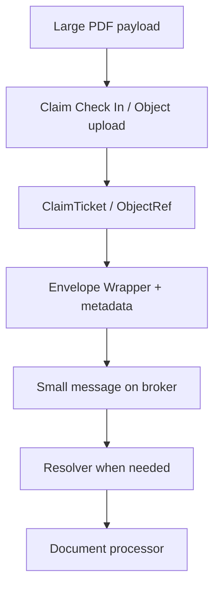

### Tác động hiệu năng khác

- Serialization/deserialization thêm CPU.
- Envelope làm tăng số bytes qua mạng/broker.
- Validate metadata/tenant/schema thêm latency, nhưng là chi phí cần thiết cho correctness/security.
- Generic JSON envelope có thể khiến consumers cần schema resolution.
- Quá nhiều nested wrappers làm tăng payload overhead và độ phức tạp.
- Khi throughput lớn, cần giới hạn max message size, queue depth và backpressure.

Một performance test nên đo:

1. Kích thước bytes trước/sau.
2. Serialization CPU và allocation.
3. Latency P50/P95/P99.
4. Tỷ lệ validate/reject.
5. Consumer lag khi có schema mới.
6. Tác động retry/redelivery và DLQ.
7. Lượng data bị log không cần thiết.

Không tối ưu bằng cách loại bỏ validation hoặc copy mọi metadata vào header không bảo vệ.

## 38. Khi nào không cần Envelope Wrapper?

Không phải hệ thống nào cũng cần một lớp bọc explicit.

**Có thể không cần** khi:

- Message chỉ đi trong một JVM, Spring `MessageHeaders` đã đủ.
- Payload được xử lý ngay bởi một service duy nhất.
- Có schema sẵn bao gồm metadata cần thiết, wrapper mới chỉ lặp trường.
- Team chưa có version/trust/retention policy để quản lý envelope.
- Chỉ có một event type đơn giản và không có yêu cầu cross-service compatibility.

**Nên cân nhắc** khi:

- Có nhiều event types cùng cần provenance, identity, version.
- Có nhiều consumers dùng ngôn ngữ/framework khác nhau.
- Có nhiều hops qua broker/HTTP và header mapping không đồng nhất.
- Cần contract tests và schema registry.
- Cần trace/correlation/causation giữa các service.
- Muốn tách business payload khỏi transport/operational metadata.

### Tránh bọc nhiều lớp không cần thiết

```text
Message<Envelope<Envelope<Envelope<OrderPlaced>>>>
```

Nếu mỗi downstream service tự thêm một wrapper mới, code sẽ khó đọc và khó xác định envelope nào authoritative. Thường nên **giữ một envelope chuẩn**, bổ sung event mới ở service boundary với causation/correlation rõ, hoặc ghi processing metadata vào tracing/operational store thay vì lồng wrapper vô hạn.

## 39. Những phản mẫu thường gặp

### 39.1. Coi Spring Message header và envelope body là một thứ

Chúng có vòng đời khác nhau. Header mapping qua broker không tự giống JSON payload. Cần quy định metadata nào portable.

### 39.2. Dùng mọi HTTP headers làm envelope metadata

Có thể lộ Authorization token, cookie, PII, signed URL và tạo coupling với client. Chỉ dùng allowlist.

### 39.3. Coi `metadata.tenantId` là bằng chứng quyền truy cập

Metadata từ ngoài có thể bị giả. Phải kiểm tra authenticated identity trước khi xử lý.

### 39.4. Tạo eventId mới trên mỗi retry

Idempotent Receiver không thể nhận diện cùng logical event; có thể sinh side effects trùng. Event ID phải ổn định theo contract.

### 39.5. Dùng `envelopedAt` làm idempotency key

Timestamp có thể khác khi replay, nên không định danh logical event.

### 39.6. Ghi đè `correlationId` nhóm bằng businessCorrelationId

Splitter/Aggregator có thể mất group identity/sequence contract. Giữ hai ý nghĩa khác nhau.

### 39.7. Không kiểm tra metadata/payload trùng nhau

Một consumer đọc tenant/eventId ở envelope, consumer khác đọc ở payload và xử lý khác nhau. Validate consistency hoặc loại bỏ duplicate field nếu contract cho phép.

### 39.8. Deserialization bằng class name từ messageType

Dữ liệu bên ngoài có thể chọn class không được phép. Dùng schema/type registry allowlist.

### 39.9. Giữ stale `replyChannel` qua broker

Gateway có thể timeout hoặc reply đi tới context cũ. Dùng request/reply protocol với correlation ID và destination rõ.

### 39.10. Bỏ qua schema evolution

Thêm required metadata field đột ngột có thể khiến consumer cũ fail. Version/compatibility test trước deploy.

### 39.11. Dùng Envelope Wrapper để “giảm kích thước file”

Wrapper không cất payload đi đâu. Claim Check/ObjectRef mới giúp offload dữ liệu lớn.

### 39.12. Không có negative tests

Chỉ test happy-path wrap/unwrap không phát hiện cross-tenant, unsupported version, mismatch hoặc invalid payload.

### 39.13. Coi eventId bằng Order ID

Một order có thể có nhiều events, corrections và workflow runs. Dùng logical event ID khác business entity ID.

### 39.14. Không phân biệt causation và correlation

Causation chỉ trực tiếp parent event, còn correlation nối cả workflow; gán bừa cùng giá trị làm mất khả năng phân tích flow.

### 39.15. Xóa envelope mà không giữ provenance khi unwrap

Downstream mất sourceSystem/eventId/version và không biết cách retry/reconcile. Chỉ bỏ những trường không còn cần thiết.

### 39.16. Lưu object mutable trong envelope

Một `List` hoặc `byte[]` có thể bị sửa sau khi publish nếu không có immutable/deep-copy policy. Contract event nên bất biến về logic.

## 40. Bài thực hành: thống nhất envelope cho nhiều event types

**Bối cảnh:** module `SPRING_INTEGRATION_PATTERN` xử lý ba events: OrderPlaced, PaymentCaptured và ShipmentDispatched. Mỗi loại có payload riêng nhưng phải được trace, route và replay theo metadata chung.

### Phần A — Thiết kế contract

1. Định nghĩa `EnvelopeMetadata` có messageType, schemaVersion, eventId, tenant, source, correlation, causation, occurredAt/envelopedAt.
2. Định nghĩa `EventEnvelope<T>` bất biến.
3. Định nghĩa một domain payload như `OrderPlaced`.
4. Chọn field nào thuộc business payload và field nào thuộc metadata.
5. Ghi rõ source/tenant identity nào được xác minh ở ingress.
6. Quy định schema registry/allowlist cho message types.
7. Xác định field bắt buộc, optional, versioning và failure codes.
8. Chọn một event ID ổn định qua redelivery.

### Phần B — Spring Integration

9. Tạo `OrderEnvelopeTransformer.wrap`.
10. Tạo `OrderEnvelopeTransformer.unwrap`.
11. Cấu hình Java DSL với `rawOrdersInput` và `envelopesOut`.
12. Cấu hình inbound unwrap flow với `wrappedOrdersInput` và `ordersOut`.
13. Bảo đảm wrapper không copy stale reply/error channels.
14. Thêm Router dựa trên `metadata.messageType`.
15. Thêm Filter/validation để reject invalid schema/tenant.
16. Tích hợp Idempotent Receiver theo stable event/business operation key.
17. Nếu có Splitter/Aggregator, giữ đúng group ID và sequence.
18. Mở rộng sang event types khác mà không cho phép arbitrary class deserialization.

### Phần C — Kiểm thử

19. Unit test `wrap` không đổi domain payload.
20. Test `envelopedAt` bằng `Clock.fixed`.
21. Test round-trip `wrap -> unwrap` khôi phục payload và business headers phù hợp.
22. Test thiếu verified tenant header.
23. Test metadata tenant khác authenticated tenant.
24. Test metadata.eventId khác payload.eventId.
25. Test unsupported messageType/schemaVersion.
26. Test JSON serialization/deserialization với typed schema.
27. Test nhiều tenants/events xen kẽ không bị trộn.
28. Test concurrency không assert global output order.
29. Test duplicate/replay không tạo event ID mới theo mỗi delivery.
30. Test header mapper khi qua Kafka/AMQP/HTTP adapter thực.

### Phần D — Vận hành

31. Test broker redelivery sau DB commit và trước ACK.
32. Dùng outbox khi publish event gắn với DB transaction.
33. Xác định Gateway reply ID khác business correlation ID.
34. Thiết kế error channel/DLQ theo reason code.
35. Giới hạn max message size, attributes và tracing baggage.
36. Đo serializer latency và kích thước wrapper.
37. Test schema migration V1→V2 khi consumer cũ còn đang chạy.
38. Lưu raw message reference có kiểm soát cho replay/quarantine.
39. Đảm bảo không log token/PII trong metadata.
40. Viết production checklist và ownership của envelope schema.

### Bảng kết quả kỳ vọng

| Tình huống | Kết quả mong đợi |
| --- | --- |
| OrderPlaced hợp lệ | `EventEnvelope<OrderPlaced>` có metadata đúng |
| Wrap → unwrap | Payload nghiệp vụ bằng bản gốc |
| Tenant nguồn khớp payload | Cho phép xử lý |
| Tenant nguồn khác metadata/payload | Security rejection |
| EventId metadata khác payload | Contract error |
| Unsupported type/version | Quarantine/unsupported schema |
| Source system từ cấu hình trusted | Provenance đáng tin |
| Cùng event được retry | Logical eventId không đổi |
| EnvelopedAt khác khi rewrap | Không coi là event mới vì timestamp |
| Hai tenants đồng thời | Metadata không bị trộn |
| Broker header mapper bỏ header | Envelope body giữ metadata portable đã định nghĩa |
| Splitter group 1..N | Group/sequence metadata vẫn đúng contract |
| Gateway hai callers cùng order | Reply đi theo request ID, không theo mỗi order ID |
| Payload 30 MB | Wrapper không offload bytes, cân nhắc Claim Check |
| JSON schema mới | Compatibility/version handling có kiểm thử |

## 41. Câu hỏi tự đánh giá

**Câu 1.** Envelope Wrapper làm gì khác với Header Enricher?

*Header Enricher chủ yếu thêm metadata vào Spring MessageHeaders; Envelope Wrapper tạo một payload có cấu trúc bao gồm metadata và payload gốc, có thể serialize thành hợp đồng liên dịch vụ.*

**Câu 2.** Tại sao không thể mặc định lấy `replyChannel` từ Spring Message rồi đưa vào envelope JSON?

*Vì replyChannel có thể là một object/context nội bộ JVM, không có nghĩa portable qua broker, restart hoặc một ngôn ngữ khác.*

**Câu 3.** Có thể tin `metadata.tenantId` do client gửi không?

*Không. Tenant phải được xác định từ authenticated context và đối chiếu với metadata/payload.*

**Câu 4.** Vì sao `eventId` khác `businessCorrelationId`?

*eventId định danh một logical event; businessCorrelationId liên kết các events của một workflow/đối tượng nghiệp vụ.*

**Câu 5.** Khi retry tạo envelope mới với `envelopedAt` khác, có phải event mới?

*Không nếu logical eventId và business meaning vẫn là cùng event; timestamp bọc không phải identity của event.*

**Câu 6.** Có nên dùng `metadata.messageType` làm Java class name rồi deserialize bằng reflection?

*Không. Dùng allowlist/schema registry mapping được kiểm soát.*

**Câu 7.** Vì sao unwrap sau Splitter có thể khiến Aggregator chờ vô hạn?

*Nếu unwrap tạo Message mới làm mất group/sequence headers, Aggregator không nhận diện đủ child của nhóm. Cần giữ hoặc tái tạo các trường nhóm theo contract.*

**Câu 8.** Envelope Wrapper có làm giảm kích thước một tài liệu PDF lớn?

*Không. Nó thêm metadata quanh payload. Muốn offload payload lớn, dùng Claim Check hoặc object storage reference.*

**Câu 9.** Một event có `causationId` và `businessCorrelationId` như nhau có luôn sai không?

*Không phải luôn sai về mặt dữ liệu, nhưng chúng có hai ý nghĩa khác nhau; cần tính theo đúng quan hệ nhân quả và phạm vi workflow, không gán giống nhau mặc định.*

**Câu 10.** Envelope có tự bảo đảm exactly-once processing không?

*Không. Nó cung cấp identity/provenance, nhưng transaction, outbox, idempotency, acknowledgement và recovery mới quyết định side effect có bị lặp hay mất.*

## 42. Checklist trước khi áp dụng production

- **Domain separation:** metadata không biến payload nghiệp vụ thành DTO của một transport cụ thể.
- **Typed envelope:** `EventEnvelope<T>` có required fields và validation.
- **Schema:** message type/version rõ, schema registry/allowlist.
- **Trust boundary:** tenant/source lấy từ identity đáng tin.
- **Consistency:** metadata và payload cùng event/tenant/timestamp theo policy.
- **Correlation:** business correlation khác technical group correlation và request ID.
- **Causation:** lưu parent event ID khi thật sự có quan hệ nhân quả.
- **Event ID:** ổn định qua retry, không dùng `MessageHeaders.id` tùy tiện.
- **Time:** phân biệt occurredAt, envelopedAt, processing/commit time.
- **Transport:** JSON/Avro/Protobuf schema và header mapping được kiểm thử.
- **Security:** không serialize credentials, signed URLs, PII dư thừa hoặc reply channel.
- **Serialization:** cross-language round-trip, Instant, số nguyên lớn và null handling.
- **Router:** chỉ định tuyến theo các message types được phép.
- **Filter:** lỗi validation khác với loại message theo business rule.
- **Normalizer:** source-specific payload về canonical model trước wrap nếu phù hợp.
- **Content Enricher:** bổ sung domain fields đúng boundary, không làm giả metadata.
- **Idempotency:** key theo logical operation, có duplicate/conflict handling.
- **Splitter/Aggregator:** giữ group/sequence fields khi qua wrapper/broker.
- **Gateway:** request/reply ID riêng, không giữ stale replyChannel.
- **Retry:** phân biệt transient errors với invalid schema/tenant.
- **Error handling:** DLQ reason code, raw message reference và replay policy.
- **Outbox:** phát event an toàn khi gắn với DB business transaction.
- **Schema evolution:** V1/V2 compatibility và retention/replay tests.
- **Concurrency:** stateless wrapper, không giữ mutable currentTenant/currentEvent.
- **Performance:** overhead bytes, serializer CPU, bounded queues và backpressure.
- **Observability:** metadata hữu ích nhưng không đưa high-cardinality IDs vào metrics labels.
- **Tests:** wrap/unwrap, tenant mismatch, schema errors, serialization, interleaving, retry và commit.
- **Ownership:** có team chịu trách nhiệm envelope contract, security và migration.

## 43. Kết luận

**Envelope Wrapper thêm metadata quanh payload** để một message mang được các thông tin cần thiết cho integration — loại sự kiện, phiên bản schema, nguồn, tenant, event ID, business correlation, causation và thời điểm — mà không buộc mọi domain payload phải tự quản lý các concern vận hành này.

Trong Spring Integration, Envelope Wrapper thường được thực hiện bằng **Transformer** tạo `Message<EventEnvelope<T>>`; khi cần sử dụng payload nghiệp vụ, một bước **unwrap** có validation chuyển trở lại `Message<T>`. Đừng nhầm envelope portable trong serialized body với `MessageHeaders` nội bộ, và không sao chép bừa những header như `replyChannel` hoặc `errorChannel` qua ranh giới hệ thống.

Một wrapper tốt không chỉ “thêm vài trường JSON”: nó có **contract, nguồn chân lý, xác thực, versioning, consistency checks, correlation/idempotency semantics, error/retry policy và kiểm thử**. Khi những điều này được xác định rõ, các luồng Router, Filter, Transformer, Splitter, Aggregator và Gateway có thể trao đổi events giữa nhiều nguồn/service một cách nhất quán, dễ quan sát và dễ mở rộng.
