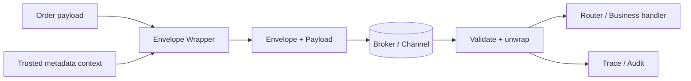
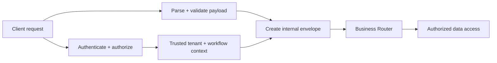
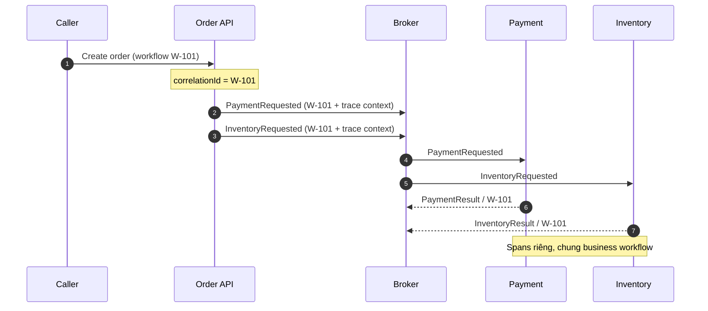
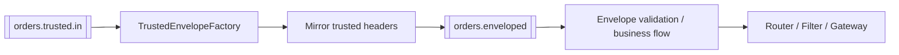
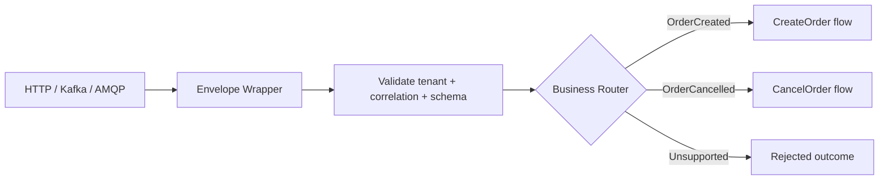
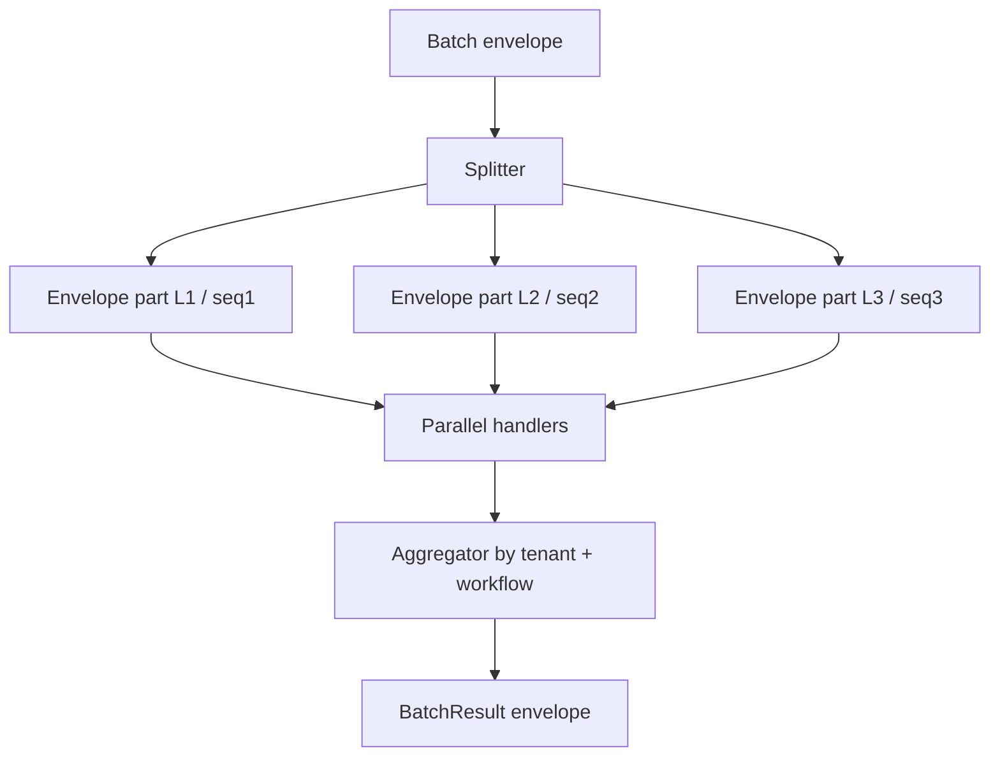
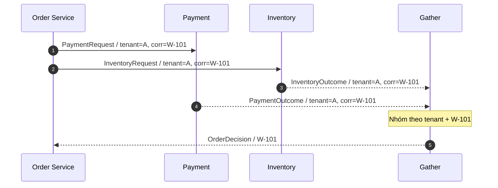
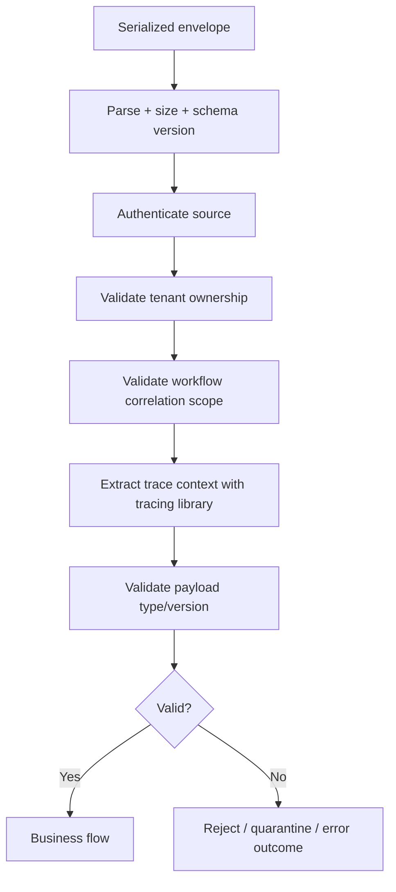
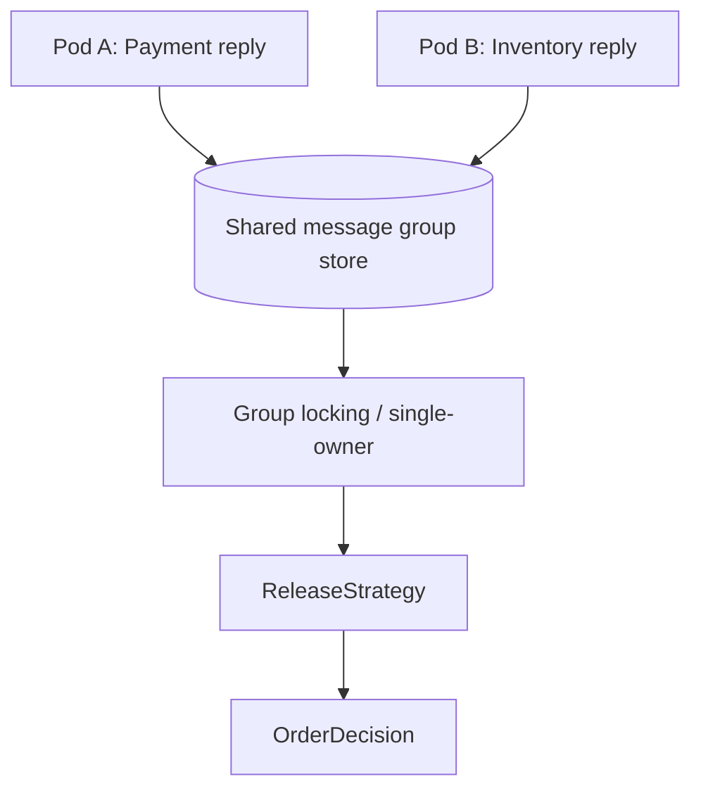

# Envelope chứa correlation, tenant và trace information

Một hệ thống thương mại điện tử nhận yêu cầu tạo đơn hàng qua HTTP, gửi lệnh kiểm tra tồn kho qua Kafka, nhận kết quả từ Inventory, rồi tổng hợp với kết quả Payment bằng Spring Integration. Mỗi service có thể tạo `Message<?>`, message ID và trace/span riêng. Nhưng toàn bộ các bước vẫn thuộc **cùng một workflow nghiệp vụ**, một **tenant** và một chuỗi xử lý cần theo dõi. Nếu các thông tin đó chỉ nằm rải rác trong header riêng của từng transport, chúng có thể bị mất hoặc hiểu sai sau Router, Transformer, broker adapter hay lần retry.

**Envelope Wrapper** trong **Enterprise Integration Patterns (EIP)** giúp đóng gói **business payload** cùng một lớp **metadata có hợp đồng rõ ràng**. Envelope có thể chứa **correlation identifier**, **tenant identifier**, **trace context**, version, source và các trường điều khiển được phép để bên nhận biết message thuộc luồng nào, có quyền xử lý dưới phạm vi nào và có thể nối trace với các bước trước ra sao. Khi nhận, receiver kiểm tra envelope rồi chuyển payload vào một mô hình nội bộ phù hợp.

Bài **“Envelope chứa correlation, tenant và trace information”** thuộc chương **Envelope wrapper** của module `SPRING_INTEGRATION_PATTERN`. Mục tiêu là học triển khai Enterprise Integration Patterns bằng Spring Integration để xây dựng luồng thông điệp ít phụ thuộc, dễ mở rộng; thực hành Router, Filter, Transformer, Splitter, Aggregator, Gateway, retry, error channel và correlation, đồng thời biết kiểm thử và quan sát từng nhánh xử lý.

> **Nguyên tắc trung tâm:** **Envelope mang metadata, nhưng không tự chứng minh metadata là đáng tin.** `tenantId` do client tự khai không thay thế authorization; `correlationId` không tự là idempotency key; `traceparent` không tự là group identity; một message có envelope đúng JSON không có nghĩa nghiệp vụ đã xử lý xong. Hệ thống phải quy định **ai cấp, ai được sửa, cách kiểm tra và cách truyền tiếp** từng trường.

## 1. Envelope Wrapper giải quyết bài toán gì?

Giả sử Producer gửi một lệnh:

```json
{
  "orderId": "ORD-101",
  "quantity": 2
}
```

Trong một hệ thống đơn giản, payload này đủ để gọi một service. Nhưng trong flow nhiều service, receiver cần thêm:

- **Correlation:** lệnh này thuộc workflow/request/batch nào?
- **Tenant:** lệnh được xử lý dưới quyền và phân vùng dữ liệu nào?
- **Trace:** thao tác này liên quan span/trace nào khi theo dõi qua nhiều service?
- **Schema version:** payload đang theo hợp đồng v1 hay v2?
- **Source:** hệ thống nào tạo hoặc chuyển message, đã được xác thực chưa?
- **Message/event identity:** đây là một event logic mới hay bản được phát lại?

Một envelope có thể trình bày:

```json
{
  "envelopeVersion": 1,
  "metadata": {
    "correlationId": "flow-51edc234",
    "tenantId": "TENANT-A",
    "source": "order-api",
    "eventId": "evt-8ef2c",
    "traceparent": "00-4bf92f3577b34da6a3ce929d0e0e473-00f067aa0ba902b7-01"
  },
  "payload": {
    "orderId": "ORD-101",
    "quantity": 2
  }
}
```

Đây là **một schema minh họa do ứng dụng định nghĩa**, không phải một format JSON mặc định do Spring Integration hay W3C bắt buộc. Các trường `eventId` và `traceparent` được thêm để phân biệt **message identity** và **trace context** với **business correlation**.



### 1.1. Envelope và payload khác vai trò

| Thành phần | Dữ liệu ví dụ | Dùng cho |
| --- | --- | --- |
| **Envelope** | `correlationId`, `tenantId`, `traceparent`, `envelopeVersion` | Identity nhóm, ngữ cảnh bảo mật, truyền trace, protocol contract. |
| **Payload** | `orderId`, `quantity`, `sku` | Logic nghiệp vụ của lệnh hoặc sự kiện. |
| **Transport headers** | HTTP `Content-Type`, Kafka headers, AMQP properties | Adapter/serializer và định tuyến ở ranh giới truyền tải. |
| **Spring MessageHeaders** | `id`, `timestamp`, `contentType`, `replyChannel`, `errorChannel`, `correlationId` | Metadata của message trong runtime Spring Messaging. |
| **Business state** | Order hiện tại đã paid/shipped chưa? | Nguồn thẩm quyền nghiệp vụ ở DB/service, không nằm trọn trong envelope. |

**Mục tiêu là giảm phụ thuộc vào transport.** Khi cả HTTP, Kafka và AMQP được chuẩn hóa về một envelope nội bộ, business handler không cần tự parse `X-Correlation-ID` của HTTP hay byte-array header của Kafka.

### 1.2. Envelope Wrapper không tự làm gì?

Nó **không** tự:

- Xác thực danh tính người gửi và cấp quyền theo tenant.
- Bảo đảm cùng `correlationId` là cùng workflow hợp pháp.
- Làm một workflow chạy đồng bộ hoặc tuần tự.
- Loại duplicate, giữ exactly-once hay commit transaction.
- Tạo trace/span hợp lệ nếu chưa có tracing instrumentation.
- Bảo đảm payload tương thích schema hoặc giữ bí mật chỉ vì được “bọc”.
- Làm broker, database và external API cùng commit atomic.

Envelope là **hợp đồng trình bày và truyền metadata**. Các bảo đảm trên đến từ security boundary, state store, transaction, retry policy, tracing framework và logic nghiệp vụ.

## 2. Mô hình một envelope tối thiểu

Có hai nhóm dữ liệu cần tách: **metadata có quy tắc chung** và **payload theo domain**.

```text
Envelope
├── envelopeVersion
├── metadata
│   ├── correlationId
│   ├── tenantId
│   ├── source
│   ├── eventId
│   └── traceparent (optional)
└── payload
    ├── orderId
    └── quantity
```

### 2.1. Trường nào nên bắt buộc?

| Trường | Bắt buộc trong ví dụ | Nguồn thẩm quyền |
| --- | --- | --- |
| `envelopeVersion` | Có | Protocol/schema contract của producer/adapter. |
| `correlationId` | Có | Workflow/ingress cấp hoặc khôi phục từ record đáng tin. |
| `tenantId` | Có | Authenticated principal/tenant mapping, không lấy mù từ client. |
| `source` | Có | Danh tính producer/adapter đã được xác thực. |
| `eventId` | Có | Event producer hoặc workflow cấp một lần cho logical event. |
| `traceparent` | Không | Tracing instrumentation/context propagation. |
| `payload` | Có | Command/event sau schema validation. |

Không phải mọi hệ thống cần `eventId`; có trường hợp dùng `operationId`, `messageType` hoặc `generation`. Bảng trên thể hiện **lựa chọn của bài thực hành**, không phải danh sách bắt buộc của EIP.

### 2.2. Một identity dùng cho mọi việc có nguy hiểm không?

Nếu dùng `correlationId=ORD-101` cho tất cả:

```text
Tenant A, order ORD-101, verification generation 1
Tenant B, order ORD-101, verification generation 1
Tenant A, order ORD-101, verification generation 2
```

thì có nguy cơ trộn message giữa **hai tenant** hoặc **hai lần xử lý**. Khi scope cần phân biệt, khóa tương quan nội bộ có thể là:

```text
(tenantId, orderId, workflowGeneration)
```

hoặc một `workflowId` duy nhất do server cấp, với **mapping bền vững sang tenant và business operation**. Không dựa chỉ vào việc chuỗi correlation “trông ngẫu nhiên” để bỏ kiểm tra ownership.

## 3. `correlationId`: message cùng một cuộc hội thoại

**Correlation Identifier** trả lời:

> Message này thuộc **workflow/group/request** nào?

Ví dụ một lần xác minh đơn:

```text
OrderVerification workflow W-101
  ├── PaymentRequested    correlationId=W-101
  ├── InventoryRequested  correlationId=W-101
  ├── PaymentResult       correlationId=W-101
  └── InventoryResult     correlationId=W-101
```

Hai reply khác nhau có thể có `eventId` khác nhau nhưng **cùng correlation ID**. Aggregator có thể dùng correlation ID để gom đúng các kết quả.

### 3.1. Phân biệt các loại định danh

| Định danh | Câu hỏi | Có thay `correlationId` được không? |
| --- | --- | --- |
| **Spring `MessageHeaders.ID`** | Đây là instance message nào? | Không mặc nhiên; message mới thường có ID mới. |
| **`eventId`** | Đây là sự kiện logic nào? | Không mặc nhiên; một workflow có nhiều event. |
| **`operationId`** | Đây là thao tác có side effect nào? | Không mặc nhiên; một workflow có nhiều operation. |
| **`correlationId`** | Những message nào thuộc cùng workflow/group? | Đây là trọng tâm correlation. |
| **`causationId`** | Message/event nào trực tiếp dẫn tới event này? | Khác; causal link có thể trải qua nhiều nhóm. |
| **`traceId`** | Những span được liên kết trong một distributed trace? | Khác; có thể đổi khi retry/sampling. |
| **`spanId`** | Một bước thực thi cụ thể trong trace? | Không; thường thay qua từng bước. |
| **`tenantId`** | Dữ liệu thuộc vùng bảo mật/khách hàng nào? | Không; mỗi tenant có nhiều workflow. |
| **Idempotency key** | Cùng side effect có được thực hiện rồi không? | Không; phải gắn với operation/consumer. |
| **Routing key** | Message phải đi tới channel/partition nào? | Không; cùng group có thể qua nhiều nhánh. |

### 3.2. Correlation ổn định qua retry, không đồng nghĩa trace bất biến

```text
W-101:
  Payment attempt 1 timeout
  Payment attempt 2 succeeds
  Inventory attempt 1 succeeds
```

Các attempt vẫn là **cùng workflow W-101**. Nếu một attempt mạng được retry, **correlationId thường giữ nguyên** để kết quả được gom đúng nhóm; nhưng trace/span có thể có các span mới, thậm chí trace mới sau một batch replay lâu hơn. **Không tạo workflowId mới trên mỗi retry kỹ thuật**, trừ khi nghiệp vụ thực sự khởi động một workflow mới.

### 3.3. Business group cần có generation khi nào?

Nếu một khách sửa đơn và yêu cầu xác minh lại, reply cũ có thể về sau reply mới:

```text
order ORD-101, generation 1: Payment APPROVED (late)
order ORD-101, generation 2: Inventory AVAILABLE
```

Không nên đưa hai reply vào cùng một Aggregator group chỉ vì `orderId` giống nhau. Thêm `workflowGeneration` hoặc dùng `workflowId` duy nhất mỗi vòng nghiệp vụ, rồi giữ identity cũ cho retry của đúng vòng đó.

## 4. `tenantId`: ranh giới cô lập dữ liệu, không phải một lời khai tự đủ

Một envelope có:

```json
{
  "metadata": {
    "tenantId": "TENANT-A",
    "correlationId": "W-101"
  }
}
```

nhưng JSON có thể được client tùy ý sửa. Do đó **`tenantId` bên trong envelope không tự là bằng chứng được phép đọc/ghi dữ liệu tenant đó**.

### 4.1. Trusted ingress tạo tenant context

Một request:

```text
HTTP client
  → TLS / authentication
  → authenticated identity + tenant membership
  → request body validation
  → server-created TrustedTenantContext
  → Envelope Wrapper
  → internal message/broker
```

Nếu body có `tenantId`, hệ thống có thể đối chiếu nó với tenant đã xác thực, **không dùng body làm nguồn thẩm quyền duy nhất**.



### 4.2. Tách các tầng bảo vệ

| Tầng | Cần làm |
| --- | --- |
| **Inbound authentication** | Xác định nguồn gửi, user/service identity. |
| **Tenant authorization** | Xác minh caller được phép hành động trên tenant. |
| **Envelope validation** | Tenant không rỗng, format/version hợp lệ, thuộc cùng trusted workflow. |
| **Business access** | Data access luôn enforce tenant isolation, không chỉ dựa vào header. |
| **Group/MessageStore** | Correlation group, claim, idempotency key có scope tenant/generation khi cần. |
| **Observability** | Mask/ẩn ID nhạy cảm, hạn chế cardinality. |

Một message có envelope hợp lệ **vẫn có thể bị từ chối** vì user/service không có quyền; một trace hợp lệ **không thay thế auth**.

### 4.3. Cross-tenant mixing nguy hiểm thế nào?

Nếu Aggregator group key chỉ là `correlationId=W-101`, hai tenant có thể vô tình hoặc cố ý cùng gửi ID đó:

```text
TENANT-A / W-101 / Payment APPROVED
TENANT-B / W-101 / Inventory AVAILABLE
→ Không được gộp thành kết quả của A!
```

Chọn một correlation key theo scope, như `(tenantId, workflowId)`, và validate nguồn reply thuộc tenant/workflow tương ứng. Không dựa vào `traceId` để phân biệt tenant.

## 5. Trace information: `traceparent`, `tracestate` và `baggage`

Trong tracing phân tán, một request đi qua nhiều service sẽ gồm các **span**. Các hệ thống thường truyền trace context qua các header tiêu chuẩn, trong đó có **W3C Trace Context**:

```text
traceparent:
  00-4bf92f3577b34da6a3ce929d0e0e473-00f067aa0ba902b7-01
```

Trong đó về ý tưởng:

- `00`: version của traceparent format.
- `4bf9...e473`: trace ID (32 ký tự hex).
- `00f0...2b7`: parent span ID (16 ký tự hex).
- `01`: trace flags.

Ví dụ là một **trace context minh họa**, không phải một token bí mật hoặc một correlation key nghiệp vụ.

### 5.1. Trace ID khác Correlation ID



Một trace có thể bao trùm nhiều span nhưng không nhất thiết toàn bộ workflow có **một trace duy nhất** nếu tác vụ kéo dài nhiều giờ, được scheduled lại hoặc replay. Trong khi đó, correlation ID có thể được **lưu bền cùng workflow** theo nghiệp vụ.

### 5.2. Có nên nhúng `traceparent` vào body envelope?

Có hai cách:

1. **Wire/protocol headers:** HTTP header, Kafka/AMQP carrier; tracing instrumentation extract/inject context. Đây thường là cách tích hợp tự nhiên với Micrometer Tracing/OpenTelemetry.
2. **Envelope metadata trong body:** hữu ích nếu một transport/format không có header đáng tin, hoặc cần lưu dấu context tại boundary. Nhưng phải **đồng bộ với tracing context do instrumentation quản lý**, tránh tự gán trace/span bất kỳ cho current thread.

Nếu dùng cả hai, hãy quy định **một nguồn thẩm quyền và mismatch policy**; không cho body traceparent giả mạo override context của trusted tracing infrastructure mà không kiểm tra.

### 5.3. Đừng tự sinh traceId cho mỗi lần chuyển message

Một code tự tạo UUID tại mọi Transformer:

```java
String traceId = java.util.UUID.randomUUID().toString();
```

không phải là distributed tracing đúng chuẩn. Nó làm đứt mối liên kết các span và không xử lý parent-child context. Nên để **Micrometer Tracing/OpenTelemetry instrumentation** quản lý span context, inject/extract qua carrier/headers đúng version và cấu hình; envelope có thể chứa **một representation đã kiểm soát** nếu ứng dụng cần.

### 5.4. `tracestate` và `baggage` cần chính sách privacy

`tracestate` có thể mang vendor-specific trace metadata; `baggage` truyền các key/value theo context và có thể đi qua nhiều service. Không đưa secrets, access tokens, email, dữ liệu khách hàng hoặc tenant PII vào baggage nếu không có policy rõ. **Baggage không phải security context**; một giá trị baggage như `tenantId=ADMIN` không cấp quyền.

### 5.5. Trace context từ mạng ngoài có đáng tin không?

Một HTTP caller có thể gửi `traceparent` tự tạo. Tracing library có thể chấp nhận remote parent sau khi parse, tùy policy. Nhưng:

- Giá trị có thể malformed và phải được kiểm tra.
- Caller có thể điều khiển một phần trace context/correlation quan sát.
- Cần chống log injection và hạn chế dữ liệu trong tracestate/baggage.
- Không dùng trace ID để tìm record tenant mà bỏ authorization.
- Không coi `sampled=1` là yêu cầu bắt buộc ghi mọi payload nhạy cảm.

Trong trường hợp không có hoặc không hợp lệ trace context, hệ thống có thể **tạo root trace mới** theo tracing policy; business message vẫn có thể hợp lệ nếu trace không phải trường bắt buộc trong hợp đồng.

## 6. Envelope ở body khác `MessageHeaders` của Spring Integration

Spring Messaging biểu diễn một message bằng **payload và headers**:

```text
Message<T>
  ├── payload: T
  └── headers: MessageHeaders
```

Envelope Wrapper có thể được thể hiện theo hai hướng:

| Hướng | Ví dụ | Khi dùng |
| --- | --- | --- |
| **Body envelope** | `Message<IntegrationEnvelope<OrderCommand>>` hoặc JSON có `metadata` + `payload`. | Cross-service protocol, lưu/replay, multi-language consumers. |
| **Header-only wrapper** | `Message<OrderCommand>` với `correlationId`, `trustedTenantId` và trace context trong headers. | Internal Spring Integration flow, adapter/header mapping đã thống nhất. |
| **Cả hai có kiểm soát** | Body envelope + selected Spring headers mirrored. | Khi một số EIP/adapter đọc headers, còn wire contract cần envelope trong body. |

**Không có một lựa chọn đúng cho mọi hệ thống.** Điểm quan trọng là **một nguồn thẩm quyền** cho mỗi metadata và chính sách xử lý khi hai biểu diễn không khớp.

### 6.1. Một số header Spring Messaging cần biết

```java
import org.springframework.integration.IntegrationMessageHeaderAccessor;
import org.springframework.messaging.MessageHeaders;

// Tên header chuẩn trong Spring Messaging:
String contentType = MessageHeaders.CONTENT_TYPE;
String reply = MessageHeaders.REPLY_CHANNEL;
String error = MessageHeaders.ERROR_CHANNEL;

// Header phục vụ correlation/sequence trong Spring Integration:
String correlation =
    IntegrationMessageHeaderAccessor.CORRELATION_ID;
String sequenceNumber =
    IntegrationMessageHeaderAccessor.SEQUENCE_NUMBER;
String sequenceSize =
    IntegrationMessageHeaderAccessor.SEQUENCE_SIZE;
```

`MessageHeaders.ID` nhận diện một **message kỹ thuật**, không nên được dùng thay `workflowId` bền vững. `replyChannel`/`errorChannel` thuộc **runtime routing**; không nhận tên channel tùy ý từ JSON ngoài mạng.

### 6.2. Mirroring vào header phải nhất quán

Nếu payload envelope chứa `correlationId=W-101` nhưng Spring header `correlationId=W-999`, Aggregator có thể gom dựa vào header khác với thứ mà audit đọc ở body.

Một invariant nên định nghĩa:

```text
If trusted correlation exists in body and header:
    header.correlationId == envelope.metadata.correlationId
Else:
    reject mismatch / derive both from one trusted value
```

Khi có tenant ở cả body/header, thực hiện **tenant mismatch validation** và dùng trusted context. Không để một lớp tùy ý “lấy header ưu tiên” trong khi lớp khác “lấy body ưu tiên”.

### 6.3. Tránh mất header khi Transformer tạo message mới

Trong luồng nội bộ, Transformer có thể tạo một `Message<?>` mới. Việc header nào được giữ phụ thuộc cách tạo message, endpoint và adapter. Cần kiểm thử propagation cho:

- Correlation/sequence của Splitter/Aggregator.
- Trusted tenant context.
- Stable event/operation identity.
- Reply/error channel do Gateway/runtime tạo.
- Trace propagation do tracing instrumentation quản lý.

**Không khuyên copy toàn bộ header một cách mù quáng.** Ở ingress ngoài, nên **allowlist**; ở flow nội bộ, giữ những header trusted cần thiết theo hợp đồng đã rõ.

## 7. Thiết kế envelope version và payload schema

Một wire envelope có hai cấp version:

```json
{
  "envelopeVersion": 1,
  "metadata": {
    "correlationId": "W-101",
    "tenantId": "TENANT-A",
    "source": "order-api",
    "eventId": "EVT-101",
    "traceparent": null
  },
  "payloadType": "OrderCreated",
  "payloadSchemaVersion": 2,
  "payload": {
    "orderId": "ORD-101",
    "lines": [
      {"sku": "PEN-01", "quantity": 2}
    ]
  }
}
```

Ví dụ này thêm `payloadType` và `payloadSchemaVersion` để thể hiện schema tiến hóa:

- **Envelope version** thay khi cấu trúc metadata/wrapper thay đổi.
- **Payload schema version** thay khi cấu trúc sự kiện/command thay đổi.
- **Payload type** cho phép chọn parser/DTO đúng nhánh.
- **Trace context** là tùy chọn; không làm business message invalid chỉ vì trace bị sampling hoặc không có.

Không dùng `application/json` như bằng chứng tất cả payload đều cùng schema: JSON chỉ là **format**.

### 7.1. Version-aware receiver

```text
Raw message
  → Validate envelopeVersion
  → Validate and authenticate metadata
  → Select payloadType + payloadSchemaVersion
  → Deserialize/transform to canonical DTO
  → Validate business command
  → IntegrationFlow
```

Nếu version không hỗ trợ, đưa ra **terminal rejected outcome/quarantine** hoặc khả năng migration, không ép deserialize vào DTO khác rồi hy vọng thành công.

### 7.2. Không deserialize arbitrary class từ `payloadType`

`payloadType` đến từ input có thể bị sửa:

```json
{"payloadType":"java.lang.Runtime","payload":{ }}
```

Không dùng String class name đó để `Class.forName(...)` rồi deserialize tùy tiện. Map **allowlist enum/type ID → parser/DTO cố định**. Với Java/Jackson, tránh bật polymorphic deserialization rộng cho dữ liệu chưa đáng tin.

### 7.3. Khi đổi schema, correlation vẫn phải ổn định

Trong rolling deployment, producer v1 dùng `workflowId`, producer v2 đổi tên thành `correlationId`. Nếu receiver không có migration mapping/version-aware parsing, cùng workflow có thể bị chia thành hai group. Nên chốt một **canonical correlation identity** và test dữ liệu từ cả hai version trong compatibility window.

## 8. Ví dụ Java: Envelope Wrapper với trusted context

Ví dụ sau mô hình hóa **một trusted ingress đã xác thực người gửi**. Trong lab, adapter/controller tạo `TrustedIngressContext` từ principal và workflow service, sau đó mới gọi `EnvelopeFactory`. Không cho client gửi JSON tùy ý để deserialize trực tiếp thành `TrustedIngressContext` và coi đó là đáng tin.

Chúng ta chọn:

- `ExternalOrderRequest`: dữ liệu do client gửi, có thể khai tenant không hợp lệ.
- `TrustedIngressContext`: tenant, workflow và event identity **do hệ thống cấp hoặc xác thực**.
- `OrderCommand`: DTO nội bộ đã validate.
- `EnvelopeMetadata`: correlation, tenant, source, event và optional traceparent.
- `IntegrationEnvelope<T>`: lớp bọc chứa metadata và payload.
- `TrustedInboundOrder`: đầu vào kỹ thuật mà **trusted adapter** đưa vào Spring Integration.

### 8.1. DTO và các invariant cơ bản

```java
// ExternalOrderRequest.java
public record ExternalOrderRequest(
    String claimedTenantId,
    String orderId,
    int quantity
) {}
```

```java
// OrderCommand.java
public record OrderCommand(String orderId, int quantity) {
    public OrderCommand {
        if (orderId == null || orderId.isBlank()
                || quantity < 1 || quantity > 100) {
            throw new IllegalArgumentException(
                "Invalid order command");
        }
    }
}
```

```java
// TrustedIngressContext.java
public record TrustedIngressContext(
    String tenantId,
    String correlationId,
    String eventId,
    String source,
    String traceparent
) {
    public TrustedIngressContext {
        if (tenantId == null || tenantId.isBlank()
                || correlationId == null || correlationId.isBlank()
                || eventId == null || eventId.isBlank()
                || source == null || source.isBlank()) {
            throw new IllegalArgumentException(
                "Trusted context is incomplete");
        }
        // traceparent có thể null; trace extraction/validation
        // thuộc instrumentation/trusted adapter.
    }
}
```

```java
// EnvelopeMetadata.java
public record EnvelopeMetadata(
    String correlationId,
    String tenantId,
    String eventId,
    String source,
    String traceparent
) {
    public EnvelopeMetadata {
        if (correlationId == null || correlationId.isBlank()
                || tenantId == null || tenantId.isBlank()
                || eventId == null || eventId.isBlank()
                || source == null || source.isBlank()) {
            throw new IllegalArgumentException(
                "Invalid envelope metadata");
        }
    }
}
```

```java
// IntegrationEnvelope.java
import java.util.Objects;

public record IntegrationEnvelope<T>(
    int envelopeVersion,
    EnvelopeMetadata metadata,
    T payload
) {
    public IntegrationEnvelope {
        if (envelopeVersion != 1) {
            throw new IllegalArgumentException(
                "Unsupported envelope version");
        }
        Objects.requireNonNull(metadata, "metadata");
        Objects.requireNonNull(payload, "payload");
    }
}
```

### 8.2. Adapter chuyển dữ liệu ngoài thành input đã xác thực

```java
// TrustedInboundOrder.java
public record TrustedInboundOrder(
    ExternalOrderRequest request,
    TrustedIngressContext context
) {}
```

**Bất biến cần giữ:** `TrustedIngressContext` không được dựng từ các header/field tự khai **nếu không qua authentication, tenant ownership và workflow validation**. Trong ví dụ, ta tạo context trực tiếp trong JUnit để minh họa ranh giới; còn ở production phải nối tới Spring Security/principal hoặc service identity.

### 8.3. Factory tạo envelope từ một nguồn thẩm quyền

```java
// TrustedEnvelopeFactory.java
import java.util.Objects;

public final class TrustedEnvelopeFactory {

    public IntegrationEnvelope<OrderCommand> wrap(
            TrustedInboundOrder input) {
        Objects.requireNonNull(input, "input");
        ExternalOrderRequest request =
            Objects.requireNonNull(input.request(), "request");
        TrustedIngressContext trusted =
            Objects.requireNonNull(input.context(), "context");

        // Client có thể không gửi tenant; nếu gửi thì
        // không được mâu thuẫn với identity đã xác thực.
        if (request.claimedTenantId() != null
                && !request.claimedTenantId()
                    .equals(trusted.tenantId())) {
            throw new IllegalArgumentException(
                "TENANT_MISMATCH");
        }

        OrderCommand command = new OrderCommand(
            request.orderId(), request.quantity());

        EnvelopeMetadata metadata = new EnvelopeMetadata(
            trusted.correlationId(),
            trusted.tenantId(),
            trusted.eventId(),
            trusted.source(),
            trusted.traceparent());

        return new IntegrationEnvelope<>(
            1, metadata, command);
    }
}
```

**Từng bước:**

1. Factory dùng **`trusted.tenantId()`**, không dùng `request.claimedTenantId()` làm nguồn dữ liệu chính.
2. Nếu client khai tenant khác, factory **fail closed** với mã `TENANT_MISMATCH`.
3. `OrderCommand` có invariant về order ID/quantity, giúp fail trước business side effect.
4. Correlation và event ID từ context được copy **nguyên vẹn**, không tự tạo UUID mới trên mỗi retry/deserialize.
5. `traceparent` chỉ được copy từ **trusted tracing context đã được adapter chuẩn hóa**. Factory **không tự parse/khởi tạo span**, không thay thế Micrometer/OpenTelemetry.
6. `envelopeVersion=1` cho phép receiver biết cấu trúc envelope đang dùng.

Trong sản phẩm thật, nên dùng **typed exception/error code**, xử lý dữ liệu nhạy cảm, schema version và field limits kỹ hơn; mục tiêu ví dụ là **làm rõ nguồn thẩm quyền**, không phải thay framework authentication/validation.

### 8.4. Vì sao không tạo correlation từ `MessageHeaders.ID`?

`MessageHeaders.ID` có thể thay khi converter tạo message hoặc broker redeliver qua một adapter mới. Nếu workflow ID phải ổn định giữa các attempt, nó nên được **cấp một lần** và lưu cùng business state/command, không phụ thuộc vào ID kỹ thuật mới tạo ở từng JVM.

### 8.5. Có thể thêm generation không?

Có. Nếu cùng order có nhiều vòng xử lý, envelope metadata có thể mang `workflowGeneration`, `workflowId` hoặc `operationId`. Nhưng đừng thêm tùy tiện hàng loạt ID không có semantic contract. Trước hết xác định **group scope và idempotency scope** rồi mới chốt schema.

## 9. Spring Integration Java DSL: wrap trước business flow

Ta tạo một flow nhận `TrustedInboundOrder` tại kênh nội bộ đã được adapter bảo vệ. Factory dựng `IntegrationEnvelope<OrderCommand>`. Sau đó **mirroring hai header nội bộ đã được xác thực** phục vụ downstream Aggregator/Router:

- Header `correlationId` giống `envelope.metadata.correlationId`.
- Header `trustedTenantId` giống `envelope.metadata.tenantId`.

Trace context vẫn được **quản lý riêng bởi tracing instrumentation**, không cố gán `traceparent` như current span chỉ bằng một header enrichment.

```java
// EnvelopeFlowConfiguration.java
import org.springframework.context.annotation.Bean;
import org.springframework.context.annotation.Configuration;
import org.springframework.integration.IntegrationMessageHeaderAccessor;
import org.springframework.integration.channel.QueueChannel;
import org.springframework.integration.config.EnableIntegration;
import org.springframework.integration.dsl.IntegrationFlow;

@Configuration
@EnableIntegration
public class EnvelopeFlowConfiguration {

    @Bean
    TrustedEnvelopeFactory trustedEnvelopeFactory() {
        return new TrustedEnvelopeFactory();
    }

    @Bean("orders.enveloped")
    QueueChannel envelopeOutput() {
        return new QueueChannel(32);
    }

    @Bean
    IntegrationFlow wrapOrderAtTrustedIngress(
            TrustedEnvelopeFactory factory) {
        return IntegrationFlow.from("orders.trusted.in")
            .transform(TrustedInboundOrder.class, factory::wrap)
            .enrichHeaders(headers -> headers
                .headerFunction(
                    IntegrationMessageHeaderAccessor.CORRELATION_ID,
                    message -> ((IntegrationEnvelope<?>)
                        message.getPayload())
                        .metadata().correlationId())
                .headerFunction(
                    "trustedTenantId",
                    message -> ((IntegrationEnvelope<?>)
                        message.getPayload())
                        .metadata().tenantId()))
            .channel("orders.enveloped")
            .get();
    }
}
```

### 9.1. Sơ đồ luồng



**Cách đọc cấu hình:**

1. `orders.trusted.in` là một **trusted internal input channel**, không nhận raw HTTP headers tùy ý.
2. `.transform(...)` tạo **body envelope** từ dữ liệu/identity được adapter xác thực.
3. `.enrichHeaders(...)` đồng bộ những header được ứng dụng lựa chọn **từ envelope đã được xây**.
4. `orders.enveloped` là `QueueChannel` để test đọc output; nó chưa tự có consumer hoặc durability.
5. Business flow tiếp theo phải **validate envelope/header invariant** và dùng đúng scope tenant/correlation khi xử lý.

**Giới hạn API:** Ví dụ minh họa các overload `transform(Class, ...)` và `headerFunction(...)` thường gặp của Spring Integration Java DSL. Kiểm tra API/version và converter của module thực tế trước khi dùng; STEP 4 NEW không chạy Gradle hay Content QA chuyên môn.

### 9.2. Header propagation ở boundary phải được kiểm thử

Spring Integration có cơ chế propagate/copy một số message headers qua các endpoint. Ví dụ code trên **không phải một firewall để loại raw untrusted header ở mọi adapter**. Trusted adapter phải **sanitize/allowlist trước khi gửi vào `orders.trusted.in`**, và ở ranh giới khác phải kiểm thử propagation + metadata reconciliation theo runtime version.

Nếu muốn loại bỏ những header cụ thể, dùng **Header Filter** hoặc tạo message mới từ **allowlist metadata** với configuration tránh các header không được propagate tương ứng. Không xóa `replyChannel`/`errorChannel` do Gateway nội bộ tạo mà không hiểu request–reply semantics.

### 9.3. Envelope trong body còn phù hợp với broker thế nào?

Khi publish tới Kafka/RabbitMQ:

1. Serialize `IntegrationEnvelope<OrderCommand>` ra **wire schema** (ví dụ JSON có version).
2. Dùng converter/serializer đã được cấu hình.
3. Đặt content type/schema headers phù hợp **representation thực tế**.
4. Tracing instrumentation inject propagation context vào broker carrier.
5. Bảo đảm event ID, correlation và tenant semantics không mất.
6. Receiver deserialize theo **allowlisted type/version**, xác minh source/tenant ownership.

Không mặc định `record` Java tự được mọi service khác ngôn ngữ deserialize. **Wire format và in-memory object là hai hợp đồng khác nhau.**

## 10. JUnit 5: tenant không bị ghi đè, correlation giữ nguyên

### 10.1. Unit test cho factory

```java
// TrustedEnvelopeFactoryTest.java
import static org.junit.jupiter.api.Assertions.*;

import org.junit.jupiter.api.Test;

class TrustedEnvelopeFactoryTest {

    private final TrustedEnvelopeFactory factory =
        new TrustedEnvelopeFactory();

    private static TrustedIngressContext trustedContext() {
        return new TrustedIngressContext(
            "TENANT-A",
            "W-101",
            "EVT-101",
            "order-api",
            "00-4bf92f3577b34da6a3ce929d0e0e473-"
                + "00f067aa0ba902b7-01");
    }

    @Test
    void wrapsBusinessPayloadWithTrustedMetadata() {
        TrustedInboundOrder input = new TrustedInboundOrder(
            new ExternalOrderRequest(
                "TENANT-A", "ORD-101", 2),
            trustedContext());

        IntegrationEnvelope<OrderCommand> envelope =
            factory.wrap(input);

        assertEquals(1, envelope.envelopeVersion());
        assertEquals("TENANT-A", envelope.metadata().tenantId());
        assertEquals("W-101", envelope.metadata().correlationId());
        assertEquals("EVT-101", envelope.metadata().eventId());
        assertEquals("order-api", envelope.metadata().source());
        assertEquals("ORD-101", envelope.payload().orderId());
        assertEquals(2, envelope.payload().quantity());
        assertNotNull(envelope.metadata().traceparent());
    }

    @Test
    void neverAcceptsAnotherTenantClaim() {
        TrustedInboundOrder spoofed = new TrustedInboundOrder(
            new ExternalOrderRequest(
                "TENANT-B", "ORD-101", 2),
            trustedContext());

        IllegalArgumentException failure = assertThrows(
            IllegalArgumentException.class,
            () -> factory.wrap(spoofed));

        assertEquals("TENANT_MISMATCH",
            failure.getMessage());
    }

    @Test
    void rejectsInvalidCommandBeforeBusinessHandling() {
        TrustedInboundOrder invalid = new TrustedInboundOrder(
            new ExternalOrderRequest(
                "TENANT-A", "ORD-101", -3),
            trustedContext());

        assertThrows(IllegalArgumentException.class,
            () -> factory.wrap(invalid));
    }
}
```

Unit test cho thấy **nguồn tenant, correlation, event ID và trace metadata** được xác định từ `TrustedIngressContext`; một field tenant sai trong request bị từ chối trước khi dựng canonical envelope.

**Giới hạn:** Test không chứng minh `TrustedIngressContext` do Spring Security cung cấp thật, không chứng minh `traceparent` được tracing provider xác thực, và chưa kiểm tra broker serialization hoặc multi-instance.

### 10.2. Integration test cho Java DSL và mirrored headers

```java
// EnvelopeFlowTest.java
import static org.junit.jupiter.api.Assertions.*;

import org.junit.jupiter.api.Test;
import org.springframework.beans.factory.annotation.Autowired;
import org.springframework.context.ApplicationContext;
import org.springframework.integration.IntegrationMessageHeaderAccessor;
import org.springframework.integration.channel.QueueChannel;
import org.springframework.messaging.Message;
import org.springframework.messaging.MessageChannel;
import org.springframework.messaging.support.MessageBuilder;
import org.springframework.test.context.junit.jupiter.SpringJUnitConfig;

@SpringJUnitConfig(EnvelopeFlowConfiguration.class)
class EnvelopeFlowTest {

    @Autowired ApplicationContext context;

    @Test
    void keepsCorrelationAndTenantConsistent() {
        TrustedIngressContext trusted =
            new TrustedIngressContext(
                "TENANT-A", "W-202", "EVT-202",
                "order-api", null);

        TrustedInboundOrder input = new TrustedInboundOrder(
            new ExternalOrderRequest(
                "TENANT-A", "ORD-202", 3),
            trusted);

        MessageChannel channel = context.getBean(
            "orders.trusted.in", MessageChannel.class);
        assertTrue(channel.send(
            MessageBuilder.withPayload(input).build()));

        QueueChannel output = context.getBean(
            "orders.enveloped", QueueChannel.class);
        Message<?> received = output.receive(0);
        assertNotNull(received);

        assertInstanceOf(
            IntegrationEnvelope.class, received.getPayload());
        IntegrationEnvelope<?> envelope =
            (IntegrationEnvelope<?>) received.getPayload();

        assertEquals("W-202",
            envelope.metadata().correlationId());
        assertEquals("TENANT-A",
            envelope.metadata().tenantId());

        assertEquals(
            envelope.metadata().correlationId(),
            received.getHeaders().get(
                IntegrationMessageHeaderAccessor.CORRELATION_ID));
        assertEquals(
            envelope.metadata().tenantId(),
            received.getHeaders().get("trustedTenantId"));

        assertNull(envelope.metadata().traceparent());
        assertNull(output.receive(0));
    }
}
```

**Điều test chứng minh:** Input của trusted integration channel được bọc thành envelope và metadata **khớp giữa body với hai Spring headers** đã chọn. Test chưa chứng minh rằng raw HTTP headers sẽ được loại trong một adapter khác; cần có **transport/security adapter tests riêng** cho vấn đề đó.

### 10.3. Test lỗi metadata không nhất quán

Một receiver có thể nhận cả body envelope và header `correlationId`. Thêm một bước kiểm tra:

```java
// EnvelopeConsistencyValidator.java
import java.util.Objects;
import org.springframework.integration.IntegrationMessageHeaderAccessor;
import org.springframework.messaging.Message;

public final class EnvelopeConsistencyValidator {

    public void verify(Message<?> message) {
        if (!(message.getPayload()
                instanceof IntegrationEnvelope<?> envelope)) {
            throw new IllegalArgumentException(
                "EXPECTED_ENVELOPE");
        }
        String expected =
            envelope.metadata().correlationId();
        Object actual = message.getHeaders().get(
            IntegrationMessageHeaderAccessor.CORRELATION_ID);

        if (!Objects.equals(expected, actual)) {
            throw new IllegalArgumentException(
                "CORRELATION_MISMATCH");
        }
        Object actualTenant =
            message.getHeaders().get("trustedTenantId");
        if (!Objects.equals(
                envelope.metadata().tenantId(), actualTenant)) {
            throw new IllegalArgumentException(
                "TENANT_MISMATCH");
        }
    }
}
```

Đoạn validator này dành cho **một contract yêu cầu cả body và headers đều có giá trị**. Một receiver chỉ dùng wire body có thể không có Spring headers sau deserialization; khi đó adapter phải **cấp lại từ một nguồn thẩm quyền** trước khi dùng validator hoặc định nghĩa chế độ chỉ-body khác. **Không tự “ưu tiên cái nào có trước”** khi hai nguồn mâu thuẫn.

### 10.4. Test các bất biến khi có retry

```text
Attempt 1:
  correlationId=W-202
  eventId=EVT-202
  traceparent=trace-A

Attempt 2: retry cùng logical event
  correlationId=W-202
  eventId=EVT-202
  traceparent=trace-B (có thể khác nếu trace context mới)
```

Nếu hợp đồng là cùng logical event, **correlation và event ID nên ổn định**, dù trace context có thể khác. Test không nên assert toàn bộ envelope byte-for-byte giống nhau khi instrumentation tạo span mới; nên assert những **business identity invariants** cần ổn định.

## 11. Router, Filter và Transformer làm gì với Envelope?

Một Normalizer/Envelope Wrapper thường được đặt **trước business Router** để mọi nhánh nhận cùng schema. Tuy nhiên, không phải Router nào cũng cần toàn bộ metadata.



### 11.1. Router theo loại payload, không theo tenant tùy ý

Một Router có thể đọc `payloadType` để chọn nhánh tương ứng, nhưng:

- Chỉ chấp nhận những loại payload trong **allowlist**.
- Không lấy chuỗi `metadata.source` hoặc `tenantId` làm **Spring channel name/bean name** tùy ý.
- Phân biệt **message type** và **event identity**; nhiều event có cùng type vẫn thuộc những workflow khác nhau.
- Định nghĩa unmatched/default route cho command không hỗ trợ.
- Không dùng `traceparent` làm routing key cho nghiệp vụ.

### 11.2. Filter sau envelope có thể làm thiếu outcome của nhóm

```text
Workflow W-101 gửi Payment + Inventory
  PaymentResult đến, hợp lệ
  InventoryResult đến, Filter loại vì status=OUT_OF_STOCK

Aggregator chỉ nhận PaymentResult
→ chờ mãi nếu release đòi đủ hai role
```

Nếu `OUT_OF_STOCK` là **kết quả nghiệp vụ hợp lệ**, Filter không nên drop nó. Nên phát một **terminal outcome** `INVENTORY=OUT_OF_STOCK` mang cùng tenant/workflow correlation để Aggregator trả `REJECTED`. Filter chỉ drop khi business contract chấp nhận thiếu reply hoặc có expiry/partial policy.

### 11.3. Transformer đổi payload nhưng không đổi bừa identity

Một flow có thể chuyển:

```text
IntegrationEnvelope<OrderCreatedV1>
     → Versioned Transformer
IntegrationEnvelope<OrderCommand>
```

Trong phép chuyển đổi, phải giữ **trusted `tenantId`, `correlationId`, `eventId`** cho cùng logical event. Nếu một bước tạo **sự kiện mới** (ví dụ `OrderAccepted` được phát ra từ `OrderCreated`), nó có thể cần **eventId mới**, nhưng vẫn có **correlationId của workflow gốc** và có thể thêm `causationId` tham chiếu event trước.

**Quy tắc:** Phân biệt **transform cùng message logic** với **tạo event nghiệp vụ mới**. Không giữ event ID cũ cho một event hoàn toàn mới nếu contract identity đòi mỗi event duy nhất, và không tạo event ID mới chỉ vì một lần deserialize/retry.

### 11.4. Content Enricher không được thay tenant theo remote reply

Một Content Enricher gọi Customer/Inventory API. Nếu service ngoài trả về:

```json
{"tenantId":"TENANT-B","customerTier":"GOLD"}
```

trong khi envelope ban đầu ghi `tenantId=TENANT-A`, không tự overwrite metadata tenant. Phải phân biệt:

- **Trusted tenant context** của workflow.
- **Domain tenant field** trong response, cần đối chiếu.
- **Trace context** của remote call, không thay business ownership.

Khi mismatch, phản ứng an toàn thường là **reject/quarantine/technical investigation**, không chuyển flow sang một tenant khác.

### 11.5. Normalizer có thể đi trước hoặc sau Envelope Wrapper

Hai cách phổ biến:

**A. Normalize trước, wrap sau:**

```text
Raw JSON/XML/CSV
  → parse/normalize thành OrderCommand
  → validate
  → Envelope Wrapper bằng trusted context
  → business flow
```

**B. Wrap raw payload trước, normalize trong:**

```text
Raw bytes
  → envelope với media type + trusted metadata
  → Format Router/Transformer
  → validated IntegrationEnvelope<OrderCommand>
```

Cả hai có thể hợp lệ nếu **wire schema, content type, error handling và header trust** rõ. Chọn A thường giúp business flow có payload canonical ngay. Chọn B có thể hữu ích khi nhận nhiều định dạng qua transport, nhưng phải đảm bảo không coi envelope “đã bọc” là “đã validate”.

## 12. Splitter, Aggregator và Resequencer: scope của envelope

### 12.1. Một envelope gốc, nhiều part

Một batch có ba line:

```text
Envelope:
  tenantId = TENANT-A
  correlationId = BATCH-101
  payload.lines = [L1, L2, L3]

Splitter:
  Part 1: correlation=BATCH-101, seq=1/3, line=L1
  Part 2: correlation=BATCH-101, seq=2/3, line=L2
  Part 3: correlation=BATCH-101, seq=3/3, line=L3
```

Spring Integration Splitter có thể tạo `correlationId`/`sequenceNumber`/`sequenceSize` dựa trên message gốc và cấu hình. **Đừng mặc định ID nhóm do Splitter tự gán bằng business `correlationId` trong envelope**. Nếu cần gom theo business batch xuyên retry/replay, hãy định nghĩa correlation strategy rõ và giữ metadata được xác thực.



### 12.2. Chìa khóa của Aggregator không chỉ là correlation string

Một group key có thể dùng **typed key**:

```java
public record EnvelopeGroupKey(
    String tenantId,
    String correlationId
) {}
```

Với payload envelope đã được validate, correlation strategy có thể diễn đạt:

```java
// Đoạn DSL minh họa cho Aggregator, không phải flow hoàn chỉnh.
// .aggregate(spec -> spec
//     .correlationStrategy(message -> {
//         IntegrationEnvelope<?> envelope =
//             (IntegrationEnvelope<?>) message.getPayload();
//         return new EnvelopeGroupKey(
//             envelope.metadata().tenantId(),
//             envelope.metadata().correlationId());
//     })
//     .releaseStrategy(requiredOutcomesReleaseStrategy)
//     .outputProcessor(envelopeBatchProcessor))
```

Đây là **minh họa trách nhiệm correlation**, không phải một bean runnable độc lập. `requiredOutcomesReleaseStrategy` và `envelopeBatchProcessor` phải do ứng dụng cài đặt, kiểm tra duplicate, role, expected parts, lỗi terminal, timeout và output schema.

Nếu dùng persistent `MessageGroupStore`, typed key cần serialization và equality ổn định qua version; đôi khi dùng canonical string/UUID đã cấp bền phù hợp hơn. Một `MessageGroupStore` bền không tự bảo đảm cross-tenant isolation nếu correlation strategy sai.

### 12.3. Envelope không tự biết đủ các reply

Một group có:

```text
PAYMENT APPROVED
PAYMENT APPROVED (duplicate)
INVENTORY chưa trả
```

Nhóm có hai message nhưng **chưa có đủ hai required roles**. `correlationId` giống nhau chỉ bảo đảm chúng **có liên hệ nhóm**. Release strategy phải chờ **Payment + Inventory distinct outcomes**, không chỉ `group.size() >= 2`.

### 12.4. Resequencer bảo toàn thứ tự phần, không tạo thứ tự từ trace

Nếu part đến `2,3,1`, Resequencer cần **sequence metadata** theo group/part. `traceId` không phải thứ tự, `timestamp` cũng không đủ vì clock skew và concurrency. Khi wrap/unwrap:

- Giữ `sequenceNumber` và `sequenceSize` do trusted Splitter cấp.
- Giữ group identity/tenant scope.
- Không gán `sequenceNumber` theo **thứ tự nhận message**.
- Có chính sách gap, duplicate và late part.

### 12.5. Nested Splitter cần nested correlation scope

Một file chứa nhiều order, mỗi order có nhiều line:

```text
Outer group: (tenantId, fileId, fileGeneration)
Inner group: (tenantId, fileId, orderId, orderGeneration)
```

Một envelope chỉ có `correlationId` phẳng **không tự biểu diễn cả hai cấp**. Có thể cần `parentCorrelationId`/`causationId` hoặc một context typed cho từng tầng. Không dùng một outer correlation ID làm key của inner Aggregator, nếu không tất cả line của các order có thể bị trộn.

## 13. Scatter–Gather, Recipient List và Publish–Subscribe

### 13.1. Reply của các recipient cùng workflow



Envelope giúp mọi reply mang **metadata nhóm thống nhất** dù Payment và Inventory có payload khác nhau. Nhưng các recipient có thể dùng hai schema, retry và timeout độc lập. Gather cần:

- Xác định **required/selected recipients** theo yêu cầu thực tế.
- Validate `source/role` từ recipient đã xác thực.
- Nhóm theo **tenant + workflow**, không chỉ trace ID.
- Loại/đối soát duplicate theo `eventId` hay identity phù hợp.
- Xử lý terminal rejection và technical failure tách biệt.
- Có expiry/late-result policy và tránh double finalization.

### 13.2. Một broadcast event có cùng correlation nhưng khác consumer identity

Publish–Subscribe phát một event cho:

```text
Audit Consumer
Search Index Consumer
Notification Consumer
```

Cả ba có thể thấy cùng `correlationId` và `eventId`, nhưng **mỗi consumer có side effect riêng**. Đừng dùng một key dedup toàn cục `eventId` và đánh dấu “đã xử lý” ngay khi Audit xử lý xong, khiến Search và Notification bị chặn.

Với Idempotent Receiver, một key có thể là:

```text
(consumerName, tenantId, eventId)
```

Đây là **identity của một lần xử lý event tại một consumer**, khác với `correlationId` của cả workflow.

### 13.3. Recipient List không làm metadata tự tin cậy

Nếu producer ngoài tự khai:

```json
{"metadata":{"source":"payment","tenantId":"TENANT-A"}}
```

điều đó **không chứng minh** message thực sự được phát bởi Payment service. Broker ACL, service identity, signature khi cần và mapping producer→role phải được xác thực trước khi dùng `source` để release Gather.

## 14. Gateway và replyChannel: hai loại correlation

Một Java Gateway có thể che chi tiết nhắn tin:

```java
import org.springframework.integration.annotation.MessagingGateway;

@MessagingGateway(defaultRequestChannel = "orders.command.in")
interface OrderGateway {
    OrderReceipt submit(OrderCommand command);
}

// OrderReceipt do ứng dụng định nghĩa;
// cần flow request–reply thật để tạo response.
```

Trong Spring Integration, **Gateway reply path** có thể dùng header nội bộ `replyChannel` hoặc các cơ chế reply routing. Trong khi đó **business correlation ID** trong envelope có thể được dùng để nối request, subcommands và các reply qua nhiều transport. **Hai cơ chế này có thể liên quan nhưng không phải một**.

### 14.1. Flow Gateway đúng cần hai invariant

1. **Business group invariant:** Payment/Inventory reply cùng tenant/workflow, không trộn sang order khác.
2. **Reply path invariant:** kết quả cuối có thể trả tới đúng caller đang đợi hoặc ghi vào status store nếu caller đã timeout.

Nếu Normalizer/Transformer tạo message mới và **làm mất trusted `replyChannel`** khi Gateway cần reply đồng bộ, caller có thể timeout dù Aggregator đã tạo OrderResult. Ngược lại, nếu **copy replyChannel từ input ngoài chưa tin cậy**, có thể tạo lỗi bảo mật/định tuyến vào channel không cho phép.

### 14.2. Những timeout không đồng nghĩa

| Timeout | Điều đã xảy ra? | Điều chưa thể kết luận |
| --- | --- | --- |
| Gateway reply timeout | Caller ngừng chờ một reply. | Handler/DB đã rollback hay chưa. |
| Broker send timeout | Không có xác nhận gửi theo transport contract. | Broker có nhận message trước đó hay không. |
| Aggregator group timeout | Chưa đủ required outcomes trong thời hạn. | Các worker đã ngừng xử lý hay chưa. |
| HTTP/DB dependency timeout | Remote call chưa hoàn tất đúng hạn ở caller. | Remote side effect có commit hay chưa. |
| Business deadline | Workflow vượt hạn được phép. | Dữ liệu/claim/late reply đã tự bị xóa hay chưa. |

Một operation retry sau Gateway timeout nên giữ **business correlation và idempotency identity** của cùng logical request. Tracing framework có thể tạo span mới, nhưng **không coi trace ID mới là một business command mới**.

### 14.3. Reply sau timeout

```text
T0: submit workflow W-101, caller đang đợi
T1: Gateway timeout
T2: Payment/Inventory đủ, Aggregator tạo OrderDecision
T3: Caller gửi lại cùng operation
```

Không chỉ dựa vào `replyChannel` cũ vốn có thể không còn receiver. Một workflow bền nên có **state/result store** keyed bằng tenant/workflow/operation, để caller query status hoặc retry nhận kết quả đúng mà không làm side effect trùng.

## 15. Idempotent Receiver: correlation khác duplicate detection

Envelope có thể chứa cả:

```text
correlationId = W-101  # Cùng workflow
eventId = EVT-101      # Cùng logical event
operationId = PAY-101  # Một payment side effect, nếu có
```

Một workflow gồm nhiều event **khác event ID**. Nếu Idempotent Receiver dùng `correlationId` làm key duy nhất, nó có thể xử lý event đầu rồi drop các event hợp lệ tiếp theo trong cùng group.

### 15.1. Chọn key theo loại handler

| Handler | Key thường phù hợp |
| --- | --- |
| Search projection | `(consumerName, tenantId, eventId)` |
| Payment capture | `(tenantId, operationType, paymentOperationId)` |
| Reserve inventory line | `(tenantId, orderId, generation, lineId, operationType)` |
| Batch part handler | `(consumerName, batchId, generation, partId)` |
| Correlation group | `(tenantId, workflowId)` — **không phải idempotency key chung**. |

Một key chỉ có ý nghĩa với identity contract của producer và thao tác nghiệp vụ tương ứng. `eventId` có thể cần scoped theo producer nếu không bảo đảm unique toàn cục.

### 15.2. First-seen không phải committed

Ngay cả khi event được nhận lần đầu và metadata store ghi “seen”, handler có thể crash trước DB commit:

```text
mark SEEN
    → business handler
    → crash trước commit
    → redelivery bị coi duplicate
    → business effect mất
```

Trong một local database transaction, nên **ghi processed key và business state cùng transaction**, dùng unique constraint và rollback chung. Với side effect ngoài DB, cần provider idempotency/outbox/reconciliation. Envelope không tự giải quyết atomicity hay exactly-once.

### 15.3. Một retry có event ID mới là lỗi identity contract

Nếu HTTP caller gửi lại `OrderCreated` với event ID mới mỗi lần timeout, key-only dedup theo `eventId` không bắt được cùng operation. Cần stable `operationId` cấp trước attempt đầu, hoặc một business identity/command key bền. Envelope nên **bảo tồn**, không tự phát minh identity mới cho cùng logical operation.

## 16. Claim Check: token và envelope phục vụ hai mục đích

Với payload lớn:

```text
Large document payload
  → Claim Check In → claim token
  → Envelope{tenant, correlation, trace, claimToken}
  → Router/Approval
  → Claim Check Out → original document
```

**Claim token** là tham chiếu tới dữ liệu đã lưu; **correlation ID** nối workflow; **tenant** là scope quyền; **trace** giúp quan sát. Chúng **không thay thế nhau**.

### 16.1. Envelope mang claim token có ích gì?

- Các nhánh không cần blob có thể route theo trusted metadata.
- Hệ thống có thể ghi nhận approval/audit mà không truyền toàn bộ document.
- Check-out service biết tenant/purpose đã được xác thực để kiểm tra quyền.
- Trace giúp liên kết quá trình check-in/approval/check-out.

### 16.2. Khi nào cleanup claim?

Không xóa chỉ vì envelope đã đi qua Approval hoặc một consumer vừa khôi phục document. Nếu retry/Recipient List còn cần claim, xóa sớm sẽ khiến token trỏ vào dữ liệu đã mất. Cần **business completion + retention/lease/ownership policy**, và không để client có claim token đọc dữ liệu tenant khác.

### 16.3. Content type của token khác original payload

Envelope chứa `claimToken` là JSON/string schema; original có thể là PDF/XML/zip. Không copy `contentType=application/pdf` từ original onto token rồi khiến consumer parse token như PDF. Khi Check Out, metadata về original representation phải được khôi phục hoặc lấy từ claim record đáng tin.

## 17. Transport boundary: envelope đi qua HTTP, Kafka, AMQP và JMS

### 17.1. HTTP

Một REST request có thể chứa:

```text
POST /orders
Authorization: Bearer ...
Content-Type: application/json
traceparent: 00-...-...-01
X-Correlation-ID: client-request-reference

Body:
  {"orderId":"ORD-101","quantity":2}
```

**Không copy nguyên `Authorization`, `X-Correlation-ID` hoặc mọi HTTP header vào business envelope.** Một hợp đồng an toàn:

1. HTTP boundary giới hạn size, parse JSON và authenticate.
2. Security layer xác định tenant quyền hiện tại.
3. Workflow service cấp hoặc khôi phục **trusted correlationId**.
4. Tracing instrumentation extract/validate trace context từ HTTP carrier.
5. Wrapper dựng metadata từ những nguồn đã kiểm tra.
6. Business IntegrationFlow xử lý payload canonical.

Nếu `X-Correlation-ID` là request ref do client cung cấp, có thể lưu nó **tách biệt với business workflow ID** sau khi validate length/format và ownership. Không để client tùy ý chọn ID của nhóm Aggregator thuộc tenant khác.

### 17.2. Kafka

Kafka message có **value bytes** và **headers**; một header như `correlationId` hoặc `traceparent` có thể được biểu diễn dưới dạng `byte[]`. Wire envelope trong value giúp nhiều consumer khác ngôn ngữ hiểu schema chung, nhưng không bảo đảm:

- Kafka header mapper tự giữ mọi field.
- Value deserializer tự biết mọi envelope version.
- `eventId` được producer giữ qua retry/re-publish.
- Ordering trên nhiều partition giống ordering trong một business workflow.
- Tenant từ value đủ làm authorization.

Một thiết kế có thể chọn:

```text
Kafka key:
  tenantId + businessPartitionKey (canonical, không chứa secret)

Kafka headers:
  tracing propagation theo instrumentation
  contentType/schema metadata nếu adapter yêu cầu

Kafka value:
  serialized envelopeVersion + metadata + payload
```

Nếu partition key có tenant/business ID, cần cân nhắc lộ metadata qua logs/broker ACL. **Kafka offset là transport position**, không phải event identity hay correlation. Khi consumer redeliver, một adapter có thể tạo Spring `MessageHeaders.ID` mới nhưng vẫn phải giữ **event/operation identity trong envelope**.

### 17.3. RabbitMQ/AMQP

AMQP có properties như `contentType`, `contentEncoding` và headers. Sau Spring AMQP adapter/message converter, nội dung có thể đã thành `byte[]`, String hoặc DTO.

Kiểm thử:

- Header nào được map từ AMQP sang Spring Messaging?
- `traceparent`/correlation được inject/extract ở carrier nào?
- Content type mô tả **wire envelope JSON** hay payload bên trong?
- Khi converter fail, adapter ack/nack/requeue/DLT ra sao?
- Có ai từ transport ngoài được phép set internal `replyChannel` không?

**Không nhầm AMQP correlation ID property** với business correlation contract nếu producer có thể khai nó tùy ý hoặc nếu adapter đang dùng nó cho một request–reply protocol khác.

### 17.4. JMS

JMS có `JMSCorrelationID`, `JMSMessageID` và các message properties. Tên gọi tương đồng nhưng **phạm vi không tự đồng nhất** với `metadata.correlationId` trong envelope. Nếu cần map, hãy định nghĩa và test một conversion rule rõ ràng:

```text
Trusted JMSCorrelationID
    → canonical business correlation?
    → chỉ khi producer contract và security policy cho phép
```

Không deserialize arbitrary Java objects từ JMS message chưa đáng tin chỉ dựa trên một header class name. Ưu tiên schema data format và converter allowlist.

### 17.5. File/SFTP và batch offline

Một batch file có thể chứa nhiều envelopes. Cần xác định:

- Envelope version ở **mỗi record** hay header của **toàn file**?
- Correlation là **batchId** hay **workflowId của từng record**?
- Tenant lấy từ **file source/ACL** hay field bên trong? Khi mâu thuẫn phải làm gì?
- Traceparent có tồn tại không? Với dữ liệu offline, có thể bắt đầu trace mới khi đọc file.
- Khi reprocess cùng file, có dùng lại stable event/operation identity không?

**Đừng gán một trace ID mới rồi coi tất cả record là một business group**. Correlation cho batch và correlation cho từng order có thể khác nhau.

## 18. Validate envelope và phân loại lỗi

### 18.1. Một ranh giới nhận envelope đáng tin cần kiểm tra gì?



**Order giữa các bước** có thể thay tùy transport: authentication ở HTTP thường diễn ra trước DTO parsing; ở broker, consumer identity/ACL có thể được biết ngay khi nhận. Trọng tâm là **không cho invalid/unauthorized metadata đi tới side effect**.

### 18.2. Bảng lỗi và retryability

| Tình huống | Phân loại | Phản ứng đề xuất |
| --- | --- | --- |
| JSON envelope không parse được | Permanent input error. | Reject/400/quarantine/DLT theo adapter. |
| `envelopeVersion` không hỗ trợ | Contract error. | Quarantine/migration/upgrade, không retry cùng bytes vô hạn. |
| Thiếu `correlationId` bắt buộc | Schema/identity error. | Reject hoặc repair qua nguồn có thẩm quyền; không tự gom vào group chung. |
| `tenantId` không khớp authenticated context | Authorization/ownership violation. | Deny, audit; không tiết lộ dữ liệu tenant khác. |
| Body correlation khác trusted Spring header | Metadata conflict. | Reject/quarantine; không chọn ngẫu nhiên một nguồn. |
| `traceparent` malformed nhưng trace là optional | Trace propagation error. | Có thể bắt đầu trace mới theo policy, không tự loại business request nếu không bắt buộc. |
| `eventId` đã xử lý và outcome terminal | Duplicate operation. | ACK/no-op hoặc replay stored result, không chạy side effect lần hai. |
| Cùng event/operation ID nhưng payload khác | Identity conflict. | Reject/quarantine/reconcile theo business contract. |
| Broker/DB không đọc được | Technical transient error. | Retry/backoff/budget, không coi envelope invalid. |
| Payload schema v2 tới consumer v1 | Version compatibility error. | Consumer migration, quarantine hoặc compatible reader. |
| Gateway hết reply timeout | Caller deadline. | Query status/retry với stable operation identity. |
| Aggregator thiếu một required reply | Workflow incomplete. | Timeout/partial/failure policy và late-result handling. |

### 18.3. Error channel khác rejected outcome

Trong Spring Integration, một `ErrorMessage` là **cơ chế chuyển lỗi kỹ thuật theo topology/adapter**. Với flow đồng bộ, exception có thể **truyền ngược sender**; với poller/async adapter, exception có thể vào `errorChannel` nếu được cấu hình đúng. Không giả định mọi lỗi validate envelope đều tự đi tới global error channel.

Một rejected envelope nên có **machine-readable error code**:

```json
{
  "status": "REJECTED",
  "errorCode": "TENANT_MISMATCH",
  "requestRef": "opaque-request-101",
  "retryable": false
}
```

Đây là **schema lỗi do ứng dụng định nghĩa**. Không kèm raw token, toàn bộ security headers hoặc payload chứa thông tin khách hàng. Trong async flow, rejected result cần một **destination có consumer, retention và ack policy**, không chỉ khai báo tên channel.

### 18.4. Poison message và retry storm

Một event có `envelopeVersion=999` hoặc tenant sai quyền sẽ không tự hợp lệ sau retry. Nếu Kafka/AMQP consumer cứ requeue, hệ thống có thể giữ mãi một record xấu và nghẽn pipeline.

Hãy:

- Phân loại **permanent invalid** và **transient unavailable**.
- Đặt bounded retries/backoff/jitter cho lỗi tạm thời.
- Có DLT/quarantine/repair flow cho dữ liệu không thể xử lý.
- Chỉ ack/commit offset sau khi outcome được ghi theo policy transport.
- Giữ stable event/operation IDs khi repair và replay nếu đó là cùng logical event.
- Tránh log mọi attempt ở mức quá chi tiết khi một poison message lặp.

## 19. Security: envelope là bề mặt đầu vào cần bảo vệ

### 19.1. Các tình huống tấn công hoặc lỗi phổ biến

**Tenant spoofing:**

```json
{
  "metadata": {
    "tenantId": "TENANT-ADMIN",
    "correlationId": "W-101"
  }
}
```

Client tự khai tenant không khiến nó có quyền. Nếu hệ thống dùng field này để chọn database/schema, có nguy cơ cross-tenant access.

**Correlation hijacking:** một producer biết hoặc đoán ID nhóm của tenant khác rồi gửi giả `InventoryResult` để Aggregator release sai. Cần auth producer/role và group ownership.

**Trace context spoofing:** caller khai traceparent/tracestate chứa giá trị lạ, cố làm log/traces liên kết sai hoặc tăng chi phí sampling. Tracing context **không phải security principal**.

**Reserved-header injection:** bên ngoài gửi `replyChannel`, `errorChannel` hoặc arbitrary route name với mục đích chọn endpoint nội bộ.

**Payload type injection:** `payloadType` hoặc schema metadata điều khiển deserializer tạo class ngoài allowlist.

**Resource exhaustion:** envelope lớn, metadata/baggage quá nhiều, payload nested sâu, group keys vô hạn hoặc retry không giới hạn.

### 19.2. Những bảo vệ tối thiểu

1. **Authentication và authorization:** identity đáng tin ở adapter, tenant ownership ở service/DB.
2. **Schema validation:** envelope/payload version/type được allowlist, giới hạn độ dài/số lượng.
3. **Metadata integrity:** xác minh source/role, tenant và correlation với workflow record.
4. **Header allowlist:** không propagate arbitrary external headers vào runtime nội bộ.
5. **Tracing hygiene:** hạn chế tracestate/baggage, tránh secrets và cardinality cao.
6. **Transport security:** TLS/mTLS/ACL/signing khi phù hợp với threat model.
7. **Storage isolation:** MessageGroupStore, dedup store, claim store và DLT bảo vệ theo tenant.
8. **Logging policy:** chỉ in opaque references/machine codes, không dump raw envelope bí mật.
9. **Quota/retention:** giới hạn group đang mở, bytes, TTL, retry và throughput theo source/tenant.
10. **Audit:** ghi denial, mismatch và action quan trọng theo phân quyền.

### 19.3. Có cần ký envelope không?

Trong một hệ thống cross-service, có thể dùng chữ ký số hoặc MAC để bảo vệ **tính toàn vẹn/provenance** của serialized envelope, ngoài TLS/ACL. Nhưng:

- Chữ ký phải gắn với **bytes/schema canonical** và key management rõ.
- Replay của một message có chữ ký hợp lệ vẫn có thể xảy ra; cần event identity/idempotency.
- Chữ ký không thay việc kiểm tra **tenant authorization và business state** ở receiver.
- Khi Transformer thay payload/metadata, chữ ký cũ có thể không còn hợp lệ; cần chain of custody hoặc ký lại theo trust boundary.

Đừng thêm một `signature` field nhưng không có quy tắc canonicalization, rotation, verification và failure policy. Với nhiều hệ thống nội bộ, một authenticated producer/broker ACL và validated envelope có thể là baseline, tùy yêu cầu bảo mật.

### 19.4. Privacy và trace data

Một correlation ID chứa email/số tài khoản sẽ bị lan qua nhiều hệ thống log, trace và broker. Nên chọn **opaque identifier** không lộ PII, bảo vệ bản ghi mapping business ID tại nguồn có quyền. Không đưa `tenantId` raw vào mọi metric label nếu cardinality cao hoặc nhạy cảm; nếu cần phân tích tenant cụ thể, dùng hệ thống audit/traces có phân quyền phù hợp.

## 20. Nhiều instance, persistence và rolling deployment

### 20.1. Envelope giúp trao đổi dữ liệu, không tự tạo shared state

Hai pod cùng nhận reply mang `correlationId=W-101`. Nếu Aggregator trên mỗi pod dùng **in-memory MessageGroupStore** riêng, một pod nhận Payment và pod khác nhận Inventory có thể không thấy đủ group.



Envelope **cấp group identity**, nhưng shared store/partition ownership, locking/fencing và idempotent finalization mới giải quyết concurrency. Không coi một shared DB tự bảo đảm atomicity của broker ACK, DB commit và outbound publish.

### 20.2. Correlation key phải ổn định qua phiên bản

Nếu v1 dùng:

```text
correlationId = orderId
```

còn v2 dùng:

```text
correlationId = tenantId + orderId + generation
```

thì trong rolling deployment các pod có thể chia **cùng logical workflow thành các group khác nhau**, hoặc v1 trộn tenant. Cần **migration/drain strategy**:

- Chốt canonical group identity versioned.
- Kiểm tra group còn mở theo schema cũ.
- Chuyển đổi identity một cách có kiểm soát, không “tự sửa” từng message độc lập.
- Có compatibility tests cho producer v1/v2 và consumer v1/v2.
- Giữ event/operation identity qua replay.

### 20.3. Header mapping thay đổi trong deploy

Một adapter có thể đổi representation của `correlationId`/`traceparent` từ String thành `byte[]`, hoặc không propagate header chưa allowlist. Vì thế **body envelope có thể là contract ổn định hơn giữa các service**, nhưng receiver vẫn phải **validate/convert** khi mirror metadata trở lại Spring headers.

Không dùng `String.valueOf(byte[])` như decoder; nó không giải mã UTF-8 content. Dùng conversion đúng charset/schema và giới hạn độ dài.

### 20.4. Persistence và cleanup của group

Envelope có `workflowId` không có nghĩa record của workflow/group được lưu bền. Nếu cần survive restart:

- Persistent business workflow state hoặc durable MessageGroupStore.
- Group expiry/late reply/tombstone policy.
- Serializable/versioned message schema.
- Idempotent processing khi replay.
- Locking hoặc single-owner theo key trong multi-instance.
- Backup/retention phù hợp và không lưu secrets trái quy định.

## 21. Observability: correlation để phân tích, trace để theo dõi

Một envelope tốt cho phép đặt câu hỏi:

- Workflow nào đang kẹt ở Payment/Inventory?
- Có reply bị gắn sai tenant/correlation không?
- Trace đang thể hiện những nhánh nào, latency nằm ở đâu?
- Có duplicate event hoặc redelivery sau Gateway timeout không?
- Có schema mismatch giữa các pod không?

### 21.1. Metric gợi ý

| Tín hiệu | Mục đích |
| --- | --- |
| `envelope_received_total` | Số envelope đi vào boundary. |
| `envelope_validated_total` | Số message qua schema/trust checks. |
| `envelope_validation_failures_total` | Số invalid envelope theo error code. |
| `envelope_tenant_mismatch_total` | Số tenant ownership mismatch. |
| `envelope_correlation_mismatch_total` | Body/header hoặc group ownership mismatch. |
| `envelope_unsupported_version_total` | Số envelope/payload version không hỗ trợ. |
| `envelope_missing_trace_context_total` | Số message thiếu optional trace info, dùng để chẩn đoán. |
| `envelope_invalid_trace_context_total` | Số trace context không hợp lệ theo instrumentation. |
| `workflow_groups_open` | Số group chưa hoàn tất. |
| `workflow_group_age_seconds` | Tuổi của nhóm chờ lâu nhất. |
| `workflow_late_replies_total` | Reply tới sau expiry/completion. |
| `idempotency_duplicate_deliveries_total` | Số lần redelivery được nhận diện. |
| `gateway_reply_timeouts_total` | Caller timeout, khác group timeout. |
| `envelope_deserialization_latency_seconds` | Chi phí parse wrapper/payload theo version. |
| `envelope_outbound_publish_failures_total` | Không gửi được envelope sang transport. |

Đây là **tên metric đề xuất**, không tự được Spring Integration tạo đầy đủ từ một `IntegrationEnvelope<T>`. Không gắn từng `correlationId`, `traceId`, `eventId` hoặc `orderId` làm metric label vì cardinality cao và có thể lộ thông tin. Dùng labels hữu hạn như `flow=orderVerification`, `source=payment`, `error_code=TENANT_MISMATCH`.

### 21.2. Log có cấu trúc

```text
event=envelope_received
flow=orderVerification
envelope_version=1
source=order-api
workflow_ref=opaque-wf-ref
tenant_scope=authorized
trace_ref=opaque-trace-ref
result=ACCEPTED
```

```text
event=envelope_rejected
flow=orderVerification
error_code=CORRELATION_MISMATCH
source=inventory
workflow_ref=opaque-wf-ref
result=QUARANTINED
```

Đây là **mẫu log do ứng dụng tự thiết kế**. Không in raw body, credential, full baggage hoặc token trong một log tập trung không có phân quyền. Trường `workflow_ref`/`trace_ref` có thể là ID mờ dùng để tra cứu trong hệ thống được bảo vệ.

### 21.3. Trace không thay được business audit

Một trace có thể bị sampling, hết retention hoặc chia ra nhiều trace sau replay. Do đó không dựa vào tracing backend làm **nguồn sự thật duy nhất** để xác định một payment đã commit, một tenant đã được kiểm tra quyền hay một workflow đã hoàn tất. Những sự kiện đó phải có **business state/audit record** theo contract.

### 21.4. Điều tra khi một reply không vào đúng group

1. Reply đã có đúng `tenantId` từ nguồn đáng tin chưa?
2. `correlationId` là workflow ID ổn định hay message ID mới sinh?
3. Body/header correlation có mâu thuẫn không?
4. Producer đã tạo **generation mới** ngoài ý muốn khi retry không?
5. Một Transformer/Normalizer/adapter có làm mất header hoặc đổi type không?
6. Reply source/role có được xác thực trước Gather không?
7. Group store có dùng chung/locking giữa các pod không?
8. Có duplicate reply được tính như một required role mới không?
9. Group đã expire/complete trước khi reply đến không?
10. Trace missing chỉ là observability issue hay thực sự workflow identity đã mất?

Không xử lý mọi lỗi bằng cách tăng group timeout: nếu correlation sai, chờ lâu hơn không làm message tự nhập đúng nhóm.

## 22. Ma trận kiểm thử Envelope Wrapper

### 22.1. Unit test: metadata và quyền

| Input/kịch bản | Kết quả cần chứng minh |
| --- | --- |
| Trusted tenant A, body khai A | Envelope mang A, accepted. |
| Trusted tenant A, body khai B | Reject `TENANT_MISMATCH`, không phát business message. |
| Body không khai tenant, trusted context có A | Nếu contract cho phép, envelope lấy A từ context. |
| Correlation ID trống | Reject khi field là bắt buộc. |
| Event ID trống | Reject theo envelope contract. |
| Source chưa xác thực | Không biến source string thành role tin cậy. |
| `traceparent=null` | Vẫn accepted nếu trace là optional. |
| Traceparent malformed | Tracing propagation policy xử lý; không mặc nhiên làm business request invalid. |
| Quantity âm | Reject trước side effect. |
| Envelope version không hỗ trợ | Reject/quarantine đúng mã lỗi. |
| Payload type không allowlist | Không deserialize arbitrary class. |
| Body/header correlation khác | Reject `CORRELATION_MISMATCH`. |
| Body/header tenant khác | Reject `TENANT_MISMATCH`. |

### 22.2. Integration flow test

| Tình huống | Điều phải chứng minh |
| --- | --- |
| Message đi vào `orders.trusted.in` | Envelope được wrap và phát vào `orders.enveloped`. |
| Mirrored `correlationId` | Bằng giá trị trong body envelope. |
| Mirrored `trustedTenantId` | Bằng tenant trong trusted metadata. |
| Queue output không có consumer | Test đọc đúng một message, không giả định production processing. |
| Router theo payload type | Đến đúng channel allowlist, không route theo source tùy ý. |
| Filter loại input invalid | Có rejected outcome/response, không drop silent. |
| Transformer đổi schema | Giữ group identity và tenant, cấp event ID mới chỉ khi là event mới. |
| Splitter tạo nhiều part | Correlation scope, sequence number/size đúng; không trộn batch. |
| Aggregator cần Payment + Inventory | Hai Payment duplicate không làm release sớm. |
| Resequencer nhận part 2,3,1 | Phát theo sequence nếu group/policy phù hợp. |
| Gateway request–reply | Reply channel/path và business correlation cùng hoạt động. |
| Idempotent Receiver | Redelivery cùng logical event không làm side effect lặp. |
| Claim Check | Token không bị nhầm với correlation/authorization. |

### 22.3. Transport và fault-injection test

| Ranh giới/sự cố | Điều kiểm chứng |
| --- | --- |
| HTTP `traceparent` hợp lệ | Instrumentation extract/inject context; không thay tenant auth. |
| HTTP body tự khai tenant khác | 403/reject theo API contract, không đưa vào business flow. |
| Kafka header `traceparent` dạng bytes | Adapter/tracing carrier decode và truyền đúng theo cấu hình. |
| AMQP content type và envelope JSON | Converter đọc đúng format, không deserialize arbitrary type. |
| JMS `JMSCorrelationID` | Chỉ map vào business correlation khi trusted contract cho phép. |
| Payload schema v2 tới consumer v1 | Quarantine/compatible reader, không retry poison vô hạn. |
| Broker redelivery sau DB commit, trước ACK | Stable idempotency identity, business effect không lặp. |
| Gateway timeout rồi caller retry | Workflow/operation identity ổn định, result replay hoặc PENDING đúng. |
| Pod A nhận Payment, Pod B nhận Inventory | Shared group state/partitioning release đúng. |
| Rolling deploy đổi envelope version | Compatibility/migration policy không chia sai group. |
| Kafka header bị mapper loại bỏ | Body envelope hoặc adapter rehydrate được metadata theo contract. |
| Baggage chứa secret | Không propagate trái policy; logs không lộ secret. |
| Message thiếu trace context | Business processing vẫn đúng khi trace optional. |
| Message có correlation group đã closed | Late-result policy, không double-finalize. |
| Group expiry khi một recipient không trả | Có terminal failure/partial outcome, không giữ state vô hạn. |

**Không cần một test duy nhất làm toàn bộ.** Hãy tách unit, Java DSL integration, transport contract, transaction/concurrency và tracing/security tests để biết lỗi phát sinh ở boundary nào. Bài STEP 4 NEW cung cấp ví dụ và kế hoạch kiểm tra; chưa chạy test/build thực tế.

## 23. Những sai lầm thường gặp

### Sai lầm 1 — “Envelope có `tenantId` thì message đã được phân quyền”

**Sai.** Bên gửi có thể giả mạo field. Cần authenticated context và tenant ownership check ở ingress và data access.

### Sai lầm 2 — “`correlationId` chính là `traceId`”

**Sai.** Correlation thường là identity của workflow/group; trace ID dùng theo dõi spans và có thể thay qua retry, reprocessing hoặc retention.

### Sai lầm 3 — “`traceparent` là một authorization token”

**Sai.** Nó phục vụ distributed trace propagation, không cấp quyền truy cập business data.

### Sai lầm 4 — “Cùng correlation thì chỉ có một event”

**Sai.** Một workflow có thể có hàng chục event/operation. `eventId` và idempotency key có semantics khác.

### Sai lầm 5 — “Chỉ dùng `orderId` làm group key là đủ trong multi-tenant”

**Sai.** ID có thể trùng tenant/generation; cần correlation scope có kiểm soát.

### Sai lầm 6 — “Spring `MessageHeaders.ID` ổn định qua mọi adapter và retry”

**Không mặc nhiên.** Message object mới có thể được cấp ID khác. Giữ business workflow/event identity riêng.

### Sai lầm 7 — “Nhúng `traceparent` vào JSON body là tracing đã chạy”

**Sai.** Cần instrumentation span context/propagator thực sự extract/inject; body field đơn lẻ không tạo parent-child span.

### Sai lầm 8 — “Có envelopeVersion là payload schema không cần version”

**Sai.** Wrapper metadata và payload domain có thể phát triển độc lập.

### Sai lầm 9 — “Copy mọi HTTP/Kafka header sang Spring Message luôn an toàn”

**Sai.** Có thể copy secrets, tenant/role spoofing và reserved routing headers. Dùng allowlist.

### Sai lầm 10 — “Body/header correlation khác nhau thì lấy cái nào không rỗng”

**Nguy hiểm.** Cần nguồn thẩm quyền và mismatch policy; thường reject hoặc reconcile, không tự đoán.

### Sai lầm 11 — “Aggregator biết đủ reply chỉ nhờ correlation đúng”

**Sai.** Cần release strategy theo required roles/parts, duplicate/late policy và group lifecycle.

### Sai lầm 12 — “Resequencer dùng trace timestamp để xếp thứ tự”

**Sai.** Thứ tự nghiệp vụ cần sequence/version metadata đáng tin, không dựa vào clock hoặc trace ID.

### Sai lầm 13 — “Envelope bảo đảm exactly-once”

**Sai.** Duplicates/transaction boundaries cần Idempotent Receiver, unique key, outbox và provider-side guards.

### Sai lầm 14 — “Gateway timeout nghĩa là workflow bị hủy”

**Sai.** Handler có thể tiếp tục và commit. Cần business state/retry idempotent, late result policy.

### Sai lầm 15 — “Claim token là business correlation”

**Không mặc nhiên.** Claim token trỏ dữ liệu lưu; correlation định nghĩa group; authorization bảo vệ quyền.

### Sai lầm 16 — “Tenant ID trong baggage có thể dùng để chọn database”

**Không an toàn.** Baggage là propagated context, không phải authenticated principal.

### Sai lầm 17 — “Mọi message trong flow nội bộ luôn đáng tin từ đầu đến cuối”

**Không nên giả định.** Outbound/inbound adapter, plugin, remote service và raw event có thể mang metadata chưa được xác thực. Mỗi trust boundary cần policy rõ.

### Sai lầm 18 — “Đổi tên contentType/header là đủ để nhận các payload version khác nhau”

**Sai.** Normalizer cần parse/transform theo schema version thực; một envelope giống nhau có thể chứa payload không tương thích.

### Sai lầm 19 — “Trace sampling thấp chứng minh ít workflow”

**Sai.** Trace sampling ảnh hưởng số span quan sát; số workflow thực phải đo bằng business state/metrics đáng tin.

### Sai lầm 20 — “Lưu trace/correlation trong mọi metric label giúp debug tốt”

**Sai.** Unique IDs làm cardinality quá cao, tăng chi phí và có thể lộ dữ liệu; dùng logs/traces có quyền để drill down.

## 24. Bài tập thực hành

**Bài 1 — Vẽ envelope.** Thiết kế JSON envelope cho `OrderCreated` với `correlationId`, `tenantId`, `eventId`, `traceparent` và `envelopeVersion`. Giải thích nguồn thẩm quyền của từng trường.

**Bài 2 — So sánh các ID.** Một workflow gửi Payment và Inventory. Xác định trường nào giống nhau giữa hai message, trường nào phải khác, và vì sao không dùng `traceId` làm group key.

**Bài 3 — Tenant spoofing.** Dùng `TrustedEnvelopeFactoryTest` tạo request khai TENANT-B trong context TENANT-A. Xác minh factory reject và business handler không chạy.

**Bài 4 — Java DSL.** Chạy `EnvelopeFlowConfiguration` và kiểm tra `orders.enveloped` có mirrored `correlationId`/`trustedTenantId` khớp body.

**Bài 5 — Mismatch validation.** Tạo envelope body `correlationId=W-101` nhưng header `W-999`; chạy `EnvelopeConsistencyValidator` và xác minh `CORRELATION_MISMATCH`.

**Bài 6 — Optional trace.** Gửi `traceparent=null`, xác minh flow vẫn hoạt động, sau đó thêm instrumentation tạo root trace theo policy.

**Bài 7 — W3C trace propagation.** Tạo hai service qua HTTP hoặc broker, instrument bằng Micrometer Tracing/OpenTelemetry và kiểm tra parent-child relationships. Không tự sinh ID ở Transformer.

**Bài 8 — Schema evolution.** Envelope v1 có `metadata.eventId`; payload `OrderCreated` nâng từ schema 1 lên 2. Thiết kế version-aware reader và test dữ liệu cũ/mới.

**Bài 9 — Router.** Thêm `payloadType` allowlist gồm `OrderCreated` và `OrderCancelled`. Kiểm tra raw `payloadType` tùy ý không thể chọn internal channel/bean.

**Bài 10 — Splitter/Aggregator.** Một batch có ba line, gửi part 2 hai lần. Dùng group key theo tenant/batch, unique part identity và release đủ ba part.

**Bài 11 — Scatter–Gather.** Payment trả JSON, Inventory trả XML. Normalize về `ProviderOutcome` envelope, correlate theo tenant/workflow và release đủ hai role.

**Bài 12 — Gateway timeout.** Caller timeout sau hai giây nhưng Payment commit sau ba giây. Thiết kế status store và retry giữ nguyên operation ID.

**Bài 13 — Idempotent Receiver.** Hai deliveries tạo hai Spring message ID khác nhau nhưng chung `eventId`. Đặt dedup ở business effect boundary.

**Bài 14 — Claim Check.** Document lớn được cất vào claim store. Bọc token với tenant/correlation; kiểm tra checkout authorization và retention trước cleanup.

**Bài 15 — Multi-instance.** Pod A nhận Payment, Pod B nhận Inventory. So sánh in-memory group store và shared persistent group store/partition owner.

**Bài 16 — Security.** Một producer giả `source=payment` và `tenantId` khác. Thiết kế producer authentication/role mapping và test không release group giả.

**Bài 17 — Header mapping.** Kafka `correlationId` header dạng bytes, HTTP dạng String. Xây adapter converter rồi kiểm tra canonical envelope identity giữ nguyên.

**Bài 18 — Trace privacy.** Đưa email vào baggage, theo dõi những hệ thống nhận baggage và sửa policy để không propagate secrets/PII.

**Bài 19 — Retry và DLQ.** Một envelope có version chưa hỗ trợ bị broker redeliver nhiều lần. Thiết kế permanent-error classification và quarantine không gây retry storm.

**Bài 20 — Observability.** Dựng dashboard accepted/rejected theo envelope version, tenant mismatch, correlation mismatch, group age, late replies và Gateway timeout; không dùng unique IDs làm labels.

## 25. Checklist triển khai Envelope Wrapper trong Spring Integration

| Câu hỏi | Điều cần xác minh |
| --- | --- |
| Envelope được định nghĩa cho mục tiêu nào? | Có hợp đồng wrapper + payload rõ, không chỉ gom metadata tùy tiện. |
| Schema của wrapper có version? | `envelopeVersion` được validate và có compatibility policy. |
| Payload có schema/type version? | Có parser/DTO allowlist và migration strategy. |
| Correlation scope đã xác định? | Workflow/request/batch cùng tenant/generation, không trộn nhóm. |
| Correlation ID do ai cấp? | Trusted workflow service hoặc mapping đã xác thực. |
| Retry có giữ correlation? | Có cho cùng logical workflow; generation mới chỉ khi nghiệp vụ mới. |
| Event/operation identity rõ không? | `eventId` khác `operationId`/group key khi cần. |
| Tenant ID có đáng tin không? | Từ authenticated context, ownership được kiểm tra ở data access. |
| Source/role đã xác thực? | Không tin raw source string trước Gather/Router. |
| Trace info dùng đúng chuẩn? | Tracing library extract/inject, không tự đặt random traceId. |
| Trace là optional hay required? | Được ghi rõ; missing/invalid xử lý theo policy. |
| Tracestate/baggage có privacy policy? | Không secrets/PII/authorization giả trong propagated context. |
| Body envelope và Spring headers có đồng bộ? | Đã có một nguồn thẩm quyền/mismatch validator. |
| Có loại header chưa đáng tin? | Header allowlist, không arbitrary replyChannel/errorChannel. |
| Wire format rõ không? | JSON/Avro/Protobuf/schema converter có hợp đồng, không nhầm DTO với bytes. |
| Có HTTP/Kafka/AMQP/JMS adapters? | Test header mapping, serialization, content type và ack/error policy. |
| Router có allowlist? | Không chọn bean/channel nội bộ theo chuỗi từ client. |
| Filter có discard outcome không? | Không làm Gateway timeout hoặc Aggregator thiếu reply vô hạn. |
| Transformer/Normalizer có giữ identity? | Trusted correlation/tenant/event ID qua mapping đúng. |
| Có Splitter/Aggregator? | Group key theo tenant/workflow, sequence/required outcomes hợp lệ. |
| Có Resequencer? | Ordering theo trusted sequence, không dùng trace timestamp. |
| Có Scatter–Gather/Recipient List? | Role validation, expected recipients, duplicate/late handling. |
| Gateway cần reply? | Reply path không mất, timeout khác business completion. |
| Có Idempotent Receiver không? | Stable key theo consumer/operation, transaction side effect được bảo vệ. |
| Có Claim Check không? | Claim token/retention/owner tách biệt correlation/trace. |
| Có shared state khi multi-instance? | Group store/partition owner, locking và recovery đã thiết kế. |
| Có permanent/transient failure classification? | Schema/auth lỗi không retry vô hạn; hạ tầng retry có hạn. |
| Có kiểm soát logging và metrics? | Opaque IDs, labels hữu hạn, không dump payload/header bí mật. |
| Có negative/security/failure tests? | Tenant spoof, mismatch, duplicate, late, restart, version drift, broker errors. |
| Có biết phạm vi đã kiểm thử chưa? | Tách unit/flow/transport/transaction/security/tracing integration tests. |

## Kết luận

**Envelope chứa correlation, tenant và trace information** giúp biến những message từ nhiều service và transport thành một **hợp đồng dễ hiểu, dễ kiểm thử và dễ mở rộng**. **Correlation Identifier** xác định các message thuộc **cùng workflow/group**, **tenant ID** thể hiện phạm vi dữ liệu cần được xác thực và bảo vệ, còn **trace context** liên kết các bước thực thi để quan sát qua nhiều service. Ba loại metadata liên quan nhưng **không thay thế nhau**.

Với Spring Integration, có thể biểu diễn Envelope Wrapper bằng **body envelope**, **Spring MessageHeaders** hoặc kết hợp có kiểm soát. Cần **tạo metadata từ trusted ingress, version hóa schema, kiểm tra body/header consistency, giữ identity đúng qua Router, Filter, Transformer, Splitter, Aggregator, Resequencer, Scatter–Gather và Gateway**, đồng thời tách biệt correlation với idempotency và reply path. Kết hợp authorization, broker header mapping, retry/error channel, persistent group state, observability và kiểm thử negative cases giúp hệ thống **truyền đúng ngữ cảnh của một luồng xử lý mà không đánh đổi an toàn đa tenant hay độ chính xác của kết quả nghiệp vụ**.
