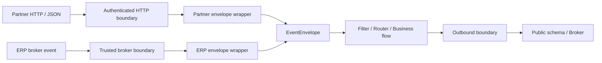
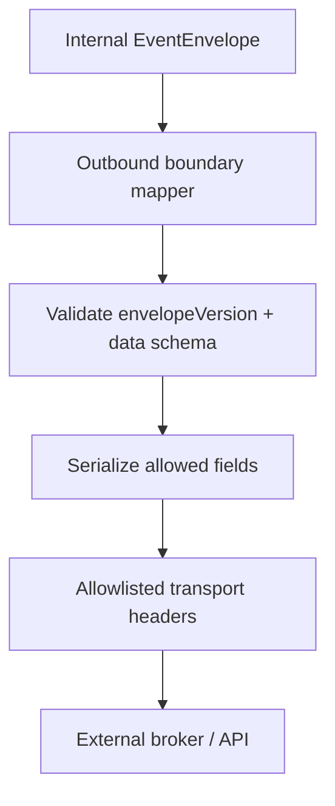
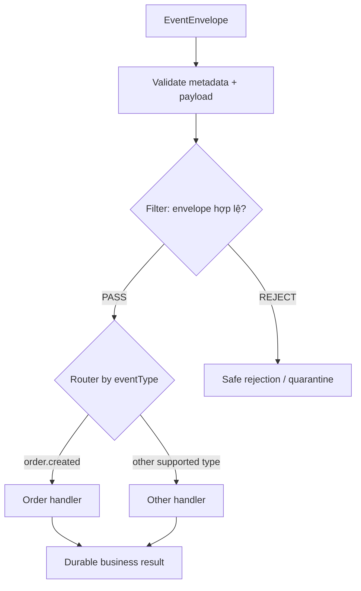
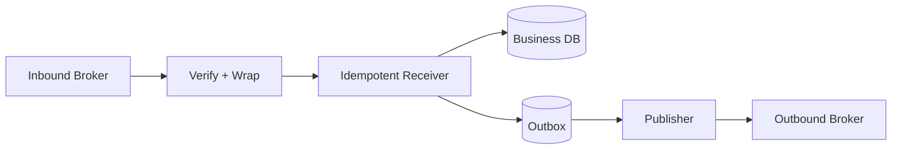

# Tạo envelope ở boundary

Một ứng dụng tích hợp có thể nhận đơn hàng từ REST API của đối tác, sự kiện từ ERP qua broker và dữ liệu được replay từ kho lưu trữ. Dữ liệu nghiệp vụ của chúng có thể cùng mô tả **một đơn hàng**, nhưng khác định dạng, định danh nguồn, phiên bản, thời điểm phát sinh và mức độ tin cậy. Nếu chuyển thẳng payload vào hệ thống nội bộ, những bước như Router, Filter, Aggregator, Gateway hoặc Idempotent Receiver có thể phải tự suy đoán Message đến từ đâu và đang thuộc lượt xử lý nào.

**Envelope Wrapper** là mẫu Enterprise Integration Patterns (EIP) đặt một *lớp bao* có hợp đồng rõ ràng xung quanh dữ liệu cần chuyển: bên trong là **payload nghiệp vụ**; bên ngoài là **metadata phục vụ tích hợp**, chẳng hạn loại sự kiện, phiên bản schema, định danh sự kiện, nguồn đã xác thực và correlation ID. Tạo envelope tại **boundary** nghĩa là dựng lớp bao ngay tại ranh giới giữa một hệ thống/giao thức bên ngoài và luồng tích hợp sử dụng mô hình chung, thay vì chờ từng handler downstream tự bổ sung metadata theo cách riêng.

Bài **Tạo envelope ở boundary** thuộc chương **Envelope wrapper** của module `SPRING_INTEGRATION_PATTERN`. Module hướng tới học triển khai Enterprise Integration Patterns với Spring Integration nhằm xây dựng các luồng Message ít phụ thuộc, dễ mở rộng; thực hành Router, Filter, Transformer, Splitter, Aggregator, Gateway, retry, error channel và correlation, đồng thời kiểm thử và theo dõi các nhánh. Trọng tâm của bài này là **chọn ranh giới tạo envelope, chuẩn hóa metadata đáng tin, bảo toàn hợp đồng qua transport và kiểm chứng bằng Java/Spring Integration**, không chỉ thêm một vài header vào Message.

## 1. Boundary là đâu và vì sao nên tạo envelope tại đó?

Một boundary là nơi dữ liệu **đổi miền sở hữu hoặc đổi hợp đồng tin cậy**. Ví dụ:

- HTTP request từ đối tác được ingress adapter nhận vào hệ thống nội bộ.
- Event từ một Kafka topic của ERP được deserializer đưa thành DTO.
- Một job replay nạp bản ghi từ archive vào cùng pipeline xử lý.
- Hệ thống nội bộ gửi event ra broker công khai cho đối tác.

Ở **inbound boundary**, adapter chịu trách nhiệm xác thực nguồn, kiểm tra định dạng được chấp nhận và đóng dấu thông tin đã xác minh. Ở **outbound boundary**, hệ thống chọn một envelope công khai, serialize nó theo schema version và chỉ xuất những metadata được phép.



**Không nên đặt toàn bộ trách nhiệm tin cậy vào wrapper.** Wrapper xây cấu trúc; xác thực token, quyền topic, tenant, nguồn gốc và các thuộc tính được phép phải được kiểm tra **trước hoặc tại boundary**. Sau khi xác minh, wrapper chuyển kết quả thành metadata ổn định mà các endpoint nội bộ có thể sử dụng.

### 1.1. Wrapper không phải nơi để chữa mọi lỗi đầu vào

Nếu payload không parse được hoặc thiếu mã sự kiện bắt buộc, bước tạo envelope nên từ chối hoặc chuyển tới error policy phù hợp. Không tự thay:

```text
eventId = UNKNOWN
sourceSystem = TRUSTED
occurredAt = now()
```

vì các giá trị giả này làm sai audit, correlation và idempotency. `wrappedAt` có thể lấy từ đồng hồ hệ thống, nhưng nó **không thay thế** `occurredAt` của sự kiện nguồn.

## 2. Envelope Wrapper khác Spring Message headers như thế nào?

Trong Spring Integration, Message thường có hai thành phần:

```text
Message<T>
  payload: T
  headers: MessageHeaders
```

Envelope Wrapper thêm một mô hình hợp đồng vào payload hoặc vào serialization bên ngoài:

```text
Message<EventEnvelope<OrderData>>
  payload:
    metadata: EventMetadata
    data: OrderData
  headers:
    id, timestamp, replyChannel, correlationId,
    routing/tracing fields... (nếu có)
```

| Khía cạnh | Spring `MessageHeaders` | Envelope payload |
| --- | --- | --- |
| Mục đích chính | Điều phối Message trong hệ thống messaging | Hợp đồng dữ liệu tích hợp qua boundary |
| Kiểu dữ liệu | Có thể chứa object của JVM, header kỹ thuật | Nên là kiểu có schema và serialize được |
| Bền qua adapter | Phụ thuộc header mapper/transport | Bền hơn nếu payload được serialize theo schema |
| `replyChannel`/`errorChannel` | Có thể là object/kênh nội bộ | Không nên đưa object nội bộ vào envelope công khai |
| Version | Không tự là schema envelope công khai | Nên có `envelopeVersion` và data schema version |
| Quyền truy cập | Phụ thuộc hệ thống Message | Có thể được validate và kiểm soát ở boundary |

**Envelope không thay thế cơ chế Message của Spring Integration.** `MessageHeaders.ID`, `MessageHeaders.TIMESTAMP`, `IntegrationMessageHeaderAccessor.CORRELATION_ID` và các header khác vẫn có chức năng riêng. Envelope có metadata **bền theo hợp đồng nghiệp vụ**, còn các header nội bộ hỗ trợ dispatch, reply, tracking và luồng xử lý.

### 2.1. Có nên lặp một số thông tin ở cả hai nơi?

Có thể. Ví dụ envelope có `meta.correlationId` để đi qua broker, còn header có `correlationId` phục vụ Aggregator trong JVM. Nhưng phải chọn **nguồn sự thật** và quy tắc đồng bộ. Khi hai giá trị không khớp, không chọn một cách tùy tiện rồi tiếp tục.

### 2.2. Không serialize mọi header vào JSON envelope

Một cách làm nguy hiểm:

```java
// Minh họa anti-pattern, KHÔNG dùng làm public envelope:
Map<String, Object> everything = message.getHeaders();
```

Headers có thể chứa dữ liệu không cần thiết, thông tin riêng tư, tên bean nội bộ hoặc đối tượng không serialize được. Khi tạo envelope công khai, sử dụng **allowlist**, không sao chép nguyên `MessageHeaders`.

## 3. Ba phần của một envelope có hợp đồng rõ

Một thiết kế dễ bảo trì gồm:

1. **Metadata:** loại event, danh tính nguồn, version, các ID và timestamps.
2. **Data:** payload canonical hoặc dữ liệu sự kiện đang được chuyển giao.
3. **Schema contract:** định nghĩa những field nào bắt buộc, giới hạn kích thước và quy tắc version.

Ví dụ:

```json
{
  "envelopeVersion": 1,
  "metadata": {
    "eventType": "order.created",
    "eventId": "PARTNER_API:evt-1001",
    "tenantId": "tenant-7",
    "sourceSystem": "PARTNER_API",
    "sourceSchemaVersion": "partner-order-v1",
    "dataSchemaVersion": "canonical-order-v1",
    "correlationId": "c7b1320f-c947-4f84-8c23-507c6961c09f",
    "causationId": null,
    "occurredAt": "2026-11-20T10:00:00Z",
    "wrappedAt": "2026-11-21T02:15:00Z"
  },
  "data": {
    "orderId": "ORD-1001",
    "amount": "49.95",
    "currency": "USD"
  }
}
```

Đây là **schema ứng dụng minh họa**, không phải cấu trúc JSON mặc định mà Spring Integration tự sinh.

### 3.1. Metadata nào thực sự bắt buộc?

| Field | Cần biết | Ghi chú |
| --- | --- | --- |
| `envelopeVersion` | Hợp đồng lớp bao | Phân biệt thay đổi cấu trúc metadata |
| `eventType` | Ý nghĩa sự kiện | Không dùng một chuỗi tùy ý từ client làm quyền xử lý |
| `eventId` | Định danh logical event | Phải ổn định qua retry/redelivery |
| `tenantId` | Phạm vi tenant đã được xác thực | Không tin tenant do client tự khai nếu chưa đối chiếu |
| `sourceSystem` | Nguồn đáng tin | Thường được boundary xác nhận/gán |
| `sourceSchemaVersion` | Đã giải mã raw bằng schema nào | Phục vụ điều tra và replay |
| `dataSchemaVersion` | Schema của `data` canonical | Giúp consumer chọn decoder |
| `correlationId` | Liên hệ Message trong một workflow | Không đồng nhất với khóa dedupe |
| `causationId` | Sự kiện/lệnh nào gây ra event này | Có thể null cho event gốc |
| `occurredAt` | Thời điểm tại nguồn | Không tự ghi bằng giờ nhận |
| `wrappedAt` | Thời điểm wrapper hoàn thành | Do server đáng tin đóng dấu |

**Không bắt buộc sao chép cùng một bộ metadata cho mọi hệ thống.** Chọn trường dựa trên hợp đồng, SLA và nhu cầu audit; sau đó validate giá trị, kiểu, version và độ dài.

## 4. Khi nào tạo envelope: trước hay sau normalization?

Có hai kiến trúc hợp lệ:

**Phương án A — Wrap trước, normalize sau**

```text
Raw event
  -> Verify ingress
  -> Envelope<RawSourceEvent>
  -> Normalize envelope.data
  -> Envelope<CanonicalData> (giữ provenance)
```

Ưu điểm: không mất nguồn ngay cả khi downstream normalizer lỗi; thuận tiện quarantine raw có kiểm soát. Nhược điểm: `data` còn nhiều schema nguồn, consumer cần hiểu mỗi kiểu trong giai đoạn đầu.

**Phương án B — Normalize và wrap trong cùng boundary**

```text
Raw event
  -> Verify ingress
  -> Parse/validate source schema
  -> Map canonical data
  -> Envelope<CanonicalData>
  -> Shared integration flow
```

Ưu điểm: phía trong chỉ xử lý một canonical contract; validation nhất quán. Nhược điểm: nếu mapping lỗi trước khi tạo envelope, error flow phải giữ **transport/source context** riêng để truy vết.

Ví dụ Java ở các mục tiếp theo dùng **phương án B**. Nó tạo `EventEnvelope<CanonicalOrder>` tại đầu luồng nội bộ, sau khi boundary đã phân biệt hai nguồn.

### 4.1. Tránh bọc nhiều lớp không có chủ đích

Một flow có thể vô tình tạo:

```text
Envelope<Envelope<Envelope<OrderData>>>
```

mỗi lần đi qua một gateway. Điều này làm schema khó quản lý và trộn provenance. Nếu không có hợp đồng rõ cho lớp bao lồng nhau, bước sau nên **giữ và cập nhật metadata có kiểm soát**, thay vì luôn bọc thêm một lớp mới.

## 5. Source identity phải được xác thực tại ingress

Đặc điểm nguy hiểm của envelope là nó nhìn **có vẻ chính thức**. Một Message từ Internet có thể tự gửi:

```text
sourceSystem=INTERNAL_ERP
tenantId=tenant-admin
eventType=order.approved
```

Nếu chỉ copy các trường đó vào envelope, Router nội bộ có thể chuyển Message vào nhánh sai hoặc bỏ qua validation.

Một boundary đúng cần:

- Xác thực client hoặc producer qua cơ chế phù hợp: mTLS, OAuth, broker ACL, signed messages, v.v.
- Ánh xạ **verified source identity** từ thông tin adapter đã xác minh, không từ arbitrary header.
- Đối chiếu tenant được phép truy cập với tenant trong payload; không chỉ kiểm tra chuỗi có định dạng hợp lệ.
- Kiểm tra phiên bản đầu vào và event type mà producer có quyền gửi.
- Giới hạn payload size, thời điểm và các ID bắt buộc.
- Ghi lại mã lỗi an toàn khi reject; raw exception/credential ở khu vực chẩn đoán hạn chế quyền.

Trong demo, `partnerIngress` và `erpIngress` là **hai channel nội bộ được giả định do adapter đã xác thực sở hữu**. Wrapper gán cứng `sourceSystem` theo channel. Demo **không triển khai authentication/authorization thật**; đây là trách nhiệm cần bổ sung ở boundary của hệ thống.

## 6. Các định danh cần phân biệt: event, correlation, causation và Message ID

| Định danh | Dùng cho | Phạm vi |
| --- | --- | --- |
| `sourceMessageId` | Sự kiện/logical delivery tại hệ thống nguồn | Nguồn/tenant |
| `eventId` | ID sự kiện trong envelope | Có thể namespace theo source và tenant |
| `correlationId` | Các bước trong cùng workflow/request | Theo lượt xử lý |
| `causationId` | Event hoặc command đã tạo ra Message hiện tại | Quan hệ nhân quả |
| `orderId` | Đối tượng nghiệp vụ được nhắc đến | Nhiều sự kiện có thể cùng order |
| Spring `MessageHeaders.ID` | Một đối tượng Message cụ thể | Mỗi lần tạo Message có thể khác |

Ví dụ một đơn có hai sự kiện:

```text
OrderCreated:
  eventId       = PARTNER_API:evt-1001
  correlationId = workflow-A
  causationId   = null
  orderId       = ORD-1001

InventoryReserved:
  eventId       = INVENTORY:evt-8844
  correlationId = workflow-A
  causationId   = PARTNER_API:evt-1001
  orderId       = ORD-1001
```

`correlationId` nên được **giữ** khi tạo sự kiện con trong cùng workflow; `causationId` thường đổi sang event/command trực tiếp gây ra sự kiện mới; `eventId` của event mới phải mới. Nếu broker redeliver **cùng event**, `eventId` phải ổn định để dedupe.

### 6.1. Không dùng correlation ID làm khóa chống trùng cho toàn workflow

Một workflow có thể phát nhiều event hợp lệ có cùng correlation ID. Dedupe chỉ theo correlation ID sẽ loại nhầm các sự kiện khác nhau.

### 6.2. ID có namespace không đồng nghĩa duy nhất toàn thế giới

Trong demo, `eventId = sourceSystem + ":" + sourceEventId`. Nếu nhiều tenant dùng lại source event ID, cần xét thêm `tenantId` khi xây idempotency key, ví dụ `(tenantId, eventId, consumerOperation)`. Không giả định ID đó là globally unique ngoài phạm vi hợp đồng.

## 7. Versioning: lớp bao và payload có thể tiến hóa độc lập

Một thay đổi ở metadata không nhất thiết thay đổi cách diễn giải `data`.

| Thay đổi | Envelope version | Data schema version |
| --- | --- | --- |
| Thêm trường metadata optional có default rõ | Có thể giữ v1 nếu backward-compatible | Không đổi |
| Đổi cấu trúc `metadata` từ object sang array | Thường cần v2 | Có thể không đổi |
| Đổi `amount` từ `String` sang object `Money` | Có thể không đổi | Cần version/schema mới |
| Đổi source input từ Partner v1 sang v2 | Có thể không đổi | Có thể không đổi nếu canonical mapping giữ nguyên |
| Đổi tên một field bắt buộc mà consumer cũ không hiểu | Cần kế hoạch tương thích | Tăng đúng version chịu ảnh hưởng |

Schema cần định nghĩa **kiểu, required/optional, constraints và quy tắc compatible**. Một phiên bản số tự ghi vào payload không đủ nếu publisher/consumer không có cơ chế quản trị contract.

### 7.1. Envelope cũ và mới có thể cùng tồn tại

Một hệ thống có thể cần đọc `envelopeVersion=1` và `envelopeVersion=2` trong thời gian migration:

```text
Inbound decoder:
  version 1 -> decode legacy envelope -> normalized internal envelope
  version 2 -> decode current envelope -> normalized internal envelope
  unknown   -> reject/quarantine with safe reason
```

Không tự gán unknown version là v1 để cố parse; việc đó có thể làm sai thứ tự byte, tiền tệ, loại event hoặc chính sách bảo mật.

## 8. Java 17+: model cho lớp bao

Ví dụ dùng `record` bất biến, một kiểu payload canonical và hai kiểu input nguồn.

```java
package example.integration;

import java.math.BigDecimal;
import java.time.Instant;

public final class EnvelopeModel {

    private EnvelopeModel() {
    }

    // REST partner: amount dạng text.
    public record PartnerOrderV1(
            String tenantId,
            String orderNumber,
            String sourceEventId,
            String amountText,
            String currency,
            String occurredAtIso) {
    }

    // ERP broker: amount ở đơn vị nhỏ nhất (cents) cho USD.
    public record ErpOrderV2(
            String tenantCode,
            String documentNumber,
            String deliveryId,
            long amountCents,
            String currency,
            long occurredAtEpochMillis) {
    }

    public record CanonicalOrder(
            String orderId,
            BigDecimal amount,
            String currency) {
    }

    public record EventMetadata(
            String eventType,
            String eventId,
            String tenantId,
            String sourceSystem,
            String sourceSchemaVersion,
            String dataSchemaVersion,
            String correlationId,
            String causationId,
            Instant occurredAt,
            Instant wrappedAt) {
    }

    public record EventEnvelope<T>(
            int envelopeVersion,
            EventMetadata metadata,
            T data) {
    }
}
```

Với `record`, việc serializing JSON qua Jackson/Avro/Protobuf cần được cấu hình theo stack thực tế. `Instant` cần serializer có hỗ trợ Java Time; `BigDecimal` cần hợp đồng precision/scale với producer và consumer. Java generic `EventEnvelope<T>` **không tự bảo đảm** decoder bên kia khôi phục chính xác `T` nếu không có schema/type information.

### 8.1. Vì sao metadata không phải `Map<String, Object>`?

Record có field rõ:

- Có thể validate tên field và kiểu.
- Có thể version hợp đồng.
- Tránh copy nhầm raw headers từ client.
- Giúp test xác minh một phần tử bắt buộc có giá trị.

Một map mở có thể hữu ích cho extension được kiểm soát, nhưng nếu mọi consumer được tự thêm metadata không giới hạn, envelope sẽ dần trở thành **túi chứa dữ liệu tùy ý** không còn ranh giới tin cậy.

## 9. Spring Integration: tạo envelope bằng Transformer ở ingress boundary

Hai nguồn bên ngoài đã được parser/adapter chuyển thành DTO tương ứng. Phần dưới tập trung vào **một bước wrapping có thể kiểm thử**.

```text
partnerIngress ── @Transformer wrapPartner ─┐
                                           ├─ wrappedOrders
erpIngress ───── @Transformer wrapErp ─────┘
```

### 9.1. Cấu hình Java

```java
package example.integration;

import java.math.BigDecimal;
import java.time.Instant;
import java.time.format.DateTimeParseException;
import java.util.UUID;

import org.springframework.context.annotation.Bean;
import org.springframework.context.annotation.Configuration;
import org.springframework.integration.annotation.Transformer;
import org.springframework.integration.channel.DirectChannel;
import org.springframework.integration.channel.QueueChannel;
import org.springframework.integration.config.EnableIntegration;
import org.springframework.messaging.Message;
import org.springframework.messaging.MessageChannel;
import org.springframework.messaging.PollableChannel;
import org.springframework.messaging.support.MessageBuilder;

import example.integration.EnvelopeModel.*;

@Configuration
@EnableIntegration
public class BoundaryEnvelopeConfiguration {

    private static final int ENVELOPE_VERSION = 1;
    private static final String EVENT_TYPE = "order.created";
    private static final String DATA_SCHEMA = "canonical-order-v1";

    @Bean
    public MessageChannel partnerIngress() {
        return new DirectChannel();
    }

    @Bean
    public MessageChannel erpIngress() {
        return new DirectChannel();
    }

    @Bean
    public PollableChannel wrappedOrders() {
        return new QueueChannel(20);
    }

    @Transformer(
            inputChannel = "partnerIngress",
            outputChannel = "wrappedOrders")
    public Message<EventEnvelope<CanonicalOrder>> wrapPartner(
            Message<PartnerOrderV1> input) {

        PartnerOrderV1 src = input.getPayload();
        String tenant = requiredId(src.tenantId(), "tenantId");
        String order = requiredId(src.orderNumber(), "orderNumber");
        String event = requiredId(src.sourceEventId(), "sourceEventId");
        BigDecimal amount = parsePartnerAmount(src.amountText());
        String currency = requireUsd(src.currency());
        Instant occurred = parseUtcInstant(src.occurredAtIso());

        return wrap(
                "PARTNER_API", "partner-order-v1",
                tenant, event, order, amount, currency, occurred);
    }

    @Transformer(
            inputChannel = "erpIngress",
            outputChannel = "wrappedOrders")
    public Message<EventEnvelope<CanonicalOrder>> wrapErp(
            Message<ErpOrderV2> input) {

        ErpOrderV2 src = input.getPayload();
        String tenant = requiredId(src.tenantCode(), "tenantCode");
        String order = requiredId(
                src.documentNumber(), "documentNumber");
        String event = requiredId(src.deliveryId(), "deliveryId");
        if (src.amountCents() < 0) {
            throw new IllegalArgumentException("ERP_AMOUNT_INVALID");
        }
        BigDecimal amount = BigDecimal.valueOf(
                src.amountCents(), 2);
        String currency = requireUsd(src.currency());
        Instant occurred = Instant.ofEpochMilli(
                src.occurredAtEpochMillis());

        return wrap(
                "ERP_BROKER", "erp-order-v2",
                tenant, event, order, amount, currency, occurred);
    }

    private static Message<EventEnvelope<CanonicalOrder>> wrap(
            String verifiedSource,
            String sourceSchema,
            String tenantId,
            String sourceEventId,
            String orderId,
            BigDecimal amount,
            String currency,
            Instant occurredAt) {

        EventMetadata metadata = new EventMetadata(
                EVENT_TYPE,
                verifiedSource + ":" + sourceEventId,
                tenantId,
                verifiedSource,
                sourceSchema,
                DATA_SCHEMA,
                UUID.randomUUID().toString(),
                null,  // Root event; no direct causing event.
                occurredAt,
                Instant.now());

        EventEnvelope<CanonicalOrder> envelope =
                new EventEnvelope<>(
                        ENVELOPE_VERSION,
                        metadata,
                        new CanonicalOrder(orderId, amount, currency));

        // Chỉ chủ động đặt header nội bộ từ metadata đã tạo.
        return MessageBuilder.withPayload(envelope)
                .setHeader("envelope.eventType", metadata.eventType())
                .setHeader("envelope.eventId", metadata.eventId())
                .setHeader("envelope.sourceSystem",
                        metadata.sourceSystem())
                .build();
    }

    private static String requiredId(String value, String field) {
        if (value == null
                || !value.matches("[A-Za-z0-9_-]{1,80}")) {
            throw new IllegalArgumentException(
                    "INVALID_IDENTIFIER_" + field);
        }
        return value;
    }

    private static String requireUsd(String currency) {
        // Demo chọn USD để minh họa conversion cents -> dollars.
        if (!"USD".equals(currency)) {
            throw new IllegalArgumentException(
                    "UNSUPPORTED_CURRENCY");
        }
        return currency;
    }

    private static BigDecimal parsePartnerAmount(String value) {
        if (value == null || !value.matches(
                "[0-9]+(\\.[0-9]{1,2})?")) {
            throw new IllegalArgumentException(
                    "PARTNER_AMOUNT_INVALID");
        }
        return new BigDecimal(value).setScale(2);
    }

    private static Instant parseUtcInstant(String raw) {
        try {
            return Instant.parse(raw);
        } catch (DateTimeParseException | NullPointerException ex) {
            throw new IllegalArgumentException(
                    "PARTNER_TIMESTAMP_INVALID");
        }
    }
}
```

### 9.2. Vai trò của hai transformer

1. `wrapPartner(...)` xử lý DTO của Partner API; `wrapErp(...)` xử lý DTO của ERP.
2. Mỗi transformer xác định **nguồn theo channel ingress** và nguồn schema tương ứng, không dựa trên một header `sourceSystem` bên ngoài.
3. Giá trị từ payload được kiểm tra format cơ bản trước khi dùng.
4. Hai nguồn đều được chuyển về `CanonicalOrder` cùng kiểu.
5. Metadata envelope gồm nguồn, version, event ID, time và correlation.
6. `wrappedOrders` chứa các Message có cùng payload type `EventEnvelope<CanonicalOrder>`.

`tenantId` ở ví dụ mới chỉ được **validate định dạng**; ứng dụng thật phải đối chiếu với tenant đã được xác thực và cấp quyền tại adapter. Nếu chỉ tin giá trị tenant do payload khai, wrapper **chưa có** tính bảo mật cần thiết cho multi-tenant.

### 9.3. Khi nào correlation ID cần giữ từ nguồn?

Ví dụ tạo một `UUID` mới cho mỗi **root processing attempt**. Vì vậy cùng một logical event bị redeliver có thể có **correlation ID mới**; điều này chấp nhận được nếu correlation chỉ phục vụ một lượt thực thi. Dedupe phải dùng `tenantId + sourceSystem + sourceEventId + operation`, **không** dùng UUID vừa tạo.

Nếu một workflow đã có correlation ID từ upstream đã được xác thực, wrapper nên **giữ ID đó**, không tự tạo mới ở mỗi hop. Chính sách phải được xác định bởi hợp đồng request/workflow.

### 9.4. Cảnh báo về header propagation

Ví dụ tạo Message với `MessageBuilder.withPayload(...)` để minh họa việc **chủ động đặt header**. Tuy nhiên, một số endpoint Spring Integration có thể copy/merge request headers vào reply Message theo cấu hình của chúng. **Không được kết luận rằng builder mới tự động xóa mọi header đầu vào.** Để ngăn lộ header ở outbound boundary, cần cấu hình header mapper/serializer allowlist thực tế và kiểm thử trên transport đó.

## 10. Demo: cùng dữ liệu nghiệp vụ, envelope thể hiện nguồn khác nhau

```java
package example.integration;

import java.time.Instant;

import org.springframework.context.annotation.AnnotationConfigApplicationContext;
import org.springframework.messaging.Message;
import org.springframework.messaging.MessageChannel;
import org.springframework.messaging.PollableChannel;
import org.springframework.messaging.support.MessageBuilder;

import example.integration.EnvelopeModel.*;

public class BoundaryEnvelopeDemo {

    public static void main(String[] args) {
        try (var context = new AnnotationConfigApplicationContext(
                BoundaryEnvelopeConfiguration.class)) {

            MessageChannel partner = context.getBean(
                    "partnerIngress", MessageChannel.class);
            MessageChannel erp = context.getBean(
                    "erpIngress", MessageChannel.class);
            PollableChannel output = context.getBean(
                    "wrappedOrders", PollableChannel.class);

            Instant occurred = Instant.parse(
                    "2026-11-20T10:00:00Z");
            partner.send(MessageBuilder.withPayload(
                    new PartnerOrderV1(
                            "tenant-7", "ORD-1001", "evt-1001",
                            "49.95", "USD", occurred.toString()))
                    .build());
            erp.send(MessageBuilder.withPayload(
                    new ErpOrderV2(
                            "tenant-7", "ORD-1001", "erp-71",
                            4995L, "USD", occurred.toEpochMilli()))
                    .build());

            Message<?> first = output.receive(0);
            Message<?> second = output.receive(0);
            if (first == null || second == null) {
                throw new IllegalStateException(
                        "Expected two wrapped events");
            }

            @SuppressWarnings("unchecked")
            EventEnvelope<CanonicalOrder> partnerEnvelope =
                    (EventEnvelope<CanonicalOrder>) first.getPayload();
            @SuppressWarnings("unchecked")
            EventEnvelope<CanonicalOrder> erpEnvelope =
                    (EventEnvelope<CanonicalOrder>) second.getPayload();

            System.out.println(partnerEnvelope.data().amount()); // 49.95
            System.out.println(erpEnvelope.data().amount());     // 49.95
            System.out.println(
                    partnerEnvelope.metadata().sourceSystem()); // PARTNER_API
            System.out.println(
                    erpEnvelope.metadata().sourceSystem());     // ERP_BROKER
        }
    }
}
```

Hai output có thể mang cùng dữ liệu nghiệp vụ nhưng có `eventId`, `sourceSystem` và `sourceSchemaVersion` **khác nhau**. Chúng không tự động là bản sao của cùng event chỉ vì `orderId` và `amount` bằng nhau.

Trong demo, channel `DirectChannel` chạy đồng bộ nên sau `send()` có thể đọc Message đã được đưa vào `QueueChannel` bằng `receive(0)`. Nếu chuyển sang executor/broker, phải dùng timeout hữu hạn và kiểm tra correlation.

## 11. JUnit 5: kiểm tra dữ liệu và metadata của hai envelope

Test cần xác minh **wrapper tạo đúng lớp bao**, không chỉ payload đã normalize.

```java
package example.integration;

import static org.junit.jupiter.api.Assertions.*;

import java.math.BigDecimal;
import java.time.Instant;

import org.junit.jupiter.api.Test;
import org.springframework.context.annotation.AnnotationConfigApplicationContext;
import org.springframework.messaging.Message;
import org.springframework.messaging.MessageChannel;
import org.springframework.messaging.PollableChannel;
import org.springframework.messaging.support.MessageBuilder;

import example.integration.EnvelopeModel.*;

class BoundaryEnvelopeIntegrationTest {

    @Test
    void ingressBoundaryCreatesEnvelopeWithTrustedSourceAndSchema() {
        try (var context = new AnnotationConfigApplicationContext(
                BoundaryEnvelopeConfiguration.class)) {

            MessageChannel partner = context.getBean(
                    "partnerIngress", MessageChannel.class);
            MessageChannel erp = context.getBean(
                    "erpIngress", MessageChannel.class);
            PollableChannel output = context.getBean(
                    "wrappedOrders", PollableChannel.class);

            Instant occurred = Instant.parse(
                    "2026-11-20T10:00:00Z");

            assertTrue(partner.send(MessageBuilder.withPayload(
                    new PartnerOrderV1(
                            "tenant-7", "ORD-1001", "evt-1001",
                            "49.95", "USD", occurred.toString()))
                    .build()));
            assertTrue(erp.send(MessageBuilder.withPayload(
                    new ErpOrderV2(
                            "tenant-7", "ORD-1001", "erp-71",
                            4995L, "USD", occurred.toEpochMilli()))
                    .build()));

            Message<?> partnerMessage = output.receive(0);
            Message<?> erpMessage = output.receive(0);
            assertNotNull(partnerMessage);
            assertNotNull(erpMessage);

            @SuppressWarnings("unchecked")
            EventEnvelope<CanonicalOrder> a =
                    (EventEnvelope<CanonicalOrder>)
                            partnerMessage.getPayload();
            @SuppressWarnings("unchecked")
            EventEnvelope<CanonicalOrder> b =
                    (EventEnvelope<CanonicalOrder>)
                            erpMessage.getPayload();

            assertEquals(1, a.envelopeVersion());
            assertEquals(1, b.envelopeVersion());
            assertEquals("order.created", a.metadata().eventType());
            assertEquals("tenant-7", a.metadata().tenantId());
            assertEquals("PARTNER_API", a.metadata().sourceSystem());
            assertEquals("ERP_BROKER", b.metadata().sourceSystem());
            assertEquals("PARTNER_API:evt-1001",
                    a.metadata().eventId());
            assertEquals("ERP_BROKER:erp-71",
                    b.metadata().eventId());
            assertEquals("partner-order-v1",
                    a.metadata().sourceSchemaVersion());
            assertEquals("erp-order-v2",
                    b.metadata().sourceSchemaVersion());
            assertEquals("canonical-order-v1",
                    a.metadata().dataSchemaVersion());
            assertEquals(occurred, a.metadata().occurredAt());
            assertEquals(occurred, b.metadata().occurredAt());
            assertEquals(new BigDecimal("49.95"), a.data().amount());
            assertEquals(a.data().amount(), b.data().amount());
            assertFalse(a.metadata().correlationId().isBlank());
            assertNotNull(a.metadata().wrappedAt());
            assertNull(a.metadata().causationId());
            assertEquals("PARTNER_API",
                    partnerMessage.getHeaders()
                            .get("envelope.sourceSystem"));
            assertNull(output.receive(0));
        }
    }
}
```

Kết quả kỳ vọng: hai input schema khác nhau sinh cùng `CanonicalOrder` về amount/order/currency nhưng metadata bảo toàn **đúng source và source schema**, với envelope version 1.

Test trong cùng JVM chưa chứng minh thông điệp JSON trên broker có schema tương thích hoặc header allowlist. Cần test serialization/adapter riêng cho boundary thực tế.

## 12. JUnit: header giả mạo không được quyết định origin

Vì một Message có thể mang header từ producer bên ngoài, hãy kiểm thử rằng wrapper **không dựa vào nhãn nguồn do client tự khai**:

```java
// Đặt method này trong BoundaryEnvelopeIntegrationTest.
@Test
void forgedHeadersCannotChangeSourceInCanonicalEnvelope() {
    try (var context = new AnnotationConfigApplicationContext(
            BoundaryEnvelopeConfiguration.class)) {

        MessageChannel partner = context.getBean(
                "partnerIngress", MessageChannel.class);
        PollableChannel output = context.getBean(
                "wrappedOrders", PollableChannel.class);

        var raw = new PartnerOrderV1(
                "tenant-7", "ORD-1001", "evt-1001",
                "49.95", "USD", "2026-11-20T10:00:00Z");

        assertTrue(partner.send(MessageBuilder.withPayload(raw)
                .setHeader("sourceSystem", "ERP_BROKER")
                .setHeader("envelope.sourceSystem", "ERP_BROKER")
                .setHeader("eventType", "order.approved")
                .build()));

        Message<?> result = output.receive(0);
        assertNotNull(result);
        @SuppressWarnings("unchecked")
        EventEnvelope<CanonicalOrder> envelope =
                (EventEnvelope<CanonicalOrder>) result.getPayload();

        assertEquals("PARTNER_API",
                envelope.metadata().sourceSystem());
        assertEquals("order.created",
                envelope.metadata().eventType());
        assertEquals("PARTNER_API",
                result.getHeaders().get("envelope.sourceSystem"));
        assertNull(output.receive(0));
    }
}
```

Test chứng minh **hai field quan trọng của envelope được dựng bởi server**. Nó không được diễn giải là chứng nhận mọi arbitrary header đã bị strip trước outbound. Những header như `sourceSystem` do client gửi có thể vẫn được framework chuyển tiếp qua endpoint tùy cấu hình; cần xác minh header mapper ở biên giới ngoài bằng test riêng.

### 12.1. Kiểm tra tenant cần hơn một regex

Một yêu cầu có `tenantId="tenant-admin"` có thể **đúng regex** nhưng chưa chắc client được quyền thao tác thay tenant đó. Ở HTTP/broker adapter phải đối chiếu tenant theo principal/ACL đã xác thực và đưa kết quả kiểm tra vào trusted context. Bài demo chưa triển khai phần này và không tuyên bố bảo vệ tenant hoàn chỉnh.

## 13. Input sai: không phát ra envelope trông có vẻ hợp lệ

Xét amount `"49,95"` hoặc timestamp `"tomorrow"`:

```json
{
  "orderNumber": "ORD-1001",
  "amountText": "49,95",
  "occurredAtIso": "tomorrow"
}
```

Nếu tùy tiện đổi `amount=0`, `occurredAt=Instant.now()` và tiếp tục gắn `eventType=order.created`, downstream có thể coi một event hỏng dữ liệu thành yêu cầu hợp lệ.

### 13.1. Test input không hợp lệ

```java
// Đặt method này trong BoundaryEnvelopeIntegrationTest.
@Test
void malformedAmountIsRejectedBeforeEnvelopeIsPublished() {
    try (var context = new AnnotationConfigApplicationContext(
            BoundaryEnvelopeConfiguration.class)) {

        MessageChannel partner = context.getBean(
                "partnerIngress", MessageChannel.class);
        PollableChannel output = context.getBean(
                "wrappedOrders", PollableChannel.class);

        var invalid = new PartnerOrderV1(
                "tenant-7", "ORD-1001", "evt-bad",
                "not-a-number", "USD", "2026-11-20T10:00:00Z");

        assertThrows(RuntimeException.class,
                () -> partner.send(
                        MessageBuilder.withPayload(invalid).build()));
        assertNull(output.receive(0));
    }
}
```

Ở flow `DirectChannel` đồng bộ, lỗi Transformer thường lan ngược về caller, có thể được bọc thành messaging exception. Vì thế test dùng `RuntimeException` ở boundary của demo. Với executor/poller/broker, `send()` có thể hoàn tất trước khi lỗi xảy ra; phải kiểm thử `errorChannel`, retry/ACK và dead-letter ở đúng điểm.

### 13.2. Phân biệt lỗi hợp đồng và lỗi hạ tầng

| Lỗi | Ý nghĩa | Xử lý gợi ý |
| --- | --- | --- |
| Thiếu `sourceEventId` | Không có ID ổn định cho event | Reject/quarantine, yêu cầu producer sửa |
| Amount không parse được | Schema hoặc dữ liệu nguồn sai | Reject với mã an toàn |
| Input currency không hỗ trợ | Contract chưa hỗ trợ | Reject hoặc route sang mapper thích hợp |
| Source schema version lạ | Decoder không tương thích | Quarantine và nâng cấp schema |
| DB/service tra cứu timeout | Lỗi kỹ thuật | Retry hữu hạn, error channel |
| Lỗi serialize outbound | Kết quả không thể phát theo contract | Giữ nguồn bền vững, error/retry theo policy |

Không đưa raw exception message, JSON đầu vào hoặc credential vào envelope lỗi công khai. Nếu không thể tạo event envelope hợp lệ, có thể tạo **error response riêng** với ID transport đã được xác thực, error code và timestamp server.

## 14. Outbound boundary: chọn payload và header được phép xuất

Tạo envelope ở inbound boundary chỉ là nửa đầu. Khi gửi ra hệ thống ngoài, một endpoint cần:

1. Chọn **schema công khai** của event/response.
2. Map `EventEnvelope<CanonicalOrder>` thành JSON/Avro/Protobuf theo version được công bố.
3. Giới hạn các field metadata cho audience cụ thể.
4. Không serialize toàn bộ Spring `MessageHeaders`.
5. Kiểm soát dữ liệu nhạy cảm, kích thước Message và quyền nhận event.



### 14.1. Một schema JSON công khai tối thiểu

Ví dụ đối tác chỉ cần:

```json
{
  "envelopeVersion": 1,
  "eventType": "order.created",
  "eventId": "PARTNER_API:evt-1001",
  "occurredAt": "2026-11-20T10:00:00Z",
  "data": {
    "orderId": "ORD-1001",
    "amount": "49.95",
    "currency": "USD"
  }
}
```

Ta cố ý không gửi `tenantId`, correlation nội bộ, `causationId`, source schema hay `wrappedAt` nếu consumer không cần và không được phép nhìn thấy. Việc xuất ít dữ liệu hơn **không làm mất metadata ở bản envelope nội bộ**; đây là một projection theo hợp đồng outbound.

### 14.2. Không phụ thuộc vào default ObjectMapper của mọi dịch vụ

Một serialization contract cần quy định:

- Tên field: `eventId`, `data`, `envelopeVersion`, v.v.
- Cách biểu diễn `Instant`: ISO 8601 UTC hoặc epoch, nhất quán.
- Cách biểu diễn `BigDecimal`: chuỗi decimal hoặc JSON number với precision được cam kết.
- Cách xử lý `null` và optional field.
- Giới hạn kích thước, depth và các field unknown.
- Schema version và cách consumer chọn decoder.

Nếu dùng Jackson, cần cấu hình Java Time, serializer và schema tests đúng phiên bản. Không mặc định Java generic `EventEnvelope<T>` hay `Instant` sẽ được serialize/deserialze đúng mà không có cấu hình cần thiết.

### 14.3. Header mapper của adapter quyết định cái gì ra ngoài

Ví dụ policy:

```text
Allowed outbound headers:
  content-type
  schema-version
  traceparent (nếu được phép)
  message-key / partition-key đáng tin

Not exported by default:
  replyChannel / errorChannel object
  raw credentials / access tokens
  full stack trace or Throwable
  tenant security principal object
  arbitrary inbound headers
```

Đây là **chính sách kiến trúc**, không phải tên cấu hình giống nhau cho mọi HTTP/Kafka/AMQP adapter. Phải dùng header mapper/producer config của transport cụ thể và chạy **adapter contract test** xác minh field thực sự được truyền.

## 15. HTTP request, broker event và Gateway không có cùng hợp đồng

Envelope cần phản ánh **ngữ nghĩa giao tiếp**:

| Tình huống | Cần nghĩ tới |
| --- | --- |
| HTTP command `POST /orders` | Request/response, status code, idempotency key của client |
| Broker event `OrderCreated` | At-least-once delivery, event ID ổn định, consumer idempotency |
| Gateway trong Spring Integration | Reply channel, timeout, correlation của request |
| Scheduled replay | Original event identity, replay attempt, rule version |
| Outbound public event | Schema version và audience có quyền nhận |

Một `EventEnvelope` có thể dùng chung ý tưởng metadata, nhưng **không nên mặc định command và event là một loại**. Command biểu diễn ý định muốn thay đổi trạng thái; event biểu diễn một sự việc đã xảy ra theo hợp đồng. Khi map request HTTP thành `order.created`, phải chắc đây là **event thực sự đã được xác nhận**, không chỉ là một yêu cầu tạo đơn chưa được commit.

### 15.1. Giới hạn của demo OrderCreated

Để minh họa kiểu dữ liệu, demo gán `eventType="order.created"` ngay khi wrapper nhận đầu vào. Trong hệ thống thật, nếu Partner/ERP input chỉ là **command yêu cầu tạo đơn**, hãy đổi thành `order.create.requested` hoặc `CreateOrderCommand`, rồi chỉ phát `OrderCreated` **sau khi business transaction thành công**. Event type không được biến một request chưa xử lý thành một sự thật đã được commit.

### 15.2. Đừng đưa `replyChannel` của JVM vào envelope công khai

Spring Integration có thể sử dụng `replyChannel` dạng object hoặc tên kênh nội bộ để gửi kết quả Gateway. Hãy giữ nó trong **phạm vi runtime** thích hợp; khi qua HTTP/broker cần dùng contract `requestId` và reply destination được quản lý bởi transport, không serialize object channel của JVM vào JSON.

## 16. Router, Filter và Validator sau khi wrap

Khi đã có envelope:



Router có thể nhìn vào `metadata.eventType` hoặc một header kỹ thuật đã được dựng từ metadata:

```java
// Logic domain có thể dùng trong Router/Filter.
boolean accepted =
        envelope.envelopeVersion() == 1
        && "order.created".equals(
                envelope.metadata().eventType())
        && envelope.metadata().eventId() != null
        && envelope.data() != null;
```

Đoạn trên là một điều kiện minh họa, **không đủ thay thế validation đầy đủ** về tenant, schema, source và quyền xử lý.

### 16.1. Filter discard có thể làm mất reply

Nếu Filter loại `EventEnvelope` và không phát kết quả lỗi, Gateway chờ reply có thể timeout. Khi rejection là tình huống dự kiến, tạo DTO phản hồi an toàn có `requestId/eventId` trong phạm vi được phép. Lỗi thực thi bất thường dùng error policy riêng.

### 16.2. Không cho client quyết định route chỉ bằng eventType

Một malicious producer có thể đặt `eventType="payment.completed"` để vào nhánh ưu tiên. Chỉ route theo `eventType` **sau khi** đã xác thực nguồn được phép tạo event type đó và kiểm tra schema/version.

## 17. Splitter, Aggregator và lineage của envelope

Nếu Splitter chia một `EventEnvelope<Batch>` thành nhiều Message con, cần quyết định giữ metadata nào:

```text
Parent:
  eventId       = ERP_BROKER:batch-91
  correlationId = workflow-91
  data          = Batch(lines=[L1,L2,L3])

Children:
  child-1: parentEventId=batch-91, lineNo=1
  child-2: parentEventId=batch-91, lineNo=2
  child-3: parentEventId=batch-91, lineNo=3
```

Một chiến lược:

- Giữ `tenantId`, `sourceSystem` và nguồn gốc cha cho mục đích lineage.
- Mỗi child có định danh riêng ổn định theo `(parent event, line number, operation)`.
- Các child cùng workflow giữ `correlationId` hoặc `batchAttemptId` phù hợp.
- `causationId` của event child trỏ về parent event.
- `sequenceNumber/sequenceSize` phục vụ thứ tự/hoàn tất trong nhóm; chúng **không phải eventId**.

### 17.1. Aggregator không được mất provenance contributors

Một Aggregator gom ba kết quả từ Inventory, Pricing và Risk có thể tạo một output tổng. Nếu nó lấy `sourceSystem` từ Message đầu tiên, nó sẽ che mất đóng góp của hai nguồn còn lại. Khi cần audit, output nên lưu **tập contributor ID có giới hạn** hoặc `lineageRef` tới kho audit phù hợp.

### 17.2. Metadata không được tăng vô hạn

Khi cứ sao chép toàn bộ `processingHistory` và danh sách contributor vào mỗi child, kích thước envelope sẽ tăng theo fan-out. Với batch lớn, dùng tham chiếu bền vững có phân quyền và một trace ID, không nhúng toàn bộ lịch sử vào mỗi Message.

## 18. Idempotency và retry: envelope giúp định danh nhưng không tự chống trùng

Giả sử broker giao lại:

```text
tenantId = tenant-7
sourceSystem = ERP_BROKER
eventId = ERP_BROKER:erp-71

Delivery 1: DB COMMIT, ACK thất lạc
Delivery 2: cùng eventId được giao lại
```

Một idempotency key ở receiver có thể là:

```text
tenantId + ":" + eventId + ":" + consumerOperation
```

Nếu `eventId` ổn định, receiver có thể nhận ra cùng logical event; nhưng **còn phải có** atomic dedupe/transaction với business state khi cần bảo đảm side effect không lặp.

### 18.1. Vì sao không dùng `wrappedAt` hoặc correlation ID để dedupe?

- `wrappedAt` thay đổi ở mỗi lần normalize/replay.
- Correlation ID có thể được tạo mới theo processing attempt.
- `MessageHeaders.ID` cũng có thể khác khi tạo Message mới.

Các giá trị đó hữu ích để trace **một lần xử lý**, không thay thế ID gốc ổn định của event.

### 18.2. Nếu cùng eventId nhưng data khác

Không nên bỏ Message mới như một duplicate bình thường. Cần phát hiện **key reuse conflict** (ví dụ theo payload fingerprint/version) và xử lý bằng error/reconciliation policy đã thống nhất.

### 18.3. Envelope không làm mọi bước “exactly once”

Một local DB transaction không rollback được email, HTTP call hay broker output độc lập. Nếu cần phát event sau business commit, sử dụng transactional outbox và idempotent consumer theo hợp đồng. Wrapper mang ID giúp làm việc đó, nhưng **không thay thế** thiết kế transaction/ACK.

## 19. Transaction, crash window và durable output

Đây là một flow phổ biến:



| Failure window | Điều có thể xảy ra | Biện pháp |
| --- | --- | --- |
| Crash sau khi wrap, trước khi lưu bền vững | Envelope chỉ ở RAM có thể mất | Broker redelivery/durable input |
| Business commit, chưa ACK input | Message có thể được giao lại | Dedupe theo eventId + operation |
| DB commit rồi publish broker lỗi | Business đã hoàn tất, output chưa đến | Transactional outbox |
| Publish thành công, relay crash trước mark sent | Event có thể phát trùng | Consumer đích idempotent |
| Replay event với mapper version mới | Data canonical có thể thay đổi | Rule/schema version và replay policy |

**Chỉ gắn `eventId`, `wrappedAt` và `correlationId` vào envelope không bảo đảm durability.** Cần lưu/ACK đúng theo tài nguyên thật và quy tắc transaction của pipeline.

## 20. Header mapping và serialization khi đi qua Kafka, AMQP, HTTP

Cùng một `EventEnvelope<CanonicalOrder>` có thể đi qua nhiều transport:

```text
In-JVM:
  Message<EventEnvelope<CanonicalOrder>>

Kafka:
  key = tenantId/orderId (theo partition policy)
  value = bytes serialized theo schema
  headers = allowlist

HTTP:
  JSON body theo public schema
  request headers = authentication/content-type/correlation phù hợp
```

Không có cam kết rằng một `MessageHeaders` bất kỳ của Spring Integration được mọi adapter tự chuyển nguyên vẹn. Từng adapter có header mapper, serialization và giới hạn byte riêng.

### 20.1. Partition key không phải idempotency key

Kafka key thường được chọn để giữ order/partition theo aggregate, ví dụ `(tenantId, orderId)`. Idempotency key thường định danh một **logical operation**, ví dụ `(tenantId, eventId, handler)`. Nếu dùng một khóa cho cả hai mà không xét phạm vi, có thể mất phân vùng mong muốn hoặc chặn nhầm event hợp lệ.

### 20.2. Contract test tốt phải làm tròn một vòng bytes

Một test xuyên transport nên:

1. Tạo envelope từ input đã xác thực.
2. Serialize theo schema và header mapper outbound.
3. Đọc bytes/headers ở consumer test.
4. Deserialize thành kiểu dữ liệu phù hợp.
5. Assert `eventId`, `sourceSystem`, version, timestamps và amount không đổi.
6. Assert secrets, raw headers, `replyChannel` và exception nội bộ không xuất hiện.

Một unit test `@Transformer` không thay thế bước đó.

## 21. Observability: envelope nào, nguồn nào, xử lý ở đâu?

Một structured log minh họa:

```json
{
  "stage": "envelope-wrapper",
  "eventType": "order.created",
  "tenantId": "tenant-7",
  "eventId": "ERP_BROKER:erp-71",
  "sourceSystem": "ERP_BROKER",
  "sourceSchemaVersion": "erp-order-v2",
  "dataSchemaVersion": "canonical-order-v1",
  "envelopeVersion": 1,
  "result": "WRAPPED"
}
```

Đây là **log schema do ứng dụng thiết kế**, không phải output mặc định của Spring Integration. Không in cả raw payload, header dump hoặc personal data vào log chung.

### 21.1. Metrics đề xuất

| Metric | Ý nghĩa |
| --- | --- |
| `envelope.wrap.received` | Lượt input vào boundary |
| `envelope.wrap.success` | Envelope hợp lệ được tạo |
| `envelope.wrap.reject` | Input sai hợp đồng |
| `envelope.wrap.technical_failure` | Lỗi kỹ thuật khi xử lý |
| `envelope.wrap.duration` | Latency mapping/wrapping |
| `envelope.schema.unsupported` | Schema version chưa hỗ trợ |
| `envelope.source.unauthorized` | Nguồn/tenant không được phép |
| `envelope.event_id.missing` | Sự kiện không có ID bắt buộc |
| `envelope.outbound.serialization_failure` | Lỗi serialize |
| `envelope.outbound.header_violation` | Header bị chặn bởi policy |

Đây là **tên gợi ý instrument**, không phải tên metric framework cung cấp sẵn. Có thể dùng các tag hữu hạn như `sourceSystem`, `schemaVersion`, `eventType`, `result`; không dùng `eventId`, `orderId`, email hoặc correlation ID làm metric tags cardinality cao.

### 21.2. Correlation cho tracing

Một trace có thể liên hệ với `metadata.correlationId`, nhưng nếu người dùng có thể tự nhập correlation ID, cần kiểm soát format, độ dài và quyền. Không dùng correlation ID làm chứng cứ xác thực hoặc authorization. Khi cần internal traceparent, truyền theo chuẩn observability riêng với header mapper có kiểm soát.

## 22. Bảo mật, quyền riêng tư và chống envelope injection

Vì envelope mang metadata quan trọng, cần bảo vệ khỏi những lỗi sau:

| Nguy cơ | Ví dụ | Cách phòng |
| --- | --- | --- |
| **Source spoofing** | Client đặt `sourceSystem=ERP` | Xác thực ingress, server gán nguồn |
| **Tenant spoofing** | Payload khai tenant khác quyền | Đối chiếu principal/ACL |
| **Event-type spoofing** | Client tự phát `payment.completed` | Whitelist type theo producer |
| **Metadata injection** | Chuỗi có newline, header quá dài | Validate kiểu, độ dài, encoding |
| **PII leakage** | Copy raw payload vào metadata | Data minimization, allowlist |
| **Secret leakage** | Serialize bearer token trong headers | Loại credential khỏi envelope/output |
| **Replay misuse** | Event ID cũ được gửi lại cố ý | Idempotency, timestamp/replay policy |
| **Schema confusion** | Version lạ được parse như v1 | Explicit version dispatch |
| **Cross-tenant tracing** | Event cùng ID của hai tenant | Namespace + access control |

`eventId` và `correlationId` có thể trở thành dữ liệu nhạy cảm nếu cho phép tra cứu record liên quan. Cần kiểm soát quyền log/audit/replay, retention và data deletion. **Không nhét token truy cập raw payload hoặc URL ký sẵn dài hạn vào metadata.**

### 22.1. Boundary không phải nơi tự động thêm chữ ký bảo mật

Muốn chứng minh data không bị sửa trên đường đi, cần dùng transport security, signature hoặc kiểm tra toàn vẹn phù hợp. Chỉ có trường `sourceSystem` và `envelopeVersion` không xác thực được người gửi. Một signature nếu được triển khai phải quy định rõ canonical bytes và những trường nào được ký; không nên mặc định mọi envelope là signed.

## 23. Những lỗi thiết kế thường gặp

| Triệu chứng | Nguyên nhân | Khắc phục |
| --- | --- | --- |
| Internal router phải đoán schema nguồn | Không wrap/normalize tại boundary | Tạo envelope chuẩn sau verified ingress |
| `sourceSystem` sai | Copy header do client khai | Server gán theo authenticated adapter |
| Tenant A nhận event của tenant B | Chỉ validate format tenant | Authorization theo principal/ACL |
| Không phân biệt retry với event mới | `eventId` tạo random mỗi lần nhận | Dùng stable logical source event ID |
| Wrapper biến request thành business fact | Gán `order.created` cho command chưa commit | Phân biệt command/event type |
| Consumer không đọc được envelope mới | Version/schema không có quản trị | Contract tests và migration |
| Replay cho dữ liệu khác | Thay amount/time theo rule không ghi version | Lưu source/rule version và replay policy |
| Broker không giữ header correlation | Chỉ dựa vào Spring MessageHeaders | Giữ metadata bền trong payload |
| Envelope chứa `replyChannel` object | Serialize toàn bộ headers | Public schema và allowlist |
| Lộ token/PII | Copy raw source/headers | Data minimization/redaction |
| Các bước cứ bọc thêm envelope | Thiếu boundary contract | Giữ/cập nhật envelope đúng phạm vi |
| Event child trùng ID với parent | Không phân biệt causation/event identity | New child event ID, causationId=parent |
| Aggregator mất nguồn đóng góp | Chỉ lấy metadata của Message đầu | Lineage contributors có giới hạn |
| `@Transformer` test PASS nhưng Kafka header leak | Chỉ test JVM, không test mapper | Transport round-trip security test |
| Dedupe chặn nhầm các event cùng order | Dùng `orderId` làm event ID | EventId theo logical event |
| Đồng bộ nội bộ đột nhiên chậm | Envelope quá lớn/processing history dài | Giới hạn metadata, tham chiếu ngoài |

## 24. Checklist triển khai envelope ở boundary

- **Xác định boundary thật:** external ingress, broker listener, HTTP adapter, replay hoặc outbound.
- **Phân biệt command và event:** không gán “đã xảy ra” cho một request chưa commit.
- **Xác thực source identity:** không tin header tự khai.
- **Authorize tenant:** kiểm tra quyền, không chỉ format.
- **Parse/validate source schema:** reject phiên bản không hỗ trợ.
- **Tạo canonical data rõ ràng:** unit, currency, timestamp, kiểu và constraints.
- **Định nghĩa envelope contract:** version, metadata, data, required/optional fields.
- **Giữ `eventId` ổn định qua redelivery:** không random cho mỗi lần retry.
- **Phân biệt `eventId`, `correlationId`, `causationId`, order ID và Message ID.**
- **Đóng dấu time có ngữ nghĩa:** occurredAt khác wrappedAt/receivedAt.
- **Quản lý schema versions độc lập:** envelope version và data schema version.
- **Không sao chép toàn bộ MessageHeaders:** chọn allowlist theo ranh giới.
- **Không serialize `replyChannel`, `errorChannel`, secrets, raw exception hoặc payload thừa.**
- **Giữ provenance qua các EIP:** Transformer, Router, Splitter, Aggregator.
- **Thiết kế retry/idempotency:** marker/transaction/ACK/outbox theo tài nguyên thực tế.
- **Thiết kế error response riêng cho input không thể wrap.**
- **Test forged source headers và invalid input** trong Spring Integration.
- **Test serialization/header mapping outbound trên transport thật.**
- **Instrument theo source/version/eventType:** không tag metric bằng ID cardinality cao.
- **Có chính sách retention, security và replay cho raw data nếu lưu.**

## 25. Bài tập thực hành: wrap hai đầu vào, chống giả mạo nguồn

Một ứng dụng nhận hai request:

```json
{
  "channel": "partnerIngress",
  "headers": {
    "sourceSystem": "ERP_BROKER",
    "eventType": "order.approved"
  },
  "payload": {
    "tenantId": "tenant-7",
    "orderNumber": "ORD-9001",
    "sourceEventId": "evt-9001",
    "amountText": "120.00",
    "currency": "USD",
    "occurredAtIso": "2026-11-20T10:00:00Z"
  }
}
```

```json
{
  "channel": "erpIngress",
  "payload": {
    "tenantCode": "tenant-7",
    "documentNumber": "ORD-9001",
    "deliveryId": "erp-742",
    "amountCents": 12000,
    "currency": "USD",
    "occurredAtEpochMillis": 1795168800000
  }
}
```

Hãy trả lời:

1. Envelope đầu tiên phải có `sourceSystem` là gì, và vì sao không được tin header `ERP_BROKER`?
2. `eventId` của hai nguồn nên khác nhau như thế nào?
3. Nếu đơn ERP được xử lý lại do ACK thất lạc, có thể dùng `wrappedAt` làm dedupe key không?
4. Nếu đây chỉ là **yêu cầu tạo đơn**, có nên dùng ngay `eventType="order.created"` không?
5. Nếu một consumer nhận `envelopeVersion=2` chưa hỗ trợ, nên hành động gì?
6. Khi chuyển ra Kafka, làm sao bảo đảm raw client headers và `replyChannel` nội bộ không lọt sang topic?
7. Những test nào chứng minh dữ liệu `amount=120.00 USD` từ hai nguồn cùng chuẩn nhưng provenance vẫn phân biệt?

Một hướng giải: wrapper đầu tiên gán `PARTNER_API` dựa trên ingress đã xác thực; wrapper thứ hai gán `ERP_BROKER`. ID sự kiện cần namespace theo source và tenant khi dedupe. `wrappedAt` chỉ là thời gian xử lý, không nhận diện logical event. Với command chưa commit, phải dùng type thể hiện yêu cầu. Unsupported schema cần reject/quarantine có reason code; outbound mapper phải dùng allowlist và có test bytes/header round-trip.

---

**Tạo envelope ở boundary là thiết lập một hợp đồng tích hợp đáng tin ngay khi Message vượt qua ranh giới hệ thống, không chỉ là thêm metadata cho đẹp.** Một envelope có ích phải tách dữ liệu nghiệp vụ khỏi danh tính sự kiện, schema, provenance và correlation; xác thực những thuộc tính có ý nghĩa bảo mật; kiểm soát những gì được chuyển tiếp; và giữ được các định danh ổn định cho retry, replay, audit và idempotency. Khi được triển khai cùng Spring Integration Transformer, Router, Filter, Gateway và các cơ chế transaction/error handling thích hợp, nó giúp luồng tích hợp mở rộng mà vẫn giải thích được Message đến từ đâu, thuộc hợp đồng nào và cần được xử lý ra sao.
