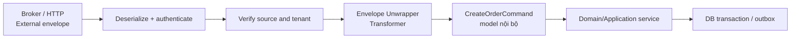
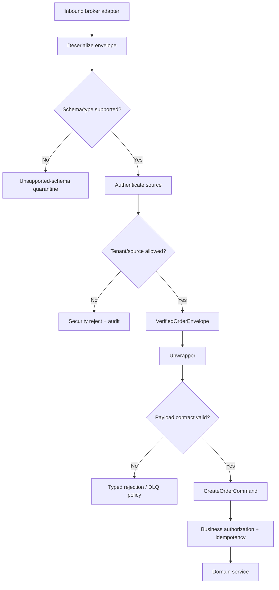
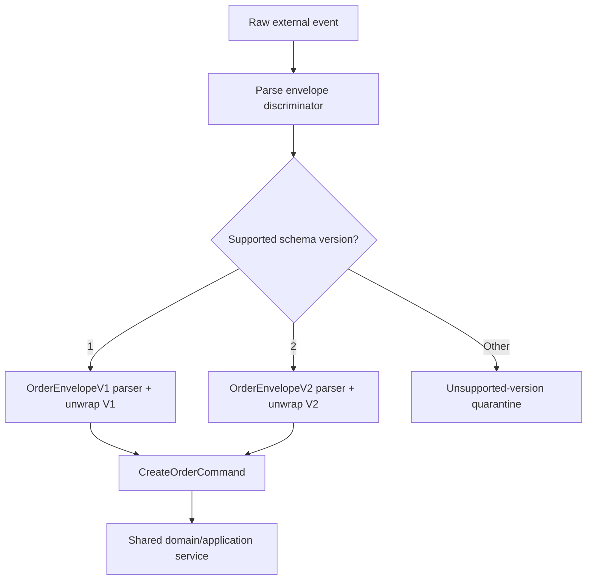
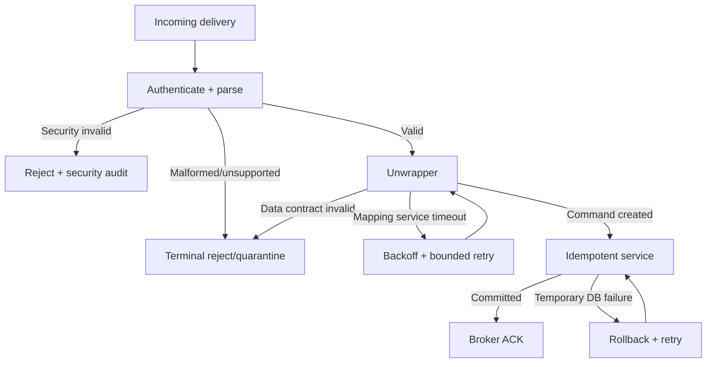

# Giải wrapper trước khi gọi domain service

## 1. Bối cảnh: domain service không nên hiểu định dạng vận chuyển

Một hệ thống nhận lệnh tạo đơn hàng từ đối tác qua broker. Đối tác không chỉ gửi thông tin đơn hàng mà còn đóng gói nó trong một **envelope** có mã nguồn, phiên bản schema, thời điểm gửi, định danh sự kiện và tenant.

```json
{
  "meta": {
    "schemaVersion": 1,
    "sourceSystem": "PARTNER_A",
    "tenantId": "tenant-a",
    "eventId": "evt-order-105",
    "sentAt": "2026-11-21T11:00:00+07:00"
  },
  "payload": {
    "purchaseRef": "PO-105",
    "items": [
      {
        "productCode": "EXT-A7",
        "units": "2",
        "unitPriceMinorVnd": "25000"
      }
    ]
  }
}
```

Nếu domain service nhận nguyên `OrderEnvelopeV1`, nó buộc phải biết `meta`, `sourceSystem`, `units` là chuỗi, định dạng ngày giờ của đối tác và mã `productCode` bên ngoài. Đến khi một đối tác thay schema, lớp nghiệp vụ cũng phải đổi theo.

**Envelope Wrapper** là Enterprise Integration Pattern (EIP) đóng gói dữ liệu nghiệp vụ trong lớp bao chứa thông tin bổ trợ phục vụ truyền tải, điều phối hoặc tích hợp. Ở chiều nhận, ta cần **giải wrapper (unwrap)** tại ranh giới tích hợp và biến payload thành một kiểu lệnh/đối tượng nội bộ ổn định trước khi gọi domain service.

Trong chương **Envelope wrapper** của module **SPRING_INTEGRATION_PATTERN**, người học thực hành triển khai Enterprise Integration Patterns với Spring Integration để xây dựng luồng message ít phụ thuộc, dễ mở rộng. Chủ đề liên hệ trực tiếp tới Transformer, Router, Filter, Gateway, Splitter, Aggregator, retry, error channel và correlation; đồng thời yêu cầu kiểm thử, quan sát đầy đủ các nhánh lỗi.



**Ranh giới quan trọng:** lớp tích hợp chịu trách nhiệm hiểu envelope của đối tác; domain service nhận **kiểu dữ liệu nghiệp vụ đã chuẩn hóa và xác thực ở tầng thích hợp**, không nhận raw transport wrapper.

## 2. Envelope Wrapper gồm những gì?

Có thể tách một envelope thành hai phần:

| Thành phần | Ví dụ | Thuộc trách nhiệm nào? |
| --- | --- | --- |
| **Payload** | `purchaseRef`, danh sách sản phẩm, số lượng | Nội dung nghiệp vụ |
| **Metadata của envelope** | `schemaVersion`, `sourceSystem`, `eventId`, `sentAt` | Giao thức tích hợp và truy vết |
| **Transport metadata ngoài envelope** | Broker delivery tag, partition/offset, `replyTo` | Adapter/broker |
| **Security context đã xác minh** | Principal, tenant được phép, source identity | Ranh giới tin cậy |
| **Canonical command** | `CreateOrderCommand` | API của application/domain layer |

Một envelope có thể chứa thêm TTL, content type, checksum, message type, version, deadline hoặc tenant scope. Nhưng **không phải mọi trường của lớp bao đều là dữ liệu nghiệp vụ**.

### 2.1. Ba lớp bao dễ bị nhầm

1. **Envelope trong payload:** đối tượng JSON/XML/Avro do hệ thống ngoài định nghĩa, như `OrderEnvelopeV1.meta` và `OrderEnvelopeV1.payload`.
2. **Spring `Message<T>`:** bao gồm payload và `MessageHeaders`; nó là cấu trúc truyền message của framework.
3. **Transport envelope:** metadata của HTTP, Kafka, RabbitMQ, JMS... có naming/type và semantics riêng.

```text
Broker Record
  transport: topic, partition, offset, delivery headers
  value: OrderEnvelopeV1
    meta: schemaVersion, sourceSystem, eventId, ...
    payload: PartnerOrderPayloadV1

Spring Integration Message<OrderEnvelopeV1>
  headers: trace, errorChannel/replyChannel, broker metadata...
  payload: OrderEnvelopeV1

After unwrap:
Spring Integration Message<CreateOrderCommand>
  headers: authorized routing / tracing metadata
  payload: CreateOrderCommand

Domain service:
  accept(CreateOrderCommand)
```

**Không được coi ba lớp này là một.** Xóa wrapper khỏi payload không đồng nghĩa xóa mọi `MessageHeaders`, và việc giữ `MessageHeaders.ID` cũng không đảm bảo domain event identity vẫn bền vững qua retry.

### 2.2. Envelope Wrapper khác Normalizer, Content Enricher và Claim Check

| Pattern | Thao tác | Quan hệ với unwrap |
| --- | --- | --- |
| **Envelope Wrapper** | Thêm/bỏ lớp bao phục vụ truyền tải | Bài này tập trung chiều **bỏ lớp bao** |
| **Normalizer** | Nhiều nguồn/format về một canonical model | Sau unwrap có thể normalize nội dung |
| **Transformer** | Chuyển payload A → B | Công cụ triển khai bước unwrap |
| **Content Enricher** | Bổ sung thông tin còn thiếu | Có thể chạy sau unwrap nếu cần catalog |
| **Claim Check** | Cất payload lớn và truyền một token | Truy xuất lại body là bài toán khác |
| **Filter** | Chấp nhận/loại theo điều kiện | Không mặc nhiên tạo reason code khi wrapper sai |
| **Aggregator** | Gộp các message tương quan | Không dùng chỉ vì envelope có nhiều trường |
| **Gateway** | Request–reply API qua messaging | Cần giữ đúng reply/error contract khi unwrap |

Một Normalizer có thể **vừa** giải wrapper **vừa** chuyển dữ liệu về canonical model. Nhưng về mặt thiết kế, nên mô tả rõ các bước: kiểm tra envelope contract, phân biệt trusted metadata, unwrap/mapping và business validation.

## 3. Đặt bước giải wrapper ở đâu?

Vị trí khuyến nghị là **sau khi adapter đã parse và xác thực nguồn, trước khi domain/application service nhận payload**.



### 3.1. Tại sao không unwrap quá muộn?

Nếu đưa envelope thẳng tới Router/Filter/service:
- Các handler chung phải truy cập `envelope.payload.purchaseRef` thay vì `command.orderId`.
- Mỗi downstream handler tự parse `"2"` thành số lượng và hiểu giá theo “minor units”.
- Mỗi service tự quyết định có tin `tenantId` trong envelope hay không.
- Dễ lặp logic lỗi và rải dependency lên source schema khắp module.
- Khi `schemaVersion=2` xuất hiện, nhiều consumer phải đổi đồng thời.

Sau unwrap, domain service chỉ nhận `CreateOrderCommand`, không phụ thuộc cấu trúc `meta/payload` của hệ thống ngoài.

### 3.2. Tại sao không unwrap trước khi xác thực nguồn?

Kẻ gửi không đáng tin có thể tự ghi `tenantId="tenant-b"` hoặc `sourceSystem="PARTNER_A"` trong JSON. Nếu mapper lấy nguyên các giá trị này làm danh tính được tin cậy, một request giả mạo có thể chạy sai tenant.

**Không được lấy security principal từ chính một trường user-supplied rồi tuyên bố đã xác thực nó.** Adapter phải xác thực mTLS, broker principal, signed webhook hoặc phương thức phù hợp trước, sau đó đối chiếu tenant/source trong envelope với identity đã xác minh.

### 3.3. Domain service nhận kiểu nào?

Một port ở tầng ứng dụng có thể là:

```java
interface OrderApplicationService {
    void submit(CreateOrderCommand command);
}
```

`CreateOrderCommand` là một lệnh nội bộ đã chuyển kiểu số, thời gian, mã SKU. Domain service không cần nhận `Message<OrderEnvelopeV1>`, `MessageHeaders` hoặc đối tượng Kafka/Rabbit. Nếu domain thật sự cần tenant và event ID để kiểm soát transaction/idempotency, những giá trị đã được **đối chiếu và chuẩn hóa** có thể nằm trong command hoặc một application context rõ ràng, chứ không phụ thuộc raw wrapper.

## 4. Chốt contract của envelope V1

Ví dụ sử dụng Java 17 records để mô hình hóa message đã deserialize. Mã minh họa một contract **cụ thể**; không tự suy đoán các field nếu nguồn khác phiên bản.

```java
import java.util.List;

record EnvelopeMetadataV1(
        int schemaVersion,
        String sourceSystem,
        String tenantId,
        String eventId,
        String sentAt) {}

record PartnerOrderLineV1(
        String productCode,
        String units,
        String unitPriceMinorVnd) {}

record PartnerOrderPayloadV1(
        String purchaseRef,
        List<PartnerOrderLineV1> items) {}

record OrderEnvelopeV1(
        EnvelopeMetadataV1 meta,
        PartnerOrderPayloadV1 payload) {}
```

Các records này là **DTO nguồn**. Không buộc chúng có tất cả invariant của domain: message sai vẫn phải deserialize được để được phân loại thành một lỗi dữ liệu có nghĩa. Việc đặt validation ngay constructor nguồn có thể làm lỗi parse/conversion xuất hiện sớm hơn; đó là lựa chọn hợp lệ nhưng phải thiết kế exception mapping rõ.

### 4.1. Vai trò của các field meta

| Field | Hợp đồng | Lỗi thường gặp |
| --- | --- | --- |
| `schemaVersion` | Số phiên bản mà parser/mapper hỗ trợ | Version lạ bị map nhầm theo V1 |
| `sourceSystem` | Tên nguồn do đối tác khai, cần so với identity tin cậy | Spoofed source |
| `tenantId` | Tenant trong payload, không tự chứng minh quyền | Cross-tenant injection |
| `eventId` | Logical event ID ổn định qua delivery attempts | Retry tạo event mới |
| `sentAt` | Thời điểm có offset/timezone rõ | Dùng local time mặc định |
| `purchaseRef` | Mã đơn hàng của nguồn | Nhầm với event ID |
| `productCode` | Alias hàng hóa riêng của nguồn | Dùng trực tiếp như canonical SKU |
| `units` | Số lượng dạng string decimal integer | `"2.5"` hoặc `"two"` |
| `unitPriceMinorVnd` | Giá nguyên đơn vị VND theo contract | Nhầm cents/USD |

**Sự khác biệt về thời gian:** `sentAt` là thời điểm đối tác gửi envelope, chưa chắc là thời điểm nghiệp vụ tạo đơn. Nếu nghiệp vụ đòi `orderCreatedAt` thì phải có field/semantics riêng. Ví dụ bài dùng `sentAt` thành `receivedSourceTimestamp` trong command để tránh gán nhầm nó thành “thời điểm thanh toán”.

### 4.2. Version là một phần của ngữ nghĩa

Nếu V2 đổi `unitPriceMinorVnd` thành `priceDecimalUsd`, **không** tái sử dụng mapper V1 mà đổi đơn vị âm thầm. Parser/adapter phải chọn mapper theo version đáng tin; version không hỗ trợ → lỗi có reason code riêng.

Không coi version bằng 0 hoặc missing version là V1 nếu giao thức chưa định nghĩa default đó. Nếu buộc phải hỗ trợ nguồn legacy, xây compatibility adapter tường minh và test chính sách tương thích.

## 5. Domain command bất biến và có invariant rõ

Sau unwrap, domain service cần kiểu lệnh đơn giản, không chứa raw transport metadata:

```java
import java.time.Instant;
import java.util.List;

enum OrderSource {
    PARTNER_A, PARTNER_B
}

record CanonicalOrderLine(
        String sku,
        int quantity,
        long unitPriceMinorVnd) {

    CanonicalOrderLine {
        if (sku == null
                || !sku.matches("[A-Z0-9-]{1,32}")
                || quantity <= 0
                || unitPriceMinorVnd < 0) {
            throw new IllegalArgumentException(
                    "INVALID_CANONICAL_ORDER_LINE");
        }
    }

    long totalMinorVnd() {
        return Math.multiplyExact(
                (long) quantity, unitPriceMinorVnd);
    }
}

record CreateOrderCommand(
        String tenantId,
        OrderSource source,
        String eventId,
        String orderId,
        Instant sourceSentAt,
        List<CanonicalOrderLine> lines,
        long totalMinorVnd) {

    CreateOrderCommand {
        if (tenantId == null || tenantId.isBlank()
                || source == null
                || eventId == null || eventId.isBlank()
                || orderId == null || orderId.isBlank()
                || sourceSentAt == null
                || lines == null || lines.isEmpty()
                || lines.size() > 1000) {
            throw new IllegalArgumentException(
                    "INVALID_CREATE_ORDER_COMMAND");
        }

        // Snapshot: không giữ mutable List của adapter.
        lines = List.copyOf(lines);

        long expected = 0;
        for (CanonicalOrderLine line : lines) {
            expected = Math.addExact(
                    expected, line.totalMinorVnd());
        }
        if (expected != totalMinorVnd) {
            throw new IllegalArgumentException(
                    "ORDER_TOTAL_MISMATCH");
        }
    }
}
```

Những quy tắc được thiết kế có chủ ý:

1. `sourceSentAt` dùng `Instant`, là thời điểm **nguồn gửi**, không tự thay `orderCreatedAt`.
2. `List.copyOf` ngăn thay đổi collection; các `CanonicalOrderLine` records cũng bất biến.
3. `Math.multiplyExact` và `Math.addExact` phát hiện tràn `long`, không tạo tổng tiền âm thầm.
4. `eventId` được giữ nguyên giữa các delivery attempts của cùng logical event.
5. `orderId` và `eventId` không mặc định là cùng một giá trị: một đơn có thể có nhiều sự kiện.
6. `tenantId` đã phải được xác nhận ở security boundary, không được tin chỉ vì nonblank.
7. Domain service có thể tiếp tục xác thực giá với nguồn được phép bán; tổng số học đúng **không** chứng minh giá khách gửi được tin cậy.

Nếu hỗ trợ đa tiền tệ, không giữ tên “VND” rồi âm thầm truyền USD cents. Hãy định nghĩa `Money(currency,minorUnits)` hoặc một value object tương đương, có precision và conversion rule rõ.

## 6. Phân biệt dữ liệu đã xác minh với envelope thô

Để mô hình hóa ranh giới tin cậy, dùng kiểu riêng `VerifiedOrderEnvelope`. Đối tượng này chỉ được tạo qua một bước **đã có security identity từ transport**.

```java
record TransportIdentity(
        String authorizedTenantId,
        OrderSource authorizedSource) {}

record VerifiedOrderEnvelope(
        OrderEnvelopeV1 envelope,
        String tenantId,
        OrderSource source) {}
```

Một bước xác minh đơn giản so sánh identity từ adapter với metadata do client gửi:

```java
import java.util.Objects;

final class VerifiedEnvelopeFactory {

    VerifiedOrderEnvelope verify(
            OrderEnvelopeV1 raw,
            TransportIdentity identity) {

        Objects.requireNonNull(raw, "raw");
        Objects.requireNonNull(identity, "identity");

        if (identity.authorizedTenantId() == null
                || identity.authorizedTenantId().isBlank()
                || identity.authorizedSource() == null) {
            throw new SecurityException(
                    "MISSING_AUTHENTICATED_CONTEXT");
        }

        var meta = raw.meta();
        if (meta == null) {
            throw new EnvelopeContractException(
                    "ENVELOPE_META_MISSING");
        }

        if (!identity.authorizedTenantId()
                    .equals(meta.tenantId())
                || !identity.authorizedSource().name()
                    .equals(meta.sourceSystem())) {
            throw new SecurityException(
                    "ENVELOPE_IDENTITY_MISMATCH");
        }

        return new VerifiedOrderEnvelope(
                raw,
                identity.authorizedTenantId(),
                identity.authorizedSource());
    }
}
```

**Giới hạn quan trọng của ví dụ:** `TransportIdentity` **không** được tạo từ `raw.meta()` hay một header do client tùy ý gắn. Nó phải do phần **đã xác thực** của inbound adapter cung cấp (mTLS, broker authorization, signed webhook...). `VerifiedOrderEnvelope` chỉ là một typed artifact nội bộ, **không phải một bằng chứng mã hóa**: nếu cho một producer không tin cậy publish trực tiếp vào channel nhận kiểu này, caller có thể tự tạo đối tượng giả.

Ở sản phẩm thật nên enforce quyền publish nội bộ, tránh công khai channel nhận verified records và thực hiện phép xác minh tại boundary trước khi mọi side effect xảy ra.

### 6.1. Không làm lộ secret qua exception

Khi tenant/source không khớp, mã lỗi đủ để quan sát; không đưa raw credentials, token, toàn payload hay dữ liệu cá nhân vào `SecurityException.getMessage()`. Log ở tầng ingress nên có tracking ID, loại source, reason code và thông tin tenant **theo chính sách bảo mật**.

### 6.2. Verified context không thay cho business authorization

Một partner được xác thực cho tenant A chưa chắc có quyền đặt mọi SKU hoặc đặt giá tùy ý. Sau unwrap, application service vẫn phải thực thi business authorization, catalog validation và transaction policy. Việc “đã verified” chỉ chứng minh **source identity và scope cơ bản** theo hợp đồng của boundary này.

## 7. Unwrapper: từ VerifiedOrderEnvelope sang CreateOrderCommand

Unwrapper nên là phép biến đổi dữ liệu có kiểm soát: đọc metadata đã xác minh, validate contract, parse các trường nguồn và tạo một object nội bộ. Nó **không** tự lưu đơn, giữ transaction, gửi email hay quyết định thành công của toàn workflow.

### 7.1. Tra SKU thông qua một abstraction

```java
interface PartnerSkuResolver {
    String requireCanonicalSku(
            OrderSource source,
            String externalProductCode);
}
```

Không tự viết `externalCode.toUpperCase()` rồi tuyên bố đó là SKU nội bộ. Một alias bên ngoài có thể trùng tên nhưng mang ý nghĩa khác. Resolver cần mapping đã được quản trị và có version/retention thích hợp khi replay; lỗi unavailable phải phân biệt với unknown mapping.

### 7.2. Kiểu lỗi hợp đồng có mã ổn định

```java
final class EnvelopeContractException
        extends IllegalArgumentException {

    private final String reasonCode;

    EnvelopeContractException(String reasonCode) {
        super(reasonCode);
        this.reasonCode = reasonCode;
    }

    String reasonCode() {
        return reasonCode;
    }
}
```

Chỉ dùng type này cho lỗi có thể kết luận do **format/contract** của input. Một database timeout trong resolver là lỗi hạ tầng cần retry/backoff, không nên bọc mọi `RuntimeException` thành `EnvelopeContractException` rồi ACK như bad data.

### 7.3. Code unwrap đầy đủ

```java
import java.time.Instant;
import java.time.OffsetDateTime;
import java.time.format.DateTimeParseException;
import java.util.ArrayList;
import java.util.Objects;
import org.springframework.stereotype.Component;

@Component
final class OrderEnvelopeUnwrapper {

    private final PartnerSkuResolver skuResolver;

    OrderEnvelopeUnwrapper(PartnerSkuResolver skuResolver) {
        this.skuResolver = Objects.requireNonNull(skuResolver);
    }

    CreateOrderCommand unwrap(VerifiedOrderEnvelope verified) {
        if (verified == null
                || verified.envelope() == null
                || verified.tenantId() == null
                || verified.source() == null) {
            throw new EnvelopeContractException(
                    "VERIFIED_ENVELOPE_MISSING");
        }

        OrderEnvelopeV1 wrapper = verified.envelope();
        EnvelopeMetadataV1 meta = wrapper.meta();
        PartnerOrderPayloadV1 body = wrapper.payload();

        if (meta == null
                || meta.schemaVersion() != 1) {
            throw new EnvelopeContractException(
                    "UNSUPPORTED_ENVELOPE_VERSION");
        }
        if (body == null
                || isBlank(body.purchaseRef())
                || isBlank(meta.eventId())
                || isBlank(meta.sentAt())) {
            throw new EnvelopeContractException(
                    "ENVELOPE_REQUIRED_FIELD_MISSING");
        }
        if (!verified.tenantId().equals(meta.tenantId())
                || !verified.source().name()
                    .equals(meta.sourceSystem())) {
            throw new SecurityException(
                    "ENVELOPE_IDENTITY_MISMATCH");
        }

        Instant sourceSentAt = parseOffsetTime(
                meta.sentAt());

        if (body.items() == null
                || body.items().isEmpty()
                || body.items().size() > 1000) {
            throw new EnvelopeContractException(
                    "ENVELOPE_ITEM_COUNT_INVALID");
        }

        var lines = new ArrayList<CanonicalOrderLine>();
        long total = 0;

        for (PartnerOrderLineV1 line : body.items()) {
            if (line == null
                    || isBlank(line.productCode())
                    || isBlank(line.units())
                    || isBlank(line.unitPriceMinorVnd())) {
                throw new EnvelopeContractException(
                        "ENVELOPE_LINE_MISSING_FIELD");
            }

            int quantity = parseQuantity(line.units());
            long price = parseMinorVnd(line.unitPriceMinorVnd());

            // Không coi mã đối tác là SKU nội bộ.
            String sku = skuResolver.requireCanonicalSku(
                    verified.source(), line.productCode());

            try {
                var normalized = new CanonicalOrderLine(
                        sku, quantity, price);
                lines.add(normalized);
                total = Math.addExact(
                        total, normalized.totalMinorVnd());
            } catch (ArithmeticException ex) {
                throw new EnvelopeContractException(
                        "ENVELOPE_AMOUNT_OUT_OF_RANGE");
            } catch (IllegalArgumentException ex) {
                throw new EnvelopeContractException(
                        "ENVELOPE_LINE_INVALID");
            }
        }

        try {
            return new CreateOrderCommand(
                    verified.tenantId(),
                    verified.source(),
                    meta.eventId(),
                    body.purchaseRef(),
                    sourceSentAt,
                    lines,
                    total);
        } catch (IllegalArgumentException ex) {
            throw new EnvelopeContractException(
                    "ENVELOPE_COMMAND_INVALID");
        }
    }

    private static Instant parseOffsetTime(String value) {
        try {
            return OffsetDateTime.parse(value).toInstant();
        } catch (DateTimeParseException ex) {
            throw new EnvelopeContractException(
                    "ENVELOPE_TIMESTAMP_INVALID");
        }
    }

    private static int parseQuantity(String raw) {
        try {
            int quantity = Integer.parseInt(raw);
            if (quantity <= 0) {
                throw new NumberFormatException();
            }
            return quantity;
        } catch (NumberFormatException ex) {
            throw new EnvelopeContractException(
                    "ENVELOPE_QUANTITY_INVALID");
        }
    }

    private static long parseMinorVnd(String raw) {
        try {
            long value = Long.parseLong(raw);
            if (value < 0) {
                throw new NumberFormatException();
            }
            return value;
        } catch (NumberFormatException ex) {
            throw new EnvelopeContractException(
                    "ENVELOPE_PRICE_INVALID");
        }
    }

    private static boolean isBlank(String input) {
        return input == null || input.isBlank();
    }
}
```

Các điểm cần chú ý khi đọc ví dụ:

- **Version gate:** Chỉ V1 được phép qua mapper này; V2 phải có adapter/mapper riêng.
- **Trust gate:** Tenant/source lấy từ `VerifiedOrderEnvelope` và được so lại với wrapper; không mặc định các giá trị nguồn đều đáng tin.
- **Parse chặt:** `"2"` hợp lệ; `"two"`, `"2.0"` và giá không phải số nguyên bị từ chối theo contract.
- **Thời gian:** `OffsetDateTime.parse(...).toInstant()` dùng offset được nguồn khai, không lấy timezone mặc định của JVM.
- **SKU:** Phải tra mapping sang nội bộ; không âm thầm tạo `UNKNOWN`.
- **Giá:** Đơn vị được đặt tên rõ là VND nguyên, không đoán USD/cents.
- **Overflow:** Phát hiện tràn tổng với `Math.addExact`/`Math.multiplyExact`.
- **Immutability:** Output có list snapshot, không giữ tham chiếu mutable từ input.
- **Exception boundary:** Chỉ lỗi hợp đồng được phân loại thành `EnvelopeContractException`; resolver timeout vẫn đi ra dưới dạng lỗi hạ tầng.

### 7.4. Vì sao không return thẳng wrapper.payload()?

```java
// Không nên để domain service phụ thuộc raw source object:
PartnerOrderPayloadV1 unwrapBadly(OrderEnvelopeV1 wrapper) {
    return wrapper.payload();
}
```

Phép “bóc vỏ” này mới loại `meta` khỏi payload, nhưng domain layer vẫn phải biết `purchaseRef`, `units` là String, `productCode` là mã đối tác. Với mục tiêu cô lập domain, cần **map về command/canonical model**. Nếu payload bên trong đã là domain command chuẩn (có thể xảy ra trong ứng dụng nội bộ), unwrap đơn giản hơn; nhưng điều đó phải được xác nhận bằng contract, không giả định.

### 7.5. Không tạo side effect trong transformer

Việc gọi `skuResolver` là một lookup để ánh xạ; nên thiết kế càng gần phép đọc, deterministic và cache/versioned càng tốt. Không tạo order row, trừ kho hay gửi payment request từ `unwrap`. Domain service chỉ được gọi **sau khi** toàn bộ wrapper đã qua kiểm tra và tạo được command.

Nếu một dòng cuối có price malformed, unwrap không được đã trừ kho cho các dòng trước đó. Tách transformation khỏi business effect giúp đạt nguyên tắc này.

## 8. Spring Integration: unwrap trước Service Activator

Spring Integration triển khai bước unwrap rất tự nhiên bằng **Transformer endpoint**. Ở đây, channel `orders.envelopes.verified` chỉ nhận đối tượng đã được adapter xác thực; downstream nhận `CreateOrderCommand`.

### 8.1. Java DSL với hai giai đoạn rõ ràng

```java
import org.springframework.context.annotation.Bean;
import org.springframework.context.annotation.Configuration;
import org.springframework.integration.channel.DirectChannel;
import org.springframework.integration.config.EnableIntegration;
import org.springframework.integration.dsl.IntegrationFlow;
import org.springframework.messaging.MessageChannel;

@Configuration
@EnableIntegration
class OrderEnvelopeIntegrationFlow {

    @Bean("orders.envelopes.verified")
    MessageChannel verifiedEnvelopes() {
        return new DirectChannel();
    }

    @Bean("orders.commands")
    MessageChannel commands() {
        return new DirectChannel();
    }

    @Bean
    IntegrationFlow unwrapVerifiedOrders(
            OrderEnvelopeUnwrapper unwrapper) {
        return IntegrationFlow.from("orders.envelopes.verified")
                .transform(VerifiedOrderEnvelope.class,
                        unwrapper::unwrap)
                .channel("orders.commands")
                .get();
    }

    @Bean
    IntegrationFlow submitCanonicalOrders(
            OrderApplicationService service) {
        return IntegrationFlow.from("orders.commands")
                .handle(CreateOrderCommand.class,
                        (command, headers) -> {
                            service.submit(command);
                            return null; // One-way handler.
                        })
                .get();
    }
}
```

**Điểm quyết định nằm ở kiểu đầu vào của handler:**

```text
Source adapter:
  OrderEnvelopeV1
    -> authenticated identity check
    -> VerifiedOrderEnvelope

Integration flow:
  VerifiedOrderEnvelope
    -> Transformer / unwrap
    -> CreateOrderCommand

Domain/application port:
  submit(CreateOrderCommand)
```

Nếu nghiệp vụ thay đổi broker hoặc payload envelope của đối tác, code của `OrderApplicationService` không cần nhận thêm field transport. Một nơi duy nhất — unwrapper/source adapter — quản lý schema nguồn.

### 8.2. Điều gì bảo vệ `orders.envelopes.verified`?

Trong test, có thể gửi trực tiếp một `VerifiedOrderEnvelope` vào channel. Nhưng trong production, **channel đó phải là boundary nội bộ** chỉ được kết nối tới verified ingress path.

Không được:
- Đưa một public HTTP request body vào channel đã verified chỉ vì deserialize thành đúng Java record.
- Lấy `sourceSystem` từ raw header rồi tự tạo `TransportIdentity`.
- Dùng annotation `@Validated` trên wrapper và cho rằng nó tự chứng minh quyền của partner.
- Tái sử dụng cùng channel cho cả verified và unverified payload không có type/contract riêng.

Có thể enforce bảo vệ ở inbound adapter, explicit guard endpoint trước verified channel, broker ACL hoặc một adapter service có quyền publish hạn chế; thiết kế cụ thể tùy deployment.

### 8.3. Tại sao dùng DirectChannel trong ví dụ?

`DirectChannel` xử lý handler đồng bộ trên thread gửi trong cùng context; thuận tiện cho demonstration và integration test. Nó **không phải** durable queue. Nếu thay bằng `ExecutorChannel` hoặc broker:
- Exceptions có thể xuất hiện ở thread/transport khác.
- Thứ tự messages có thể thay đổi.
- Phải có retry, ACK/NACK, deadline và idempotency policy.
- Domain service vẫn chỉ nhận command, nhưng độ tin cậy của delivery là trách nhiệm ở các lớp khác.

### 8.4. Giới hạn request–reply

Flow trên là **one-way** vì domain port trả `void` và lambda handler trả `null`. Một Messaging Gateway gọi flow và đợi response **sẽ không tự nhận được reply thành công**. Nếu use case cần request–reply, định nghĩa:

```java
record SubmitOrderResult(
        String tenantId,
        String eventId,
        String orderId,
        boolean accepted) {}

interface RequestReplyOrderService {
    SubmitOrderResult submit(CreateOrderCommand command);
}
```

Handler request–reply trả `SubmitOrderResult`, kèm đường phản hồi lỗi hợp đồng/timeout được thiết kế rõ. Đừng đưa rejected envelope vào một terminal channel rồi để Gateway chờ mãi.

## 9. Biến thể annotation-based: @Transformer và @ServiceActivator

Một ứng dụng có thể dùng annotation thay cho Java DSL:

```java
import org.springframework.integration.annotation.Transformer;
import org.springframework.integration.annotation.ServiceActivator;
import org.springframework.stereotype.Component;

@Component
class AnnotatedEnvelopeEndpoints {

    private final OrderEnvelopeUnwrapper unwrapper;
    private final OrderApplicationService service;

    AnnotatedEnvelopeEndpoints(
            OrderEnvelopeUnwrapper unwrapper,
            OrderApplicationService service) {
        this.unwrapper = unwrapper;
        this.service = service;
    }

    @Transformer(
            inputChannel = "orders.envelopes.verified",
            outputChannel = "orders.commands")
    public CreateOrderCommand unpack(
            VerifiedOrderEnvelope envelope) {
        return unwrapper.unwrap(envelope);
    }

    @ServiceActivator(inputChannel = "orders.commands")
    public void process(CreateOrderCommand command) {
        service.submit(command);
    }
}
```

Đây là **topology thay thế** cho các `IntegrationFlow` ở mục 8. Không đăng ký **đồng thời** hai phiên bản vào cùng `DirectChannel` rồi mong cả hai được gọi: một DirectChannel thường phân phát mỗi message cho **một** subscriber theo dispatch semantics, tạo hành vi không mong đợi.

Mục đích của cả hai cách đều như nhau: giữ việc bóc wrapper trong integration layer, domain service chỉ nhận command.

### 9.1. Không đặt @Transformer trên domain service

Nếu dùng:

```java
// PHẢN MẪU: domain service phải biết cả wrapper.
void submit(OrderEnvelopeV1 envelope) {
    String orderId = envelope.payload().purchaseRef();
    // ... xử lý nghiệp vụ ...
}
```

thì bước unwrap đã bị đẩy xuống domain. Điều này làm domain phụ thuộc source schema và khiến việc test nghiệp vụ cần tạo các wrapper/headers không liên quan.

Một test tốt cho `OrderApplicationService` nên chỉ cần dựng `CreateOrderCommand` hoặc domain object, không cần Kafka headers hay `OrderEnvelopeV1`.

## 10. Message headers sau khi giải wrapper

Transformer có thể tạo message mới với payload `CreateOrderCommand` và giữ một phần headers theo cơ chế Spring Integration. **Đổi payload không tự xóa các headers không đáng tin**, và wrapper metadata không tự được copy sang header đúng tên.

```text
Incoming Spring Message:
  payload = VerifiedOrderEnvelope(
              envelope=OrderEnvelopeV1(...),
              trustedTenantId=tenant-a,
              trustedSource=PARTNER_A
            )
  headers = {
    ingressTrackingId, traceparent,
    messageId, replyChannel, errorChannel,
    broker-specific fields
  }

Outgoing Spring Message:
  payload = CreateOrderCommand(
              tenantId=tenant-a,
              eventId=evt-order-105,
              orderId=PO-105,
              ...
            )
  headers = controlled routing/tracing metadata
```

Không để một header `tenantId=tenant-b` từ raw broker lấn át `CreateOrderCommand.tenantId=tenant-a`. Khi hai lớp thông tin khác nhau, xác thực và **từ chối conflict**, thay vì chọn tùy tiện một field.

### 10.1. Bảng chính sách header

| Header/metadata | Sau unwrap nên làm gì? | Lý do |
| --- | --- | --- |
| `ingressTrackingId` | Truyền qua nếu do adapter cấp | Audit và đối soát lỗi |
| `traceparent`/trace ID | Dùng tracing library, bảo vệ trust boundary | Distributed observability |
| `tenantId` | Derive từ verified identity hoặc command | Tránh spoof/cross-tenant |
| `eventId` | Đồng bộ với stable `CreateOrderCommand.eventId` | Retry/idempotency |
| `sourceSystem` | Derive từ verified `OrderSource` | Không tin raw source field |
| `schemaVersion` | Ghi nhận parser version nếu cần audit | Replay/migration |
| `CORRELATION_ID` | Giữ nếu vẫn đúng ý nghĩa group | Không trộn workflow/batch |
| `SEQUENCE_NUMBER/SIZE` | Chỉ giữ khi sequence semantics được bảo toàn | Resequencer/Aggregator |
| `replyChannel` | Giữ đúng reply path trong flow nội bộ | Gateway request–reply |
| `errorChannel` | Duy trì theo error handling policy | Phân loại exception |
| Broker delivery headers | Xử lý tại adapter/ACK boundary | Không đưa vào domain |
| Raw authorization token | Loại khỏi nơi không cần | Bảo mật |

### 10.2. Headers không phải bằng chứng đã xác thực

Ngay cả khi `MessageHeaders` không bị sửa trong runtime, giá trị ban đầu của một header có thể do client đặt. Do đó cần **nguồn gốc tin cậy**: header do ingress adapter tạo từ authenticated principal khác với header chỉ được copy từ request.

Một pattern an toàn là đưa verified identity vào một internal context được tạo bởi adapter, sau đó cross-check các trường wrapper và tạo business command từ context ấy.

### 10.3. Khi custom Transformer trả Message thay vì payload

Nếu một Transformer tạo thủ công `Message<CreateOrderCommand>`, nó có thể chủ động copy/override headers. Khi đó phải:
- Giữ các trường thuộc reply routing cần thiết;
- Loại raw credential, PII, transport object chỉ tồn tại trong JVM;
- Không tự gắn `CORRELATION_ID` bằng một UUID mới khi nhóm nghiệp vụ cần giữ nguyên;
- Đồng bộ eventId và tenant giữa payload/header;
- Integration test trên **output message thực**, không đoán framework behavior.

Phản mẫu `copyHeaders(input.getHeaders())` không phân loại có thể kéo toàn bộ dữ liệu không đáng tin vào luồng sau. Ở ranh giới broker/service, nên có **header allowlist** và contract test.

## 11. Schema versioning: không giả vờ mọi wrapper là V1

Khi đối tác nâng API, envelope có thể thay đổi cả cấu trúc và ý nghĩa dữ liệu.

| Thay đổi | Tác động | Giải pháp |
| --- | --- | --- |
| Đổi `items` thành `lines` | Parsing DTO nguồn | Parser/mapper V2 |
| Đổi `units` từ String thành integer | Source contract | New version hoặc explicit compatibility |
| Đổi `unitPriceMinorVnd` sang USD decimal | **Breaking semantic change** | Money conversion/version rõ |
| Thêm `checksum` hoặc `signature` | Security/transport verification | Xác thực trước unwrap |
| Đổi ý nghĩa `eventId` | Idempotency/correlation breaking | Migration và key versioning |
| Thêm optional tracing metadata | Không phải domain logic | Metadata mapping |
| Thay `sentAt` bằng thời điểm tạo đơn | Business meaning thay đổi | Command model và tests cập nhật |

### 11.1. Adapter chọn mapper theo version



Cần chú ý thứ tự: **parser dùng version để chọn schema** có thể là phần của inbound adapter; nếu raw bytes không có discriminator hợp lệ, đừng deserialize cưỡng bức thành V1 rồi nhận các giá trị default sai.

Nếu V2 thay đổi ngữ nghĩa command, có thể tạo `CreateOrderCommandV2` hoặc version của canonical model thay vì ép thông tin mới vào kiểu V1 gây mất nghĩa. Không phải mọi thay đổi nguồn đều yêu cầu sửa domain command, nhưng **mọi breaking semantic change đều cần được xem xét**.

### 11.2. Replay dữ liệu cũ phải dùng rule đúng version

Nếu một message V1 nằm trong DLQ 30 ngày và đến lúc đó code chỉ hỗ trợ V2, replay có thể thất bại. Chiến lược:
1. Giữ parser V1 trong migration window;
2. Convert V1 → canonical version hiện hành theo rule explicit;
3. Dùng source SKU mapping/version phù hợp;
4. Giữ stable eventId và fingerprint cho idempotency;
5. Ghi audit source version và normalization rule version.

Không tự map `schemaVersion=1` thành V2 bằng cách chỉ đổi field name trong code rồi hy vọng giá/tenant/timezone không sai.

### 11.3. Signature và checksum: thứ tự xác minh

Nếu đối tác ký raw body (HMAC/chữ ký số), phải xác minh **trên đúng bytes hoặc canonical representation được giao thức ký quy định**, trước khi sửa field order, trim text hoặc map payload. Một chữ ký đúng chứng minh tính toàn vẹn/nguồn theo trust material tương ứng, **không** chứng minh dữ liệu nghiệp vụ được phép.

Không đưa secret/key material vào normalizer hoặc domain command. Verification nằm ở ingress/security boundary, và key rotation phải có policy tương ứng.

## 12. Xử lý lỗi unwrap: phân loại input, security và hạ tầng

Trong thực tế có ít nhất bốn nhóm lỗi, không nên dùng một `catch(Exception)` rồi coi tất cả là “payload malformed”.

| Nhóm | Ví dụ | Hành động |
| --- | --- | --- |
| **Conversion/deserialization** | JSON không đúng cú pháp, sai content type | Chặn tại adapter; response 4xx hoặc DLQ policy |
| **Contract invalid** | V1 thiếu `eventId`, `units="two"` | Reject/quarantine có reason code |
| **Unsupported version** | `schemaVersion=9` | Quarantine, nâng mapper hoặc hợp đồng |
| **Security violation** | Tenant/source mismatch, signature sai | Deny và security audit |
| **Unknown mapping** | `EXT-A7` chưa có SKU nội bộ | Quarantine/replay sau khi mapping bổ sung |
| **Transient infrastructure** | SKU directory timeout | Bounded retry, backoff |
| **Programming defect** | `NullPointerException` không dự kiến | Alert và fail processing |
| **Business rejection** | SKU đã bị cấm bán, giá không được chấp thuận | Domain/application decision, khác unwrap |

### 12.1. Đừng dùng Filter để im lặng bỏ bad wrapper

```text
Incoming Envelope
  -> filter(e -> unwrap(e) != null)
  -> domain service
```

Phản mẫu này che nguyên nhân: Filter loại một message khiến Gateway đang chờ reply bị timeout, một batch Aggregator thiếu item, hoặc broker adapter ACK sai. Nên dùng **typed rejection outcome** hoặc exception classifier phù hợp để biết vì sao một delivery không được xử lý.

### 12.2. Một typed outcome cho lỗi có thể xác định

Một biến thể phù hợp cho import/batch có thể trả:

```java
sealed interface UnwrapOutcome
        permits UnwrappedOrder, RejectedEnvelope {}

record UnwrappedOrder(CreateOrderCommand command)
        implements UnwrapOutcome {}

record RejectedEnvelope(
        String trustedTrackingId,
        String reasonCode)
        implements UnwrapOutcome {}
```

Một ingress guard có thể bắt **riêng** `EnvelopeContractException` để tạo `RejectedEnvelope`, không chứa raw payload trong đối tượng lỗi:

```java
UnwrapOutcome classify(
        VerifiedOrderEnvelope input,
        String trustedTrackingId,
        OrderEnvelopeUnwrapper unwrapper) {
    try {
        return new UnwrappedOrder(unwrapper.unwrap(input));
    } catch (EnvelopeContractException badInput) {
        return new RejectedEnvelope(
                trustedTrackingId, badInput.reasonCode());
    }
}
```

Nếu phát outcome vào Router, nhánh accepted cần **unwrap `UnwrappedOrder.command`** trước khi gửi vào channel chỉ nhận `CreateOrderCommand`. Nhánh rejected lưu/reply theo contract, không nuốt exception của nguồn lookup. **Không** bắt `SecurityException` rồi trả rejection thiếu security audit; xử lý ở boundary bảo mật.

### 12.3. Error channel không thay thế DLQ hoặc ledger

Với `DirectChannel` đồng bộ, lỗi transformer có thể truyền về sender dưới dạng một messaging exception. Với executor/poller/broker, lỗi có thể đi qua `errorChannel`/adapter-specific error handler.

Tuy nhiên `errorChannel` không tự:
- Lưu raw envelope bền vững;
- Retry theo policy;
- Phân loại lỗi permanent/transient;
- ACK/NACK đúng semantics của broker;
- Trả kết quả cho Gateway đang chờ;
- Chống xử lý trùng khi replay.

Những chức năng này cần cấu hình cụ thể ở adapter, retry advice, quarantine storage, transaction và Idempotent Receiver.

### 12.4. Retry đúng loại lỗi



Không retry vô hạn khi `units="two"`: chạy lại cùng dữ liệu không làm nó thành số. Không đánh dấu mọi lỗi resolver là terminal nếu đó là một timeout: map/trạng thái ở bên ngoài có thể phục hồi.

## 13. Idempotency, correlation và việc giữ identity qua unwrap

Một wrapper có thể mang các identity khác nhau:

```text
sourceOrderId = PO-105      // đơn hàng nguồn
eventId       = evt-105     // logical event (ổn định qua retry)
messageId     = framework ID của từng delivery envelope
correlationId = batch/group/request correlation theo flow
traceId       = distributed trace context
```

Không dùng `MessageHeaders.ID` hoặc trace ID thay eventId. Một broker có thể redeliver cùng event với envelope ID khác. Sau unwrap, `CreateOrderCommand.eventId` phải giữ stable logical identity để Idempotent Receiver nhận ra duplicate.

### 13.1. Idempotency key nên có source và tenant scope

```java
record OrderEventKey(
        String consumerName,
        String tenantId,
        OrderSource source,
        String eventId) {}

OrderEventKey forCommand(
        String consumerName, CreateOrderCommand command) {
    return new OrderEventKey(
            consumerName,
            command.tenantId(),
            command.source(),
            command.eventId());
}
```

Nếu hai nguồn có thể phát cùng eventId, `source` phải là một phần của key. Nếu cùng eventId nhưng payload khác, nên đánh dấu **identity conflict**, không âm thầm ACK như duplicate hợp lệ.

### 13.2. Domain service vẫn phải có transaction boundary

Unwrapper không chặn side effect trùng. Một flow broker at-least-once:

```text
Delivery #1:
  verify -> unwrap -> CreateOrderCommand
  idempotent receiver -> commit order + inbox
  broker ACK lost

Delivery #2:
  verify -> unwrap -> same CreateOrderCommand identity
  idempotent receiver -> duplicate, no second order
  broker ACK successful
```

Khi ghi order và Inbox cùng database, có thể dùng unique constraint + transaction để tránh race. Nếu domain service gửi email hoặc publish event, cân nhắc outbox/idempotent downstream. **Không gọi payment API ngay trong unwrap** rồi tuyên bố toàn flow idempotent.

### 13.3. Correlation headers không biến mất theo ý muốn

Nếu wrapper là một phần của Splitter/Aggregator flow, metadata như `CORRELATION_ID`, `SEQUENCE_NUMBER`, `SEQUENCE_SIZE` có thể cần giữ qua Transformer. Đừng gán `correlationId=eventId` một cách tùy tiện:
- Một batch có nhiều eventIds nhưng cùng correlation group.
- Một event có thể có nhiều reply/subtasks.
- Một trace có thể chứa nhiều requests.

Phải định nghĩa **ngữ nghĩa group** riêng. Khi Filter loại một envelope invalid, Aggregator downstream có thể chờ mãi nếu release strategy vẫn đòi số item gốc; tạo rejected outcome/completion marker hoặc điều chỉnh expected count theo contract.

### 13.4. Replay với catalog mapping đổi

Nếu `EXT-A7` map sang `SKU-A` hôm nay nhưng sang `SKU-B` tháng sau, cùng event được replay có thể tạo command khác trong lần thứ hai. Dù event ID ổn định, việc idempotency check có thể thấy payload conflict.

Để xử lý:
- Giữ mapping version/snapshot được dùng lần đầu;
- Hoặc persist canonical command/result cùng event ID và tái sử dụng cho replay;
- Hoặc quy định event revision mới nếu thay đổi mapping có chủ đích.

Không dùng “latest mapping” một cách ngầm định nếu nghiệp vụ cần deterministic replay và audit.

## 14. Unit test: unwrap đúng payload và giữ ngữ nghĩa nghiệp vụ

Để test chính xác, không cần khởi động Spring context. Ta dựng source envelope, đưa verified identity từ một đối tượng kiểm thử, dùng fake SKU resolver, rồi kiểm tra kết quả là command **không còn wrapper**.

### 14.1. Fixture tạo envelope V1

```java
import java.util.List;

final class EnvelopeFixtures {
    static OrderEnvelopeV1 validV1() {
        return new OrderEnvelopeV1(
                new EnvelopeMetadataV1(
                        1,
                        "PARTNER_A",
                        "tenant-a",
                        "evt-order-105",
                        "2026-11-21T11:00:00+07:00"),
                new PartnerOrderPayloadV1(
                        "PO-105",
                        List.of(new PartnerOrderLineV1(
                                "EXT-A7", "2", "25000"))));
    }

    static OrderEnvelopeV1 withUnits(String units) {
        var old = validV1();
        return new OrderEnvelopeV1(
                old.meta(),
                new PartnerOrderPayloadV1(
                        "PO-105",
                        List.of(new PartnerOrderLineV1(
                                "EXT-A7", units, "25000"))));
    }

    private EnvelopeFixtures() {}
}
```

Fixture giữ source metadata và payload tách biệt. Trong test version/tenant conflict, tạo một bản `EnvelopeMetadataV1` khác mà **không** thay phần body để biết lỗi đến từ rule nào.

### 14.2. Test round trip của identity và số tiền

```java
import java.time.Instant;
import org.junit.jupiter.api.BeforeEach;
import org.junit.jupiter.api.Test;
import static org.junit.jupiter.api.Assertions.*;

class OrderEnvelopeUnwrapperTest {

    private VerifiedEnvelopeFactory verifier;
    private OrderEnvelopeUnwrapper unwrapper;

    @BeforeEach
    void setup() {
        verifier = new VerifiedEnvelopeFactory();

        PartnerSkuResolver resolver = (source, externalSku) -> {
            if (source == OrderSource.PARTNER_A
                    && "EXT-A7".equals(externalSku)) {
                return "SKU-A";
            }
            throw new EnvelopeContractException(
                    "UNKNOWN_EXTERNAL_SKU");
        };
        unwrapper = new OrderEnvelopeUnwrapper(resolver);
    }

    private VerifiedOrderEnvelope trusted(
            OrderEnvelopeV1 wrapper) {
        return verifier.verify(
                wrapper,
                new TransportIdentity(
                        "tenant-a", OrderSource.PARTNER_A));
    }

    @Test
    void validEnvelopeBecomesTypedDomainCommand() {
        var command = unwrapper.unwrap(
                trusted(EnvelopeFixtures.validV1()));

        assertEquals("tenant-a", command.tenantId());
        assertEquals(OrderSource.PARTNER_A, command.source());
        assertEquals("evt-order-105", command.eventId());
        assertEquals("PO-105", command.orderId());
        assertEquals(
                Instant.parse("2026-11-21T04:00:00Z"),
                command.sourceSentAt());

        assertEquals(1, command.lines().size());
        var line = command.lines().get(0);
        assertEquals("SKU-A", line.sku());
        assertEquals(2, line.quantity());
        assertEquals(25_000L, line.unitPriceMinorVnd());
        assertEquals(50_000L, command.totalMinorVnd());
    }

    @Test
    void malformedQuantityProducesStableReasonCode() {
        var bad = EnvelopeFixtures.withUnits("two");

        var error = assertThrows(
                EnvelopeContractException.class,
                () -> unwrapper.unwrap(trusted(bad)));

        assertEquals(
                "ENVELOPE_QUANTITY_INVALID",
                error.reasonCode());
    }

    @Test
    void identityMismatchIsSecurityError() {
        var untrusted = EnvelopeFixtures.validV1();

        assertThrows(SecurityException.class,
                () -> verifier.verify(
                        untrusted,
                        new TransportIdentity(
                                "tenant-b", OrderSource.PARTNER_A)));
    }

    @Test
    void sameEventIdentitySurvivesRedelivery() {
        var first = unwrapper.unwrap(
                trusted(EnvelopeFixtures.validV1()));
        var retry = unwrapper.unwrap(
                trusted(EnvelopeFixtures.validV1()));

        assertEquals(first.eventId(), retry.eventId());
        assertEquals(first.tenantId(), retry.tenantId());
        assertEquals(first.source(), retry.source());
        assertEquals(first, retry);
    }
}
```

**Cần phân biệt:** Test identity mismatch chỉ kiểm tra rằng factory từ chối hai giá trị khác nhau. Nó không chứng minh một người gửi đã được xác thực bằng mTLS/JWT/HMAC; integration test security adapter phải dùng cơ chế chứng thực thật hoặc test double mô phỏng đúng identity được tin cậy.

### 14.3. Test unsupported version

```java
import org.junit.jupiter.api.Test;
import static org.junit.jupiter.api.Assertions.*;

class EnvelopeVersionTest {
    @Test
    void doesNotInterpretVersionTwoAsVersionOne() {
        var old = EnvelopeFixtures.validV1();
        var oldMeta = old.meta();

        var future = new OrderEnvelopeV1(
                new EnvelopeMetadataV1(
                        2,
                        oldMeta.sourceSystem(),
                        oldMeta.tenantId(),
                        oldMeta.eventId(),
                        oldMeta.sentAt()),
                old.payload());

        var verified = new VerifiedEnvelopeFactory()
                .verify(future,
                        new TransportIdentity(
                                "tenant-a", OrderSource.PARTNER_A));

        var mapper = new OrderEnvelopeUnwrapper(
                (source, product) -> "SKU-A");

        var error = assertThrows(
                EnvelopeContractException.class,
                () -> mapper.unwrap(verified));

        assertEquals(
                "UNSUPPORTED_ENVELOPE_VERSION",
                error.reasonCode());
    }
}
```

Trong thực tế version 2 có thể có một DTO khác nên cần parser V2 riêng. Test này chỉ xác minh **guard không để V2 bị hiểu nhầm là V1** nếu đã được deserialize thành cấu trúc V1 ở bài tập.

### 14.4. Test dữ liệu sai theo bảng

| Kịch bản | Kết quả cần kiểm tra |
| --- | --- |
| `meta=null` | Không thể verified hợp lệ; lỗi có mã |
| `payload=null` | `ENVELOPE_REQUIRED_FIELD_MISSING` |
| `schemaVersion=2` | `UNSUPPORTED_ENVELOPE_VERSION` |
| `eventId=""` | `ENVELOPE_REQUIRED_FIELD_MISSING` |
| `sourceSystem` không khớp principal | Security reject |
| `tenantId` không khớp principal | Security reject |
| `sentAt` thiếu offset | `ENVELOPE_TIMESTAMP_INVALID` |
| `items=[]` | `ENVELOPE_ITEM_COUNT_INVALID` |
| `items` chứa null | `ENVELOPE_LINE_MISSING_FIELD` |
| `units="two"` | `ENVELOPE_QUANTITY_INVALID` |
| `units="-1"` | `ENVELOPE_QUANTITY_INVALID` |
| `unitPriceMinorVnd="-100"` | `ENVELOPE_PRICE_INVALID` |
| `unitPriceMinorVnd="25.00"` | `ENVELOPE_PRICE_INVALID` |
| `productCode` chưa được map | Reason code hoặc typed mapping error |
| Directory timeout | Infrastructure error; không bọc thành bad input |
| Total vượt `long` | `ENVELOPE_AMOUNT_OUT_OF_RANGE` |
| Same V1 delivered twice | Same command business identity |
| Cùng event ID, payload khác | Idempotency conflict ở receiver |

**Một test quan trọng:** `List.of(null)` sẽ ném `NullPointerException` ngay trong fixture Java. Nếu muốn kiểm thử list có phần tử null do nguồn JSON tạo ra, dùng `Arrays.asList((PartnerOrderLineV1) null)` hoặc một mutable list cho phép null, rồi đi qua unwrapper.

## 15. Integration test: domain service chỉ nhận CreateOrderCommand

Unit test chứng minh mapper, nhưng chưa chứng minh wiring Spring Integration gọi đúng endpoint. Một integration test phải gửi `VerifiedOrderEnvelope` vào channel rồi dùng mock domain port quan sát kết quả.

### 15.1. Spring context cho ví dụ Java DSL

```java
import org.junit.jupiter.api.AfterEach;
import org.junit.jupiter.api.Test;
import org.mockito.ArgumentCaptor;
import org.springframework.beans.factory.annotation.Autowired;
import org.springframework.beans.factory.annotation.Qualifier;
import org.springframework.context.annotation.Bean;
import org.springframework.context.annotation.Configuration;
import org.springframework.messaging.MessageChannel;
import org.springframework.messaging.support.MessageBuilder;
import org.springframework.test.context.junit.jupiter.SpringJUnitConfig;

import static org.junit.jupiter.api.Assertions.*;
import static org.mockito.Mockito.*;

@SpringJUnitConfig(classes = {
        OrderEnvelopeIntegrationFlow.class,
        OrderEnvelopeUnwrapper.class,
        OrderEnvelopeFlowIT.FakeDependencies.class
})
class OrderEnvelopeFlowIT {

    @Autowired
    @Qualifier("orders.envelopes.verified")
    MessageChannel input;

    @Autowired
    OrderApplicationService service;

    private final VerifiedEnvelopeFactory verifier =
            new VerifiedEnvelopeFactory();

    @AfterEach
    void resetMock() {
        reset(service);
    }

    @Test
    void unwrapsBeforeInvokingApplicationService() {
        var verified = verifier.verify(
                EnvelopeFixtures.validV1(),
                new TransportIdentity(
                        "tenant-a", OrderSource.PARTNER_A));

        assertTrue(input.send(
                MessageBuilder.withPayload(verified)
                        .setHeader("ingressTrackingId", "track-105")
                        .build()));

        var captor =
                ArgumentCaptor.forClass(CreateOrderCommand.class);
        verify(service).submit(captor.capture());

        var cmd = captor.getValue();
        assertEquals("PO-105", cmd.orderId());
        assertEquals("tenant-a", cmd.tenantId());
        assertEquals("evt-order-105", cmd.eventId());
        assertEquals(50_000L, cmd.totalMinorVnd());
        assertEquals("SKU-A", cmd.lines().get(0).sku());
    }

    @Test
    void invalidPayloadDoesNotInvokeDomainService() {
        var verified = verifier.verify(
                EnvelopeFixtures.withUnits("invalid"),
                new TransportIdentity(
                        "tenant-a", OrderSource.PARTNER_A));

        // DirectChannel có thể wrap lỗi trong messaging exception.
        assertThrows(RuntimeException.class,
                () -> input.send(
                        MessageBuilder.withPayload(verified)
                                .build()));

        verifyNoInteractions(service);
    }

    @Configuration
    static class FakeDependencies {

        @Bean
        PartnerSkuResolver partnerSkuResolver() {
            return (source, externalSku) -> {
                if (source == OrderSource.PARTNER_A
                        && "EXT-A7".equals(externalSku)) {
                    return "SKU-A";
                }
                throw new EnvelopeContractException(
                        "UNKNOWN_EXTERNAL_SKU");
            };
        }

        @Bean
        OrderApplicationService orderApplicationService() {
            return mock(OrderApplicationService.class);
        }
    }
}
```

**Giả định test:**
- Các classes minh họa thuộc package test phù hợp và được đăng ký đúng vào context.
- `OrderEnvelopeUnwrapper` được đăng ký qua class list, nên không cần component scan bổ sung cho nó trong test.
- `DirectChannel` xử lý đồng bộ; Mockito verification có thể chạy sau `send()`.
- Test gửi **verified object từ fixture**, bỏ qua auth adapter thật; cần integration test riêng để chứng minh adapter ngăn raw envelope bypass.
- Code block là tài liệu kỹ thuật, **không có tuyên bố đã compile/chạy**; phiên bản Java DSL/dependency phải được đối chiếu trong vòng Content QA.

### 15.2. Test “domain không biết wrapper”

Ở kiến trúc sạch, không nên có chữ `OrderEnvelopeV1` trong interface của domain service. Có thể dùng một architecture test (ArchUnit hoặc một test phụ thuộc module) để xác minh:

```text
domain/application module:
    may depend on CreateOrderCommand
    must not depend on OrderEnvelopeV1
    must not depend on Kafka/Rabbit/JMS/HTTP DTOs

integration adapter:
    may depend on OrderEnvelopeV1
    may depend on CreateOrderCommand
    owns the unwrap mapper
```

Kiểm tra bằng review code hoặc rule tự động theo dependency graph. Nếu domain module import `org.springframework.messaging.Message` hoặc `OrderEnvelopeV1` chỉ để lấy tenant, cần xem lại **boundary**.

### 15.3. Test error channel với adapter thật

Bổ sung trường hợp:
1. Broker gửi raw payload malformed;
2. JSON deserializer thất bại;
3. Retry classifier nhận biết lỗi data terminal;
4. Message đi quarantine/DLQ hoặc trả rejection theo contract;
5. Domain service không được gọi;
6. Payload/headers nhạy cảm không xuất hiện trong log;
7. ACK/NACK đúng semantics adapter.

Một test tương tự cho transient SKU resolver outage phải chứng minh **bounded retry** và eventual recovery mà không tạo hai order. Không dùng mock `RuntimeException` để kết luận toàn bộ broker retry policy hoạt động.

## 16. Các tình huống request–reply, batch và fan-out

### 16.1. Khi Gateway đang đợi kết quả

Một Gateway có thể nhận raw envelope rồi đợi `SubmitOrderResult`. Nếu unwrapper ném `EnvelopeContractException`, application cần map nó thành **structured rejection** hoặc một exception response theo contract. Không âm thầm Filter drop message khiến Gateway chỉ có timeout.

```text
Gateway call
  -> validate/verify wrapper
  -> unwrap
    -> valid: domain submit -> SubmitOrderResult
    -> invalid: RejectedOrderResult(reasonCode)
    -> store unavailable: retry/error reply
```

Nếu result được trả qua transport async, stable `eventId` và `requestId`/correlation header phải được truyền đúng; đừng dùng một `MessageHeaders.ID` tạm làm business request ID.

### 16.2. Wrapper bao một batch

Một envelope có thể mang mảng 100 đơn hàng thay vì một order. Có hai kiến trúc:

| Cách | Lợi thế | Điều cần lưu ý |
| --- | --- | --- |
| Unwrap toàn batch rồi Splitter | Một lần kiểm tra metadata và contract chung | Giữ sourceIndex, batchId, expectedCount |
| Splitter wrapper thành child envelopes rồi unwrap từng item | Cách ly item lỗi rõ | Copy/derive verified context an toàn, không fake |
| Unwrap và trả accepted/rejected outcomes từng item | Partial import có kiểm soát | Aggregator phải biết đủ mọi kết quả |
| Reject toàn batch nếu một item sai | Hợp đồng all-or-nothing rõ | Không side effect trước khi validate tất cả |

Nếu Splitter phát 100 items, 3 items malformed và Filter xóa chúng, Aggregator vẫn đợi `sequenceSize=100` có thể mắc kẹt. Cần terminal status/rejected outcome cho mọi sourceIndex hoặc thiết kế release strategy theo acceptedCount/completion marker đáng tin.

### 16.3. Khi nhiều downstream consumers cần metadata

Đừng đưa raw envelope nguyên vẹn qua các nhánh chỉ vì một consumer cần `sourceSystem`. Có thể:
- Đưa provenance và eventId đã xác minh vào canonical command;
- Gắn approved routing/tracing headers;
- Lưu source envelope vào secure audit store và gửi reference khi phải đối soát;
- Tạo một typed application context khác chứa minimal metadata.

Việc fan-out cùng mutable wrapper cho nhiều consumer có thể tạo side effects khó đoán khi một nhánh sửa payload. Ưu tiên immutable command và list snapshot; với `byte[]` cần defensive copy.

## 17. Hiệu năng, giới hạn dữ liệu và khả năng quan sát

Giải wrapper không phải chỉ một lệnh `payload()`: có thể cần deserialize JSON, validate schema, parse thời gian, ánh xạ SKU và tạo immutable objects. Dưới tải lớn, những bước đó cần có giới hạn rõ.

### 17.1. Giới hạn trước khi tạo object

Một kẻ gửi có thể đưa envelope có:
- Raw JSON hàng trăm MB;
- List chứa hàng triệu items;
- String thời gian hoặc product code dài bất thường;
- Nhiều mức nested object;
- Số nguyên gây overflow;
- Hàng chục nghìn mapping lookups trong một message.

Chặn ở **ingress**:
1. HTTP/broker payload byte limit;
2. JSON depth và element count limit ở deserializer nếu hỗ trợ;
3. Schema/version allowlist;
4. Authentication/rate limit;
5. Quantity/price range validation;
6. Timeout/circuit breaker cho mapping service;
7. Max item count và bounded logs/error responses.

Kiểm tra `items.size() <= 1000` trong unwrapper **không thay thế** giới hạn byte/JSON depth ở deserializer, vì object đã được tạo trước khi tới mapper.

### 17.2. Metrics phù hợp

| Metric đề xuất | Ý nghĩa |
| --- | --- |
| `envelope.received.total` | Delivery theo nguồn/schema version |
| `envelope.verified.total` | Envelope qua source/tenant check |
| `envelope.security.rejected.total` | Identity/signature/tenant mismatch |
| `envelope.schema.unsupported.total` | Version không hỗ trợ |
| `envelope.unwrap.success.total` | Command được tạo thành công |
| `envelope.unwrap.invalid.total` | Input contract invalid |
| `envelope.unwrap.duration` | P50/P95/P99 elapsed time |
| `envelope.sku.mapping.miss.total` | SKU alias chưa đăng ký |
| `envelope.mapping.infrastructure.error` | Directory timeout/down |
| `envelope.retry.count` | Retry có giới hạn |
| `envelope.quarantine.backlog` | Input cần sửa hoặc điều tra |
| `order.idempotent.duplicate.total` | Duplicate sau unwrap |
| `order.gateway.reply.timeout.total` | Caller không nhận result đúng hạn |

Đây là **tên metric gợi ý ở tầng ứng dụng**, không phải danh sách built-in mặc định của Spring Integration. Labels nên dùng source, schemaVersion, error category; **không dùng eventId, customer ID, raw SKU hoặc token** làm metric labels có cardinality cao.

### 17.3. Log và tracing an toàn

Nên có:
- Trusted tracking ID, source, schemaVersion;
- Tenant/event ID theo quyền và chính sách dữ liệu;
- Reason code, outcome, attempt, processing latency;
- Trace/correlation context theo tracing library;
- Kích thước payload và số items thay vì dump dữ liệu.

Không nên có:
- Raw envelope chứa PII/credential;
- JWT, API key, chữ ký/HMAC secret;
- Toàn bộ transport headers không lọc;
- `ConstraintViolation.getInvalidValue()` hoặc payload lỗi trong exception text;
- Source invoice/contract data khi chỉ cần lỗi parser;
- Object `Message` của Spring in nguyên trong log công khai.

Một thống kê lỗi theo reason code cho phép phát hiện partner đổi schema mà không thu thập toàn bộ dữ liệu người dùng.

### 17.4. Triệu chứng và hướng điều tra

| Triệu chứng | Nguyên nhân có thể | Hướng kiểm tra |
| --- | --- | --- |
| Tăng `UNSUPPORTED_ENVELOPE_VERSION` | Partner deploy V2 | Schema contract và rollout mapper |
| Domain service phải parse `units` | Unwrap đặt quá muộn | Kiến trúc boundary |
| Cùng event tạo nhiều order | Không có idempotency hoặc key bị thay | Business eventId/transaction |
| Tenant sai trên command | Trust gate bị bypass | Verified identity channel |
| Giá tiền sai 100 lần | Nhầm minor units/currency | Versioned money contract |
| Kafka header chứa secret downstream | Copy header không kiểm soát | Allowlist/redaction |
| Gateway timeout khi payload sai | Filter/drop không có rejection reply | Routing lỗi |
| Nhiều SKU mapping misses | Catalog/partner mapping thay đổi | Mapping version |
| Replays khác payload | Mappers/directory không versioned | Snapshot/rule version |
| CPU cao lúc deserialize | Body quá lớn/depth quá sâu | Byte/depth limits |

## 18. Những phản mẫu cần tránh

1. **Đưa `OrderEnvelopeV1` trực tiếp vào domain service**, khiến domain hiểu schema đối tác.
2. **Unwrap chỉ bằng `return wrapper.payload()`** dù payload vẫn là DTO nguồn chưa chuẩn hóa.
3. **Tạo `TransportIdentity` từ raw `meta.tenantId`**, giả vờ đó là xác thực.
4. **Công khai channel `orders.envelopes.verified` cho producer không tin cậy**.
5. **Tin `@NotBlank tenantId` là đủ để phân quyền**.
6. **Dùng `MessageHeaders.ID` làm business event ID** khi retry/redelivery.
7. **Lấy thời gian gửi envelope làm thời điểm nghiệp vụ tạo đơn** mà không có contract.
8. **Tự dùng server timezone để parse timestamp thiếu offset**.
9. **Coi đơn vị giá USD cents bằng VND nguyên** mà không conversion.
10. **Coi raw external productCode là canonical SKU** không qua mapping.
11. **Không kiểm tra schemaVersion hoặc ngầm fallback mọi version về V1**.
12. **Copy mọi message headers sang downstream**, kể cả credential/replyChannel sai.
13. **Catch mọi RuntimeException rồi trả bad input**, che cả resolver timeout và code bug.
14. **Filter silently drop wrapper invalid**, khiến Gateway/Aggregator không hoàn thành.
15. **Dùng mutable list hoặc byte array chia sẻ sau unwrap**, gây thay đổi payload bất ngờ.
16. **Gọi database update/trừ kho ngay trong Transformer**, tạo side effect trước khi validate hoàn chỉnh.
17. **Gán eventId ngẫu nhiên mỗi lần retry**, phá idempotency.
18. **Dùng latest SKU mapping để replay cũ mà không có version**, tạo payload khác.
19. **Không thiết kế error reply cho Gateway**, giả sử mọi one-way handler đều trả kết quả.
20. **Chỉ test happy path và không test identity mismatch/version/error category**.
21. **Không giới hạn body size trước deserialize**, để máy hết bộ nhớ trước validation.
22. **Dùng raw envelope làm metric label**, gây cardinality và rò dữ liệu.
23. **Nhầm normalized command với domain entity đã được authorize**, bỏ qua business rules.
24. **Coi unwrap là exactly-once processing**, bỏ qua broker ACK, Inbox và outbox.

## 19. Bài tập thực hành và tự đánh giá

**Bài tập:** Một nền tảng xử lý yêu cầu giao hàng từ ba đối tác. Mỗi đối tác gửi `DeliveryEnvelope` gồm `meta` (source, tenant, event ID, sentAt, schemaVersion) và `payload` (delivery reference, recipient, địa chỉ, danh sách kiện hàng). Domain service cần `CreateDeliveryCommand`.

1. Xây DTO wrapper V1 độc lập với domain command.
2. Tạo security boundary nhận identity đã xác thực từ adapter; kiểm tra tenant/source trong wrapper.
3. Định nghĩa `CreateDeliveryCommand` bất biến, có stable event ID, source và timestamp ngữ nghĩa rõ.
4. Dùng Transformer Spring Integration để chuyển verified wrapper thành command **trước Service Activator**.
5. Tạo error taxonomy cho invalid schema, missing field, forbidden tenant, unknown mapping và resolver timeout.
6. Thiết kế typed outcome/Router để trả rejection có tracking ID thay vì silently drop.
7. Giữ `MessageHeaders.REPLY_CHANNEL` khi triển khai Gateway request–reply, không nhầm với business requestId.
8. Viết test happy path: domain port chỉ nhận `CreateDeliveryCommand`.
9. Viết test tenant/source mismatch: domain port không được gọi, tạo security audit.
10. Viết test schemaVersion lạ không bị fallback về V1.
11. Viết test list item null, size quá lớn, quantity sai, value overflow và timestamp thiếu offset.
12. Viết test source alias được map sang canonical code nhưng raw DTO không lọt vào domain.
13. Thử broker redeliver cùng event ID với MessageHeaders.ID mới; domain update không lặp nếu có Idempotent Receiver.
14. Cho một SKU/address mapping directory timeout; dùng retry có giới hạn, không ACK như malformed.
15. Thiết kế correlation cho batch gồm 50 deliveries; nếu 3 phần tử invalid, Coordinator vẫn biết đủ outcome.
16. Đặt một adapter nhận Envelope V2 có payload schema khác nhưng trả cùng command khi hợp đồng cho phép.
17. Dùng contract test kiểm tra semantics của currency, timezone và verified identity.
18. Thêm header allowlist, không phát token/PII vào error channel hoặc metric labels.
19. Quan sát retry, rejected reasons, mapping misses, unwrap latency và version skew.
20. Giải thích vì sao domain service không cần biết Kafka topic, HTTP header, JSON meta hoặc `OrderEnvelopeV1`.

**Tự kiểm tra:** Sự khác nhau giữa envelope trong payload và `MessageHeaders` là gì? Vì sao giải wrapper nên nằm trước domain service nhưng sau authentication? Có phải bóc `payload()` là đủ nếu payload vẫn dùng mã nguồn? Vì sao một token/chữ ký hợp lệ không tự chứng minh business authorization? Khi same eventId được redeliver sau commit, điều gì ngăn tạo đơn trùng? Khi Filter xóa một child invalid của batch, Aggregator sẽ ra sao? Một Gateway có nhận result khi domain handler trả `void` không?

**Giải wrapper trước khi gọi domain service** là cách đặt ranh giới rõ giữa giao thức tích hợp và logic nghiệp vụ. Với Spring Integration, một Transformer/normalizer nên chuyển **verified external envelope** thành **typed, immutable application command** trước khi Service Activator hay domain port thực thi. Cần bảo toàn identity có nghĩa, quản lý header propagation, phiên bản schema, lỗi dữ liệu và bảo mật; đồng thời dùng retry, idempotency, transaction và kiểm thử phù hợp để ngăn những sai sót vận chuyển trở thành tác dụng nghiệp vụ sai.
