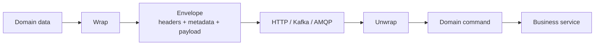
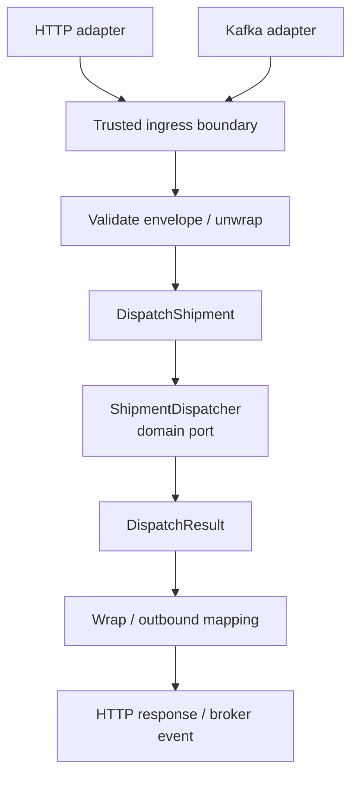
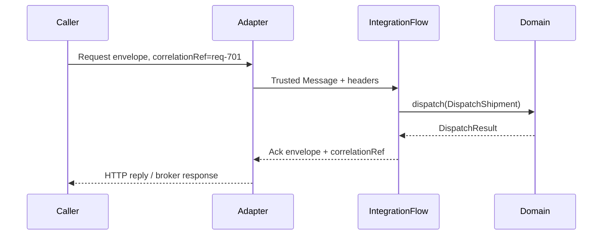
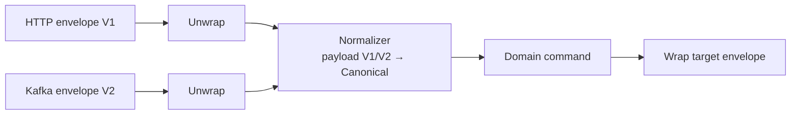
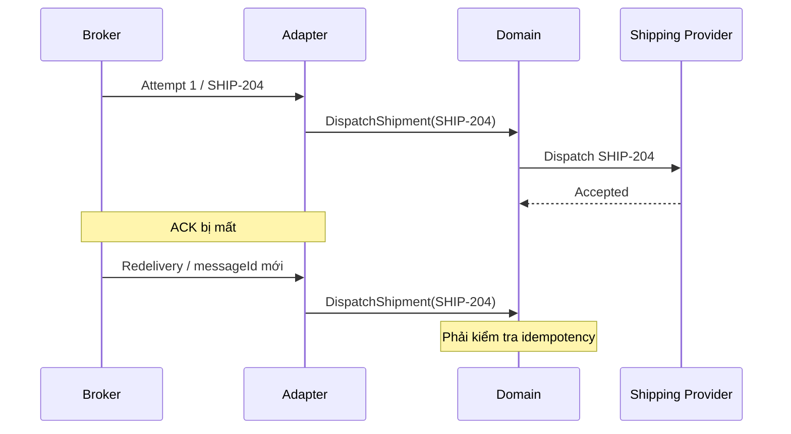

# Không để domain logic phụ thuộc transport envelope

## 1. Bài toán: đổi Kafka thành HTTP mà domain cũng phải đổi

Một dịch vụ điều phối giao hàng nhận cùng một loại yêu cầu từ hai nguồn:

- HTTP API của ứng dụng bán hàng.
- Kafka topic của hệ thống quản lý đơn hàng.

Ở đường HTTP, bên gửi sử dụng envelope JSON:

```json
{
  "type": "SHIPMENT_REQUEST",
  "schemaVersion": "1",
  "messageId": "http-msg-101",
  "claimedTenantId": "tenant-A",
  "traceRef": "trace-701",
  "data": {
    "shipmentRequestId": "SHIP-204",
    "orderId": "ORD-204",
    "countryCode": "VN",
    "weightGrams": 1200
  }
}
```

Cùng yêu cầu đi qua Kafka có thêm metadata của broker:

```text
topic = shipments.requested
partition = 3
offset = 9012
key = SHIP-204
headers:
  trace-id = trace-701

value:
  type = SHIPMENT_REQUEST
  schemaVersion = 1
  messageId = kafka-msg-802
  data = { shipmentRequestId: SHIP-204, ... }
```

Nếu domain service nhận `ConsumerRecord<?,?>`, `HttpServletRequest` hoặc toàn bộ message envelope rồi tự lấy offset, tenant, trace, order, nó bị **buộc vào transport**. Chỉ một thay đổi từ Kafka sang AMQP, SQS hoặc HTTP cũng có thể khiến business code cần sửa.

```java
// Anti-pattern: nghiệp vụ biết Kafka ConsumerRecord.
void dispatch(
        org.apache.kafka.clients.consumer.ConsumerRecord<String, String>
            record) {

    String body = record.value();
    long offset = record.offset();
    // Parse JSON, kiểm tra broker metadata rồi mới xử lý đơn.
}
```

Hệ quả:

1. Mọi unit test nghiệp vụ phải dựng header, record hoặc adapter fixture.
2. Domain import thư viện messaging mà không phục vụ business rule.
3. Một delivery ID mới khi retry có thể bị nhầm với business operation ID.
4. Dễ dựa vào header chưa xác thực để quyết định quyền tenant.
5. Thay đổi envelope schema có thể làm hỏng use case không liên quan.
6. Domain khó được gọi lại qua CLI, batch job, HTTP và broker bằng cùng một contract.

Giải pháp: **giữ Envelope Wrapper ở lớp tích hợp**, tháo envelope ở biên nhận trước khi gọi domain, và chỉ bọc kết quả lại thành envelope ở biên gửi.

Bài **“Không để domain logic phụ thuộc transport envelope”** thuộc chương **Envelope wrapper** của module **SPRING_INTEGRATION_PATTERN**. Module hướng dẫn triển khai Enterprise Integration Patterns bằng Spring Integration để xây dựng các luồng message ít phụ thuộc, dễ mở rộng; thực hành Router, Filter, Transformer, Splitter, Aggregator, Gateway, retry, error channel, correlation, cùng kiểm thử và theo dõi các nhánh xử lý.

Sau bài này, bạn có thể:

- Phân biệt transport metadata, integration envelope và domain payload.
- Dùng Envelope Wrapper để gửi message qua hạ tầng mà không tạo phụ thuộc từ domain tới transport.
- Viết luồng Spring Integration **validate → unwrap → domain → wrap**.
- Thiết kế trusted tenant, business ID, correlation, trace và schema version ở đúng lớp.
- Kiểm thử cùng business command dù envelope HTTP/Kafka chứa các delivery ID khác nhau.
- Phân tích retry, idempotency, outbox, error channel, schema evolution và header propagation.
- Chọn đúng giữa Envelope Wrapper, Normalizer, Transformer, Content Enricher, Claim Check và Aggregator.

## 2. Envelope Wrapper trong Enterprise Integration Patterns

**Envelope Wrapper** đóng một thông điệp ứng dụng vào lớp vỏ tương thích với hạ tầng hoặc giao thức trao đổi. Ở bên nhận, lớp vỏ được tháo hoặc chuyển đổi, đưa dữ liệu ứng dụng tới bộ xử lý phù hợp.



Một envelope có thể chứa:

- `messageType` và `schemaVersion`.
- Trace, request ID, correlation hoặc reply-to.
- Metadata nguồn, nội dung được mã hóa và content type.
- Message ID của một lần phát/giao.
- Payload và thông tin cần để receiver deserialize.

**Không phải envelope nào cũng có tất cả các trường này**, và EIP không yêu cầu một lớp Java tên chính xác `EnvelopeWrapper`. Envelope có thể là JSON object, CloudEvents, protocol frame, Spring Message headers hoặc một wire format khác.

Lớp vỏ phục vụ **trao đổi**, không phải mặc định là một phần của **ngữ nghĩa nghiệp vụ**.

### Wrapper không phải là bằng chứng bảo mật

```text
claimedTenantId = tenant-A
traceRef = trace-701
```

Hai trường trên chỉ là dữ liệu do sender cung cấp. Nếu sender không được xác thực hoặc có thể sửa header, domain không được tin chúng để cấp quyền. Adapter cần kiểm chứng nguồn và tạo một **trusted application context** trước khi gọi use case.

## 3. Ba lớp dễ bị trộn lẫn

| Lớp | Nội dung điển hình | Ai sở hữu? | Domain cần biết? |
| --- | --- | --- | --- |
| **Transport mechanics** | HTTP header/status, Kafka topic/offset, AMQP delivery tag, ACK | Adapter/broker | Thường không |
| **Integration envelope** | Type, version, trace, correlation, replyTo, contentEncoding | Messaging/integration contract | Chỉ phần mang ngữ nghĩa được chuyển thành field có kiểu |
| **Domain payload** | Shipment request, order ID, destination, weight | Domain/application | Có, theo use case |

Một số thông tin xuất phát ở header nhưng **thực sự có nghĩa nghiệp vụ**, ví dụ tenant đã xác thực, business operation ID hoặc event ID ổn định. Chúng có thể được đưa vào command/event có kiểu. Nhưng domain không nên biết chúng được trích từ header HTTP, Kafka hay AMQP nào.

### Ba ID khác nhau

```text
Delivery message ID     = kafka-msg-802
Request/reply correlation= req-701
Business operation ID   = SHIP-204
```

Delivery ID có thể thay khi publish hoặc broker redeliver. Correlation ID dùng nối một cuộc hội thoại yêu cầu–phản hồi. Operation ID xác định một **hành động nghiệp vụ**. Chúng có thể trùng trong một protocol cụ thể, nhưng không được tự đồng nhất.

## 4. Spring Message không nên trở thành domain object

Spring Integration truyền dữ liệu bằng `Message<T>`:

```text
Message<T>
  payload = T
  headers = MessageHeaders
```

Đây là abstraction tiện lợi cho IntegrationFlow. Trong lớp boundary, xử lý `Message<?>`, headers, replyChannel và errorChannel hoàn toàn bình thường.

Không nên bắt **mọi method nghiệp vụ** có signature:

```java
// Phụ thuộc vào Spring messaging ở domain.
DispatchResult dispatch(
        org.springframework.messaging.Message<ShipmentWireBody>
            message);
```

Thay bằng một port thuần Java:

```java
DispatchResult dispatch(DispatchShipment command);
```

Bản thân Spring `Message<?>` cũng không đồng nghĩa với envelope trên wire. HTTP/Kafka adapter còn phải serialize payload và map headers. Không được dựa vào giả định mọi header từ JVM sẽ được giữ nguyên qua network.

**Ranh giới thiết kế:** IntegrationFlow có thể dùng Message API; domain model và domain port nên được gọi/kiểm thử mà không phải import transport/framework API.

## 5. Sơ đồ ports and adapters



Trách nhiệm:

1. **Inbound adapter:** nhận message, authenticate producer, xác định tenant, deserialize, kiểm soát payload size và protocol version.
2. **Boundary mapper:** validate integration envelope, chuyển wire data sang command có kiểu.
3. **Domain/application service:** kiểm tra business rule, authorization đối với entity và thực hiện use case.
4. **Outbound adapter:** tạo envelope/schema phù hợp consumer, chọn topic/status, serialize và publish/reply.
5. **Infrastructure:** quản lý ACK, timeout, DLQ, transaction, message store, retry và observability.

Không nhất thiết tách thành năm repository. Điều quan trọng là **hướng phụ thuộc**: adapter biết domain port; domain không phải biết Kafka/HTTP.

## 6. Domain command thuần Java

Chúng ta triển khai yêu cầu giao hàng có cấu trúc:

```java
record DispatchShipment(
        String tenantId,
        String shipmentRequestId,
        String orderId,
        String countryCode,
        int weightGrams) {}

record DispatchResult(
        String tenantId,
        String shipmentRequestId,
        String orderId,
        String status) {}
```

Nghĩa từng trường:

- `tenantId` là tenant đã được xác thực và có liên quan tới quyền xử lý đơn.
- `shipmentRequestId` là stable ID của **một business command**, cần giữ qua retry.
- `orderId` và `countryCode` là dữ liệu nghiệp vụ.
- `weightGrams` là dữ kiện của chính shipment.
- `status` là kết quả ứng dụng.

Không có Kafka topic, offset, AMQP delivery tag, raw HTTP body, trace span hoặc HTTP status code.

**Domain vẫn phải có invariant/authorization**. Tách envelope không đồng nghĩa bỏ kiểm tra dữ liệu, quyền tenant, trạng thái đơn hàng hay quota.

### Một lệnh, nhiều lần giao

```text
HTTP attempt 1:
  messageId=http-101
  shipmentRequestId=SHIP-204

Kafka redelivery:
  messageId=kafka-205
  shipmentRequestId=SHIP-204
```

Sau unwrap, domain nhận cùng command. Nhưng việc nó không thực hiện side effect hai lần **phải do cơ chế idempotency**, không phải do Envelope Wrapper tự bảo đảm.

## 7. DTO lớp vỏ ở integration boundary

Ví dụ wire schema của một partner:

```java
record ShipmentWireBody(
        String shipmentRequestId,
        String orderId,
        String countryCode,
        long weightGrams) {}

record ShipmentTransportEnvelope(
        String messageType,
        String schemaVersion,
        String messageId,
        String claimedTenantId,
        String traceRef,
        ShipmentWireBody data) {}
```

Wrapper nội bộ từ **adapter đã xác thực**:

```java
record AuthenticatedShipmentIngress(
        String verifiedTenantId,
        ShipmentTransportEnvelope envelope) {}
```

Lưu ý:

- `ShipmentTransportEnvelope` là **untrusted wire data**, dù đã deserialize thành Java record.
- `claimedTenantId` không có quyền tự cấp.
- `verifiedTenantId` phải được tạo từ identity/ACL/mTLS/JWT đã xác minh tại adapter.
- Domain không lấy tenant từ `claimedTenantId` nếu chưa so với source of truth.
- `messageId` thuộc envelope, không phải business operation ID.
- `traceRef` chỉ phục vụ quan sát, không phải cơ sở xác thực hay idempotency.

Nếu client có thể trực tiếp gửi `AuthenticatedShipmentIngress` vào public endpoint, tên record “Authenticated” không mang lại bảo mật. Internal channel phải bị giới hạn cho trusted adapter.

## 8. Đóng gói kết quả ở chiều ra

Domain trả `DispatchResult`. Outbound adapter cần trả một wire envelope riêng:

```java
record ShipmentAckBody(
        String shipmentRequestId,
        String status) {}

record ShipmentAckEnvelope(
        String messageType,
        String schemaVersion,
        String messageId,
        String correlationRef,
        String traceRef,
        ShipmentAckBody data) {}
```

Response JSON minh họa:

```json
{
  "messageType": "SHIPMENT_ACK",
  "schemaVersion": "1",
  "messageId": "ack-delivery-901",
  "correlationRef": "SHIP-204",
  "traceRef": "trace-701",
  "data": {
    "shipmentRequestId": "SHIP-204",
    "status": "SIMULATED_ACCEPTED"
  }
}
```

Việc tạo outbound message ID mới là bình thường. **Không đưa nó ngược vào domain result** rồi gọi đó là định danh nghiệp vụ.

Nếu caller cần request/reply correlation ID khác `shipmentRequestId`, outbound adapter phải map từ trusted integration context đã được lưu, chứ không tự dùng một ID khác theo cảm tính.

## 9. Mapper: validate envelope rồi unwrap

Chúng ta dùng một mapper độc lập Spring Messaging. Nó kiểm tra **hợp đồng đầu vào và trusted tenant**, sau đó chuyển payload sang command.

```java
import java.util.UUID;

final class ShipmentEnvelopeMapper {

    boolean canUnwrap(AuthenticatedShipmentIngress input) {
        if (input == null
                || blank(input.verifiedTenantId())
                || input.envelope() == null) {
            return false;
        }

        ShipmentTransportEnvelope envelope = input.envelope();

        if (!"SHIPMENT_REQUEST".equals(
                envelope.messageType())
                || !"1".equals(envelope.schemaVersion())
                || blank(envelope.messageId())
                || !input.verifiedTenantId().equals(
                    envelope.claimedTenantId())
                || envelope.data() == null) {
            return false;
        }

        ShipmentWireBody body = envelope.data();

        return validId(body.shipmentRequestId())
            && validId(body.orderId())
            && ("VN".equals(body.countryCode())
                || "SG".equals(body.countryCode()))
            && body.weightGrams() > 0
            && body.weightGrams() <= 25_000L;
    }

    // Chỉ gọi trong flow sau canUnwrap() thành công.
    DispatchShipment unwrap(AuthenticatedShipmentIngress input) {
        ShipmentWireBody body = input.envelope().data();

        return new DispatchShipment(
            input.verifiedTenantId(),
            body.shipmentRequestId(),
            body.orderId(),
            body.countryCode(),
            Math.toIntExact(body.weightGrams()));
    }

    ShipmentAckEnvelope wrap(
            DispatchResult result,
            Object traceValue) {

        return new ShipmentAckEnvelope(
            "SHIPMENT_ACK",
            "1",
            UUID.randomUUID().toString(),
            result.shipmentRequestId(),
            safeTraceRef(traceValue),
            new ShipmentAckBody(
                result.shipmentRequestId(),
                result.status()));
    }

    static String safeTraceRef(Object value) {
        if (value instanceof String text
                && text.matches("[A-Za-z0-9._:-]{1,64}")) {
            return text;
        }
        return "untracked";
    }

    private static boolean validId(String value) {
        return value != null
            && value.matches("[A-Z0-9-]{1,40}");
    }

    private static boolean blank(String value) {
        return value == null || value.isBlank();
    }
}
```

### Vì sao Filter trước Mapper?

Ví dụ sẽ dùng `canUnwrap()` ở ingress Filter. Khi pass, `unwrap()` không chạy lại toàn bộ regex. Đây là pipeline đồng bộ với input DTO bất biến theo các trường `String/long`.

Nếu `unwrap()` là public API được nhiều caller dùng độc lập, nên cung cấp một phương thức `parseAndValidate()` trả typed result hoặc ném typed exception; đừng buộc caller nhớ rằng phải gọi `canUnwrap()` trước.

### Hai loại ID trong wrap

- `messageId` được sinh mới, dành cho outbound envelope/delivery.
- `correlationRef` dùng `shipmentRequestId` theo **hợp đồng demo**.

Nếu quy trình dùng request/reply correlation khác business operation, hãy lấy nó từ context tin cậy, không gộp bừa hai ID.

### TraceRef không quyết định quyền

`safeTraceRef()` chỉ ràng buộc định dạng để hạn chế log/header injection; nó không chứng minh trace đã được một nguồn đáng tin cấp. Adapter thực cần tuân thủ tracing/security policy, thường dùng W3C Trace Context hoặc cách propagation có chuẩn.

## 10. Domain port không có import Spring/Kafka

Interface:

```java
interface ShipmentDispatcher {
    DispatchResult dispatch(DispatchShipment command);
}
```

Một implementation demo:

```java
import java.util.concurrent.atomic.AtomicInteger;

final class FakeShipmentDispatcher implements ShipmentDispatcher {

    private final AtomicInteger attempts =
        new AtomicInteger();

    @Override
    public DispatchResult dispatch(DispatchShipment command) {
        attempts.incrementAndGet();

        return new DispatchResult(
            command.tenantId(),
            command.shipmentRequestId(),
            command.orderId(),
            "SIMULATED_ACCEPTED");
    }

    int attempts() {
        return attempts.get();
    }
}
```

Domain handler chỉ nhận một command thuần Java:

```java
DispatchResult result = dispatcher.dispatch(
    new DispatchShipment(
        "tenant-A", "SHIP-204", "ORD-204", "VN", 1200));
```

Unit test domain không cần broker, servlet, Kafka ConsumerRecord, MessageHeaders hoặc JSON. Một use case khác có thể gọi lại cùng port từ batch/CLI mà không phải tạo envelope giả.

**Chú ý:** Fake handler chỉ đếm lần gọi và trả kết quả mô phỏng. Nó chưa có idempotency hoặc side effect thật. Không dùng nó để chứng minh “exactly once”.

## 11. Spring Integration Java DSL: từ envelope tới domain

Sơ đồ:

```text
shipping.transport.in
    ↓
Filter: validate wire envelope + trusted tenant
    ├── reject → shipping.transport.rejected
    └── pass
          ↓
Transformer: AuthenticatedShipmentIngress → DispatchShipment
          ↓
Service Activator: ShipmentDispatcher.dispatch(command)
          ↓
Outbound wrapper: DispatchResult → ShipmentAckEnvelope
          ↓
shipping.transport.ack
```

Cấu hình Spring Integration Java DSL:

```java
import org.springframework.context.annotation.Bean;
import org.springframework.context.annotation.Configuration;
import org.springframework.integration.channel.DirectChannel;
import org.springframework.integration.channel.QueueChannel;
import org.springframework.integration.config.EnableIntegration;
import org.springframework.integration.dsl.IntegrationFlow;

@Configuration
@EnableIntegration
public class ShipmentEnvelopeFlowConfig {

    @Bean
    ShipmentEnvelopeMapper shipmentEnvelopeMapper() {
        return new ShipmentEnvelopeMapper();
    }

    @Bean
    FakeShipmentDispatcher fakeShipmentDispatcher() {
        return new FakeShipmentDispatcher();
    }

    @Bean("shipping.transport.in")
    DirectChannel transportInput() {
        return new DirectChannel();
    }

    @Bean("shipping.transport.rejected")
    QueueChannel rejectedInput() {
        return new QueueChannel();
    }

    @Bean("shipping.transport.ack")
    QueueChannel outboundAck() {
        return new QueueChannel();
    }

    @Bean
    IntegrationFlow shipmentEnvelopeFlow(
            ShipmentEnvelopeMapper mapper,
            FakeShipmentDispatcher dispatcher) {

        return IntegrationFlow.from("shipping.transport.in")
            .filter(
                AuthenticatedShipmentIngress.class,
                mapper::canUnwrap,
                spec -> spec.discardChannel(
                    "shipping.transport.rejected"))
            .transform(
                AuthenticatedShipmentIngress.class,
                mapper::unwrap)
            .handle(
                DispatchShipment.class,
                (command, headers) ->
                    dispatcher.dispatch(command))
            .handle(
                DispatchResult.class,
                (result, headers) ->
                    mapper.wrap(
                        result,
                        headers.get("trustedTraceRef")))
            .channel("shipping.transport.ack")
            .get();
    }
}
```

### Vai trò của từng endpoint

| Endpoint | Nhận | Trả | Trách nhiệm |
| --- | --- | --- | --- |
| Filter | AuthenticatedShipmentIngress | Accept/reject | Bảo vệ boundary |
| Transformer | AuthenticatedShipmentIngress | DispatchShipment | Bỏ lớp vỏ, tạo domain command |
| Service Activator | DispatchShipment | DispatchResult | Gọi business port |
| Outbound wrapper | DispatchResult + trusted header | ShipmentAckEnvelope | Tạo schema gửi đi |
| Output channel | ShipmentAckEnvelope | Message chờ consumer | Đưa sang adapter response/publisher |

Hai `handle(...)` có vai trò khác nhau: một gọi domain, một là **outbound integration mapper** có thể đọc header. Domain vẫn không nhìn thấy traceRef hay MessageHeaders.

### Vì sao không dùng Kafka adapter trong ví dụ?

Bài học tập trung vào Envelope Wrapper, nên test kênh nội bộ bằng `DirectChannel` và `QueueChannel`, không cần broker. Khi thêm Kafka/HTTP thực, adapter chịu trách nhiệm:

- Authentication/authorization và source identity.
- Parse/serialize, header mapping.
- Commit offset/ACK, retry và DLQ.
- Đưa verified tenant và trusted trace context vào message nội bộ.

`QueueChannel` demo không phải durable queue. Đừng diễn giải test pass là đã xử lý crash/restart.

### Kiểm tra version Spring Integration

Code sử dụng Java 17+ và các overload Java DSL thường gặp cho `filter`, `transform` và `handle`. Khi áp dụng vào dự án thật, phải đối chiếu API/overload theo dependency cụ thể. Trong STEP 4, chưa chạy build hoặc vòng Content QA chuyên môn.

## 12. Header kỹ thuật được giữ bên ngoài domain

Trong ví dụ, `trustedTraceRef` là header Spring do adapter nội bộ có quyền thêm vào:

```text
Input Message:
  payload = AuthenticatedShipmentIngress(...)
  header.trustedTraceRef = trace-http-1

Sau Transformer:
  payload = DispatchShipment(...)
  header.trustedTraceRef = trace-http-1

Domain:
  dispatch(DispatchShipment)
  không đọc traceRef

Outbound:
  ShipmentAckEnvelope.traceRef = trace-http-1
```

Spring Integration thường truyền/copy các header khi Transformer trả payload, nhưng không nên **giả định mọi Header luôn giữ nguyên** khi:

- Transformer tự tạo Message mới.
- Header Enricher ghi đè.
- Message đi qua Kafka/AMQP/HTTP mapper.
- Channel chuyển từ JVM object sang serialization.
- Gateway/adapter bỏ các header không serializable.
- Hệ thống dùng một envelope khác có schema header riêng.

Test cần kiểm tra những header có ý nghĩa: correlation, event ID, tracing, trusted tenant, reply routing và schema provenance.

**Không serialize `replyChannel` hoặc `errorChannel` object Spring qua network.** Cần reply-to destination/correlation có hợp đồng transport rõ.

## 13. Unit test: hai envelope ID khác nhau tạo cùng domain command

Kiểm thử thuần Java:

```java
import static org.assertj.core.api.Assertions.assertThat;

import org.junit.jupiter.api.Test;

class ShipmentEnvelopeMapperTest {

    private final ShipmentEnvelopeMapper mapper =
        new ShipmentEnvelopeMapper();

    private AuthenticatedShipmentIngress inbound(
            String messageId,
            String traceRef) {

        ShipmentTransportEnvelope wire =
            new ShipmentTransportEnvelope(
                "SHIPMENT_REQUEST",
                "1",
                messageId,
                "tenant-A",
                traceRef,
                new ShipmentWireBody(
                    "SHIP-204", "ORD-204", "VN", 1200));

        return new AuthenticatedShipmentIngress(
            "tenant-A", wire);
    }

    @Test
    void differentDeliveryEnvelopesCreateSameDomainCommand() {
        AuthenticatedShipmentIngress http =
            inbound("delivery-http-1", "trace-http-1");

        AuthenticatedShipmentIngress kafka =
            inbound("delivery-kafka-2", "trace-kafka-2");

        assertThat(mapper.canUnwrap(http)).isTrue();
        assertThat(mapper.canUnwrap(kafka)).isTrue();

        DispatchShipment a = mapper.unwrap(http);
        DispatchShipment b = mapper.unwrap(kafka);

        assertThat(a).isEqualTo(b);
        assertThat(a.shipmentRequestId()).isEqualTo("SHIP-204");
        assertThat(a.tenantId()).isEqualTo("tenant-A");
    }

    @Test
    void outboundWrapperAddsTechnicalFields() {
        DispatchResult result = new DispatchResult(
            "tenant-A", "SHIP-204", "ORD-204", "OK");

        ShipmentAckEnvelope ack =
            mapper.wrap(result, "trace-701");

        assertThat(ack.messageType()).isEqualTo("SHIPMENT_ACK");
        assertThat(ack.schemaVersion()).isEqualTo("1");
        assertThat(ack.messageId()).isNotBlank();
        assertThat(ack.correlationRef()).isEqualTo("SHIP-204");
        assertThat(ack.traceRef()).isEqualTo("trace-701");
        assertThat(ack.data().shipmentRequestId())
            .isEqualTo("SHIP-204");
    }

    @Test
    void traceMetadataCannotInjectNewHeaderLines() {
        ShipmentAckEnvelope ack = mapper.wrap(
            new DispatchResult(
                "tenant-A", "SHIP-204", "ORD-204", "OK"),
            "evil\nheader-injection");

        assertThat(ack.traceRef()).isEqualTo("untracked");
    }

    @Test
    void claimedTenantAndVerifiedTenantMustMatch() {
        AuthenticatedShipmentIngress bad =
            new AuthenticatedShipmentIngress(
                "tenant-B",
                inbound("delivery-1", "trace-1")
                    .envelope());

        assertThat(mapper.canUnwrap(bad)).isFalse();
    }

    @Test
    void unsupportedVersionIsRejected() {
        ShipmentTransportEnvelope wire =
            new ShipmentTransportEnvelope(
                "SHIPMENT_REQUEST", "99", "m-99",
                "tenant-A", "trace-99",
                new ShipmentWireBody(
                    "SHIP-204", "ORD-204", "VN", 1200));

        assertThat(mapper.canUnwrap(
            new AuthenticatedShipmentIngress(
                "tenant-A", wire))).isFalse();
    }
}
```

### Test bảo vệ điều gì?

- Header trace/delivery ID thay đổi không làm đổi command nghiệp vụ.
- Mapper chỉ tạo domain command sau khi envelope và scope hợp lệ.
- Domain không nhận technical delivery ID.
- Outbound wrapper có thể thêm schema/message ID mới.
- Trường claimed tenant không được quyền vượt qua identity đã xác thực.
- Schema version không hỗ trợ bị từ chối, thay vì cố suy đoán.

**Test không chứng minh authentication thật.** `verifiedTenantId` trong fixture là giá trị test cung cấp, không phải một security subsystem. Production cần contract test với adapter và identity provider.

## 14. Integration test: Filter → domain handler → wrapper

Dùng JUnit 5, Spring Test và AssertJ:

```java
import static org.assertj.core.api.Assertions.assertThat;

import org.junit.jupiter.api.Test;
import org.springframework.beans.factory.annotation.Autowired;
import org.springframework.beans.factory.annotation.Qualifier;
import org.springframework.integration.channel.QueueChannel;
import org.springframework.messaging.Message;
import org.springframework.messaging.MessageChannel;
import org.springframework.messaging.support.MessageBuilder;
import org.springframework.test.context.junit.jupiter.SpringJUnitConfig;

@SpringJUnitConfig(ShipmentEnvelopeFlowConfig.class)
class ShipmentEnvelopeFlowTest {

    @Autowired
    @Qualifier("shipping.transport.in")
    MessageChannel input;

    @Autowired
    @Qualifier("shipping.transport.rejected")
    QueueChannel rejected;

    @Autowired
    @Qualifier("shipping.transport.ack")
    QueueChannel ack;

    @Autowired
    FakeShipmentDispatcher dispatcher;

    private AuthenticatedShipmentIngress request(
            String claimedTenant,
            String shipmentId,
            long weight) {

        return new AuthenticatedShipmentIngress(
            "tenant-A",
            new ShipmentTransportEnvelope(
                "SHIPMENT_REQUEST", "1",
                "delivery-" + shipmentId,
                claimedTenant, "untrusted-trace",
                new ShipmentWireBody(
                    shipmentId, "ORD-204", "VN", weight)));
    }

    private void send(
            AuthenticatedShipmentIngress payload,
            String trustedTrace) {

        Message<AuthenticatedShipmentIngress> message =
            MessageBuilder.withPayload(payload)
                .setHeader("trustedTraceRef", trustedTrace)
                .build();

        assertThat(input.send(message)).isTrue();
    }

    @Test
    void validEnvelopeProducesAckWithoutExposingHeadersToDomain() {
        int before = dispatcher.attempts();

        send(request("tenant-A", "SHIP-204", 1200),
            "trace-http-204");

        Message<?> message = ack.receive(1_000);
        assertThat(message).isNotNull();
        assertThat(message.getPayload())
            .isInstanceOf(ShipmentAckEnvelope.class);

        ShipmentAckEnvelope body =
            (ShipmentAckEnvelope) message.getPayload();

        assertThat(body.messageType()).isEqualTo("SHIPMENT_ACK");
        assertThat(body.correlationRef()).isEqualTo("SHIP-204");
        assertThat(body.traceRef()).isEqualTo("trace-http-204");
        assertThat(body.data().shipmentRequestId())
            .isEqualTo("SHIP-204");

        assertThat(dispatcher.attempts() - before).isEqualTo(1);
        assertThat(rejected.receive(0)).isNull();
        assertThat(ack.receive(0)).isNull();
    }

    @Test
    void tenantMismatchIsRejectedBeforeDomainHandler() {
        int before = dispatcher.attempts();

        send(request("tenant-B", "SHIP-205", 1200),
            "trace-invalid");

        assertThat(rejected.receive(1_000)).isNotNull();
        assertThat(ack.receive(0)).isNull();
        assertThat(dispatcher.attempts() - before).isZero();
    }

    @Test
    void invalidBodyIsRejectedBeforeDomainHandler() {
        int before = dispatcher.attempts();

        send(request("tenant-A", "SHIP-206", -1),
            "trace-invalid");

        assertThat(rejected.receive(1_000)).isNotNull();
        assertThat(ack.receive(0)).isNull();
        assertThat(dispatcher.attempts() - before).isZero();
    }

    @Test
    void outboundMessageIdDoesNotReplaceBusinessId() {
        send(request("tenant-A", "SHIP-207", 400),
            "trace-207");

        ShipmentAckEnvelope body =
            (ShipmentAckEnvelope) ack.receive(1_000)
                .getPayload();

        assertThat(body.messageId()).isNotBlank();
        assertThat(body.correlationRef()).isEqualTo("SHIP-207");
        assertThat(body.messageId())
            .isNotEqualTo(body.correlationRef());
    }
}
```

**Test wiring, không phải kiểm thử broker thật:** dùng `DirectChannel` đồng bộ và `QueueChannel` để quan sát. Nếu chạy song song các test cùng Spring context, cần cô lập queue/fixture. Không được suy rằng queue demo có thể survive restart hoặc đã ACK ở broker.

### Test nào nên bổ sung?

- JSON wire thật có `data=null`, field thiếu hoặc sai type.
- HTTP authentication và Kafka producer/ACL thực.
- Header mapper qua transport serialization.
- Version V2 cùng tồn tại với V1.
- Message size/timeout, corrupt envelope, schema negotiation.
- Duplicate delivery sau khi provider đã commit.
- Multi-instance, durable ledger, ACK và crash recovery.
- Authorization đối với order thực tế, không chỉ kiểm tra claimed tenant.

## 15. Một domain command nhận được từ nhiều transport

Hai ingress adapters có thể làm khác nhau ở phần xác thực/deserialize nhưng cùng xuất một object nội bộ:

```text
HTTP endpoint
   → JWT/mTLS verification
   → JSON deserializer
   → AuthenticatedShipmentIngress
   ┐
   ├──► shipping.transport.in
   ┘
Kafka listener
   → trusted producer/topic/schema verification
   → record deserializer
   → AuthenticatedShipmentIngress
```

Pseudocode adapter:

```java
// Những tham số "verified" phải do security subsystem tạo.
AuthenticatedShipmentIngress fromHttp(
        String verifiedTenant,
        ShipmentTransportEnvelope parsedBody) {

    return new AuthenticatedShipmentIngress(
        verifiedTenant, parsedBody);
}

AuthenticatedShipmentIngress fromBroker(
        String authorizedProducerTenant,
        ShipmentTransportEnvelope deserializedValue) {

    return new AuthenticatedShipmentIngress(
        authorizedProducerTenant, deserializedValue);
}
```

Đây là pseudocode **sau authentication**, không phải code xác thực hoàn chỉnh. Domain không cần biết hai source dùng JWT, topic ACL hay mTLS.

Khi đổi transport, thay **adapter và mapping**, không thay `ShipmentDispatcher.dispatch(DispatchShipment)`.

## 16. Domain command, domain event và envelope khác nhau

| Khái niệm | Ví dụ | Mục đích |
| --- | --- | --- |
| Domain command | `DispatchShipment` | Yêu cầu thực hiện một hành động |
| Domain event | `ShipmentDispatched` | Thông báo một sự kiện đã xảy ra |
| Transport envelope | `ShipmentTransportEnvelope` | Đóng gói khi truyền đi |
| Spring Message | `Message<DispatchShipment>` | Message abstraction trong integration flow |

Một domain event có thể mang **logical event ID** ổn định khi được publish lại. Một envelope có **message/delivery ID mới** cho mỗi lần gửi. Một command có **business operation ID** ổn định khi client retry.

Không đồng nhất:

```text
deliveryMessageId = logicalEventId = businessOperationId
```

trừ khi protocol đã quy định cụ thể quan hệ đó và kiểm thử được.

### Khi domain cần eventId thì sao?

Một event processor có thể cần logical event ID để tránh áp dụng cùng event hai lần. Hãy cho event có field `eventId` dưới dạng value object/string có nghĩa nghiệp vụ. Không đưa Kafka offset hoặc một UUID mới của mỗi delivery làm event ID.

## 17. Correlation và request–reply ở lớp tích hợp

Một Gateway request–reply có thể cần `correlationId`, `replyTo`, `replyTimeout` và trace context.



Nếu request/reply correlation thực sự khác business operation ID, giữ nó ở **trusted messaging context** và map lại ở outbound boundary. Domain chỉ cần business identity, không cần biết caller đang chờ ở HTTP request nào.

**Không gửi object Spring `replyChannel` qua broker.** Khi dùng Kafka/AMQP phải có reply topic/address và correlation contract phù hợp.

### Header propagation có giới hạn

Một Transformer trả payload thường giữ ngữ cảnh headers trong Spring Integration, nhưng:

- Tự tạo một Message mới có thể làm mất headers.
- HTTP/Kafka/AMQP adapter có header mapper riêng.
- Không phải mọi header Java serializable qua transport.
- Header do client gửi có thể bị giả mạo.
- Một field như traceparent cần validation/propagation đúng spec.

Do đó, **kiểm thử header cần thiết tại boundary**, không dựa vào giả định “Spring luôn copy hết”.

## 18. Envelope Wrapper và Normalizer

**Envelope Wrapper** xử lý *lớp vỏ truyền tin*. **Normalizer** xử lý *nhiều payload schemas khác nhau nhưng cùng ý nghĩa*.



Một schema v2 chỉ bổ sung trace metadata **không buộc domain đổi**, có thể chỉ cần nâng envelope adapter.

Nếu payload V2 đổi `weightGrams` thành `weightKg`, mapper phải áp dụng conversion contract; có thể dùng Normalizer để hỗ trợ nhiều schema cùng lúc.

| Vấn đề | Kỹ thuật |
| --- | --- |
| Đóng/gỡ lớp vỏ transport | Envelope Wrapper |
| Đổi một biểu diễn payload | Transformer |
| Nhiều schema cùng nghĩa về một chuẩn | Normalizer |
| Chọn endpoint theo message type | Router |
| Kiểm tra accept/reject | Filter/validation |
| Bổ sung dữ liệu từ API ngoài | Content Enricher |
| Payload lớn, chỉ gửi reference | Claim Check |
| Gom nhiều reply thành summary | Aggregator/Scatter-Gather |
| Chặn business side effect lặp | Idempotent Receiver |

Normalizing và wrapping có thể cùng dùng Spring Integration Transformers, nhưng **chúng không thay thế nhau**.

## 19. Header Enricher khác Envelope Wrapper

Spring Integration Header Enricher có thể thêm/sửa header trong `Message<?>`:

```java
// Minh họa Java DSL, chưa phải một flow hoàn chỉnh.
.enrichHeaders(spec ->
    spec.header("sourceSystem", "PARTNER_ALPHA"))
```

Đây là thao tác **metadata trên message nội bộ**. Envelope Wrapper rộng hơn: đôi khi cần tạo một **JSON frame có messageType, schemaVersion, data**, hoặc một CloudEvent với metadata được đóng gói theo chuẩn.

Một hệ thống có thể phát:

```text
Kafka headers:
  type = SHIPMENT_ACK
  version = 1

Kafka value:
  { "shipmentRequestId": "SHIP-204", "status": "ACCEPTED" }
```

hoặc:

```json
{
  "type": "SHIPMENT_ACK",
  "schemaVersion": "1",
  "data": {
    "shipmentRequestId": "SHIP-204",
    "status": "ACCEPTED"
  }
}
```

Chọn theo contract của consumer, không cho domain tự quyết định.

## 20. Envelope Wrapper và Claim Check

Nếu payload lớn, có thể lưu payload vào kho và gửi claim reference:

```text
Large domain document
   ↓ Claim Check In
Store document
   ↓
Envelope(data={claimId:"CC-204"})
   ↓ broker
Claim Check Out
   ↓ Domain content
```

Nhưng Claim Check đưa thêm yêu cầu:

- Store cần bền vững qua restart/multi-instance nếu SLA yêu cầu.
- TTL phải bao phủ queue delay, retry và DLQ replay.
- Claim token phải được authorize theo tenant/resource.
- One-time consume cần recovery nếu crash trước business commit.
- Không coi claim hết hạn là dữ liệu nghiệp vụ mặc định hợp lệ.

Envelope Wrapper không bảo đảm token trỏ tới payload còn tồn tại. Phải có **claim lifecycle, retention và recovery** phù hợp.

## 21. Idempotency: envelope ID không phải operation ID

Giả sử cùng một lệnh giao hàng được gửi lại:

```text
Delivery 1:
  envelope.messageId = kafka-101
  data.shipmentRequestId = SHIP-204

Delivery 2:
  envelope.messageId = kafka-205
  data.shipmentRequestId = SHIP-204
```

Hai lần unwrap tạo cùng command, nhưng nếu handler trực tiếp gọi Shipping Provider hai lần thì vẫn có **hai side effects**.

Key đúng hơn:

```text
idempotencyKey = (tenantId, DISPATCH, shipmentRequestId)
```

Một hệ thống production cần:

1. Định danh operation ổn định xuyên retry.
2. Atomic claim/unique constraint trong ledger dùng chung.
3. Trạng thái `PROCESSING`, `COMPLETED` và `UNKNOWN` khi remote outcome mơ hồ.
4. Nếu provider hỗ trợ idempotency key, gửi cùng key ở mọi retry.
5. Nếu response của provider mất, tra trạng thái/reconcile trước khi gửi lệnh mới.
6. Trả lại stored outcome khi duplicate đã hoàn tất.
7. Retention đủ dài so với broker redelivery và DLQ replay.

**Envelope Wrapper không phải Idempotent Receiver.** Nó giúp domain không biết delivery mechanics, nhưng không tự ngăn business operation bị lặp.

## 22. Crash window và transactional outbox

Ví dụ:



Nếu domain update database và muốn phát event:

```text
Business transaction:
  update shipment state
  insert outbox row (stable eventId)

Outbox publisher:
  read row
  wrap event in target envelope
  publish to broker
  mark published
```

Nếu outbox và domain state dùng cùng một database transaction, việc lưu state và yêu cầu publish có thể nguyên tử. Publisher vẫn có thể gửi event **nhiều lần** khi ACK không rõ; consumer cần idempotency theo logical event ID.

Transactional outbox **không** làm remote HTTP provider tự tham gia database transaction. Side effect external cần provider idempotency, reconciliation hoặc compensation policy.

### Tránh domain tự dùng KafkaTemplate

Thay vì domain service tự chọn topic, Kafka headers và retry, application/domain layer tạo outcome/domain event, rồi publisher/adapter đóng envelope theo target transport. Điều đó giữ domain port ổn định khi thay hạ tầng.

## 23. Security: không tin raw transport headers

Một request:

```text
X-Tenant-Id: tenant-B
X-Validated: true
```

không chứng minh caller có quyền của tenant B, dù các header “trông đúng”.

Trusted boundary phải:

1. Xác thực actor/service bằng cơ chế phù hợp (JWT, mTLS, producer ACL/signature).
2. Xác định tenant/scope từ danh tính được kiểm chứng.
3. Kiểm tra `claimedTenantId` và resource ownership.
4. Tạo trusted input chỉ bên trong adapter đã xác thực.
5. Không cho external client ghi đè `verifiedTenantId` hoặc `trustedTraceRef` trong internal message.
6. Tránh lộ full envelope/raw token vào logs, DLQ không được bảo vệ.
7. Kiểm tra payload size, nesting, schema type/version trước deserialize phức tạp.
8. Kiểm tra authorization gần side effect nếu quyền có thể thay đổi theo thời gian.

**Tên class hoặc header không phải security boundary**. Tính bảo mật đến từ authentication, authorization và kiểm soát đường ingress thực tế.

## 24. Envelope version và domain version độc lập

Ví dụ nâng envelope V1 → V2:

```text
V1: type, schemaVersion, messageId, data
V2: type, schemaVersion, messageId, data, contentEncoding
```

Domain command `DispatchShipment` có thể **không đổi** nếu business payload vẫn cùng nghĩa.

Ngược lại, khi thêm `deliveryWindow` ảnh hưởng business rule, domain contract có thể cần đổi dù envelope frame không thay.

| Thay đổi | Nơi chịu tác động chính |
| --- | --- |
| Đổi Kafka topic | Adapter/config |
| Thêm trace header | Envelope/header mapping |
| Đổi JSON nesting | Deserializer/mapper |
| Đổi weightGrams sang weightKg | Canonical conversion, domain invariant |
| Thêm deliveryWindow | Domain/application schema |
| Đổi source authentication | Trust boundary |
| Đổi business operation ID | Domain identity + idempotency migration |
| Event type SHIPMENT_CANCELLED | Use case/command mới |

### Schema migration và rolling deploy

Khi producer gửi envelope v2 mà consumer chỉ biết v1, phải có explicit reject/compatibility path, không âm thầm giả v2 là v1. Khi remove v1, cần xem:

- Active producers còn dùng v1 không?
- Broker retention và DLQ replay chứa v1 bao lâu?
- Historical events có cần converter v1 không?
- Có canary/rollback plan không?
- Có golden contract tests cho từng version không?
- Schema body có thay **nghĩa** chứ không chỉ shape không?

Một mapper gộp mọi version thành “best effort” có thể biến đổi nhầm đơn vị hoặc bỏ dữ liệu quan trọng.

## 25. Error handling phân theo boundary

| Lỗi | Lớp phát hiện | Hướng xử lý |
| --- | --- | --- |
| Unsupported envelope version | Adapter/mapper | Typed reject, quarantine theo rollout |
| JSON hỏng/missing body | Deserializer/validation | Reject, không tạo fake command |
| Tenant mismatch | Security/mapper | Deny/audit, không retry mù |
| Missing business field | Mapper/domain constructor | Permanent validation error |
| Domain rule từ chối dispatch | Domain service | Business rejection có mã rõ |
| Provider HTTP 503 | Outbound port/adapter | Bounded retry/backoff |
| Provider timeout, outcome unknown | Recovery workflow | Reconcile, không sinh ID mới |
| Broker publish thất bại | Outbox/transport | Retry publish |
| Duplicate delivery | Idempotency ledger | Trả stored outcome/ACK, không double effect |
| CorrelationRef sai | Messaging/Gateway boundary | Reject, không gửi response nhầm |
| Store unavailable | Infrastructure | Retry bounded, alert |
| Header mapping mất trace | Integration test/adapter | Sửa contract và mapping |

Spring Integration không tự đưa **mọi exception** vào global `errorChannel`. Với `DirectChannel` đồng bộ, exception có thể lan tới caller; với poller/executor/broker, endpoint có recovery/error handler riêng.

`discardChannel(...)` không tự động tạo HTTP response hoặc durable DLQ. Với Gateway request–reply, nếu Filter discard im lặng, caller có thể chờ timeout. Hãy có explicit rejection response hoặc exception mapping theo protocol.

### Domain error không phải transport error

Domain có thể trả:

```java
record DispatchRejected(
        String shipmentRequestId,
        String reasonCode) {}
```

HTTP adapter map thành status và JSON response; broker adapter map thành error event. Domain không cần trả `ResponseEntity<?>` hoặc biết topic `shipping.rejected`.

## 26. Không lưu raw envelope vào domain entity

Một anti-pattern:

```java
record ShipmentEntity(
    String shipmentRequestId,
    String orderId,
    String rawHttpBody,
    String kafkaHeadersJson,
    long brokerOffset) {}
```

Hậu quả:

- Domain database đổi schema theo hạ tầng.
- Dữ liệu dễ chứa token, IP, PII và secret.
- Không có nghĩa khi use case chạy qua batch/CLI.
- Khó migration, retention và phân quyền.
- Không rõ header nào đáng tin.

Nếu cần audit, hãy lưu:

- Business provenance có ý nghĩa (sourceSystem, actor, eventId, policyVersion).
- Một audit reference tới raw event archive được bảo vệ.
- Metadata tối thiểu cần cho reconciliation.
- Raw envelope ở integration archive theo retention và ACL riêng nếu cần.

**Không có nghĩa xóa sạch provenance.** Chỉ không để domain entity bị điều khiển bởi wire schema.

## 27. Quan sát luồng qua wrapper

Structured log đề xuất:

```text
event=envelope_received
transport=kafka
source=warehouse-service
messageType=SHIPMENT_REQUEST
schemaVersion=1
tenantScope=tenant-A
deliveryRefHash=...
operationRef=SHIP-204
```

```text
event=envelope_unwrapped
domainCommand=DispatchShipment
mapperVersion=shipment-envelope-v1
operationRef=SHIP-204
```

```text
event=envelope_wrapped
messageType=SHIPMENT_ACK
schemaVersion=1
correlationRef=SHIP-204
outcome=SIMULATED_ACCEPTED
```

Đây là **schema đề xuất**, không phải log framework mặc nhiên tạo. Tránh raw payload/credentials và token trong logs.

| Metric | Ý nghĩa |
| --- | --- |
| `envelope.received.total{transport,type,version}` | Theo dõi variant ingress |
| `envelope.rejected.total{reason}` | Validation/security errors |
| `envelope.unwrap.duration{version}` | Chi phí mapping |
| `envelope.wrap.duration{target}` | Chi phí outbound framing |
| `envelope.header.missing.total{name}` | Thiếu correlation/trace |
| `domain.dispatch.attempts.total` | Số lần gọi business handler |
| `domain.dispatch.result.total{status}` | Outcome ứng dụng |
| `domain.idempotency.duplicate.total` | Redelivery của logical operation |
| `envelope.publish.error.total{transport}` | Broker/adapter errors |
| `envelope.schema.usage{version}` | Theo dõi deprecation |
| `envelope.dlq.total{reason}` | Message không xử lý được |

Metric name chỉ là gợi ý. Không đưa shipmentRequestId, raw trace/message ID làm metric labels có cardinality cao. Dùng tracing/log được bảo vệ để điều tra một request.

## 28. Troubleshooting

| Triệu chứng | Nguyên nhân có thể | Hướng xử lý |
| --- | --- | --- |
| Đổi Kafka sang HTTP phải sửa business service | Domain nhận transport objects | Unwrap ở adapter, domain nhận command |
| Unit test domain cần dựng broker | Domain port gắn vào messaging | Interface thuần Java |
| Domain nhận nhầm tenant | Tin claimedTenantId | Trusted ingress + resource authorization |
| Message redelivery tạo side effect trùng | Lấy messageId làm key | Stable operation ID + ledger |
| Trace biến mất sau Transformer | Header mapping không rõ | Test propagation, adapter mapping |
| Reply gửi sai request | CorrelationRef không có contract | Tách conversation/business ID |
| Schema v2 bị xử lý như v1 | Không kiểm tra version | Versioned mapper/Normalizer |
| Domain entity chứa Kafka offset | Transport mechanics lọt vào model | Audit reference riêng |
| HTTP status được quyết trong domain | Domain trả ResponseEntity | Adapter map domain outcome |
| Consumer khác không đọc được ack | Envelope hard-code một target | Target-specific outbound wrapper |
| Filter discard làm Gateway timeout | Không có reject reply | Error/rejection response path |
| Outbox gửi event hai lần | ACK/publish retry | Stable event ID, idempotent consumer |
| Fan-out bị chặn một recipient | Idempotency key quá rộng | Namespace theo recipient |
| Claim Check bị mất payload | TTL/store không đủ | Durable retention/recovery |
| Chỉ lỗi ở multi-instance | State cục bộ, không transaction | Shared state, atomic claim |
| Lỗi chỉ ở schema migration | Mapper V1 bị xóa quá sớm | Historical/DLQ compatibility |
| Hai transport tạo domain command khác nhau | Mapping theo transport tùy ý | Contract tests và canonical model |

## 29. Ma trận kiểm thử

| Trường hợp | Expected |
| --- | --- |
| Envelope V1 hợp lệ | Unwrap đúng DispatchShipment |
| Cùng payload, delivery ID khác | Cùng domain command |
| Cùng payload, trace ID khác | Cùng domain command |
| Claimed tenant khác verified tenant | Reject |
| Missing verified tenant | Reject |
| Missing body/invalid weight | Reject |
| Unsupported schemaVersion | Reject/quarantine |
| Wrong messageType | Không vào handler này |
| HTTP/Kafka cùng logical command | Cùng operation identity |
| Outbound wrap | Schema, message ID mới và correlation đúng |
| Trace chứa newline/invalid chars | Không copy raw vào output |
| Transformer qua transport khác | Header mapping rõ và được test |
| Domain unit test | Không cần MessageHeaders/Kafka |
| Broker redelivery sau business commit | Idempotency ngăn double effect |
| Provider timeout sau commit | Reconcile với cùng operation ID |
| Two pods nhận cùng operation | Durable atomic ledger |
| Gateway retry | Không sinh business operation ID mới |
| Outbox event được publish hai lần | Consumer idempotent theo logical event ID |
| Fan-out nhiều recipient | Idempotency per recipient |
| Envelope V1/V2 rolling deploy | Migration/compatibility |
| Raw envelope chứa PII | Không log công khai |
| Invalid envelope trong queue | Error/reject/DLQ theo protocol |
| Claim reference hết hạn | Không tạo fake payload |
| HTTP và broker error mapping | Cùng domain reason, output khác nhau |

## 30. Bài tập thực hành

### Bài 1 — Xác định phần domain và transport

Với các trường `topic`, `offset`, `shipmentRequestId`, `orderId`, `traceId`, `tenantId`, `replyTo`, `weightGrams`, hãy phân loại theo transport mechanics, integration context và domain semantics. Giải thích vì sao tenant và event ID có thể đi từ header sang một application field đáng tin.

### Bài 2 — Refactor domain port

Thay một hàm `dispatch(ConsumerRecord<String,String>)` bằng `dispatch(DispatchShipment)`. Đưa parse, offset, header mapping và ACK về adapter. Viết unit test domain không import Kafka.

### Bài 3 — Unwrap hai envelope ID

Tạo hai `ShipmentTransportEnvelope` cùng `data` nhưng có messageId/traceRef khác nhau. Assert mapper trả hai domain commands bằng nhau. Thêm một request có `shipmentRequestId` khác dù cùng order/weight; xác định đó có thể là operation mới.

### Bài 4 — Spring Integration Java DSL

Chạy `ShipmentEnvelopeFlowConfig` với input hợp lệ. Assert outbound ack có schema version, business correlation và trace metadata đúng; domain handler chỉ nhận command.

### Bài 5 — Giả mạo tenant

External envelope khai tenant-B nhưng trusted ingress xác thực tenant-A. Kiểm thử Filter chặn trước domain. Tiếp tục thêm test resource ownership tại domain/application service khi tenant đúng nhưng order không thuộc quyền.

### Bài 6 — Version v2

Envelope V2 thêm contentEncoding nhưng giữ business payload. Thiết kế mapper hỗ trợ V1/V2 mà không đổi domain. Thêm test unsupported version đi vào reject flow, không bị suy đoán.

### Bài 7 — Egress hai transport

Dùng cùng một `DispatchResult` để tạo HTTP response body và Kafka event khác nhau. Không thêm HTTP status hoặc topic vào `DispatchResult`.

### Bài 8 — Correlation và header mapping

Gửi trusted trace, requestRef, correlationRef và logical eventId qua Transformer/Service Activator. Test các header cần thiết được giữ. Mô phỏng adapter chỉ map một số headers và xác định trường nào phải ở canonical envelope.

### Bài 9 — Idempotency sau redelivery

Broker giao lệnh `SHIP-204`, Shipping Provider đã commit nhưng ACK mất. Broker phát lại với delivery ID mới. Thiết kế ledger theo `(tenant,DISPATCH,shipmentRequestId)`, các trạng thái `PROCESSING/COMPLETED/UNKNOWN` và reconciliation.

### Bài 10 — Domain event/outbox

Sau khi update shipment, application tạo event có eventId ổn định và outbox record. Publisher wrap vào Kafka envelope, retry sau publish ACK mơ hồ. Chứng minh downstream không xử lý trùng event.

### Bài 11 — Normalizer kết hợp Envelope Wrapper

Hai provider gửi quote bằng schema JSON/XML khác nhau trong envelopes. Unwrap; Normalizer tạo `CanonicalQuote`; Aggregator gom theo expected responders. Chứng minh hai reply trùng của một responder không thay reply của responder khác.

### Bài 12 — CloudEvents và contract

Chọn CloudEvents hoặc wire envelope nội bộ có `id`, `type`, `source`, `time`, `data`. Xác định id nào phải ổn định qua republish, field nào thuộc domain và field nào phục vụ transport. Không coi CloudEvents tự bảo đảm authentication.

### Bài 13 — Error flow có kiểu

Phân loại INVALID_ENVELOPE, UNSUPPORTED_VERSION, ACCESS_DENIED, BUSINESS_REJECTED, STORE_UNAVAILABLE và UNKNOWN_REMOTE_OUTCOME. Với HTTP và broker, thiết kế error responses/ACK/DLQ khác nhau nhưng không làm domain đổi contract.

### Bài 14 — Observability/runbook

Xây dashboard về tỷ lệ envelope version, rejection reasons, unwrap/wrap latency, domain attempts, duplicate operations. Viết runbook khi sau khi đổi broker, số shipment bị dispatch trùng tăng mạnh; kiểm tra operation ID/ledger thay vì chỉ trace ID.

**Tiêu chí hoàn thành:** người học chỉ ra được **đâu là transport envelope**, **đâu là domain command**, **ai chịu trách nhiệm unwrap/wrap**, **trusted context đến từ đâu**, và **cách giữ business identity xuyên transport, retry và schema migration**.

## 31. Checklist trước production

- [ ] Domain model/domain port không import Kafka, AMQP, HTTP hoặc Spring Message classes vì delivery mechanics.
- [ ] Inbound adapter xác thực nguồn, không tin claimedTenantId.
- [ ] Envelope type/version/content schema được kiểm tra trước khi tạo command.
- [ ] Payload size và nguồn deserialization được giới hạn.
- [ ] Mapper tạo canonical domain command bất biến khi phù hợp.
- [ ] Operation/event ID có nghĩa nghiệp vụ được giữ ổn định qua retry.
- [ ] Không dùng envelope messageId hoặc broker offset làm idempotency key.
- [ ] Correlation, trace, replyTo và trusted identity có header mapping contract.
- [ ] Không gửi Spring replyChannel/errorChannel object qua broker.
- [ ] Domain trả outcome/event, outbound adapter tự wrap theo target protocol.
- [ ] HTTP status/topic/delivery ACK không nằm trong domain model nếu chỉ là chi tiết transport.
- [ ] Có typed reject cho unsupported version, invalid body và access denied.
- [ ] Filter discard không khiến Gateway timeout hoặc làm mất message quan trọng.
- [ ] Có retry bounded và reconciliation cho remote outcome mơ hồ.
- [ ] Có idempotent receiver/ledger và transaction/outbox khi cần.
- [ ] Shared state phù hợp khi scale ngang/restart.
- [ ] Normalizer hỗ trợ nhiều nguồn/schema nếu cần; không ép logic variant vào domain.
- [ ] Claim Check có TTL, quyền, persistence và recovery phù hợp khi dùng reference.
- [ ] Có unit tests mapping và integration tests channel/header propagation.
- [ ] Có cross-transport contract tests HTTP/Kafka/AMQP theo deployment.
- [ ] Có migration/rollback/DLQ replay plan cho envelope versions.
- [ ] Logs/metrics không lộ raw tokens, payload nhạy cảm hoặc PII.
- [ ] API Java DSL/framework được kiểm chứng theo version thực tế.

## 32. Tổng kết

**Envelope Wrapper** cho phép message mang một lớp vỏ phù hợp transport/protocol mà không kéo toàn bộ cơ chế ấy vào domain.

Một luồng dễ bảo trì:

```text
External transport envelope
     ↓ trusted ingress + validate + unwrap
Domain command / application event
     ↓ domain/application service
Domain result / domain event
     ↓ wrap + serialize + publish
Target transport envelope
```

- **Adapter/envelope** sở hữu schema wire, headers, trace, protocol, ACK và retry.
- **Mapper** chịu trách nhiệm chuyển biểu diễn, version và provenance đã xác thực thành semantic model.
- **Domain** xử lý business rule theo một contract độc lập transport.
- **Idempotency/transaction/outbox** bảo vệ trước retry, redelivery và crash.
- **Normalizer/Router/Transformer** phối hợp khi input đa dạng.

Thước đo thành công không phải “không có một header nào xuất hiện trong IntegrationFlow”, mà là **domain có thể được gọi và kiểm thử bằng dữ liệu nghiệp vụ thuần Java**, dù bên ngoài dùng HTTP, Kafka hay AMQP.

**Hãy tháo lớp vỏ tại đúng ranh giới, và chỉ đóng lớp vỏ mới khi phải giao tiếp với một hệ thống khác.**

## Tài liệu tham khảo

- [Enterprise Integration Patterns — Envelope Wrapper](https://www.enterpriseintegrationpatterns.com/patterns/messaging/EnvelopeWrapper.html)
- [Enterprise Integration Patterns — Message Translator](https://www.enterpriseintegrationpatterns.com/patterns/messaging/MessageTranslator.html)
- [Enterprise Integration Patterns — Correlation Identifier](https://www.enterpriseintegrationpatterns.com/patterns/messaging/CorrelationIdentifier.html)
- [Enterprise Integration Patterns — Idempotent Receiver](https://www.enterpriseintegrationpatterns.com/patterns/messaging/IdempotentReceiver.html)
- [Spring Integration Reference — Message Transformation](https://docs.spring.io/spring-integration/reference/transformer.html)
- [Spring Integration Reference — Message Channels](https://docs.spring.io/spring-integration/reference/channel.html)
- [Spring Integration Reference — Java DSL](https://docs.spring.io/spring-integration/reference/dsl.html)
- [Spring Integration Reference — Content Enrichment](https://docs.spring.io/spring-integration/reference/content-enrichment.html)
- [Spring Integration Reference — Messaging Gateways](https://docs.spring.io/spring-integration/reference/gateway.html)
- [Spring Integration Reference — Error Handling](https://docs.spring.io/spring-integration/reference/error-handling.html)
- [Spring Integration Reference — Idempotent Receiver](https://docs.spring.io/spring-integration/reference/handler-advice/idempotent-receiver.html)
- [CloudEvents Specification](https://cloudevents.io/)

Các ví dụ minh họa dùng Java 17+, Spring Integration Java DSL và JUnit 5/AssertJ, cùng dữ liệu/gateway giao hàng giả lập. Chúng không triển khai authentication, broker ACK, persistent store hoặc side effect thật. Khi áp dụng vào dự án, phải xác minh dependency/API, adapter header mapping, schema, transaction, retry và transport thực tế. Bài thuộc STEP 4 NEW; biên dịch, kiểm thử hạ tầng và Content QA chuyên môn được thực hiện ở bước riêng.
