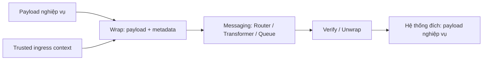
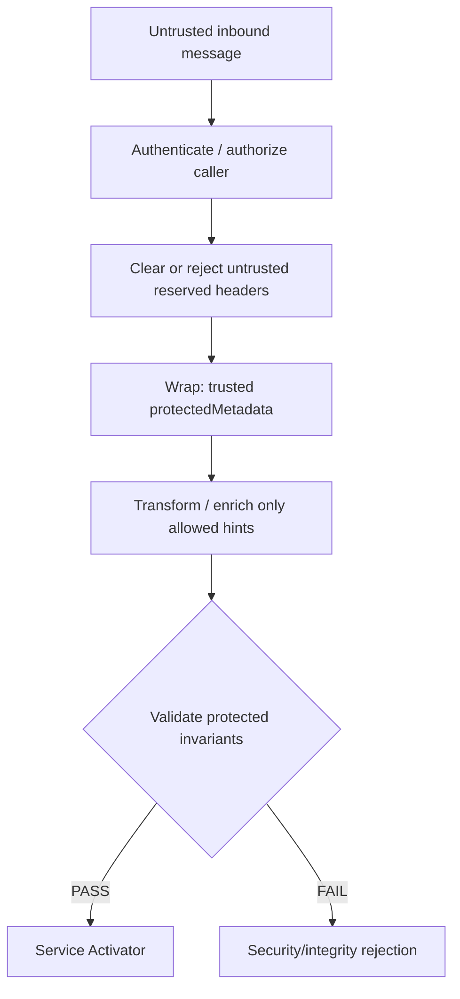
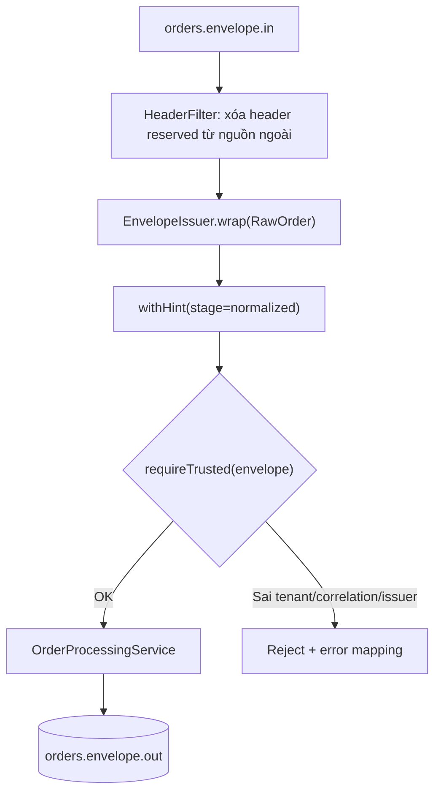
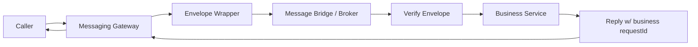
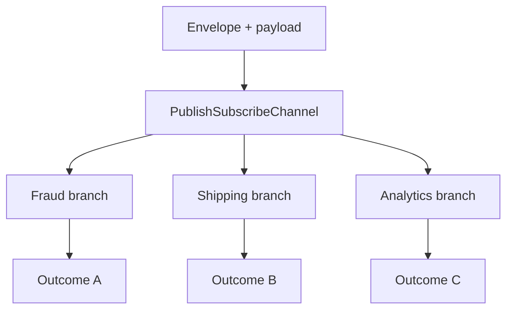
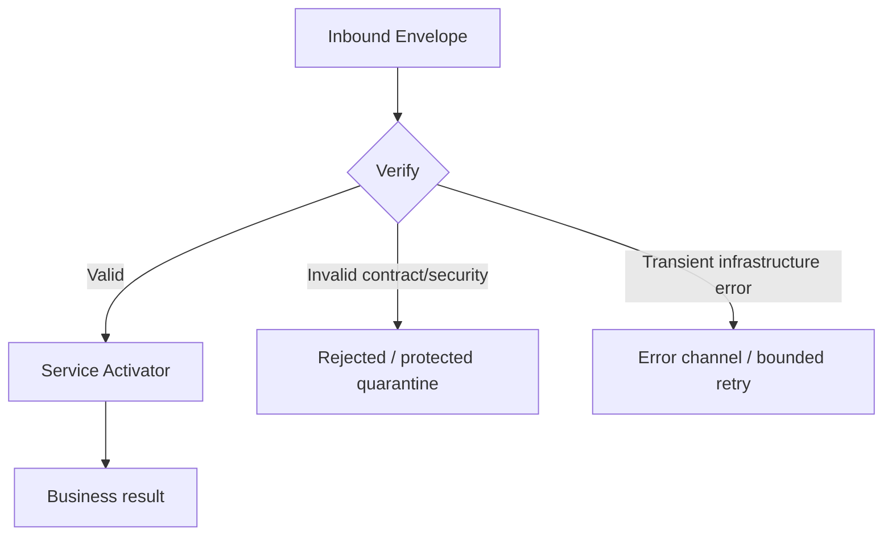

# Bảo vệ metadata khỏi bị ghi đè với Envelope Wrapper trong Spring Integration

## Mục tiêu bài học

Một hệ thống tiếp nhận đơn đặt hàng từ nhiều đối tác. Sau khi xác thực lời gọi đến, hệ thống biết yêu cầu thực sự thuộc `tenant-a`. Tuy nhiên, message có thể mang một header do client tự đặt:

```text
headers:
  tenantId = tenant-b
  correlationId = tenant-b|ORD-42|1
  issuer = trusted-order-api
  role = ADMIN
payload:
  orderId = ORD-42
  amountMinor = 125000
  generation = 1
```

Nếu một Router, Transformer hoặc Service Activator **tin header vừa nhận** và dùng nó để quyết định tenant, quyền truy cập hoặc correlation group, hệ thống có thể xử lý sai dữ liệu hoặc trộn đơn hàng giữa những khách hàng khác nhau.

Một giải pháp là **Envelope Wrapper**: tách payload nghiệp vụ khỏi một lớp metadata rõ cấu trúc, được **tạo từ ngữ cảnh đáng tin** tại ingress, sau đó bảo vệ các trường quan trọng trong suốt các bước chuyển đổi. Message có thể được wrap ở bên nhận và unwrap trước khi gọi hệ thống đích không biết gì về hạ tầng messaging.

**Trọng tâm của bài:** bảo vệ metadata **khỏi bị ghi đè ngoài ý muốn hoặc bởi nguồn không đáng tin**, đồng thời nhận diện giới hạn của cách bảo vệ đó. Bản ghi Java bất biến không tự tạo chứng thực mật mã; header của Spring không tự là một ACL; cùng một trường metadata có thể xuất hiện ở cả envelope, Spring Message headers và transport headers nên phải quy định **nguồn nào có thẩm quyền**.

Bài thuộc chương **Envelope wrapper** của module **SPRING_INTEGRATION_PATTERN**, phục vụ mục tiêu học Enterprise Integration Patterns bằng Spring Integration: xây dựng luồng message ít phụ thuộc, dễ mở rộng; thực hành Router, Filter, Transformer, Splitter, Aggregator, Gateway, retry, error channel và correlation; kiểm thử cũng như theo dõi các nhánh.

Sau khi học, bạn có thể:

1. Phân biệt **Envelope Wrapper** với `Message<?>`/`MessageHeaders` và với **Header Enricher**.
2. Xác định metadata nào là **trusted/protected**, metadata nào chỉ là **advisory** hoặc **transport-level**.
3. Tạo một **typed immutable envelope** và một quy tắc chỉ cho phép bổ sung metadata không được bảo vệ.
4. Sanitize header nhận từ bên ngoài; tránh việc `headerFunction`, `setHeader`, Transformer hoặc header mapper làm mất/ghi đè metadata quan trọng.
5. Xây Java DSL `headerFilter → wrap → enrich an toàn → guard → Service Activator`.
6. Viết JUnit chứng minh header giả không làm thay đổi tenant/correlation có thẩm quyền và metadata giả trong envelope bị phát hiện trước side effect.
7. Giải thích khi nào phải dùng **chữ ký/MAC, xác thực người gửi và kiểm tra replay** khi envelope đi qua ranh giới không tin cậy.
8. Thiết kế chính sách dành cho Gateway, Router, Splitter/Aggregator, broker, error channel, retry và audit.

---

## 1. Envelope Wrapper giải quyết vấn đề nào?

Trong mô hình Enterprise Integration Patterns, **Envelope Wrapper** đóng gói dữ liệu ứng dụng vào một lớp envelope phù hợp với yêu cầu của hạ tầng messaging. Lớp đó có thể mang thông tin định tuyến, tương quan, định dạng, phiên bản hoặc các yếu tố kiểm soát an toàn mà hệ thống ứng dụng đích không hiểu hoặc không nên nhận.



Các mục tiêu:

- Giữ **payload nghiệp vụ** độc lập với cấu trúc header yêu cầu bởi hạ tầng tích hợp.
- Cho endpoint trung gian truy cập metadata phục vụ correlation, routing và observability mà không phải sửa mô hình domain của hệ thống đích.
- Có một nơi rõ ràng để **phát hành**, **kiểm tra** và **chuyển giao** những metadata mang ý nghĩa nghiệp vụ hoặc bảo mật.
- Cho phép thay adapter/protocol mà không để mỗi Service Activator phụ thuộc tùy tiện vào HTTP/Kafka/JMS headers.
- Hạn chế việc một message mới vô tình thay tenant, schema version hoặc khóa workflow.

**Giới hạn:** EIP Envelope Wrapper là **mẫu thiết kế cấu trúc thông điệp**, không phải một bộ tính năng bảo mật được Spring Integration tự bật. Quyền truy cập, chữ ký và quản lý khóa là trách nhiệm của ứng dụng/hạ tầng tương ứng.

### Mẫu message có envelope

```json
{
  "metadata": {
    "tenantId": "tenant-a",
    "businessCorrelationId": "tenant-a|ORD-42|1",
    "issuer": "order-ingress",
    "schemaVersion": 1,
    "issuedAt": "2026-11-21T00:00:00Z"
  },
  "body": {
    "orderId": "ORD-42",
    "amountMinor": 125000,
    "generation": 1
  },
  "hints": {
    "stage": "normalized"
  }
}
```

Trong ví dụ:

- `metadata` chứa các trường **protected**. Chỉ thành phần ingress tin cậy được phép tạo giá trị ban đầu; downstream không được âm thầm sửa chúng.
- `body` chứa thông tin nghiệp vụ cần xử lý.
- `hints` chứa các thông tin bổ sung ít tin cậy hơn như nhãn giai đoạn, dành cho quan sát hoặc tính toán phụ trợ.
- Spring `Message<?>` vẫn có thể có headers riêng như `replyChannel`, `errorChannel`, `traceId`. Không trộn các header vận hành ấy với thông tin đã được xác minh.

### Envelope chỉ mang metadata không làm mọi trường bên trong trở nên đáng tin

Nếu client tự gửi toàn bộ JSON ở trên, trường `metadata.issuer="order-ingress"` **vẫn do client tự khai**. Chỉ khi một thành phần đáng tin tạo hoặc xác thực envelope thì thông tin đó mới có ý nghĩa đáng tin trong phạm vi được công nhận.

---

## 2. Ba lớp metadata dễ bị nhầm

Một Spring Integration flow có thể đồng thời tồn tại:

| Lớp | Ví dụ | Mục đích |
| --- | --- | --- |
| **Protected business envelope** | Tenant đã xác thực, workflow generation, canonical business correlation | Identity nghiệp vụ và bất biến giữa các flow |
| **Spring Message headers** | `correlationId`, `replyChannel`, `errorChannel`, `priority`, `contentType` | Điều khiển messaging endpoint |
| **Transport headers** | HTTP `X-Tenant`, Kafka record headers, JMS properties | Truyền thông giữa process/adapter |

Ba lớp này có thể chứa **tên trường giống nhau nhưng thẩm quyền khác nhau**.

Ví dụ:

```text
HTTP header X-Tenant: tenant-b        // do client gửi, chưa tin
Spring header tenantId: tenant-b      // do inbound adapter map
Envelope metadata tenantId: tenant-a // phát từ verified principal
```

Quy tắc an toàn: **dùng `tenant-a` từ identity đã xác thực** để quyết định quyền và business group. Header `tenant-b` phải được loại bỏ, từ chối hoặc ghi nhận là xung đột tùy policy; **không được để nó ghi đè metadata có thẩm quyền**.

### Những trường thường cần bảo vệ

- `tenantId`/namespace có nguồn xác thực.
- `issuer` hoặc service identity đã kiểm chứng.
- `businessCorrelationId` hoặc workflow/run/generation.
- `schemaVersion` và `mappingVersion` đã được chọn theo contract.
- `requestId` khi là ID nghiệp vụ tin cậy của ingress.
- `classification`/`sensitivity`, ví dụ dữ liệu hạn chế truy cập.
- `authorizationScope` nếu được cấp từ policy engine chứ không phải người gửi.
- `issuedAt`, `expiresAt` và `nonce` khi là thành phần của hợp đồng đã ký.

Không phải mọi hệ thống đều cần mọi trường trên. **Metadata càng lớn, số điểm cần validate và đồng bộ càng nhiều.**

### Metadata ít nhạy cảm hơn

Những trường như `stage`, `workerDurationMs`, `debugTag` hoặc `retryObservation` có thể do các flow bổ sung, nhưng vẫn phải:

- Có tên rõ ràng và namespace.
- Không va chạm trường protected.
- Không cho phép giá trị quá lớn hoặc chứa secret.
- Không âm thầm thay giá trị đã được dùng để ra quyết định.
- Không được tin là bằng chứng xác thực chỉ vì nó nằm trong envelope.

---

## 3. MessageHeaders immutable nhưng không có nghĩa protected business metadata

Trong Spring Messaging, một `Message<?>` thông thường không có setter cho payload/headers; bản đồ `MessageHeaders` không cho sửa trực tiếp như một `HashMap`.

Tuy nhiên, một endpoint có thể tạo **message mới**:

```java
Message<?> next = MessageBuilder
    .fromMessage(previous)
    .setHeader("tenantId", "tenant-b")
    .build();
```

Nếu `tenantId` là một **business header thông thường**, đoạn này có thể đặt giá trị khác trong message mới. Nó không sửa `previous` tại chỗ, nhưng downstream nhận `next` sẽ thấy metadata đã khác.

### Header nào thực sự read-only?

Với cấu hình mặc định của Spring Integration:

- `MessageHeaders.ID` và `MessageHeaders.TIMESTAMP` là hai header hệ thống **read-only**.
- Một số API Header Enricher/Filter không cho tự định nghĩa hoặc thay những tên hệ thống đó.
- Các business header như `tenantId`, `sourceSystem`, `customerTier` hoặc `businessCorrelationId` **không mặc nhiên được bảo vệ như ID/timestamp**.
- Spring Integration cho phép tùy chỉnh header propagation và việc copy header ở những điểm phù hợp. Những thiết lập đó không tự thành cơ chế phân quyền.

**Không nhầm `MessageHeaders` là map bất biến với việc mọi giá trị trong map đều được xác thực.** Giá trị header cũng có thể trỏ tới object mutable hoặc đã đến từ nguồn không đáng tin.

### Ba dạng thay đổi khác nhau

| Thao tác | Có thay đổi message trước? | Rủi ro |
| --- | --- | --- |
| `message.getHeaders().put(...)` | Không hợp lệ với map headers mặc định | Có thể ném exception |
| `MessageBuilder.fromMessage(message).setHeader(...)` | Không; tạo message mới | Có thể ghi đè business header trong bản mới |
| Transformer trả một `Message<?>` khác | Không; output là message khác | Có thể bỏ hoặc thay toàn bộ metadata cần bảo vệ |
| Adapter tạo message từ broker | Tạo message ở process khác | Có thể thiếu/mapping sai/giả header |
| Thay object mutable bên trong header | Có thể ảnh hưởng nội dung được tham chiếu | Shallow immutability không chặn mutate nested object |

### Khi Transformer trả payload và khi trả Message

Spring Integration thường truyền các inbound headers khi một Transformer chỉ trả **payload**. Nếu một Transformer trả về **message hoàn chỉnh**, code của bạn có trách nhiệm quyết định headers của message mới.

Đây là lý do phải kiểm thử cách truyền metadata của cả hai loại Transformer, đặc biệt khi đụng đến `correlationId` và `replyChannel`.

---

## 4. Vì sao một Header Enricher có thể gây ghi đè?

Header Enricher rất hữu ích để thêm header từ payload, cấu hình hoặc kết quả tính toán:

```java
.enrichHeaders(spec -> spec
    .header("stage", "normalized"))
```

Nhưng hãy quan sát một cấu hình được phép overwrite:

```java
.enrichHeaders(spec -> spec
    .header("tenantId", "tenant-b", true))
```

Với business header thông thường, `true` biểu thị **cho phép ghi đè** giá trị đã tồn tại. Nếu handler downstream sử dụng `headers['tenantId']` để truy cập dữ liệu, kết quả có thể sai tenant.

### Điều cần nhớ về `defaultOverwrite`

- Nhiều phương thức trên `HeaderEnricherSpec` mặc định **không overwrite** nếu header đã tồn tại.
- Có thể bật overwrite từng header bằng overload có tham số `Boolean overwrite`.
- Có thể cấu hình `defaultOverwrite(true)` cho nhiều header.
- **Không overwrite** chưa chắc đã an toàn: một giá trị giả từ ingress có thể đã chiếm header trước khi thành phần tin cậy cố thêm giá trị mới.

Ví dụ nguy hiểm:

```text
Inbound (untrusted): tenantId=tenant-b
Trusted Header Enricher (overwrite=false): tenantId=tenant-a
Result: tenantId vẫn là tenant-b
```

Do vậy, với trường trusted, không chỉ hỏi “có overwrite không?” mà phải hỏi **giá trị hiện tại đến từ nguồn nào**.

### Header do framework tạo và header ứng dụng tự quản

`correlationId` còn được Aggregator/Resequencer hoặc Splitter sử dụng. Nếu tự ghi đè nó giữa chừng, bạn có thể làm hỏng group formation dù ý định chỉ là thêm thông tin log.

Một cách tổ chức tốt:

- Giữ business correlation lâu dài trong `protectedMetadata.businessCorrelationId`.
- Dùng `correlationId` của Spring cho **group đang xử lý**, theo topology cụ thể.
- Khi cần đưa business key vào Spring header, **tính từ nguồn trusted** và làm rõ nơi được phép thay.
- Không tự thay `replyChannel`/`errorChannel` khi không hiểu tác động tới Gateway hoặc request-reply.

---

## 5. Nguyên tắc bảo vệ metadata: phát hành, sử dụng, xác minh

Một chính sách có thể trình bày bằng ba giai đoạn:



**1. Phát hành:** chỉ trusted ingress/service tạo protected metadata từ identity/configuration/server state đã kiểm chứng.

**2. Sử dụng:** các endpoint trung gian được phép đọc metadata; khi thêm thông tin phụ, chúng không sửa những trường protected.

**3. Xác minh:** tại điểm có side effect hoặc trước khi vượt ranh giới tin cậy, so metadata với nguồn đã xác thực, kiểm tra tính nhất quán giữa payload và correlation/generation. Với dữ liệu đi qua hệ thống không tin cậy, phải xác minh **chữ ký/MAC** theo contract, không chỉ so giá trị.

### Những cơ chế bảo vệ khác nhau

| Cơ chế | Ngăn lỗi gì? | Không tự giải quyết |
| --- | --- | --- |
| Java record + `Map.copyOf` | Mutation ngoài ý muốn trong cùng object | Object mới có thể được dựng với giá trị khác |
| HeaderFilter tại ingress | Không cho một số header từ client đi vào flow | Không xác thực toàn bộ client hoặc byte payload |
| Allowlist/reserved names | Không để annotation ghi đè tên protected | Không ngăn component có quyền tạo envelope mới |
| Invariant guard trước service | Phát hiện metadata không nhất quán trong phạm vi có ngữ cảnh | Không chứng minh ai đã ký dữ liệu |
| Authentication + authorization | Xác định actor/quyền tại trust boundary | Không tự bảo đảm body/header bất biến khi chuyển qua broker |
| MAC/chữ ký hợp lệ | Phát hiện thay đổi của các trường được ký | Không tự bảo vệ confidentiality hay ngăn replay |
| Nonce/deadline/ledger | Giảm phát lại message cũ | Cần lưu state và chính sách tiêu thụ |

**Không có một cờ `immutable=true` nào thay thế tất cả các hàng trong bảng.**

---

## 6. Domain model: envelope chứa protected metadata và hints

Trong bài thực hành, chúng ta dùng:

```text
RawOrder
  orderId, amountMinor, generation

ProtectedMetadata
  tenantId, businessCorrelationId,
  issuer, schemaVersion, issuedAt

EnvelopedOrder
  protectedMetadata, body: RawOrder,
  hints: Map<String, String>
```

`tenantId` không lấy từ client-supplied header. Một `VerifiedCallerContext` tin cậy trong ví dụ cấp giá trị minh họa `tenant-a`.

Chúng ta chia metadata thành hai vùng:

- **ProtectedMetadata:** không có phương thức thay một field riêng lẻ; chỉ issuer tin cậy tạo ban đầu.
- **hints:** có thể bổ sung khi qua từng stage, nhưng không được dùng các tên reserved hoặc overwrite key đã có.

```java
import java.time.Instant;
import java.util.HashMap;
import java.util.Map;
import java.util.Objects;
import java.util.Set;

public record ProtectedMetadata(
    String tenantId,
    String businessCorrelationId,
    String issuer,
    int schemaVersion,
    Instant issuedAt
) {}

public record RawOrder(
    String orderId,
    long amountMinor,
    int generation
) {}

public record EnvelopedOrder(
    ProtectedMetadata metadata,
    RawOrder body,
    Map<String, String> hints
) {
    private static final Set<String> RESERVED = Set.of(
        "tenantId", "businessCorrelationId", "issuer",
        "schemaVersion", "issuedAt", "securityRole");

    public EnvelopedOrder {
        Objects.requireNonNull(metadata, "metadata");
        Objects.requireNonNull(body, "body");
        hints = Map.copyOf(
            Objects.requireNonNull(hints, "hints"));
    }

    public EnvelopedOrder withHint(String key, String value) {
        if (key == null || key.isBlank()
                || RESERVED.contains(key)
                || value == null || value.length() > 200) {
            throw new IllegalArgumentException("INVALID_HINT");
        }
        if (hints.containsKey(key)) {
            throw new IllegalArgumentException(
                "HINT_ALREADY_DEFINED");
        }

        Map<String, String> next = new HashMap<>(hints);
        next.put(key, value);

        // Vẫn dùng metadata cũ, không copy/recreate bằng
        // một giá trị khác từ header ngoài luồng.
        return new EnvelopedOrder(metadata, body, next);
    }
}
```

Đây là các record **minh họa để học**; phần cấu hình Java DSL ở mục sau có phiên bản tự chứa của chúng ở dạng nested types.

### Vì sao không dùng `Map<String,Object> metadata` cho tất cả?

Một map duy nhất cho mọi trường dễ dẫn đến:

```java
Map<String, Object> metadata = new HashMap<>();
metadata.put("tenantId", "tenant-a");

// Một bước enrich khác:
metadata.put("tenantId", "tenant-b"); // Âm thầm thay.
```

Typed `ProtectedMetadata` giúp IDE/compiler và code review nhận diện trường có ý nghĩa quan trọng; các method thêm hints không có đường ghi vào metadata.

Nhưng record chỉ bất biến **nông**. Nếu một field record là `List`/`Map` mutable, cần tạo defensive copy của collection và của phần tử mutable khi cần. Trong demo, metadata chỉ dùng `String`, `int` và `Instant` — các kiểu bất biến; `hints` là `Map.copyOf` với giá trị `String`.

### Vì sao ngăn overwrite cả hints?

Mặc dù `hints` ít đáng tin hơn, ghi đè `stage=validated` thành `stage=reviewed` mà không ghi nhận lý do có thể khiến audit sai. Ví dụ dùng `withHint(...)` theo chính sách **append-only cho mỗi key**. Một hệ thống thật có thể dùng event history có timestamp thay vì nhét mọi bước vào một map.

---

## 7. Java DSL: HeaderFilter → Wrap → Enrich → Guard → Service Activator

Bây giờ tạo một ví dụ đầy đủ trong Spring Integration:



Điều cần quan sát:

1. Payload ban đầu chỉ là `RawOrder`.
2. Một số header client-controlled được loại trước khi có thể ảnh hưởng downstream.
3. `EnvelopeIssuer` tạo metadata có thẩm quyền từ **trusted server context**.
4. `withHint` chỉ bổ sung thông tin stage.
5. `requireTrusted` xác minh các bất biến trước khi Service Activator tạo side effect.
6. Handler sử dụng `envelope.metadata()`, không đọc `headers["tenantId"]` để chọn tenant.

### Cấu hình tự chứa (Java 17+, Spring Integration 6.x/7.x)

```java
import java.time.Clock;
import java.time.Instant;
import java.time.ZoneOffset;
import java.util.HashMap;
import java.util.Map;
import java.util.Objects;
import java.util.Set;
import java.util.concurrent.atomic.AtomicInteger;
import java.util.regex.Pattern;

import org.springframework.context.annotation.Bean;
import org.springframework.context.annotation.Configuration;
import org.springframework.integration.channel.DirectChannel;
import org.springframework.integration.channel.QueueChannel;
import org.springframework.integration.config.EnableIntegration;
import org.springframework.integration.dsl.IntegrationFlow;
import org.springframework.messaging.MessageChannel;
import org.springframework.messaging.PollableChannel;

@Configuration
@EnableIntegration
public class ProtectedEnvelopeConfig {

    public record RawOrder(
        String orderId, long amountMinor, int generation
    ) {}

    public record ProtectedMetadata(
        String tenantId,
        String businessCorrelationId,
        String issuer,
        int schemaVersion,
        Instant issuedAt
    ) {}

    public record EnvelopedOrder(
        ProtectedMetadata metadata,
        RawOrder body,
        Map<String, String> hints
    ) {
        private static final Set<String> RESERVED = Set.of(
            "tenantId", "businessCorrelationId",
            "issuer", "schemaVersion",
            "issuedAt", "securityRole");

        public EnvelopedOrder {
            Objects.requireNonNull(metadata, "metadata");
            Objects.requireNonNull(body, "body");
            hints = Map.copyOf(
                Objects.requireNonNull(hints, "hints"));
        }

        public EnvelopedOrder withHint(
            String key, String value
        ) {
            if (key == null || key.isBlank()
                    || RESERVED.contains(key)
                    || value == null || value.length() > 200) {
                throw new IllegalArgumentException(
                    "INVALID_HINT");
            }
            if (hints.containsKey(key)) {
                throw new IllegalArgumentException(
                    "HINT_ALREADY_DEFINED");
            }

            Map<String, String> next =
                new HashMap<>(hints);
            next.put(key, value);
            return new EnvelopedOrder(metadata, body, next);
        }
    }

    public record Receipt(
        String orderId,
        String tenantId,
        String businessCorrelationId,
        long amountMinor,
        String stage
    ) {}

    // Đây chỉ là fixture tin cậy cho bài học.
    // Production phải lấy identity từ authentication
    // context/service principal đã xác minh.
    public static final class VerifiedCallerContext {

        public String tenantId() {
            return "tenant-a";
        }

        public String issuer() {
            return "order-ingress";
        }
    }

    public static final class EnvelopeIssuer {
        private static final Pattern ORDER_ID =
            Pattern.compile("[A-Za-z0-9_-]{1,80}");

        private final VerifiedCallerContext context;
        private final Clock clock;

        public EnvelopeIssuer(
            VerifiedCallerContext context,
            Clock clock
        ) {
            this.context = context;
            this.clock = clock;
        }

        public EnvelopedOrder wrap(RawOrder order) {
            if (order == null
                    || order.orderId() == null
                    || !ORDER_ID.matcher(
                        order.orderId()).matches()
                    || order.amountMinor() <= 0
                    || order.generation() < 1) {
                throw new IllegalArgumentException(
                    "INVALID_ORDER");
            }

            String tenant = context.tenantId();
            String group = tenant + "|" + order.orderId()
                + "|" + order.generation();

            var metadata = new ProtectedMetadata(
                tenant,
                group,
                context.issuer(),
                1,
                clock.instant());

            return new EnvelopedOrder(
                metadata, order, Map.of());
        }

        public void requireTrusted(EnvelopedOrder envelope) {
            if (envelope == null) {
                throw new SecurityException(
                    "INVALID_ENVELOPE_METADATA");
            }

            var metadata = envelope.metadata();
            var body = envelope.body();

            String expectedGroup =
                context.tenantId() + "|" + body.orderId()
                    + "|" + body.generation();

            boolean valid =
                context.tenantId().equals(metadata.tenantId())
                && expectedGroup.equals(
                    metadata.businessCorrelationId())
                && context.issuer().equals(metadata.issuer())
                && metadata.schemaVersion() == 1
                && metadata.issuedAt() != null
                && !metadata.issuedAt().isAfter(
                    clock.instant().plusSeconds(30));

            if (!valid) {
                throw new SecurityException(
                    "INVALID_ENVELOPE_METADATA");
            }
        }
    }

    public static final class OrderProcessingService {
        private final AtomicInteger calls =
            new AtomicInteger();

        public Receipt process(EnvelopedOrder envelope) {
            // Không tự lấy tenantId từ Spring message header.
            calls.incrementAndGet();

            return new Receipt(
                envelope.body().orderId(),
                envelope.metadata().tenantId(),
                envelope.metadata().businessCorrelationId(),
                envelope.body().amountMinor(),
                envelope.hints().get("stage"));
        }

        public int invocations() {
            return calls.get();
        }
    }

    @Bean
    Clock envelopeClock() {
        // Clock cố định giúp test có kết quả xác định.
        // Production thường dùng Clock.systemUTC().
        return Clock.fixed(
            Instant.parse("2026-11-21T00:00:00Z"),
            ZoneOffset.UTC);
    }

    @Bean
    VerifiedCallerContext verifiedCallerContext() {
        return new VerifiedCallerContext();
    }

    @Bean
    EnvelopeIssuer envelopeIssuer(
        VerifiedCallerContext context, Clock clock
    ) {
        return new EnvelopeIssuer(context, clock);
    }

    @Bean
    OrderProcessingService orderProcessingService() {
        return new OrderProcessingService();
    }

    @Bean("orders.envelope.in")
    MessageChannel input() {
        return new DirectChannel();
    }

    @Bean("orders.envelope.out")
    PollableChannel output() {
        // Test sink, không có consumer nền.
        return new QueueChannel();
    }

    @Bean
    IntegrationFlow protectedEnvelopeFlow(
        EnvelopeIssuer issuer,
        OrderProcessingService service
    ) {
        return IntegrationFlow.from("orders.envelope.in")

            // Chỉ lọc những header ngoài không được tin.
            // Không xóa bừa replyChannel/errorChannel ở đây.
            .headerFilter(
                "tenantId",
                "businessCorrelationId",
                "issuer",
                "schemaVersion",
                "securityRole")

            // Phát metadata tin cậy trong payload envelope.
            .transform(RawOrder.class, issuer::wrap)

            // Chỉ thêm nhãn stage, không sửa protected metadata.
            .transform(
                EnvelopedOrder.class,
                envelope -> envelope.withHint(
                    "stage", "normalized"))

            // Guard luôn chạy trước side effect.
            .handle(
                EnvelopedOrder.class,
                (envelope, headers) -> {
                    issuer.requireTrusted(envelope);
                    return service.process(envelope);
                })

            .channel("orders.envelope.out")
            .get();
    }
}
```

### Mô hình bảo mật của demo

`VerifiedCallerContext` đang trả một tenant cố định **chỉ để học/test**. Đây không phải cơ chế xác thực thật. Trong ứng dụng nhiều tenant, hãy thay nó bằng một **identity provider đáng tin** được gọi tại đúng boundary; tránh một singleton mutable `currentTenant` dùng chung nhiều request/thread.

Tương tự, `requireTrusted` là **invariant guard**: so metadata với ngữ cảnh và body. Nó phát hiện nhiều lỗi/giả mạo giá trị rõ ràng, nhưng một actor có khả năng tạo envelope mới với các giá trị được dự đoán có thể vượt qua một guard chỉ so chuỗi. **Không dùng đoạn code này để thay chữ ký số/HMAC hoặc authentication khi nhận dữ liệu qua mạng không tin cậy.**

### Vì sao headerFilter đứng trước wrap?

Một client có thể gửi `tenantId` hoặc `issuer` giống tên trường ứng dụng dùng. Nếu cứ giữ nguyên chúng, một handler không cẩn thận ở đoạn sau có thể vô tình đọc header thay vì `envelope.metadata()`.

`headerFilter(...)` ở ingress giúp **xóa các tên được chỉ rõ** khỏi Spring Message headers. Nó không xóa mọi header nguy hiểm trên đời. Với một trust boundary nghiêm ngặt, nên thiết kế **allowlist** các transport headers được phép chuyển vào flow.

### Tại sao không xóa `replyChannel` và `errorChannel` ở đây?

Vì các header đó có thể được Spring Integration sử dụng để trả lời Gateway hoặc chuyển lỗi. Xóa chúng không có chủ đích có thể làm caller chờ timeout hoặc làm sai đường error handling. Ở một outbound broker boundary, lại cần chính sách khác vì các đối tượng channel trong JVM không tự tương thích với transport.

### Vì sao Service Activator dùng envelope?

Nó nhận `EnvelopedOrder` đã được validate thay vì sử dụng một tập header tự do. Điều này làm rõ **đầu vào đã có metadata được phát hành bởi ai**, **trường nào ổn định**, và **trường nào chỉ bổ sung để quan sát**.

---

## 8. Kiểm thử JUnit: header giả không thay protected metadata

Các test dùng `DirectChannel` và `QueueChannel` để kiểm tra đồng bộ trong một JVM. Chúng chứng minh logic bảo vệ của flow, **không phải** authentication thật hoặc khả năng xác minh chữ ký qua broker.

### Integration test: forged header, valid request và invalid input

```java
import static org.assertj.core.api.Assertions.assertThat;
import static org.assertj.core.api.Assertions.assertThatThrownBy;

import org.junit.jupiter.api.Test;
import org.springframework.beans.factory.annotation.Autowired;
import org.springframework.beans.factory.annotation.Qualifier;
import org.springframework.messaging.Message;
import org.springframework.messaging.MessageChannel;
import org.springframework.messaging.PollableChannel;
import org.springframework.messaging.support.MessageBuilder;
import org.springframework.test.annotation.DirtiesContext;
import org.springframework.test.context.junit.jupiter.SpringJUnitConfig;

@SpringJUnitConfig(ProtectedEnvelopeConfig.class)
@DirtiesContext(
    classMode = DirtiesContext.ClassMode.AFTER_EACH_TEST_METHOD)
class ProtectedEnvelopeFlowTest {

    @Autowired
    @Qualifier("orders.envelope.in")
    MessageChannel input;

    @Autowired
    @Qualifier("orders.envelope.out")
    PollableChannel output;

    @Autowired
    ProtectedEnvelopeConfig.OrderProcessingService service;

    @Test
    void forgedBusinessHeadersCannotOverrideTrustedEnvelope() {
        var raw = new ProtectedEnvelopeConfig.RawOrder(
            "ORD-42", 125_000L, 1);

        Message<?> inbound = MessageBuilder.withPayload(raw)
            .setHeader("tenantId", "tenant-b")
            .setHeader(
                "businessCorrelationId",
                "tenant-b|ORD-42|1")
            .setHeader("issuer", "fake-issuer")
            .setHeader("schemaVersion", 999)
            .setHeader("securityRole", "ADMIN")
            .setHeader("traceId", "trace-42")
            .build();

        assertThat(input.send(inbound)).isTrue();

        Message<?> result = output.receive(2_000);
        assertThat(result).isNotNull();

        var receipt =
            (ProtectedEnvelopeConfig.Receipt)
                result.getPayload();

        assertThat(receipt.tenantId())
            .isEqualTo("tenant-a");
        assertThat(receipt.businessCorrelationId())
            .isEqualTo("tenant-a|ORD-42|1");
        assertThat(receipt.orderId()).isEqualTo("ORD-42");
        assertThat(receipt.amountMinor()).isEqualTo(125_000L);
        assertThat(receipt.stage()).isEqualTo("normalized");

        // Header client-controlled đã bị loại.
        assertThat(result.getHeaders())
            .doesNotContainKeys(
                "tenantId",
                "businessCorrelationId",
                "issuer",
                "schemaVersion",
                "securityRole");

        // Header quan sát không nằm trong reserved list.
        assertThat(result.getHeaders().get("traceId"))
            .isEqualTo("trace-42");

        assertThat(service.invocations()).isEqualTo(1);
        assertThat(output.receive(0)).isNull();
    }

    @Test
    void twoValidOrdersKeepIndependentCorrelations() {
        sendValid("ORD-101", 1);
        sendValid("ORD-102", 2);

        var first = (ProtectedEnvelopeConfig.Receipt)
            output.receive(2_000).getPayload();

        var second = (ProtectedEnvelopeConfig.Receipt)
            output.receive(2_000).getPayload();

        assertThat(first.businessCorrelationId())
            .isEqualTo("tenant-a|ORD-101|1");
        assertThat(second.businessCorrelationId())
            .isEqualTo("tenant-a|ORD-102|2");
        assertThat(service.invocations()).isEqualTo(2);
    }

    private void sendValid(String orderId, int generation) {
        assertThat(input.send(MessageBuilder.withPayload(
            new ProtectedEnvelopeConfig.RawOrder(
                orderId, 100L, generation)).build()))
            .isTrue();
    }

    @Test
    void invalidOrderStopsBeforeServiceActivator() {
        var invalid = new ProtectedEnvelopeConfig.RawOrder(
            "ORD|INJECTED", 100L, 1);

        assertThatThrownBy(() -> input.send(
            MessageBuilder.withPayload(invalid).build()
        )).isInstanceOf(RuntimeException.class);

        assertThat(service.invocations()).isZero();
        assertThat(output.receive(0)).isNull();
    }
}
```

Các test quan sát:

- Header `tenantId=tenant-b` từ bên ngoài **không ghi đè** metadata được issuer tạo từ trusted context.
- Business correlation có cấu trúc đủ tenant/order/generation.
- Các header có tên reserved bị loại khỏi output.
- Một header quan sát `traceId` có thể truyền qua flow nhưng **không được xem là business identity**.
- Payload sai định dạng bị chặn trước handler.

**Giới hạn rõ ràng:** trong test, service được gọi một lần vì chỉ có một lần gửi message hợp lệ; kết quả này không chứng minh exactly-once processing khi broker redelivery hoặc hệ thống crash.

## 9. Unit test: bất biến của envelope và guard

Code dưới đây kiểm tra trực tiếp một số trường hợp mà HeaderFilter một mình không bảo vệ được.

```java
import static org.assertj.core.api.Assertions.assertThat;
import static org.assertj.core.api.Assertions.assertThatThrownBy;

import java.time.Clock;
import java.time.Instant;
import java.time.ZoneOffset;
import java.util.Map;

import org.junit.jupiter.api.Test;

class ProtectedEnvelopeUnitTest {

    private final Clock clock = Clock.fixed(
        Instant.parse("2026-11-21T00:00:00Z"),
        ZoneOffset.UTC);

    private final ProtectedEnvelopeConfig.EnvelopeIssuer issuer =
        new ProtectedEnvelopeConfig.EnvelopeIssuer(
            new ProtectedEnvelopeConfig.VerifiedCallerContext(),
            clock);

    private ProtectedEnvelopeConfig.EnvelopedOrder original() {
        return issuer.wrap(
            new ProtectedEnvelopeConfig.RawOrder(
                "ORD-77", 500L, 1));
    }

    @Test
    void addingHintDoesNotOverwriteProtectedMetadata() {
        var before = original();
        var after = before.withHint("stage", "normalized");

        assertThat(after.metadata())
            .isSameAs(before.metadata());

        assertThat(before.hints()).isEmpty();
        assertThat(after.hints())
            .containsEntry("stage", "normalized");
        assertThat(after.metadata().tenantId())
            .isEqualTo("tenant-a");

        issuer.requireTrusted(after);
    }

    @Test
    void reservedKeyCannotBeWrittenAsHint() {
        var envelope = original();

        assertThatThrownBy(
            () -> envelope.withHint("tenantId", "tenant-b"))
            .isInstanceOf(IllegalArgumentException.class)
            .hasMessage("INVALID_HINT");

        assertThatThrownBy(
            () -> envelope.withHint(
                "businessCorrelationId", "wrong"))
            .isInstanceOf(IllegalArgumentException.class);
    }

    @Test
    void existingHintCannotBeReplacedSilently() {
        var first = original().withHint("stage", "normalized");

        assertThatThrownBy(
            () -> first.withHint("stage", "overridden"))
            .isInstanceOf(IllegalArgumentException.class)
            .hasMessage("HINT_ALREADY_DEFINED");
    }

    @Test
    void hintsMapCannotBeMutatedAfterCreation() {
        var envelope = original().withHint("stage", "normalized");

        assertThatThrownBy(
            () -> envelope.hints().put("stage", "spoofed"))
            .isInstanceOf(UnsupportedOperationException.class);

        assertThat(envelope.hints())
            .containsExactlyInAnyOrderEntriesOf(
                Map.of("stage", "normalized"));
    }

    @Test
    void forgedTenantInNewEnvelopeIsDetectedByGuard() {
        var good = original();
        var originalMetadata = good.metadata();

        var forgedMetadata =
            new ProtectedEnvelopeConfig.ProtectedMetadata(
                "tenant-b",
                originalMetadata.businessCorrelationId(),
                originalMetadata.issuer(),
                originalMetadata.schemaVersion(),
                originalMetadata.issuedAt());

        var forged = new ProtectedEnvelopeConfig.EnvelopedOrder(
            forgedMetadata, good.body(), Map.of());

        assertThatThrownBy(
            () -> issuer.requireTrusted(forged))
            .isInstanceOf(SecurityException.class)
            .hasMessage("INVALID_ENVELOPE_METADATA");
    }

    @Test
    void forgedCorrelationIsDetectedByGuard() {
        var good = original();
        var metadata = good.metadata();

        var forgedMetadata =
            new ProtectedEnvelopeConfig.ProtectedMetadata(
                metadata.tenantId(),
                "tenant-a|OTHER-ORDER|1",
                metadata.issuer(),
                metadata.schemaVersion(),
                metadata.issuedAt());

        var forged = new ProtectedEnvelopeConfig.EnvelopedOrder(
            forgedMetadata, good.body(), Map.of());

        assertThatThrownBy(
            () -> issuer.requireTrusted(forged))
            .isInstanceOf(SecurityException.class);
    }
}
```

**Ý nghĩa kiểm thử:** code trung gian không thể sửa metadata của **cùng object** bằng `withHint`; guard phát hiện một số loại tái tạo envelope sai. Nhưng Java vẫn cho phép tạo `new ProtectedMetadata(...)` với trường mới: phải kiểm soát **ai được phép phát hành** và **bằng chứng nguồn gốc** ở trust boundary.

### Nếu muốn đóng hẳn constructor?

Có thể dùng class private constructor/factory thay vì public record để giới hạn những nơi trong code có thể tạo object. Nhưng trong một JVM, code cùng quyền process vẫn có thể truy cập nhiều cơ chế nội bộ qua bean/service khác; constructor hạn chế không tương đương một sandbox bảo mật.

Ở ranh giới service-to-service, dùng **xác thực người gửi và kiểm tra signature/MAC**, không chỉ độ kín của constructor Java.

---

## 10. Nguồn sự thật: protected envelope khác business header

Một số team muốn mỗi handler đều có `headers['tenantId']` để xử lý thuận tiện. Điều đó có thể chấp nhận nếu **đường tạo header được kiểm soát** và handler không dùng một header chưa được xác minh làm quyết định an toàn.

Có ba lựa chọn:

### Lựa chọn A — Chỉ dùng protected envelope cho dữ liệu có thẩm quyền

```text
envelope.metadata.tenantId = tenant-a
Spring header tenantId     = không có
```

Ưu điểm: giảm hai nguồn giá trị trùng tên; handler bắt buộc lấy tenant từ envelope đã verify.

Nhược điểm: một số Router/Aggregator sử dụng header cần bước chuyển riêng.

### Lựa chọn B — Phát header từ envelope ở đúng nơi cần

Ví dụ **đoạn DSL thay thế** sau khi envelope đã được xác minh:

```java
.enrichHeaders(spec -> spec
    .headerFunction(
        "businessCorrelationId",
        message -> ((ProtectedEnvelopeConfig.EnvelopedOrder)
            message.getPayload())
            .metadata().businessCorrelationId(),
        true))
```

Phải đặt bước này **sau khi validate provenance/invariant**. `true` cho phép thay business header cũ do ingress không đáng tin tạo ra — nhưng không làm nó tự được xác thực nếu envelope cũng không đáng tin.

### Lựa chọn C — Giữ business identity trong payload và dùng correlation strategy

Với Aggregator, thay vì tin mọi `headers['correlationId']`:

```java
.aggregate(spec -> spec
    .correlationStrategy(message -> {
        var envelope =
            (ProtectedEnvelopeConfig.EnvelopedOrder)
                message.getPayload();

        return envelope.metadata()
            .businessCorrelationId();
    }))
```

Đoạn này là **cấu hình một phần**, chưa có release strategy/output processor. Nó phải được triển khai với trusted envelope, không nhận payload envelope trực tiếp từ nguồn ngoài chưa verify.

**Đừng chọn cả ba cách mà không có chính sách precedence.** Nếu envelope nói `tenant-a` nhưng header nói `tenant-b`, hệ thống phải quyết định **reject** hoặc **tính lại header từ nguồn đáng tin**, không để một số endpoint đọc A và endpoint khác đọc B.

---

## 11. Bảo vệ correlationId, sequenceNumber và sequenceSize

Spring Integration sử dụng một số header để quản lý nhóm và thứ tự:

| Header | Ai thường dùng | Rủi ro khi overwrite |
| --- | --- | --- |
| `correlationId` | Aggregator/Resequencer | Trộn các group hoặc tách một group thành nhiều |
| `sequenceNumber` | Resequencer/Aggregator | Sai vị trí, release sai |
| `sequenceSize` | Release strategy | Chờ mãi hoặc release thiếu phần |
| `replyChannel` | Gateway/request-reply | Reply mất hoặc gửi nhầm |
| `errorChannel` | Error flow | Exception không đến đích mong muốn |
| `priority` | PriorityChannel | Thay thứ tự xử lý |
| `contentType` | Converter/adapter | Giải mã sai payload |
| `routingSlip` | Routing Slip | Chuyển message tới endpoint ngoài ý muốn |

Có những header do framework tạo ra và mang ý nghĩa hợp lệ **trong một giai đoạn xử lý nhất định**. Không nên đưa tất cả vào danh sách “không bao giờ được thay”, bởi Splitter hoặc Scatter-Gather có thể cần tạo **sequence của cấp mới**.

### Phân biệt business correlation và framework correlation

Một đơn có:

```text
businessCorrelationId = tenant-a|ORD-42|run-1
```

Nếu Splitter tách một tập record, nó có thể tạo group/sequence headers cho **một đợt split**. Những header đó không bắt buộc trùng business correlation ở mọi cấp.

Khi dùng Envelope Wrapper:

- Lưu business ID lâu dài trong protected metadata.
- Cho endpoint tạo sequence metadata của **đúng cấp**.
- Trước Aggregator/Resequencer, xác định rõ correlation strategy và release strategy.
- Không overwrite `sequenceNumber` bằng “số lần retry” hay `priority`.
- Nếu có nested Splitter, cần hiểu `sequenceDetails` và giữ cấp sequence phù hợp.

### Trường hợp một header có thể bị mất nhưng envelope vẫn giữ nội dung

Qua broker, header `correlationId` có thể không được map; nếu protected envelope được serialize trong payload, business correlation vẫn có thể tồn tại để **tái tạo metadata vận hành** ở đầu bên kia, với điều kiện đã xác thực envelope.

**Không khẳng định luôn bảo toàn request-reply chỉ vì có business correlation.** Reply destination, header mapping và Registry vẫn cần thiết theo topology.

---

## 12. Khi nào cần chữ ký số hoặc HMAC?

Trong một Spring context tin cậy, các lớp DTO immutable, factory và guard có thể giảm lỗi lập trình. Nhưng khi envelope đi qua:

- Broker mà nhiều producer có thể ghi.
- HTTP API nhận body từ người ngoài.
- Shared filesystem/object store.
- Nhiều service triển khai độc lập.
- Queue hoặc connector có nhiều mức quyền.

…thì attacker hoặc một service bị xâm nhập có thể **tạo một envelope khác** với metadata giả. So chuỗi `tenantId` với một field cũng do attacker cung cấp là vô nghĩa.

### Đề xuất envelope có xác minh

```json
{
  "protectedMetadata": {
    "tenantId": "tenant-a",
    "businessCorrelationId": "tenant-a|ORD-42|1",
    "issuer": "ingress-service",
    "schemaVersion": 1,
    "issuedAt": "2026-11-21T00:00:00Z",
    "expiresAt": "2026-11-21T00:05:00Z",
    "nonce": "random-unique-id"
  },
  "body": {
    "orderId": "ORD-42",
    "amountMinor": 125000,
    "generation": 1
  },
  "signature": {
    "algorithm": "HMAC-SHA256",
    "keyId": "issuer-key-v3",
    "value": "encoded-mac-value"
  }
}
```

Đây là **schema minh họa**. Giá trị MAC thực tế không được đưa ra; string trong ví dụ chỉ là placeholder giải thích cấu trúc.

### Phạm vi phải được ký

Một MAC hoặc chữ ký cần bao gồm **tất cả những trường không được phép sửa**:

```text
mac = HMAC_SHA256(
  secretKeyForIssuer,
  canonicalEncode(
      protectedMetadata,
      hash(body),
      signedContextOrDestination))
```

Không chỉ ký `tenantId` nếu attacker vẫn có thể thay amount, workflow generation hoặc destination. Cần một **canonical serialization** ổn định (thứ tự field, encoding, Unicode, số, null) để producer và consumer ký/verify cùng bytes.

### Quy trình verify khi nhận

1. Xác thực transport/service identity từ một nguồn tin cậy.
2. Kiểm tra `issuer` và `keyId` nằm trong allowlist phù hợp với service đó.
3. Chọn khóa verify từ **trusted key registry**, không từ URL tùy ý do message cung cấp.
4. Xác minh MAC/signature trên bytes đã chuẩn hóa, so sánh theo cơ chế tránh timing leak phù hợp.
5. Kiểm tra `expiresAt`/`issuedAt` và giới hạn clock skew.
6. Kiểm tra `nonce`/message ID đã sử dụng nếu yêu cầu chống replay.
7. Ràng buộc `tenantId`/scope với principal/service được phép.
8. Chỉ sau khi PASS mới dựng `VerifiedEnvelope` cho các flow nghiệp vụ.

**HMAC chỉ chứng minh bên sở hữu khóa đã tạo hoặc xác nhận dữ liệu**, không phân biệt các actor dùng chung một secret. Nếu cần non-repudiation hoặc tách quyền producer/consumer, cân nhắc chữ ký bất đối xứng theo chính sách khóa.

### MAC không tự mã hóa nội dung

Một payload được ký vẫn có thể bị đọc bởi bất kỳ ai có quyền truy cập bản message. Nếu dữ liệu nhạy cảm, cần TLS, encryption at rest hoặc **encryption of payload** theo trust boundary. Không lầm integrity với confidentiality.

### MAC không ngăn replay

Một envelope ký hợp lệ có thể bị gửi lại nguyên vẹn. Nếu nghiệp vụ yêu cầu một command chỉ chạy một lần, phải có **idempotency ledger**, nonce/expiry phù hợp và bảo vệ side effect tại nơi commit.

---

## 13. Versioning và nâng cấp metadata an toàn

Một ngày nào đó, envelope version 2 bổ sung:

```json
{
  "schemaVersion": 2,
  "classification": "CONFIDENTIAL",
  "dataResidency": "VN"
}
```

Rủi ro:

- Consumer cũ bỏ qua `classification` rồi vô tình đưa dữ liệu tới hệ thống không được phép.
- Producer mới dùng tên `correlationKey` nhưng consumer cũ vẫn đọc `correlationId`.
- Một Transformer “copy headers if absent” giữ phiên bản cũ từ message ngoài.
- Consumer chấp nhận version 2 nhưng chỉ verify signature theo tập trường version 1.
- Một trường mới được thêm ngoài phần dữ liệu ký.

### Quy tắc nâng cấp

1. **Envelope schema version** phải được định nghĩa rõ, độc lập với version của payload domain nếu cần.
2. Unknown protected metadata có thể cần **fail closed**, không âm thầm ignore.
3. Một schema version xác định danh sách field được ký và cách serialize.
4. Mapping v1 → v2 phải giữ các bất biến như tenant/issuer/workflow, và ghi audit migration.
5. Không để một service bất kỳ “hạ version” chỉ bằng cách xóa trường nhạy cảm.
6. Có contract tests producer-consumer cho mỗi version được hỗ trợ.
7. Ghi rõ thời hạn deprecation và quy trình replay lịch sử.

### Ví dụ fail-closed

```text
Consumer supports envelope version 1.
Received version 2 with metadata unknown.
Policy: REJECT_UNSUPPORTED_VERSION.

Không:
  Thử đọc v2 như v1 rồi bỏ mọi protected field lạ.
```

Tùy độ quan trọng, hệ thống có thể hỗ trợ compatibility an toàn được thiết kế trước, nhưng không thể tự tin rằng mọi unknown field là vô hại.

---

## 14. Gateway và Messaging Bridge

Một Gateway có thể chuyển request Java sang message và chờ reply. Lúc đó có hai loại metadata:

- **Business metadata** trong envelope: tenant, request/workflow ID, source, schema version.
- **Framework reply metadata**: `replyChannel`, `errorChannel`, timeout và các header định tuyến request-reply.

Không sao chép nguyên `replyChannel` Java object ra HTTP/Kafka rồi kỳ vọng bên kia có thể gửi vào cùng object.

### Đường request-reply



Muốn Gateway trả lời đúng, cần:

1. Một request ID/business correlation ID ổn định trong envelope.
2. Reply destination thực tế phù hợp với transport.
3. Header mapper/registry được cấu hình đúng.
4. Timeout và error path rõ ràng.
5. Không dùng payload metadata do caller tự khai để chiếm reply channel của người khác.
6. Consumer xác thực trước khi tin routing/destination nhạy cảm.

### Khi cần Header Channel Registry

Spring Integration có các cơ chế như `headerChannelsToString()` để chuyển references của reply/error channel thành chuỗi và đăng ký chúng khi cần serialize message. Nhưng registry có vòng đời và phạm vi; nó không phải cách để tự “làm public” mọi reply channel. Thiết kế cụ thể phải kiểm tra TTL, bảo mật và địa chỉ reply của transport.

---

## 15. Transformer và canonical metadata

Một Transformer có thể đổi payload từ `RawOrder` thành `CanonicalOrder`:

```text
RawOrder                 CanonicalOrder
orderId, amountMinor ->   id, Money, customerInfo
```

Nếu nó tạo envelope mới, metadata protected phải được **chuyển theo chính sách**:

```java
public record CanonicalOrder(
    String id,
    long amountMinor
) {}

public record CanonicalEnvelope(
    ProtectedEnvelopeConfig.ProtectedMetadata metadata,
    CanonicalOrder body
) {}

CanonicalEnvelope normalize(
    ProtectedEnvelopeConfig.EnvelopedOrder original
) {
    return new CanonicalEnvelope(
        original.metadata(),
        new CanonicalOrder(
            original.body().orderId(),
            original.body().amountMinor()));
}
```

Ở đây `CanonicalEnvelope.metadata` dùng lại object metadata gốc. Điều đó giúp tránh một bước transform tự sinh tenant/correlation khác.

**Nhưng:** nếu body mới thay đổi những trường đã được dùng để tính correlation, guard phải xác định liệu correlation cũ còn hợp lệ với representation mới hay không. Có thể cần một **business identity object** tách khỏi schema body thay vì cố suy key từ mọi kiểu payload.

### Một phản ví dụ

```java
CanonicalEnvelope normalizeBadly(
    ProtectedEnvelopeConfig.EnvelopedOrder original
) {
    var metadata =
        new ProtectedEnvelopeConfig.ProtectedMetadata(
            "default-tenant",
            "UNKNOWN",
            "normalizer",
            1,
            java.time.Instant.now());

    return new CanonicalEnvelope(
        metadata,
        new CanonicalOrder(
            original.body().orderId(),
            original.body().amountMinor()));
}
```

Nếu downstream tin metadata được tạo mới, tenant và correlation gốc đã mất. **Không phát lại metadata có thẩm quyền tùy tiện trong mỗi Transformer**.

---

## 16. Content Enricher, Header Enricher và Envelope Wrapper

Ba pattern liên quan nhưng không đồng nhất:

| Pattern | Mục đích | Rủi ro metadata |
| --- | --- | --- |
| **Envelope Wrapper** | Đóng gói payload cùng metadata để phù hợp hạ tầng và unwrap tại đích | Wrapper mới có thể làm mất/thay trường protected |
| **Header Enricher** | Thêm header để route/trace/control | `overwrite=true` thay business header hiện có |
| **Content Enricher** | Làm giàu payload từ lookup/nguồn phụ | Có thể trả dữ liệu enrichment không đáng tin |
| **Transformer** | Chuyển đổi payload/message | Có thể tạo Message mới và không propagate headers |
| **Header Filter** | Xóa các header được chỉ định | Có thể xóa nhầm header điều khiển quan trọng |

Ví dụ, Content Enricher lấy `customerTier` từ một service khác. `customerTier` là **business data** và có thể thay đổi theo thời gian; nó không nên được phép sửa `tenantId` hoặc `issuer` của envelope.

Một policy rõ:

```text
Protected:
  tenantId, issuer, correlationKey, schemaVersion

Enrichable:
  customerTier, deliveryScore, currencyDisplay

Operational:
  traceId, attempt, processingDurationMs
```

Từng nhóm có semantics riêng. Nếu một trường enrichable ảnh hưởng quyền truy cập, phải xác định nó có cần được **nâng lên metadata đã được xác minh** sau một bước policy check hay không.

---

## 17. Concurrency và Publish-Subscribe: sao chép không phải bảo vệ

Khi một message được publish tới nhiều subscriber:



Nếu payload/header chứa một object mutable được chia sẻ, một nhánh có thể sửa object khiến nhánh khác thấy trạng thái mới. Điều đó vẫn có thể xảy ra dù message wrapper của framework không có setter.

### Cách xử lý

- Dùng `record`/immutable DTO cho protected metadata và payload khi có thể.
- Với `Map`/`List` mutable, defensive-copy trước khi chia nhánh.
- Không lưu một `HashMap` metadata dùng chung rồi cho mọi nhánh mutate.
- Mỗi nhánh có metadata **kết quả của riêng nó** hoặc append-only event được xác định.
- Aggregator nhận branch outcome và tạo summary; không để nhánh tự overwrite metadata của group gốc.
- Nếu nhánh có thể tạo envelope mới, verify invariants khi merge.

### Ví dụ branch-specific outcome

```java
public record BranchOutcome<T>(
    String businessCorrelationId,
    String branchId,
    T result
) {}
```

Hai branch khác nhau có thể có `branchId=FRAUD` và `SHIPPING` nhưng cùng businessCorrelationId. Điều đó **không có nghĩa** một branch có quyền thay `tenantId` của request gốc.

### Không nhầm ordering với integrity

Resequencer khôi phục thứ tự trong group, Aggregator tổng hợp reply theo correlation và release strategy. Không cái nào tự xác minh một envelope đến từ service hợp lệ hoặc metadata chưa bị sửa. **Tính đúng thứ tự** và **tính toàn vẹn metadata** là hai yêu cầu riêng.

---

## 18. Đầu vào không đáng tin: ưu tiên sanitize hay reject?

Có hai chính sách hợp lệ tùy trust boundary.

### Policy A — Strip and replace

Nếu protocol cho phép caller đính kèm các header tùy ý để quan sát nhưng **không cấp quyền theo header**, có thể:

```text
Input header tenantId=tenant-b
  -> HeaderFilter strip
  -> Trusted EnvelopeIssuer tạo tenant-a
  -> tiếp tục
```

Ưu điểm: tránh để giá trị giả lan sang downstream. Nhược điểm: nếu việc giả mạo đáng nghi, chỉ strip rồi đi tiếp có thể che mất dấu hiệu tấn công; cần log/audit phù hợp.

### Policy B — Reject on conflict

Khi hợp đồng nói client **không được** gửi `tenantId` hoặc không được khai giá trị khác principal:

```text
Input header tenantId=tenant-b
Authenticated tenant=tenant-a
  -> Reject + security audit
  -> không cho vào business flow
```

Ưu điểm: fail-closed và phát hiện client bị cấu hình sai/đang thử spoof. Nhược điểm: có thể làm gián đoạn client legacy; cần chính sách rollout/compatibility.

### Không tự overwrite rồi tuyên bố đã an toàn

Ghi đè một header giả bằng giá trị từ cùng payload giả **không làm nguồn dữ liệu trở nên đáng tin**. Cần xác minh identity bằng cơ chế độc lập, sau đó chọn strip/reject theo contract.

---

## 19. Metadata bị ghi đè khi đi qua broker hoặc adapter

Khi outbound adapter serialize Spring Message sang Kafka/AMQP/JMS/HTTP:

- Không phải mọi Spring header đều được truyền.
- Một số key/value type không thể serialize trực tiếp.
- Hệ thống ngoài có thể đặt thêm header có cùng tên.
- Namespace/casing có thể thay đổi.
- Producer và consumer có thể dùng schema version khác nhau.
- Không có bảo đảm client-supplied header đã được xác thực chỉ vì transport nhận được nó.

### Ví dụ bảng mapping

| Ở service A | Broker representation | Ở service B |
| --- | --- | --- |
| ProtectedMetadata trong body envelope | JSON/Avro/Protobuf theo schema | Deserialize rồi **verify** |
| `businessCorrelationId` copy sang header | Header `x-business-correlation` | Có thể dùng để log sau khi đối chiếu với envelope |
| `traceparent`/trace headers | Transport tracing context | Dùng cho observation; không tự cấp quyền |
| `replyChannel` Java object | Không nên copy trực tiếp | Dùng reply destination/registry phù hợp |
| `tenantId` từ principal | Có thể nằm trong signed metadata | Không tin broker header chưa verify |

### Một quy trình nhận an toàn

```text
Inbound broker message
  -> Verify producer identity/transport permissions
  -> Decode supported envelope schema
  -> Verify integrity + expiry + tenant scope
  -> Reject conflicting transport headers
  -> Rebuild safe internal Message
  -> Service processing
```

Đừng để logic authentication/verification nằm **sau** một Router đã quyết định queue tenant hoặc một Service Activator đã tạo side effect.

### Header mapper có thể làm mất metadata

Nếu bạn chỉ lưu business correlation trong Spring header mà không map nó qua broker, đầu kia có thể nhận message thiếu `correlationId`. Envelope Wrapper giúp giữ một bản business identity trong body nếu bạn đã xác định serializer/schema phù hợp. Tuy nhiên, cùng lúc bạn phải bảo vệ body envelope khỏi giả mạo.

---

## 20. Invalid metadata: rejected branch, error channel và quarantine

Không phải metadata mismatch nào cũng nên đi qua retry.

| Sự cố | Phân loại | Hướng xử lý |
| --- | --- | --- |
| `tenantId` khác authenticated principal | Security conflict | Deny + audit |
| Signature/MAC không hợp lệ | Integrity failure | Reject/quarantine, alert |
| Envelope schema version lạ | Contract mismatch | Quarantine/contract update |
| Thiếu `businessCorrelationId` bắt buộc | Invalid envelope | Reject hoặc tra cứu bằng nguồn tin cậy |
| Envelope quá hạn | Expired/replay policy | Reject hoặc xử lý theo reissue policy |
| Header `priority` khác body metadata | Source mismatch | Validate precedence, không tin mù |
| Serializer của store bị lỗi do deploy | Hạ tầng/schema migration | Error flow + khắc phục |
| DB/network outage sau verify | Transient infrastructure | Bounded retry + idempotency |
| Duplicate command đúng chữ ký | Redelivery/idempotency | Cached result/ledger, không tự thực hiện lại |

### Không nuốt exception rồi dùng tenant mặc định

```java
// PHẢN VÍ DỤ
try {
    issuer.requireTrusted(envelope);
} catch (SecurityException ex) {
    return processAsTenant("default", envelope.body());
}
```

Đây là fail-open. Với metadata protected bị lỗi, **không tiếp tục bằng quyền mặc định**.

### Luồng lỗi rõ ràng



Với `DirectChannel` đồng bộ, exception thường truyền tới caller. Với broker/poller/executor, error flow tùy cấu hình adapter. `errorChannel` không tự động là đích nhận mọi lỗi trong mọi topology. Tách **permanent rejection** khỏi **transient failure** để không tạo poison-message loop.

### Quarantine cũng cần bảo vệ

Một rejected envelope có thể chứa payload nhạy cảm và signature/token. Quarantine store cần:

- ACL và encryption at rest.
- Giới hạn retention/dung lượng.
- Redaction trong log.
- Mã lý do, source, schemaVersion, requestId an toàn.
- Tùy chọn lưu `rawPayloadRef` được phân quyền thay vì raw payload trong metric/log.
- Quy trình repair/replay và quyền phê duyệt.

---

## 21. Idempotency và replay: protected metadata chưa đủ

Giả sử một envelope đã được ký và xác minh:

```text
T1: Command ORD-42 nhận và Service ghi DB thành công.
T2: ACK bị mất.
T3: Broker redeliver nguyên envelope (MAC vẫn hợp lệ).
T4: Service có thể tạo side effect lần hai nếu thiếu idempotency.
```

Protected metadata cho biết **ai phát**, **dữ liệu nào được ký**, **workflow nào**; nó không tự bảo đảm lệnh chưa được xử lý.

Để bảo vệ side effect:

- Dùng business idempotency key như `tenant + operation + commandId + generation`.
- Có ledger/unique constraint ở nơi ghi dữ liệu nghiệp vụ.
- Lưu result/terminal state để replay reply.
- Khi gọi hệ thống ngoài, dùng provider idempotency key ổn định nếu hợp đồng hỗ trợ.
- Nếu cần chống phát lại ở transport, theo dõi nonce/time window.
- Phân biệt **duplicate delivery** của command cũ với **command mới** có payload giống nhau.

### Không dùng `MessageHeaders.ID` làm idempotency key duy nhất

Spring Message ID có thể thay khi message được dựng lại qua Transformer, adapter hoặc redelivery. Business identity ở protected envelope ổn định hơn trong cùng command logic, nhưng phải gắn với phiên xử lý và scope đúng.

### Rotation của khóa ký

Khi một issuer thay khóa HMAC/chữ ký, `keyId` phải được quản lý bởi trusted registry; thời gian verify khóa cũ phải cân bằng giữa redelivery window và chính sách bảo mật. **Không cho client tự chọn một thuật toán yếu hoặc key URL tùy ý**.

---

## 22. Error handling, Gateway và response đã xử lý

Một Gateway có thể chờ reply của Service Activator sau bước verify. Nếu envelope không hợp lệ mà flow chỉ gửi vào một `QueueChannel` reject không có consumer/reply mapping, caller có thể chờ timeout.

Hai mô hình hợp lệ:

**A. Exception được map ra lỗi hợp đồng**

```text
Gateway -> Envelope guard throws
        -> error mapper
        -> 4xx/403/422 hoặc domain error tương ứng
```

Mã lỗi phụ thuộc bản chất: 403 cho quyền, 400/422 cho schema hay 409 cho conflict chỉ là ví dụ; adapter/controller cần cấu hình mapping thật.

**B. Typed rejection result**

```java
public record RejectedEnvelope(
    String requestId,
    String reasonCode
) {}
```

Một flow có thể trả kết quả terminal dạng `RejectedEnvelope` với thông tin được phép tiết lộ, không phát raw metadata nhạy cảm. Hợp đồng phải bảo đảm chỉ một reply hợp lệ cho request.

### Header routing khác metadata nghiệp vụ

Khi Gateway chọn reply channel, nó dùng framework headers và endpoint semantics. Đừng để `ProtectedMetadata.businessCorrelationId` được dùng như một địa chỉ reply tới channel chưa được phép. Correlation là **khóa liên hệ**, không tự là quyền gửi/đọc dữ liệu.

---

## 23. Đo lường tình trạng overwrite

Một hệ thống chỉ đếm số message thành công sẽ bỏ lỡ các lần metadata bị thay. Nên quan sát cả **số lần metadata được gắn**, **bị xung đột** và **được xác minh**.

| Metric gợi ý | Ý nghĩa |
| --- | --- |
| `envelope_issued_total{issuer}` | Số envelope được tạo |
| `envelope_verified_total{result}` | Số envelope PASS/FAIL |
| `envelope_header_conflict_total{header}` | Số header đầu vào xung đột policy |
| `envelope_reserved_hint_rejected_total` | Số lần cố ghi reserved hint |
| `envelope_schema_unsupported_total` | Số schema version không được hỗ trợ |
| `envelope_signature_invalid_total` | Số MAC/signature fail |
| `envelope_expired_total` | Số envelope quá hạn |
| `envelope_replay_detected_total` | Số nonce/request bị nhận lại |
| `envelope_guard_failure_total{reason}` | Lỗi invariant trước Service Activator |
| `envelope_business_invoked_total` | Số handler nghiệp vụ được gọi |
| `envelope_quarantine_written_total` | Số record lưu quarantine |
| `envelope_quarantine_write_failed_total` | Lỗi ghi quarantine |
| `envelope_mapping_version_total{version}` | Phân phối phiên bản mapping/contract |

Các tên metric này **do ứng dụng có thể tự đặt**, không phải Spring Integration tự tạo sẵn đúng tên. Không dùng nguyên `correlationId`/`orderId`/`nonce` làm metric tag cardinality cao.

### Structured log minh họa

```text
traceId=trace-42 event=envelope_header_conflict
header=tenantId source=untrusted-ingress
resolution=STRIP trustedTenantRef=<redacted>

traceId=trace-43 event=envelope_verified
issuer=order-ingress schemaVersion=1
result=PASS correlationRef=<redacted>

traceId=trace-44 event=envelope_guard_rejected
reason=CORRELATION_MISMATCH
result=DENY correlationRef=<redacted>
```

Log không được chứa HMAC secret, private key, raw token, toàn payload tài chính hoặc dữ liệu cá nhân nhạy cảm. Với business ID trong log, cân nhắc surrogate/hashing và quyền truy cập theo vai trò.

### Audit các lần chuyển metadata

Muốn biết ai đã thay header:

1. Ghi message ID và correlation ở ingress.
2. Ghi danh sách **tên** header được lọc (không cần giá trị bí mật).
3. Ghi issuer/schema/version của envelope sau khi phát hành.
4. Ghi kết quả verify ở các trust boundary.
5. Với Transformer, ghi stage và output schema version.
6. Với rejected/late retry, ghi nguyên nhân và policy version.
7. Ghép thêm traceId/spanId để tìm điểm đổi envelope.
8. Kiểm tra business ledger để biết side effect đã commit hay chưa.

Message History của Spring Integration hữu ích để quan sát đường đi component trong phạm vi cấu hình, nhưng không phải một audit log bảo mật độc lập, có chữ ký và retention mặc định.

---

## 24. Bảng chẩn đoán sự cố

| Hiện tượng | Nguyên nhân thường gặp | Hướng khắc phục |
| --- | --- | --- |
| Tenant thay sau một Header Enricher | `overwrite=true` trên header business | Tách protected metadata; audit overwrite |
| Tenant giả được giữ dù enricher ghi giá trị đúng | Enricher mặc định không overwrite header đã có | Strip/reject ở ingress, dùng trusted source |
| MessageHeaders không cho `put` nhưng downstream khác tenant | Một endpoint tạo message mới với `setHeader` | So sánh message trước/sau, không coi immutable là AuthN |
| Correlation group bị trộn | Một Transformer thay `correlationId` | Bảo vệ business correlation, correlation strategy rõ |
| Gateway timeout sau header filter | Lỡ xóa `replyChannel` | Preserve/convert reply metadata có chủ đích |
| Error flow không nhận lỗi | Lỡ xóa `errorChannel` hoặc topology sync | Thiết kế error mapping, không strip bừa |
| Splitter/Aggregator không release | Mất `sequenceNumber/sequenceSize` | Bảo toàn metadata đúng cấp |
| Hints bị ghi đè | Dùng shared mutable map | `Map.copyOf` + append-only policy |
| Metadata giả trong envelope vẫn được tin | Không có verification/issuer check | AuthN + signature/MAC tại trust boundary |
| Signature PASS nhưng lệnh chạy hai lần | Replay/ACK lost | Business idempotency ledger |
| MAC FAIL sau deploy | Canonical serialization/version khác | Versioned signing contract, test byte-level |
| Consumer cũ bỏ qua classification mới | Unknown protected schema field | Fail closed/version migration |
| Broker đầu kia mất correlation | Header mapper không chuyển | Verify/rebuild từ signed envelope |
| Hai pod đọc tenant khác nhau | Trusted context dùng singleton mutable tenant | Immutable per-request context, identity propagation |
| Log rò rỉ metadata | Ghi raw envelope/token | Redaction, role access và retention |
| Rejection queue đầy | Không có consumer/backpressure | Durable quarantine và cảnh báo |
| Timestamp read-only bị nhầm là expiry | `MessageHeaders.TIMESTAMP` là mốc tạo message | Dùng expiry/business deadline đã được xác thực |
| Đổi envelope và vẫn pass guard | Guard chỉ so giá trị dự đoán, không có MAC | Chữ ký/MAC và issuer binding khi qua mạng |

---

## 25. Bài tập thực hành

### Bài 1 — Phân loại metadata

Từ một Spring Message có `tenantId`, `traceId`, `replyChannel`, `schemaVersion` và `correlationId`, phân loại metadata nào nên là protected business envelope, operational header và untrusted input. Giải thích nguyên nhân.

### Bài 2 — Header overwrite

Tạo hai message bằng `MessageBuilder.fromMessage(...)`, trong đó một message thay `tenantId`. Chứng minh message gốc không bị sửa nhưng downstream nhận message mới có giá trị khác.

### Bài 3 — Header Enricher overwrite

Tạo flow thử `header("tenantId", "tenant-a")` và `header("tenantId", "tenant-a", true)` khi inbound header đã chứa `tenant-b`. Kiểm tra khác biệt và rút ra lý do tại sao `overwrite=false` không đủ cho security.

### Bài 4 — Wrap bằng trusted context

Dùng `ProtectedEnvelopeConfig`. Gửi `RawOrder("ORD-42",125000,1)` với header `tenantId=tenant-b`. Assert receipt vẫn dùng `tenant-a`, correlation do issuer tạo, header giả bị loại.

### Bài 5 — Ngăn hint ghi đè

Gọi `withHint("stage","normalized")` rồi gọi lại `withHint("stage","overridden")`; assert exception. Thử `withHint("tenantId","tenant-b")` và xác nhận bị từ chối.

### Bài 6 — Guard phát hiện metadata sai

Tạo `new ProtectedMetadata("tenant-b", ...)` từ envelope hợp lệ. Gọi `issuer.requireTrusted(...)` và assert `INVALID_ENVELOPE_METADATA`. Giải thích vì sao test này không thay thế MAC.

### Bài 7 — Transformer đổi body nhưng giữ identity

Viết `CanonicalEnvelope normalize(EnvelopedOrder)`, giữ protected metadata, chỉ thay body. Kiểm tra tenant/business correlation không đổi sau hai bước transform.

### Bài 8 — Correlation với Aggregator

Giữ `businessCorrelationId` trong protected envelope và cấu hình Aggregator dùng custom `CorrelationStrategy`. Gửi hai tenant có cùng `orderId`; xác nhận các group không bị trộn.

### Bài 9 — Nested Splitter

Cho một batch chia file rồi từng file chia line. Xác định metadata nào là business-level ổn định và metadata nào là sequence cấp file/line. Không overwrite sequence của level khác.

### Bài 10 — Broker round trip

Serialize envelope thành JSON/Protobuf, gửi qua broker, decode và verify. Thử bỏ `issuer`, đổi schemaVersion, thay correlation header; xác định trường hợp reject, normalize hoặc rebuild an toàn.

### Bài 11 — MAC verification

Thiết kế canonical encoding + HMAC bao gồm protected metadata và body hash. Thử sửa `tenantId`, `amountMinor` hoặc `issuedAt`; verify phải fail. Thêm keyId/rotation và kiểm tra replay bằng nonce.

### Bài 12 — Gateway

Gửi request hợp lệ và envelope lỗi qua Gateway. Đảm bảo có response/rejected outcome rõ; không làm mất `replyChannel` khi strip reserved headers.

### Bài 13 — Multi-instance context

Thay fixture tenant cố định bằng verified principal cho từng request. Chạy hai request khác tenant song song. Chứng minh không dùng một biến singleton mutable `currentTenant` gây lẫn dữ liệu.

### Bài 14 — Repair và replay

Một envelope schema v2 bị consumer v1 từ chối. Cập nhật consumer, replay message cũ có chữ ký hợp lệ theo policy; kiểm tra expiry và side-effect idempotency.

### Bài 15 — Audit và observability

Tạo metric cho header conflict, guard reject, invalid MAC, schema mismatch và business invocation. Log tên trường xung đột mà không để lộ raw token hoặc toàn payload.

---

## 26. Checklist triển khai

1. **Đã xác định nguồn nào có thẩm quyền cho từng metadata quan trọng chưa?**
2. Protected metadata có được tạo từ identity/service context đã xác thực?
3. Một header ngoài có thể ghi đè tenant, issuer, business correlation hay schema version không?
4. Có strip/reject reserved headers ở đúng trust boundary?
5. Nếu dùng Header Enricher, đã kiểm tra `overwrite` và hành vi với giá trị đã tồn tại?
6. Đã hiểu `MessageHeaders` immutable không tương đương business metadata tamper-proof?
7. Typed envelope có defensive copy cho collection/nested mutable values?
8. Mọi bước enrich hints có ngăn reserved name và ghi đè ngoài ý muốn?
9. Transformer có giữ metadata protected khi đổi payload/schema?
10. Nếu tạo `Message<?>` mới, đã xác định header propagation đầy đủ?
11. Header `replyChannel/errorChannel` chỉ được thay/xóa theo một policy request-reply rõ?
12. Business correlation có được phân biệt với framework correlation/sequence của Splitter/Aggregator?
13. Tại Service Activator, có guard/verification **trước side effect**?
14. Qua broker/service không tin cậy, có xác thực issuer và integrity signature/MAC?
15. Signature có phủ tất cả field protected cùng body/context cần bảo vệ?
16. Có versioned canonical encoding, keyId, key rotation và giới hạn thuật toán?
17. Có expiry/nonce/idempotency để ngăn replay hợp lệ tạo side effect trùng?
18. Consumer có xử lý unknown protected schema version theo policy fail closed?
19. Có validate tenant/scope tại consumer, không tin raw transport header?
20. Lỗi integrity khác lỗi hạ tầng transient và có routing/quarantine phù hợp?
21. Gateway có trả lỗi rõ, không timeout do mất reply metadata?
22. Quarantine/log/trace có redaction, encryption, RBAC và retention?
23. Multi-instance có identity context đúng request, không dùng mutable singleton?
24. Có test forged header, forbidden hint, forged envelope, signature mismatch, broker round trip?
25. Có monitoring tỷ lệ metadata conflict/guard failure và khả năng điều tra các điểm ghi đè?

### Ghi nhớ

**Envelope Wrapper** cho phép mang payload nghiệp vụ và metadata cần cho luồng messaging trong một cấu trúc rõ ràng, được wrap ở ingress và unwrap ở đích. Khi bài toán là **bảo vệ metadata khỏi bị ghi đè**, cần phân biệt ba thứ: **protected business metadata**, **Spring Message headers** và **transport headers**. Một header có tên `tenantId` hoặc `correlationId` không tự chứng minh giá trị được xác thực.

Trong Spring Integration, `MessageHeaders` của message thông thường không thể sửa trực tiếp, nhưng **các endpoint có thể tạo message mới, filter/enrich và ghi đè business headers**. Chọn một nguồn thẩm quyền, sanitize ingress, dùng envelope typed/immutable, giới hạn phần có thể enrich, validate invariants trước Service Activator và kiểm thử các tình huống giả header/đổi metadata. Không tự biến ID/timestamp read-only thành lập luận rằng tất cả header đều an toàn.

Khi đi qua **ranh giới không tin cậy**, cần thêm xác thực người phát, chữ ký/HMAC trên dữ liệu được chuẩn hóa, expiry/replay policy, phân quyền và audit. **Bất biến của Java object giúp chống lỗi lập trình; xác thực tính toàn vẹn giúp chống sửa đổi ngoài ý muốn qua ranh giới hệ thống; idempotency giúp chống thực thi lặp.** Không cơ chế nào một mình thay thế hai cơ chế còn lại.

### Tài liệu tham khảo

- [Enterprise Integration Patterns — Envelope Wrapper](https://www.enterpriseintegrationpatterns.com/patterns/messaging/EnvelopeWrapper.html)
- [Spring Integration Reference — Message and MessageHeaders](https://docs.spring.io/spring-integration/reference/message.html)
- [Spring Integration Reference — Transformer and Header Filter](https://docs.spring.io/spring-integration/reference/transformer.html)
- [Spring Integration Reference — Header Enricher](https://docs.spring.io/spring-integration/reference/content-enrichment.html)
- [Spring Integration Reference — Router](https://docs.spring.io/spring-integration/reference/router.html)
- [Spring Integration Reference — Aggregator](https://docs.spring.io/spring-integration/reference/aggregator.html)
- [Spring Integration Reference — Error Handling](https://docs.spring.io/spring-integration/reference/error-handling.html)
- [Spring Integration Reference — Message History](https://docs.spring.io/spring-integration/reference/message-history.html)
- [Spring Integration API — HeaderEnricherSpec](https://docs.spring.io/spring-integration/api/org/springframework/integration/dsl/HeaderEnricherSpec.html)
- [Spring Integration API — HeaderFilterSpec](https://docs.spring.io/spring-integration/api/org/springframework/integration/dsl/HeaderFilterSpec.html)
