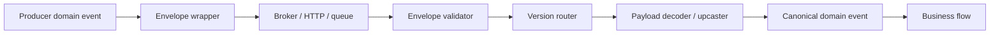
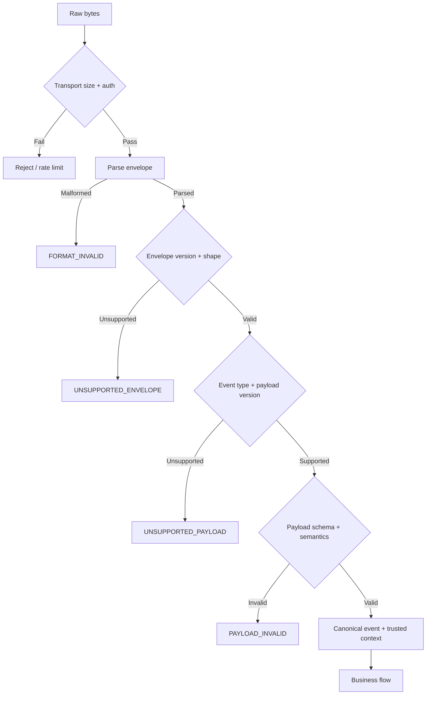
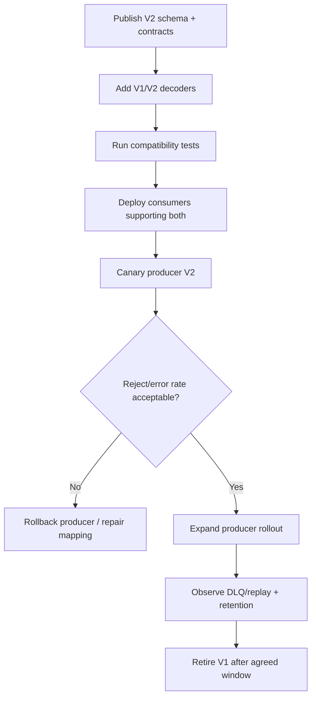
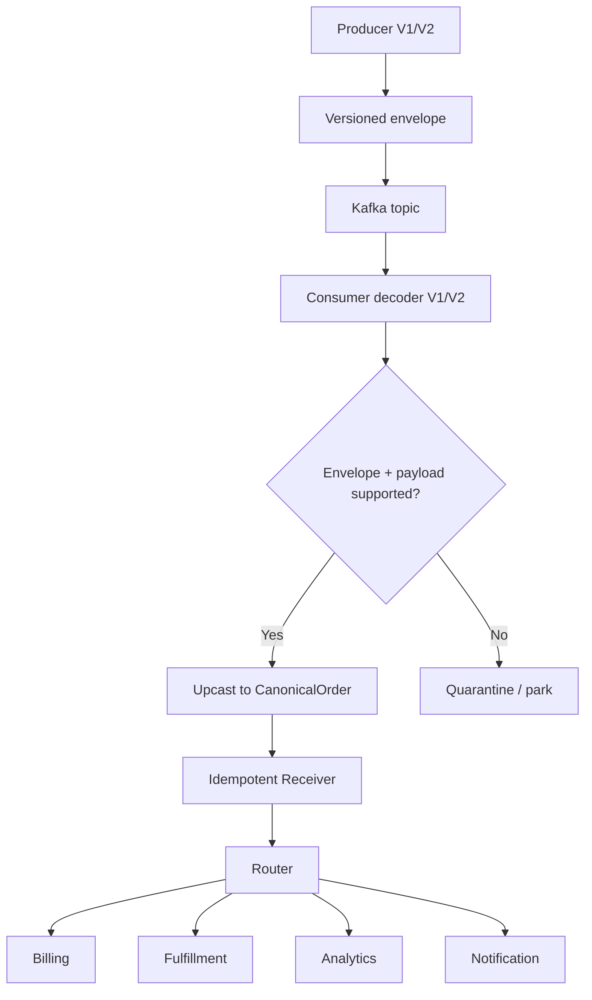

# Version envelope và tương thích

Trong hệ thống tích hợp, một message không chỉ chứa dữ liệu nghiệp vụ. Nó còn cần thông tin để consumer biết **đây là sự kiện gì, được phát theo hợp đồng nào, thuộc tenant nào, có liên hệ với request nào và phải giải mã ra sao**. Khi số lượng producer, consumer và broker tăng, việc chỉ truyền payload rồi yêu cầu từng consumer tự đoán định dạng sẽ khiến hệ thống khó nâng cấp, khó replay và dễ xử lý nhầm phiên bản.

**Envelope Wrapper** là một Enterprise Integration Pattern (EIP) đặt một lớp bao (*envelope*) quanh dữ liệu nghiệp vụ. Lớp bao chứa metadata phục vụ trao đổi, định tuyến, truy vết, phân loại và lựa chọn bộ giải mã. **Version envelope và tương thích** đề cập tới việc thiết kế và phát triển lớp bao đó sao cho những service được triển khai ở các thời điểm khác nhau vẫn giao tiếp **đúng hợp đồng**, không đánh đồng một thay đổi metadata với một thay đổi payload.

Bài thuộc chương **Envelope wrapper** của module `SPRING_INTEGRATION_PATTERN`: học triển khai EIP bằng Spring Integration để tạo message flow ít phụ thuộc, dễ mở rộng; thực hành Router, Filter, Transformer, Splitter, Aggregator, Gateway, retry, error channel, correlation, đồng thời kiểm thử và quan sát các nhánh xử lý.

**Sau bài học, bạn có thể:**

- Phân biệt **envelope version**, **payload schema version** và version của business semantics.
- Thiết kế envelope có định danh, type, schema reference, correlation, thời gian và metadata tin cậy.
- Giải thích **backward/forward compatibility** theo quan hệ writer–reader, không dùng thuật ngữ mơ hồ.
- Chọn cách xử lý trường mới, trường bị xóa, field bắt buộc, enum mới và thay đổi format.
- Dùng **upcaster/adapter** để chuẩn hóa dữ liệu từ nhiều phiên bản về một DTO nội bộ.
- Thiết kế Spring Integration Java DSL có nhánh chấp nhận/từ chối và mã lỗi ổn định.
- Kiểm thử ma trận phiên bản, replay, unsupported schema, duplicate, gateway response và bảo mật.
- Lập chiến lược rollout đa service, không giả định chỉ nâng version number là đủ.

## 1. Envelope Wrapper giải quyết vấn đề nào?

Giả sử producer phát một message JSON:

```json
{
  "orderId": "ORD-100",
  "amountMinor": 30000,
  "currency": "VND"
}
```

Consumer có thể hiểu các field, nhưng không biết chắc: message thuộc sự kiện `OrderSubmitted` hay `OrderCorrected`? Đây là phiên bản nào? Ai là nguồn? Cùng event bị phát lại hay là event mới? Reply/correlation phải về đâu?

Bổ sung envelope:

```json
{
  "envelopeVersion": 1,
  "eventType": "OrderSubmitted",
  "payloadSchemaVersion": 2,
  "eventId": "evt-100",
  "tenantId": "TENANT-A",
  "correlationId": "flow-100",
  "occurredAt": "2026-11-21T03:00:00Z",
  "data": {
    "orderId": "ORD-100",
    "amountMinor": 30000,
    "currency": "VND"
  }
}
```

Lớp `data` chứa **nội dung nghiệp vụ**; lớp bao chứa **hợp đồng vận chuyển ở mức ứng dụng**. Schema và decoder được lựa chọn theo `(eventType, payloadSchemaVersion)` sau khi xác minh cấu trúc envelope.



**Không phải tất cả headers của Spring Messaging đều nên được đưa vào JSON envelope.** Lớp bao là hợp đồng liên service; các object như `replyChannel` nội bộ, security context hoặc object exception không có ý nghĩa truyền nguyên dạng qua mọi broker.

## 2. Có ít nhất ba trục version khác nhau

Một lỗi thiết kế phổ biến là chỉ có một trường `version` rồi dùng nó đồng thời cho shape của envelope và business payload.

| Trục | Định nghĩa | Ví dụ thay đổi |
| --- | --- | --- |
| **Envelope version** | Hình dạng và semantics của lớp metadata chung. | Thêm `causationId`, đổi cách biểu diễn timestamp, đổi tên field `eventType`. |
| **Payload schema version** | Hình dạng `data` của một loại sự kiện. | `totalMinor` thành `amountMinor`, thêm `sourceChannel`. |
| **Business semantics/policy version** | Ý nghĩa nghiệp vụ hoặc thuật toán xử lý. | Giá từ tổng trước thuế thành tổng sau thuế, đổi quy tắc trạng thái. |

Một message có thể hoàn toàn hợp lệ với:

```text
envelopeVersion       = 2
eventType             = OrderSubmitted
payloadSchemaVersion  = 1
businessPolicyVersion = được quản lý riêng nếu cần
```

Không có quy tắc rằng envelope V2 phải đi với payload V2. Hai trục có thể **tiến hóa độc lập**, miễn consumer công bố và kiểm thử các tổ hợp mà nó hỗ trợ.

### Vì sao không tăng envelope version khi chỉ thêm một field trong data?

Nếu mỗi thay đổi nghiệp vụ đều buộc nâng version của lớp bao chung, tất cả consumer dù không quan tâm loại sự kiện đó cũng phải xử lý version envelope mới. Điều này tạo **coupling giả tạo**. Ngược lại, một thay đổi về cách mã hóa metadata của envelope có thể tác động tới tất cả event types, cần quản lý version tại lớp bao.

## 3. Hợp đồng tối thiểu của một envelope

Một lớp bao nên đủ ổn định nhưng không ôm mọi metadata của mọi transport.

| Trường | Mục đích | Lưu ý |
| --- | --- | --- |
| `envelopeVersion` | Chọn contract của lớp bao. | Không lấy làm payload version. |
| `eventType` | Tên loại message hoặc event. | Nên ổn định và có registry/allowlist. |
| `payloadSchemaVersion` | Chọn decoder/schema cho `data`. | Luôn xét cùng `eventType`. |
| `eventId` | Định danh nghiệp vụ bền vững cho event. | Dùng chống duplicate theo đúng consumer scope. |
| `tenantId` | Ngữ cảnh sở hữu nghiệp vụ. | Phải **đối chiếu với principal đã xác thực**. |
| `correlationId` | Liên hệ message trong một flow/run. | Không thay thế event ID. |
| `causationId` | Message/command nào gây ra event này. | Có thể được bổ sung ở version mới. |
| `occurredAt` | Thời điểm xảy ra hoặc phát theo contract. | Nên là ISO-8601 có timezone/UTC rõ. |
| `data` | Payload nghiệp vụ. | Được validate theo schema riêng. |

Có thể cần thêm `source`, `traceparent`, `contentType`, `schemaId`, `partitionKey`, `producerVersion` hoặc `expiresAt`. **Chỉ thêm khi có use case** và xác định semantics rõ. Một lớp bao chứa hàng chục trường optional không kiểm soát có thể trở thành nguồn coupling mới.

### Các giá trị không nên tin chỉ vì đúng kiểu

Một client có thể tự gửi `"tenantId":"TENANT-A"` hoặc `"correlationId":"run-1"`. Schema check chứng minh chúng là string hợp lệ; **không chứng minh** người gửi có quyền gắn chúng. Ở ingress, cần xác thực nguồn, áp policy và tái tạo/đối chiếu metadata trusted.

## 4. Ví dụ hai phiên bản của envelope

### Envelope V1 + payload OrderSubmitted V1

```json
{
  "envelopeVersion": 1,
  "eventType": "OrderSubmitted",
  "payloadSchemaVersion": 1,
  "eventId": "evt-100",
  "tenantId": "TENANT-A",
  "correlationId": "flow-100",
  "occurredAt": "2026-11-21T03:00:00Z",
  "data": {
    "orderId": "ORD-100",
    "totalMinor": 30000,
    "currency": "VND"
  }
}
```

### Envelope V2 + payload OrderSubmitted V2

```json
{
  "envelopeVersion": 2,
  "eventType": "OrderSubmitted",
  "payloadSchemaVersion": 2,
  "eventId": "evt-100",
  "tenantId": "TENANT-A",
  "correlationId": "flow-100",
  "causationId": "cmd-create-100",
  "occurredAt": "2026-11-21T03:00:00Z",
  "data": {
    "orderId": "ORD-100",
    "amountMinor": 30000,
    "currency": "VND",
    "sourceChannel": "MOBILE"
  }
}
```

Trong ví dụ:

- Envelope V2 thêm metadata tùy chọn `causationId`.
- Payload V2 đổi tên `totalMinor` thành `amountMinor` và thêm `sourceChannel`.
- Số tiền trong cả hai version đều có nghĩa **minor units của VND**.
- `eventId` giống nhau để minh họa **cùng một sự kiện logic được biểu diễn bằng hai schema**, không có nghĩa production nên publish đồng thời cả hai biểu diễn cho một consumer không có idempotency.
- `sourceChannel` không thay business amount; adapter có thể giữ ở metadata quan sát nếu cần.

**Tương đương về dữ liệu nghiệp vụ** không đồng nghĩa **hai envelope bằng nhau**: metadata version, causation và source có thể khác theo hợp đồng.

## 5. Ma trận version phải được định nghĩa rõ

Nếu consumer hỗ trợ envelope V1/V2 và payload OrderSubmitted V1/V2, có thể định nghĩa:

| Envelope | Payload | Consumer dự kiến |
| --- | --- | --- |
| V1 | V1 | Chấp nhận, upcast `totalMinor`. |
| V1 | V2 | Chấp nhận **nếu** hai version độc lập được công bố. |
| V2 | V1 | Chấp nhận, metadata mới có thể optional. |
| V2 | V2 | Chấp nhận, dùng `amountMinor`. |
| V3 | V2 | Reject/park `UNSUPPORTED_ENVELOPE_VERSION`. |
| V2 | V9 | Reject/park `UNSUPPORTED_PAYLOAD_SCHEMA`. |
| V2 | V2 của eventType lạ | Reject/park `UNSUPPORTED_EVENT_TYPE`. |

Không mặc định **mọi** tổ hợp giữa hai dải version đều hợp lệ. Ma trận trên là **hợp đồng minh họa**; nếu một field V2 chỉ có nghĩa khi envelope V2, cần ghi quan hệ phụ thuộc đó và test đúng giới hạn.

### Khả năng tương thích khác khả năng nhận diện version

Một consumer đọc được `envelopeVersion: 2` không có nghĩa nó biết cách xử lý field mới. Ngược lại, consumer cũ có thể **chấp nhận một thay đổi additive** nếu nó cho phép unknown fields và semantics không đổi, nhưng không nên suy ra điều đó khi hệ thống có strict validation.

**Version number là tín hiệu chọn contract; compatibility được xác nhận bởi test.**

## 6. Backward và forward compatibility: nói rõ reader và writer

Hai thuật ngữ dễ gây nhầm nếu không nêu ai được nâng cấp trước:

- **Backward compatibility theo góc nhìn reader mới:** consumer/reader **mới** đọc được dữ liệu do producer/writer **cũ** tạo.
- **Forward compatibility theo góc nhìn reader cũ:** consumer/reader **cũ** đọc được dữ liệu từ producer/writer **mới**.

| Writer | Reader | Điều cần kiểm tra |
| --- | --- | --- |
| V1 | V1 | Hợp đồng hiện hành. |
| V1 | V2 | Reader mới vẫn hiểu format cũ (backward). |
| V2 | V1 | Reader cũ có chấp nhận dữ liệu mới không (forward)? |
| V2 | V2 | Hợp đồng mới. |

Tên gọi backward/forward còn phụ thuộc quy ước của schema registry hoặc cách người nói định nghĩa chiều kiểm tra. Trong tài liệu dự án, hãy luôn viết **writer Vx → reader Vy** bên cạnh thuật ngữ.

### Một thay đổi additive có luôn forward-compatible không?

Không chắc. Ví dụ producer V2 thêm `"causationId"` và tăng `envelopeVersion` lên 2. Nếu reader V1 yêu cầu **`envelopeVersion == 1`** hoặc dùng `additionalProperties: false`, nó sẽ reject. Thay đổi có vẻ additive ở cấp field nhưng **không tương thích với reader hiện hữu**.

Muốn old readers đọc được trong giai đoạn chuyển tiếp, có thể:

1. Giữ V1 khi producer chưa được phép chuyển phiên bản.
2. Cho reader V1 hỗ trợ/cấu hình tương thích trước.
3. Sử dụng envelope evolution policy cho optional metadata mà không thay phiên bản phá vỡ.
4. Chọn upcaster/adapter ở ingress để chuyển V2 về representation cũ **chỉ khi không mất nghĩa quan trọng**.

## 7. Những thay đổi nào thường an toàn hoặc phá vỡ?

| Thay đổi | Nguy cơ | Chính sách khuyến nghị |
| --- | --- | --- |
| Thêm optional metadata | Reader strict có thể reject. | Kiểm tra unknown-field policy, compatibility matrix. |
| Thêm required metadata | Writer cũ không phát được. | Có fallback được định nghĩa hoặc version mới. |
| Xóa/đổi tên `eventId` | Hỏng idempotency và tracing. | Breaking change; migration/upcaster rõ. |
| Đổi `eventType` | Router/decoder không còn biết sự kiện. | Alias/version migration có kiểm soát. |
| Đổi `occurredAt` từ string sang số epoch | Reader cũ sai type. | Breaking change; version hóa định dạng timestamp. |
| Thay nghĩa `correlationId` | Gom group sai dù field vẫn là string. | Semantic breaking; test group/reply. |
| Thêm enum value | Router cũ có thể không biết route. | Default/reject policy có chủ đích. |
| `totalMinor` → `amountMinor` | Mapper cũ thiếu field. | Payload version mới + upcaster. |
| Decimal amount → integer minor unit | Có nguy cơ đổi tiền sai. | Version contract + conversion/rounding tests. |
| Đổi `data` JSON thành bytes nén | Thay đổi decoding và security. | Version/encoding policy + adapter/test. |
| Xóa một field ít dùng | Consumer bất ngờ vẫn có thể phụ thuộc. | Consumer-driven contract tests. |

**Không suy compatibility chỉ từ schema shape.** Có những thay đổi vẫn cùng type nhưng nghĩa hoàn toàn khác, ví dụ `status="DONE"` từ “đã lưu queue” thành “đã xử lý thành công”.

## 8. Cần version hóa lớp bao, payload hay cả hai?

Một chính sách thực dụng là:

1. **Envelope version** chỉ thay khi có thay đổi **được công bố trong hợp đồng metadata chung** và cần phân biệt.
2. **Payload schema version** thay theo **loại event** khi shape/semantics của `data` đổi theo cách cần decoder mới.
3. **Business policy/revision** có định danh riêng khi người nhận cần tái diễn giải theo phiên bản nghiệp vụ khác.
4. Định nghĩa việc **thêm optional field** có được chấp nhận trong cùng version không, và unknown-field policy là gì.
5. Giữ schema/version đã phát hành **bất biến hoặc có lifecycle rõ**, tránh “V1 hôm nay khác V1 tuần trước”.

Một versioning scheme có thể dùng số nguyên tăng dần, semantic version hoặc schema ID. Không có phương pháp duy nhất tốt nhất; điều quan trọng là quy ước **ổn định, có registry và test compatibility**.

### Vì sao không lấy `producerBuildVersion` làm payload version?

Phiên bản triển khai `2.7.14` có thể đổi mỗi ngày dù hợp đồng dữ liệu không thay. Consumer không nên phải biết mọi build của producer. Hãy phân biệt **implementation version** phục vụ quan sát với **schema/envelope contract version** phục vụ giải mã.

## 9. Envelope fields nằm trong payload hay headers?

Với Spring Integration, một message có `payload` và `MessageHeaders`. Một broker cũng có headers/key/properties riêng; một HTTP request có headers riêng. Cần quyết định **hợp đồng liên service** nằm ở đâu.

| Phương án | Ưu điểm | Rủi ro cần kiểm soát |
| --- | --- | --- |
| Envelope JSON bên trong body | Portable qua file/object store, dễ replay độc lập. | Metadata bị nhân đôi với broker headers; phải kiểm tra body trước routing. |
| Metadata trong broker headers | Router/adapter có thể đọc sớm. | Không phải transport nào giữ nguyên headers; mapping/type khác nhau. |
| Kết hợp body envelope + một số headers | Tận dụng broker routing/tracing. | Hai nguồn có thể **mâu thuẫn**, cần quy tắc nguồn chân lý. |
| Schema ID ở broker wire format | Giảm overhead body, hỗ trợ registry. | Replay/interop cần có registry/decoder phù hợp. |

**Không chọn “header thắng” theo mặc định** nếu một client ngoài có thể tự đặt `tenantId` hoặc `schemaId`. Hãy kiểm tra trusted transport identity và quy định mapping. Nếu body nói `eventType=OrderSubmitted` nhưng broker header nói `OrderCancelled`, **không được tự chọn một bên và tiếp tục tạo side effect** khi contract yêu cầu chúng khớp.

### Header nào không nên serialize thẳng?

`replyChannel`, `errorChannel` dưới dạng object channel trong JVM, `MessageHeaders.id` của một message instance, security principal, `ThreadLocal` context và exception objects không phải contract JSON an toàn mặc định. Qua process/broker, dùng **reply address hoặc correlation token** có định nghĩa riêng, khi thực sự cần request–reply.

## 10. Canonical internal model và upcaster

Một consumer có thể đọc nhiều phiên bản ngoài nhưng chỉ dùng **một kiểu nội bộ**:

```text
Envelope V1 + OrderSubmitted V1 --+
                                 |
Envelope V2 + OrderSubmitted V1 --+--> validate --> upcast --> Canonical OrderSubmitted
                                 |
Envelope V1 + OrderSubmitted V2 --+
                                 |
Envelope V2 + OrderSubmitted V2 --+
```

Ví dụ canonical:

```java
record CanonicalOrderSubmitted(
        String orderId,
        String currency,
        long amountMinor
) {}
```

Translator V1:

```text
data.totalMinor -> canonical.amountMinor
```

Translator V2:

```text
data.amountMinor -> canonical.amountMinor
```

**Upcaster phải bảo toàn nghĩa.** Nếu V1 không có currency nhưng V2 yêu cầu currency, không tự đặt `USD` hay `VND` trừ khi contract V1 thật sự xác định một giá trị mặc định. Một default **không được tài liệu hóa** có thể làm dữ liệu cũ bị hiểu sai trên replay.

### Có nên upcast tất cả lịch sử thành V2 trong database?

Tùy yêu cầu: có thể giữ **raw immutable event** để audit/replay, và tạo **canonical view** khi đọc; hoặc migration durable store có kiểm chứng. Không làm mất chứng cứ về dữ liệu đã nhận chỉ vì DTO nội bộ thay đổi. Nếu dùng Claim Check, metadata/schema version của payload đã lưu cần đồng bộ với reference.

## 11. Định danh và correlation không được thay đổi theo version

Một lỗi khó phát hiện là chuyển đổi version làm mất hoặc tái tạo ID:

```text
raw V1:
  eventId=evt-100
  correlationId=flow-100

upcaster:
  new eventId=random UUID
  correlationId=null
```

Hậu quả:

- **Idempotent Receiver** không nhận ra replay cùng sự kiện.
- **Aggregator** không gom được reply về đúng group.
- **Gateway** có thể timeout vì mất correlation hoặc reply route.
- **Tracing** đứt đoạn.
- Dữ liệu của hai tenant có nguy cơ bị trộn khi group key không có scope.

Chính sách nên là: **giữ nguyên business event identity đã được xác minh**, giữ hoặc tái tạo correlation theo contract và **không dùng message UUID mới làm event ID**. Nếu thay đổi ID scheme là bắt buộc, cần mapping table/migration và compatibility tests.

### `eventId` khác `correlationId` và `causationId`

| Trường | Ví dụ | Vai trò |
| --- | --- | --- |
| `eventId` | `evt-100` | Sự kiện duy nhất, hỗ trợ dedup theo consumer. |
| `correlationId` | `checkout-run-12` | Những sự kiện/message cùng một workflow/run. |
| `causationId` | `cmd-create-100` | Lệnh/message trực tiếp gây ra event này. |
| `traceId`/`traceparent` | Trace phân tán | Quan sát call chain, không phải ID nghiệp vụ. |
| `MessageHeaders.id` | UUID Spring message | Danh tính message instance, có thể đổi khi transformer/replay. |

Đừng đưa mọi message của một workflow vào cùng khóa idempotency `correlationId`; nhiều event khác nhau có thể cùng flow.

## 12. Version/schema registry và cách chọn decoder

Một ứng dụng có thể chứa nhiều schema:

```text
OrderSubmitted / payload V1
OrderSubmitted / payload V2
OrderCancelled / payload V1
ShipmentDispatched / payload V3

Envelope / V1
Envelope / V2
```

Bộ chọn không được chỉ dùng `payloadSchemaVersion=2`, vì **mỗi eventType có schema V2 khác nhau**. Một khóa phù hợp:

```text
(envelopeVersion, eventType, payloadSchemaVersion)
```

Trong một số kiến trúc, `schemaId` trong envelope/transport có thể ánh xạ tới một artifact được version hóa, nhưng consumer vẫn cần xác minh schema tương ứng với loại event và quyền của producer.

### Lỗi liên quan registry

| Trạng thái | Xử lý |
| --- | --- |
| Schema ID/version được hỗ trợ và có bản cache tin cậy | Giải mã bằng schema đúng. |
| `eventType` chưa được hỗ trợ | Reject/park/quarantine theo policy. |
| Payload version mới chưa được consumer hỗ trợ | Không dùng parser cũ để đoán; lưu event để replay sau nâng cấp nếu cần. |
| Registry tạm unreachable | Retry có backoff hoặc dùng immutable cache versioned. |
| Schema artifact bị thay đổi mà giữ cùng ID | Contract governance failure; kiểm tra checksum/signature. |
| Data sai schema đã biết | Lỗi permanent, không retry vô hạn cùng bytes. |

Schema registry không tự bảo đảm consumer **tương thích về ngữ nghĩa**. Một schema hợp lệ vẫn có thể chứa giá trị enum mới mà Router chưa có channel tương ứng.

## 13. Validation cần hai lớp

Một envelope nên qua **hai vòng validation độc lập nhưng phối hợp**:



- **Envelope validation:** đảm bảo field type, version, event ID, tenant context, correlation, time format và những metadata được phép.
- **Payload validation:** đảm bảo `data` đúng schema của `(eventType, payloadVersion)`.
- **Business validation:** kiểm tra điều kiện nghiệp vụ hiện tại sau khi dữ liệu đã được giải mã đúng.
- **Security validation:** xác minh nguồn/tenant, quyền và tính toàn vẹn; không thay được bằng JSON Schema.

**Bắt buộc kiểm soát kích thước ngay tại ingress**, trước khi nạp hàng trăm MiB vào RAM. Một `bytes.length` check trong handler chỉ là lớp kiểm soát thứ hai, không thu hồi được memory đã cấp phát.

## 14. Thiết kế dữ liệu Java 17 cho decoder

Ví dụ sau dùng **Jackson**, Java records và một exception có mã lỗi. Các kiểu dưới đây là **ứng dụng tự định nghĩa**, không phải class sẵn có của Spring Integration.

```java
import java.time.Instant;

record EventMetadata(
        int envelopeVersion,
        String eventType,
        int payloadSchemaVersion,
        String eventId,
        String tenantId,
        String correlationId,
        String causationId,
        Instant occurredAt
) {}

record CanonicalOrderSubmitted(
        String orderId,
        String currency,
        long amountMinor
) {}

record DecodedOrderMessage(
        EventMetadata metadata,
        CanonicalOrderSubmitted order
) {}

final class EnvelopeRejected extends RuntimeException {
    private final String reasonCode;

    EnvelopeRejected(String reasonCode) {
        super(reasonCode);
        this.reasonCode = reasonCode;
    }

    String reasonCode() {
        return reasonCode;
    }
}
```

Bản canonical **không chứa `envelopeVersion` như một thuộc tính nghiệp vụ của order**. Phiên bản và metadata cần thiết được giữ riêng trong `EventMetadata`, để downstream xử lý cùng một kiểu order nhưng vẫn quan sát chính xác nguồn schema.

### Khi nào nên tách metadata thành Spring headers?

Trong cùng JVM, có thể chuyển metadata hợp lệ thành các header có namespace được kiểm soát. Nhưng nếu header cũng có thể do inbound client tự khai, nên **xóa/tái tạo các header tin cậy** thay vì copy toàn bộ. DTO metadata rõ ràng dễ kiểm thử hơn việc các handler tự đọc những string header không có contract.

## 15. Java decoder: chọn envelope version rồi payload version

Ví dụ decoder minh họa hỗ trợ:

- Envelope V1: những field cơ bản.
- Envelope V2: tương tự V1, thêm optional `causationId`.
- `OrderSubmitted` payload V1: `totalMinor`.
- `OrderSubmitted` payload V2: `amountMinor`, thêm optional `sourceChannel`.
- Chỉ cho `currency="VND"` và `amountMinor >= 0` trong bài.
- Reject eventType, version, field/kiểu hoặc size chưa được hỗ trợ.

Đây là một **decoder rút gọn cho một event type**, không thay thế engine JSON Schema đầy đủ hay một schema registry trong production.

```java
import java.time.Instant;
import java.time.format.DateTimeParseException;
import java.util.Iterator;
import java.util.Set;

import java.io.IOException;
import com.fasterxml.jackson.databind.JsonNode;
import com.fasterxml.jackson.databind.ObjectMapper;

final class EnvelopeDecoder {
    private static final int MAX_BYTES = 64 * 1024;

    private final ObjectMapper mapper;

    EnvelopeDecoder(ObjectMapper mapper) {
        this.mapper = mapper;
    }

    DecodedOrderMessage decode(byte[] raw) {
        if (raw == null || raw.length == 0
                || raw.length > MAX_BYTES) {
            throw new EnvelopeRejected("BODY_SIZE_INVALID");
        }

        try {
            JsonNode root = mapper.readTree(raw);
            if (root == null || !root.isObject()) {
                throw new EnvelopeRejected("ENVELOPE_NOT_OBJECT");
            }

            int envelopeVersion =
                    requiredInt(root, "envelopeVersion");
            if (envelopeVersion != 1 && envelopeVersion != 2) {
                throw new EnvelopeRejected(
                        "UNSUPPORTED_ENVELOPE_VERSION");
            }

            Set<String> envelopeFields = Set.of(
                    "envelopeVersion", "eventType",
                    "payloadSchemaVersion", "eventId",
                    "tenantId", "correlationId",
                    "occurredAt", "data");

            if (envelopeVersion == 2) {
                envelopeFields =
                        new java.util.HashSet<>(envelopeFields);
                envelopeFields.add("causationId");
            }

            rejectUnknownFields(root, envelopeFields,
                    "UNKNOWN_ENVELOPE_FIELD");

            String eventType = requiredText(root, "eventType");
            if (!"OrderSubmitted".equals(eventType)) {
                throw new EnvelopeRejected(
                        "UNSUPPORTED_EVENT_TYPE");
            }

            int payloadVersion =
                    requiredInt(root, "payloadSchemaVersion");
            if (payloadVersion != 1 && payloadVersion != 2) {
                throw new EnvelopeRejected(
                        "UNSUPPORTED_PAYLOAD_SCHEMA");
            }

            String eventId = requiredText(root, "eventId");
            String tenantId = requiredText(root, "tenantId");
            String correlationId =
                    requiredText(root, "correlationId");
            Instant occurredAt;
            try {
                occurredAt = Instant.parse(
                        requiredText(root, "occurredAt"));
            } catch (DateTimeParseException ex) {
                throw new EnvelopeRejected(
                        "OCCURRED_AT_INVALID");
            }

            String causationId = null;
            if (root.has("causationId")) {
                causationId = requiredText(root, "causationId");
            }

            JsonNode data = root.path("data");
            if (!data.isObject()) {
                throw new EnvelopeRejected("PAYLOAD_NOT_OBJECT");
            }

            CanonicalOrderSubmitted order =
                    decodeOrder(payloadVersion, data);

            return new DecodedOrderMessage(
                    new EventMetadata(
                            envelopeVersion, eventType,
                            payloadVersion, eventId,
                            tenantId, correlationId,
                            causationId, occurredAt),
                    order);

        } catch (IOException ex) {
            // Không lộ raw JSON hoặc parser exception cho caller.
            throw new EnvelopeRejected("JSON_PARSE_FAILED");
        }
    }

    private static CanonicalOrderSubmitted decodeOrder(
            int version, JsonNode data) {

        if (version == 1) {
            rejectUnknownFields(
                    data, Set.of("orderId", "currency", "totalMinor"),
                    "UNKNOWN_PAYLOAD_FIELD");
        } else {
            rejectUnknownFields(
                    data, Set.of("orderId", "currency",
                            "amountMinor", "sourceChannel"),
                    "UNKNOWN_PAYLOAD_FIELD");

            if (data.has("sourceChannel")) {
                requiredText(data, "sourceChannel");
            }
        }

        String orderId = requiredText(data, "orderId");
        String currency = requiredText(data, "currency");

        if (!"VND".equals(currency)) {
            throw new EnvelopeRejected("UNSUPPORTED_CURRENCY");
        }

        String moneyField =
                version == 1 ? "totalMinor" : "amountMinor";
        long amount = requiredLong(data, moneyField);

        if (amount < 0) {
            throw new EnvelopeRejected("NEGATIVE_AMOUNT");
        }

        return new CanonicalOrderSubmitted(
                orderId, currency, amount);
    }

    private static String requiredText(
            JsonNode object, String field) {
        JsonNode value = object.path(field);

        if (!value.isTextual() || value.textValue().isBlank()
                || value.textValue().length() > 128) {
            throw new EnvelopeRejected("TEXT_FIELD_INVALID");
        }

        return value.textValue();
    }

    private static int requiredInt(
            JsonNode object, String field) {
        JsonNode value = object.path(field);

        if (!value.isIntegralNumber()
                || !value.canConvertToInt()) {
            throw new EnvelopeRejected("INTEGER_FIELD_INVALID");
        }

        return value.intValue();
    }

    private static long requiredLong(
            JsonNode object, String field) {
        JsonNode value = object.path(field);

        if (!value.isIntegralNumber()
                || !value.canConvertToLong()) {
            throw new EnvelopeRejected("AMOUNT_TYPE_INVALID");
        }

        return value.longValue();
    }

    private static void rejectUnknownFields(
            JsonNode object, Set<String> allowed, String reason) {

        Iterator<String> fields = object.fieldNames();
        while (fields.hasNext()) {
            if (!allowed.contains(fields.next())) {
                throw new EnvelopeRejected(reason);
            }
        }
    }
}
```

### Diễn giải chính xác phạm vi

- Code minh họa **strict allowlist** để người học thấy hệ quả của versioning. Nếu policy cho phép optional/extension fields, phải thiết kế allowance/test tương ứng thay vì copy nguyên `rejectUnknownFields`.
- `causationId` là **optional chỉ ở envelope V2**. Envelope V1 có field đó sẽ bị từ chối do allowlist.
- `sourceChannel` trong payload V2 chỉ được validate kiểu và không được dùng thay authentication/source identity.
- `EventMetadata` giữ event/correlation identities; **không tự xác thực tenant**.
- `Instant.parse` yêu cầu timestamp ISO-8601 theo format nó chấp nhận, phù hợp dữ liệu ví dụ `Z`.
- `MAX_BYTES` chỉ là ngưỡng demo; production cần giới hạn ở HTTP/broker adapter **trước khi buffer toàn bộ body**.
- Không coi mã trên là JSON Schema validator đầy đủ; production có thể dùng schema registry và compiled schema theo version.

## 16. Cấu hình Jackson an toàn cho envelope chưa đáng tin

Một mapper mặc định có thể không đáp ứng yêu cầu hợp đồng về **duplicate JSON keys**, trailing tokens hoặc nesting limits. Có thể cấu hình mapper lúc khởi tạo, sau đó sử dụng như singleton **không thay cấu hình khi có nhiều thread**.

Ví dụ ý tưởng:

```java
import com.fasterxml.jackson.core.JsonFactory;
import com.fasterxml.jackson.core.StreamReadFeature;
import com.fasterxml.jackson.databind.DeserializationFeature;
import com.fasterxml.jackson.databind.ObjectMapper;

ObjectMapper envelopeMapper = new ObjectMapper(
        JsonFactory.builder()
                .enable(StreamReadFeature.STRICT_DUPLICATE_DETECTION)
                .build()
);
envelopeMapper.enable(
        DeserializationFeature.FAIL_ON_TRAILING_TOKENS);
```

Khi triển khai thật, cần đối chiếu Jackson version và kiểm thử rằng **API `readTree`/object reader thực sự từ chối trailing tokens** trong cấu hình được dùng. Có thể thêm `StreamReadConstraints` để giới hạn độ sâu, độ dài string/number và tổng số token theo khả năng phiên bản.

Không bật polymorphic default typing cho dữ liệu untrusted để tự dựng object theo tên class do payload cung cấp. Envelope `eventType` chỉ được dùng để **chọn decoder từ allowlist**, không phải để load class tùy ý.

### Một vấn đề khó: JSON duplicate keys

```json
{
  "envelopeVersion": 1,
  "eventType": "OrderSubmitted",
  "eventType": "OrderCancelled"
}
```

Một parser lỏng có thể lấy field đầu hoặc cuối tùy cách cài đặt. Nếu `eventType` ảnh hưởng route và side effect, cần **reject duplicate key** thay vì chấp nhận một kết quả không xác định.

## 17. Spring Integration: decode và phân nhánh accepted/rejected

Ta nối `EnvelopeDecoder` vào IntegrationFlow, rồi route **một kết quả có kiểu** đến hai channel:

```java
record EnvelopeOutcome(
        DecodedOrderMessage accepted,
        String rejectionCode
) {
    boolean valid() {
        return accepted != null;
    }

    static EnvelopeOutcome pass(DecodedOrderMessage event) {
        return new EnvelopeOutcome(event, null);
    }

    static EnvelopeOutcome reject(String reason) {
        return new EnvelopeOutcome(null, reason);
    }
}
```

Cấu hình Java DSL minh họa:

```java
import com.fasterxml.jackson.core.JsonFactory;
import com.fasterxml.jackson.core.StreamReadFeature;
import com.fasterxml.jackson.databind.DeserializationFeature;
import com.fasterxml.jackson.databind.ObjectMapper;

import org.springframework.context.annotation.Bean;
import org.springframework.context.annotation.Configuration;
import org.springframework.integration.channel.DirectChannel;
import org.springframework.integration.channel.QueueChannel;
import org.springframework.integration.config.EnableIntegration;
import org.springframework.integration.dsl.IntegrationFlow;

@Configuration
@EnableIntegration
class EnvelopeFlowConfig {

    @Bean
    DirectChannel rawEnvelopes() {
        return new DirectChannel();
    }

    @Bean
    QueueChannel acceptedEnvelopes() {
        return new QueueChannel();
    }

    @Bean
    QueueChannel rejectedEnvelopes() {
        return new QueueChannel();
    }

    @Bean
    ObjectMapper versionedEnvelopeMapper() {
        ObjectMapper mapper = new ObjectMapper(
                JsonFactory.builder()
                        .enable(
                                StreamReadFeature.STRICT_DUPLICATE_DETECTION)
                        .build());

        mapper.enable(
                DeserializationFeature.FAIL_ON_TRAILING_TOKENS);
        return mapper;
    }

    @Bean
    EnvelopeDecoder envelopeDecoder(
            ObjectMapper versionedEnvelopeMapper) {
        return new EnvelopeDecoder(versionedEnvelopeMapper);
    }

    @Bean
    IntegrationFlow envelopeIngress(EnvelopeDecoder decoder) {
        return IntegrationFlow.from("rawEnvelopes")
                .handle(byte[].class, (body, headers) -> {
                    try {
                        return EnvelopeOutcome.pass(decoder.decode(body));
                    } catch (EnvelopeRejected rejection) {
                        return EnvelopeOutcome.reject(
                                rejection.reasonCode());
                    }
                })
                .route(EnvelopeOutcome.class,
                        outcome -> outcome.valid()
                                ? "ACCEPTED" : "REJECTED",
                        routes -> routes
                                .channelMapping(
                                        "ACCEPTED", "acceptedEnvelopes")
                                .channelMapping(
                                        "REJECTED", "rejectedEnvelopes"))
                .get();
    }
}
```

**Quan trọng:**

- `acceptedEnvelopes` nhận **`EnvelopeOutcome` có `DecodedOrderMessage`**, không nhận `CanonicalOrderSubmitted` trực tiếp. Downstream cần transform/map đúng kiểu.
- `rejectedEnvelopes` nhận **rejection code**, chưa có durable DLQ/quarantine hay HTTP response mapper. Đó là fixture để kiểm thử routing.
- `EnvelopeRejected` biểu thị **contract error**. Lỗi hạ tầng (database outage, schema registry unavailable, broker failure) cần đường exception/retry **khác**, không bắt `Exception` rồi coi mọi lỗi là invalid payload.
- `QueueChannel` trong demo là kênh trong JVM để test; nó **không phải durable broker**.
- Không tạo hai endpoint cạnh tranh cùng tiêu thụ `rawEnvelopes` nếu định hướng mỗi message đi một đường.
- Java DSL/API overload có thể khác theo dependency Spring Integration; bài **chưa chạy build/Gradle tại STEP 4**.

## 18. Unit test: V1 và V2 cho cùng semantic output

Đây là kiểm thử quan trọng: **version khác nhau nhưng cùng dữ liệu nghiệp vụ** phải normalize về cùng canonical record, trong khi metadata version vẫn phản ánh nguồn.

```java
import static org.junit.jupiter.api.Assertions.*;

import java.nio.charset.StandardCharsets;

import com.fasterxml.jackson.databind.ObjectMapper;
import org.junit.jupiter.api.Test;

class EnvelopeDecoderCompatibilityTest {

    private final EnvelopeDecoder decoder =
            new EnvelopeDecoder(new ObjectMapper());

    private static byte[] utf8(String json) {
        return json.getBytes(StandardCharsets.UTF_8);
    }

    private static final String V1 = """
        {
          "envelopeVersion": 1,
          "eventType": "OrderSubmitted",
          "payloadSchemaVersion": 1,
          "eventId": "evt-100",
          "tenantId": "TENANT-A",
          "correlationId": "flow-100",
          "occurredAt": "2026-11-21T03:00:00Z",
          "data": {
            "orderId": "ORD-100",
            "totalMinor": 30000,
            "currency": "VND"
          }
        }
        """;

    private static final String V2 = """
        {
          "envelopeVersion": 2,
          "eventType": "OrderSubmitted",
          "payloadSchemaVersion": 2,
          "eventId": "evt-100",
          "tenantId": "TENANT-A",
          "correlationId": "flow-100",
          "causationId": "cmd-create-100",
          "occurredAt": "2026-11-21T03:00:00Z",
          "data": {
            "orderId": "ORD-100",
            "amountMinor": 30000,
            "currency": "VND",
            "sourceChannel": "MOBILE"
          }
        }
        """;

    @Test
    void oldAndNewVersionsNormalizeToSameBusinessOrder() {
        DecodedOrderMessage a = decoder.decode(utf8(V1));
        DecodedOrderMessage b = decoder.decode(utf8(V2));

        assertEquals(a.order(), b.order());
        assertEquals(
                new CanonicalOrderSubmitted(
                        "ORD-100", "VND", 30_000L),
                a.order());

        assertEquals(1, a.metadata().envelopeVersion());
        assertEquals(2, b.metadata().envelopeVersion());
        assertEquals(1, a.metadata().payloadSchemaVersion());
        assertEquals(2, b.metadata().payloadSchemaVersion());

        assertEquals(
                a.metadata().eventId(), b.metadata().eventId());
        assertEquals(
                a.metadata().correlationId(),
                b.metadata().correlationId());
        assertNull(a.metadata().causationId());
        assertEquals(
                "cmd-create-100",
                b.metadata().causationId());
    }
}
```

Hai fixtures cố ý dùng **cùng event ID**. Trong hệ thống thật, khi cả hai biểu diễn được publish vào cùng consumer, có thể cần **Idempotent Receiver** để tránh xử lý side effect hai lần.

### Các tổ hợp độc lập còn lại

Vì ví dụ hỗ trợ envelope V1/V2 và payload V1/V2 độc lập, nên bổ sung test:

- Envelope V1 + payload V2 → chấp nhận nếu vẫn thỏa allowlist V1.
- Envelope V2 + payload V1 → chấp nhận nếu không yêu cầu metadata V2 bắt buộc.
- Envelope V1 thêm `causationId` → reject `UNKNOWN_ENVELOPE_FIELD`.
- Envelope V2 **không có** `causationId` → vẫn chấp nhận theo contract optional.

Đừng chỉ assert `envelopeVersion=2` dẫn tới payload V2: đó là một coupling không tồn tại trong hợp đồng ví dụ.

## 19. Unit test: unsupported version và field sai

```java
@Test
void rejectsFutureEnvelopeVersion() {
    String unknown = V1.replace(
            "\"envelopeVersion\": 1",
            "\"envelopeVersion\": 99");

    EnvelopeRejected ex = assertThrows(
            EnvelopeRejected.class,
            () -> decoder.decode(utf8(unknown)));

    assertEquals(
            "UNSUPPORTED_ENVELOPE_VERSION",
            ex.reasonCode());
}

@Test
void rejectsUnknownPayloadSchemaVersion() {
    String unknown = V2.replace(
            "\"payloadSchemaVersion\": 2",
            "\"payloadSchemaVersion\": 99");

    EnvelopeRejected ex = assertThrows(
            EnvelopeRejected.class,
            () -> decoder.decode(utf8(unknown)));

    assertEquals(
            "UNSUPPORTED_PAYLOAD_SCHEMA",
            ex.reasonCode());
}

@Test
void v1EnvelopeCannotSilentlyAcceptV2OnlyMetadata() {
    String illegal = V1.replace(
            "\"occurredAt\":",
            "\"causationId\": \"cmd-100\", \"occurredAt\":");

    EnvelopeRejected ex = assertThrows(
            EnvelopeRejected.class,
            () -> decoder.decode(utf8(illegal)));

    assertEquals(
            "UNKNOWN_ENVELOPE_FIELD",
            ex.reasonCode());
}

@Test
void wrongAmountTypeIsNotCoerced() {
    String wrong = V2.replace(
            "\"amountMinor\": 30000",
            "\"amountMinor\": \"30000\"");

    EnvelopeRejected ex = assertThrows(
            EnvelopeRejected.class,
            () -> decoder.decode(utf8(wrong)));

    assertEquals("AMOUNT_TYPE_INVALID", ex.reasonCode());
}

@Test
void missingEventIdIsNotReplacedWithRandomId() {
    String invalid = V1.replace(
            "\"eventId\": \"evt-100\",", "");

    EnvelopeRejected ex = assertThrows(
            EnvelopeRejected.class,
            () -> decoder.decode(utf8(invalid)));

    assertEquals("TEXT_FIELD_INVALID", ex.reasonCode());
}
```

Đây là **các phương thức test bổ sung vào class `EnvelopeDecoderCompatibilityTest` ở mục 18**, không phải một file Java độc lập khi copy riêng từng block. Nếu đổi tên field ở một bản payload thật, cần test cả positive/negative cases cho đúng mapping, không chỉ test reject.

### Lỗi timestamp có ảnh hưởng gì?

Nếu `occurredAt` chứa chuỗi không parse được hoặc không có timezone theo contract, phải reject/migrate rõ thay vì dùng `Instant.now()` âm thầm: replay cùng sự kiện ở các thời điểm khác nhau sẽ cho metadata khác nhau, ảnh hưởng audit, ordering và TTL.

## 20. Integration test: routing valid và invalid version

Một unit test decoder PASS không chứng minh Spring Integration flow đã nối đúng channel. Ta cần test:

1. Input hợp lệ đi vào `acceptedEnvelopes`.
2. Input version không hỗ trợ đi vào `rejectedEnvelopes`.
3. Một input chỉ tạo một outcome.
4. Không có business handler chạy với payload bị reject.

```java
import static org.junit.jupiter.api.Assertions.*;

import java.nio.charset.StandardCharsets;

import org.junit.jupiter.api.Test;
import org.springframework.beans.factory.annotation.Autowired;
import org.springframework.beans.factory.annotation.Qualifier;
import org.springframework.integration.channel.QueueChannel;
import org.springframework.messaging.Message;
import org.springframework.messaging.MessageChannel;
import org.springframework.messaging.support.MessageBuilder;
import org.springframework.test.annotation.DirtiesContext;
import org.springframework.test.context.junit.jupiter.SpringJUnitConfig;

@SpringJUnitConfig(EnvelopeFlowConfig.class)
@DirtiesContext(classMode = DirtiesContext.ClassMode.AFTER_EACH_TEST_METHOD)
class EnvelopeFlowTest {

    @Autowired @Qualifier("rawEnvelopes")
    MessageChannel input;

    @Autowired @Qualifier("acceptedEnvelopes")
    QueueChannel accepted;

    @Autowired @Qualifier("rejectedEnvelopes")
    QueueChannel rejected;

    private static Message<byte[]> json(String content) {
        return MessageBuilder.withPayload(
                content.getBytes(StandardCharsets.UTF_8)).build();
    }

    @Test
    void acceptsVersionedOrderEvent() {
        assertTrue(input.send(json("""
            {
              "envelopeVersion": 2,
              "eventType": "OrderSubmitted",
              "payloadSchemaVersion": 1,
              "eventId": "evt-201",
              "tenantId": "TENANT-A",
              "correlationId": "flow-201",
              "occurredAt": "2026-11-21T03:00:00Z",
              "data": {
                "orderId": "ORD-201",
                "totalMinor": 25000,
                "currency": "VND"
              }
            }
            """)));

        Message<?> output = accepted.receive(1_000);
        assertNotNull(output);

        EnvelopeOutcome outcome =
                (EnvelopeOutcome) output.getPayload();
        assertTrue(outcome.valid());
        assertEquals(
                25_000L, outcome.accepted().order().amountMinor());

        assertEquals(
                2, outcome.accepted().metadata().envelopeVersion());
        assertEquals(
                1, outcome.accepted().metadata()
                        .payloadSchemaVersion());

        assertNull(rejected.receive(0));
    }

    @Test
    void rejectsUnsupportedEnvelopeVersion() {
        assertTrue(input.send(json("""
            {
              "envelopeVersion": 99,
              "eventType": "OrderSubmitted",
              "payloadSchemaVersion": 2,
              "eventId": "evt-202",
              "tenantId": "TENANT-A",
              "correlationId": "flow-202",
              "occurredAt": "2026-11-21T03:00:00Z",
              "data": {
                "orderId": "ORD-202",
                "amountMinor": 25000,
                "currency": "VND"
              }
            }
            """)));

        Message<?> output = rejected.receive(1_000);
        assertNotNull(output);

        EnvelopeOutcome outcome =
                (EnvelopeOutcome) output.getPayload();
        assertFalse(outcome.valid());
        assertEquals(
                "UNSUPPORTED_ENVELOPE_VERSION",
                outcome.rejectionCode());

        assertNull(accepted.receive(0));
    }
}
```

Test trên dùng `DirectChannel` và `QueueChannel` trong JVM. Chưa có broker adapter, durable DLQ hoặc authorization thật. Khi tích hợp Kafka/AMQP, cần kiểm thử **ACK/retry/DLQ** và behavior khi consumer không thể xử lý version mới.

## 21. Header mapping giữa Spring Integration và envelope

Khi message vào bằng HTTP/Kafka/AMQP, có thể có metadata ở cả envelope và `MessageHeaders`.

Ví dụ:

```text
envelope:
  eventId=evt-100
  tenantId=TENANT-A
  correlationId=flow-100

Spring headers:
  id=<generated UUID>
  traceId=trace-100
  contentType=application/json
  kafka_receivedPartitionId=2   (tùy adapter)
```

Một thành phần chuẩn hóa có thể phát `Message<DecodedOrderMessage>` và thêm một số header trusted bằng code, nhưng nên:

- Giữ **event ID** trong canonical metadata, không thay bằng `MessageHeaders.id`.
- Dùng `tenantId` từ principal trusted hoặc đối chiếu envelope với context, không chỉ copy header từ client.
- Với `correlationId`, kiểm tra namespace/group key; không cho client tùy ý nhóm dữ liệu qua tenant.
- Bảo toàn trace context qua adapter nhưng không dùng trace ID để chống duplicate.
- Không serialize `replyChannel` là object Java xuyên process; nếu cần reply, định nghĩa logical reply address/correlation protocol riêng.
- Giữ `envelopeVersion` và `payloadSchemaVersion` phục vụ tracing/debug mà không cho các business handlers tự dựa vào raw version để quyết định business logic.

### Trùng giá trị metadata có cần reject?

Nếu Kafka header ghi `eventType=OrderCancelled` nhưng body envelope ghi `OrderSubmitted`, nên có **policy mismatch rõ**. Một số hệ thống định nghĩa body là nguồn chân lý; số khác dùng header đã được gateway đặt lại. Điều quan trọng là **không lặng lẽ chọn bên có lợi để tiếp tục side effect**, đặc biệt với loại event ảnh hưởng tiền/hủy đơn.

## 22. Normalizer, Router, Transformer và Filter khi đổi version

Envelope Wrapper thường đi cùng các EIP khác:

```text
Inbound bytes
  -> Validate envelope
  -> Route by eventType + payloadSchemaVersion
  -> Version-specific Transformer / upcaster
  -> Canonical event
  -> Business Router / Filter
  -> Service handler
```

**Router:** Chọn decoder theo version đã xác minh. Event type mới phải đi đến unsupported/error branch, không route nhầm vào một handler cũ chỉ vì tên gần giống.

**Transformer:** Upcast dữ liệu cũ thành canonical DTO. Nếu Transformer đổi `eventId`, currency hoặc correlation, sẽ gây sai nghĩa và dedup.

**Filter:** Một message có envelope hợp lệ nhưng business không quan tâm có thể bị Filter loại có chủ đích. Một message sai schema không nên bị bỏ im lặng mà thiếu audit.

**Normalizer:** Hội tụ nhiều định dạng/version thành một semantic model. Version decoder/upcaster là một phần của Normalizer, trong khi Envelope Wrapper cung cấp metadata để chọn nhánh.

**Content Enricher:** Nếu payload V1 thiếu field mới, lookup bên ngoài có thể được cân nhắc, nhưng phải nêu rõ source of truth và lỗi/fallback. Không tự tạo một giá trị nhạy cảm chỉ để làm V1 có vẻ hợp lệ theo V2.

## 23. Splitter/Aggregator và Scatter–Gather cần correlation nhất quán

Một workflow có thể phát nhiều message con:

```text
OrderSubmitted envelope
    |
    v
Splitter -> ItemResult #1
         -> ItemResult #2
         -> ItemResult #3
    |
    v
Aggregator by orderRunId
```

Nếu envelope V1 sử dụng `correlationId="flow-100"` nhưng V2 lại coi `correlationId` là **event ID đơn lẻ**, cùng một workflow có thể bị tách thành nhiều group hoặc nhóm sai.

Kiểm thử cần:

1. `correlationId` có **nghĩa ổn định** giữa các envelope versions, hoặc có migration explicit.
2. Mỗi item giữ `batchId/orderRunId`, `itemId`, `sequenceNumber`, `sequenceSize` theo contract.
3. Duplicate item không làm Aggregator release sớm chỉ vì count đủ.
4. Missing/late reply có timeout/partial/failure-as-result policy.
5. Dữ liệu của tenant khác không thể tham gia cùng group.
6. Message reject do unsupported version không làm group chờ vô hạn mà không có recovery path.

**Envelope version không tự là group key**. Hai event khác phiên bản có thể thuộc một workflow; ngược lại, hai event cùng version có thể hoàn toàn độc lập.

## 24. Idempotent Receiver và replay xuyên version

Cùng một business event có thể được replay bằng envelope V1 hoặc được **re-encoded thành V2** trong quá trình migration:

```text
evt-100 / envelope V1 / payload V1
evt-100 / envelope V2 / payload V2
```

Nếu consumer dùng `(eventId, consumerName)` làm dedup key thì hai biểu diễn có thể được nhận diện là **một event**, phù hợp khi chúng cùng event semantics. Nếu dùng `(eventId, envelopeVersion)` làm key, migration có thể khiến same event bị xử lý **hai lần**.

Tuy nhiên, không có quy tắc luôn bỏ version khỏi khóa. Khi **một event ID được tái dùng sai** hoặc có một operation khác được phép chạy theo processing version mới, cần business identity/operation/version hợp đồng riêng.

### Các test quan trọng

- Replay V1 rồi V2 của cùng event: **không tạo side effect nghiệp vụ lần hai** khi contract coi đó là cùng event.
- Cùng `eventId` nhưng payload fingerprint khác: **xung đột**, không âm thầm nhận bản mới.
- Hai event types khác nhau cùng `correlationId`: **không coi là duplicate**.
- Cùng `eventId` từ hai tenant khác nhau: key phải scoped hoặc ID bảo đảm global uniqueness và authorization.
- Consumer đã `COMPLETED` nhưng Kafka redeliver: trả cached outcome/ACK theo policy.
- Receipt còn `PROCESSING`: không drop vĩnh viễn; có lease/retry/recovery.

Idempotency phải được thực hiện ở đúng **business boundary**. Envelope chỉ giúp truyền identity; nó không tự ngăn duplicate.

## 25. Gateway và response contract khi version thay đổi

Một Gateway có request–reply thường có:

```text
Client V1 -> Gateway -> version adapter -> domain handler
                                 |
                                 v
                      Reply adapter -> Client V1
```

Nếu request V1 đã được upcast thành canonical nội bộ, response cho client V1 **không nhất thiết** được phép phát theo response schema V2. Cần có **outbound adapter** cho phiên bản mà caller hỗ trợ.

Ví dụ:

| Caller | Request | Internal processing | Reply |
| --- | --- | --- | --- |
| Client V1 | Envelope V1 | Canonical DTO | Response V1 |
| Client V2 | Envelope V2 | Canonical DTO | Response V2 |
| Client V3 chưa được hỗ trợ | Envelope V3 | Không chạy business | Unsupported-version response |

Nếu caller timeout, `replyChannel` của lần gọi đầu có thể không còn hữu dụng; duplicate retry cần status/cached result theo idempotency contract. **Không dùng việc upcast request làm bằng chứng rằng caller hiểu response mới**.

### Khi nào trả 400, 409, 415 hoặc 422?

Mapping phụ thuộc API contract:

- JSON malformed có thể là `400 Bad Request`.
- Content-Type không hỗ trợ có thể là `415 Unsupported Media Type`.
- Envelope/payload version không hỗ trợ có thể dùng một structured error với HTTP status được API quy định.
- Cùng idempotency key nhưng payload khác có thể là `409 Conflict`.

Không có một HTTP mapping được Spring Integration áp dụng tự động cho mọi `EnvelopeRejected`. Gateway/controller cần chọn response và không rò stack trace/payload.

## 26. Kafka/AMQP, DLQ và message chưa tương thích

Một consumer không biết envelope V3 không nên:

- Dùng decoder V2 rồi mong field gần đúng.
- ACK/drop âm thầm khi message cần được xử lý trong tương lai.
- Requeue cùng poison message vô hạn làm tắc partition.
- Gán default event type hoặc random event ID để né validation.

Thay vào đó, phân loại:

| Lỗi | Có nên retry cùng bytes ngay? | Phản ứng |
| --- | --- | --- |
| `UNSUPPORTED_ENVELOPE_VERSION` | Thường không tự hết. | Park/quarantine + nâng consumer/rollout. |
| `UNSUPPORTED_PAYLOAD_SCHEMA` | Thường không tự hết. | Quarantine có schema ref, replay sau khi có decoder. |
| `JSON_PARSE_FAILED` | Permanent nếu bytes không đổi. | Quarantine + thông báo producer. |
| `SCHEMA_REGISTRY_UNAVAILABLE` | Có thể transient. | Retry/backoff hoặc trusted cache. |
| `BROKER_UNAVAILABLE` | Có thể transient. | Retry với idempotency/ACK đúng. |
| `CLAIM_NOT_FOUND` với Claim Check | Tùy store visibility/retention. | Phân biệt lỗi transient/permanent, reconcile. |
| `TENANT_FORBIDDEN` | Không được retry để vượt quyền. | Fail closed, security audit. |

**DLQ không tự có nghĩa đã phục hồi nghiệp vụ**. Phải kiểm tra khả năng lưu bền, permission, retention, replay tool, version compatibility và điều kiện ACK/commit nguồn. Nếu ghi quarantine thất bại, phải có policy riêng để không làm mất message cần xử lý.

## 27. Content type, compression và schema evolution

Một envelope có thể phát triển thêm:

```json
{
  "envelopeVersion": 3,
  "contentType": "application/json",
  "contentEncoding": "gzip",
  "schemaId": "ordersubmitted-3",
  "data": "..."
}
```

Ví dụ này chỉ minh họa **ý tưởng đổi encoding**, không phải schema V3 hoàn chỉnh hay base64 thật. Khi đổi từ JSON object sang bytes nén/string:

- Reader phải biết **thứ tự giải mã** và giới hạn decompressed size.
- Không tin `contentEncoding` từ nguồn ngoài khi chưa qua allowlist và kiểm tra quyền.
- Không deserialize object tùy ý theo class name trong data.
- Content type/encoding cần có **compatibility contract riêng**; đây có thể là breaking envelope change.
- Checksum/signature (nếu dùng) phải quy định ký lên **raw bytes, canonical bytes hay logical payload**, tránh hai phía tính khác nhau.
- Compression bombs và parser/resource limits cần được kiểm thử.

Một envelope giúp **mô tả** payload, nhưng không tự làm nội dung an toàn hoặc toàn vẹn.

## 28. Bảo mật khi hỗ trợ nhiều version

Version cũ có thể thiếu những kiểm tra mới. Nếu consumer chấp nhận V1 để backward-compatible, điều đó **không có nghĩa** được bỏ qua các quy tắc bảo mật hiện hành.

Các ràng buộc quan trọng:

1. **Authentication:** xác minh producer/caller trước khi tin tenant hoặc source.
2. **Authorization:** một event đúng schema vẫn không được phép thay đổi tài nguyên tenant khác.
3. **Signed envelope (khi cần):** xác định rõ dữ liệu nào được ký và xử lý key rotation.
4. **Replay defense:** chống duplicate/replay bằng event identity/receipt và time window thích hợp.
5. **Unknown-field policy:** không cho field lạ thành quyền mới qua mass assignment.
6. **Parser safety:** duplicate JSON keys, type coercion, nested arrays/strings lớn.
7. **Schema integrity:** registry/artifact được phân quyền, checksum/version immutable.
8. **PII minimization:** không log raw `data`, secret hoặc signed headers.
9. **Downgrade protection:** không cho nguồn ngoài tự chọn version cũ để né validation quan trọng.
10. **Tenant-aware correlation:** group/reply không được gom hoặc tiết lộ dữ liệu chéo tenant.

### Downgrade attack

Giả sử V2 thêm trường bắt buộc `authorisationContext`, nhưng V1 cũ không có. Nếu service chấp nhận V1 không điều kiện và bỏ kiểm tra quyền, kẻ gửi có thể khai `envelopeVersion=1` để né chính sách mới.

**Giải pháp:** version adapter chỉ chuyển **biểu diễn dữ liệu**; authorization phải dựa trên trusted principal và policy hiện hành, không phụ thuộc vào việc payload V1 có trường hay không. Có thể chấm dứt hỗ trợ V1 trên một endpoint nhạy cảm khi không thể bảo đảm an toàn.

## 29. Chiến lược rollout producer và consumer

Một thay đổi an toàn thường cần **nâng consumer trước**, sau đó mới chuyển producer sang format mới.



Các bước cụ thể:

1. **Inventory readers/writers:** liệt kê service nào nhận envelope/payload types nào.
2. **Đóng băng contract hiện tại:** fixtures V1 và nghĩa từng field.
3. **Publish schema V2:** nêu field bắt buộc/optional, semantics và compatibility target.
4. **Nâng decoder/upcaster:** consumer đọc được cả V1/V2, test cả combo envelope/payload.
5. **Nâng outbound encoder:** producer có thể xuất V2 sau khi consumers sẵn sàng.
6. **Canary:** chuyển một tỉ lệ nhỏ theo tenant/topic/source phù hợp, theo dõi rejects.
7. **Rollback:** giữ khả năng quay lại phát V1 khi business rules cho phép, không làm mất event identity.
8. **Replay:** bảo đảm message V1 còn trong broker/DLQ/object store vẫn đọc được.
9. **Retirement:** bỏ V1 decoder chỉ sau **thời hạn retention/replay và sự đồng thuận các bên**.
10. **Ghi nhận contract tests:** mọi release chạy lại ma trận writer–reader.

Không coi deploy tất cả service cùng lúc là chiến lược duy nhất: trong thực tế có instance cũ đang drain queue, partition rebalance, rolling deploy, offline clients và archived messages.

## 30. Contract testing theo producer–consumer

Ngoài unit tests của `EnvelopeDecoder`, nên có **producer contract tests** và **consumer-driven tests**:

| Test | Mục tiêu |
| --- | --- |
| Writer V1 → reader V1 | Giữ baseline đã phát hành. |
| Writer V1 → reader V2 | Reader mới không bỏ dữ liệu legacy. |
| Writer V2 → reader V1 | Xác định thực sự có forward compatibility không. |
| Writer V2 → reader V2 | Hợp đồng mới hợp lệ. |
| Envelope V2 + payload V1 | Hai version axes độc lập. |
| Envelope V1 + payload V2 | Được phép/không được phép theo policy. |
| Unsupported envelope V3 | Reject có reason, không chạy side effect. |
| Unsupported payload V9 | Quarantine/park đúng. |
| Same event in two encodings | Upcast ra cùng semantic DTO; business idempotency. |
| Field mới optional | Reader strict/tolerant theo hợp đồng. |
| Đổi đơn vị tiền | Phát hiện semantic breaking dù field vẫn numeric. |
| Thiếu identity/correlation | Reject hoặc recovery rõ, không tự sinh ID ngẫu nhiên. |
| Header/body eventType mismatch | Fail closed hoặc xử lý đúng policy. |

Test nên dùng **golden fixtures** được review thay vì chỉ dựng object DTO rồi serialize: chỉ test DTO có thể bỏ qua sai wire format, number coercion hoặc unknown fields.

### Một phiên bản schema là một artifact cần được giữ lại

Nếu contract registry cho phép ghi đè V1, hai bản replay từ cùng event V1 ở thời điểm khác nhau có thể cho kết quả khác. Cần lưu schema artifact/hash hoặc đảm bảo registry version immutable. Nếu schema đã được upcast, audit vẫn nên biết raw version nguồn.

## 31. Failure injection cho lỗi version

| Điểm tiêm lỗi | Kết quả mong đợi |
| --- | --- |
| Message malformed JSON | Reject `JSON_PARSE_FAILED`, không side effect. |
| `envelopeVersion` là string `"2"` | Reject type, không tự coerce. |
| `envelopeVersion=99` | `UNSUPPORTED_ENVELOPE_VERSION`. |
| `payloadSchemaVersion=99` | `UNSUPPORTED_PAYLOAD_SCHEMA`. |
| `eventType` chưa được allowlist | Reject/park đúng type. |
| Envelope V1 có V2-only field | Strict V1 reject, hoặc explicit tolerance nếu contract cho phép. |
| Envelope V2 thiếu optional causation ID | Accepted. |
| V2 đổi `amountMinor` thành string | Reject type. |
| Amount âm hoặc vượt `long` | Reject, không truncate. |
| `eventId` thiếu/trống | Reject, không tạo identity thay producer. |
| `occurredAt` sai định dạng | Reject hoặc convert có version policy. |
| Duplicate JSON key `eventType` | Hardened parser reject. |
| Header/body mismatch | Reject/quarantine, không route sai. |
| Schema registry outage | Retry/backoff/cache; không gọi dữ liệu “schema invalid”. |
| Consumer V1 nhận V2 trước rollout | Kết quả theo compatibility đã công bố, có rollback. |
| Same event replay từ V1 qua V2 | Không nhân đôi business side effect. |
| Gateway nhận unsupported version | Có structured reply, không chỉ timeout. |
| Splitter/Aggregator thiếu reply V3 | Có failure-as-result/expiry, không group treo vô hạn. |
| Quarantine store down | Error/ACK policy tránh mất sự kiện. |
| Hai tenant dùng cùng correlation ID | Không trộn group/tiết lộ dữ liệu. |
| 10.000 messages mixed version | Throughput, cache, parser limits/backpressure ổn. |

**Một JUnit PASS trên JSON nhỏ không chứng minh correctness khi broker redeliver, store crash hoặc schema registry mất kết nối**. Những cam kết đó đòi hỏi integration/end-to-end tests với hạ tầng thật.

## 32. Observability cho version migration

Nếu producer V2 được canary, đội vận hành cần theo dõi **tỷ lệ versions và lý do rejection**, không chỉ tổng số messages.

| Metric minh họa | Mục đích |
| --- | --- |
| `envelope_received_total{version,eventType}` | Số messages từng envelope version. |
| `envelope_decode_success_total{version}` | Số lần parse/validate thành công. |
| `envelope_rejected_total{reason}` | Phân loại lỗi schema/unsupported. |
| `payload_schema_received_total{eventType,version}` | Theo dõi rollout payload. |
| `version_upcast_total{sourceVersion}` | Số message legacy được chuyển. |
| `schema_registry_lookup_failure_total` | Registry/caching issue. |
| `envelope_decode_duration_seconds` | Độ trễ parse+upcast. |
| `unknown_event_type_total` | Producer mới chưa có consumer support. |
| `cross_version_duplicate_total` | Replay/migration same event ID hai biểu diễn. |
| `quarantine_write_total{outcome}` | Có giữ được message không xử lý? |
| `envelope_body_size_bytes` | Phân phối dung lượng. |

Các tên metric là **đề xuất instrument của ứng dụng**, không phải Spring Integration tự cam kết tạo đúng tên. Không đưa `eventId`, `tenantId` chưa kiểm soát, `correlationId`, token hoặc raw payload vào metric labels vì high cardinality và rò rỉ dữ liệu.

Log minh họa:

```text
auditId=ingress-100
eventType=OrderSubmitted
envelopeVersion=2
payloadSchemaVersion=1
source=orders-topic
decision=ACCEPTED
traceId=trace-100

auditId=ingress-101
envelopeVersion=99
decision=REJECTED
reason=UNSUPPORTED_ENVELOPE_VERSION
source=orders-topic
```

Một số giá trị của message sai có thể **chưa được xác minh**. Log nên dùng audit ID do ingress cấp và giới hạn các field untrusted, không dùng nội dung payload làm chỉ số metric/route nhạy cảm.

## 33. Tình huống thực hành: nâng cấp event hợp đồng qua nhiều service

**Bối cảnh:** Một hệ thống thương mại phát `OrderSubmitted` vào Kafka. Consumer gồm Billing, Fulfillment, Analytics và Notification, có lịch deploy khác nhau. Envelope V1 chứa `eventId`, `tenantId`, `correlationId`, `occurredAt`, `data`. Envelope V2 bổ sung `causationId`; payload V2 đổi `totalMinor` sang `amountMinor` và có thêm `sourceChannel`. Cả hai version có thể còn nằm trong broker và kho replay nhiều ngày.



### Yêu cầu thiết kế

1. **Hai trục version:** công bố envelope V1/V2 và payload OrderSubmitted V1/V2 độc lập; mô tả các tổ hợp được phép.
2. **Schema semantics:** `totalMinor` và `amountMinor` có chính xác cùng đơn vị/ý nghĩa không? Nếu không, bắt buộc conversion.
3. **Compatibility:** chạy writer V1→reader V2 và writer V2→reader V1; nêu rõ kết quả khi reader strict.
4. **Upcaster:** cả bốn tổ hợp hợp lệ có tạo cùng canonical order không? Metadata version có được giữ để trace?
5. **Security:** `tenantId` có được xác minh theo principal không? V1 thiếu causation ID có làm giảm authorization không?
6. **Correlation:** Splitter/Aggregator và Gateway có giữ group/reply semantics qua cả hai envelope versions?
7. **Idempotency:** cùng event ID replay hai bản V1/V2 có tạo hai payment/fulfillment side effects không?
8. **Quarantine:** unsupported V3 được giữ thế nào và replay ra sao sau khi decoder được nâng?
9. **Error taxonomy:** malformed, unsupported, registry outage, checksum mismatch, wrong tenant phải có reason khác nhau.
10. **Rollout:** deploy consumers trước, canary producer sau; xác định điều kiện rollback.
11. **Retention:** consumer V1 chỉ được gỡ khi không còn data V1 hợp lệ cần replay.
12. **Quan sát:** dashboard theo envelope/payload version, rejected reason, quarantine backlog và cross-version duplicates.
13. **Test:** unit decoder, Spring Integration route, schema contract tests, concurrency, replay và end-to-end broker test.

### Câu hỏi tự đánh giá

**Câu 1:** `envelopeVersion=2` có bắt buộc `payloadSchemaVersion=2` không? **Không**, trừ khi contract công bố ràng buộc ấy.

**Câu 2:** Producer V2 thêm optional `causationId`; consumer V1 dùng `additionalProperties:false`. Có chắc consumer V1 đọc được không? **Không.** Nó có thể reject field mới hoặc version 2.

**Câu 3:** JSON parse thành công và có `eventType` là string có bảo đảm event được phép xử lý không? **Không.** Cần eventType allowlist, schema validation và security context.

**Câu 4:** Upcaster được quyền sinh `eventId` ngẫu nhiên cho message cũ thiếu ID để phù hợp DTO mới không? **Không được mặc định.** Nó phá identity và idempotency; phải có migration policy rõ.

**Câu 5:** Cùng event có thể được re-encode V1 thành V2 rồi phát lại. Consumer có được thực thi business side effect lần hai không? **Không**, nếu hợp đồng coi đó là cùng event; dùng receipt/idempotency key thích hợp.

**Câu 6:** `@Transactional` trên handler có bảo đảm event không bị xử lý trùng khi Kafka redeliver và gọi external payment API không? **Không.** Cần downstream idempotency/reconciliation và transaction ở ranh giới đúng.

**Câu 7:** `replyChannel` trong Spring message có nên được serialize thành object rồi gửi qua Kafka để Gateway ở process khác reply không? **Không.** Dùng logical reply address/correlation protocol.

**Câu 8:** Một message mới có payload schema V9 nhưng envelope V1 hợp lệ. Có nên thử decode như V1 để không mất event không? **Không.** Park/quarantine hoặc nâng decoder, không đoán shape/semantics.

## 34. Checklist trước khi phát hành version mới

- [ ] Có schema và version độc lập cho envelope và từng event payload.
- [ ] `eventType + payloadSchemaVersion` chọn decoder từ allowlist/registry đáng tin.
- [ ] Có ma trận writer–reader và các tổ hợp envelope/payload được hỗ trợ.
- [ ] Required/optional/unknown-field policy được viết rõ, không suy đoán.
- [ ] Field metadata mới không làm mất ID nghiệp vụ, correlation hoặc reply semantics.
- [ ] Upcaster giữ semantic meaning, không tự gán default chưa được contract hóa.
- [ ] Có golden V1/V2 fixtures và semantic equivalence tests.
- [ ] JSON parser xử lý duplicate keys, trailing tokens và type coercion theo policy.
- [ ] Ingress có size/nesting/resource limits, không buffer dữ liệu vô hạn.
- [ ] Tenant/source/authorization được xác minh độc lập với envelope schema.
- [ ] Spring Integration flow route đúng accepted/rejected; không drop im lặng.
- [ ] Gateway/API trả structured error cho unsupported version.
- [ ] Kafka/AMQP retry, quarantine/DLQ, ACK và replay được định nghĩa.
- [ ] Splitter/Aggregator/Scatter–Gather có correlation, dedup và timeout đúng.
- [ ] Idempotent Receiver xử lý cùng event re-encoded ở hai versions.
- [ ] Outbound encoder chọn version consumer hiểu, không ép nâng tất cả cùng lúc.
- [ ] Schema registry/artifact có immutable ID/hash và quyền publish rõ.
- [ ] Có canary, rollback, deployment order và retention/replay windows.
- [ ] Dashboard cho version distribution, failures, latency và quarantine backlog.
- [ ] Content QA, build/Gradle và integration tests thực được tiến hành ở bước đánh giá chuyên môn riêng.

## Tổng kết

- **Envelope Wrapper** tách metadata giao tiếp khỏi business payload. Version hóa envelope giúp các service hiểu cấu trúc metadata, trong khi **payload schema version** chọn đúng hợp đồng dữ liệu nghiệp vụ.
- **Envelope version và payload version có thể tiến hóa độc lập**. Mỗi consumer cần công bố ma trận tổ hợp được phép thay vì mặc định V2 luôn đi với V2.
- **Backward/forward compatibility phải được phát biểu theo reader–writer cụ thể**; thêm optional field vẫn có thể phá reader strict hoặc consumer không hỗ trợ version mới.
- **Upcaster/Normalizer** giúp chuyển dữ liệu nhiều version về một canonical DTO mà vẫn bảo toàn event identity, tenant context, correlation và semantic meaning; không đặt default tùy tiện để che missing fields.
- **Versioned validation, secure header mapping, Idempotent Receiver và error/quarantine policy** là những lớp trách nhiệm khác nhau. Envelope hợp lệ không tự chứng minh nguồn đáng tin, message không bị replay hoặc side effect exactly once.
- Dùng **Spring Integration flow và JUnit contract/integration tests** để kiểm tra các tổ hợp version, unknown fields, wrong types, routing valid/rejected, retry, Gateway reply và Aggregator correlation.
- Khi triển khai, **nâng consumers trước, canary producer sau, giữ decoder cũ đủ thời gian replay**, giám sát lỗi version và chỉ dừng hỗ trợ legacy khi có chính sách retirement đã được kiểm chứng.
