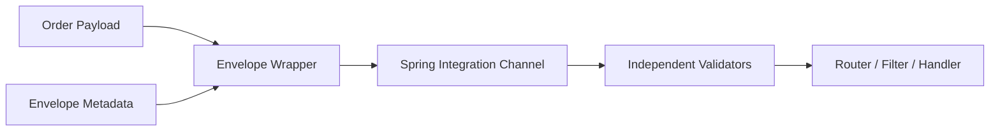
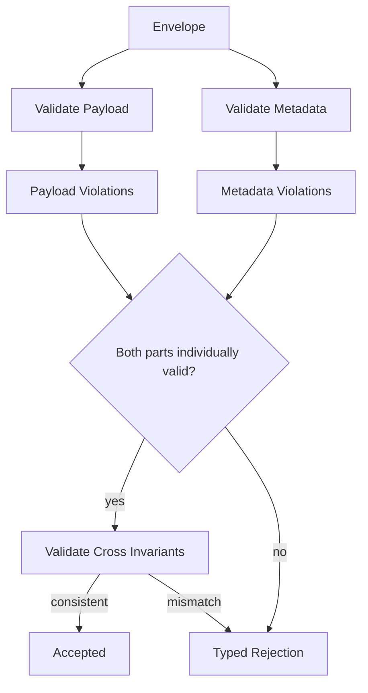
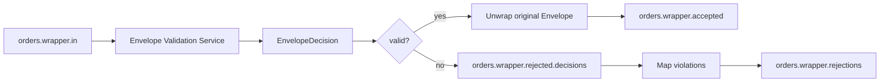
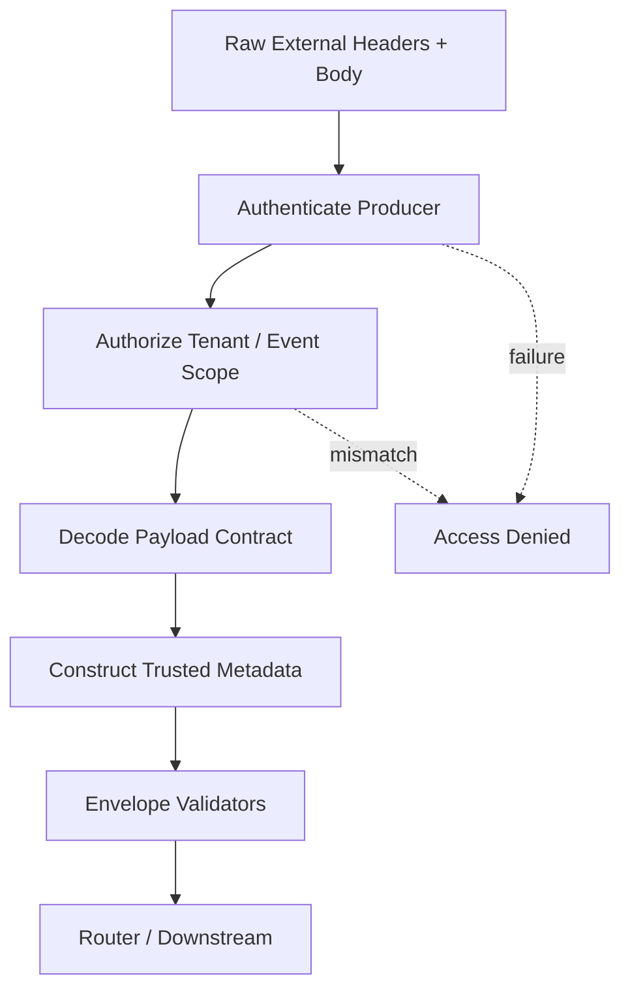
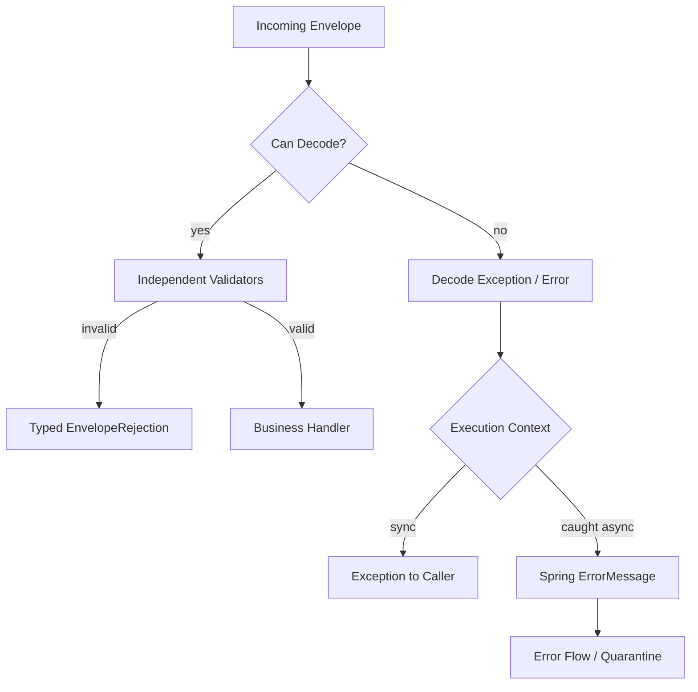
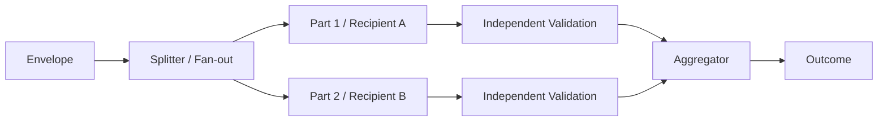
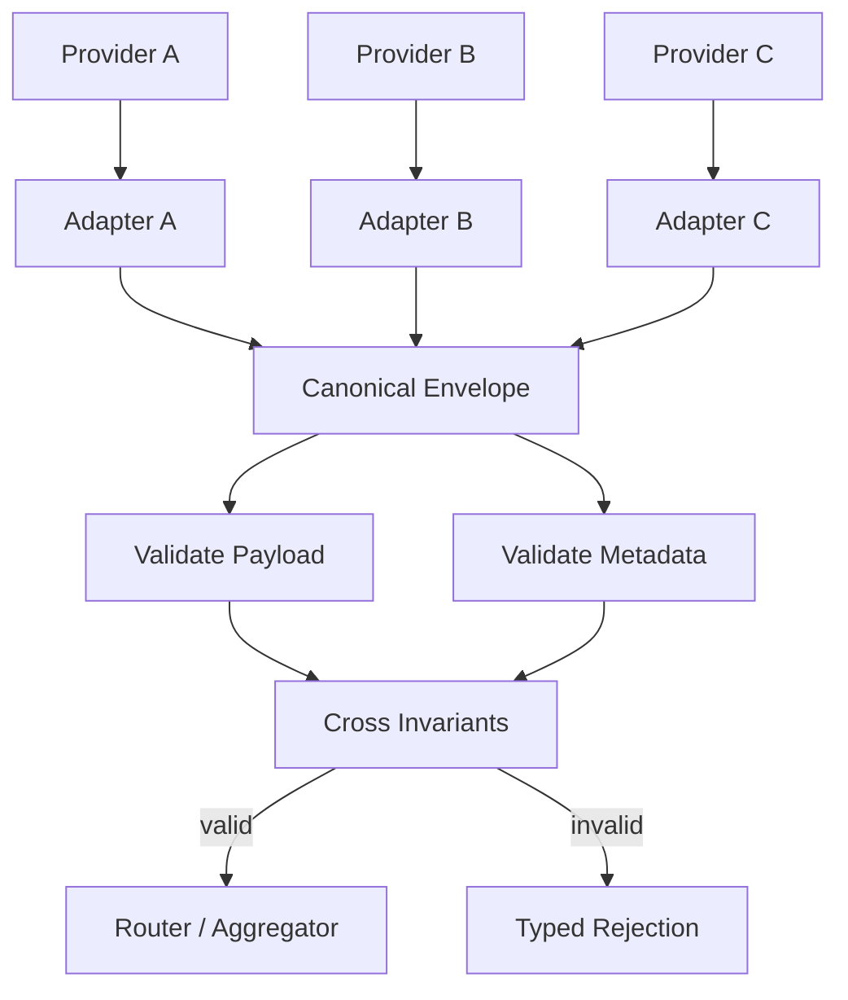

# Kiểm thử payload và metadata độc lập

**Envelope Wrapper** là một Enterprise Integration Pattern (EIP) đóng gói **dữ liệu nghiệp vụ (payload)** cùng **metadata cần thiết để truyền, định tuyến, tương quan và quản trị vòng đời message**. Trong một nền tảng tích hợp, payload có thể mô tả đơn hàng, giao dịch hoặc kết quả kiểm tra; metadata có thể chứa `eventId`, `correlationId`, `tenantId`, loại event, phiên bản schema và thời điểm phát sinh.

Một lỗi phổ biến là viết một hàm `validate(envelope)` khổng lồ, rồi kiểm thử bằng vài trường hợp “valid/invalid”. Khi test thất bại, không rõ **dữ liệu nghiệp vụ sai**, **metadata sai**, hay **hai phần đều đúng riêng lẻ nhưng không nhất quán với nhau**. Tệ hơn, một consumer có thể bỏ qua metadata bị giả mạo chỉ vì payload hợp lệ, hoặc từ chối cả một đơn hàng đúng chỉ vì trace header thiếu.

Bài **“Kiểm thử payload và metadata độc lập”** thuộc chương **Envelope wrapper**, module **SPRING_INTEGRATION_PATTERN**. Module học triển khai Enterprise Integration Patterns với Spring Integration để xây dựng luồng thông điệp ít phụ thuộc, dễ mở rộng; thực hành Router, Filter, Transformer, Splitter, Aggregator, Gateway, retry, error channel, correlation, cùng kiểm thử và quan sát các nhánh xử lý.

**Mục tiêu:** xây dựng hợp đồng kiểm tra riêng cho payload và metadata; xác định nơi cần test liên kết chéo; viết JUnit 5 unit/parameterized tests, Spring Integration flow tests và transport contract tests; bảo vệ tenant/correlation/version qua các adapter; xử lý đúng typed rejection, exception và retry.

**Thông điệp trọng tâm:** *Kiểm thử độc lập* không có nghĩa bỏ qua tính nhất quán. Ta kiểm chứng từng phần bằng bộ test riêng **trước**, sau đó kiểm chứng các bất biến **giữa** payload và metadata bằng một lớp test thứ ba.

## 1. Envelope Wrapper chứa những gì?

Một envelope chuẩn có thể được biểu diễn bằng:

```text
Envelope
├── payload
│   ├── orderId
│   ├── tenantId
│   ├── customerId
│   ├── currency
│   └── lines[]
└── metadata
    ├── envelopeVersion
    ├── eventId
    ├── tenantId
    ├── correlationId
    ├── payloadType
    ├── payloadSchemaVersion
    └── occurredAt
```



Ví dụ JSON:

```json
{
  "payload": {
    "tenantId": "tenant-a",
    "orderId": "ORD-101",
    "customerId": "CUS-9",
    "currency": "VND",
    "lines": [
      {"sku": "SKU-1", "quantity": 2}
    ]
  },
  "metadata": {
    "envelopeVersion": 1,
    "eventId": "evt-101",
    "tenantId": "tenant-a",
    "correlationId": "corr-77",
    "payloadType": "ORDER_PLACED",
    "payloadSchemaVersion": 1,
    "occurredAt": "2026-11-21T05:00:00Z"
  }
}
```

Đây là **hợp đồng ứng dụng minh họa**, không phải một JSON envelope mà Spring Integration tự phát ra với các trường trên. Spring `Message<?>` còn có **`MessageHeaders` riêng**. Envelope metadata trong payload **không tự trở thành** Spring message headers và ngược lại.

### Tách payload và metadata để làm gì?

- Payload tập trung vào **ý nghĩa nghiệp vụ**: đơn nào, sản phẩm nào, số lượng bao nhiêu.
- Metadata tập trung vào **vòng đời truyền thông điệp**: sự kiện nào, correlation scope nào, schema version nào.
- Source adapter có thể đổi format transport mà không làm đổi business payload.
- Router/Filter có thể dùng metadata đã được xác thực mà không phải parse toàn bộ dữ liệu.
- Test suite có thể chỉ ra lỗi nằm ở **domain contract**, **envelope protocol**, hay **quan hệ giữa hai contract**.

Không đặt mật khẩu, secret, token truy cập hoặc raw header điều khiển `replyChannel`/`errorChannel` vào metadata chỉ vì “envelope có thể chứa metadata”.

## 2. Ba lớp bất biến cần được kiểm thử

Một thiết kế nên có ba câu hỏi tách biệt:

| Lớp test | Câu hỏi | Ví dụ |
| --- | --- | --- |
| **Payload contract** | Dữ liệu nghiệp vụ có hợp lệ không? | `quantity > 0`, có `orderId`, currency hợp lệ |
| **Metadata contract** | Metadata có đủ và hợp lệ không? | `eventId` ổn định, `payloadSchemaVersion` hỗ trợ, `occurredAt` là instant |
| **Cross-envelope contract** | Hai phần có nhất quán không? | `payload.tenantId == metadata.tenantId`; payload type khớp schema |



**Không được bỏ qua cross-invariant.** Một payload thuộc `tenant-a` có thể tự hợp lệ; metadata tự khai `tenant-b` cũng có format hợp lệ. Nhưng cả envelope không thể được chấp nhận nếu hệ thống định nghĩa chúng phải chỉ cùng một tenant.

Ngược lại, khi test riêng payload, không nên bắt test phải khởi tạo một `MessageHeaders` hoàn chỉnh. Khi test riêng metadata, không nên bắt nó phải có một database order hợp lệ.

## 3. Chọn ranh giới dữ liệu để tránh coupling trong test

Một envelope có thể được hiện thực bằng generic Java record:

```java
record EventEnvelope<T>(
    T payload,
    EnvelopeMetadata metadata
) {}
```

Nội dung payload có thể thay đổi theo loại event; metadata giữ contract chung. Tuy nhiên, `EventEnvelope<T>` **không tự xác minh** rằng `payload` thật sự phù hợp với `payloadType`.

Một số cách tổ chức test:

1. **Payload unit tests:** tạo `OrderPayload`, gọi `OrderPayloadValidator` trực tiếp.
2. **Metadata unit tests:** tạo `EnvelopeMetadata`, gọi `EnvelopeMetadataValidator` trực tiếp.
3. **Envelope contract tests:** tạo `EventEnvelope<OrderPayload>`, gọi `EnvelopeValidationService`.
4. **Spring Integration tests:** gửi `Message<EventEnvelope<...>>` tới channel.
5. **Wire/transport tests:** serialize/deserialize JSON/Avro/JMS/Kafka và kiểm tra identity/version/headers.

Bộ test đầu tiên phải chạy nhanh, deterministic, không cần Spring context. Bộ test sau kiểm tra các lỗi **chỉ xuất hiện khi nối các endpoint và adapter thực tế**.

## 4. Metadata trong envelope khác Spring MessageHeaders

Trong Java:

```text
Spring Message
  payload = EventEnvelope<OrderPayload>
    payload = OrderPayload(...)
    metadata = EnvelopeMetadata(...)
  headers = MessageHeaders(...)
    id = generated framework message id
    timestamp = framework timestamp
    replyChannel / errorChannel / ...
```

Không nhầm:

| Giá trị | Vai trò | Ghi chú |
| --- | --- | --- |
| `metadata.eventId` | Identity ổn định của sự kiện nghiệp vụ | Retry/redelivery cùng event phải giữ nguyên |
| `MessageHeaders.ID` | ID của một Spring message | Có thể thay đổi qua transform/bridge |
| `metadata.correlationId` | Identity nhóm/workflow theo hợp đồng ứng dụng | Không mặc định là Spring header `correlationId` |
| `MessageHeaders.REPLY_CHANNEL` | Kênh reply nội bộ | Không nhận giá trị từ client tùy ý |
| `metadata.payloadSchemaVersion` | Phiên bản cấu trúc payload | Không thay thế envelope version |
| `metadata.occurredAt` | Thời điểm sự kiện nguồn xảy ra | Không đồng nghĩa `MessageHeaders.TIMESTAMP` |

**Envelope Wrapper là pattern dữ liệu**, còn các loại Spring Message và MessageHeaders là cơ chế messaging. Một ứng dụng có thể map một số metadata từ envelope sang Spring headers để Router/Aggregator sử dụng, nhưng cần **mapping tường minh, giới hạn tin cậy và test propagation**.

## 5. Hợp đồng mẫu: đơn hàng và metadata

Để test minh bạch, ta dùng Java 17+:

```java
import java.time.Instant;
import java.util.List;

record OrderLine(String sku, Integer quantity) {}

record OrderPayload(
    String tenantId,
    String orderId,
    String customerId,
    String currency,
    List<OrderLine> lines
) {
    OrderPayload {
        // Cho phép null list để validator có thể báo REQUIRED.
        // Nếu list tồn tại, sao chép tránh thay đổi qua alias.
        if (lines != null) {
            lines = List.copyOf(lines);
        }
    }
}

record EnvelopeMetadata(
    int envelopeVersion,
    String eventId,
    String tenantId,
    String correlationId,
    String payloadType,
    int payloadSchemaVersion,
    Instant occurredAt
) {}

record EventEnvelope<T>(
    T payload,
    EnvelopeMetadata metadata
) {}

record Violation(
    String area,
    String path,
    String code
) {}
```

Các trường có ý nghĩa:

- `OrderPayload.tenantId` xác định phạm vi nghiệp vụ theo nguồn đã được xác thực.
- `EnvelopeMetadata.tenantId` là phạm vi vận chuyển/điều phối, phải được **kiểm chứng** với payload và security context.
- `eventId` là ID ổn định cho event; không phát `UUID.randomUUID()` mỗi lần retry cùng event.
- `correlationId` nối các message của cùng workflow; không dùng làm quyền truy cập.
- `payloadType="ORDER_PLACED"` và `payloadSchemaVersion=1` xác định cách hiểu payload.
- `envelopeVersion=1` định nghĩa format wrapper bên ngoài, **khác** phiên bản payload.
- `occurredAt` được parse thành `Instant`, không mặc định bằng thời gian nhận.

Constructor ở đây cố ý **chưa chặn toàn bộ field null** để bài test có thể kiểm chứng logic validator. Trong hệ thống thật, factory/constructor bất biến có thể từ chối dữ liệu sai sớm hơn; khi đó đặt test tại ranh giới tương ứng.

### Một giới hạn của tính bất biến

Java `record` không tự làm tất cả object lồng nhau bất biến. `List.copyOf` giúp ngăn sửa danh sách sau khi khởi tạo; nếu phần tử bên trong là mutable object, còn cần defensive copy sâu hơn. Với `OrderLine` là record và `Integer` bất biến, ví dụ đủ đơn giản.

`List.copyOf` cũng **không chấp nhận phần tử null**; nếu cần test một line null từ JSON, test đó có thể thất bại ngay ở constructor. Hãy test ở decoder/constructor boundary hoặc thay bằng factory chấp nhận trạng thái invalid trước khi validation, **không ghi nhầm lỗi ấy thành lỗi Filter**.

## 6. Validator payload chỉ đọc dữ liệu nghiệp vụ

Một payload validator không cần biết `eventId`, `correlationId` hoặc Spring headers.

Hợp đồng ví dụ:

- `tenantId`, `orderId`, `customerId` không rỗng.
- `currency` thuộc `VND` hoặc `USD`.
- `lines` phải có ít nhất một dòng và không vượt 100 dòng.
- `sku` không rỗng.
- `quantity` từ 1 đến 10.000.

```java
import java.util.ArrayList;
import java.util.List;
import java.util.Set;

final class OrderPayloadValidator {

    private static final Set<String> CURRENCIES =
        Set.of("VND", "USD");

    List<Violation> validate(Object input) {
        List<Violation> errors = new ArrayList<>();

        if (input == null) {
            errors.add(new Violation(
                "PAYLOAD", "payload", "REQUIRED"));
            return List.copyOf(errors);
        }

        if (!(input instanceof OrderPayload payload)) {
            errors.add(new Violation(
                "PAYLOAD", "payload", "WRONG_TYPE"));
            return List.copyOf(errors);
        }

        required(errors, "tenantId", payload.tenantId());
        required(errors, "orderId", payload.orderId());
        required(errors, "customerId", payload.customerId());

        if (blank(payload.currency())) {
            errors.add(new Violation(
                "PAYLOAD", "currency", "REQUIRED"));
        } else if (!CURRENCIES.contains(payload.currency())) {
            errors.add(new Violation(
                "PAYLOAD", "currency", "UNSUPPORTED_CURRENCY"));
        }

        if (payload.lines() == null) {
            errors.add(new Violation(
                "PAYLOAD", "lines", "REQUIRED"));
        } else if (payload.lines().isEmpty()) {
            errors.add(new Violation(
                "PAYLOAD", "lines", "MUST_NOT_BE_EMPTY"));
        } else {
            if (payload.lines().size() > 100) {
                errors.add(new Violation(
                    "PAYLOAD", "lines", "TOO_MANY"));
            }
            for (int i = 0; i < payload.lines().size(); i++) {
                OrderLine line = payload.lines().get(i);
                String prefix = "lines[" + i + "]";
                if (line == null) {
                    errors.add(new Violation(
                        "PAYLOAD", prefix, "REQUIRED"));
                    continue;
                }
                required(errors, prefix + ".sku", line.sku());
                if (line.quantity() == null) {
                    errors.add(new Violation(
                        "PAYLOAD", prefix + ".quantity", "REQUIRED"));
                } else if (line.quantity() < 1
                        || line.quantity() > 10_000) {
                    errors.add(new Violation(
                        "PAYLOAD", prefix + ".quantity",
                        "OUT_OF_RANGE"));
                }
            }
        }

        return List.copyOf(errors);
    }

    private static void required(
            List<Violation> errors,
            String field, String value) {
        if (blank(value)) {
            errors.add(new Violation(
                "PAYLOAD", field, "REQUIRED"));
        }
    }

    private static boolean blank(String s) {
        return s == null || s.isBlank();
    }
}
```

**Điểm thiết kế:** Phương thức nhận `Object` tại boundary để phân biệt `null` và sai Java type; sau khi xác nhận `OrderPayload`, mọi rule tiếp theo là của domain. Validator **không truy cập metadata**, không gọi service bên ngoài và không ghi dữ liệu.

Đừng coi phép kiểm tra `tenantId` không rỗng là xác thực tenant. Actor và producer phải được xác thực/ủy quyền **riêng**, trước khi metadata được tin cậy để route hoặc phân quyền.

## 7. Validator metadata không đọc trường đơn hàng

Metadata validator chỉ kiểm tra hợp đồng envelope:

- `envelopeVersion == 1`.
- `eventId`, `tenantId`, `correlationId` có format đã công bố.
- `payloadType == ORDER_PLACED` trong flow ví dụ này.
- `payloadSchemaVersion == 1`.
- `occurredAt` có giá trị.
- Không dùng raw `MessageHeaders.ID` hoặc timestamp framework để tự điền field thiếu.

```java
import java.util.ArrayList;
import java.util.List;
import java.util.regex.Pattern;

final class EnvelopeMetadataValidator {
    private static final Pattern ID =
        Pattern.compile("[A-Za-z0-9_-]{1,64}");

    List<Violation> validate(EnvelopeMetadata metadata) {
        List<Violation> errors = new ArrayList<>();

        if (metadata == null) {
            errors.add(new Violation(
                "METADATA", "metadata", "REQUIRED"));
            return List.copyOf(errors);
        }

        if (metadata.envelopeVersion() != 1) {
            errors.add(new Violation(
                "METADATA", "envelopeVersion",
                "UNSUPPORTED_ENVELOPE_VERSION"));
        }

        id(errors, "eventId", metadata.eventId());
        id(errors, "tenantId", metadata.tenantId());
        id(errors, "correlationId", metadata.correlationId());

        if (!"ORDER_PLACED".equals(metadata.payloadType())) {
            errors.add(new Violation(
                "METADATA", "payloadType",
                "UNSUPPORTED_PAYLOAD_TYPE"));
        }

        if (metadata.payloadSchemaVersion() != 1) {
            errors.add(new Violation(
                "METADATA", "payloadSchemaVersion",
                "UNSUPPORTED_PAYLOAD_VERSION"));
        }

        if (metadata.occurredAt() == null) {
            errors.add(new Violation(
                "METADATA", "occurredAt", "REQUIRED"));
        }

        return List.copyOf(errors);
    }

    private static void id(
            List<Violation> errors,
            String path, String value) {
        if (value == null || !ID.matcher(value).matches()) {
            errors.add(new Violation(
                "METADATA", path, "INVALID_ID"));
        }
    }
}
```

Ví dụ cho phép ID chứa chữ số, chữ cái, `_` và `-`; **không áp regex minh họa này cho mọi hệ thống**. Các ID thực có thể có dấu chấm, UUID chuẩn hoặc Unicode; điều quan trọng là công bố chính sách và kiểm thử nhất quán.

**Giới hạn:** Metadata có đúng format vẫn có thể bị **giả mạo**. Một client biết tên tenant của người khác có thể ghi nó vào JSON. Validation format là bước khác với authentication, authorization, integrity và provenance.

## 8. Test quan hệ chéo chỉ sau hai phần đã đạt

Một envelope có thể gồm hai phần tự hợp lệ nhưng không tương thích:

```json
{
  "payload": {
    "tenantId": "tenant-a",
    "orderId": "ORD-101",
    "customerId": "CUS-9",
    "currency": "VND",
    "lines": [{"sku": "SKU-1", "quantity": 2}]
  },
  "metadata": {
    "envelopeVersion": 1,
    "eventId": "evt-101",
    "tenantId": "tenant-b",
    "correlationId": "corr-77",
    "payloadType": "ORDER_PLACED",
    "payloadSchemaVersion": 1,
    "occurredAt": "2026-11-21T05:00:00Z"
  }
}
```

Cả `tenant-a` và `tenant-b` đều đúng regex. Nhưng nếu payload và envelope phải cùng tenant, đây là lỗi **cross-envelope invariant**, không phải lỗi định dạng riêng của payload hay metadata.

```java
import java.util.List;

final class CrossEnvelopeValidator {

    List<Violation> validate(EventEnvelope<?> envelope) {
        if (!(envelope.payload() instanceof OrderPayload payload)
                || envelope.metadata() == null) {
            throw new IllegalArgumentException(
                "Cross validation requires valid parts");
        }

        if (!payload.tenantId()
                .equals(envelope.metadata().tenantId())) {
            return List.of(new Violation(
                "CROSS", "tenantId", "TENANT_MISMATCH"));
        }

        return List.of();
    }
}
```

Code trên chỉ gọi khi **payload và metadata đã pass** các validator riêng. Không dùng nó để thay thế kiểm tra quyền đối với tenant. Một attacker có thể sửa **cả hai phần** về cùng `tenant-b`; phép so sánh vẫn đúng trong khi người gửi không có quyền.

### Những cross-invariant khác

Tùy contract:

- `payloadType` phải tương ứng kiểu dữ liệu được decode.
- `payloadSchemaVersion` phải tương ứng schema payload.
- `tenantId` trong metadata phải tương ứng ownership của payload.
- `correlationId` phải nằm trong workflow/batch manifest đã được cấp.
- Khi định nghĩa sequence, `sequenceNumber`/`sequenceSize` phải phù hợp với manifest.
- `eventId` trong metadata và event identity trong payload (nếu có) phải thống nhất.
- `causationId` (nếu có) không được tự suy ra từ `MessageHeaders.ID`.
- Signature/integrity của envelope (nếu dùng) phải bao phủ **đúng phần metadata và payload** theo contract.

Không đưa mọi cross-invariant vào `OrderPayloadValidator` vì làm nó không còn độc lập. Đặt chúng ở một bước rõ ràng sau khi cả hai phần hợp lệ.

## 9. Tổng hợp ValidationDecision mà không mất chi tiết lỗi

Kết quả chung có thể giữ **ba danh sách riêng** để test và quan sát:

```java
import java.util.ArrayList;
import java.util.List;

record EnvelopeDecision(
    EventEnvelope<?> original,
    List<Violation> payloadErrors,
    List<Violation> metadataErrors,
    List<Violation> crossErrors
) {
    EnvelopeDecision {
        payloadErrors = List.copyOf(payloadErrors);
        metadataErrors = List.copyOf(metadataErrors);
        crossErrors = List.copyOf(crossErrors);
    }

    boolean valid() {
        return payloadErrors.isEmpty()
            && metadataErrors.isEmpty()
            && crossErrors.isEmpty();
    }

    List<Violation> allViolations() {
        List<Violation> all = new ArrayList<>();
        all.addAll(payloadErrors);
        all.addAll(metadataErrors);
        all.addAll(crossErrors);
        return List.copyOf(all);
    }
}

final class EnvelopeValidationService {
    private final OrderPayloadValidator payloadValidator =
        new OrderPayloadValidator();
    private final EnvelopeMetadataValidator metadataValidator =
        new EnvelopeMetadataValidator();
    private final CrossEnvelopeValidator crossValidator =
        new CrossEnvelopeValidator();

    EnvelopeDecision evaluate(EventEnvelope<?> envelope) {
        if (envelope == null) {
            // Không thể đưa null thành ordinary Spring Message payload.
            throw new IllegalArgumentException("Missing envelope");
        }

        // Cả hai validator được chạy độc lập.
        List<Violation> payload =
            payloadValidator.validate(envelope.payload());
        List<Violation> metadata =
            metadataValidator.validate(envelope.metadata());

        List<Violation> cross =
            payload.isEmpty() && metadata.isEmpty()
                ? crossValidator.validate(envelope)
                : List.of();

        return new EnvelopeDecision(
            envelope, payload, metadata, cross);
    }
}
```

**Tại sao chỉ chạy cross validation sau hai bước riêng?** Nếu `payload=null`, phép so sánh `payload.tenantId()` sẽ tạo `NullPointerException`, che mất lỗi thực sự `PAYLOAD_REQUIRED`. Không nên dùng một exception như vậy để đoán input đã sai ở đâu.

Cách trả ba nhóm lỗi còn giúp phân biệt nguyên nhân trong log và test:

```text
payloadErrors  = [PAYLOAD.lines[0].quantity OUT_OF_RANGE]
metadataErrors = [METADATA.eventId INVALID_ID]
crossErrors    = []
```

Tầng API/transport có thể gộp violations khi trả cho producer, nhưng vẫn giữ `area` và `code` để consumer hiểu đúng loại lỗi. **Đừng đưa raw field value hoặc secret vào Violation**.

## 10. Test fixture đúng để hai phần không phụ thuộc nhau

Một bộ fixture ổn định giúp test không thất bại chỉ vì copy/paste metadata sai.

```java
import java.time.Instant;
import java.util.List;

final class EnvelopeFixtures {
    static OrderPayload validPayload() {
        return new OrderPayload(
            "tenant-a", "ORD-101", "CUS-9", "VND",
            List.of(new OrderLine("SKU-1", 2)));
    }

    static EnvelopeMetadata validMetadata() {
        return new EnvelopeMetadata(
            1, "evt-101", "tenant-a",
            "corr-77", "ORDER_PLACED", 1,
            Instant.parse("2026-11-21T05:00:00Z"));
    }

    static EventEnvelope<OrderPayload> validEnvelope() {
        return new EventEnvelope<>(
            validPayload(), validMetadata());
    }

    static EventEnvelope<OrderPayload> withPayload(
            OrderPayload replacement) {
        return new EventEnvelope<>(
            replacement, validMetadata());
    }

    static EventEnvelope<OrderPayload> withMetadata(
            EnvelopeMetadata replacement) {
        return new EventEnvelope<>(
            validPayload(), replacement);
    }

    private EnvelopeFixtures() {}
}
```

**Nguyên tắc fixture:** Khi kiểm tra payload, giữ metadata ở một mẫu hợp lệ bất biến; khi kiểm tra metadata, giữ payload hợp lệ. Khi kiểm tra cross-invariant, đảm bảo **cả hai phần riêng lẻ đều valid** trước khi cố tình làm chúng không nhất quán.

Không dùng `Instant.now()`, UUID mới hoặc ID ngẫu nhiên trong mọi fixture nếu điều đó khiến test khó tái hiện. Dùng giá trị cố định cho unit tests; chỉ kiểm tra tính ngẫu nhiên/uniqueness khi đó thực sự là contract cần test.

## 11. Unit test payload độc lập

Các test sau **không tạo EnvelopeMetadata**. Chúng chứng minh domain validator có thể hoạt động tách khỏi metadata và Spring.

```java
import static org.junit.jupiter.api.Assertions.*;
import java.util.List;
import org.junit.jupiter.api.Test;

class OrderPayloadValidatorTest {
    private final OrderPayloadValidator validator =
        new OrderPayloadValidator();

    @Test
    void validPayloadPassesWithoutMetadata() {
        assertTrue(validator.validate(
            EnvelopeFixtures.validPayload()).isEmpty());
    }

    @Test
    void missingOrderIdProducesPayloadViolation() {
        OrderPayload invalid = new OrderPayload(
            "tenant-a", null, "CUS-9", "VND",
            List.of(new OrderLine("SKU-1", 2)));

        assertTrue(validator.validate(invalid).contains(
            new Violation("PAYLOAD", "orderId", "REQUIRED")));
    }

    @Test
    void quantityOutsideDomainIsRejected() {
        OrderPayload invalid = new OrderPayload(
            "tenant-a", "ORD-101", "CUS-9", "VND",
            List.of(new OrderLine("SKU-1", -2)));

        assertTrue(validator.validate(invalid).contains(
            new Violation(
                "PAYLOAD", "lines[0].quantity",
                "OUT_OF_RANGE")));
    }

    @Test
    void wrongPayloadJavaTypeIsDetectedAtBoundary() {
        assertEquals(
            List.of(new Violation(
                "PAYLOAD", "payload", "WRONG_TYPE")),
            validator.validate("raw-string"));
    }

    @Test
    void missingInnerPayloadCanBeValidatedDirectly() {
        assertEquals(
            List.of(new Violation(
                "PAYLOAD", "payload", "REQUIRED")),
            validator.validate(null));
    }
}
```

Các test ở trên **không kiểm chứng** routing hoặc discard channel; chúng kiểm chứng đúng phạm vi của `OrderPayloadValidator`.

Nếu input thực đến dưới dạng JSON, sai cú pháp và sai kiểu trước deserialize phải được test **ở inbound decoder**, không ép `OrderPayloadValidator` nhận raw JSON rồi mong có kết quả như domain validation.

## 12. Unit test metadata độc lập

Metadata test cũng không cần một `OrderPayload`:

```java
import static org.junit.jupiter.api.Assertions.*;
import java.time.Instant;
import org.junit.jupiter.api.Test;

class EnvelopeMetadataValidatorTest {
    private final EnvelopeMetadataValidator validator =
        new EnvelopeMetadataValidator();

    @Test
    void validMetadataPassesWithoutPayload() {
        assertTrue(validator.validate(
            EnvelopeFixtures.validMetadata()).isEmpty());
    }

    @Test
    void rejectsMissingBusinessEventId() {
        var valid = EnvelopeFixtures.validMetadata();
        var invalid = new EnvelopeMetadata(
            valid.envelopeVersion(), "",
            valid.tenantId(), valid.correlationId(),
            valid.payloadType(), valid.payloadSchemaVersion(),
            valid.occurredAt());

        assertTrue(validator.validate(invalid).contains(
            new Violation(
                "METADATA", "eventId", "INVALID_ID")));
    }

    @Test
    void rejectsUnsupportedPayloadSchemaVersion() {
        var valid = EnvelopeFixtures.validMetadata();
        var invalid = new EnvelopeMetadata(
            valid.envelopeVersion(), valid.eventId(),
            valid.tenantId(), valid.correlationId(),
            valid.payloadType(), 99, valid.occurredAt());

        assertTrue(validator.validate(invalid).contains(
            new Violation(
                "METADATA", "payloadSchemaVersion",
                "UNSUPPORTED_PAYLOAD_VERSION")));
    }

    @Test
    void rejectsMissingOccurredAt() {
        var valid = EnvelopeFixtures.validMetadata();
        var invalid = new EnvelopeMetadata(
            valid.envelopeVersion(), valid.eventId(),
            valid.tenantId(), valid.correlationId(),
            valid.payloadType(),
            valid.payloadSchemaVersion(), null);

        assertTrue(validator.validate(invalid).contains(
            new Violation(
                "METADATA", "occurredAt", "REQUIRED")));
    }

    @Test
    void rejectsMissingMetadataObject() {
        assertEquals(1, validator.validate(null).size());
    }
}
```

**Không coi “metadata đúng format” là “metadata đáng tin”.** Những test trên chưa xác minh producer được phép phát sự kiện cho tenant đó, chưa kiểm tra cryptographic integrity và chưa kiểm tra replay authorization. Những ranh giới ấy cần security/contract integration tests riêng.

## 13. Unit test hai trục độc lập và trường hợp cùng sai

Một test của toàn wrapper nên chứng minh: đổi payload **không làm thay đổi metadata errors**, và đổi metadata **không làm thay đổi payload errors**.

```java
import static org.junit.jupiter.api.Assertions.*;
import java.util.List;
import org.junit.jupiter.api.Test;

class EnvelopeValidationIndependenceTest {
    private final EnvelopeValidationService service =
        new EnvelopeValidationService();

    private OrderPayload invalidPayload() {
        return new OrderPayload(
            "tenant-a", "ORD-101", "CUS-9", "VND",
            List.of(new OrderLine("SKU-1", -2)));
    }

    private EnvelopeMetadata invalidMetadata() {
        var valid = EnvelopeFixtures.validMetadata();
        return new EnvelopeMetadata(
            1, "", valid.tenantId(),
            valid.correlationId(), valid.payloadType(),
            1, valid.occurredAt());
    }

    @Test
    void invalidPayloadDoesNotInvalidateMetadataContract() {
        EnvelopeDecision result = service.evaluate(
            EnvelopeFixtures.withPayload(invalidPayload()));

        assertFalse(result.valid());
        assertEquals(1, result.payloadErrors().size());
        assertTrue(result.metadataErrors().isEmpty());
        assertTrue(result.crossErrors().isEmpty());
    }

    @Test
    void invalidMetadataDoesNotChangePayloadRules() {
        EnvelopeDecision result = service.evaluate(
            EnvelopeFixtures.withMetadata(invalidMetadata()));

        assertFalse(result.valid());
        assertTrue(result.payloadErrors().isEmpty());
        assertEquals(1, result.metadataErrors().size());
        assertTrue(result.crossErrors().isEmpty());
    }

    @Test
    void bothInvalidPartsReportBothSetsOfErrors() {
        EnvelopeDecision result = service.evaluate(
            new EventEnvelope<>(
                invalidPayload(), invalidMetadata()));

        assertEquals(1, result.payloadErrors().size());
        assertEquals(1, result.metadataErrors().size());
        assertTrue(result.crossErrors().isEmpty());
    }

    @Test
    void wrapperMayContainMissingInnerPayload() {
        EnvelopeDecision result = service.evaluate(
            new EventEnvelope<>(null,
                EnvelopeFixtures.validMetadata()));

        assertTrue(result.payloadErrors().contains(
            new Violation(
                "PAYLOAD", "payload", "REQUIRED")));
        assertTrue(result.metadataErrors().isEmpty());
    }
}
```

**Lưu ý về null:** `new EventEnvelope<>(null, metadata)` là một **wrapper object không null**, dù field `payload` bên trong null. Nó vẫn có thể được đặt làm payload của một Spring `Message` thông thường. Ngược lại, `MessageBuilder.withPayload(null)` thường bị framework từ chối ngay tại bước tạo message.

Đó là lý do **“payload bên trong envelope thiếu”** và **“Spring Message không có payload”** phải có hai bộ test khác nhau.

## 14. Test cross-invariant không làm bẩn hai suite riêng

Giả sử payload thuộc tenant A, metadata thuộc tenant B, còn mỗi phần riêng lẻ đều đúng.

```java
import static org.junit.jupiter.api.Assertions.*;
import java.time.Instant;
import org.junit.jupiter.api.Test;

class EnvelopeCrossInvariantTest {
    private final EnvelopeValidationService service =
        new EnvelopeValidationService();

    @Test
    void detectsTenantMismatchOnlyInCrossValidation() {
        EnvelopeMetadata wrongTenant = new EnvelopeMetadata(
            1, "evt-101", "tenant-b", "corr-77",
            "ORDER_PLACED", 1,
            Instant.parse("2026-11-21T05:00:00Z"));

        EnvelopeDecision result = service.evaluate(
            EnvelopeFixtures.withMetadata(wrongTenant));

        assertTrue(result.payloadErrors().isEmpty());
        assertTrue(result.metadataErrors().isEmpty());
        assertEquals(
            java.util.List.of(new Violation(
                "CROSS", "tenantId", "TENANT_MISMATCH")),
            result.crossErrors());
    }

    @Test
    void matchingValidPartsPassAllValidationLayers() {
        EnvelopeDecision result =
            service.evaluate(EnvelopeFixtures.validEnvelope());

        assertTrue(result.valid());
        assertTrue(result.allViolations().isEmpty());
    }
}
```

**Không giải quyết cross-tenant security chỉ bằng việc so hai chuỗi.** Nếu attacker kiểm soát cả payload và metadata và điền `tenant-b` vào cả hai, test này sẽ pass. Test bảo mật phải dùng **authenticated principal/producer mapping**, rồi xác minh tenant đó có được phép phát event.

### Ma trận để tránh nhầm lớp

| Payload | Metadata | Cross | Kết quả |
| --- | --- | --- | --- |
| Hợp lệ | Hợp lệ | Khớp | Accept |
| Sai | Hợp lệ | Không chạy | Payload rejection |
| Hợp lệ | Sai | Không chạy | Metadata rejection |
| Sai | Sai | Không chạy | Cả hai danh sách violation |
| Hợp lệ | Hợp lệ | Tenant không khớp | Cross rejection |
| Hợp lệ | Hợp lệ | Đúng chuỗi nhưng producer không có quyền | **Authorization rejection** ở boundary riêng |

## 15. Parameterized tests cho giá trị biên của từng phần

Dùng JUnit 5 để kiểm tra miền giá trị mà không nhân bản nhiều test case.

### Payload domain: quantity

```java
import static org.junit.jupiter.api.Assertions.*;
import java.util.List;
import org.junit.jupiter.params.ParameterizedTest;
import org.junit.jupiter.params.provider.CsvSource;

class PayloadBoundaryTest {
    private final OrderPayloadValidator validator =
        new OrderPayloadValidator();

    @ParameterizedTest
    @CsvSource({
        "0, false", "1, true", "2, true",
        "10000, true", "10001, false", "-1, false"
    })
    void quantityRespectsDomain(
            int quantity, boolean expectedValid) {
        OrderPayload payload = new OrderPayload(
            "tenant-a", "ORD-101", "CUS-9", "VND",
            List.of(new OrderLine("SKU-1", quantity)));

        assertEquals(expectedValid,
            validator.validate(payload).isEmpty());
    }
}
```

### Metadata versions

```java
import static org.junit.jupiter.api.Assertions.*;
import java.time.Instant;
import org.junit.jupiter.params.ParameterizedTest;
import org.junit.jupiter.params.provider.CsvSource;

class MetadataVersionBoundaryTest {
    private final EnvelopeMetadataValidator validator =
        new EnvelopeMetadataValidator();

    @ParameterizedTest
    @CsvSource({"0, false", "1, true", "2, false", "99, false"})
    void envelopeVersionPolicyIsExplicit(
            int version, boolean expectedValid) {
        EnvelopeMetadata metadata = new EnvelopeMetadata(
            version, "evt-101", "tenant-a",
            "corr-77", "ORDER_PLACED", 1,
            Instant.parse("2026-11-21T05:00:00Z"));

        assertEquals(expectedValid,
            validator.validate(metadata).isEmpty());
    }
}
```

Không trộn testcase `quantity=-1` vào MetadataVersionBoundaryTest. **Mỗi suite nên có một lý do thất bại chính**. Tests phối hợp nhiều lỗi đặt ở lớp EnvelopeValidationIndependenceTest.

## 16. Test bất biến khi chỉ thay payload hoặc chỉ thay metadata

Envelope thường được biến đổi trong Transformer:

- **Payload-only transform:** chuẩn hóa nội dung nhưng giữ identity của cùng một event.
- **Metadata update:** thêm một metadata vận hành được phép mà không sửa thông tin nghiệp vụ.

Với cùng một event, việc thay payload không nên tự tạo `eventId` mới; với một business event **mới** tạo ra từ event cũ, phải phát `eventId` mới và (nếu hợp đồng cần) `causationId`, không sao chép identity cũ vô điều kiện.

Ví dụ helper giữ nguyên metadata khi chuẩn hóa **trong cùng schema và cùng event**:

```java
final class EnvelopeOrderTransformer {

    EventEnvelope<OrderPayload> replacePayload(
            EventEnvelope<OrderPayload> original,
            OrderPayload normalized) {
        if (original == null || normalized == null) {
            throw new IllegalArgumentException(
                "Envelope and normalized payload required");
        }
        return new EventEnvelope<>(
            normalized, original.metadata());
    }
}
```

Test:

```java
import static org.junit.jupiter.api.Assertions.*;
import java.util.List;
import org.junit.jupiter.api.Test;

class EnvelopeOrderTransformerTest {

    @Test
    void sameEventPayloadTransformPreservesMetadata() {
        var original = EnvelopeFixtures.validEnvelope();
        var normalized = new OrderPayload(
            "tenant-a", "ORD-101", "CUS-9", "VND",
            List.of(new OrderLine("SKU-1", 3)));

        var result = new EnvelopeOrderTransformer()
            .replacePayload(original, normalized);

        assertSame(original.metadata(), result.metadata());
        assertEquals(normalized, result.payload());
        assertEquals(Integer.valueOf(2),
            original.payload().lines().get(0).quantity());
    }
}
```

Đây là test **cơ học** cho việc không làm đột biến original wrapper. Nó **không chứng minh** thay quantity từ 2 thành 3 là business action hợp lệ. Nếu số lượng đã thay đổi vì một lệnh chỉnh đơn hàng mới, phải cân nhắc tạo event ID mới, schema/generation thích hợp và idempotency riêng.

### Khi thay metadata

Nếu chỉ thêm trace context ở gateway (không đổi business identity), metadata có thể có một bản sao mới. Nhưng phải xác định field nào được phép sửa và field nào bất biến như eventId, tenantId, payloadSchemaVersion. **Đừng làm helper `withMetadata(...)` công khai cho client tùy ý thay tenant và correlation**.

## 17. Spring Integration Java DSL: validate rồi định tuyến

Trong Spring Integration, ta có thể hiện thực Envelope Wrapper bằng **một payload object** chứa cả business payload và metadata, sau đó dùng Transformer + Filter + discard flow.



Điểm quan trọng: **Filter nhận `EnvelopeDecision`**, không tự biết hai validator riêng. Đối với input không hợp lệ, `discardChannel` nhận một **Spring message có payload là `EnvelopeDecision`**, không phải một Spring `ErrorMessage`.

### Hợp đồng cho typed rejection

```java
import java.time.Instant;
import java.util.List;

record EnvelopeRejection(
    String businessEventId,
    String errorCode,
    List<Violation> violations,
    Instant rejectedAt
) {
    EnvelopeRejection {
        violations = List.copyOf(violations);
    }
}

final class EnvelopeRejectionMapper {
    private final java.time.Clock clock;

    EnvelopeRejectionMapper(java.time.Clock clock) {
        this.clock = clock;
    }

    EnvelopeRejection fromDecision(EnvelopeDecision decision) {
        if (decision.valid()) {
            throw new IllegalArgumentException(
                "Cannot reject valid envelope");
        }

        EnvelopeMetadata meta = decision.original().metadata();
        // Có thể null hoặc invalid; trusted ingress audit ID
        // nên được lưu riêng nếu cần truy vết đầy đủ.
        String eventId = meta == null ? null : meta.eventId();

        return new EnvelopeRejection(
            eventId, "ENVELOPE_VALIDATION_FAILED",
            decision.allViolations(),
            java.time.Instant.now(clock));
    }
}
```

### Java DSL minh họa

```java
import org.springframework.context.annotation.Bean;
import org.springframework.context.annotation.Configuration;
import org.springframework.integration.channel.DirectChannel;
import org.springframework.integration.channel.QueueChannel;
import org.springframework.integration.config.EnableIntegration;
import org.springframework.integration.dsl.IntegrationFlow;
import org.springframework.messaging.MessageChannel;
import org.springframework.messaging.PollableChannel;

@Configuration
@EnableIntegration
class EnvelopeFlowConfiguration {

    @Bean("orders.wrapper.in")
    MessageChannel input() {
        return new DirectChannel();
    }

    @Bean("orders.wrapper.accepted")
    PollableChannel accepted() {
        return new QueueChannel(); // Học/test; không durable.
    }

    @Bean("orders.wrapper.rejected.decisions")
    MessageChannel rejectedDecisions() {
        return new DirectChannel();
    }

    @Bean("orders.wrapper.rejections")
    PollableChannel rejectedOutcomes() {
        return new QueueChannel();
    }

    @Bean
    EnvelopeValidationService envelopeValidationService() {
        return new EnvelopeValidationService();
    }

    @Bean
    EnvelopeRejectionMapper envelopeRejectionMapper() {
        return new EnvelopeRejectionMapper(
            java.time.Clock.systemUTC());
    }

    @Bean
    IntegrationFlow validateEnvelopeFlow(
            EnvelopeValidationService validator) {
        return IntegrationFlow.from("orders.wrapper.in")
            .transform(EventEnvelope.class, validator::evaluate)
            .filter(EnvelopeDecision.class,
                EnvelopeDecision::valid,
                spec -> spec.discardChannel(
                    "orders.wrapper.rejected.decisions"))
            .transform(EnvelopeDecision.class,
                EnvelopeDecision::original)
            .channel("orders.wrapper.accepted")
            .get();
    }

    @Bean
    IntegrationFlow rejectEnvelopeFlow(
            EnvelopeRejectionMapper mapper) {
        return IntegrationFlow
            .from("orders.wrapper.rejected.decisions")
            .transform(EnvelopeDecision.class,
                mapper::fromDecision)
            .channel("orders.wrapper.rejections")
            .get();
    }
}
```

**Ý nghĩa của topology:**

1. Input channel nhận **`EventEnvelope<?>` đã được deserialize**.
2. Transformer tạo `EnvelopeDecision`, chạy payload validator và metadata validator độc lập.
3. Filter chỉ đọc `valid()`; không chạy lại validation hai lần.
4. Nhánh hợp lệ trả **wrapper gốc** để giữ payload và metadata, không làm rơi metadata.
5. Nhánh invalid tạo typed `EnvelopeRejection` với khu vực lỗi `PAYLOAD`/`METADATA`/`CROSS`.
6. Các QueueChannel chỉ dùng để dễ kiểm thử output trong một JVM; khi nối broker/DB phải thiết kế durability, retry và ACK.
7. Nếu transform/Filter ném exception trên `DirectChannel`, lỗi có thể lan tới sender. Nó **không tự trở thành `ErrorMessage` trên global errorChannel**.

**Cần kiểm tra overload Java DSL theo phiên bản Spring Integration của project.** Đoạn này là ví dụ kiến trúc STEP 4, chưa chạy build hoặc test chuyên môn; các bean/service và kiểu dữ liệu ở các mục trước cần nằm trong cùng package hoặc được import.

### Một cảnh báo khi dùng generic wrapper

`EventEnvelope<OrderPayload>` và `EventEnvelope<OtherPayload>` đều có raw class `EventEnvelope.class` vì **type erasure**. Validator phải kiểm tra `payload instanceof OrderPayload` trong flow chuyên xử lý order, không dựa vào generic parameter trong runtime message để bảo đảm schema.

## 18. Integration test: accepted/rejected channels tách biệt

Với cấu hình ở mục 17, viết một integration test có Spring context thật:

```java
import static org.junit.jupiter.api.Assertions.*;
import org.junit.jupiter.api.Test;
import org.springframework.beans.factory.annotation.Autowired;
import org.springframework.beans.factory.annotation.Qualifier;
import org.springframework.messaging.Message;
import org.springframework.messaging.MessageChannel;
import org.springframework.messaging.PollableChannel;
import org.springframework.messaging.support.MessageBuilder;
import org.springframework.test.context.junit.jupiter.SpringJUnitConfig;

@SpringJUnitConfig(EnvelopeFlowConfiguration.class)
class EnvelopeFlowIntegrationTest {

    @Autowired
    @Qualifier("orders.wrapper.in")
    MessageChannel input;

    @Autowired
    @Qualifier("orders.wrapper.accepted")
    PollableChannel accepted;

    @Autowired
    @Qualifier("orders.wrapper.rejections")
    PollableChannel rejections;

    @Test
    void validEnvelopeGoesOnlyToAccepted() {
        EventEnvelope<OrderPayload> envelope =
            EnvelopeFixtures.validEnvelope();

        assertTrue(input.send(
            MessageBuilder.withPayload(envelope).build()));

        Message<?> forwarded = accepted.receive(1_000);
        assertNotNull(forwarded);
        assertEquals(envelope, forwarded.getPayload());
        assertNull(rejections.receive(50));
    }

    @Test
    void metadataInvalidEnvelopeDoesNotReachAccepted() {
        var original = EnvelopeFixtures.validMetadata();
        var badMetadata = new EnvelopeMetadata(
            1, "", original.tenantId(),
            original.correlationId(),
            original.payloadType(), 1, original.occurredAt());

        assertTrue(input.send(MessageBuilder.withPayload(
            EnvelopeFixtures.withMetadata(badMetadata)).build()));

        assertNull(accepted.receive(50));
        Message<?> rejected = rejections.receive(1_000);
        assertNotNull(rejected);

        EnvelopeRejection result =
            (EnvelopeRejection) rejected.getPayload();
        assertTrue(result.violations().contains(
            new Violation(
                "METADATA", "eventId", "INVALID_ID")));
        assertTrue(result.violations().stream()
            .noneMatch(v -> "PAYLOAD".equals(v.area())));
    }
}
```

Test này chứng minh **một message payload wrapper hợp lệ** được nhận, còn metadata-invalid wrapper được phát vào rejection channel mà không tiếp tục đi accepted.

Cần thêm test payload-invalid, both-invalid và cross mismatch trên Spring flow. Các QueueChannel trong ví dụ phải được **đọc sạch** giữa các test; tránh chạy song song cùng context khiến test này nhận message của test khác. Khi nối accepted vào business handler, test tiếp **không tạo side effect khi rejected**, chứ không chỉ dựa vào kết quả queue.

## 19. Test payload thiếu ở bên trong khác null Spring Message

Một nhầm lẫn phổ biến:

```java
// Cách này không tạo ordinary Spring Message hợp lệ:
MessageBuilder.withPayload(null).build();
```

Trong Spring Messaging, ordinary `Message` có payload không null. Nhưng wrapper là một object hợp lệ dù field bên trong có thể null:

```java
var envelope = new EventEnvelope<OrderPayload>(
    null, EnvelopeFixtures.validMetadata());

var message = org.springframework.messaging.support.MessageBuilder
    .withPayload(envelope)
    .build();
```

Lúc này **Spring message payload là `EventEnvelope`, không phải null**. `OrderPayloadValidator` phát hiện field `envelope.payload` thiếu. Nếu **toàn bộ HTTP request body** trống hoặc JSON root `null` trước khi dựng envelope, lỗi xảy ra ở decoder/inbound gateway, không phải tại Filter trong mục 17.

### Những test cần tách

| Đầu vào | Nơi test | Kỳ vọng |
| --- | --- | --- |
| HTTP body không có | HTTP ingress/decoder | MISSING_BODY; không tạo Envelope |
| JSON root `null` | JSON decoder | ROOT_NULL; không dựng Spring Message |
| JSON `{"payload":null,"metadata":{...}}` | Decoder + envelope validation | PAYLOAD.REQUIRED |
| JSON `{"payload":{...},"metadata":null}` | Decoder + envelope validation | METADATA.REQUIRED |
| Payload là `String` thay vì `OrderPayload` | Typed payload validator / decode boundary | PAYLOAD.WRONG_TYPE |
| Entire Spring Message payload null | Spring Message creation boundary | Không tạo ordinary message |
| Valid envelope có payload hợp lệ và meta hợp lệ | Spring Integration | Accepted, wrapper giữ nguyên |

Nếu JSON decoder ánh xạ `payload` về `Object` hoặc `JsonNode` thay vì kiểu `OrderPayload`, cần bước decode riêng theo `payloadType + payloadSchemaVersion`. Test raw JSON không thay thế type-checked Java message tests.

## 20. Wire contract: JSON và schema version phải nhất quán

Khi envelope đi qua HTTP, Kafka hoặc JMS, cần phân biệt **Java object contract** với **wire format**.

Một envelope hợp lệ có thể serialize thành JSON như mục 1; nhưng test roundtrip cần kiểm tra:

- `envelopeVersion` đã được viết/đọc đúng.
- `payloadSchemaVersion` không bị đổi hoặc bỏ.
- `eventId` và `correlationId` giữ nguyên.
- `occurredAt` giữ đúng instant với `Z`/offset.
- `tenantId` của payload và metadata không bị đổi case.
- Danh sách order lines giữ đúng nội dung/thứ tự nếu thứ tự là business invariant.
- Unknown field có bị bỏ hoặc từ chối theo contract?
- Reader version cũ xử lý version mới ra sao?

### JSON type erasure và typed decoder

Một Java generic record `EventEnvelope<T>` cần **type information** khi deserialize. Ví dụ với Jackson 2.x và JavaTimeModule:

```java
import com.fasterxml.jackson.core.type.TypeReference;
import com.fasterxml.jackson.databind.ObjectMapper;
import com.fasterxml.jackson.datatype.jsr310.JavaTimeModule;

ObjectMapper mapper = new ObjectMapper()
    .registerModule(new JavaTimeModule());

String json = /* envelope JSON từ test fixture */ "...";

EventEnvelope<OrderPayload> envelope = mapper.readValue(
    json,
    new TypeReference<EventEnvelope<OrderPayload>>() {});
```

Đây là **đoạn minh họa đặt trong test/decoder**, không phải class Java chạy độc lập. Cần dependency Jackson hỗ trợ Java records và `JavaTimeModule` khi cần đọc `Instant`.

**Không deserialize `EventEnvelope<Object>` rồi cast payload thành `OrderPayload` mà không kiểm tra**: payload có thể thành `LinkedHashMap`. Dùng type reference, schema registry hoặc một dispatcher kiểu có allowlist để chuyển đúng payload class.

### Test thay đổi schema

Nếu `payloadSchemaVersion=2` nhưng decoder vẫn dùng `OrderPayload` v1, đừng coi việc Jackson parse được một số field là bằng chứng v2 tương thích. Phải route theo version/supported schema rồi validate. Khi cần upcaster từ v1 lên v2, test nó như một migration riêng.

## 21. Metadata từ transport header có đáng tin không?

Một HTTP client có thể gửi:

```text
X-Tenant-Id: tenant-victim
X-Event-Id: evt-101
X-Correlation-Id: corr-77
```

Các giá trị này **đúng format** nhưng hoàn toàn có thể do client tự bịa. Nếu adapter copy vào `EnvelopeMetadata` rồi Router/handler dùng `tenantId` như quyền truy cập, hệ thống có thể bị lỗi cross-tenant.

Cần phân tách:

1. **Giá trị khai báo** từ body/header.
2. **Producer identity** từ authentication/service credential/mTLS/JWT đã xác thực.
3. **Tenant/workflow scope được cấp quyền** từ security context/registry đáng tin.
4. **Metadata đã xác minh** được phép đi tiếp trong envelope nội bộ.



**Khớp `payload.tenantId` và `metadata.tenantId` chưa đủ**: attacker có thể điền cùng một tenant giả ở cả hai. Cần test producer không có quyền với tenant đó **bị chặn dù cả hai validator riêng và cross-invariant đều pass**.

### Test bảo mật quan trọng

- Client A khai `tenant-b` trong cả hai phần → authorization từ chối.
- Client sửa `correlationId` để gán vào batch không thuộc quyền → từ chối/quarantine.
- Consumer nhận event từ service không nằm trong allowlist loại `ORDER_PLACED` → từ chối.
- Header `replyChannel` hoặc `errorChannel` do client gửi → không được map thành Spring `MessageChannel` nội bộ.
- Nếu dùng chữ ký envelope, chỉnh một byte trong payload **hoặc** metadata phải làm kiểm tra integrity thất bại.

Không dùng regex hoặc valid JSON schema để thay thế các test security.

## 22. Mapping metadata từ envelope sang Spring headers

Trong một flow nội bộ, Router/Aggregator có thể đọc metadata qua payload wrapper trực tiếp. Khi muốn dùng Spring headers, nên **map tường minh những trường đã được xác minh**.

Ví dụ:

```java
import org.springframework.messaging.Message;
import org.springframework.messaging.support.MessageBuilder;

final class TrustedEnvelopeHeaderMapper {

    Message<EventEnvelope<OrderPayload>> toMessage(
            EventEnvelope<OrderPayload> envelope) {
        if (envelope == null
                || envelope.metadata() == null) {
            throw new IllegalArgumentException(
                "Trusted envelope required");
        }

        EnvelopeMetadata meta = envelope.metadata();

        // Chỉ gọi sau validation và authorization.
        return MessageBuilder.withPayload(envelope)
            .setHeader("businessEventId", meta.eventId())
            .setHeader("businessCorrelationId",
                meta.correlationId())
            .setHeader("businessTenantId", meta.tenantId())
            .build();
    }
}
```

Đoạn code **không được coi là security boundary độc lập**. Nó không tự xác thực actor; caller phải bảo đảm envelope đã được kiểm tra trước khi đưa vào mapper. Không copy wholesale raw source headers, đặc biệt `replyChannel`, `errorChannel` hoặc route/channel name.

### Test mapping giữ identity, không giữ header nguy hiểm

```java
import static org.junit.jupiter.api.Assertions.*;
import org.junit.jupiter.api.Test;

class TrustedEnvelopeHeaderMapperTest {

    @Test
    void mapsOnlyApprovedBusinessHeaders() {
        var source = EnvelopeFixtures.validEnvelope();

        var result = new TrustedEnvelopeHeaderMapper()
            .toMessage(source);

        assertEquals("evt-101",
            result.getHeaders().get("businessEventId"));
        assertEquals("corr-77",
            result.getHeaders().get("businessCorrelationId"));
        assertEquals("tenant-a",
            result.getHeaders().get("businessTenantId"));
        assertEquals(source, result.getPayload());

        assertFalse(result.getHeaders()
            .containsKey("replyChannel"));
        assertFalse(result.getHeaders()
            .containsKey("errorChannel"));
    }
}
```

Với một số infrastructure code, message có thể được gắn system headers sau đó. Test trên xác minh **mapper không tự copy** control headers từ nguồn. Đừng biến nó thành khẳng định rằng không endpoint nào về sau được phép gắn `replyChannel` hợp lệ.

### Nếu metadata và header không khớp?

Nếu một Transformer làm thay đổi envelope metadata nhưng để header `businessTenantId` cũ, Router có thể đọc header và route sai. Cần một quy tắc **source of truth**:

- Chỉ tính header từ trusted envelope sau khi validate.
- Hoặc lấy trusted header từ ingress và kiểm tra envelope cùng giá trị.
- Không cho hai nguồn sự thật có thể bị sửa độc lập mà không có invariant test.
- Trên boundary broker, mapping phải phù hợp với wire contract, không dựa vào Java object channel headers được serialize ngầm.

## 23. Kiểm thử khi Transformer chỉ đổi payload

Một Transformer có thể đổi `OrderPayload` thành `NormalizedOrderPayload`. Khi đó:

- Nếu là **cùng một business event, cùng payload schema semantic**, metadata eventId/correlation có thể giữ.
- Nếu `payloadType` hoặc `payloadSchemaVersion` thay đổi, metadata phải được cập nhật **có chủ đích** và các consumer phải hiểu version mới.
- Nếu Transformer phát **event nghiệp vụ mới**, cần event identity/causation riêng, không dùng lại eventId cũ tùy tiện.

Ma trận kiểm thử:

| Thao tác | Payload | Metadata | Test |
| --- | --- | --- | --- |
| Normalize field không đổi contract | Thay nội dung hợp lệ | Giữ identity/version | Output payload đúng, metadata equal |
| Upcast payload v1 → v2 | Đổi schema | Update payloadSchemaVersion | Decoder v2 và cross contract đúng |
| Sinh sự kiện con | Payload mới | Event ID mới, causation liên kết | Không giả là redelivery |
| Thêm tracing context | Không đổi | Chỉ thay allowed tracing metadata | Business identity không đổi |
| Đổi tenant qua adapter | Có thể đổi phạm vi | Cần ánh xạ quyền có kiểm chứng | Không silently remap chéo tenant |
| Broker redelivery | Không đổi | eventId/correlation giữ nguyên | Dedup ổn định |

**Đừng copy toàn bộ metadata “cho tiện” khi schema đã đổi.** Envelope version và payloadSchemaVersion là lời hứa với consumer về cách đọc dữ liệu; chúng phải phản ánh đúng nội dung.

## 24. ErrorMessage và typed rejection là hai thứ khác nhau

Khi `EnvelopeValidationService.evaluate(...)` trả decision invalid, flow ở mục 17 dùng **Filter discard** để đưa decision sang typed rejection. Nó **không tự tạo Spring `ErrorMessage`**.

Nếu parser hoặc Transform ném exception:

- Với `DirectChannel` đồng bộ, exception có thể ném lên caller.
- Với ExecutorChannel/poller/inbound adapter có error handler, exception có thể được công bố như `ErrorMessage` chứa `Throwable`.
- `failedMessage` trong MessagingException có thể chứa payload và metadata nhạy cảm.
- Error handler phải phân biệt lỗi cấu trúc/data, lỗi authorization và lỗi hạ tầng.



Một typed rejection giúp producer sửa field; `ErrorMessage` phục vụ cơ chế exception/error delivery của Spring. **Tên một channel là `errorChannel` không tự biến object nhận vào thành `ErrorMessage`.**

### Thiết kế rejection an toàn

`EnvelopeRejection` nên chứa:

- `businessEventId` hoặc transport-generated audit ID.
- `errorCode` ổn định.
- `violations[]` với `area`/`path`/`code`.
- `policyVersion` nếu bộ validator thay đổi theo thời gian.
- `retryable` hoặc class lỗi theo chính sách.
- `rejectedAt` theo server clock nếu cần audit.

Không echo toàn bộ payload, email, thẻ thanh toán, token hoặc raw exception/stack trace.

## 25. Retry, correlation và idempotency khi wrapper được gửi lại

Một event có thể bị broker redeliver:

```text
First delivery:
  eventId=evt-101
  correlationId=corr-77
  messageHeaders.id=generated-1

Redelivery:
  eventId=evt-101
  correlationId=corr-77
  messageHeaders.id=generated-2
```

Nếu downstream dedup theo `MessageHeaders.ID`, hai lần có thể được coi là **hai event khác nhau**. Nên dựa vào một business key ổn định, thường kết hợp:

```text
tenantId + eventType + eventId + consumerScope
```

Khi `payloadSchemaVersion` thay đổi do producer phát một bản sửa thật, cần quyết định đó là **cùng event được upcast** hay **generation mới**. Không dùng đổi version như một cách né idempotency record tùy tiện.

### Metadata lỗi có nên retry?

| Lỗi | Hướng xử lý |
| --- | --- |
| eventId thiếu hoặc sai format | Rejection/quarantine, không retry nguyên dữ liệu vô hạn |
| payloadSchemaVersion không hỗ trợ | Route đúng schema/version hoặc quarantine |
| correlationId không thuộc batch | Rejection/authorization review |
| payload domain invalid | Rejection với field code |
| Producer authentication thất bại | Access denied, không dùng business retry |
| Schema registry/database không sẵn sàng | Bounded retry/hold, không gán invalid |
| Downstream side effect đã xảy ra, ACK mất | Idempotency/outcome reconciliation |
| Rejection sink lỗi | Outbox/retry, không đánh đồng message đã được báo lỗi thành công |

Một message có thể là **đúng dữ liệu nhưng không thể xác minh** vì hệ thống reference/authorization tạm thời không sẵn sàng. Đó là trạng thái khác với `INVALID`.

## 26. Splitter, Aggregator và Scatter-Gather cần gì từ envelope?

### Splitter

Khi tách một order thành nhiều line, mỗi part cần xác định:

- Part payload mô tả dòng nào.
- Metadata eventId của **sự kiện con** là gì hay có `partId` riêng.
- `correlationId` nối về batch nào.
- `sequenceNumber`/`sequenceSize` phản ánh đúng contract.
- Tenant và source provenance có được giữ không.

Không tạo một envelope mới cho mỗi part rồi phát **cùng một eventId** nếu downstream dedup theo eventId và những part ấy phải được xử lý độc lập. Có thể giữ parentEventId/causationId riêng và cấp part identity ổn định.

### Aggregator

Aggregator cần correlation key, expected members và release strategy đúng. Một metadata object tự khai `sequenceSize=2` không được tin nếu manifest tin cậy cho biết batch có ba phần tử.

Nếu Filter loại một part vì payload invalid, phải có **rejected part result** hoặc chính sách fail-fast/timeout, không lặng lẽ làm Aggregator chờ mãi.

### Scatter-Gather và Publish-Subscribe

Nhiều nhánh nhận cùng wrapper có thể có quyền truy cập payload khác nhau. Cần kiểm tra **recipient authorization**, giới hạn dữ liệu và metadata. Không phát full PII payload chỉ vì mọi subscriber đều cần eventId/correlationId.



**Test cross-branch:** Event ID và correlation của parent không bị nhầm với identity của từng part; rejected part không bị mất khỏi outcome contract.

## 27. Test wire roundtrip và thay đổi version

Khi một service xuất JSON và service khác đọc lại, cần test **serialization + deserialization** của cả payload lẫn metadata.

Một kịch bản hợp lý:

1. Serialize `EventEnvelope<OrderPayload>` v1 ra JSON bằng mapper production.
2. Deserialize vào đúng type reference.
3. Assert payload business fields và metadata identity/version/time bằng nhau.
4. Assert hai bộ validator tiếp tục pass.
5. Sửa `payloadSchemaVersion` từ 1 thành 2 mà giữ reader chỉ hỗ trợ v1, assert typed unsupported version outcome.
6. Thêm field mới theo compatibility contract, test unknown-field policy.
7. Xóa field bắt buộc, assert missing field/metadata violations.
8. Simulate broker headers chỉ giữ một phần; assert các field bắt buộc đã được lưu trong wire envelope.

Không tự coi “JSON parse thành công” nghĩa là model tương thích. Có thể một field bị bỏ qua, default thành null hoặc bị ép kiểu, khiến payload sau roundtrip **khác ngữ nghĩa**.

### Một test phác thảo với Jackson

```java
import static org.junit.jupiter.api.Assertions.*;
import com.fasterxml.jackson.core.type.TypeReference;
import com.fasterxml.jackson.databind.ObjectMapper;
import com.fasterxml.jackson.datatype.jsr310.JavaTimeModule;
import org.junit.jupiter.api.Test;

class EnvelopeJsonRoundtripTest {

    private final ObjectMapper mapper =
        new ObjectMapper().registerModule(new JavaTimeModule());

    @Test
    void preservesBusinessAndEnvelopeMetadata()
            throws Exception {
        var original = EnvelopeFixtures.validEnvelope();

        String json = mapper.writeValueAsString(original);

        EventEnvelope<OrderPayload> restored =
            mapper.readValue(json,
                new TypeReference<EventEnvelope<OrderPayload>>() {});

        assertEquals(original.payload(), restored.payload());
        assertEquals(original.metadata(), restored.metadata());
        assertTrue(new EnvelopeValidationService()
            .evaluate(restored).valid());
    }
}
```

Cần dependency Jackson Java Time module và hỗ trợ Java records. Với Jackson 3 hoặc serializer khác, điều chỉnh cấu hình theo version dự án; không dùng test mapper tự tạo nếu inbound adapter production có mapper khác.

### Không serialize Spring MessageHeaders tùy ý

`replyChannel` và `errorChannel` có thể là object `MessageChannel` nội bộ. Chúng không phải business metadata để phát lên Kafka/HTTP. Chỉ serialize những field đã có trong **wire contract**, rồi dựng lại internal headers trên phía nhận sau khi xác thực.

## 28. Kiểm thử bảo mật: hai phần có thể bị sửa độc lập

Một attacker có thể thử ba cách:

1. **Đổi payload**, giữ metadata: tăng quantity hoặc thay orderId.
2. **Đổi metadata**, giữ payload: thay tenant, eventId, correlationId hoặc version.
3. **Đổi cả hai để khớp nhau**: thay tenant ở payload và metadata sang tenant-victim.

Nếu hệ thống có xác minh chữ ký/integrity cho envelope, cần kiểm tra chữ ký bao phủ **đúng các trường bắt buộc của cả payload và metadata**. **Ký riêng payload mà không ký tenant trong metadata** có thể để lại chỗ bị sửa route. Không tự viết thuật toán ký; dùng thư viện và chuẩn phù hợp với key management/replay policy.

### Ma trận security test

| Tình huống | Kỳ vọng |
| --- | --- |
| Producer A gửi tenant B trong payload | Authorization denial |
| Producer A gửi tenant B trong metadata | Authorization denial |
| Producer A sửa cả hai thành B | Vẫn denial từ verified identity |
| Metadata eventId bị giả mạo | Không bỏ qua integrity/idempotency policy |
| Correlation ID được đổi sang batch của người khác | Không được ghép group trái quyền |
| Payload amount/quantity bị sửa trên đường truyền | Integrity check thất bại nếu signed transport |
| Signature hợp lệ nhưng event đã xử lý | Idempotent receiver tránh duplicate |
| Token bí mật nằm trong raw error | Không echo/log nguyên token |
| Client gửi header `errorChannel` | Không map thành channel nội bộ |
| Hai subscriber có scope khác nhau | Không phát full payload ngoài quyền |

**Thử nghiệm “two parts equal” không phải authorization test.** Hãy dùng principal/producer identity có xác thực để chứng minh cả hai phần dù khớp nhau vẫn không được phép nếu actor sai.

## 29. Performance và cardinality của metadata

Envelope mang metadata có ích, nhưng không nên gắn tùy ý:

- Stack trace, raw request body hoặc credential.
- Danh sách lớn các header không được giới hạn.
- Một object stateful Java không serialize được.
- Hàng trăm tag tracing được lấy từ nguồn không tin cậy.
- Thông tin nhạy cảm ở key của Kafka/JMS hoặc metric labels.

Khi test hiệu năng:

- Giới hạn kích thước payload và metadata ở ingress.
- Kiểm tra latency của hai validator riêng.
- Bảo đảm validation không deserialize lại payload nhiều lần vô ích.
- Kiểm tra số lượng GroupStore keys/correlation IDs mới không tăng vô hạn do client tự tạo.
- Bounded retry/backpressure khi metadata registry/authorization service lỗi.
- Với fan-out, xem mỗi recipient có thật sự cần full payload không; có thể dùng Claim Check hoặc envelope rút gọn.

Một envelope quá lớn với metadata không kiểm soát có thể đánh mất lợi ích tách biệt payload/headers.

## 30. Observability: báo đúng lỗi payload, metadata hay cross

Một lỗi chi tiết nên có khu vực rõ để điều tra nhưng **không phát dữ liệu nhạy cảm**.

Ví dụ typed rejection:

```json
{
  "businessEventId": "evt-101",
  "errorCode": "ENVELOPE_VALIDATION_FAILED",
  "violations": [
    {
      "area": "PAYLOAD",
      "path": "lines[0].quantity",
      "code": "OUT_OF_RANGE"
    },
    {
      "area": "METADATA",
      "path": "correlationId",
      "code": "INVALID_ID"
    }
  ]
}
```

Đây là schema ứng dụng đề xuất, không phải Spring `ErrorMessage` mặc định.

Metric gợi ý:

```text
envelope_validation_total{flow="orders",area="payload",result="invalid"}
envelope_validation_total{flow="orders",area="metadata",result="invalid"}
envelope_validation_total{flow="orders",area="cross",result="mismatch"}
envelope_validation_total{flow="orders",area="all",result="accepted"}
envelope_version_total{flow="orders",version="1"}
payload_schema_version_total{type="ORDER_PLACED",version="1"}
envelope_rejection_publish_failure_total{flow="orders"}
envelope_decode_error_total{flow="orders"}
```

Đây là **metric đề xuất do ứng dụng tự instrument**, không phải metric Spring Integration tự tạo. Không dùng `eventId`, `correlationId`, `orderId` hay `tenantId` làm metric label có cardinality cao hoặc có nguy cơ lộ dữ liệu.

**Kết quả hữu ích:** Số lỗi payload tăng sau thay đổi producer cho thấy vấn đề business/schema; số lỗi metadata tăng sau đổi adapter cho thấy lỗi mapping/transport; cross mismatches tăng sau khi thay đổi cách xác minh tenant có thể chỉ ra lỗ hổng boundary hoặc drift contract.

## 31. Test matrix theo ba lớp

| ID | Test | Lớp | Kỳ vọng |
| --- | --- | --- | --- |
| P01 | Payload đúng hoàn toàn | Payload | 0 violations |
| P02 | Payload null trong wrapper | Payload | `payload REQUIRED` |
| P03 | Payload Java String | Payload/type | `WRONG_TYPE` |
| P04 | `orderId` null | Payload | `orderId REQUIRED` |
| P05 | `lines` null | Payload | `lines REQUIRED` |
| P06 | `lines` rỗng | Payload | `MUST_NOT_BE_EMPTY` |
| P07 | Quantity 0 | Payload | `OUT_OF_RANGE` |
| P08 | Quantity 1 | Payload | Hợp lệ |
| P09 | Quantity 10000 | Payload | Hợp lệ |
| P10 | Quantity 10001 | Payload | `OUT_OF_RANGE` |
| P11 | Currency không hỗ trợ | Payload | `UNSUPPORTED_CURRENCY` |
| M01 | Metadata đúng hoàn toàn | Metadata | 0 violations |
| M02 | Metadata null | Metadata | `metadata REQUIRED` |
| M03 | `eventId` rỗng | Metadata | `INVALID_ID` |
| M04 | Correlation ID sai format | Metadata | `INVALID_ID` |
| M05 | Envelope version 2 | Metadata | `UNSUPPORTED_ENVELOPE_VERSION` |
| M06 | Payload schema version 99 | Metadata | `UNSUPPORTED_PAYLOAD_VERSION` |
| M07 | occurredAt null | Metadata | `REQUIRED` |
| C01 | Payload valid, metadata valid | Cross | Accept |
| C02 | Payload invalid, metadata valid | Independence | Chỉ payload violations |
| C03 | Payload valid, metadata invalid | Independence | Chỉ metadata violations |
| C04 | Cả hai invalid | Independence | Cả hai lists, cross không chạy |
| C05 | Cả hai hợp lệ, tenant mismatch | Cross | `TENANT_MISMATCH` |
| C06 | Cả hai tự khai tenant B, caller thuộc A | Authorization | Deny |
| S01 | Valid Spring wrapper message | Integration | Chỉ accepted output |
| S02 | Invalid wrapper message | Integration | Chỉ typed rejection |
| S03 | Spring Message payload null | Message boundary | Không tạo ordinary message |
| T01 | JSON roundtrip đúng schema | Transport | Payload + metadata equality |
| T02 | JSON thiếu metadata | Transport | Metadata rejection |
| T03 | JSON payload sai kiểu | Decode/type | Không coi là domain valid |
| T04 | Header mapper làm rơi correlation | Transport | Contract test FAIL |
| T05 | Producer đổi payload nhưng giữ signed metadata | Security | Integrity validation FAIL |
| R01 | Broker redelivery cùng eventId | Idempotency | Không lặp side effect |
| R02 | Filter loại một split part | Aggregator | Rejected result hoặc policy rõ |
| R03 | Error/rejection sink lỗi | Recovery | Không báo hoàn tất giả |

Bộ test không cần gom vào một file. Có thể chia thành `PayloadValidatorTest`, `MetadataValidatorTest`, `EnvelopeCrossInvariantTest`, `EnvelopeFlowIntegrationTest`, `EnvelopeJsonRoundtripTest` và `EnvelopeAuthorizationTest`.

## 32. Sai lầm thường gặp

**“Payload hợp lệ thì envelope hợp lệ.”** Sai: metadata có thể thiếu version, eventId hoặc correlationId.

**“Metadata đúng format thì được tin.”** Sai: tenant và producer identity cần được chứng thực.

**“Kiểm thử độc lập nghĩa là không cần cross-check.”** Sai: mỗi phần hợp lệ vẫn có thể mismatch.

**“Cứ cho payload validator đọc correlationId cho tiện.”** Khi đó test payload không còn độc lập và rule nghiệp vụ bị coupling với messaging.

**“Nếu metadata thiếu, hãy tự tạo eventId ngẫu nhiên.”** Retry cùng sự kiện sẽ nhận identity mới và có thể tạo side effect trùng.

**“Có JSON envelope rồi thì Spring headers tự giống metadata.”** Không, cần mapper và test rõ ràng.

**“Spring Message ID có thể dùng thay eventId của envelope.”** Không có bảo đảm identity nghiệp vụ ổn định xuyên transform/transport.

**“Một Java record luôn bất biến sâu.”** Record chỉ bảo vệ reference; collection/object mutable có thể vẫn đổi được.

**“Java generic bảo đảm payload runtime type.”** Type erasure có thể khiến `EventEnvelope<OtherType>` lọt vào raw-class processor; cần type guard và version contract.

**“Có discardChannel tức là đã có ErrorMessage.”** Filter discard không tự tạo Spring `ErrorMessage`.

**“Một handler validation không có output vẫn chuyển message đi tiếp.”** Service Activator một chiều có thể kết thúc flow; cần Transformer/Filter pass-through phù hợp.

**“Nếu metadata có tenant giống payload thì caller có quyền.”** Cả hai có thể bị giả mạo; phải kiểm tra verified producer identity.

**“Một error channel ghi full failedMessage để debug là an toàn.”** Có nguy cơ lộ payload và metadata nhạy cảm.

**“Mọi version tăng đều backward compatible.”** Cần schema/version migration policy và contract tests.

**“Chỉ test accepted channel là đủ.”** Cần assert invalid không đi accepted và không tạo side effect.

## 33. Bài tập: Envelope Wrapper cho kết quả kiểm tra thanh toán

Một hệ thống nhận `PaymentCheckResult` từ ba nhà cung cấp. Mỗi nguồn có schema riêng nhưng đều phải chuyển về:

- Payload gồm `paymentId`, `decision`, `amountMinor`, `currency`.
- Metadata gồm `eventId`, `tenantId`, `correlationId`, `payloadType`, `payloadSchemaVersion`, `occurredAt`.
- Dữ liệu sẽ qua Router, Filter, một Aggregator gom kết quả và Gateway trả outcome.



Hãy thiết kế:

1. Payload validator riêng: giá trị `decision` nào hợp lệ, amount có âm không, currency có được hỗ trợ không?
2. Metadata validator riêng: version, eventId, correlationId, occurredAt và producer scope.
3. Cross-invariant: tenant, payment identity, expected workflow và các source event relationships.
4. Test payload sai, metadata đúng.
5. Test payload đúng, metadata sai.
6. Test cả hai sai cùng lúc và assert **hai nhóm lỗi**.
7. Test từng phần đúng nhưng correlationId không thuộc payment group.
8. Test attacker thay tenant trong cả hai phần; verified principal phải chặn.
9. Test payload null **bên trong wrapper** khác MessageBuilder null.
10. Test raw JSON sai kiểu trước khi tạo Java wrapper.
11. Test normalize payload mà không đổi eventId khi đây vẫn là cùng event.
12. Test tạo business event mới với eventId/causationId riêng.
13. Test JSON roundtrip bảo toàn cả payload và metadata.
14. Test transport làm mất header nhưng wire envelope vẫn giữ identity bắt buộc.
15. Test broker redelivery không làm Aggregator count cùng provider hai lần.
16. Test rejection flow không lộ raw payload/card data.
17. Test when ErrorMessage được phát ở async context nhưng typed rejection ở Filter vẫn là DTO.
18. Test compatibility khi thêm payload schema v2 và còn consumer v1.

**Tiêu chí đạt:** Hai validator thật sự độc lập, có cross-invariant và authorization riêng, test flow accepted/rejected, bảo toàn identity/version/correlation qua transport, và không tạo side effect khi một trong hai phần không hợp lệ.

## 34. Checklist triển khai kiểm thử envelope

- [ ] Payload và metadata có **hai contract độc lập** được viết rõ.
- [ ] Có validator riêng, unit tests riêng, không đòi object của phần còn lại.
- [ ] Có lớp cross-invariant chạy **sau khi** cả hai phần pass.
- [ ] Violation chỉ rõ `PAYLOAD`/`METADATA`/`CROSS`.
- [ ] Có test cả hai sai cùng lúc không làm mất lỗi của bên nào.
- [ ] Không nhầm null inner payload với null ordinary Spring Message payload.
- [ ] Có test wrong Java payload type dù generic wrapper bị type erasure.
- [ ] Payload boundary kiểm tra null/empty/range/domain values.
- [ ] Metadata boundary kiểm tra eventId, correlationId, schema type/version, timestamp.
- [ ] Có test metadata version và payload schema version **độc lập**.
- [ ] Không lấy MessageHeaders.ID làm business event identity.
- [ ] Metadata lấy từ producer/trust boundary đã được xác minh.
- [ ] Có test tenant tampering ở một bên và cả hai bên.
- [ ] Có test correlationId không thuộc workflow được cấp quyền.
- [ ] Accepted flow giữ envelope dữ liệu hợp lệ và không làm rơi metadata.
- [ ] Rejection flow phát typed outcome, không tự coi đó là Spring ErrorMessage.
- [ ] Lỗi parser/transport test ở đúng decoder/adapter boundary.
- [ ] Có test Filter discard và đường exception/error channel riêng.
- [ ] Có test Spring Integration channel với accepted/rejected outputs.
- [ ] Có test handler side effect không chạy với invalid envelope.
- [ ] Có JSON/Avro/broker roundtrip test theo transport thật.
- [ ] Không serialize internal replyChannel/errorChannel theo raw client headers.
- [ ] Có schema evolution/compatibility tests cho envelope và payload.
- [ ] Có test deterministic identity qua retry/replay và idempotent receiver.
- [ ] Có test fan-out/Splitter/Aggregator khi metadata được sao chép hoặc tạo mới.
- [ ] Có test PII/secret không bị phát vào rejection/log/error channel.
- [ ] Metric labels giới hạn cardinality, không chứa eventId/correlationId.
- [ ] Test suite cô lập QueueChannel/MessageGroupStore giữa các test.
- [ ] Đã đối chiếu Java DSL, JUnit và serialization APIs theo phiên bản dự án.

## Ghi nhớ

**Kiểm thử payload và metadata độc lập** trong Envelope Wrapper nghĩa là mỗi phần có **hợp đồng, validator và bộ unit tests của riêng mình**: payload được kiểm tra theo business constraints; metadata theo event identity, correlation, schema version và transport contract. Sau đó, cross-invariant tests kiểm chứng hai phần phù hợp với nhau, đặc biệt ở tenant, type/version và workflow scope.

Trong Spring Integration, envelope thường được biểu diễn bằng một payload object chứa cả hai phần và được xử lý qua Transformer, Filter, Router, Gateway hoặc Aggregator. **Envelope metadata không tự tương đương Spring MessageHeaders**, Filter discard không tự tạo ErrorMessage, và một field tenant đúng format không thay thế được authorization tại trusted ingress.

Một bộ test tốt phải chứng minh **payload sai không làm metadata bị đánh giá sai**, **metadata sai không làm payload bị đánh giá sai**, và **cả hai riêng lẻ đúng vẫn bị từ chối khi cross-contract hoặc quyền truy cập sai**. Đồng thời cần giữ nguyên identity/correlation qua retry, bảo toàn version qua transport, ngăn side effect không hợp lệ và không làm lộ dữ liệu khi báo lỗi.

