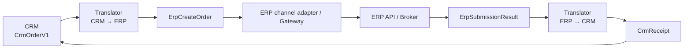
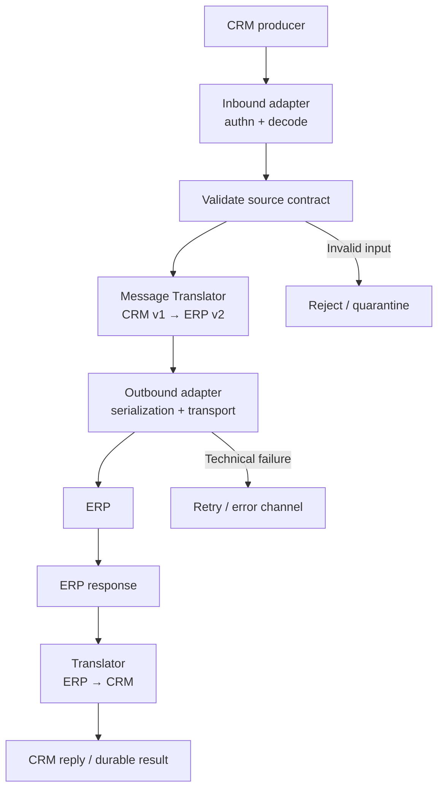
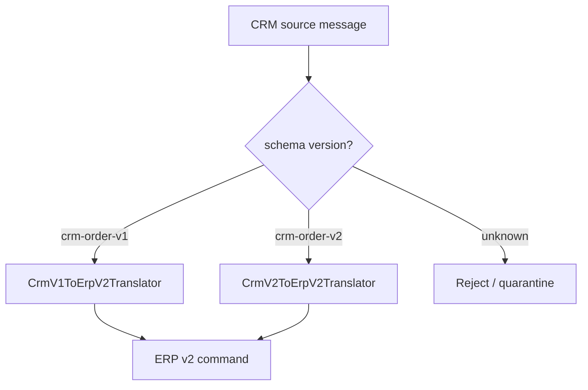
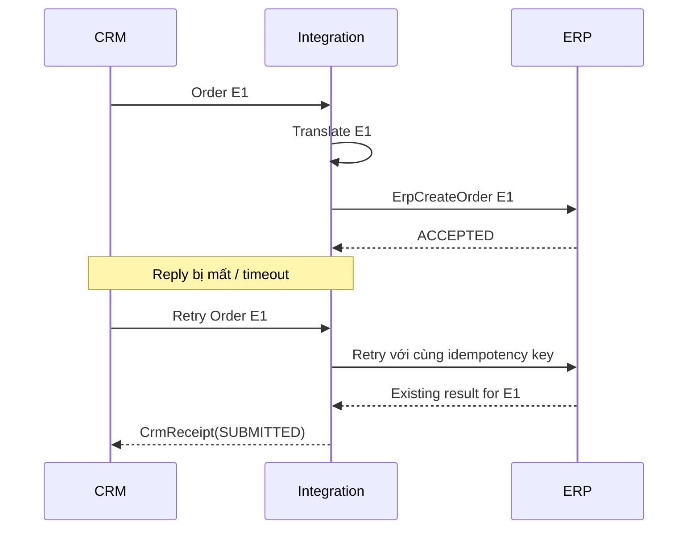
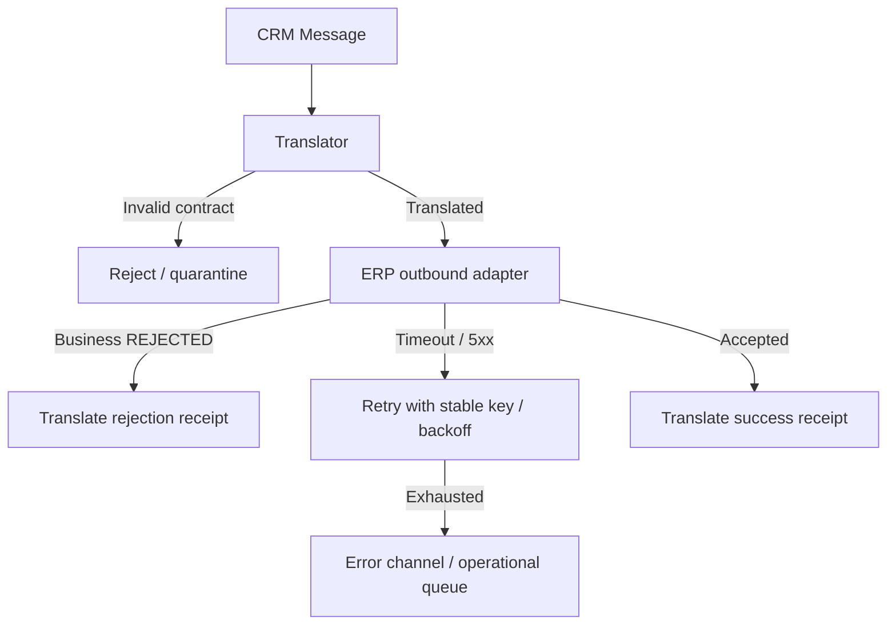
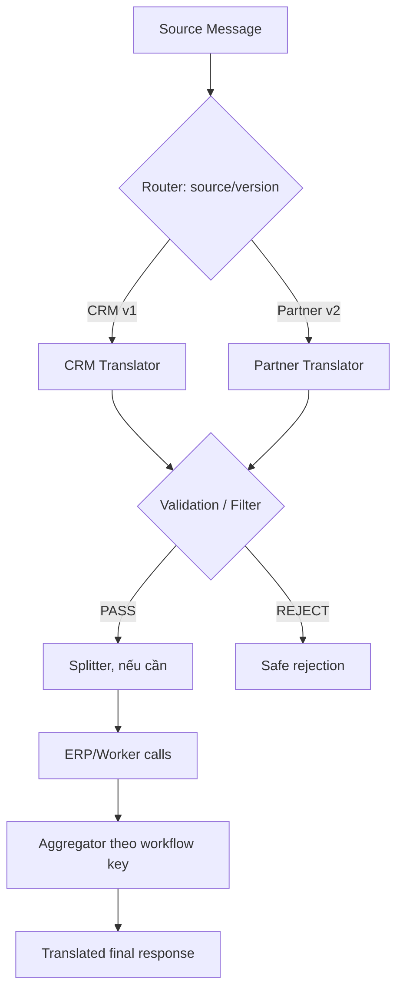

# Message Translator chuyển message giữa hai hệ thống

Một hệ thống CRM có thể tạo yêu cầu đặt hàng với số tiền `"49.95"` dưới dạng chuỗi thập phân, trong khi ERP chỉ nhận số nguyên `4995` tính bằng cent. CRM gọi khách hàng là `customerRef`, còn ERP dùng `customerAccount`; CRM trả trạng thái `SUBMITTED`, nhưng ERP phản hồi `ACCEPTED` hoặc `REJECTED`. Nếu hai hệ thống trao đổi Message trực tiếp mà không có lớp chuyển đổi, mỗi bên phải biết cấu trúc dữ liệu và quy tắc đặc thù của bên còn lại.

**Message Translator** là mẫu Enterprise Integration Patterns (EIP) chuyển Message từ **hợp đồng của hệ thống gửi** sang **hợp đồng của hệ thống nhận**, để hai hệ thống có thể tương tác mà không phải dùng chung một kiểu payload hoặc một mô hình nghiệp vụ. Translator có thể chuyển tên trường, kiểu dữ liệu, đơn vị đo, danh sách, mã trạng thái và một phần metadata; nó cũng phải phát hiện những khác biệt **không thể chuyển đổi an toàn** thay vì đoán hoặc làm mất dữ liệu.

Bài **Message Translator chuyển message giữa hai hệ thống** thuộc chương **Message translator**, module `SPRING_INTEGRATION_PATTERN`. Mục tiêu module là học triển khai Enterprise Integration Patterns với Spring Integration để xây dựng luồng thông điệp ít phụ thuộc và dễ mở rộng; thực hành Router, Filter, Transformer, Splitter, Aggregator, Gateway, retry, error channel và correlation, đồng thời kiểm thử và theo dõi các nhánh xử lý. Bài này sẽ dùng tình huống CRM ↔ ERP để giải thích **ranh giới hợp đồng, triển khai translator bằng Spring Integration, kiểm thử bản dịch hai chiều và những yêu cầu reliability khi hai hệ thống giao tiếp thật**.

## 1. Vấn đề thực tế: hai hệ thống, hai ngôn ngữ dữ liệu

CRM phát yêu cầu:

```json
{
  "tenantId": "tenant-7",
  "eventId": "evt-1001",
  "orderId": "ORD-1001",
  "customerRef": "CUS-9",
  "totalAmount": "49.95",
  "currency": "USD",
  "lines": [
    {"lineNo": 1, "sku": "BOOK-01", "quantity": 2},
    {"lineNo": 2, "sku": "PEN-02", "quantity": 5}
  ]
}
```

ERP yêu cầu:

```json
{
  "tenant": "tenant-7",
  "externalDocumentId": "ORD-1001",
  "sourceEventId": "evt-1001",
  "customerAccount": "ERP-CUS-9",
  "totalMinorUnits": 4995,
  "currencyCode": "USD",
  "positions": [
    {"position": 1, "materialCode": "BOOK-01", "units": 2},
    {"position": 2, "materialCode": "PEN-02", "units": 5}
  ]
}
```

Nếu ERP trả:

```json
{
  "sourceEventId": "evt-1001",
  "externalDocumentId": "ORD-1001",
  "erpDocumentId": "ERP-DOC-777",
  "resultCode": "ACCEPTED",
  "errorCode": "NONE"
}
```

thì CRM mong một phản hồi theo ngôn ngữ của nó:

```json
{
  "eventId": "evt-1001",
  "orderId": "ORD-1001",
  "erpReference": "ERP-DOC-777",
  "status": "SUBMITTED",
  "reasonCode": "NONE"
}
```

Message Translator là **ranh giới dịch hợp đồng**, không đơn thuần đổi tên `totalAmount` thành `totalMinorUnits`.



Trong ví dụ này, một request CRM dẫn đến một command ERP và sau đó một receipt CRM. Đây là **kịch bản một-nhánh, đồng bộ để học cách dịch**. Với broker bất đồng bộ hoặc ERP trả kết quả sau nhiều phút, cách tương quan và trả reply sẽ khác; các phần sau phân tích riêng.

## 2. Message Translator EIP khác Message Transformer như thế nào?

Về mặt cơ chế, một Message Translator thường **được triển khai bằng một hoặc nhiều Message Transformer**. Khác biệt nằm ở **mục đích kiến trúc**, không nhất thiết ở tên class:

| Pattern / thành phần | Câu hỏi chính | Ví dụ |
| --- | --- | --- |
| **Message Translator** | Làm thế nào hai hệ thống khác hợp đồng hiểu nhau? | `CrmOrderV1 → ErpCreateOrder` |
| **Message Transformer** | Biến đổi payload hoặc Message trong flow như thế nào? | String → DTO, đổi đơn vị tiền |
| **Normalizer** | Nhiều định dạng nguồn khác nhau về **một dạng chung** như thế nào? | CRM/ERP/Partner → `CanonicalOrder` |
| **Envelope Wrapper** | Gắn metadata trao đổi ổn định quanh dữ liệu như thế nào? | `EventEnvelope<OrderData>` |
| **Channel Adapter** | Kết nối một ứng dụng với HTTP, Kafka, JMS, file như thế nào? | HTTP outbound gateway |
| **Gateway** | Ẩn messaging API đằng sau lời gọi request-reply như thế nào? | Java interface gọi integration flow |
| **Router** | Message đi tới endpoint nào? | Chọn translator theo `sourceSystem` |

**Translator không mặc nhiên là transport adapter.** Một hàm Java đổi dữ liệu CRM thành dữ liệu ERP chưa gửi request HTTP hoặc publish Kafka. Adapter chịu trách nhiệm kết nối và serialization; Translator chịu trách nhiệm hiểu sự khác nhau của hai hợp đồng.

### 2.1. Có phải mọi Translator đều cần Canonical Data Model?

Không. Nếu chỉ có CRM và ERP, có thể dịch **trực tiếp** `CRM → ERP`. Khi phải kết nối nhiều nguồn và nhiều đích, mô hình chuẩn có thể giúp giảm số bộ mapping:

```text
Direct pairwise:
  CRM -> ERP
  CRM -> WMS
  POS -> ERP
  POS -> WMS

Canonical:
  CRM ─┐
  POS ─┴──> CanonicalOrder ──┬──> ERP
                            └──> WMS
```

Tuy nhiên Canonical Model cũng có chi phí quản trị và không tự phù hợp với mọi nghiệp vụ. Bài này tập trung **Translator giữa hai hệ thống**, có nói tới canonical mapping khi cần mở rộng.

## 3. Translation phải giữ ý nghĩa, không chỉ giữ cấu trúc

Một bản dịch đúng cần bảo toàn những **bất biến nghiệp vụ** mà hai bên đã thống nhất:

1. Cùng một đơn hàng giữ được `orderId` và tenant theo hợp đồng.
2. Tổng tiền bằng nhau sau khi đổi biểu diễn và đơn vị, không làm tròn âm thầm.
3. Số dòng, vị trí dòng và số lượng không bị thay đổi ngoài quy tắc được công bố.
4. `eventId` nguồn ổn định qua redelivery để phía nhận có thể dedupe.
5. Mã phản hồi ERP được chuyển theo **bảng trạng thái có chủ ý**.
6. Dữ liệu không thể ánh xạ phải được **từ chối hoặc chuyển nhánh lỗi**, không tự chế giá trị mặc định.

Ví dụ sai:

```text
CRM totalAmount = "49.95"
ERP totalMinorUnits = 49

Sai: lấy nguyên phần trước dấu chấm rồi bỏ phần lẻ.
```

Hoặc:

```text
ERP resultCode = "REJECTED"
CRM status = "SUBMITTED"

Sai: coi mọi HTTP 200 hoặc mọi reply ERP là nghiệp vụ thành công.
```

Khi giao tiếp giữa hai bounded context, có những trường tuy giống tên nhưng **không có cùng ngữ nghĩa**. `customerRef` của CRM chỉ có thể dịch thành `customerAccount` của ERP nếu đã có quy tắc/nguồn ánh xạ đáng tin, không được tự giả định hai ID thuộc cùng một hệ thống định danh.

## 4. Bảng mapping phải được thống nhất trước khi code

| CRM v1 | ERP v2 | Quy tắc dịch |
| --- | --- | --- |
| `tenantId` | `tenant` | Giữ giá trị đã được xác thực |
| `eventId` | `sourceEventId` | Giữ ổn định qua retry |
| `orderId` | `externalDocumentId` | Đối chiếu độ dài, phạm vi ID |
| `customerRef` | `customerAccount` | Tra cứu/mapping theo hợp đồng; demo dùng prefix có quy định |
| `totalAmount` | `totalMinorUnits` | USD decimal → cents, exact conversion |
| `currency` | `currencyCode` | Chỉ nhận mã tiền được hỗ trợ |
| `lines[].lineNo` | `positions[].position` | Bảo toàn số thứ tự |
| `lines[].sku` | `positions[].materialCode` | Demo giữ SKU; production có thể cần product catalog mapping |
| `lines[].quantity` | `positions[].units` | Số nguyên dương |
| CRM `eventId` + tenant | ERP idempotency key | Thêm operation namespace ổn định |

Mapping ngược:

| ERP response | CRM receipt | Ngữ nghĩa |
| --- | --- | --- |
| `ACCEPTED` | `SUBMITTED` | ERP chấp nhận command theo hợp đồng demo |
| `REJECTED`, `OUT_OF_STOCK` | `REJECTED`, `ERP_OUT_OF_STOCK` | Từ chối nghiệp vụ, không retry ngay cùng dữ liệu |
| `REJECTED`, code không biết | `REJECTED`, `ERP_REJECTED` | Mã công khai an toàn |
| Status code không hỗ trợ | Lỗi hợp đồng kỹ thuật | Không giả là thành công hay từ chối chắc chắn |

**Đây là bảng mapping ví dụ, không phải bảng mã thật của một ERP cụ thể.** Khi tích hợp thực tế, phải lấy hợp đồng phiên bản của từng hệ thống làm chuẩn, xác định rõ mức độ chấp nhận (`received`, `validated`, `committed`) và kiểm thử với adapter thật.

### 4.1. Có cần dùng một lược đồ lỗi chung?

Nên có các nhóm lỗi phân biệt:

```text
VALIDATION_FAILURE  -> request đầu vào sai
TRANSLATION_FAILURE -> không thể ánh xạ an toàn
REMOTE_REJECTION    -> ERP đã trả business rejection
REMOTE_TIMEOUT      -> không biết ERP đã xử lý hay chưa
REMOTE_UNAVAILABLE  -> hệ thống ERP không truy cập được
SERIALIZATION_ERROR -> payload không đúng hợp đồng transport
```

Không gộp mọi lỗi thành `REJECTED` vì một timeout không chứng minh ERP chưa tạo đơn; retry mù có thể tạo thêm đơn hàng.

## 5. Xác định ranh giới CRM → Translator → ERP



**Ranh giới tin cậy** ở inbound adapter:

- Xác thực người gửi và tenant hoặc đối chiếu với principal/ACL.
- Giải mã đúng schema version.
- Kiểm tra các trường bắt buộc, kích thước và định dạng.
- Loại hoặc ghi đè những header nội bộ do client tự khai.
- Gắn source identity được xác thực, không lấy từ một chuỗi tự do trong payload.

**Ranh giới dịch hợp đồng** ở Translator:

- Chuyển field, kiểu, đơn vị và mã trạng thái.
- Giữ các ID cần cho correlation/idempotency.
- Chỉ tạo giá trị mới khi hợp đồng cho phép.
- Ném lỗi có mã an toàn nếu không thể chuyển đổi.

**Ranh giới transport** ở outbound adapter:

- Cấu hình endpoint, authentication và serialization.
- Chỉ chuyển header có trong allowlist.
- Xử lý timeout, retry, response status và lỗi kết nối.
- Không phát tán raw exception, token hoặc các header JVM không nên ra ngoài.

Không nên đặt token/credential, HTTP URL hoặc cấu hình broker vào lớp Translator chỉ để việc dịch “tiện hơn”. Translator nên gần với hàm thuần, dễ test khi chưa có hệ thống ERP.

## 6. Java 17+: thiết kế các kiểu Message của hai hệ thống

Các `record` sau biểu thị schema minh họa. Để dễ theo dõi, chúng được khai báo trong một class chứa các kiểu lồng nhau.

```java
package example.integration;

import java.util.List;

public final class TranslatorModel {

    private TranslatorModel() {
    }

    public record CrmLine(
            int lineNo, String sku, int quantity) {
    }

    public record CrmOrderV1(
            String tenantId,
            String eventId,
            String orderId,
            String customerRef,
            String totalAmount,
            String currency,
            List<CrmLine> lines) {
    }

    public record ErpLine(
            int position, String materialCode, int units) {
    }

    public record ErpCreateOrder(
            String tenant,
            String sourceEventId,
            String externalDocumentId,
            String customerAccount,
            long totalMinorUnits,
            String currencyCode,
            List<ErpLine> positions,
            String idempotencyKey) {
    }

    public record ErpSubmissionResult(
            String sourceEventId,
            String externalDocumentId,
            String erpDocumentId,
            String resultCode,
            String errorCode) {
    }

    public record CrmReceipt(
            String eventId,
            String orderId,
            String erpReference,
            String status,
            String reasonCode) {
    }
}
```

Các DTO chỉ thể hiện **dữ liệu được truyền**, không tự khẳng định có authentication, transaction hay delivery. Khi dùng HTTP/Kafka/AMQP thật, cần contract serialization (JSON/Avro/Protobuf), schema validation và chiến lược tương thích phiên bản.

### 6.1. Vì sao giữ `sourceEventId` và `externalDocumentId` trong ERP command?

ERP có thể cấp `erpDocumentId` mới. Tuy nhiên, khi nhận response, Translator vẫn cần liên hệ về `eventId` và `orderId` của CRM. Hai field này giúp phân biệt **mã sự kiện nguồn** với **mã tài liệu do ERP cấp**.

Không sử dụng `erpDocumentId` để thay thế event ID khi dedupe request đầu vào.

### 6.2. Vì sao `totalMinorUnits` dùng `long`?

Đây là một lựa chọn minh họa cho hệ thống ERP dùng đơn vị nhỏ nhất. Phải có giới hạn độ lớn và `longValueExact()` khi chuyển từ `BigDecimal`. Với hệ thống cần lượng tiền vượt phạm vi `long` hoặc hỗ trợ nhiều đơn vị đo, cần một kiểu `Money` có currency, scale và precision rõ ràng.

## 7. Translator thuần: kiểm tra rồi dịch CRM sang ERP

Translator chính nên không gọi broker, database hoặc API bên ngoài. Việc ánh xạ mã khách hàng theo tiền tố `"ERP-"` ở demo là **quy tắc mô phỏng đã thỏa thuận**, không phải cách tra cứu khách hàng an toàn cho production.

```java
package example.integration;

import java.math.BigDecimal;
import java.util.HashSet;
import java.util.List;
import java.util.Set;

import example.integration.TranslatorModel.*;

public final class CrmErpMessageTranslator {

    private static final String OPERATION = "CREATE_ERP_ORDER";

    public ErpCreateOrder toErpOrder(CrmOrderV1 input) {
        if (input == null) {
            throw new IllegalArgumentException("CRM_REQUEST_REQUIRED");
        }

        String tenant = requiredId(input.tenantId(), "TENANT");
        String event = requiredId(input.eventId(), "EVENT");
        String order = requiredId(input.orderId(), "ORDER");
        String customer = requiredId(input.customerRef(), "CUSTOMER");

        if (!"USD".equals(input.currency())) {
            throw new IllegalArgumentException("UNSUPPORTED_CURRENCY");
        }

        long cents = parseUsdCents(input.totalAmount());
        List<ErpLine> lines = translateLines(input.lines());

        // Một logical CRM event + một operation -> cùng một key khi retry.
        String idempotencyKey =
                tenant + ":" + event + ":" + OPERATION;

        return new ErpCreateOrder(
                tenant,
                event,
                order,
                "ERP-" + customer, // Demo: mapping contract đơn giản.
                cents,
                "USD",
                lines,
                idempotencyKey);
    }

    private static long parseUsdCents(String text) {
        // Chỉ decimal thường, không exponent, không âm;
        // giới hạn số chữ số để tránh đầu vào quá lớn.
        if (text == null
                || !text.matches("[0-9]{1,12}(\\.[0-9]{1,2})?")) {
            throw new IllegalArgumentException("CRM_AMOUNT_INVALID");
        }
        try {
            return new BigDecimal(text)
                    .movePointRight(2)
                    .longValueExact();
        } catch (ArithmeticException ex) {
            throw new IllegalArgumentException(
                    "CRM_AMOUNT_OUT_OF_RANGE", ex);
        }
    }

    private static List<ErpLine> translateLines(
            List<CrmLine> inputLines) {
        if (inputLines == null
                || inputLines.isEmpty()
                || inputLines.size() > 100) {
            throw new IllegalArgumentException("INVALID_LINE_COUNT");
        }

        Set<Integer> seenPositions = new HashSet<>();
        return inputLines.stream().map(line -> {
            if (line == null
                    || line.lineNo() < 1
                    || line.lineNo() > inputLines.size()
                    || !seenPositions.add(line.lineNo())) {
                throw new IllegalArgumentException(
                        "INVALID_LINE_POSITION");
            }
            if (line.quantity() <= 0) {
                throw new IllegalArgumentException(
                        "INVALID_LINE_QUANTITY");
            }
            String material = requiredId(line.sku(), "MATERIAL");
            return new ErpLine(
                    line.lineNo(), material, line.quantity());
        }).toList();
    }

    private static String requiredId(String value, String field) {
        if (value == null
                || !value.matches("[A-Za-z0-9_-]{1,80}")) {
            throw new IllegalArgumentException("INVALID_" + field + "_ID");
        }
        return value;
    }

    public CrmReceipt toCrmReceipt(ErpSubmissionResult response) {
        if (response == null) {
            throw new IllegalArgumentException("ERP_RESPONSE_REQUIRED");
        }
        String event = requiredId(
                response.sourceEventId(), "EVENT");
        String order = requiredId(
                response.externalDocumentId(), "ORDER");

        return switch (response.resultCode()) {
            case "ACCEPTED" -> new CrmReceipt(
                    event, order,
                    requiredId(response.erpDocumentId(), "ERP_DOCUMENT"),
                    "SUBMITTED", "NONE");

            case "REJECTED" -> new CrmReceipt(
                    event, order, null,
                    "REJECTED", safeRejectionCode(response.errorCode()));

            default -> throw new IllegalArgumentException(
                    "UNSUPPORTED_ERP_RESULT_CODE");
        };
    }

    private static String safeRejectionCode(String rawCode) {
        // Không phản chiếu raw ERP error text ra CRM.
        return switch (rawCode == null ? "" : rawCode) {
            case "OUT_OF_STOCK" -> "ERP_OUT_OF_STOCK";
            case "CUSTOMER_NOT_FOUND" -> "ERP_CUSTOMER_NOT_FOUND";
            default -> "ERP_REJECTED";
        };
    }
}
```

### 7.1. Những bảo đảm trong mapper

- `requiredId` từ chối ID không có cấu trúc phù hợp và giới hạn độ dài.
- `parseUsdCents` dùng `BigDecimal`, không dùng `double` để xử lý số tiền.
- `longValueExact()` không âm thầm làm tròn hoặc cắt giá trị.
- Danh sách dòng phải có `lineNo` khác nhau và trong khoảng `1..N`.
- Mã vật tư giả định có cùng namespace giữa hai hệ thống; thực tế có thể phải tra bảng mapping.
- Key idempotency được tạo từ logical event, không từ `MessageHeaders.ID`.
- Mapping phản hồi theo **bảng mã có giới hạn**, không đưa raw response text vào public receipt.

**Giới hạn rất quan trọng:** đây là translator **không có integration với ERP thật**. Nó chưa xác minh được account `ERP-CUS-9` có tồn tại, currency USD có phải loại ERP đang chấp nhận hay `REJECTED` tương ứng với lỗi có thể retry. Các quy tắc này phải dựa trên hợp đồng ERP và integration tests ở môi trường thích hợp.

### 7.2. Nếu cần ánh xạ customer ID bằng dữ liệu tra cứu?

Một `customerRef` CRM không nhất thiết biến thành ERP account bằng cách nối tiền tố. Trong hệ thống thực:

1. Có nguồn mapping đã được quản trị giữa hai mã khách hàng.
2. Dùng Content Enricher/service riêng để tra cứu theo tenant/customer ID.
3. Phân biệt *missing mapping* với *lookup service unavailable*.
4. Chỉ chạy Translator khi đã có dữ liệu đủ tin cậy hoặc truyền mapping resolver qua interface.
5. Kiểm thử một customer được đổi mapping/version mà không phát sai đơn.

Giữ Translator càng thuần càng tốt giúp **tách lỗi chuyển đổi khỏi lỗi mạng** và cho phép unit test nhanh.

## 8. Phân biệt translation failure với remote rejection

Hai lỗi sau **không giống nhau**:

```text
CRM amountText="NaN"
  -> Translator không thể chuyển thành số tiền
  -> Không gửi ERP.

CRM amountText="49.95"
  -> Translator gửi ERP.
  -> ERP trả REJECTED/OUT_OF_STOCK
  -> Dịch thành CrmReceipt(status=REJECTED).
```

Lỗi thứ nhất xảy ra **trước transport** vì đầu vào không hợp đồng; lỗi thứ hai là **phản hồi nghiệp vụ từ ERP** sau khi request hợp lệ đã được gửi.

| Điều kiện | Có tạo `ErpCreateOrder`? | Có gửi ERP? | Kết quả nên trả |
| --- | --- | --- | --- |
| CRM amount sai định dạng | Không | Không | Validation/translation error |
| CRM thiếu event ID | Không | Không | Input contract error |
| ERP trả `ACCEPTED` | Có | Có | `CrmReceipt(SUBMITTED)` |
| ERP trả `REJECTED` | Có | Có | `CrmReceipt(REJECTED)` |
| ERP trả status lạ | Có | Có | Technical/protocol error |
| ERP không trả response | Có | Có thể | Timeout/unknown outcome; cần kiểm tra trước retry |

**Không ném exception cho mọi business rejection nếu hệ thống đã chọn receipt là hợp đồng trả lời.** Nhưng cũng không trả `"REJECTED"` cho mọi exception, vì điều đó làm mất khả năng phân biệt lỗi dữ liệu với lỗi transport.

## 9. Tách Message Translator khỏi cổng giao tiếp ERP

Translator ở mục 7 là một hàm đổi DTO; cổng gọi ERP có thể là:

```java
package example.integration;

import example.integration.TranslatorModel.*;

@FunctionalInterface
public interface ErpSubmissionPort {
    ErpSubmissionResult submit(ErpCreateOrder command);
}
```

Ứng dụng production cung cấp implementation gọi HTTP outbound gateway, AMQP/Kafka request-reply hoặc một ERP SDK theo hợp đồng thật. Nhưng để ví dụ **tự chứa, không cần ERP thực**, ta tạo fake port:

```java
package example.integration;

import java.util.concurrent.atomic.AtomicReference;

import example.integration.TranslatorModel.*;

public final class RecordingErpPort implements ErpSubmissionPort {

    private final AtomicReference<ErpCreateOrder> last =
            new AtomicReference<>();

    @Override
    public ErpSubmissionResult submit(ErpCreateOrder command) {
        last.set(command);
        return new ErpSubmissionResult(
                command.sourceEventId(),
                command.externalDocumentId(),
                "ERP-DOC-" + command.externalDocumentId(),
                "ACCEPTED",
                "NONE");
    }

    public ErpCreateOrder lastCommand() {
        return last.get();
    }
}
```

Fake port là **bộ mô phỏng phục vụ bài học và test**, không có bảo đảm durability, authentication, retry hoặc ERP transaction. Điểm có ích là **có thể thay transport mà không sửa hàm dịch DTO**.

### 9.1. Vì sao không đưa URL ERP vào `CrmErpMessageTranslator`?

Nếu mapper tự gọi HTTP, test một quy tắc đổi tiền đơn giản có thể phụ thuộc vào mạng, credential và trạng thái ERP. Điều này làm tăng coupling và khó phân biệt mapping error với transport error.

Phân tách thành:

```text
Mapper (pure conversion)
  +
ErpSubmissionPort (boundary interface)
  +
HTTP/Broker Adapter (transport implementation)
```

cho phép kiểm thử từng lớp và đổi cách kết nối mà không đổi hợp đồng nghiệp vụ của translator.

## 10. Spring Integration Java DSL: nối hai translator vào một flow

Spring Integration có thể điều phối theo chuỗi:

```text
crmOrdersInput
    -> transform CRM request sang ERP command
    -> handle gửi ERP qua port
    -> transform ERP response sang CRM receipt
    -> crmReceipts
```

```java
package example.integration;

import org.springframework.context.annotation.Bean;
import org.springframework.context.annotation.Configuration;
import org.springframework.integration.channel.DirectChannel;
import org.springframework.integration.channel.QueueChannel;
import org.springframework.integration.config.EnableIntegration;
import org.springframework.integration.dsl.IntegrationFlow;
import org.springframework.messaging.MessageChannel;
import org.springframework.messaging.PollableChannel;

import example.integration.TranslatorModel.*;

@Configuration
@EnableIntegration
public class TranslatorFlowConfiguration {

    @Bean
    public MessageChannel crmOrdersInput() {
        return new DirectChannel();
    }

    @Bean
    public PollableChannel crmReceipts() {
        return new QueueChannel(20);
    }

    @Bean
    public CrmErpMessageTranslator messageTranslator() {
        return new CrmErpMessageTranslator();
    }

    @Bean
    public RecordingErpPort erpSubmissionPort() {
        // Chỉ demo/test, thay bằng real adapter trong production.
        return new RecordingErpPort();
    }

    @Bean
    public IntegrationFlow translateCrmOrders(
            CrmErpMessageTranslator translator,
            ErpSubmissionPort erpPort) {

        return IntegrationFlow.from("crmOrdersInput")
                .transform(
                        CrmOrderV1.class,
                        translator::toErpOrder)
                .handle(
                        ErpCreateOrder.class,
                        (command, headers) -> erpPort.submit(command))
                .transform(
                        ErpSubmissionResult.class,
                        translator::toCrmReceipt)
                .channel("crmReceipts")
                .get();
    }
}
```

### 10.1. Đọc từng bước trong DSL

1. `IntegrationFlow.from("crmOrdersInput")` nhận một `Message<CrmOrderV1>`.
2. `.transform(CrmOrderV1.class, ...)` chuyển **payload** sang `ErpCreateOrder`.
3. `.handle(ErpCreateOrder.class, ...)` gọi `ErpSubmissionPort` và lấy phản hồi `ErpSubmissionResult`.
4. `.transform(ErpSubmissionResult.class, ...)` chuyển phản hồi về `CrmReceipt`.
5. `.channel("crmReceipts")` đưa receipt tới consumer/test.

Trong flow đồng bộ, nếu một bước ném exception, nó có thể lan ngược về `send()` và Message không xuất hiện ở output. Với transport async hoặc Gateway có timeout, phải xử lý error/reply ở mức adapter và completion state.

### 10.2. API có luôn như thế ở mọi phiên bản không?

Các overload `.transform(Class, transformer)` và `.handle(Class, handler)` là cách cấu hình Java DSL thường dùng ở các phiên bản Spring Integration hiện đại. Khi đưa vào dự án, phải đối chiếu đúng phiên bản dependency, chạy compiler và tests; bài STEP 4 **chưa chạy build/JUnit**.

### 10.3. `QueueChannel(20)` chỉ là bộ đệm test

Nó không làm cho lời gọi ERP bền vững và không tự ACK broker bên ngoài. Nếu ứng dụng crash sau khi ERP nhận request nhưng trước khi receipt nằm trong `QueueChannel`, chỉ có Message/source idempotency và trạng thái ERP/durable store mới giúp phục hồi đúng.

## 11. Demo: gửi một CRM Message, nhận một CRM receipt

```java
package example.integration;

import java.util.List;

import org.springframework.context.annotation.AnnotationConfigApplicationContext;
import org.springframework.messaging.Message;
import org.springframework.messaging.MessageChannel;
import org.springframework.messaging.PollableChannel;
import org.springframework.messaging.support.MessageBuilder;

import example.integration.TranslatorModel.*;

public class TranslatorDemo {

    public static void main(String[] args) {
        try (var context = new AnnotationConfigApplicationContext(
                TranslatorFlowConfiguration.class)) {

            MessageChannel input =
                    context.getBean("crmOrdersInput", MessageChannel.class);
            PollableChannel output =
                    context.getBean("crmReceipts", PollableChannel.class);
            RecordingErpPort erpPort =
                    context.getBean(RecordingErpPort.class);

            CrmOrderV1 request = new CrmOrderV1(
                    "tenant-7",
                    "evt-1001",
                    "ORD-1001",
                    "CUS-9",
                    "49.95",
                    "USD",
                    List.of(
                            new CrmLine(1, "BOOK-01", 2),
                            new CrmLine(2, "PEN-02", 5)));

            input.send(MessageBuilder.withPayload(request).build());

            Message<?> result = output.receive(0);
            if (result == null) {
                throw new IllegalStateException(
                        "Expected a translated CRM receipt");
            }

            CrmReceipt receipt = (CrmReceipt) result.getPayload();
            ErpCreateOrder erpCommand = erpPort.lastCommand();
            System.out.println(erpCommand.totalMinorUnits()); // 4995
            System.out.println(erpCommand.customerAccount());  // ERP-CUS-9
            System.out.println(receipt.status());              // SUBMITTED
            System.out.println(receipt.orderId());             // ORD-1001
        }
    }
}
```

Trong demo, fake ERP trả `ACCEPTED` đồng bộ. Kết quả `SUBMITTED` **chỉ phản ánh semantics do bài này định nghĩa**; một ERP thật có thể phân biệt accepted into queue, validated, committed, posted và fulfilled. Không đồng nhất `ACCEPTED` của mọi ERP với việc đơn đã hoàn tất.

## 12. JUnit 5: kiểm thử bản dịch CRM → ERP ở mức mapper

Unit test không cần Spring context hoặc mạng. Nó kiểm tra cụ thể quy tắc đổi tiền, ID và danh sách dòng:

```java
package example.integration;

import static org.junit.jupiter.api.Assertions.*;

import java.util.List;

import org.junit.jupiter.api.Test;

import example.integration.TranslatorModel.*;

class CrmErpMessageTranslatorTest {

    private final CrmErpMessageTranslator translator =
            new CrmErpMessageTranslator();

    private static CrmOrderV1 validRequest() {
        return new CrmOrderV1(
                "tenant-7",
                "evt-1001",
                "ORD-1001",
                "CUS-9",
                "49.95",
                "USD",
                List.of(
                        new CrmLine(1, "BOOK-01", 2),
                        new CrmLine(2, "PEN-02", 5)));
    }

    @Test
    void crmOrderIsTranslatedToErpContractWithoutLosingMeaning() {
        ErpCreateOrder output = translator.toErpOrder(validRequest());

        assertEquals("tenant-7", output.tenant());
        assertEquals("evt-1001", output.sourceEventId());
        assertEquals("ORD-1001", output.externalDocumentId());
        assertEquals("ERP-CUS-9", output.customerAccount());
        assertEquals(4995L, output.totalMinorUnits());
        assertEquals("USD", output.currencyCode());
        assertEquals(2, output.positions().size());
        assertEquals(1, output.positions().get(0).position());
        assertEquals("BOOK-01",
                output.positions().get(0).materialCode());
        assertEquals(5, output.positions().get(1).units());
        assertEquals(
                "tenant-7:evt-1001:CREATE_ERP_ORDER",
                output.idempotencyKey());
    }

    @Test
    void sameLogicalEventGetsSameIdempotencyKeyOnRetry() {
        var first = translator.toErpOrder(validRequest());
        var retry = translator.toErpOrder(validRequest());

        assertEquals(first.idempotencyKey(), retry.idempotencyKey());
        assertEquals(first, retry);
    }

    @Test
    void erpAcceptanceAndBusinessRejectionAreTranslatedDifferently() {
        var accepted = translator.toCrmReceipt(
                new ErpSubmissionResult(
                        "evt-1001", "ORD-1001",
                        "ERP-DOC-777", "ACCEPTED", "NONE"));

        assertEquals("SUBMITTED", accepted.status());
        assertEquals("ERP-DOC-777", accepted.erpReference());
        assertEquals("NONE", accepted.reasonCode());

        var rejected = translator.toCrmReceipt(
                new ErpSubmissionResult(
                        "evt-1001", "ORD-1001",
                        null, "REJECTED", "OUT_OF_STOCK"));

        assertEquals("REJECTED", rejected.status());
        assertNull(rejected.erpReference());
        assertEquals("ERP_OUT_OF_STOCK", rejected.reasonCode());
    }
}
```

Những assertion này giúp phát hiện lỗi **đổi sai đơn vị**, **thất lạc định danh**, **đổi nhầm thứ tự dòng** hoặc **coi rejection là accepted**.

### 12.1. Test hợp đồng chứ không chỉ test object != null

Một test chỉ kiểm tra `assertNotNull(translator.toErpOrder(...))` chưa chứng minh translator thực hiện đúng nghĩa vụ. Cần kiểm tra từng invariant quan trọng, nhất là tiền, tenant, ID, status và các field dùng để dedupe/correlation.

## 13. JUnit 5: input sai không được gửi sang ERP

Nếu CRM gửi `"NaN"` hoặc `"-1.00"` cho amount, Translator phải từ chối thay vì sinh ERP command sai:

```java
// Các method thuộc CrmErpMessageTranslatorTest.
@Test
void invalidAmountIsRejectedBeforeAnyErpCommandIsProduced() {
    CrmOrderV1 input = new CrmOrderV1(
            "tenant-7", "evt-bad", "ORD-1001", "CUS-9",
            "NaN", "USD", List.of(new CrmLine(1, "BOOK-01", 1)));

    IllegalArgumentException ex = assertThrows(
            IllegalArgumentException.class,
            () -> translator.toErpOrder(input));

    assertEquals("CRM_AMOUNT_INVALID", ex.getMessage());
}

@Test
void duplicateLinePositionsAreRejected() {
    CrmOrderV1 input = new CrmOrderV1(
            "tenant-7", "evt-dup-line", "ORD-1001", "CUS-9",
            "49.95", "USD",
            List.of(
                    new CrmLine(1, "BOOK-01", 2),
                    new CrmLine(1, "PEN-02", 5)));

    assertThrows(
            IllegalArgumentException.class,
            () -> translator.toErpOrder(input));
}

@Test
void unsupportedErpStatusIsNotSilentlyMappedToSuccess() {
    assertThrows(IllegalArgumentException.class, () ->
            translator.toCrmReceipt(new ErpSubmissionResult(
                    "evt-1001", "ORD-1001", null,
                    "SUSPENDED_FOR_REVIEW", "NONE")));
}
```

Trong production, `"SUSPENDED_FOR_REVIEW"` có thể là một trạng thái nghiệp vụ hoàn toàn hợp lệ. Khi gặp trạng thái mới, phải **nâng phiên bản bảng mapping và hợp đồng CRM**; không tự gán `ACCEPTED` hoặc `REJECTED` khi chưa rõ semantics.

### 13.1. Thiếu SKU mapping xử lý thế nào?

Giả sử CRM gửi `crmSku="CRM-BOOK-01"` trong khi ERP chỉ chấp nhận `"ERP-M-100"`. Nếu không có bảng mapping hợp lệ, Translator **không được tự bỏ prefix rồi đoán mã mới**. Có thể phát lỗi `MATERIAL_MAPPING_MISSING` hoặc giữ công việc ở trạng thái cần enrichment/reconciliation, tùy hợp đồng nghiệp vụ.

## 14. JUnit 5: kiểm thử xuyên Spring Integration channels

Một mapper unit test PASS vẫn chưa chứng minh IntegrationFlow gọi mapper và chuyển kết quả tới đúng channel. Test sau kiểm tra:

```java
package example.integration;

import static org.junit.jupiter.api.Assertions.*;

import java.util.List;

import org.junit.jupiter.api.Test;
import org.springframework.context.annotation.AnnotationConfigApplicationContext;
import org.springframework.messaging.Message;
import org.springframework.messaging.MessageChannel;
import org.springframework.messaging.PollableChannel;
import org.springframework.messaging.support.MessageBuilder;

import example.integration.TranslatorModel.*;

class TranslatorFlowIntegrationTest {

    @Test
    void crmRequestCrossesTwoTranslationBoundariesAndGetsReceipt() {
        try (var context = new AnnotationConfigApplicationContext(
                TranslatorFlowConfiguration.class)) {

            MessageChannel input =
                    context.getBean("crmOrdersInput", MessageChannel.class);
            PollableChannel output =
                    context.getBean("crmReceipts", PollableChannel.class);
            RecordingErpPort port =
                    context.getBean(RecordingErpPort.class);

            var order = new CrmOrderV1(
                    "tenant-7",
                    "evt-1001",
                    "ORD-1001",
                    "CUS-9",
                    "49.95",
                    "USD",
                    List.of(
                            new CrmLine(1, "BOOK-01", 2),
                            new CrmLine(2, "PEN-02", 5)));

            assertTrue(input.send(
                    MessageBuilder.withPayload(order).build()));

            Message<?> message = output.receive(0);
            assertNotNull(message);
            assertInstanceOf(CrmReceipt.class, message.getPayload());

            CrmReceipt receipt = (CrmReceipt) message.getPayload();
            assertEquals("evt-1001", receipt.eventId());
            assertEquals("ORD-1001", receipt.orderId());
            assertEquals("SUBMITTED", receipt.status());

            ErpCreateOrder translated = port.lastCommand();
            assertNotNull(translated);
            assertEquals(4995L, translated.totalMinorUnits());
            assertEquals("ERP-CUS-9", translated.customerAccount());
            assertEquals(
                    "tenant-7:evt-1001:CREATE_ERP_ORDER",
                    translated.idempotencyKey());
            assertNull(output.receive(0));
        }
    }

    @Test
    void invalidRequestDoesNotReachErpPort() {
        try (var context = new AnnotationConfigApplicationContext(
                TranslatorFlowConfiguration.class)) {

            MessageChannel input =
                    context.getBean("crmOrdersInput", MessageChannel.class);
            PollableChannel output =
                    context.getBean("crmReceipts", PollableChannel.class);
            RecordingErpPort port =
                    context.getBean(RecordingErpPort.class);

            var invalid = new CrmOrderV1(
                    "tenant-7", "evt-invalid", "ORD-1001",
                    "CUS-9", "invalid", "USD",
                    List.of(new CrmLine(1, "BOOK-01", 1)));

            assertThrows(RuntimeException.class,
                    () -> input.send(
                            MessageBuilder.withPayload(invalid).build()));
            assertNull(port.lastCommand());
            assertNull(output.receive(0));
        }
    }
}
```

Trong cấu hình đồng bộ `DirectChannel`, `send()` hoàn tất sau khi translator và fake port chạy, nên `receive(0)` là cách quan sát hợp lý. Nếu đổi sang `ExecutorChannel`, broker hoặc real HTTP async, test phải chờ có timeout hữu hạn, kiểm soát completion và xem lỗi ở đúng thread/adapter.

**Đây là mã ví dụ để đưa vào dự án và chạy kiểm thử; bước soạn STEP 4 chưa thực thi Java/JUnit.** Unit test + integration test dùng fake port chứng minh mapping và flow nội bộ, không chứng minh ERP thật đã nhận được request.

## 15. Metadata và headers: Translator phải giữ những gì?

Message giữa hai hệ thống thường cần thêm:

| Metadata | Mục đích | Lưu ở đâu? |
| --- | --- | --- |
| `sourceSystem` | Nguồn đáng tin đã được xác thực | Envelope hoặc header được server gán |
| `sourceEventId` | Sự kiện logic từ CRM | Payload/envelope, có thể mirror header |
| `tenantId` | Phạm vi tenant | Payload/envelope + security context |
| `correlationId` | Liên hệ các bước một workflow | Envelope/header tùy contract |
| `causationId` | Sự kiện/lệnh trực tiếp gây event mới | Envelope khi có event downstream |
| `schemaVersion` | Version contract của mỗi bên | Envelope/content-type/schema registry |
| `mappingVersion` | Logic Translator đã dùng | Trace/audit/envelope nếu cần |
| `replyChannel` | Trả lời trong Spring runtime | Header kỹ thuật nội bộ, không serialize vô tội vạ |

**Không được coi mọi `MessageHeaders` là dữ liệu được phép gửi sang ERP.** Nếu dùng:

```java
// Minh họa điều không nên làm ở outbound boundary:
Map<String, Object> all = message.getHeaders();
```

để serialize, những header như thông tin bảo mật, exception, channel object hoặc dữ liệu gỡ lỗi có thể bị lộ hoặc gây lỗi serialization.

### 15.1. Message ID và source event ID khác nhau

`MessageHeaders.ID` thường là định danh một Message Spring cụ thể. Khi Translator tạo Message mới, gửi qua broker hay retry, ID framework có thể thay đổi. `sourceEventId` do nguồn xác định cần **ổn định cho cùng logical event**.

### 15.2. Không tin `sourceSystem` chỉ vì là header

Một client có thể tự gửi:

```text
sourceSystem = TRUSTED_ERP
translation.approved = true
```

Translator hoặc Router không nên lấy các giá trị này làm quyền xử lý. Ingress adapter phải xác thực nguồn và gán/ghi đè metadata đáng tin. `CrmErpMessageTranslator` của demo không đọc header tự khai; nó nhận DTO CRM từ channel nội bộ được giả định là **chỉ do adapter CRM đáng tin gửi vào**.

### 15.3. Payload có ID không đủ để giữ request/reply correlation xuyên broker

Trong flow đồng bộ, fake port trả `sourceEventId` và `externalDocumentId`. Nhưng với request-reply qua broker, ERP response có thể đến ở consumer khác. Cần **correlation key và reply destination phù hợp transport**, TTL, timeout và mapping trạng thái request đã gửi. Chỉ có tên `eventId` trong DTO không tự làm Spring Gateway chuyển reply đến đúng caller.

## 16. Versioning: Translator phải biết nó đang đọc hợp đồng nào

Một Translator phục vụ CRM v1 và ERP v2 không nên tự động coi mọi payload là phiên bản đó.

```text
CRM v1:
  totalAmount = decimal string "49.95"

CRM v2:
  totalAmountMinor = integer 4995

ERP v2:
  totalMinorUnits = integer 4995
```

Nếu một producer CRM v2 gửi số nguyên nhưng deserializer/mapper vẫn dùng quy tắc CRM v1, giá trị có thể sai **100 lần**.

### 16.1. Chọn translator theo schema version



Không dùng try-catch parse v1 rồi lặng lẽ thử v2 nếu hai version có thể trùng shape nhưng khác **ý nghĩa**. Ưu tiên schema version tường minh, registry hoặc content-type và hợp đồng tương thích.

### 16.2. Mapping version khác schema version

`CRM schema v1` có thể giữ nguyên nhưng quy tắc ánh xạ mã khách hàng đổi từ `mapping-v1` sang `mapping-v2`. Một audit record có thể cần cả:

```text
sourceSchemaVersion = crm-order-v1
targetSchemaVersion = erp-order-v2
mappingVersion      = crm-erp-map-v2
```

Điều đó giúp kiểm tra một event được chuyển bằng logic nào khi replay hoặc sửa lỗi dữ liệu.

### 16.3. Nâng cấp không được phá replay

Khi thay đổi mapping, phải quyết định replay event cũ:

- **Replay-as-was:** dùng quy tắc cũ để tái tạo output lịch sử.
- **Reprocess-as-new:** áp dụng mapping mới, có audit và quy tắc cập nhật nghiệp vụ rõ.

Hai mục tiêu này không giống nhau. Một Translator chỉ có code phiên bản mới không tự giúp tái tạo kết quả cũ.

## 17. Units, currency, timezone: dịch đúng đơn vị và ngữ nghĩa

Các lỗi Translation khó phát hiện thường không phải lỗi syntax:

| Dữ liệu | Nguồn | Đích | Rủi ro |
| --- | --- | --- | --- |
| Amount | `"49.95"` USD | `4995` cents | Sai scale hoặc làm tròn |
| Quantity | `2 boxes` | `2 pieces` | Sai đơn vị hàng hóa |
| Timestamp | ISO time có offset | epoch millis | Nhầm timezone và DST |
| Status | `ACCEPTED` | `SUBMITTED` | Hiểu nhầm hoàn tất nghiệp vụ |
| Customer ID | CRM code | ERP account | Sai namespace |
| SKU | CRM product code | ERP material code | Mapping sản phẩm không tương ứng |

### 17.1. `double` không thích hợp cho tiền

Tránh:

```java
long cents = (long) (Double.parseDouble(text) * 100);
```

vì floating-point có thể không biểu diễn chính xác nhiều giá trị thập phân và phép ép sang `long` có thể cắt phần lẻ.

Ưu tiên `BigDecimal`, scale/range được kiểm tra và `longValueExact()` như mục 7.

### 17.2. Cents không phải mặc định cho mọi currency

Demo chỉ hỗ trợ `USD`. Nếu xử lý nhiều loại tiền, scale phụ thuộc hợp đồng tiền tệ/đơn vị của từng hệ thống. Không tự chia/multipy 100 cho JPY, KWD hoặc mọi currency khi chưa có bảng quy đổi đúng.

### 17.3. Đừng tự chọn timezone của server

Một timestamp nguồn như `"2026-11-20 10:00:00"` chưa có offset/zone. Nếu cần dịch sang epoch millis của ERP, phải biết vùng thời gian đã được công bố; không mặc định `ZoneId.systemDefault()` vì hai server có thể ở timezone khác nhau.

## 18. Correlation, Idempotent Receiver và duplicate

Hai Message có thể có:

```text
Message 1:
  tenantId = tenant-7
  orderId = ORD-1001
  eventId = evt-1001

Message 2:
  tenantId = tenant-7
  orderId = ORD-1001
  eventId = evt-1002
```

Chúng cùng order nhưng có thể là **hai sự kiện hợp lệ**, không được dedupe chỉ vì `orderId` giống nhau.

Một key theo logical operation:

```text
tenantId + ":" + sourceSystem + ":" + eventId
    + ":" + consumerOperation
```

Trong demo, cổng ERP nhận key `tenant:event:CREATE_ERP_ORDER`; vì chỉ có đúng một nguồn CRM trên cổng này nên namespace nguồn là một giả định đã chốt. Nếu nhiều nguồn chia sẻ endpoint, phải đưa source system vào key hoặc dùng một key đã được namespace đủ rộng.

### 18.1. Cùng key gửi lại nhưng payload khác

Giả sử CRM gửi lại `evt-1001` với tổng tiền thay từ `49.95` lên `149.95`. Nếu ERP dùng key idempotency và bỏ Message mới, phải có chính sách **key reuse conflict** hoặc version. Không được mặc định cùng event ID đồng nghĩa payload luôn giống nhau.

### 18.2. Translator tạo Message mới không tự chống trùng

`toErpOrder()` tạo ra một object mới. Nó không ghi marker, không giữ trạng thái và không thực hiện transaction. Muốn bảo đảm một command không có side effect lặp, cần:

- Receiver ERP có idempotency key được hỗ trợ, hoặc
- Dedupe state bền vững trong ứng dụng tích hợp, có atomicity với thao tác nghiệp vụ phù hợp, hoặc
- Workflow/outbox có completion state và quy tắc retry rõ ràng.

### 18.3. Correlation không phải idempotency

`correlationId` dùng để liên hệ các bước request/reply hoặc các Message cùng group. Nhiều kết quả con từ Splitter/Aggregator có thể cùng correlation ID nhưng **không phải duplicate**. Cần chọn khóa dedupe riêng cho logical event/child operation.

## 19. Transaction và failure window khi hai hệ thống trao đổi

Translator thường ở giữa hai hệ thống có transaction **độc lập**:

```text
CRM -> Broker/HTTP -> Integration Service -> ERP
```

Một local `@Transactional` ở Integration Service không thể tự rollback lời gọi ERP HTTP đã thành công. Các failure window:

| Sự cố | Trạng thái có thể xảy ra | Thiết kế cần |
| --- | --- | --- |
| Crash trước khi gửi ERP | ERP chưa nhận | Durable input và retry |
| ERP tạo đơn nhưng response mất | ERP có thể đã tạo | Tra trạng thái theo external ID hoặc idempotency key trước khi gửi lại |
| Integration trả receipt nhưng CRM không nhận | CRM có thể retry | Stable event ID và dedupe |
| Business DB đã commit, chưa gửi outbound | Event/command có thể mất | Transactional outbox |
| Outbox relay gửi rồi crash trước mark sent | Có thể publish lần hai | ERP/consumer idempotent |
| ERP từ chối nghiệp vụ | Command đã được ERP xử lý để trả reject | Dịch đúng rejection, không retry như timeout |
| Mapper lỗi trước transport | Không có ERP side effect từ request này | Fix input/mapping, không gọi ERP |



Đây là **hành vi mong muốn nếu ERP hỗ trợ idempotency**; fake port của demo không triển khai nó. Không được suy ra “exactly once” chỉ vì mỗi Message đã đi qua Translator một lần.

### 19.1. Khi ERP không có idempotency endpoint

Có thể cần:

1. Gửi `externalDocumentId` có namespace và tính duy nhất theo nguồn.
2. Tra ERP theo external reference trước khi retry sau timeout.
3. Lưu request completion và remote ERP ID trong database bền vững.
4. Chặn hai instance gửi cùng logical event đồng thời.
5. Thiết kế reconciliation khi ERP đã tạo đơn nhưng acknowledgment bị mất.

Nếu ERP không bảo đảm uniqueness hay khả năng lookup, không thể tuyên bố không có duplicate remote side effect chỉ dựa vào transaction của ứng dụng tích hợp.

## 20. Retry, errorChannel, dead-letter và timeout

Một flow có thể có nhiều loại lỗi:



Một chính sách gợi ý:

- **Input invalid:** không retry vô hạn; trả code từ catalog, quarantine khi cần.
- **Translator bug/schema mismatch:** lỗi kỹ thuật cần sửa code hoặc version.
- **ERP business rejection:** trả kết quả nghiệp vụ, không giả là hạ tầng lỗi.
- **ERP connection failure trước khi request đi:** có thể retry an toàn hơn, nhưng cần xác định thật sự chưa gửi.
- **ERP timeout sau khi request có thể đã tới:** trạng thái **không chắc chắn**, retry phải có idempotency/lookup.
- **Serialization failure:** log mã an toàn, kiểm tra payload/schema và không gửi raw stack trace ra CRM.

### 20.1. `errorChannel` khác rejection receipt

Trong Spring Integration, `errorChannel` có thể nhận `ErrorMessage` chứa exception ở những boundary/asynchronous handler được cấu hình. Một `CrmReceipt(status="REJECTED")` là **business result**, không tự động là `ErrorMessage`.

Trong flow đồng bộ qua `DirectChannel`, exception thường có thể lan ngược về caller; không mặc định mọi exception sẽ tự vào `errorChannel`. Phải kiểm tra error handling của **adapter/poller/Gateway thực tế**.

### 20.2. Retry advice đặt ở đâu?

Nếu retry ở quanh toàn flow CRM → ERP, mỗi retry có thể gọi translator và ERP lại. Translator thuần thường an toàn để chạy lại; lời gọi ERP cần key ổn định và xác định trạng thái trước khi resend. Không retry mù một phản hồi `REJECTED` nghiệp vụ.

### 20.3. Đường dead-letter có thể lộ dữ liệu

Raw CRM request có thể chứa email, thông tin đơn và token. Dead-letter queue cần phân quyền, encryption, retention và header mapping; không chuyển nguyên exception/credential sang nơi có quyền truy cập rộng chỉ để debug.

## 21. Spring Integration Gateway và request-reply thật

Khi cần ẩn chi tiết channel, ứng dụng có thể dùng Messaging Gateway như một interface:

```java
package example.integration;

import org.springframework.integration.annotation.Gateway;
import org.springframework.integration.annotation.MessagingGateway;

import example.integration.TranslatorModel.*;

@MessagingGateway
public interface CrmOrderGateway {

    @Gateway(requestChannel = "crmOrdersInput")
    CrmReceipt submit(CrmOrderV1 request);
}
```

**Cần chú ý wiring:** flow ở mục 10 gửi kết quả tới một `QueueChannel` đặt tên `crmReceipts` để demo/test. Một Gateway request-reply đầy đủ cần route response tới `replyChannel` của request (hoặc cấu hình reply channel/poller thích hợp), không được giả định chỉ vì flow có output queue là Gateway sẽ tự nhận được reply. Để dùng Gateway thực tế, hãy chọn **một hợp đồng reply** rõ ràng, ví dụ:

- Flow trực tiếp kết thúc bằng Message reply trở về Gateway trong cùng call stack, **không** chặn reply bằng một channel ngoài ý muốn.
- Hoặc Gateway khai báo và cấu hình `replyChannel` riêng tương thích với `PollableChannel`, timeout và routing thực tế.
- Nếu response ERP đến qua broker khác, dùng correlation store/reply flow bền vững và timeout policy thích hợp.

Đoạn interface minh họa cách định nghĩa Gateway; **không được kết hợp nguyên xi với flow QueueChannel demo rồi xem là ứng dụng Gateway đã hoàn chỉnh**.

### 21.1. Gateway timeout không rollback được ERP

Một Gateway timeout sau 3 giây có thể chỉ nghĩa là **caller không chờ được reply**, trong khi ERP tiếp tục xử lý request. Nếu caller retry, cần idempotency và reconciliation; không coi timeout là bằng chứng ERP chưa nhận đơn.

## 22. Splitter, Aggregator, Router và Filter xung quanh Translator



### 22.1. Router

Router có thể chọn translator theo `sourceSystem`, event type hoặc schema version **đã được xác thực**. Không route Message từ client chỉ dựa vào một `sourceSystem` header tự khai.

### 22.2. Filter

Filter nên chặn payload hoặc metadata không hợp lệ **trước khi gọi ERP**. Nếu Filter discard một Message trong request-reply, phải có rejection path để caller không chỉ thấy timeout.

### 22.3. Splitter

Nếu CRM gửi một batch gồm nhiều đơn, Splitter có thể tạo từng `CrmOrderV1`, Translator chuyển từng đơn thành `ErpCreateOrder`. Mỗi child cần event/operation ID **riêng ổn định**; nếu tất cả dùng cùng key, Idempotent Receiver ERP có thể coi đơn thứ hai là duplicate của đơn thứ nhất.

### 22.4. Aggregator

Khi gom nhiều ERP reply thành một kết quả batch, cần **correlation key theo batchAttemptId** và release strategy phù hợp, không nhóm chỉ theo status code `ACCEPTED`. Nếu Filter bỏ một reply, Aggregator có thể chờ không bao giờ đủ; cần chính sách timeout, partial và rejection.

### 22.5. Claim Check / Envelope Wrapper

Một payload lớn có thể được claim check trước khi truyền qua luồng; Translator cần dùng nội dung gốc sau checkout đúng policy. Envelope Wrapper giúp giữ metadata version, source và correlation qua transport; Translator chuyển **data** giữa hợp đồng, không làm mất lineage/provenance của envelope.

## 23. Bảo mật và ranh giới tin cậy giữa CRM và ERP

Một translator được triển khai sai có thể trở thành nơi sao chép dữ liệu nhạy cảm giữa hai hệ thống với quyền khác nhau.

| Nguy cơ | Ví dụ | Biện pháp |
| --- | --- | --- |
| Source spoofing | Client gửi `sourceSystem=ERP` | Xác thực ở ingress, server gán identity |
| Cross-tenant mapping | Tenant A map customer của tenant B | Tenant-aware lookup và authorization |
| Credential leakage | Copy bearer token vào ERP payload | Outbound allowlist, secrets management |
| Excessive data | Gửi raw CRM customer profile sang ERP | Data minimization, explicit DTO |
| Error leakage | Phản chiếu SQL/HTTP stack trace từ ERP | Map mã lỗi từ catalog |
| Payload injection | CRM gửi ID quá dài/không hợp lệ | Validation size, charset, regex |
| Duplicate side effect | Retry tạo hai đơn ERP | Stable idempotency key, reconciliation |
| Replay abuse | Kẻ gửi lại command cũ | Authentication, TTL/authorization, dedupe |
| Schema confusion | ERP nhận v1 như v2 | Version dispatch và contract tests |

**Mapping không phải authorization.** Dù `tenantId` đúng format và `customerAccount` có vẻ hợp lệ, ứng dụng vẫn phải xác nhận CRM caller có quyền gửi lệnh cho tenant/customer đó. Quy tắc `"ERP-" + customerRef` ở demo không đủ bảo vệ quyền dữ liệu.

### 23.1. Không log mọi Message để debug

Một Spring Message có thể mang cả payload và headers nhạy cảm. Tránh `logger.info("{}", message)` không kiểm soát trên production. Khi cần điều tra, log mã sự kiện, source/target schema, mapping version và error code với quyền truy cập và retention phù hợp.

## 24. Observability và contract testing

Một log có cấu trúc minh họa:

```json
{
  "stage": "message-translator",
  "sourceSystem": "CRM",
  "targetSystem": "ERP",
  "sourceSchema": "crm-order-v1",
  "targetSchema": "erp-create-order-v2",
  "mappingVersion": "crm-erp-map-v1",
  "eventId": "evt-1001",
  "result": "TRANSLATED",
  "durationMs": 3
}
```

Đây là schema **ứng dụng đề xuất**, không phải metric/log framework tự phát sinh. Không ghi raw amount, customer email, bearer token hoặc full request/response nếu không có nhu cầu và quyền phù hợp.

### 24.1. Metric gợi ý

| Metric | Mục tiêu |
| --- | --- |
| `translator.messages.received` | Message đi vào Translator |
| `translator.messages.success` | Chuyển đổi thành công |
| `translator.messages.rejected` | Không chuyển đổi được do contract |
| `translator.messages.technical_failure` | Lỗi hệ thống/mapper bất thường |
| `translator.mapping.duration` | Latency ánh xạ |
| `translator.source_schema.unsupported` | Source version chưa hỗ trợ |
| `translator.target_schema.unsupported` | Target version chưa hỗ trợ |
| `translator.mapping.missing_reference` | Thiếu customer/material mapping |
| `translator.erp.business_rejection` | ERP từ chối nghiệp vụ |
| `translator.erp.timeout` | ERP không trả lời trong hạn |
| `translator.erp.duplicate` | ERP xác định command trùng |
| `translator.output.serialization_error` | Lỗi outbound serialization |

Các tên metric này là **gợi ý instrument**, không phải tên Spring Integration/Micrometer chắc chắn có sẵn. Sử dụng tags hữu hạn như `sourceSystem`, `targetSystem`, `mappingVersion`, `result`; không dùng `eventId`, `orderId` hay raw error string làm tag vì cardinality cao và có thể liên hệ tới dữ liệu cá nhân.

### 24.2. Những contract test quan trọng

1. Parse source JSON/Avro/Protobuf CRM đúng schema.
2. Translator tạo đúng ERP DTO, amount và line mapping.
3. Serialize ERP DTO thành **đúng bytes và field names** mà ERP chấp nhận.
4. ERP fake/server test trả `ACCEPTED`, `REJECTED`, unknown code, timeout.
5. Dịch ERP response thành CRM receipt đúng cả status và ID.
6. Outbound header mapper không gửi credential/`replyChannel`/exception.
7. Replay cùng event giữ idempotency key.
8. Thay mapping/schema version không làm sai backward compatibility.
9. Tình huống response ERP thất lạc được reconciliation an toàn.

Unit test Java mapper không thay thế các test serialization và transport thực tế.

## 25. Bảng kiểm tra trước khi đưa Translator vào production

| Kịch bản | Kỳ vọng |
| --- | --- |
| CRM order chuẩn | ERP DTO đủ ID, money, lines |
| CRM amount có 2 chữ số lẻ | Chuyển exact sang cents |
| CRM amount có 3 chữ số lẻ | Reject hoặc rounding theo contract công bố, không âm thầm |
| CRM amount quá lớn | Không overflow |
| Currency không hỗ trợ | Không tự nhân/chia 100 |
| CRM line trùng position | Reject, không tạo ERP document sai |
| Customer mapping thiếu | Không tự bịa account |
| ERP `ACCEPTED` | CRM `SUBMITTED` theo contract |
| ERP `REJECTED` | CRM receipt từ chối với safe code |
| ERP result code lạ | Protocol/translation error rõ |
| ERP timeout sau request | Unknown outcome; không retry mù |
| Duplicate cùng eventId | Stable key và business side effect không lặp ngoài policy |
| Cùng orderId nhưng eventId khác | Không bị chặn như duplicate |
| Tenant giả mạo | Bị từ chối tại authenticated boundary |
| Source schema v2 xuất hiện | Chọn translator đúng version hoặc reject |
| ERP response JSON đổi field | Contract test phát hiện |
| Retry qua broker | Correlation/idempotency được giữ |
| Gateway request-reply | Có reply hoặc error/timeout contract |
| Error channel / DLQ | Không lộ raw PII, token và exception |
| Observability | Thấy version/error/latency nhưng không cardinality cao |

## 26. Sai lầm phổ biến khi làm Message Translator

| Dấu hiệu | Nguyên nhân | Cách khắc phục |
| --- | --- | --- |
| ERP tổng tiền sai 100 lần | Nhầm USD decimal với cents | Dùng `BigDecimal`, exact conversion |
| Mất event ID sau khi tạo Message mới | Không giữ định danh nguồn | Copy vào DTO/envelope rõ ràng |
| Reply đến nhầm caller | Nhầm business order ID với request correlation | Request/reply mapping đúng transport |
| Gọi ERP ngay trong mapper | Coupling mapping với network | Tách translator và adapter |
| Unit test PASS nhưng ERP từ chối JSON | Không test serialization/schema | Contract test outbound |
| ERP trả `REJECTED` nhưng CRM thấy success | Mapping mọi HTTP 200 thành thành công | Bảng status nghiệp vụ |
| Timeout bị xem là business rejection | Không phân biệt trạng thái chưa rõ | Unknown outcome + retry/lookup |
| Một customer bị map nhầm tenant | Customer mapping không có tenant namespace | Tenant-aware resolution |
| Dedupe chặn event sửa đơn | Chỉ dùng orderId | Key theo event/operation |
| Gửi nhiều đơn do redelivery | Không có idempotency ở remote boundary | Stable key/reconciliation |
| Lộ credentials trong header | Serialize toàn bộ MessageHeaders | Header allowlist |
| Unsupported source version bị parse như v1 | Không quản trị schema version | Version dispatch/reject |
| Message batch thiếu một reply | Filter drop child, Aggregator chờ mãi | Rejected result/timeout policy |
| Side effect thành công nhưng log thất bại | Crash sau ERP call trước reply | Durable completion và reconciliation |
| Không phân biệt lỗi dữ liệu và lỗi mạng | Catch mọi exception → `REJECTED` | Phân loại validation/transport |

## 27. Checklist thiết kế Message Translator giữa hai hệ thống

- **Chốt hai hợp đồng:** nguồn đọc schema/version nào, đích yêu cầu schema/version nào.
- **Viết bảng mapping theo ngữ nghĩa:** field, type, units, status, cardinality và defaults.
- **Kiểm tra dữ liệu trước gửi:** ID, tenant, amount, currency, list và constraints.
- **Không đoán dữ liệu thiếu:** unknown schema/code/ID phải có error policy rõ.
- **Tách mapper khỏi transport:** pure Translator và interface ERP port/adapter.
- **Giữ stable event ID:** không tạo random mỗi lần retry.
- **Định nghĩa correlation/reply riêng:** nhất là async broker/Gateway.
- **Dedupe theo logical operation:** tenant/source/event/handler phù hợp.
- **Có idempotency hoặc reconciliation ở remote boundary:** timeout có thể là unknown outcome.
- **Giữ provenance và mapping version:** hỗ trợ audit/replay.
- **Tách lỗi business rejection với technical exception:** không false success.
- **Không dùng mọi MessageHeaders làm envelope/outbound headers:** allowlist và strip untrusted values.
- **Bảo vệ tenant/customer data:** authentication, authorization và mapping theo tenant.
- **Chọn transaction/outbox khi cần durable output:** local DB không rollback remote ERP.
- **Thiết kế retry, backoff, DLQ và retention:** tránh poison message và retry storm.
- **Kiểm thử đơn vị:** mapping, monetary exactness, status, IDs.
- **Kiểm thử IntegrationFlow:** channel, handler, output và error.
- **Kiểm thử adapter contract:** request bytes, headers, response, timeout và version.
- **Quan sát được:** rate, latency, mapping error, remote rejection và retry, không lộ PII.

## 28. Bài tập thực hành: CRM nâng phiên bản nhưng ERP vẫn dùng schema cũ

CRM bắt đầu gửi phiên bản mới:

```json
{
  "schemaVersion": "crm-order-v2",
  "tenantId": "tenant-7",
  "eventId": "evt-2001",
  "orderId": "ORD-2001",
  "customerRef": "CUS-20",
  "totalMinorUnits": 125075,
  "currency": "USD",
  "lines": [
    {"lineNo": 1, "sku": "BOOK-01", "quantity": 1}
  ]
}
```

ERP vẫn yêu cầu:

```json
{
  "externalDocumentId": "ORD-2001",
  "totalMinorUnits": 125075,
  "currencyCode": "USD",
  "positions": [
    {"position": 1, "materialCode": "BOOK-01", "units": 1}
  ]
}
```

Hãy trả lời:

1. Nếu dùng translator CRM v1 cũ, `totalMinorUnits=125075` có thể bị diễn giải sai thế nào?
2. Cần phân biệt `sourceSchemaVersion`, `targetSchemaVersion` và `mappingVersion` ở đâu?
3. Nếu ERP timeout sau khi nhận command, nên retry ngay bằng event ID mới hay giữ ID cũ?
4. Nếu ERP phản hồi `REJECTED/CUSTOMER_NOT_FOUND`, CRM nên nhận status/code nào?
5. Nếu CRM có cùng `orderId` nhưng `eventId=evt-2002`, liệu đó có phải duplicate của `evt-2001`?
6. Nếu `sku="CRM-BOOK"` cần map thành `"ERP-M-100"`, lớp nào chịu trách nhiệm tra cứu và kiểm tra tenant?
7. Khi chuyển sang Kafka, làm sao chứng minh header `replyChannel`, credential và raw exception không bị phát ra?

Một hướng giải hợp lý: chọn `CrmV2ToErpV2Translator` theo schema version, không nhân 100 lần nữa; giữ các version trong contract/audit; tạo idempotency key từ tenant + logical event + operation và sử dụng lại khi retry; mapping lỗi ERP theo catalog công khai; tra cứu customer/material ID qua một nguồn reference data có quản trị; kiểm tra adapter bytes/header allowlist bằng integration contract test.

---

**Message Translator cho phép hai hệ thống trao đổi Message mà không phải chia sẻ mọi kiểu dữ liệu và quy tắc nội bộ, nhưng bản dịch chỉ có giá trị khi bảo toàn đúng ý nghĩa nghiệp vụ.** Một lớp dịch tốt kiểm tra schema, đơn vị, mã trạng thái, các ID và metadata; tách biệt khỏi transport; có đường xử lý rõ cho dữ liệu không dịch được và phản hồi lỗi; đồng thời hỗ trợ correlation, idempotency, retry, transaction và quan sát tại ranh giới thực. Với Spring Integration, tổ hợp **Transformer + Channel Adapter/Gateway + error policy** giúp đưa bản dịch vào một flow có thể kiểm thử và mở rộng mà không làm hai hệ thống phụ thuộc chặt vào nhau.
