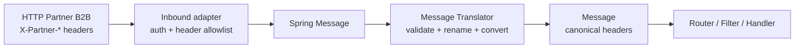
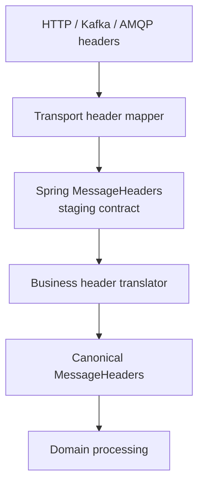
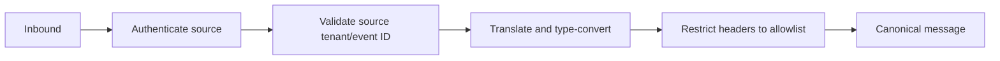
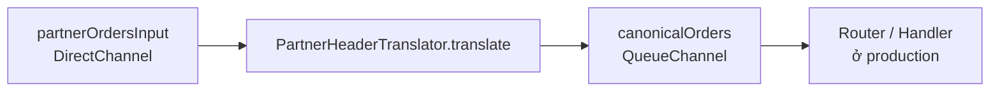
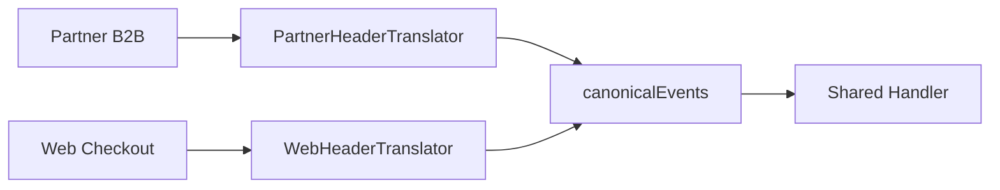
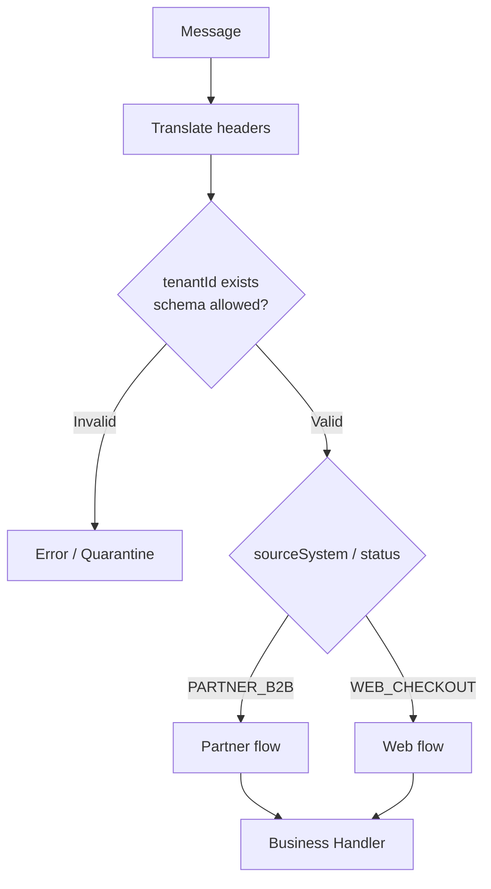
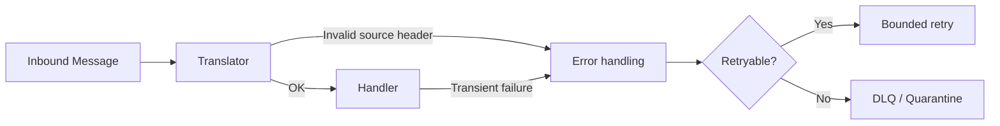
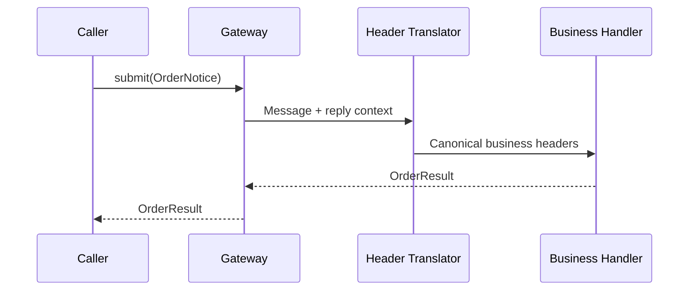
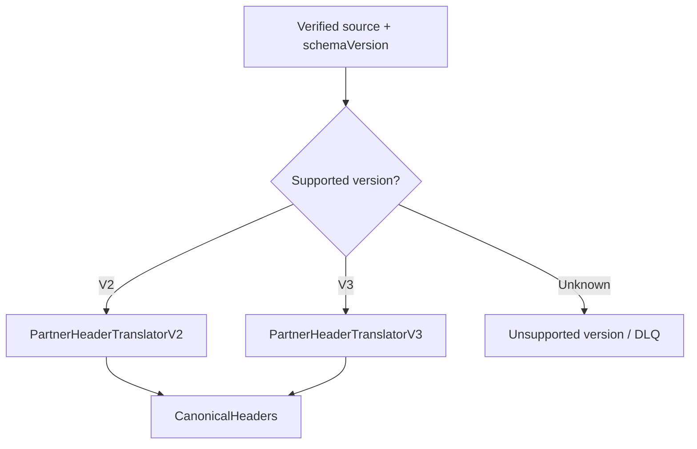

# Mapping header của hệ thống nguồn sang đích với Message Translator trong Spring Integration

> **Chương:** Message translator  
> **Bài học:** Mapping header của hệ thống nguồn sang đích  
> **Module:** `SPRING_INTEGRATION_PATTERN` — học triển khai Enterprise Integration Patterns bằng Spring Integration, xây dựng luồng thông điệp ít phụ thuộc và dễ mở rộng; thực hành Router, Filter, Transformer, Splitter, Aggregator, Gateway, retry, error channel, correlation và kiểm thử các nhánh xử lý.
>
> **Mục tiêu của bài:** chuyển **header contract** từ hệ thống nguồn sang contract nội bộ/đích một cách tường minh, an toàn và kiểm thử được. Bài phân biệt *message translation*, *header mapping tại adapter*, *header enrichment* và *envelope serialization*.

## 1. Bài toán: cùng một ngữ nghĩa, khác tên header

Một dịch vụ nhận sự kiện cập nhật đơn hàng từ một đối tác. Đối tác gửi HTTP headers theo tên của họ:

```http
POST /partner/orders HTTP/1.1
Content-Type: application/json
X-Partner-Tenant: shop-01
X-Partner-Correlation-Id: batch-2026-11-21-A
X-Partner-Event-Id: evt-901
X-Partner-Event-Time: 2026-11-21T15:30:00+07:00
X-Partner-Schema-Version: 2
X-Partner-Retry-Count: 1

{"orderId":"ORD-101","status":"PAID"}
```

Trong nội bộ, các Router/Service Activator/Idempotent Receiver muốn dùng một bộ metadata nhất quán:

```text
tenantId                = shop-01
sourceSystem            = PARTNER_B2B
businessCorrelationId  = PARTNER_B2B:batch-2026-11-21-A
sourceEventId           = evt-901
sourceOccurredAt        = 2026-11-21T08:30:00Z (Instant)
sourceSchemaVersion     = 2 (integer)
sourceAttempt           = 1 (integer, chỉ phục vụ audit)
```

Payload business `OrderNotice(orderId="ORD-101", status="PAID")` không cần thay đổi. **Công việc chính là dịch ngữ nghĩa metadata ở tầng header**.



### Những lỗi xuất hiện nếu mapping theo cảm tính

- Router tìm `tenantId` nhưng nhận `X-Partner-Tenant` nên không có route.
- Correlation ID của đối tác bị nhầm với ID group của Aggregator.
- `"1"` được giữ dưới dạng chuỗi nhưng handler mong chờ integer.
- Chuỗi thời gian `+07:00` bị coi là UTC, lệch bảy giờ.
- Người gọi giả mạo `X-Partner-Tenant` để truy cập tenant khác.
- Header `Authorization` hoặc token của đối tác bị sao chép sang downstream broker.
- Hai nguồn khác nhau đều phát `evt-901` và bị dedup sai nếu thiếu namespace.
- Gateway reply channel biến mất hoặc bị sao chép qua transport không còn hợp lệ.
- Duplicate delivery được ghi lại thành sự kiện mới vì dùng `MessageHeaders.id` làm event ID.

**Một header translator đúng phải vừa chuyển tên, vừa chuyển *meaning*, type, scope và trust.**

## 2. Mục tiêu học tập

Sau bài học, bạn có thể:

1. Mô tả Message Translator Pattern trong kiến trúc tích hợp.
2. Phân biệt chuyển payload với **chuyển header/message envelope**.
3. Thiết kế bảng mapping nguồn → đích có kiểu dữ liệu, policy và owner.
4. Xác định header nào được giữ, đổi tên, đổi kiểu, bỏ và tái tạo.
5. Phân biệt dữ liệu do đối tác khai với thông tin đã được xác thực tại ingress.
6. Viết Message Translator bằng Java 17 và `MessageBuilder`.
7. Cấu hình Transformer trong Spring Integration Java DSL.
8. Kiểm thử happy path, missing header, tenant mismatch, invalid timestamp/schema/retry.
9. Kiểm thử nhiều nguồn và nhiều thread không trộn metadata.
10. Giữ đúng correlation, causation, idempotency và group sequence khi đi qua transport.
11. Xử lý lỗi, retry, Gateway, Filter/Router và broker header mapping có kiểm soát.
12. Thiết kế quan sát, schema evolution, bảo mật và vận hành production.

## 3. Message Translator thực hiện điều gì?

Trong Enterprise Integration Patterns, **Message Translator** chuyển một message từ **định dạng hoặc hợp đồng của hệ thống nguồn** sang **định dạng/hợp đồng mà hệ thống đích hiểu**.

Sự khác biệt có thể nằm ở:

- Cấu trúc payload.
- Kiểu dữ liệu.
- Tên và ý nghĩa headers.
- Envelope metadata.
- Encoding/serialization.
- Thông tin correlation, ID, timestamp hoặc source provenance.

Ví dụ bài này có **payload không đổi, header contract thay đổi**:

```text
Source:
  payload: OrderNotice
  headers:
    X-Partner-Event-Id = "evt-901"
    X-Partner-Retry-Count = "1"

Target:
  payload: OrderNotice (giữ nguyên)
  headers:
    sourceEventId = "evt-901"
    sourceAttempt = 1
```

Không cần ép mọi Message Translator phải đổi payload. Việc đổi một message contract có thể chỉ liên quan tới headers — miễn là đích thấy được thông tin theo contract mới.

### Message Translator khác Adapter thế nào?

- **Adapter:** kết nối transport với Spring Message, ví dụ HTTP request → Spring Message.
- **Header mapper của adapter:** map transport headers vào/ra `MessageHeaders`, có quy tắc include/exclude và type conversion tùy adapter.
- **Message Translator:** chuyển **semantic contract giữa nguồn và đích**; có thể nằm sau adapter để xác minh và chuẩn hóa.
- **Header Enricher:** thêm/chỉnh sửa header trên một Spring Message, thường giữ payload.
- **Transformer:** cơ chế/framework endpoint thực hiện phép dịch hoặc bất kỳ chuyển đổi message nào.
- **Envelope Wrapper:** đưa metadata vào cấu trúc serialized payload; khác với việc chỉ tạo Spring Message headers.

Với Spring Integration, ta thường triển khai Message Translator bằng `Transformer` hoặc phối hợp `Header Enricher` với `Header Filter`, không mặc định tồn tại một operator Java DSL riêng mang tên `.messageTranslator()`.

## 4. Hai tầng mapping không nên nhập làm một

Để hiểu rõ sự khác biệt, chia pipeline thành hai tầng:



### Tầng 1: transport → message

HTTP có thể dùng header names không phân biệt hoa/thường theo giao thức; Kafka và Spring Message có quy tắc tên/giá trị khác. Inbound adapter phải xác định:

- Header nào được nhập.
- Header nào không được nhập vì nhạy cảm.
- Nếu giá trị transport là list/multi-value, lấy một giá trị hay reject.
- Những giá trị nào có thể chuyển từ bytes sang String.
- Tên được chuẩn hóa thế nào để code downstream không phụ thuộc capitalization.
- Ai được phép đặt **trusted principal/tenant** vào context.

### Tầng 2: source contract → canonical contract

Business header translator phải xác định:

- `X-Partner-Event-Id` dùng cho event identity hay request ID?
- `X-Partner-Correlation-Id` có cần namespace theo source?
- `X-Partner-Event-Time` có offset hay chỉ giờ local?
- `X-Partner-Retry-Count` có tin được để điều khiển retry không?
- `X-Partner-Schema-Version` là version của payload nguồn hay envelope?
- `X-Partner-Tenant` có khớp tenant từ authentication không?

Đây là **phép dịch ngữ nghĩa**, không chỉ đổi tên trường trong một `Map`.

### Quy ước cho ví dụ Java

Để minh họa dễ kiểm thử, ở các code blocks tiếp theo ta dùng **chính xác các tên nguồn** như `"X-Partner-Event-Id"` bên trong Spring Message.

Trong ứng dụng HTTP thực, inbound adapter có thể chuẩn hóa cách viết tên hoặc kiểu giá trị trước khi gọi translator. **Phải kiểm tra hợp đồng adapter và cấu hình staging headers** thay vì giả định mọi transport tự tạo ra đúng string keys/values trong ví dụ. Những header như `verifiedTenantId` là **metadata nội bộ do security layer tạo**, không được copy từ HTTP request do khách hàng tự khai.

## 5. Bảng mapping nguồn → đích

Thiết kế bảng mapping trước khi viết Java code:

| Header nguồn | Header đích | Kiểu đích | Quy tắc |
| --- | --- | --- | --- |
| `X-Partner-Tenant` | `tenantId` | `String` | Bắt buộc, so với tenant đã xác thực |
| Không có: dùng ingress identity | `sourceSystem` | `String` | Đặt từ cấu hình kết nối đáng tin |
| `X-Partner-Correlation-Id` | `businessCorrelationId` | `String` | Validate, thêm namespace nguồn |
| `X-Partner-Event-Id` | `sourceEventId` | `String` | Bắt buộc, stable qua retry |
| `X-Partner-Event-Time` | `sourceOccurredAt` | `Instant` | Parse ISO offset, quy đổi UTC |
| `X-Partner-Schema-Version` | `sourceSchemaVersion` | `Integer` | Chỉ chấp nhận version được hỗ trợ |
| `X-Partner-Retry-Count` | `sourceAttempt` | `Integer` | Audit, bounded, không điều khiển retry |
| `Authorization` | Không map | — | Không truyền credential downstream |
| `Cookie` | Không map | — | Không chuyển session token |
| `X-Forwarded-*` | Không map mặc định | — | Chỉ dùng khi proxy chain đáng tin |
| `traceparent` | Tracing context | Theo protocol | Sanitize/validate bằng tracing component |
| `Content-Type` | Transport content type | Theo adapter | Mô tả codec, không dùng làm tenant/quyền |

### Vì sao correlation ID có namespace?

Hai nguồn có thể cùng phát `X-Partner-Correlation-Id: batch-001`. Nếu downstream nhóm/tìm trace dựa vào chuỗi trần này, nguồn A và B có thể vô tình bị coi như một workflow.

Một quy tắc đơn giản:

```text
sourceSystem = PARTNER_B2B
externalCorrelation = batch-2026-11-21-A

businessCorrelationId =
  PARTNER_B2B:batch-2026-11-21-A
```

Đây là một **quy ước ví dụ**; nếu hệ thống có một business correlation ID do coordinator cấp thì nên dùng ID đó thay vì tự nối tên nguồn. Nếu chuỗi có delimiter tùy ý hoặc cần cross-language keys, dùng canonical encoding/ID registry để tránh collision.

## 6. Header contract là một phần của API

Tương tự JSON schema, header contract cần định nghĩa:

- Tên field chính xác và quy tắc casing.
- Type sau deserialize.
- Required hay optional.
- Default có hợp lệ không.
- Allowed values/versions.
- Maximum length và character set.
- Nguồn chân lý và mức độ tin cậy.
- Namespace/uniqueness.
- Quy tắc bỏ hoặc ẩn dữ liệu.
- Backward compatibility khi đổi tên.
- Fail-fast, quarantine hay fallback khi thiếu.

### Ví dụ: header thiếu nhưng có thể default?

`X-Partner-Retry-Count` có thể optional. Nếu thiếu, ví dụ có thể đặt `sourceAttempt=0` theo **contract đã công bố**.

Ngược lại, `X-Partner-Tenant` thiếu không nên được lấp bằng tenant từ payload khi security layer cần đối chiếu tenant nguồn đã khai. Có thể reject hoặc có policy của nguồn cho phép xác định từ credential, nhưng **không tự đoán**.

### Ví dụ: nhiều giá trị cùng tên

HTTP có thể có nhiều header values cho một tên. Nếu đối tác gửi:

```http
X-Partner-Tenant: shop-01
X-Partner-Tenant: shop-99
```

Không tùy tiện chọn phần tử đầu hoặc cuối. Inbound adapter/security layer nên **reject ambiguity** đối với tenant/identity headers. Tương tự, không gộp `X-Partner-Event-Id` nhiều giá trị bằng dấu phẩy rồi coi đó là một event ID hợp lệ.

## 7. Các loại header phải phân biệt

| Loại | Ví dụ | Cần làm gì? |
| --- | --- | --- |
| **Source business identity** | `X-Partner-Event-Id` | Validate, namespace nếu cần |
| **Source context** | `X-Partner-Correlation-Id` | Translate, giữ provenance |
| **Trusted security context** | `verifiedTenantId` | Được ingress dựng lại từ principal |
| **Routing** | `eventType`, `partitionKey` | Validate, dùng ở Router/adapter |
| **Tracing** | `traceparent` | Tracing processor kiểm soát |
| **Runtime framework** | `replyChannel`, `errorChannel` | Không serialize tùy tiện |
| **Aggregator/Resequencer** | `correlationId`, `sequenceNumber` | Giữ đúng group/window contract |
| **Delivery metadata** | broker redelivery count | Không tin source retry count thay thế |
| **Secrets** | `Authorization`, API key | Không đưa vào canonical message |
| **Serialization metadata** | `contentType`, schema registry ID | Quản lý tại codec/adapter |

### Không biến nguồn không đáng tin thành nguồn tin cậy

Nếu client tự gửi:

```http
verifiedTenantId: shop-admin
X-Partner-Tenant: shop-admin
```

thì không thể coi header `verifiedTenantId` là tin cậy chỉ vì tên của nó. Inbound gateway/filter **phải loại bỏ mọi biến thể tên được bảo vệ do client gửi** và tự ghi thông tin đã xác thực bằng một context rõ ràng.

Phép dịch header chỉ an toàn khi **đường biên tin cậy** được thiết kế và kiểm thử trước đó.

## 8. Payload giữ nguyên, header đổi: hiểu tác động tới Spring Message

Spring Message gồm:

```java
org.springframework.messaging.Message<T> {
    T getPayload();
    MessageHeaders getHeaders();
}
```

Khi translator tạo message mới:

```text
Input Message<OrderNotice>
  payload: OrderNotice("ORD-101","PAID")
  headers:
    X-Partner-Event-Id: evt-901
    X-Partner-Tenant: shop-01
    ...

Output Message<OrderNotice>
  payload: OrderNotice("ORD-101","PAID")  (cùng giá trị)
  headers:
    sourceEventId: evt-901
    tenantId: shop-01
    ...
```

**Message ID/timestamp do Spring tạo có thể thay đổi.** Business event ID phải là field riêng (`sourceEventId`), không suy từ `MessageHeaders.id`.

Một phép dịch có thể:

- Giữ nguyên giá trị payload.
- Đổi toàn bộ cấu trúc headers.
- Chỉ mang các headers có trong allowlist.
- Chuyển string → int/Instant.
- Thêm metadata mới từ trusted context.
- Loại bỏ credentials hoặc transport-only fields.

### Hai kiểu translation

**In-place style (không thực sự sửa immutable headers):** tạo Spring Message mới với payload cũ nhưng headers được chọn, không mutate `MessageHeaders` đầu vào.

**Envelope style:** tạo `Message<Envelope<OrderNotice>>`, đưa metadata vào serialized body nếu consumer ngoài Spring không nhận headers tương ứng.

Bài này tập trung vào **header translation**. Envelope Wrapper được giới thiệu để biết khi nào cần chuyển sang body thay vì chỉ dựa vào adapter header mapping.

## 9. Header Enricher và Message Translator kết hợp ra sao?

Có thể chia translation thành hai bước:

```text
Inbound Message
  -> Header Enricher: bổ sung verified source metadata
  -> Header Translator: rename/convert/validate source fields
  -> Header Filter: bỏ raw source headers
  -> Canonical Message
```

Tuy nhiên, nếu Header Enricher thêm `tenantId` trước khi kiểm tra `X-Partner-Tenant`, một header có thể che giấu mismatch. Thứ tự đúng phải phục vụ **validation trước khi trust promotion**.

Ví dụ:



Đối với flow phức tạp, một custom Transformer nhận nguyên `Message<?>` có thể giúp đặt toàn bộ mapping, validation và allowlist trong một chỗ rõ ràng. Với mapping đơn giản, cấu hình Header Enricher + Filter có thể dễ bảo trì hơn.

## 10. Sai lầm: map tất cả bằng `copyHeaders`

Một phản mẫu thường thấy:

```java
MessageBuilder.withPayload(input.getPayload())
    .copyHeaders(input.getHeaders())
    .setHeader("tenantId",
        input.getHeaders().get("X-Partner-Tenant"))
    .build();
```

Vấn đề:

- Giữ mọi header do client gửi, có thể chứa credential hoặc PII.
- Giữ tên raw lẫn tên canonical, tạo hai nguồn chân lý.
- Có thể giữ `replyChannel` hoặc `errorChannel` không còn hợp lệ khi qua transport.
- Có thể giữ một `correlationId` nhóm cũ trong khi target flow đang tạo nhóm mới.
- Không kiểm tra type hoặc required fields.
- Header mới có thể xung đột với header đã tồn tại.
- Đích phụ thuộc vào implementation detail của nguồn.

**Nguyên tắc mặc định:** chọn từng header được phép (allowlist), xác minh ý nghĩa, xây message mới. Chỉ giữ infrastructure headers khi bạn biết rõ phạm vi chúng có hiệu lực và lý do downstream cần chúng.

### Nhưng không được phá request-reply một cách vô tình

Nếu translator nằm **trong** một Gateway sync flow, việc tạo message mới bỏ `replyChannel` có thể làm hỏng đường trả kết quả, tùy topology/framework header propagation.

Giải pháp không phải copy toàn bộ raw headers từ nguồn ngoài. Hãy tách:

1. **Trusted internal framework headers** do adapter/gateway tạo.
2. **Untrusted source headers** cần translate hoặc loại bỏ.
3. **Portable business metadata** cần đi qua transport.

Trong một flow request-reply, việc bảo toàn reply context cần được test riêng ở đúng boundary và dùng API/adapter contract phù hợp. Trong bài demo, output đi vào QueueChannel để không nhầm lẫn giữa contract nghiệp vụ và reply-channel lifecycle.

## 11. Ma trận quyết định giữ, đổi, bỏ header

| Nhóm field | Hành động tại translator | Điều kiện |
| --- | --- | --- |
| Source tenant ID | Validate rồi map sang `tenantId` | Khớp authenticated tenant |
| Source event ID | Map sang `sourceEventId` | Nonblank, stable |
| Source correlation | Validate + namespace | Không dùng làm authorization |
| Source timestamp | Parse sang `Instant` | Có offset/timezone xác định |
| Source schema version | Parse integer/allowlist | Consumer hỗ trợ version |
| Source retry count | Parse bounded integer hoặc default | Audit only |
| Source system | Tạo từ trusted ingress | Không tin client tự khai |
| `Authorization`, `Cookie` | Drop | Không chuyển credential |
| `replyChannel` của ingress HTTP | Không đưa sang broker | Có reply routing protocol riêng |
| `correlationId` của Splitter | Giữ nếu vẫn cùng group | Không đánh đồng business correlation |
| Trace context | Tracing component normalize | Xác thực/sanitize trust boundary |
| Unknown source header | Drop hoặc quarantine theo policy | Không copy mặc định |

### Kết quả lý tưởng

```text
Input headers: 12 trường (bao gồm 2 credential/transport)
Output headers: 7 canonical business fields + framework ID/timestamp

Không còn:
  X-Partner-*
  Authorization
  Cookie
  header do client đặt để giả authenticated tenant
```

Lưu ý `MessageHeaders.id` và `MessageHeaders.timestamp` vẫn xuất hiện trong Spring Message mới do framework tạo; việc “không có raw headers” không có nghĩa message không còn bất kỳ header nào.

## 12. Thiết kế payload dùng cho ví dụ: OrderNotice

Bài tập cố ý giữ payload nhỏ và bất biến để tập trung vào **mapping headers**, không trộn với bài Normalizer chuyên đổi payload.

```java
package example.integration;

import java.util.Set;

public record OrderNotice(
    String orderId,
    String status
) {
    private static final Set<String> VALID_STATUSES =
        Set.of("CREATED", "PAID", "CANCELLED");

    public OrderNotice {
        if (orderId == null || orderId.isBlank()) {
            throw new IllegalArgumentException(
                "orderId không được rỗng");
        }

        if (!VALID_STATUSES.contains(status)) {
            throw new IllegalArgumentException(
                "status không được hỗ trợ");
        }
    }
}
```

Ví dụ một Spring Message đầu vào:

```text
payload:
  OrderNotice("ORD-101", "PAID")

headers:
  X-Partner-Tenant          = "shop-01"
  X-Partner-Correlation-Id  = "batch-2026-11-21-A"
  X-Partner-Event-Id        = "evt-901"
  X-Partner-Event-Time      = "2026-11-21T15:30:00+07:00"
  X-Partner-Schema-Version  = "2"
  X-Partner-Retry-Count     = "1"
  verifiedTenantId         = "shop-01"
  verifiedSourceSystem     = "PARTNER_B2B"
```

Hai header cuối là **fixture giả định security layer đã tạo**. Đối tác không được phép trực tiếp set chúng. Một ứng dụng thật sẽ dùng authenticated principal/connection/verified context ở adapter; không chấp nhận một value trùng tên từ raw HTTP request.

### Vì sao không đặt mọi thứ vào OrderNotice?

- Payload chỉ cần `orderId/status` cho domain.
- Headers cần phục vụ integration routing, tracing, audit.
- Payload có thể được xử lý bởi Handler không biết nguồn HTTP.
- Translator dễ được test với cùng payload nhưng nhiều metadata cases.

Nếu domain thật yêu cầu `tenantId` hoặc `eventId` là một phần của event contract bền vững, các trường đó cũng có thể thuộc payload hoặc envelope. **Không có quy tắc rằng mọi ID phải chỉ nằm ở header.** Bài tập này tập trung vào mapping header, không quy định schema tối ưu cho mọi domain.

## 13. Java 17: class PartnerHeaderTranslator

Class sau nhận `Message<OrderNotice>` theo source contract và trả `Message<OrderNotice>` theo canonical target contract.

Đặc điểm:

- Không giữ mutable state theo message.
- Bắt buộc authenticated tenant và source context.
- Đối chiếu source tenant với authenticated tenant.
- Kiểm tra độ dài/character set cho event/correlation ID.
- Parse offset timestamp thành `Instant`.
- Parse schema version và retry count thành integer.
- Không copy unknown/credential/source headers.
- Không tự cập nhật DB, không gọi network trong translation.

```java
package example.integration;

import java.time.Instant;
import java.time.OffsetDateTime;
import java.util.Objects;
import java.util.Set;
import java.util.regex.Pattern;

import org.springframework.messaging.Message;
import org.springframework.messaging.support.MessageBuilder;

public final class PartnerHeaderTranslator {

    public static final String SOURCE_SYSTEM = "PARTNER_B2B";

    private static final Pattern TENANT_PATTERN =
        Pattern.compile("[A-Za-z0-9][A-Za-z0-9._-]{0,63}");

    private static final Pattern EXTERNAL_ID_PATTERN =
        Pattern.compile("[A-Za-z0-9][A-Za-z0-9._:-]{0,127}");

    private static final Set<Integer> SUPPORTED_SOURCE_SCHEMAS =
        Set.of(2);

    public Message<OrderNotice> translate(
            Message<OrderNotice> input) {

        Objects.requireNonNull(input, "input");

        String authenticatedTenant =
            requiredString(input, "verifiedTenantId");

        String verifiedSource =
            requiredString(input, "verifiedSourceSystem");

        if (!SOURCE_SYSTEM.equals(verifiedSource)) {
            throw new SecurityException(
                "Sender không được xác minh là PARTNER_B2B");
        }

        String sourceTenant =
            requiredString(input, "X-Partner-Tenant");

        requireMatches(
            authenticatedTenant, TENANT_PATTERN,
            "verified tenant");

        requireMatches(
            sourceTenant, TENANT_PATTERN,
            "X-Partner-Tenant");

        if (!authenticatedTenant.equals(sourceTenant)) {
            throw new SecurityException(
                "TENANT_MISMATCH");
        }

        String externalCorrelation = requireMatches(
            requiredString(
                input, "X-Partner-Correlation-Id"),
            EXTERNAL_ID_PATTERN,
            "X-Partner-Correlation-Id");

        String sourceEventId = requireMatches(
            requiredString(
                input, "X-Partner-Event-Id"),
            EXTERNAL_ID_PATTERN,
            "X-Partner-Event-Id");

        String sourceTimestamp =
            requiredString(input, "X-Partner-Event-Time");

        // Bắt buộc offset; không đoán timezone server.
        Instant occurredAt = OffsetDateTime
            .parse(sourceTimestamp)
            .toInstant();

        int schemaVersion = parseInteger(
            requiredString(
                input, "X-Partner-Schema-Version"),
            "X-Partner-Schema-Version");

        if (!SUPPORTED_SOURCE_SCHEMAS.contains(schemaVersion)) {
            throw new IllegalArgumentException(
                "UNSUPPORTED_SOURCE_SCHEMA_VERSION");
        }

        String retryCount = optionalString(
            input, "X-Partner-Retry-Count", "0");

        int sourceAttempt = parseInteger(
            retryCount, "X-Partner-Retry-Count");

        if (sourceAttempt < 0 || sourceAttempt > 20) {
            throw new IllegalArgumentException(
                "INVALID_SOURCE_ATTEMPT");
        }

        // Ví dụ contract ghép namespace.
        String correlation =
            SOURCE_SYSTEM + ":" + externalCorrelation;

        return MessageBuilder
            .withPayload(input.getPayload())
            .setHeader("tenantId", authenticatedTenant)
            .setHeader("sourceSystem", SOURCE_SYSTEM)
            .setHeader("businessCorrelationId", correlation)
            .setHeader("sourceEventId", sourceEventId)
            .setHeader("sourceOccurredAt", occurredAt)
            .setHeader("sourceSchemaVersion", schemaVersion)
            .setHeader("sourceAttempt", sourceAttempt)
            .build();
    }

    private static String requiredString(
            Message<?> message, String header) {

        Object value = message.getHeaders().get(header);

        if (!(value instanceof String text)
                || text.isBlank()) {
            throw new IllegalArgumentException(
                "MISSING_OR_INVALID_HEADER: " + header);
        }

        return text.trim();
    }

    private static String optionalString(
            Message<?> message,
            String header,
            String fallback) {

        Object value = message.getHeaders().get(header);

        if (value == null) {
            return fallback;
        }

        if (!(value instanceof String text)
                || text.isBlank()) {
            throw new IllegalArgumentException(
                "INVALID_HEADER: " + header);
        }

        return text.trim();
    }

    private static String requireMatches(
            String value,
            Pattern pattern,
            String field) {

        if (!pattern.matcher(value).matches()) {
            throw new IllegalArgumentException(
                "INVALID_HEADER_FORMAT: " + field);
        }

        return value;
    }

    private static int parseInteger(
            String value, String field) {

        try {
            // Cho phép ASCII decimal như "0", "1", "2".
            if (!value.matches("[0-9]{1,4}")) {
                throw new NumberFormatException(
                    "Not an unsigned decimal integer");
            }

            return Integer.parseInt(value);
        } catch (NumberFormatException e) {
            throw new IllegalArgumentException(
                "INVALID_INTEGER_HEADER: " + field, e);
        }
    }
}
```

### Giải thích các quyết định

**1. `verifiedSourceSystem` phải khớp cấu hình bean.** Class chỉ xử lý nguồn Partner B2B. Nếu một request thuộc nguồn khác bị đưa nhầm vào channel, method từ chối thay vì gắn provenance sai.

**2. `X-Partner-Tenant` không trực tiếp được thăng cấp thành trusted `tenantId`.** Nó phải khớp tenant đã được security layer xác nhận.

**3. `sourceEventId` lấy từ external event ID.** Nó ổn định cho retry của cùng logical event nếu producer tuân thủ contract; không dùng Spring Message ID.

**4. `sourceOccurredAt` là `Instant`**, không phải chuỗi offset phụ thuộc display. Consumer không cần tự parse giờ nguồn.

**5. `sourceSchemaVersion` là integer có allowlist**, không phải một header string tùy ý. Unsupported version cần được nhận diện sớm.

**6. `sourceAttempt` chỉ dùng cho quan sát.** Vì nguồn có thể tự gửi header retry count, không dùng giá trị đó làm điều kiện tắt retry nội bộ hoặc trao quyền xử lý.

**7. Output chỉ chứa 7 canonical business headers** do translator đặt, cộng những framework headers `id`/`timestamp` do Spring tạo. Không chuyển `Authorization`, `Cookie` hay raw `X-Partner-*` sang downstream.

**8. Class không sử dụng biến `currentTenant`/`currentCorrelation` mutable toàn cục.** Nó dùng local variables theo từng message, giúp an toàn trong test nhiều thread nếu các collaborators cũng thread-safe.

### Giới hạn có chủ đích của code

- Đầu vào giả định adapter đã tạo **String-valued staging headers** đúng tên/casing.
- HTTP nhiều giá trị, duplicate headers, byte arrays và case-insensitive lookup phải được xử lý/normalize tại adapter boundary.
- Authentication thật chưa được triển khai trong ví dụ.
- Timestamp lỗi để exception từ `OffsetDateTime.parse` truyền ra, có thể map thành `INVALID_SOURCE_TIMESTAMP` ở error handler.
- Chỉ hỗ trợ schema version 2; V1/V3 cần mapping/version policy mới.
- Không cố giữ `replyChannel`/`errorChannel` hoặc technical `correlationId` từ upstream.
- Không tự tạo signed envelope, retry policy hoặc transactional side effect.
- Không phải serializer/deserializer JSON/Avro/Kafka.

## 14. Header translation là phép biến đổi có thể kiểm thử độc lập

Định nghĩa trên có thể xem như hàm:

```text
translate(
    OrderNotice payload,
    SourceHeaders,
    VerifiedIngressContext
) =
    OrderNotice payload,
    CanonicalHeaders
```

Các thuộc tính quan trọng:

1. **Payload preservation:** giá trị `OrderNotice` đầu ra giống đầu vào.
2. **Header normalization:** target names/types đúng hợp đồng.
3. **Trust enforcement:** tenant/source không phù hợp bị từ chối.
4. **No leakage:** raw source headers và credentials không lọt ra output.
5. **Deterministic mapping:** cùng input/context → canonical business header values giống nhau.
6. **No global state:** message A/B xen kẽ không trộn metadata.
7. **Fail closed:** thiếu ID, schema sai hoặc time không parse được → không tạo canonical message.

Không kiểm tra **Spring-generated MessageHeaders.id** bằng giá trị equality giữa hai lần gọi, bởi mỗi message mới có thể có ID khác. So sánh các **business headers** mới là yêu cầu của translator.

## 15. Java DSL: nối Translator vào Spring Integration Flow

Sử dụng một `DirectChannel` làm ingress và một `QueueChannel` làm output cho test.



### Configuration

```java
package example.integration;

import org.springframework.context.annotation.Bean;
import org.springframework.context.annotation.Configuration;
import org.springframework.integration.channel.DirectChannel;
import org.springframework.integration.channel.QueueChannel;
import org.springframework.integration.config.EnableIntegration;
import org.springframework.integration.dsl.IntegrationFlow;
import org.springframework.messaging.MessageChannel;

@Configuration
@EnableIntegration
public class PartnerTranslationConfiguration {

    @Bean
    public MessageChannel partnerOrdersInput() {
        return new DirectChannel();
    }

    @Bean
    public QueueChannel canonicalOrders() {
        return new QueueChannel();
    }

    @Bean
    public PartnerHeaderTranslator partnerHeaderTranslator() {
        return new PartnerHeaderTranslator();
    }

    @Bean
    public IntegrationFlow translatePartnerOrderHeaders(
            PartnerHeaderTranslator translator) {

        return IntegrationFlow.from("partnerOrdersInput")
            .transform(translator, "translate")
            .channel("canonicalOrders")
            .get();
    }
}
```

### Tại sao dùng `.transform(translator, "translate")`?

Spring Integration có Transformer endpoint có thể gọi method của bean để chuyển đổi message. Ở đây method nhận `Message<OrderNotice>` và trả một `Message<OrderNotice>` mới với target headers.

Trong dự án cụ thể, nên kiểm tra overload Java DSL và method invocation trên phiên bản Spring Integration đang dùng. **Bài này không chạy build/tests trong STEP 4 NEW**; phần compile/QA chuyên môn dành cho giai đoạn sau.

### Nhận từ HTTP không có nghĩa input tự đúng contract

Flow ví dụ bắt đầu khi các headers đã trở thành các values trong `MessageHeaders`. Ở production, trước đó thường còn:

```text
HTTP Inbound Gateway
  -> authenticate producer + tenant
  -> reject duplicate/ambiguous identity headers
  -> normalize header names and scalar values
  -> set verifiedTenantId / verifiedSourceSystem
  -> deserialize OrderNotice
  -> partnerOrdersInput
```

Nếu inbound gateway giữ `List<String>` cho một header, translator đang mong `String` sẽ reject. Đây là **lỗi tích hợp contract** cần xử lý tại adapter, không nên tự cast mọi `Object` bằng `toString()`.

### Vì sao dùng QueueChannel trong test?

`QueueChannel` cho phép `receive(timeout)` để đọc message đầu ra. Nó không mặc định là persistent broker, không đại diện Kafka/AMQP ack, không bảo đảm exactly-once và không tự làm shared state giữa các pod.

## 16. Unit test fixture: tạo source Message đầy đủ

Test class cho PartnerHeaderTranslator:

```java
package example.integration;

import static org.junit.jupiter.api.Assertions.*;

import java.time.Instant;

import org.junit.jupiter.api.Test;
import org.springframework.messaging.Message;
import org.springframework.messaging.support.MessageBuilder;

class PartnerHeaderTranslatorTest {

    private final PartnerHeaderTranslator translator =
        new PartnerHeaderTranslator();

    private OrderNotice notice() {
        return new OrderNotice("ORD-101", "PAID");
    }

    private Message<OrderNotice> validMessage() {
        return MessageBuilder.withPayload(notice())
            .setHeader("X-Partner-Tenant", "shop-01")
            .setHeader(
                "X-Partner-Correlation-Id",
                "batch-2026-11-21-A")
            .setHeader("X-Partner-Event-Id", "evt-901")
            .setHeader(
                "X-Partner-Event-Time",
                "2026-11-21T15:30:00+07:00")
            .setHeader("X-Partner-Schema-Version", "2")
            .setHeader("X-Partner-Retry-Count", "1")
            .setHeader("verifiedTenantId", "shop-01")
            .setHeader(
                "verifiedSourceSystem", "PARTNER_B2B")
            .build();
    }

    // Các @Test sau đặt trong class này.
}
```

**Lưu ý:** `verifiedTenantId` và `verifiedSourceSystem` ở đây là **test fixtures**. Một hệ thống có HTTP gateway thật phải có integration/security tests chứng minh client không thể giả mạo chúng.

## 17. Unit test happy path: field names và types

Bổ sung method trong `PartnerHeaderTranslatorTest`:

```java
@Test
void translatesPartnerHeadersIntoCanonicalContract() {
    Message<OrderNotice> input = validMessage();

    Message<OrderNotice> output =
        translator.translate(input);

    // Domain payload không đổi.
    assertEquals(input.getPayload(), output.getPayload());

    // Mapping source -> target.
    assertEquals(
        "shop-01",
        output.getHeaders().get("tenantId"));

    assertEquals(
        "PARTNER_B2B",
        output.getHeaders().get("sourceSystem"));

    assertEquals(
        "PARTNER_B2B:batch-2026-11-21-A",
        output.getHeaders().get("businessCorrelationId"));

    assertEquals(
        "evt-901",
        output.getHeaders().get("sourceEventId"));

    assertEquals(
        Instant.parse("2026-11-21T08:30:00Z"),
        output.getHeaders().get("sourceOccurredAt"));

    assertEquals(
        Integer.valueOf(2),
        output.getHeaders().get("sourceSchemaVersion"));

    assertEquals(
        Integer.valueOf(1),
        output.getHeaders().get("sourceAttempt"));
}
```

### Những lỗi test này bắt được

- Header target bị đặt sai tên.
- Timestamp vẫn ở dạng `String` hoặc bị lệch offset.
- Schema version vẫn là string `"2"`.
- Retry count vẫn là string `"1"`.
- Correlation thiếu namespace nguồn.
- Source system bị lấy từ giá trị bên ngoài.
- Domain payload vô tình bị Transformer làm thay đổi.

### Không so sánh message ID

`MessageHeaders.id` là ID runtime. Translator tạo message mới có thể sinh ID mới — đó không phải lỗi, vì logical `sourceEventId` mới là identity mà downstream dùng cho retry/dedup.

## 18. Test allowlist: raw/secret headers không được chuyển tiếp

Thêm một header nhạy cảm và một header do client cố tình đặt trùng tên canonical:

```java
@Test
void translationDropsRawAndSensitiveHeaders() {
    Message<OrderNotice> source =
        MessageBuilder.fromMessage(validMessage())
            .setHeader("Authorization", "Bearer SECRET")
            .setHeader("Cookie", "session=SECRET")
            .setHeader("tenantId", "shop-admin")
            .setHeader(
                "businessCorrelationId",
                "SPOOFED-CORRELATION")
            .setHeader("X-Unknown-Debug", "untrusted")
            .build();

    Message<OrderNotice> output =
        translator.translate(source);

    // Trusted mapping thắng, không tin header target
    // do nguồn tự chèn.
    assertEquals(
        "shop-01", output.getHeaders().get("tenantId"));

    assertEquals(
        "PARTNER_B2B:batch-2026-11-21-A",
        output.getHeaders()
            .get("businessCorrelationId"));

    assertFalse(
        output.getHeaders().containsKey("Authorization"));
    assertFalse(
        output.getHeaders().containsKey("Cookie"));
    assertFalse(
        output.getHeaders().containsKey("X-Partner-Tenant"));
    assertFalse(
        output.getHeaders().containsKey("X-Partner-Event-Id"));
    assertFalse(
        output.getHeaders().containsKey("X-Unknown-Debug"));
}
```

### Bài test không thay thế security at ingress

Nó chứng minh **output allowlist** của translator, nhưng không chứng minh attacker không thể set `verifiedTenantId`. Phải có test riêng tại HTTP/AMQP/Kafka ingress xác minh những trusted headers được tạo từ authenticated connection và các bản sao do client gửi bị loại bỏ.

### Kiểm tra leakage ở lớp outbound adapter

Nếu translator không chuyển credential nhưng outbound adapter tự thêm Authorization token của chính service, đó có thể là hành vi cần thiết. Các security rules phải phân biệt **source credential không được forward** với **outbound credential do target service cấp hợp lệ**.

## 19. Test missing header: không tạo message canonical giả

Một lỗi phổ biến là `null` bị convert thành chuỗi `"null"` rồi dùng làm ID.

Thêm các test:

```java
@Test
void missingSourceEventIdIsRejected() {
    Message<OrderNotice> source =
        MessageBuilder.fromMessage(validMessage())
            .removeHeader("X-Partner-Event-Id")
            .build();

    assertThrows(IllegalArgumentException.class, () ->
        translator.translate(source));
}

@Test
void blankCorrelationIdIsRejected() {
    Message<OrderNotice> source =
        MessageBuilder.fromMessage(validMessage())
            .setHeader("X-Partner-Correlation-Id", "  ")
            .build();

    assertThrows(IllegalArgumentException.class, () ->
        translator.translate(source));
}

@Test
void missingVerifiedTenantIsRejected() {
    Message<OrderNotice> source =
        MessageBuilder.fromMessage(validMessage())
            .removeHeader("verifiedTenantId")
            .build();

    assertThrows(IllegalArgumentException.class, () ->
        translator.translate(source));
}
```

Có thể tranh luận việc thiếu `verifiedTenantId` nên là `SecurityException` hơn `IllegalArgumentException`. Trong class minh họa, helper `requiredString` ném `IllegalArgumentException` cho header thiếu; ở tầng error handling nên map trường này thành reason code `MISSING_TRUST_CONTEXT` với mức độ bảo mật phù hợp.

### Required và optional phải theo contract

- `X-Partner-Event-Id` là required vì downstream cần dedup.
- `X-Partner-Correlation-Id` required theo nguồn đang xét.
- `X-Partner-Retry-Count` là optional vì thiếu được hiểu là attempt 0.
- `verifiedTenantId` không thuộc dữ liệu đối tác; bắt buộc từ security ingress.

Không tự biến tất cả fields optional để tránh test fail. Một canonical message thiếu identity thiết yếu có thể gây hậu quả downstream nghiêm trọng hơn việc reject sớm.

## 20. Test tenant mismatch và source spoofing

Kiểm tra hai trường hợp riêng: tenant từ nguồn sai và nguồn không phù hợp với handler.

```java
@Test
void mismatchedTenantIsRejected() {
    Message<OrderNotice> source =
        MessageBuilder.fromMessage(validMessage())
            .setHeader("X-Partner-Tenant", "shop-99")
            .build();

    assertThrows(SecurityException.class, () ->
        translator.translate(source));
}

@Test
void wrongVerifiedSourceIsRejected() {
    Message<OrderNotice> source =
        MessageBuilder.fromMessage(validMessage())
            .setHeader("verifiedSourceSystem", "UNKNOWN_SOURCE")
            .build();

    assertThrows(SecurityException.class, () ->
        translator.translate(source));
}
```

### Tenant trong payload có cần kiểm tra thêm không?

`OrderNotice` của demo chỉ có `orderId/status`. Trong hệ thống thực, payload có thể chứa `tenantId`, hoặc order ID cần được resolve qua database. Nếu payload chứa tenant khác với verified tenant, cần **validate** trước business effect; header translator không tự phát hiện mâu thuẫn với một field mà payload không có.

### Source system nên lấy từ đâu?

- HTTP endpoint/partner credential được cấp riêng.
- Mutual TLS identity hoặc API key mapping.
- Authenticated Kafka producer/topic ACL.
- File-feed owner qua ingestion configuration.
- Service-to-service identity được xác minh.

Không tin trường `X-Partner-Source: PARTNER_B2B` do bất kỳ người gửi nào cũng có thể điền.

## 21. Test chuyển đổi timestamp và numeric headers

### Event time: parse có offset

```java
@Test
void offsetTimestampConvertsToSameInstant() {
    Message<OrderNotice> source =
        MessageBuilder.fromMessage(validMessage())
            .setHeader(
                "X-Partner-Event-Time",
                "2026-11-21T08:30:00Z")
            .build();

    Message<OrderNotice> output =
        translator.translate(source);

    assertEquals(
        Instant.parse("2026-11-21T08:30:00Z"),
        output.getHeaders().get("sourceOccurredAt"));
}
```

`2026-11-21T08:30:00Z` và `2026-11-21T15:30:00+07:00` là cùng `Instant`.

### Không đoán timezone khi thiếu offset

```java
@Test
void timestampWithoutOffsetIsRejected() {
    Message<OrderNotice> source =
        MessageBuilder.fromMessage(validMessage())
            .setHeader(
                "X-Partner-Event-Time",
                "2026-11-21T15:30:00")
            .build();

    assertThrows(
        java.time.format.DateTimeParseException.class,
        () -> translator.translate(source));
}
```

Đây là lỗi hợp đồng deterministic, không nên retry không giới hạn cùng input.

### Retry count optional

```java
@Test
void missingRetryHeaderDefaultsToZero() {
    Message<OrderNotice> source =
        MessageBuilder.fromMessage(validMessage())
            .removeHeader("X-Partner-Retry-Count")
            .build();

    Message<OrderNotice> output =
        translator.translate(source);

    assertEquals(
        Integer.valueOf(0),
        output.getHeaders().get("sourceAttempt"));
}
```

### Reject numeric invalid

```java
@Test
void invalidRetryCountIsRejected() {
    Message<OrderNotice> source =
        MessageBuilder.fromMessage(validMessage())
            .setHeader("X-Partner-Retry-Count", "9999")
            .build();

    assertThrows(IllegalArgumentException.class, () ->
        translator.translate(source));
}

@Test
void unsupportedSchemaVersionIsRejected() {
    Message<OrderNotice> source =
        MessageBuilder.fromMessage(validMessage())
            .setHeader("X-Partner-Schema-Version", "3")
            .build();

    assertThrows(IllegalArgumentException.class, () ->
        translator.translate(source));
}
```

### Vì sao không dùng sourceAttempt để tính số lần retry thật?

Một value từ đối tác có thể sai, bị replay hoặc không phản ánh broker delivery. Retry policy nội bộ phải dựa vào **local retry context**, broker redelivery metadata đã được adapter kiểm soát hoặc operation state, không dựa vào một header tự khai của client.

## 22. Tính nhất quán và determinism của mapping

Với cùng source message và verified context, các business header values sau translation phải giống nhau:

```java
@Test
void sameSourceMessageProducesSameBusinessMetadata() {
    Message<OrderNotice> source = validMessage();

    Message<OrderNotice> a = translator.translate(source);
    Message<OrderNotice> b = translator.translate(source);

    assertEquals(
        a.getHeaders().get("sourceEventId"),
        b.getHeaders().get("sourceEventId"));

    assertEquals(
        a.getHeaders().get("businessCorrelationId"),
        b.getHeaders().get("businessCorrelationId"));

    assertEquals(
        a.getHeaders().get("sourceOccurredAt"),
        b.getHeaders().get("sourceOccurredAt"));

    // Không assert a.headers.id == b.headers.id.
}
```

### Vì sao không dùng `Instant.now()` cho event time?

Nếu translator nhận lại cùng event sau một phút và lấy `Instant.now()` làm `sourceOccurredAt`, nó đã thay đổi business metadata của cùng logical event. Dùng timestamp có nghĩa theo source contract.

Nếu muốn đo processing time, hãy dùng **trường khác**, chẳng hạn `translatedAt` được lấy từ `Clock`. Không dùng translatedAt trong event identity/idempotency key.

## 23. Integration test: Java DSL thực sự chạy Translator

Unit test gọi method trực tiếp chưa kiểm chứng wiring Spring Integration. Ta thêm test với `PartnerTranslationConfiguration` từ mục 15.

```java
package example.integration;

import static org.junit.jupiter.api.Assertions.*;

import java.time.Instant;

import org.junit.jupiter.api.Test;
import org.springframework.beans.factory.annotation.Autowired;
import org.springframework.beans.factory.annotation.Qualifier;
import org.springframework.integration.channel.QueueChannel;
import org.springframework.messaging.Message;
import org.springframework.messaging.MessageChannel;
import org.springframework.messaging.support.MessageBuilder;
import org.springframework.test.annotation.DirtiesContext;
import org.springframework.test.context.junit.jupiter.SpringJUnitConfig;

@SpringJUnitConfig(PartnerTranslationConfiguration.class)
@DirtiesContext(
    classMode = DirtiesContext.ClassMode.AFTER_EACH_TEST_METHOD)
class PartnerHeaderTranslationFlowTest {

    @Autowired
    @Qualifier("partnerOrdersInput")
    private MessageChannel partnerInput;

    @Autowired
    @Qualifier("canonicalOrders")
    private QueueChannel canonicalOut;

    private Message<OrderNotice> partnerMessage(
            String tenant,
            String eventId,
            String correlationId,
            String orderId) {

        return MessageBuilder
            .withPayload(new OrderNotice(orderId, "PAID"))
            .setHeader("verifiedTenantId", tenant)
            .setHeader(
                "verifiedSourceSystem", "PARTNER_B2B")
            .setHeader("X-Partner-Tenant", tenant)
            .setHeader(
                "X-Partner-Correlation-Id", correlationId)
            .setHeader("X-Partner-Event-Id", eventId)
            .setHeader(
                "X-Partner-Event-Time",
                "2026-11-21T15:30:00+07:00")
            .setHeader("X-Partner-Schema-Version", "2")
            .setHeader("X-Partner-Retry-Count", "1")
            .build();
    }

    @Test
    void integrationFlowProducesCanonicalHeaders() {
        Message<OrderNotice> source =
            partnerMessage(
                "shop-01",
                "evt-901",
                "batch-2026-11-21-A",
                "ORD-101");

        assertTrue(partnerInput.send(source));

        Message<?> output = canonicalOut.receive(1_000);
        assertNotNull(output);
        assertEquals(source.getPayload(), output.getPayload());

        assertEquals(
            "shop-01", output.getHeaders().get("tenantId"));

        assertEquals(
            "PARTNER_B2B",
            output.getHeaders().get("sourceSystem"));

        assertEquals(
            "evt-901",
            output.getHeaders().get("sourceEventId"));

        assertEquals(
            Integer.valueOf(2),
            output.getHeaders().get("sourceSchemaVersion"));

        assertEquals(
            Instant.parse("2026-11-21T08:30:00Z"),
            output.getHeaders().get("sourceOccurredAt"));

        assertFalse(output.getHeaders()
            .containsKey("X-Partner-Event-Id"));

        assertNull(canonicalOut.receive(0));
    }
}
```

### Vì sao dùng `@DirtiesContext`?

Test sử dụng QueueChannel; các tests cần cô lập dữ liệu trong queue. Context được tạo lại sau mỗi test cho ví dụ học tập. Với test suite lớn, có thể làm sạch fixture có kiểm soát để giảm thời gian, nhưng không reset production state.

### Test này chứng minh gì?

- Channel gửi message vào Transformer endpoint.
- Transformer tạo canonical headers.
- Output channel nhận đúng một message cho đầu vào hợp lệ.
- Payload không đổi và raw header không bị chuyển tiếp.

### Chưa chứng minh gì?

- HTTP inbound gateway chuyển raw headers đúng.
- Header keys được normalize trên Kafka/AMQP.
- Security principal thực sự tạo trusted headers.
- Lỗi được route vào error channel ở topology async.
- Outbound broker publish/ack, retry và transaction.
- Nhiều pods cùng xử lý đúng một logical event.

Đó là những lớp test riêng, không nên coi `DirectChannel + QueueChannel` là kiểm thử end-to-end đầy đủ.

## 24. Test hai message từ cùng nguồn đến xen kẽ

Một bug nguy hiểm là translator dùng mutable field `currentTenant` hoặc `currentCorrelation` trên singleton bean. Khi hai messages xen kẽ, A có thể mang correlation của B.

```text
Input A:
  tenant=shop-01, event=evt-A, correlation=batch-A

Input B:
  tenant=shop-02, event=evt-B, correlation=batch-B

Expected A:
  shop-01 / evt-A / PARTNER_B2B:batch-A

Expected B:
  shop-02 / evt-B / PARTNER_B2B:batch-B
```

Bổ sung vào `PartnerHeaderTranslationFlowTest`:

```java
@Test
void interleavedTenantsKeepIndependentMetadata() {
    var a = partnerMessage(
        "shop-01", "evt-A", "batch-A", "ORD-A");

    var b = partnerMessage(
        "shop-02", "evt-B", "batch-B", "ORD-B");

    var c = partnerMessage(
        "shop-01", "evt-C", "batch-C", "ORD-C");

    assertTrue(partnerInput.send(a));
    assertTrue(partnerInput.send(b));
    assertTrue(partnerInput.send(c));

    var byEvent = new java.util.HashMap<
        String, Message<?>>();

    for (int i = 0; i < 3; i++) {
        Message<?> result = canonicalOut.receive(1_000);
        assertNotNull(result);

        String eventId =
            (String) result.getHeaders().get("sourceEventId");

        assertNull(byEvent.put(eventId, result));
    }

    assertEquals(
        "shop-01",
        byEvent.get("evt-A").getHeaders().get("tenantId"));

    assertEquals(
        "shop-02",
        byEvent.get("evt-B").getHeaders().get("tenantId"));

    assertEquals(
        "PARTNER_B2B:batch-C",
        byEvent.get("evt-C").getHeaders()
            .get("businessCorrelationId"));
}
```

### Trong production không nên assert global order giữa nhiều nguồn

Ở cấu hình demo, chúng ta gửi tuần tự qua một DirectChannel, nhưng nếu có ExecutorChannel, Kafka partitions hoặc retry, output order giữa các groups có thể thay đổi.

Để test đúng contract, nên nhận đủ kết quả rồi **index theo logical eventId** như ví dụ, không dựa vào “output thứ hai phải là shop-02”.

## 25. Test concurrency: ba thread dịch độc lập

Để lộ bug shared mutable state, ta gửi ba messages gần như đồng thời. Dùng `CountDownLatch` để kiểm soát điểm bắt đầu; không dùng `Thread.sleep` đoán thời gian.

```java
@Test
void concurrentMessagesDoNotMixHeaderValues()
        throws Exception {

    var sources = java.util.List.of(
        partnerMessage(
            "shop-01", "evt-1", "batch-1", "ORD-1"),
        partnerMessage(
            "shop-02", "evt-2", "batch-2", "ORD-2"),
        partnerMessage(
            "shop-03", "evt-3", "batch-3", "ORD-3")
    );

    var executor = java.util.concurrent.Executors
        .newFixedThreadPool(3);

    var ready = new java.util.concurrent.CountDownLatch(3);
    var start = new java.util.concurrent.CountDownLatch(1);
    var futures = new java.util.ArrayList<
        java.util.concurrent.Future<?>>();

    try {
        for (Message<OrderNotice> source : sources) {
            futures.add(executor.submit(() -> {
                ready.countDown();

                if (!start.await(
                        5,
                        java.util.concurrent.TimeUnit.SECONDS)) {
                    throw new IllegalStateException(
                        "Concurrent start timeout");
                }

                assertTrue(partnerInput.send(source));
                return null;
            }));
        }

        assertTrue(ready.await(
            5, java.util.concurrent.TimeUnit.SECONDS));

        start.countDown();

        for (var future : futures) {
            future.get(5, java.util.concurrent.TimeUnit.SECONDS);
        }

        var byEvent = new java.util.HashMap<
            String, Message<?>>();

        for (int i = 0; i < sources.size(); i++) {
            Message<?> output = canonicalOut.receive(2_000);
            assertNotNull(output);

            String eventId = (String)
                output.getHeaders().get("sourceEventId");

            assertNull(byEvent.put(eventId, output));
        }

        for (int i = 1; i <= 3; i++) {
            Message<?> output =
                byEvent.get("evt-" + i);

            assertNotNull(output);

            assertEquals(
                "shop-0" + i,
                output.getHeaders().get("tenantId"));

            assertEquals(
                "PARTNER_B2B:batch-" + i,
                output.getHeaders()
                    .get("businessCorrelationId"));

            assertEquals(
                "ORD-" + i,
                ((OrderNotice) output.getPayload())
                    .orderId());
        }

        assertEquals(3, byEvent.size());
        assertNull(canonicalOut.receive(0));
    } finally {
        start.countDown();
        executor.shutdownNow();
    }
}
```

### Phạm vi bảo đảm

Test cho thấy translator stateless với ba messages được xử lý song song trong **một JVM**. Nó không chứng minh:

- Multiple pods có cùng trusted identity mapping.
- Broker gửi event đúng một lần.
- Shared dedup state được đồng bộ.
- Authenticated header không bị spoof.
- External error/timeout không gây duplicate effect.

Một race test vượt qua một lần cũng không chứng minh mọi scheduling interleavings đều an toàn. Nên lặp/stress, kết hợp static design review và các kiểm thử downstream effect.

## 26. Nhiều hệ thống nguồn: không viết một translator toàn năng

Giả sử hệ thống nhận thêm Web Checkout qua Kafka:

```text
Partner B2B HTTP:
  X-Partner-Event-Id
  X-Partner-Correlation-Id
  X-Partner-Event-Time

Web Checkout Kafka:
  web.event_id
  web.order_trace
  web.occurred_at

Target:
  sourceEventId
  businessCorrelationId
  sourceOccurredAt
```

Thay vì một method đọc tất cả headers tùy ý rồi đoán nguồn, có thể xây **hai translators theo contract**:



### Bảng hai nguồn

| Canonical field | Partner B2B | Web Checkout | Ghi chú |
| --- | --- | --- | --- |
| `sourceEventId` | `X-Partner-Event-Id` | `web.event_id` | Logical event identity |
| `tenantId` | Source tenant đối chiếu auth | Authenticated user/tenant context | Không tin raw claim |
| `sourceSystem` | `PARTNER_B2B` | `WEB_CHECKOUT` | Đặt từ ingress |
| `businessCorrelationId` | Partner batch ID | Web order trace | Namespace/contract riêng |
| `sourceOccurredAt` | Offset string | UTC epoch millis | Cần parse đúng |
| `sourceSchemaVersion` | `"2"` | `3` | Theo từng source schema |
| `sourceAttempt` | `X-Partner-Retry-Count` | Broker/producer metadata | Chỉ audit, không đồng nhất |

### Giao diện chung giúp downstream không phụ thuộc nguồn

Có thể tạo interface/domain model cho translator:

```java
public interface SourceHeaderTranslator<P> {
    org.springframework.messaging.Message<P> translate(
        org.springframework.messaging.Message<P> input);
}
```

Mỗi bean implementation có source-specific schema validation, sau đó tạo cùng tên canonical fields.

Không nhất thiết phải dùng interface nếu hai nguồn có payload type hoặc API quá khác nhau. **Tính nhất quán nằm ở target contract**, không bắt buộc nằm ở một class hierarchy.

### Versioning của source

Nếu Partner V3 đổi tên `X-Partner-Correlation-Id`, không nên âm thầm đọc hai header tùy tiện và ưu tiên cái nào tình cờ xuất hiện. Có thể:

- Giữ translator V2 riêng.
- Tạo translator V3.
- Dùng authenticated source + negotiated schema version để chọn mapping.
- Có test cho V2/V3 và trường hợp hai header cùng xuất hiện nhưng xung đột.
- Chỉ ngừng V2 sau khi hết replay/retention window.

## 27. Header names có phân biệt hoa/thường không?

Câu trả lời tùy **giai đoạn**:

- HTTP header names về mặt giao thức là case-insensitive.
- Spring `MessageHeaders` là một map key-based và không nên giả định mọi chuỗi tên khác casing đều tự được coi là một.
- Kafka record headers có semantics khác với HTTP và có thể chứa nhiều giá trị với cùng key.
- AMQP properties/headers và Jackson converters lại có quy ước riêng.

Vì vậy, nếu nguồn HTTP gửi:

```http
x-partner-event-id: evt-901
```

translator code hiện tại đọc:

```java
input.getHeaders().get("X-Partner-Event-Id");
```

thì adapter cần chuẩn hóa đúng key hoặc translator phải dùng một **staging header contract** nhất quán, không phải tự đoán.

### Một hướng adapter-normalization

```text
HTTP raw headers (case-insensitive)
  -> reject duplicate identity headers
  -> extract exactly one approved value
  -> write staged Spring header "X-Partner-Event-Id"
  -> PartnerHeaderTranslator
```

Nếu muốn tránh phụ thuộc raw tên HTTP, có thể đặt staging names kiểu:

```text
source.partner.tenant
source.partner.eventId
source.partner.correlationId
source.partner.eventTime
```

và sửa translator đọc các names này. **Không có cách nào mặc nhiên đúng cho mọi adapter**; contract phải được viết và kiểm thử theo transport thực tế.

### Trường hợp header là byte[]

Một Kafka adapter có thể cung cấp bytes. Không dùng:

```java
String value = input.getHeaders().get("eventId").toString();
```

vì `byte[].toString()` tạo chuỗi mô tả object, không decode bytes. Dùng charset/codec đã thống nhất tại transport adapter, kiểm tra invalid byte sequences và giới hạn độ dài.

## 28. Header mapping khi outbound sang hệ thống khác

Translation thường có hai chiều:

```text
Inbound:  Partner headers -> Canonical headers
Outbound: Canonical headers -> Target contract
```

Giả sử đích Legacy Fulfillment yêu cầu:

```text
X-Legacy-Client     = tenantId
X-Legacy-Request-Id = sourceEventId
X-Legacy-Batch      = businessCorrelationId
X-Legacy-Time       = sourceOccurredAt as UTC ISO-8601
```

### Mapping outbound

| Canonical header | Target Legacy | Transformation |
| --- | --- | --- |
| `tenantId` | `X-Legacy-Client` | String, authz đã kiểm tra |
| `sourceEventId` | `X-Legacy-Request-Id` | Stable logical ID |
| `businessCorrelationId` | `X-Legacy-Batch` | Theo target length/encoding |
| `sourceOccurredAt` | `X-Legacy-Time` | `Instant.toString()` |
| `sourceSchemaVersion` | Không cần | Drop |
| `sourceAttempt` | Không cần | Drop |
| `sourceSystem` | `X-Legacy-Origin` nếu contract yêu cầu | Whitelist |

Với HTTP outbound gateway, **outbound header mapper** mới chịu trách nhiệm đặt các values vào HTTP request headers. Nếu target cần JSON envelope thay vì headers, phải tạo envelope body phù hợp.

### Không tạo vòng dịch sai

```text
Partner -> Canonical -> Legacy -> Canonical
```

Không được mặc nhiên kỳ vọng phép dịch hai chiều là nghịch đảo hoàn hảo. Một số field bị drop, phiên bản schema khác và precision có thể thay đổi. Nêu rõ **lossy fields** trong mapping tables và regression tests.

## 29. Correlation, causation và group headers

Ba loại correlation dễ bị đánh đồng:

| Loại | Ví dụ | Mục đích |
| --- | --- | --- |
| **Business correlation** | `PARTNER_B2B:batch-A` | Liên kết events của workflow |
| **Request/reply correlation** | `request-123` | Trả đúng reply về caller |
| **Aggregator group correlation** | `group-77` | Gom đúng các child messages |
| **Causation ID** | `evt-previous` | Event trực tiếp gây ra event hiện tại |

Trong ví dụ, `X-Partner-Correlation-Id` được dịch sang `businessCorrelationId`. **Không mặc nhiên map nó vào `correlationId` của Aggregator**.

### Khi nào cần group correlation khác?

Nếu Splitter tách `OrderNotice` thành các dòng:

```text
Message group key = split-group-77
Child #1 sequenceNumber=1/3
Child #2 sequenceNumber=2/3
Child #3 sequenceNumber=3/3
```

thì `businessCorrelationId=PARTNER_B2B:batch-A` có thể giống nhau ở nhiều order events, còn `correlationId` của Splitter xác định một nhóm chính xác.

### Mất technical headers khi tạo Message mới

Class `PartnerHeaderTranslator` cố ý tạo message mới chỉ có canonical business headers. Nếu đặt nó **giữa Splitter và Aggregator**, việc loại `correlationId` và sequence headers có thể làm Aggregator không nhận đủ group.

Các cách triển khai an toàn tùy topology:

1. Đặt translator ở **ingress trước Splitter**; Splitter sau đó tạo headers nhóm mới.
2. Đặt translator **sau Aggregator**, trước outbound target.
3. Nếu translator phải nằm giữa, có **explicit allowlist** cho các trusted internal `correlationId`/`sequenceNumber`/`sequenceSize`, cùng validation rằng chúng đến từ Splitter nội bộ.
4. Khi qua broker, đưa group identity/sequence vào protocol fields có version, rồi tái tạo headers sau inbound validation.
5. Với content-based aggregation, dùng custom CorrelationStrategy đọc canonical payload/verified metadata và một ReleaseStrategy riêng.

**Không lấy toàn bộ source headers chỉ vì muốn giữ một correlation header.**

## 30. Filter và Router sử dụng canonical headers

Sau translation, các endpoints không cần biết nguồn đặt tên header thế nào.



### Router dựa trên header canonical

Một flow fragment minh họa:

```java
IntegrationFlow routeByTrustedSource() {
    return IntegrationFlow.from("canonicalEvents")
        .route(
            message -> message.getHeaders()
                .get("sourceSystem", String.class),
            spec -> spec
                .channelMapping(
                    "PARTNER_B2B", "partnerHandlerChannel")
                .channelMapping(
                    "WEB_CHECKOUT", "webHandlerChannel"))
        .get();
}
```

Đây là fragment; các channels phải được khai báo, và Java DSL overload cần đối chiếu theo version sử dụng.

### Filter không thay thế security

Một Filter dùng `tenantId` để chọn đối tượng phù hợp không tự xác thực principal. Security layer phải xác định tenant đáng tin trước khi translation, và các business handlers tiếp tục thực thi authorization theo resource/action khi cần.

### Unknown route

Một sourceSystem không nằm trong allowlist cần một default/error route có thông tin lý do. Không silently discard nếu đó là sự kiện cần bảo đảm xử lý.

### Không map retry count thành business routing rule

Ví dụ không nên route `sourceAttempt > 3` sang DLQ chỉ vì source tự khai một con số. Dùng retry state đã được middleware/consumer kiểm soát và chính sách backoff/circuit breaker riêng.

## 31. Header translation và Idempotent Receiver

Cùng logical event có thể đến trong hai Spring Messages khác nhau:

```text
Delivery 1:
  Spring Message ID = UUID-A
  sourceEventId = evt-901

Delivery 2:
  Spring Message ID = UUID-B
  sourceEventId = evt-901
```

Idempotent Receiver không nên dùng `MessageHeaders.id` làm key; nó cần stable business event/operation key.

Ví dụ:

```text
IdempotencyKey(
    tenantId = shop-01,
    sourceSystem = PARTNER_B2B,
    sourceEventId = evt-901,
    operation = APPLY_ORDER_NOTICE
)
```

Nếu service khác cũng phát `evt-901`, thêm `sourceSystem` giúp tránh collision. Nếu cùng một order effect có thể đến từ **hai nguồn với hai event IDs khác nhau**, cần thêm business unique constraint dựa trên order/action.

### Header mapping không tự bảo đảm exactly-once

Translator chỉ cung cấp metadata đúng. Sau đó vẫn cần:

- Atomic claim/unique constraint.
- Business transaction hoặc outbox.
- Dedup/processing state.
- Retry/replay policy.
- Completion record/retention.
- Reconciliation khi side effect qua API khác có outcome không chắc.

Nếu một event được chuyển thành canonical message đúng nhưng bị redeliver nhiều lần, việc có `sourceEventId` không tự ngăn handler chạy lại; Idempotent Receiver phải thực sự dùng nó.

## 32. Retry và error channel: không đánh đồng sourceAttempt với local delivery count

Một sơ đồ failure:



### Phân loại lỗi

| Lỗi | Ví dụ | Retry? |
| --- | --- | --- |
| Missing required event ID | `X-Partner-Event-Id` trống | Không, trừ khi producer sửa |
| Invalid timestamp | Thiếu offset / không parse được | Không với cùng payload |
| Unsupported schema version | V3 khi chỉ hỗ trợ V2 | Cần nâng code/contract |
| Tenant mismatch | Verified tenant khác source | Không; security incident |
| Unknown source | Verified source không được phép | Không; reject |
| Untrusted/repeated identity header | Hai tenant values | Không; adapter reject |
| DB timeout sau translation | Store tạm mất kết nối | Có thể retry |
| Broker connection failed | Không publish được target | Retry/outbox theo policy |
| External API result unknown | Timeout sau request | Reconcile trước retry mù |
| Duplicate completed | Event đã xử lý | Replay result/ack theo contract |

### `DirectChannel` và `errorChannel`

Với flow đồng bộ như ví dụ, exception từ Transformer có thể truyền về thread gọi `send(...)`. Khi flow có queue/executor hoặc inbound adapter, lỗi có thể được đóng thành `ErrorMessage` và gửi tới configured `errorChannel`.

Không giả định mọi lỗi Java tự đi tới global error channel. Test cần biết **endpoint nào** bắt lỗi, retry advice ở đâu và error flow có quyền ack/requeue hay không.

### Retry có thể thay đổi Spring Message ID

Nếu adapter/producer tạo Message mới khi retry, `MessageHeaders.id` thay đổi. Hợp đồng `sourceEventId` vẫn phải ổn định để chống lặp effect. Tương tự, `sourceOccurredAt` là thời điểm business event, không thay bằng thời điểm retry.

## 33. Gateway request-reply: giữ được reply context

Giả sử client gọi Gateway để yêu cầu xử lý đơn:



**Một Message Translator có thể làm hỏng reply flow** nếu tạo Spring Message mới và làm mất một header kỹ thuật mà Gateway cần.

### Hai boundary cần phân biệt

**Inbound từ network không đáng tin:** không copy raw `replyChannel` của client. Bất kỳ tên giống header nội bộ nào do client gửi cũng không được tin.

**Nội bộ Spring Gateway đã tạo request:** có thể cần duy trì trusted reply/error headers theo pipeline hiện tại, hoặc sử dụng flow design trong đó framework quản lý correlation/reply destination riêng.

Các lựa chọn:

- Dùng payload transformer + Header Enricher chỉ sửa business headers, để framework quản lý reply channel.
- Custom translator hỗ trợ **explicit internal header allowlist** sau khi xác định trusted origin.
- Dùng adapter/gateway protocol với request ID/reply destination khi đi qua broker.
- Đặt translator trước Gateway request creation hoặc tại một boundary mà reply context không cần copy.
- Test end-to-end một request và một reply, bao gồm timeout/late reply.

Không đặt `replyChannel` vào JSON envelope rồi kỳ vọng service khác có thể gọi lại object channel đó.

### Request ID khác business correlation

Hai callers có thể hỏi cùng `orderId` nhưng có hai request IDs khác nhau. `businessCorrelationId=order:ORD-101` không đủ để trả reply tới đúng caller. Cần request/reply correlation riêng, có lifecycle và timeout.

### Duplicate request nên trả gì?

Nếu Gateway/HTTP caller gửi lại cùng idempotency key sau khi effect đã commit, một hệ thống tốt có thể trả **stored result** thay vì drop message rồi để caller timeout. Header translator không tự làm response replay; nó chỉ chuẩn hóa các ID cần cho lớp đó.

## 34. Adapter contract tests: kiểm thử tại ranh giới HTTP/broker

Các unit tests ở trên tạo trực tiếp Spring Message với header names đã chuẩn hóa. Nhưng input thật đến từ network, nơi ta phải xử lý các chi tiết khác:

- HTTP header name có thể có các cách viết hoa/thường khác nhau.
- Một header có thể xuất hiện nhiều lần.
- Header values có thể chứa dấu xuống dòng/giá trị dài bất thường nếu adapter/proxy xử lý không đúng.
- Kafka header bytes cần decode.
- AMQP properties có kiểu dữ liệu khác HTTP strings.
- Auth context phải đến từ credential/connection, không từ raw header.
- Proxy có thể thêm `X-Forwarded-For`, nhưng không phải proxy nào cũng đáng tin.

### Test matrix ở ingress

| Source input | Adapter result kỳ vọng |
| --- | --- |
| `X-Partner-Event-Id: evt-1` | Staged field với một giá trị string `evt-1` |
| `x-partner-event-id: evt-1` | Cùng semantic với header HTTP trên |
| Hai `X-Partner-Tenant` khác nhau | Reject ambiguous identity |
| Header tenant không có nhưng credential có tenant | Theo policy: reject hoặc derive from credential, không đoán |
| Client gửi `verifiedTenantId` | Strip/reject, security layer tự tạo context |
| Client gửi `Authorization` | Dùng để authenticate, không forward downstream |
| Header có length vượt hạn | Reject trước business translation |
| Timestamp không có offset | Structured invalid header error |
| Schema version không được cấp phép cho producer | Unsupported/forbidden schema |
| Kafka header bytes không decode hợp lệ | Reject/quarantine, không dùng `toString()` |
| Message content type không đúng | Parser/adapter error trước translator |
| HTTP proxy thêm tracing header bất thường | Tracing processor validate/sanitize |

### Contract test khác unit test thế nào?

**Unit test** xác minh `PartnerHeaderTranslator.translate` với một `MessageHeaders` đã có hình dạng dự kiến.

**Adapter contract test** chứng minh raw network record thực sự được biến thành **đúng hình dạng đó** và mọi giá trị nhạy cảm/không tin cậy đã bị loại hoặc cô lập.

Ví dụ test mô tả:

```java
// Pseudocode: phụ thuộc HTTP inbound gateway và
// security adapter thật của ứng dụng.
@Test
void httpHeaderCaseAndAuthenticationAreNormalized() {
    // Given: request đã được xác thực là shop-01.
    // Raw header: "x-partner-event-id: evt-901"
    // Raw header: "X-Partner-Tenant: shop-01"
    //
    // When: nhận qua HTTP gateway, security layer,
    // staging header mapper và PartnerHeaderTranslator.
    //
    // Then:
    //   sourceEventId = "evt-901"
    //   tenantId = "shop-01"
    //   sourceSystem = "PARTNER_B2B"
    //   Authorization/Cookie/raw headers không tới target.
}
```

Đây là **contract test outline**, không phải code có fixture tự chạy. Không nên tuyên bố đã kiểm chứng HTTP case folding nếu chỉ gọi `MessageBuilder` trong JVM.

## 35. Outbound adapter: không cần copy canonical header y nguyên

Sau translator, canonical headers có thể là:

```text
tenantId             = shop-01
sourceSystem         = PARTNER_B2B
businessCorrelationId = PARTNER_B2B:batch-A
sourceEventId        = evt-901
sourceOccurredAt     = Instant(2026-11-21T08:30:00Z)
sourceSchemaVersion  = 2
sourceAttempt        = 1
```

Nếu target yêu cầu HTTP headers như `X-Legacy-Time`, outbound adapter phải serialize `Instant` thành chuỗi theo contract. Không đơn thuần đưa Java `Instant` object vào header mà kỳ vọng mọi HTTP library tự định dạng giống nhau.

### Một outbound translator thuần Java

```java
package example.integration;

import java.time.Instant;
import java.util.LinkedHashMap;
import java.util.Map;

import org.springframework.messaging.Message;

public final class LegacyOutboundHeaderMapper {

    public Map<String, String> toLegacyHeaders(
            Message<?> canonical) {

        var h = canonical.getHeaders();

        String tenant =
            h.get("tenantId", String.class);

        String eventId =
            h.get("sourceEventId", String.class);

        String correlation =
            h.get("businessCorrelationId", String.class);

        Instant occurredAt =
            h.get("sourceOccurredAt", Instant.class);

        if (tenant == null || eventId == null
                || correlation == null || occurredAt == null) {
            throw new IllegalArgumentException(
                "Missing canonical outbound header");
        }

        Map<String, String> result = new LinkedHashMap<>();

        result.put("X-Legacy-Client", tenant);
        result.put("X-Legacy-Request-Id", eventId);
        result.put("X-Legacy-Batch", correlation);
        result.put("X-Legacy-Time", occurredAt.toString());

        return Map.copyOf(result);
    }
}
```

Đây là code xây một **map cho target contract**, chưa phải một Spring HTTP outbound gateway được cấu hình hoàn chỉnh. Trong production, adapter cần quyết định HTTP method, destination allowlist, authentication riêng của service, response mapping, timeout và idempotent retry.

### Test outbound mapping

```java
@Test
void legacyOutboundHeadersHaveTargetNamesAndUtcTime() {
    Message<OrderNotice> canonical =
        new PartnerHeaderTranslator().translate(
            validMessage());

    Map<String, String> target =
        new LegacyOutboundHeaderMapper()
            .toLegacyHeaders(canonical);

    assertEquals(
        "shop-01",
        target.get("X-Legacy-Client"));

    assertEquals(
        "evt-901",
        target.get("X-Legacy-Request-Id"));

    assertEquals(
        "2026-11-21T08:30:00Z",
        target.get("X-Legacy-Time"));

    assertFalse(target.containsKey("Authorization"));
    assertFalse(target.containsKey("Cookie"));
    assertEquals(4, target.size());
}
```

Nếu thêm test này vào `PartnerHeaderTranslatorTest`, thêm import `java.util.Map` và giữ fixture `validMessage()` đã có.

### Mapping có thể mất thông tin

Output Legacy không mang `sourceAttempt` hoặc `sourceSchemaVersion`. Đây có thể là quyết định hợp lệ nếu target không cần chúng, nhưng phải ghi rõ vì reverse translation không khôi phục được những fields đã bỏ.

Trong hợp đồng giữa các đội, nên có bảng **lossy mapping** để tránh kỳ vọng sai rằng mọi round-trip đều là identity operation.

## 36. Schema evolution: khi source đổi tên hoặc kiểu header

Một thay đổi tưởng nhỏ có thể phá integration:

```text
Partner V2:
  X-Partner-Event-Id   = "evt-901"
  X-Partner-Event-Time = "2026-11-21T15:30:00+07:00"

Partner V3:
  X-Event-Key          = "evt-901"
  X-Occurred-Millis    = "1795249800000" (epoch milliseconds UTC)
```

**Lưu ý:** giá trị milliseconds trên được tính cho `2026-11-21T08:30:00Z`; trong code thực hãy chuyển bằng thư viện thời gian thay vì tự viết số epoch bằng tay. Khi đổi seconds sang milliseconds, cần kiểm tra đơn vị và tránh overflow.

V3 đã đổi cả tên lẫn đơn vị timestamp. Chỉ đổi tên header trong code mà giữ cách `OffsetDateTime.parse` sẽ fail hoặc sai dữ liệu.

### Versioned translators

Một giải pháp:



Các nguyên tắc:

1. Xác định version theo protocol/registry đã được kiểm soát.
2. Có allowlist version cho producer đó.
3. Duy trì V2 và V3 trong thời gian migration.
4. Test các fields canonical cho từng version.
5. Khi cả header cũ/mới cùng có mặt, xác định conflict policy rõ.
6. Không tự fallback bất cứ version nào thành V2 chỉ vì parse được vài field.
7. Chỉ bỏ V2 sau khi hết replay window hoặc có migration path cho DLQ.

### Compatible change và breaking change

| Thay đổi | Có thể tương thích? | Yêu cầu |
| --- | --- | --- |
| Thêm optional correlation extension | Có, nếu consumer bỏ unknown fields an toàn | Define optional/default |
| Đổi header name required | Thường breaking | Versioned mapper |
| Đổi retry count từ text sang number | Có thể breaking | Adapter type contract |
| Đổi epoch seconds sang millis | Breaking về semantic | Unit explicit + test |
| Đổi event ID uniqueness scope | Breaking với dedup | Migration/idempotency plan |
| Đổi timezone default | Breaking về thời gian | Versioned policy |
| Thêm target optional header | Có thể | Security allowlist review |
| Bỏ source tenant claim | Security-impacting | Policy với authenticated identity |

## 37. Bảo mật: header mapping là trust boundary

Header dễ bị xem như metadata “vô hại”, nhưng có thể ảnh hưởng quyền truy cập hoặc định tuyến.

### Các rủi ro

**Spoofed tenant:** attacker gửi `X-Partner-Tenant: shop-admin` để mở quyền xử lý object của tenant khác.

**Spoofed source:** gửi `verifiedSourceSystem: PARTNER_B2B` từ client thường.

**Header injection:** chuỗi correlation chứa newline hoặc ký tự điều khiển, gây log injection hoặc ảnh hưởng HTTP header serialization.

**Credential leakage:** copy `Authorization`/`Cookie` vào Kafka message cho nhiều consumers.

**Confused deputy:** Router tin `sourceSystem` tự khai để gọi handler có quyền cao hơn.

**Cross-service tracing abuse:** copy `traceparent`/baggage tùy ý làm quá tải tracing metadata hoặc gắn trace vào workflow không mong muốn.

**Header collision:** input có cả `tenantId=shop-admin` và `X-Partner-Tenant=shop-01`; nếu handler đọc header sai, kết quả authorization khác nhau.

### Defense in depth

- Authenticate trước khi translate.
- Strip các tên protected header từ raw source.
- Chọn canonical tenant/source từ verified principal/connection.
- Validate source claims khớp verified identity.
- Chỉ forward field đã cho phép theo contract.
- Limit length và character set cho IDs.
- Dùng schema/type allowlist cho serialized metadata.
- Tránh log raw values nhạy cảm.
- Không dùng header-derived claim như credential.
- Dùng business authorization riêng tại handler theo resource/action.
- Test multi-tenant data isolation end-to-end.

### Không tất cả header đều có thể được kiểm chứng từ client

`businessCorrelationId` thường hữu ích cho tracing nhưng không đủ làm bằng chứng quyền. `sourceEventId` có thể dùng cho dedup nhưng vẫn cần source authentication. `sourceAttempt` chỉ là số do nguồn khai, không phải chỉ thị bảo mật hay một retry budget đáng tin.

## 38. Tracing và observability: thấy được cả source lẫn target contract

Một translator nên có logs và metrics theo **kết quả chuyển đổi** mà không log toàn bộ message.

Ví dụ structured log:

```text
stage=HEADER_TRANSLATION_STARTED
sourceSystem=PARTNER_B2B
sourceSchemaVersion=2
sourceEventId=evt-901

stage=HEADER_TRANSLATION_SUCCEEDED
sourceSystem=PARTNER_B2B
sourceEventId=evt-901
targetContract=CanonicalOrderHeadersV1
businessCorrelationId=PARTNER_B2B:batch-2026-11-21-A

stage=HEADER_TRANSLATION_REJECTED
sourceSystem=PARTNER_B2B
reasonCode=TENANT_MISMATCH
messageReference=ingress:...
```

Đây là log minh họa; Spring Integration không tự phát đúng các dòng này chỉ vì có Transformer.

### Các metrics hữu ích

| Metric | Ý nghĩa |
| --- | --- |
| `headers.translate.received` | Số source messages vào translator |
| `headers.translate.succeeded` | Số messages tạo canonical headers |
| `headers.translate.failed` | Số mapping failures |
| `headers.translate.latency` | Thời gian translate |
| `headers.translate.missing_required` | Thiếu header bắt buộc |
| `headers.translate.invalid_type` | Value sai kiểu/sai numeric |
| `headers.translate.invalid_timestamp` | Timestamp không parse được |
| `headers.translate.invalid_version` | Unsupported source schema |
| `headers.translate.tenant_mismatch` | Security/context mismatch |
| `headers.translate.unknown_source` | Producer/route không được nhận diện |
| `headers.translate.dropped_headers` | Số raw headers bị loại theo policy |
| `headers.translate.outbound_failed` | Mapping/serialization target thất bại |
| `integration.error_backlog` | Messages lỗi chờ xử lý |
| `integration.retry_count` | Retry thực tế tại middleware |

Label nên ít giá trị cố định như `sourceSystem`, `sourceSchemaVersion`, `reasonCode` và `targetSystem`. Không dùng `sourceEventId`, `orderId` hay `businessCorrelationId` làm metrics label vì cardinality cao.

### Phân biệt các mốc

```text
INGRESS_ACCEPTED:
  Transport adapter nhận input.

TRUST_VERIFIED:
  Producer/tenant được xác thực.

HEADERS_TRANSLATED:
  Source metadata được map đúng contract.

BUSINESS_PROCESSED:
  Handler thực thi và hoàn thành theo logic.

BUSINESS_COMMITTED:
  Side effect được commit/persist.

OUTBOUND_ACKNOWLEDGED:
  Target transport xác nhận theo protocol.
```

Một message đã được translate thành công **không có nghĩa** DB đã commit, target đã nhận hoặc Gateway đã trả reply. Phải đo từng mốc riêng.

## 39. Hiệu năng và vận hành: header nhỏ cũng có thể gây vấn đề

Header translation thường rẻ hơn parse payload lớn, nhưng trong pipeline tốc độ cao vẫn cần kiểm soát:

- Parsing timestamp/regex theo mỗi message.
- Số lượng headers mỗi message.
- Kích thước correlation ID/tracing baggage.
- Số nguồn và mappings được đăng ký.
- Chi phí serialize headers cho Kafka/AMQP.
- Excessive logs trong happy path.
- Backpressure khi một nguồn gửi bùng nổ.
- Error loops do malformed input bị retry liên tục.

### Bảo vệ tài nguyên

- Áp dụng max header bytes/count tại ingress nếu adapter hỗ trợ.
- Giới hạn độ dài từng ID trong translator.
- Bounded executor và queue.
- Rate limit theo authenticated producer.
- Không log whole headers vì có thể chứa secrets.
- Không tạo network lookup cho mỗi header translate nếu không thật cần.
- Cache những mappings bất biến có version đúng.
- Không dùng mutable mapping state dùng chung cho mọi tenant.
- Bảo đảm lỗi deterministic đi vào quarantine thay vì retry mãi.

### Khi nào nên dùng config mapping thay code?

Nếu chỉ đổi tên một vài String headers đã tin cậy, Spring Integration `Header Enricher` và `Header Filter` có thể đủ.

Nếu cần:

- Tenant authz cross-check.
- Parse offset timestamp.
- Strict schema version.
- Xử lý collision/provenance.
- Convert types và structured error.

thì một custom Translator giúp hợp đồng rõ ràng, dễ unit test và dễ review hơn một expression quá dài.

**Đừng dùng code phức tạp để dịch hai tên header đơn giản nếu không có yêu cầu thực tế**, nhưng cũng đừng dùng một mapping biểu thức vô kiểm soát cho security-critical metadata.

## 40. Anti-patterns cần tránh

### 40.1. Copy toàn bộ headers từ source

Rò rỉ credential, giữ raw và canonical names song song, làm target phụ thuộc nguồn.

### 40.2. Tin `verifiedTenantId` từ request

Tên header không tạo ra trust. Chỉ security layer được ghi context này.

### 40.3. Chỉ đổi tên mà không đổi type

`"2"` là String, không phải Integer; timestamp có offset không phải Instant.

### 40.4. Dùng `toString()` với mọi header value

`byte[]` thành object descriptor, `List<String>` thành chuỗi lạ; adapter phải decode và kiểm tra scalar types.

### 40.5. Coi header name HTTP luôn case-sensitive

HTTP casing khác Spring MessageHeaders. Tạo staging contract ở adapter.

### 40.6. Cho phép identity header xuất hiện nhiều giá trị

Tenant/event ID mơ hồ. Reject duplicates/collisions ở ingress thay vì tùy tiện chọn first/last.

### 40.7. Dùng source retry count làm local retry budget

Đối tác có thể gửi giá trị sai; local retry state phải được middleware kiểm soát.

### 40.8. Dùng businessCorrelationId làm Aggregator correlationId

Có thể ghép sai message groups khi nhiều batches/order runs cùng correlation.

### 40.9. Dùng MessageHeaders.id làm sourceEventId

Một event retry trong Spring Message mới có ID khác, dẫn đến side effect lặp.

### 40.10. Gắn sourceSystem theo field do client khai

Attacker có thể chọn privileged route. Lấy từ authenticated ingress configuration.

### 40.11. Chuyển `replyChannel` qua JSON/Kafka

Spring channel object không phải một reply destination portable.

### 40.12. Tự động fallback schema V3 về V2

Một thay đổi semantic tiền/thời gian/identity có thể tạo dữ liệu sai mà không báo lỗi.

### 40.13. Chỉ test happy path

Không bắt được tenant mismatch, missing headers, invalid timestamp, spoofing hoặc concurrency.

### 40.14. Bỏ mọi group headers giữa Splitter và Aggregator

Aggregator không còn đủ metadata để release đúng.

### 40.15. Tạo correlation từ mutable currentSource

Nhiều messages xen kẽ làm metadata bị trộn. Use stateless mapping per message.

### 40.16. Coi translation success là business commit

Translator chỉ map metadata; retry, transaction và outbox xử lý độ tin cậy của side effects.

## 41. Bài thực hành: chuyển header của ba nguồn sang một chuẩn

**Bối cảnh:** module `SPRING_INTEGRATION_PATTERN` nhận đơn hàng từ Partner B2B HTTP, Web Checkout Kafka và Legacy Fulfillment AMQP. Tất cả cần đi vào một Canonical Order Processing Flow.

### Phần A — Thiết kế mapping

1. Lập bảng source→target cho tenant, event ID, correlation, timestamp, version, retry và content type.
2. Xác định source nào có HTTP headers, Kafka bytes headers hoặc AMQP properties.
3. Quy định adapter-level staging names và scalar types.
4. Định nghĩa target `tenantId`, `sourceSystem`, `sourceEventId`, `businessCorrelationId`, `sourceOccurredAt`, `sourceSchemaVersion`.
5. Đặt required/optional, max length, allowed schema versions.
6. Quy định source identity/tenant từ authenticated context.
7. Liệt kê credentials/protected headers không được forward.
8. Định nghĩa policies cho duplicate source header values và casing.
9. Phân biệt business correlation, request ID và Aggregator group key.
10. Xác định migration path khi Partner nâng V2 lên V3.

### Phần B — Java và Spring Integration

11. Tạo `OrderNotice` immutable.
12. Tạo `PartnerHeaderTranslator.translate(Message<OrderNotice>)`.
13. Parse timestamp thành `Instant`.
14. Parse schema version và retry count thành `Integer`.
15. Đối chiếu `X-Partner-Tenant` với verified tenant.
16. Chỉ tạo output canonical headers, không copy raw inputs.
17. Cấu hình Java DSL với `partnerOrdersInput`, Transformer và `canonicalOrders`.
18. Thêm Router dựa trên `sourceSystem` theo allowlist.
19. Thêm Idempotent Receiver dựa trên logical operation key.
20. Thêm outbound mapping sang target Legacy HTTP.
21. Khi qua Kafka, kiểm tra header codec/casing/bytes.
22. Nếu cần portable metadata, xây Envelope Wrapper thay vì phụ thuộc header JVM.

### Phần C — Kiểm thử

23. Happy-path source → canonical và assert exact target header values/types.
24. Assert payload không thay đổi.
25. Assert không còn `Authorization`, `Cookie` hoặc raw `X-Partner-*` ở output.
26. Test client cố set `tenantId=shop-admin` nhưng canonical mapping không tin field đó.
27. Test missing event ID và correlation.
28. Test thiếu trusted tenant/source context.
29. Test source tenant không khớp verified tenant.
30. Test unsupported schema version.
31. Test malformed timestamp và timestamp không offset.
32. Test retry header missing mặc định 0; invalid/beyond max bị reject.
33. Test casing HTTP và duplicate identity headers tại adapter.
34. Test Kafka byte decoding chính xác.
35. Test A/B tenants xen kẽ không trộn metadata.
36. Test ba threads translate đồng thời, không assert global output order.
37. Test cùng eventId redeliver trong hai Spring Messages khác ID.
38. Test Splitter/Aggregator khi group headers phải đi qua boundary.
39. Test Gateway request/reply và timeout khi translator nằm trong flow.
40. Test outbound target header mapping và lossy fields.

### Phần D — Vận hành

41. Phân loại non-retryable validation errors và transient downstream errors.
42. Cấu hình DLQ/quarantine có reason code, sourceEventId và raw message reference.
43. Dùng outbox nếu translation nằm giữa DB write và publish event.
44. Định nghĩa idempotency retention theo replay window.
45. Theo dõi metrics translation success/failure/latency theo source/schema.
46. Đặt rate limits và max header size để chống abuse.
47. Thử Partner V2/V3 cùng lúc với versioned translator.
48. Xác minh không log tokens/PII trong source headers.
49. Định nghĩa owner của từng source mapping contract.
50. Viết runbook xử lý mismatch, unknown version, DLQ replay và regression.

### Bảng test chấp nhận

| Input | Expected |
| --- | --- |
| Partner valid V2 | Canonical headers đúng kiểu |
| `X-Partner-Event-Time=15:30+07` | `sourceOccurredAt=08:30Z` |
| `X-Partner-Retry-Count="1"` | `sourceAttempt=1` |
| Retry count absent | `sourceAttempt=0` |
| Source event ID absent | Reject / structured error |
| Verified tenant ≠ Partner tenant | Reject + security audit |
| Wrong verified source | Reject |
| Invalid source schema | Unsupported version |
| Spoofed canonical tenant header | Không truyền tiếp |
| Authorization/Cookie present | Không truyền sang canonical output |
| Two tenants interleaved | Headers không bị trộn |
| Same event in two Spring Message IDs | sourceEventId ổn định cho Idempotent Receiver |
| Child between Splitter and Aggregator | Giữ group/sequence theo topology |
| Gateway reply context | Reply tới đúng caller, không leak internal channel |
| Outbound Legacy | Target header names, UTC timestamp đúng |
| HTTP casing/multi-values | Adapter xử lý theo protocol và reject ambiguity |
| Two versions running | V2/V3 map theo version đã xác minh |

## 42. Câu hỏi tự đánh giá

**Câu 1.** Message Translator khác transport header mapper như thế nào?

*Header mapper kết nối headers của transport với Spring MessageHeaders; Message Translator đổi ngữ nghĩa contract từ nguồn sang target, bao gồm name, type, security/provenance và required fields.*

**Câu 2.** Có thể dùng `copyHeaders(input.getHeaders())` rồi đổi thêm vài tên không?

*Không nên ở untrusted boundary. Nó có thể truyền credentials, source-only headers, stale reply channels và conflicting metadata. Nên allowlist và validate.*

**Câu 3.** Vì sao `X-Partner-Event-Time` nên được parse thành `Instant`?

*Để downstream không phải biết offset/timezone của source và tránh lỗi so sánh thời gian theo chuỗi/local time.*

**Câu 4.** Có thể dùng `X-Partner-Tenant` làm bằng chứng quyền truy cập không?

*Không. Cần authenticated principal/connection và đối chiếu tenant claim với identity đáng tin.*

**Câu 5.** `X-Partner-Retry-Count` có được dùng để quyết định đã retry đủ trong broker không?

*Không nếu nó do nguồn khai. Local retry context/ack state phải được middleware kiểm soát.*

**Câu 6.** Tại sao không map businessCorrelationId thẳng vào correlationId của Aggregator?

*Vì business correlation nhóm events theo workflow, còn Aggregator correlation phân biệt message groups và sequence contract cụ thể.*

**Câu 7.** Hai Spring Message IDs khác nhau có thể chứa cùng logical event không?

*Có. Dùng sourceEventId cùng source/tenant/operation scope cho dedup, không dùng MessageHeaders.id.*

**Câu 8.** Tại sao test unit không chứng minh HTTP header casing đã xử lý đúng?

*Vì MessageBuilder fixture tự tạo exact key; raw HTTP adapter có thể canonicalize/đưa multi-values khác nhau. Cần adapter contract tests.*

**Câu 9.** Vì sao không dùng `value.toString()` cho Kafka byte[] header?

*Vì nó không decode nội dung bytes theo charset, có thể cho ra object identity string thay vì event ID.*

**Câu 10.** Nếu translator tạo Message mới bỏ replyChannel, có luôn đúng không?

*Không. Với flow Gateway nội bộ, có thể mất reply context. Phải phân biệt trusted framework headers với untrusted source headers và kiểm thử request-reply cụ thể.*

**Câu 11.** Message Translator có thay thế Content Enricher không?

*Không. Translator chuyển contract của dữ liệu sẵn có; Enricher bổ sung dữ liệu còn thiếu từ nguồn phụ khi nghiệp vụ cần.*

**Câu 12.** Translation thành công có bảo đảm side effect chỉ xảy ra một lần không?

*Không. Transaction, Idempotent Receiver, outbox và retry/reconciliation mới quyết định business effect có bị lặp hay mất.*

## 43. Checklist trước production

- **Source ownership:** mỗi header contract có owner và version.
- **Trusted ingress:** source/tenant xác định từ authenticated identity.
- **Transport mapping:** casing, multi-value, byte decoding và header limits rõ ràng.
- **Canonical contract:** exact target names/types/required fields được tài liệu hóa.
- **Semantics:** correlation, event ID, timestamp, schema version, retry count không bị đánh đồng.
- **Validation:** reject missing/invalid/ambiguous identity fields.
- **Type conversion:** ISO offset → `Instant`, numeric strings → integers có bounds.
- **Security:** không forward Authorization/Cookie/secrets/unknown headers.
- **Collision:** source cannot spoof canonical target names.
- **Namespace:** sourceSystem + tenant + event ID khi cần unique/idempotency.
- **Business authorization:** downstream vẫn kiểm tra quyền đối với resource/action.
- **No global state:** translator pure/stateless theo từng message.
- **Header scope:** tách business headers và internal reply/error/group headers.
- **Gateway:** đảm bảo reply destination và request correlation đúng.
- **Splitter/Aggregator:** giữ hoặc tái tạo group/sequence fields khi topology yêu cầu.
- **Router:** chỉ route theo verified, allowed source/category metadata.
- **Filter:** phân biệt validation, security rejection và business discard.
- **Schema evolution:** versioned mappings, V2/V3 compatibility tests.
- **Outbound:** chỉ phát target headers được phép, serialize đúng kiểu.
- **Retry:** không retry vô hạn deterministic bad input.
- **Idempotency:** stable event/operation key; không dùng Spring Message ID.
- **Outbox:** khi business write và publish cần liên kết, xử lý bằng transaction/outbox.
- **Observability:** mapping failures theo source/version, không log sensitive header values.
- **Testing:** unit mapping, missing/invalid/tenant, concurrent, adapter, outbound, Gateway và broker.
- **Backpressure:** bounded queues/rate limit cho source lỗi hoặc flood.
- **Runbook:** xử lý unsupported versions, replay và DLQ có owner.

## 44. Kết luận

**Mapping header của hệ thống nguồn sang đích** là một phần quan trọng của Message Translator Pattern trong Spring Integration. Phép dịch đáng tin cậy phải xử lý **cả tên, kiểu dữ liệu, ý nghĩa nghiệp vụ, namespace, version và mức độ tin cậy** của metadata — không chỉ đổi `X-Partner-Event-Id` thành `sourceEventId`.

Một flow thực tế nên tách **transport header mapper** khỏi **business translator**. Adapter chuẩn hóa HTTP/Kafka/AMQP headers và dựng verified source context; Translator kiểm tra đầu vào, chuyển thành canonical MessageHeaders và chỉ giữ các trường được phép; các Router, Filter, Idempotent Receiver và business handlers sau đó làm việc với một contract thống nhất.

Với Java 17, `PartnerHeaderTranslator` và Spring Integration `.transform(...)` giúp biểu diễn mapping rõ ràng, độc lập với side effect. Các test phải xác minh **payload preservation, type conversion, security/tenant mismatch, no secret leakage, nhiều message xen kẽ và concurrency**. Ở môi trường nhiều service, còn cần kiểm thử adapter boundary, schema evolution, Gateway reply context, Splitter/Aggregator correlation, retry, outbox và observability.

Khi các hợp đồng đó được xác định và kiểm thử nhất quán, việc thêm một nguồn mới hoặc thay đổi phiên bản giao thức không buộc toàn bộ downstream hiểu lại các header riêng của từng hệ thống, giúp pipeline EIP ít phụ thuộc và dễ mở rộng hơn.
