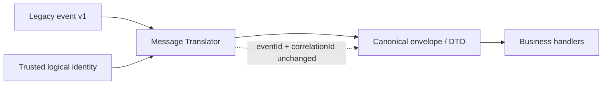
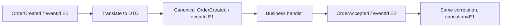
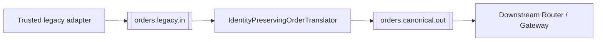
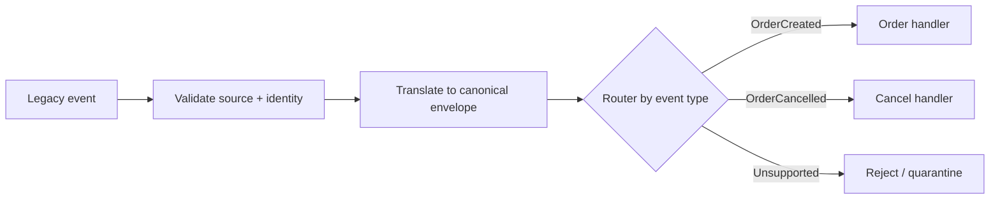
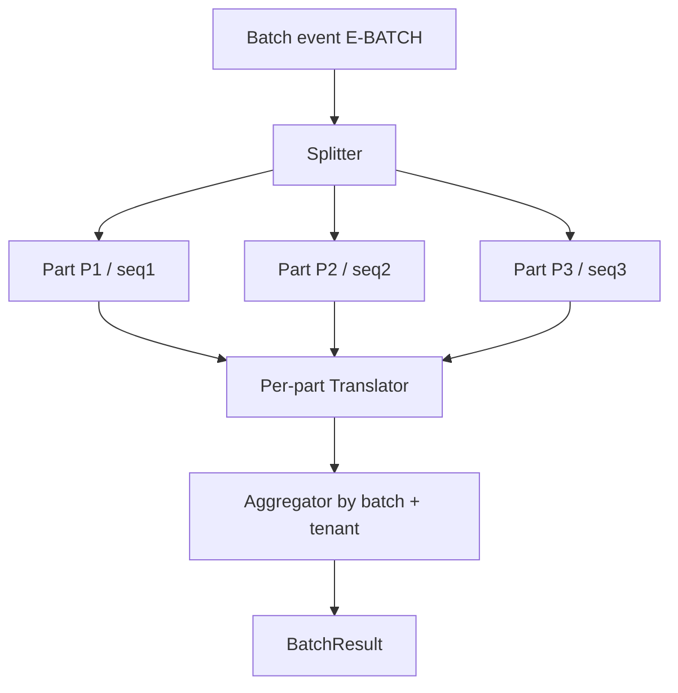
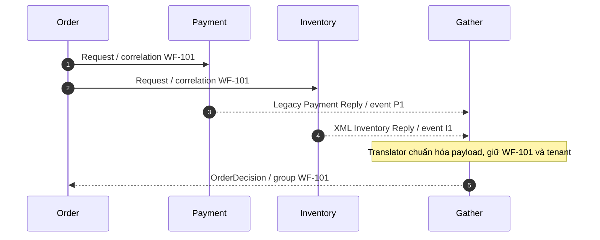
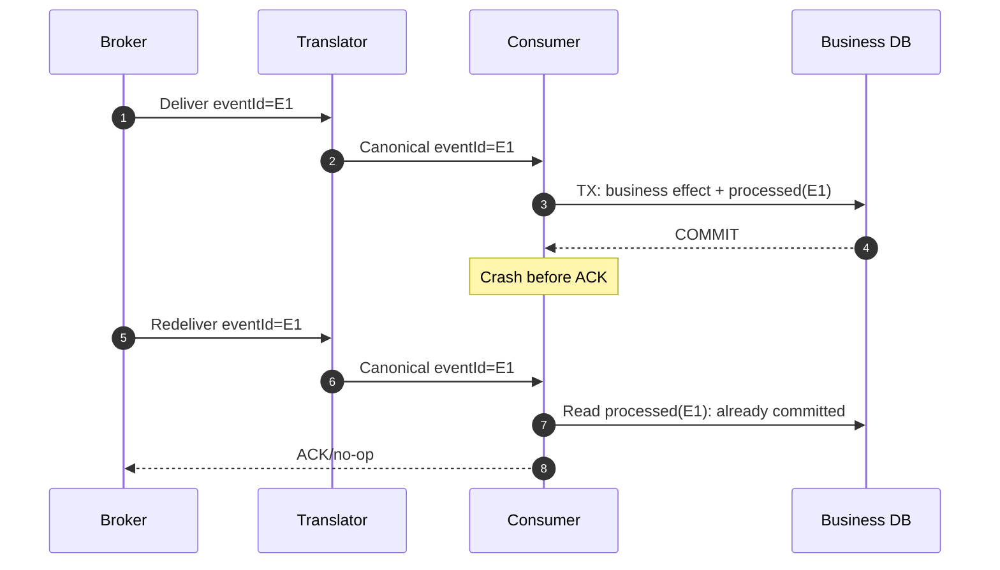
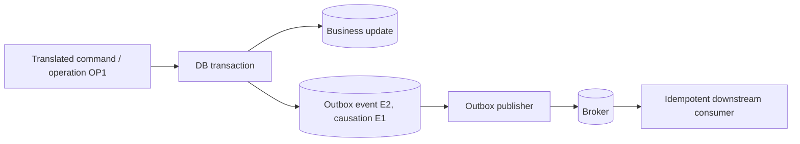

# Bảo toàn message identity khi cần

Một producer cũ gửi sự kiện đặt hàng bằng JSON schema v1. Ở cổng tích hợp, Spring Integration **Message Translator** chuyển định dạng v1 sang đối tượng `OrderCommand` của hệ thống mới. Payload đã thay đổi kiểu, tên field và cấu trúc; nhưng đó vẫn là **cùng một sự kiện logic**. Nếu bước dịch tự tạo `eventId` mới ở mỗi lần nhận, một bản redelivery từ broker sẽ trông giống một sự kiện mới và có thể khiến downstream cập nhật đơn, trừ tồn hoặc gửi thông báo hai lần.

Ngược lại, sau khi xử lý `OrderCreated`, hệ thống phát **một sự kiện nghiệp vụ mới** là `OrderAccepted`. Nếu cứ giữ `eventId` cũ cho mọi message mới, consumer có thể coi `OrderAccepted` là duplicate của `OrderCreated` hoặc hệ thống audit không phân biệt được hai sự kiện. Cần biết **khi nào bảo toàn identity, khi nào cấp identity mới, và identity nào đang được nói tới**.

Đó là trọng tâm bài **“Bảo toàn message identity khi cần”** thuộc chương **Message translator** của module `SPRING_INTEGRATION_PATTERN`. Trong lộ trình học triển khai Enterprise Integration Patterns với Spring Integration để tạo luồng thông điệp ít phụ thuộc và dễ mở rộng, ta sẽ áp dụng kiến thức cho **Router, Filter, Transformer, Splitter, Aggregator, Gateway, retry, error channel, correlation**, đồng thời kiểm thử các đường thành công, duplicate, đổi schema và xử lý lỗi.

> **Nguyên tắc trọng tâm:** Khi Message Translator chỉ thay đổi **representation của cùng một message logic**, hãy giữ những **business identity** cần cho idempotency, correlation và audit. Khi nó dẫn tới **một sự kiện hay thao tác nghiệp vụ mới**, thường cần **identity mới cho sự kiện/thao tác mới**, đồng thời giữ **correlation** và liên hệ **causation** với sự kiện gốc. Đừng đồng nhất những ID này với `MessageHeaders.ID` do Spring Messaging quản lý.

## 1. Message Translator là gì?

Trong Enterprise Integration Patterns, **Message Translator** chuyển message giữa những mô hình dữ liệu hoặc định dạng khác nhau để hai ứng dụng trao đổi mà không buộc dùng chung schema. Spring Integration có thể hiện thực bằng **Transformer**, các adapter, message converter hoặc `IntegrationFlow` với các bước mapping phù hợp.

Ví dụ:

```json
{
  "event_id": "evt-718",
  "flow_key": "wf-42",
  "customer_scope": "TENANT-A",
  "order_number": "ORD-101",
  "count": 2
}
```

được dịch sang một envelope có DTO canonical:

```json
{
  "envelopeVersion": 1,
  "identity": {
    "eventId": "evt-718",
    "correlationId": "wf-42",
    "tenantId": "TENANT-A"
  },
  "payload": {
    "orderId": "ORD-101",
    "quantity": 2
  }
}
```

**Nội dung đã thay đổi biểu diễn**, nhưng `eventId=evt-718` và `correlationId=wf-42` không đổi vì đây vẫn là **cùng logical event và cùng workflow**. Trường `tenantId` cũng được giữ theo **nguồn đã được xác thực**, không vì tên field cũ hay mới mà làm yếu quyền truy cập.



### 1.1. Message Translator không chỉ đổi tên field

Nó có thể:

- Chuyển `byte[]` hoặc String JSON thành Java DTO.
- Đổi field `order_number` sang `orderId`, `count` sang `quantity`.
- Chuẩn hóa enum, kiểu số, ngày giờ và đơn vị theo contract.
- Chuyển JSON/XML/CSV sang một canonical message.
- Bổ sung một envelope có version và metadata được xác thực.
- Thay `MessageHeaders.CONTENT_TYPE` phù hợp **representation thực tế**.
- Tách phần dữ liệu không tương thích thành rejected outcome.

**Điều không tự xảy ra:** Message Translator không tự xác thực tenant, không bảo đảm exactly-once, không làm hai transaction ở hai hệ thống atomic, và không giải quyết duplicate chỉ bằng cách “giữ nguyên một header”.

### 1.2. Từ khóa “khi cần” có nghĩa gì?

Không phải mọi identity đều cần giữ ở mọi ranh giới:

- Một **business event ID** ổn định thường phải giữ qua bản dịch và redelivery của **cùng event**.
- Một **correlation ID** cần giữ nếu các reply còn phải được group đúng workflow.
- Một **operation ID** cần giữ nếu retry phải bảo vệ cùng side effect.
- Một **tenant context** cần bảo toàn để không chuyển dữ liệu sang tenant khác, nhưng phải dựa trên **authenticated context**.
- Một **Spring message ID kỹ thuật** không nhất thiết phải giữ khi tạo `Message<?>` mới; phải hiểu framework semantics.
- Một **span ID** thường là identity của một bước thực thi, **không nên cố giữ bằng mọi giá** khi tạo span mới.
- Một **event mới** phải được nhận diện là event mới, dù cùng correlation với event trước.

Vì vậy trước khi viết translator, phải có **bảng identity contract**.

## 2. Các loại identity cần phân biệt

| Identity | Câu hỏi giải quyết | Giữ qua translation cùng logical event? |
| --- | --- | --- |
| **Spring `MessageHeaders.ID`** | Đây là một instance `Message<?>` nào trong runtime? | **Không mặc định yêu cầu**; có thể được giữ hoặc tái tạo theo builder/endpoint. |
| **Broker message ID / offset** | Đây là delivery/record nào trong transport? | Không thay thế business event identity. |
| **`eventId`** | Đây là một sự kiện logic nào? | **Có** đối với cùng event được đổi representation. |
| **`operationId`** | Đây là thao tác nghiệp vụ/side effect nào? | **Có** nếu vẫn là cùng operation; event mới khác operation có thể cần ID mới. |
| **`correlationId`** | Message thuộc hội thoại/workflow/group nào? | **Có** nếu vẫn cùng workflow cần tương quan. |
| **`causationId`** | Event/message nào trực tiếp dẫn tới event mới? | Chỉ định khi có **quan hệ nguyên nhân mới**. |
| **`tenantId`** | Dữ liệu/hành động thuộc security scope nào? | Giữ **sau xác thực**; không tin raw claim chưa kiểm tra. |
| **`traceId`** | Những span nào được liên kết trong một trace? | Tracing instrumentation quản lý; không mặc nhiên là business identity. |
| **`spanId`** | Bước xử lý cụ thể nào của trace? | Thường **thay khi sinh span mới**. |
| **`sequenceNumber` / `sequenceSize`** | Part thuộc vị trí nào, group chờ bao nhiêu part? | Giữ trong flow Splitter/Aggregator/Resequencer phù hợp. |
| **`claimToken`** | Bản dữ liệu nào đang lưu trong Claim Check store? | Không phải event/correlation identity; phụ thuộc claim lifecycle. |

### 2.1. Ví dụ nhiều ID cùng tồn tại

```text
Spring MessageHeaders.ID = UUID-msg-01234
Broker offset            = partition-2, offset-881
eventId                  = evt-718
operationId              = order-create-op-006
correlationId            = wf-42
tenantId                 = TENANT-A
causationId              = api-command-001
traceId                  = 4bf92f3577b34da6a3ce929d0e0e473
spanId                   = 00f067aa0ba902b7
```

Hai bản redelivery của `evt-718` có thể được chuyển thành **hai Spring `Message<?>` mới** với kỹ thuật ID khác nhau. **Điều cần ổn định** để Idempotent Receiver nhận ra cùng event là `eventId`/`operationId` theo contract, không phải nhất thiết là `MessageHeaders.ID`.

### 2.2. Correlation ID không phải idempotency key

Một workflow `wf-42` có thể chứa:

```text
PaymentRequested     eventId=evt-p1, corr=wf-42
InventoryRequested   eventId=evt-i1, corr=wf-42
PaymentResult        eventId=evt-p2, corr=wf-42
InventoryResult      eventId=evt-i2, corr=wf-42
```

Nếu Idempotent Receiver dùng mỗi `correlationId=wf-42` làm khóa chống trùng, nó có thể chặn ba message hợp lệ sau message đầu. Nếu Aggregator dùng `eventId` làm khóa nhóm, bốn reply không thể gom thành một nhóm vì các event ID khác nhau.

**Correlation** nhận diện **group**, còn **idempotency** nhận diện **một thao tác logic của consumer**.

### 2.3. Causation thể hiện nguồn gốc của event mới

```text
OrderCreated eventId=evt-718, corr=wf-42
    |
    | handler tạo sự kiện mới
    v
OrderAccepted eventId=evt-719, corr=wf-42,
              causationId=evt-718
```

Không tái dùng `evt-718` làm event ID cho `OrderAccepted` nếu đó là **một event mới có contract identity riêng**. Ngược lại, nếu chỉ parse lại `OrderCreated` từ JSON sang DTO, **không tự tạo `evt-719`**.

## 3. Tình huống nào cần bảo toàn identity?

### 3.1. Dịch schema v1 sang v2

```text
LegacyOrderEvent(eventId=E1, orderNo=O1, count=2)
  → Translator
CanonicalOrderEvent(eventId=E1, orderId=O1, quantity=2)
```

Đây là **một event logic** dưới hai representation; giữ `eventId=E1`.

### 3.2. Đổi wire format từ XML sang JSON

```text
XML envelope / eventId=E1
   → secure XML parser + schema validation
   → canonical DTO
   → JSON serializer
   → JSON envelope / eventId=E1
```

Bytes và Content-Type thay đổi, **event identity không đổi**. Nếu payload được ký số, chữ ký gốc trên bytes cũ không mặc nhiên còn hợp lệ sau chuyển format; cần verify trước và ký lại khi contract yêu cầu.

### 3.3. Retry/redelivery từ broker

```text
T1: Kafka record E1 → translator → downstream
T2: downstream commit DB
T3: consumer crash trước ack/offset commit
T4: Kafka redeliver E1 → translator → downstream
```

Nếu translator tạo `eventId` mới tại T4, downstream khó biết đây là **cùng một logical event**. Giữ stable identity giúp Idempotent Receiver xử lý redelivery an toàn, **nếu** nó có state/transaction đúng.

### 3.4. Chuyển message qua nhiều transport

```text
HTTP request → Spring Integration → AMQP → Kafka bridge
```

Transport có thể thay header names, serialization và technical message IDs. Khi chuyển qua bridge, nên có **wire envelope và header mapping contract** cho event/operation/correlation IDs cần sống lâu hơn một JVM.

### 3.5. Splitter/Transformer/Resequencer

Một message gốc chứa batch được split thành các part. Các part là **những message kỹ thuật mới**, có thể mang cùng group correlation nhưng **part identity khác nhau**:

```text
Batch B1
  Part P1: batchId=B1, partId=P1, seq=1/3
  Part P2: batchId=B1, partId=P2, seq=2/3
  Part P3: batchId=B1, partId=P3, seq=3/3
```

Transformer đổi `P2` từ legacy DTO sang canonical DTO: **giữ partId=P2** nếu vẫn là cùng part. Nhưng đừng gán `eventId` chung của batch thành **identity duy nhất** của mọi part nếu mỗi part có side effect riêng.

## 4. Tình huống nào **không** giữ toàn bộ identity?

### 4.1. Một business handler phát event mới



Ở cạnh `E1 → C`, chỉ translation nên giữ `eventId=E1`. Ở cạnh `H → E2`, một **business event mới** cần event ID mới, và giữ correlation để biết nó thuộc workflow cũ.

### 4.2. Sinh operation mới khi workflow có nhiều bước

Một workflow `Checkout` có các operation:

```text
operationId=RESERVE-1  → Inventory reserve
operationId=CAPTURE-1  → Payment capture
operationId=SHIP-1     → Shipping create
```

Cùng `correlationId` không làm chúng cùng idempotency key. Mỗi side effect có **operation identity riêng**. Khi **retry cùng bước** capture, giữ `CAPTURE-1`; khi thực sự tạo một payment capture mới theo business contract, phải cấp operation ID mới.

### 4.3. Một span tracing mới

Translator có thể tạo span đo thời gian parse/map. Span đó thường có `spanId` mới, nằm trong trace context do OpenTelemetry/Micrometer Tracing quản lý. **Không cố gán spanId cũ** để giả như translation không phải một bước xử lý riêng.

### 4.4. Biên giới bảo mật mới

Ở ingress ngoài, một header `correlationId` do caller tùy ý khai hoặc `tenantId` chưa được xác thực **không nên được bảo toàn như trusted metadata**. Có thể phải:

- Validate quyền và mapping tenant.
- Cấp **server-side correlation ID** mới hoặc đối chiếu ID đã tồn tại.
- Ghi nhận raw external request ID trong một field riêng, không dùng làm group identity.
- Loại reserved headers như `replyChannel` và `errorChannel` khỏi dữ liệu ngoài.

**Bảo toàn identity “khi cần” không có nghĩa copy toàn bộ header không đáng tin.**

## 5. Thiết kế identity contract trước khi viết Translator

Một bảng contract mẫu:

| Metadata | Nguồn thẩm quyền | Khi translation cùng event | Khi tạo event mới | Quy tắc validation |
| --- | --- | --- | --- | --- |
| `tenantId` | Authenticated ingress/workflow. | Giữ sau xác thực. | Giữ nếu event mới vẫn thuộc tenant đó. | Ownership, tenant isolation. |
| `eventId` | Event producer đáng tin. | Giữ. | Cấp ID mới. | Không rỗng, stable, uniqueness scope. |
| `operationId` | Command/workflow service. | Giữ cho cùng operation. | Cấp ID mới khi operation mới. | Không đổi trong retry cùng side effect. |
| `correlationId` | Trusted workflow service. | Giữ. | Giữ nếu còn thuộc workflow. | Group scope/generation. |
| `causationId` | Event-producing handler. | Không tùy ý sửa nếu chỉ parse/map. | Tham chiếu event gây ra event mới. | Event causal relation hợp lệ. |
| `traceparent` | Tracing instrumentation. | Propagate theo tracing policy. | New span/context theo instrumentation. | W3C format/privacy policy. |
| `MessageHeaders.ID` | Spring Messaging runtime. | Không dùng làm business identity. | Runtime quản lý. | Không tự sửa ID bằng header mapping tùy tiện. |
| `sequenceNumber` | Trusted Splitter. | Giữ cho cùng part. | Tùy new group/sequence semantics. | Group sequence không mâu thuẫn. |

### 5.1. Identity phải ổn định theo **logic**, không chỉ theo chuỗi

Một ID `order-123` có thể chỉ unique trong một tenant. Nếu translation xóa `tenantId`, hai orders khác tenant có thể bị coi cùng identity. Nếu workflow cho phép xử lý lại order theo **generation** mới, correlation có thể cần:

```text
groupKey = (tenantId, orderId, workflowGeneration)
```

Hoặc một `workflowId` opaque duy nhất, có mapping tin cậy tới tenant/order/generation. Không chỉ dựa vào định dạng chuỗi “nhìn giống UUID”.

### 5.2. Đừng dùng hash toàn payload như giải pháp mặc định

Nếu hệ thống cũ không có event ID, một cách tưởng như tiện:

```java
String eventId = sha256(payloadBytes);
```

Nhưng:

- Hai operation hợp lệ có **payload giống nhau** sẽ bị gộp nhầm.
- JSON khác thứ tự field/whitespace có **hash khác nhau** dù cùng ý nghĩa.
- Payload bổ sung timestamp có thể khiến retry có hash khác.
- Thay schema làm hash thay đổi dù cùng logical event.
- Hash không thay authorization hoặc unique business identity.

Nếu nguồn cũ thiếu ID, cần thiết kế một **stable mapping/inbox record** dựa trên business key đáng tin, transport source identity và replay semantics. Content hash chỉ có thể là **một thành phần** của hợp đồng khi chứng minh được tính duy nhất đúng phạm vi.

## 6. Header mapping: giữ metadata cần thiết mà không sao chép mù

Spring Messaging có `Message<?>` với payload và `MessageHeaders`. Spring Integration endpoint/Transformer có thể tạo message mới hoặc xuất ra chỉ payload để framework đóng gói; **semantics propagation phụ thuộc từng endpoint và cách dựng message**. Không giả định mọi header sẽ được giữ hay mọi technical ID sẽ đổi.

### 6.1. Những header cần quan tâm

```java
import org.springframework.integration.IntegrationMessageHeaderAccessor;
import org.springframework.messaging.MessageHeaders;

String contentType = MessageHeaders.CONTENT_TYPE;
String replyChannel = MessageHeaders.REPLY_CHANNEL;
String errorChannel = MessageHeaders.ERROR_CHANNEL;
String correlationId =
    IntegrationMessageHeaderAccessor.CORRELATION_ID;
String sequenceNumber =
    IntegrationMessageHeaderAccessor.SEQUENCE_NUMBER;
String sequenceSize =
    IntegrationMessageHeaderAccessor.SEQUENCE_SIZE;
```

Một số header liên quan **transport** (ví dụ Kafka `topic/partition/offset`), một số chỉ có ý nghĩa **trong một runtime** (ví dụ replyChannel object), còn `eventId`/`operationId` là **ứng dụng tự định nghĩa**. Không có một quy tắc “copy all” đúng cho mọi channel/broker.

### 6.2. Hai chiến lược

**A. Giữ identity trong canonical envelope:**

```text
Message<LegacyOrderEvent>
    → translator
Message<CanonicalEnvelope<OrderCommand>>
    identity.eventId = old eventId
    identity.correlationId = old correlationId
```

Hợp khi cần **cross-service serialization** hoặc có nhiều header mapper.

**B. Giữ identity trong selected trusted headers:**

```text
Message<OrderCommand>
    headers.eventId = validated event ID
    headers.correlationId = validated workflow ID
    headers.trustedTenantId = authenticated tenant
```

Hợp với **internal Spring Integration flow** cần Router/Aggregator dựa vào headers. Có thể kết hợp cả hai, nhưng phải có **mismatch policy** khi body khác header.

### 6.3. Không sao chép `MessageHeaders.ID` để “bảo đảm exactly-once”

Giữ technical message ID không đồng nghĩa side effect chỉ thực hiện một lần. Nếu hai event khác nhau bị gán cùng ID thủ công, framework/store có thể nhận nhầm message; nếu retry được adapter cấp ID mới, duplicate detection chỉ dùng ID kỹ thuật sẽ bỏ sót. Hãy **giữ stable logical identity riêng** và dùng **Idempotent Receiver/DB transaction** ở side-effect boundary.

## 7. Mô hình Java: legacy event và canonical identity

Ví dụ triển khai **một bản dịch cùng logical event**. Nguồn gửi dùng schema cũ; một **trusted adapter** đã kiểm tra nguồn/tenant rồi mới chuyển request thành `TrustedLegacyOrder`. Translator cần:

1. Kiểm tra identity và nghiệp vụ tối thiểu.
2. Từ chối tenant claim mâu thuẫn với tenant đã xác thực.
3. Đổi cấu trúc legacy sang `CanonicalOrderCommand`.
4. Giữ `eventId`, `operationId` và `correlationId` cho cùng logical event.
5. Dùng tenant từ trusted adapter.
6. Chỉ mirror những identity header mà downstream cần, **không dùng toàn bộ raw headers bên ngoài làm nguồn thẩm quyền**.

### 7.1. DTO legacy và context đã xác thực

```java
// LegacyOrderEvent.java
public record LegacyOrderEvent(
    String eventId,
    String operationKey,
    String workflowKey,
    String claimedTenant,
    String orderNumber,
    int itemCount
) {}
```

```java
// TrustedLegacyOrder.java
public record TrustedLegacyOrder(
    String authenticatedTenant,
    LegacyOrderEvent event
) {}
```

`LegacyOrderEvent.claimedTenant` có thể đến từ payload/wire. `TrustedLegacyOrder.authenticatedTenant` phải được adapter xác định từ **principal/producer identity và tenant authorization**, không copy mù từ payload.

### 7.2. Canonical identity và payload

```java
// CanonicalIdentity.java
public record CanonicalIdentity(
    String tenantId,
    String eventId,
    String operationId,
    String correlationId
) {
    public CanonicalIdentity {
        if (tenantId == null || tenantId.isBlank()
                || eventId == null || eventId.isBlank()
                || operationId == null || operationId.isBlank()
                || correlationId == null || correlationId.isBlank()) {
            throw new IllegalArgumentException(
                "INVALID_LOGICAL_IDENTITY");
        }
    }
}
```

```java
// CanonicalOrderCommand.java
public record CanonicalOrderCommand(
    String orderId,
    int quantity
) {
    public CanonicalOrderCommand {
        if (orderId == null || orderId.isBlank()
                || quantity < 1 || quantity > 100) {
            throw new IllegalArgumentException(
                "INVALID_ORDER_COMMAND");
        }
    }
}
```

```java
// CanonicalEnvelope.java
import java.util.Objects;

public record CanonicalEnvelope<T>(
    int envelopeVersion,
    CanonicalIdentity identity,
    T payload
) {
    public CanonicalEnvelope {
        if (envelopeVersion != 1) {
            throw new IllegalArgumentException(
                "UNSUPPORTED_ENVELOPE_VERSION");
        }
        Objects.requireNonNull(identity, "identity");
        Objects.requireNonNull(payload, "payload");
    }
}
```

Một `CanonicalIdentity` được thiết kế theo **value semantics** của Java record, giúp so sánh trong test và truyền qua envelope. Nhưng **việc các chuỗi bằng nhau không tự chứng minh hai event cùng một nguồn đáng tin**: phải kiểm tra tenant, provenance, schema và quyền ở ingress.

## 8. Java Transformer: giữ logical ID, không phụ thuộc technical message ID

### 8.1. Cài đặt `org.springframework.integration.transformer.Transformer`

```java
// IdentityPreservingOrderTranslator.java
import java.util.Objects;
import org.springframework.integration.IntegrationMessageHeaderAccessor;
import org.springframework.integration.transformer.Transformer;
import org.springframework.messaging.Message;
import org.springframework.messaging.support.MessageBuilder;

public final class IdentityPreservingOrderTranslator
        implements Transformer {

    @Override
    public Message<?> transform(Message<?> original) {
        if (!(original.getPayload()
                instanceof TrustedLegacyOrder inbound)) {
            throw new IllegalArgumentException(
                "EXPECTED_TRUSTED_LEGACY_ORDER");
        }

        LegacyOrderEvent legacy =
            Objects.requireNonNull(inbound.event(), "event");
        String tenant = inbound.authenticatedTenant();

        if (tenant == null || tenant.isBlank()) {
            throw new IllegalArgumentException(
                "MISSING_AUTHENTICATED_TENANT");
        }
        if (!tenant.equals(legacy.claimedTenant())) {
            throw new IllegalArgumentException(
                "TENANT_MISMATCH");
        }

        CanonicalIdentity identity = new CanonicalIdentity(
            tenant,
            legacy.eventId(),
            legacy.operationKey(),
            legacy.workflowKey());

        CanonicalOrderCommand command =
            new CanonicalOrderCommand(
                legacy.orderNumber(),
                legacy.itemCount());

        CanonicalEnvelope<CanonicalOrderCommand> envelope =
            new CanonicalEnvelope<>(1, identity, command);

        // Header cho những downstream Spring Integration
        // endpoints cần group/operation identity.
        // Nguồn là context/DTO đã được validate,
        // KHÔNG lấy raw header từ external caller.
        return MessageBuilder.withPayload(envelope)
            .setHeader(
                IntegrationMessageHeaderAccessor.CORRELATION_ID,
                identity.correlationId())
            .setHeader("trustedTenantId",
                identity.tenantId())
            .setHeader("eventId",
                identity.eventId())
            .setHeader("operationId",
                identity.operationId())
            .build();
    }
}
```

### 8.2. Giải thích từng quyết định

**Dịch payload:** `orderNumber → orderId`, `itemCount → quantity`. Không tạo thêm đơn hàng mới; vì vậy vẫn là một logical event.

**Bảo toàn business IDs:** `eventId`, `operationKey` và `workflowKey` từ legacy event được giữ sau khi kiểm tra. Trong một hệ thống thật, adapter/protocol phải xác minh chúng là những ID đáng tin và có uniqueness/scope đúng, chứ không chỉ kiểm tra nonblank.

**Bảo vệ tenant:** output dùng `authenticatedTenant`. Nếu raw claim không khớp, translator **từ chối**, không tự chuyển request sang tenant do producer khai.

**Không copy raw headers:** builder tạo output message có các metadata được lựa chọn tường minh. Đây là lựa chọn cho một ranh giới chuyển đổi đã kiểm tra nguồn. Tuy nhiên, **Spring Integration endpoint/adapter có thể thực hiện header propagation hoặc mapping** ngoài bản thân phương thức; phải kiểm tra behavior của flow và cấu hình adapter thực tế. Không coi riêng đoạn method này là firewall tuyệt đối.

**Không hứa giữ `MessageHeaders.ID`:** runtime có thể tạo kỹ thuật ID mới cho output message, tùy builder và flow. Bài test kiểm tra **logical identity** trong payload/header, **không đòi technical ID của input và output bằng nhau**.

**Không tự viết trace context:** Tracing instrumentation chịu trách nhiệm tạo/propagate parent-child span. Nếu cần giữ `traceparent` qua adapter, phải có hợp đồng riêng, không tự gán random trace/span ID trong business translator.

### 8.3. Tại sao message ID kỹ thuật có thể đổi?

Một Transformer có thể:

- Trả **chỉ payload mới**, để framework đóng gói thành Message.
- Trả **một Message mới** với selected headers.
- Dùng `MessageBuilder.fromMessage(...)` cho một message đã tin cậy.
- Đi qua broker adapter tạo một transport record và sau đó một inbound Spring Message khác.

Các trường hợp có semantics về header copy/ID creation khác nhau. **Đừng gắn correctness của idempotency vào một giả định rằng `MessageHeaders.ID` luôn được preserve**. Nếu có yêu cầu giao thức bắt buộc giữ original message ID, định nghĩa **một field `originalMessageRef` có scope/trust rõ**, không tùy ý đặt lại reserved ID của framework.

## 9. Spring Integration Java DSL: đặt Translator vào flow

### 9.1. Cấu hình một flow đơn giản

```java
// MessageTranslatorConfiguration.java
import org.springframework.context.annotation.Bean;
import org.springframework.context.annotation.Configuration;
import org.springframework.integration.channel.QueueChannel;
import org.springframework.integration.config.EnableIntegration;
import org.springframework.integration.dsl.IntegrationFlow;

@Configuration
@EnableIntegration
public class MessageTranslatorConfiguration {

    @Bean
    IdentityPreservingOrderTranslator orderTranslator() {
        return new IdentityPreservingOrderTranslator();
    }

    @Bean("orders.canonical.out")
    QueueChannel canonicalOutput() {
        return new QueueChannel(16);
    }

    @Bean
    IntegrationFlow translateLegacyOrders(
            IdentityPreservingOrderTranslator translator) {
        return IntegrationFlow.from("orders.legacy.in")
            .transform(translator)
            .channel("orders.canonical.out")
            .get();
    }
}
```

Sơ đồ:



Ở bản minh họa:

1. `orders.legacy.in` nhận `Message<TrustedLegacyOrder>` từ adapter đáng tin.
2. `.transform(translator)` kiểm tra tenant và chuyển sang `CanonicalEnvelope<CanonicalOrderCommand>`.
3. Header business identity được mirror từ identity đã xác nhận.
4. `orders.canonical.out` là `QueueChannel` có bộ nhớ để test đọc, **không phải queue bền** hay consumer production.

**Điều không làm ở demo:** không cấu hình Kafka/AMQP/HTTP, database, tracing provider, transaction manager hoặc default error flow; bài STEP 4 NEW không chạy build/Gradle hay Content QA chuyên môn. Trong dự án thật, xác minh dependency/version của Spring Integration và hành vi endpoint qua integration test.

### 9.2. Xử lý lỗi translator

Translator có thể ném `IllegalArgumentException` nếu:

```text
EXPECTED_TRUSTED_LEGACY_ORDER
MISSING_AUTHENTICATED_TENANT
TENANT_MISMATCH
INVALID_LOGICAL_IDENTITY
INVALID_ORDER_COMMAND
```

Ở flow đồng bộ dùng `DirectChannel`, exception có thể truyền ngược sender. Với inbound adapter/poller/async flow, nó có thể được chuyển thành `ErrorMessage` qua `errorChannel` khi cấu hình phù hợp. **Không giả định mọi lỗi translator tự vào global errorChannel**; broker ACK/requeue/DLT phụ thuộc adapter/transaction semantics.

### 9.3. Khi nào dùng Message Converter thay vì một Transformer?

Một `MessageConverter` thường chịu trách nhiệm **deserialize/serialize** giữa wire format và Java object. Một `Transformer` trong Spring Integration có thể làm **mapping nghiệp vụ/schema**. Trong một flow rõ ràng:

```text
Raw Kafka bytes
  → transport deserializer
  → legacy DTO + trusted adapter context
  → IdentityPreservingOrderTranslator
  → canonical envelope
  → business handler
```

Đừng trộn việc **đọc một byte stream chưa đáng tin** và việc **bảo toàn identity của một business event đã xác thực** mà không có ranh giới kiểm tra/loại lỗi rõ.

## 10. JUnit 5: hai bản delivery là cùng event dù technical IDs khác

### 10.1. Unit test giữ identity

```java
// IdentityPreservingOrderTranslatorTest.java
import static org.junit.jupiter.api.Assertions.*;

import org.junit.jupiter.api.Test;
import org.springframework.integration.IntegrationMessageHeaderAccessor;
import org.springframework.messaging.Message;
import org.springframework.messaging.support.MessageBuilder;

class IdentityPreservingOrderTranslatorTest {

    private final IdentityPreservingOrderTranslator translator =
        new IdentityPreservingOrderTranslator();

    private static TrustedLegacyOrder sameEvent() {
        LegacyOrderEvent event = new LegacyOrderEvent(
            "evt-718", "order-create-op-006",
            "wf-42", "TENANT-A", "ORD-101", 2);
        return new TrustedLegacyOrder("TENANT-A", event);
    }

    @Test
    void preservesBusinessIdentityAcrossRepresentationChange() {
        Message<?> source = MessageBuilder
            .withPayload(sameEvent())
            .setHeader("externalRole", "SUPERADMIN")
            .build();

        Message<?> output = translator.transform(source);
        assertInstanceOf(CanonicalEnvelope.class, output.getPayload());

        CanonicalEnvelope<?> result =
            (CanonicalEnvelope<?>) output.getPayload();
        CanonicalIdentity identity = result.identity();

        assertEquals("evt-718", identity.eventId());
        assertEquals("order-create-op-006",
            identity.operationId());
        assertEquals("wf-42", identity.correlationId());
        assertEquals("TENANT-A", identity.tenantId());

        CanonicalOrderCommand command =
            (CanonicalOrderCommand) result.payload();
        assertEquals("ORD-101", command.orderId());
        assertEquals(2, command.quantity());

        assertEquals("wf-42", output.getHeaders().get(
            IntegrationMessageHeaderAccessor.CORRELATION_ID));
        assertEquals("evt-718",
            output.getHeaders().get("eventId"));
        assertNull(output.getHeaders().get("externalRole"));
    }

    @Test
    void retriesKeepLogicalIdentityWithoutDependingOnMessageId() {
        Message<?> first = MessageBuilder
            .withPayload(sameEvent()).build();
        Message<?> retry = MessageBuilder
            .withPayload(sameEvent()).build();

        // Hai Spring Messages khác nhau được tạo cho
        // cùng một logical event, không dùng ID này làm dedup.
        assertNotEquals(first.getHeaders().getId(),
            retry.getHeaders().getId());

        CanonicalEnvelope<?> result1 = (CanonicalEnvelope<?>)
            translator.transform(first).getPayload();
        CanonicalEnvelope<?> result2 = (CanonicalEnvelope<?>)
            translator.transform(retry).getPayload();

        assertEquals(result1.identity(), result2.identity());
        assertEquals(result1.payload(), result2.payload());
    }

    @Test
    void rejectsTenantSpoofingBeforeBusinessHandler() {
        TrustedLegacyOrder forged = new TrustedLegacyOrder(
            "TENANT-A",
            new LegacyOrderEvent(
                "evt-718", "order-create-op-006",
                "wf-42", "TENANT-B", "ORD-101", 2));

        IllegalArgumentException error = assertThrows(
            IllegalArgumentException.class,
            () -> translator.transform(MessageBuilder
                .withPayload(forged).build()));
        assertEquals("TENANT_MISMATCH",
            error.getMessage());
    }
}
```

**Điều test chứng minh:** translator giữ những logical IDs đã được đưa vào trusted context, đổi payload hợp lệ, và không dùng technical message ID để quyết định event identity. Test cũng xác minh **method transformer tự tạo output với selected headers**, không copy raw `externalRole`. Với flow thật, kiểm thử header propagation của toàn endpoint/adapter.

**Điều test chưa chứng minh:** redelivery qua broker, DB transaction, exactly-once side effect, ACL/authorization, trace propagation hoặc multi-instance.

### 10.2. Integration test cho DSL

```java
// MessageTranslatorFlowTest.java
import static org.junit.jupiter.api.Assertions.*;

import org.junit.jupiter.api.Test;
import org.springframework.beans.factory.annotation.Autowired;
import org.springframework.context.ApplicationContext;
import org.springframework.integration.channel.QueueChannel;
import org.springframework.messaging.Message;
import org.springframework.messaging.MessageChannel;
import org.springframework.messaging.support.MessageBuilder;
import org.springframework.test.context.junit.jupiter.SpringJUnitConfig;

@SpringJUnitConfig(MessageTranslatorConfiguration.class)
class MessageTranslatorFlowTest {

    @Autowired ApplicationContext context;

    @Test
    void translatedMessageCarriesOriginalLogicalEventId() {
        TrustedLegacyOrder input = new TrustedLegacyOrder(
            "TENANT-A",
            new LegacyOrderEvent(
                "evt-900", "order-create-op-900",
                "wf-900", "TENANT-A", "ORD-900", 5));

        MessageChannel inbound = context.getBean(
            "orders.legacy.in", MessageChannel.class);
        assertTrue(inbound.send(MessageBuilder
            .withPayload(input).build()));

        QueueChannel output = context.getBean(
            "orders.canonical.out", QueueChannel.class);
        Message<?> translated = output.receive(0);

        assertNotNull(translated);
        CanonicalEnvelope<?> envelope =
            (CanonicalEnvelope<?>) translated.getPayload();
        assertEquals("evt-900", envelope.identity().eventId());
        assertEquals("wf-900",
            envelope.identity().correlationId());
        assertEquals("TENANT-A",
            translated.getHeaders().get("trustedTenantId"));
        assertNull(output.receive(0));
    }
}
```

Trong demo, channel/handler là đồng bộ và output được buffer bằng `QueueChannel`, nên `receive(0)` có thể dùng. Khi thay bằng executor/poller/broker, hãy dùng **bounded wait** và dọn state giữa test. Test chỉ quan sát message translation, không thực hiện side effect.

### 10.3. Test một event mới phải có event ID mới

Đây là một logic khác, **không nằm trong bản dịch cùng event ở mục 8**:

```java
// Ví dụ minh họa cho business-event producer.
public record AcceptedEventIdentity(
    String eventId,
    String causationId,
    String correlationId,
    String tenantId
) {}

AcceptedEventIdentity newAcceptedEvent(
        CanonicalIdentity original,
        String newlyAllocatedEventId) {
    if (newlyAllocatedEventId.equals(original.eventId())) {
        throw new IllegalArgumentException(
            "NEW_EVENT_REQUIRES_NEW_ID");
    }
    return new AcceptedEventIdentity(
        newlyAllocatedEventId,
        original.eventId(),
        original.correlationId(),
        original.tenantId());
}
```

`newlyAllocatedEventId` phải được cấp theo **event publishing contract**, tránh sinh ID mới mỗi lần retry cùng **outbox event**. Một cách thường dùng là tạo event ID **một lần khi ghi outbox row cùng transaction**, rồi publisher có thể phát lại chính outbox record đó với **cùng event ID**.

## 11. Transformer, Message Translator và Header Enricher

Spring Integration cung cấp nhiều cách chuyển message. Chọn cách nào phụ thuộc identity contract và representation.

### 11.1. Chỉ trả payload mới

Một Transformer đơn giản có thể trả một DTO:

```java
// Ví dụ minh họa mapping thuần, KHÔNG đủ để tự
// khẳng định mọi identity metadata đã được bảo toàn.
CanonicalOrderCommand translatePayload(
        LegacyOrderEvent source) {
    return new CanonicalOrderCommand(
        source.orderNumber(),
        source.itemCount());
}
```

Trong `IntegrationFlow`, khi Transformer trả một payload, framework có thể dựng output Message và xử lý header propagation theo endpoint. **Phải test** liệu `eventId`, `correlationId`, `sequenceNumber`, `replyChannel` còn phù hợp, đặc biệt sau adapter và trước Aggregator/Gateway.

Nếu downstream cần business identity bền qua broker, cách trả **chỉ payload** mà không có canonical envelope/header contract dễ làm mất ID.

### 11.2. Trả một `Message<?>` mới

Ví dụ `IdentityPreservingOrderTranslator` ở mục 8:

```text
Message<TrustedLegacyOrder>
    → IdentityPreservingOrderTranslator
Message<CanonicalEnvelope<CanonicalOrderCommand>>
    headers:
       correlationId
       trustedTenantId
       eventId
       operationId
```

Cách này cho phép translator quyết định **dữ liệu nào thực sự cần mang sang output**, nhưng không thay thế bước xác thực nguồn hay cấu hình adapter bên ngoài.

### 11.3. Dùng `Header Enricher` có chọn lọc

Nếu translator trả payload canonical, một bước tiếp theo có thể copy những header business đã được xác thực từ **nguồn tin cậy** hoặc tạo chúng từ envelope:

```java
// Pseudocode DSL cho một internal flow đã xác thực:
// .enrichHeaders(headers -> headers
//   .headerFunction("eventId", msg ->
//       ((CanonicalEnvelope<?>) msg.getPayload())
//           .identity().eventId())
//   .headerFunction(
//       IntegrationMessageHeaderAccessor.CORRELATION_ID,
//       msg -> ((CanonicalEnvelope<?>) msg.getPayload())
//           .identity().correlationId()))
```

Không dùng `headerEnricher` để **tự tạo eventId mới mỗi lần** nếu đây là **cùng logical event** được translate hoặc redeliver. Không lấy `tenantId` từ header chưa xác thực để override trusted tenant scope.

### 11.4. `Content-Type` phải mô tả representation thực tế

Trường hợp:

```text
Input:
    payload: byte[] JSON
    contentType: application/json

Output:
    payload: CanonicalOrderCommand (Java object)
```

Đừng cho rằng output vẫn là **JSON bytes** chỉ vì header cũ `application/json` được propagate. Có thể giữ media-type intent cho converter ở outbound boundary, nhưng phải định nghĩa **contract của converter** và test cách nó serialize DTO thành wire bytes.

Khi translator chuyển XML bytes sang JSON bytes, hãy **đổi content type sau khi serialize thật**, không chỉ đổi header rồi giữ XML bytes.

## 12. Router và Filter: identity phải có trước khi chọn nhánh

Một Router chọn nhánh theo `messageType`, tenant policy hoặc payload type. Message Translator có thể **normalize field tên loại sự kiện** trước khi Router xử lý.



### 12.1. Router không thay correlation

`PAYMENT` và `INVENTORY` là **destination roles**, không phải correlation group. Nếu hai reply cùng workflow đi qua hai channel khác nhau, chúng vẫn cần **cùng group identity** khi về Aggregator.

Ngược lại, hai message cùng channel `orders.received` chưa chắc thuộc cùng workflow.

### 12.2. Tenant-aware routing phải có identity đáng tin

Nếu producer ngoài tự gửi:

```text
headers:
  tenantId = TENANT-ADMIN
  routeTo = admin.internal
```

Translator không được copy những giá trị đó và để Router chọn database/channel tùy ý. Cần **authenticated tenant context** và allowlist route. Một trusted tenant ID trong envelope không thay data-access authorization ở handler.

### 12.3. Filter có thể làm mất terminal outcome

Giả sử translator xử lý Inventory reply và Filter phía sau loại `OUT_OF_STOCK`. Nếu Aggregator cần đủ Payment + Inventory, group có thể thiếu reply mãi.

```text
Sai:
  Inventory OUT_OF_STOCK
    → Translator
    → Filter false
    → drop
    → Aggregator chỉ còn Payment reply

Đúng theo contract cần terminal outcomes:
  Inventory OUT_OF_STOCK
    → Translator
    → InventoryOutcome(REJECTED)
    → Aggregator đủ các required roles
```

**Identity bảo toàn đúng** không tự giải quyết việc Filter làm mất message. Cần release/expiry contract cho từng group.

## 13. Splitter và Part Identity

Một `OrderBatch` có ba line. Splitter tạo các message con, mỗi part có thể có:

```text
tenantId = TENANT-A
batchId = BATCH-101
partId = LINE-2
correlationId = BATCH-101
sequenceNumber = 2
sequenceSize = 3
```

Khi Translator đổi payload part `LINE-2` sang canonical `OrderLineCommand`:

- Giữ **tenant và batch/workflow correlation**.
- Giữ **partId/lineId** cho cùng logical part.
- Giữ **sequenceNumber/sequenceSize** nếu Aggregator/Resequencer cần và header được cấp từ trusted Splitter.
- Giữ **operation ID** nếu cùng step có side effect và retry có thể xảy ra.
- Không tái sử dụng event ID gốc của cả batch như **identity duy nhất** của từng part khi mỗi part là một operation riêng.



### 13.1. Khi nào part được coi là message mới?

**Về kỹ thuật**, Splitter tạo message con mới. **Về nghiệp vụ**, part có thể là:

1. **Một fragment của cùng sự kiện gốc** (cần group/part ID để reassemble).
2. **Một command mới cho từng line** (cần operation ID riêng cho side effect).
3. **Một event mới đại diện outcome của part** (cần event ID riêng và causation tới part request).

Không có quy tắc chung “mọi part phải giữ event ID gốc” hoặc “mọi part phải tạo event ID mới”. Phải định nghĩa **identity của đối tượng đang được xử lý**.

### 13.2. Duplicate part và Aggregator release

```text
Expected: P1, P2, P3
Received: P1, P2, P2 (duplicate)
```

Nếu Aggregator chỉ dùng `group.size() == 3`, nó có thể release sớm dù thiếu P3. Cần **distinct part ID** hoặc release strategy theo required outcomes. Message Translator phải **bảo toàn part identity**, không sinh part ID khác cho duplicate P2.

### 13.3. Nested splitter

Một file chứa nhiều order, mỗi order có nhiều line:

```text
outer group = (tenantId, fileId, generation)
inner group = (tenantId, fileId, orderId, generation)
part identity = (tenantId, fileId, orderId, lineId)
```

Nếu translator chỉ giữ một `correlationId` phẳng cho mọi tầng, inner Aggregator có thể trộn line của các order khác nhau. Cần **correlation scope theo tầng**; có thể có `parentCorrelationId` hoặc typed context tùy wire contract.

## 14. Aggregator và Content-Based Correlation

Một Payment reply và một Inventory reply có event IDs khác nhau nhưng cùng workflow:

```text
PAYMENT eventId=EVT-P-101, corr=WF-101, tenant=A
INVENTORY eventId=EVT-I-101, corr=WF-101, tenant=A
```

Translator chuyển hai payload về một DTO `ProviderOutcome`:

```java
public record ProviderOutcome(
    String source,
    String status,
    String eventId,
    String tenantId,
    String correlationId
) {}
```

**Group key** có thể là:

```java
public record BusinessGroupKey(
    String tenantId,
    String correlationId
) {}
```

Một correlation strategy minh họa:

```java
// Pseudocode cho AggregateSpec, cần ReleaseStrategy
// và MessageGroupProcessor do ứng dụng cài đặt:
//
// .aggregate(spec -> spec
//     .correlationStrategy(message -> {
//         ProviderOutcome p =
//             (ProviderOutcome) message.getPayload();
//         return new BusinessGroupKey(
//             p.tenantId(), p.correlationId());
//     })
//     .releaseStrategy(requiredRolesReleaseStrategy)
//     .outputProcessor(providerGroupProcessor))
```

Ở đây:

- **CorrelationStrategy** trả lời reply thuộc group nào.
- **ReleaseStrategy** trả lời đủ những source/role cần thiết chưa.
- **MessageGroupProcessor** tạo output sau release.

Nếu Translator làm mất `correlationId`, Group sẽ bị chia; nếu nó làm mất `tenantId`, Group có thể trộn cross-tenant; nếu nó cấp event ID mới cho mỗi redelivery, dedup theo event ID sẽ mất tác dụng. Nhưng **giữ đủ ba ID vẫn chưa bảo đảm release đúng** khi thiếu required source, conflict hoặc late reply.

### 14.1. Không dùng `MessageHeaders.ID` của Translator làm correlation

Nếu mỗi reply được translate thành message kỹ thuật mới:

```text
Payment reply: input Message ID M1 → output Message ID M2
Inventory reply: input Message ID M3 → output Message ID M4
```

và Aggregator nhóm theo `MessageHeaders.ID`, hai reply sẽ ở hai group khác nhau. Cần **business correlation** ổn định (hoặc header do EIP cấp đúng scope), không lấy ID kỹ thuật output làm group identity.

### 14.2. Timeout và late reply

Một group có thể expire lúc T1; Inventory reply về lúc T2. Nếu Translate chỉ giữ correlation mà không có **generation/completed-group policy**, reply cũ có thể tạo group mới hoặc làm một workflow đã final xử lý tiếp. Cần version/generation, late-result policy, tombstone/completed state và idempotent finalization.

## 15. Resequencer: giữ sequence identity, không giả tạo thứ tự

Resequencer cần biết **mỗi part thuộc group nào và thứ tự nào**. Một message translator có thể làm chậm một định dạng XML hơn JSON:

```text
input order: P1, P2, P3
completion order: P2, P3, P1
```

Đừng vì part `P2` translate xong đầu tiên mà đổi `sequenceNumber=1`. Sequence phải phản ánh **thứ tự được giao bởi nguồn/thực thể nghiệp vụ**, không phải arrival/completion order.

| ID | Mục đích |
| --- | --- |
| `correlationId` | Nhóm của sequence. |
| `sequenceNumber` | Vị trí trong group. |
| `sequenceSize` | Số phần dự kiến nếu biết trước. |
| `partId` | Identity riêng cho part để dedup. |
| `eventId` | Identity sự kiện logic đang mang part/outcome. |

Message Translator nên bảo toàn những field phù hợp với cùng part, đồng thời loại bỏ raw metadata không đáng tin.

## 16. Scatter–Gather, Recipient List và Publish–Subscribe

### 16.1. Scatter–Gather



Payment và Inventory có thể khác wire format; các Translator đưa cả hai về một canonical `ProviderOutcome`. Điều cần bảo toàn:

- **Business correlation và tenant** từ trusted workflow.
- **Recipient role/source** đã được xác thực.
- **Event identity** riêng cho mỗi reply.
- **Required recipients** theo request thật, không suy từ message đã tới.

Nếu translator coi mọi reply cùng correlation là duplicate, Gather sẽ mất một role. Nếu translator cấp correlation mới cho từng reply, Gather sẽ không bao giờ hoàn tất.

### 16.2. Recipient List động

Một request gửi Pricing và Inventory nhưng không gửi Promotions. Translator không được “đẻ” thêm một expected role chỉ vì schema canonical có field promotions. Release strategy phải biết **tập recipient thực sự được chọn** trong trusted workflow context.

### 16.3. Publish–Subscribe

Một `OrderCreated` có thể được phát cho:

```text
Audit Consumer
Search Index Consumer
Notification Consumer
```

Cả ba consumer nhìn thấy cùng eventId và correlation, nhưng **mỗi consumer có side effect độc lập**. Đừng dùng **một global dedup key chỉ bằng eventId** trên kho dùng chung, vì Audit xử lý rồi có thể làm Notification bị chặn. Thường dùng:

```text
idempotencyKey = (consumerName, tenantId, eventId)
```

Đây là **identity của xử lý event tại consumer**, không phải correlation group.

## 17. Gateway request–reply và reply identity

Một Java Gateway có thể khai báo:

```java
import org.springframework.integration.annotation.MessagingGateway;

@MessagingGateway(defaultRequestChannel = "orders.command.in")
interface OrderGateway {
    OrderReceipt submit(OrderCommand command);
}

// OrderCommand, OrderReceipt là DTO do ứng dụng định nghĩa;
// flow cần reply path và converter/handler phù hợp.
```

Trong một request–reply flow, có **hai identity khác nhau**:

1. **Business operation/correlation:** retry cùng request vẫn thuộc cùng logical operation/workflow.
2. **Reply path:** Gateway cần biết kết quả trả về caller nào, thường thông qua **trusted `replyChannel`/request–reply contract** của Spring Messaging.

Nếu Translator tạo message mới và **làm mất reply channel mà runtime cần**, Gateway có thể timeout dù business handler đã tạo output. Nếu nó **copy `replyChannel` từ raw external payload/header**, có thể tạo routing/security vulnerability.

### 17.1. Gateway timeout không làm operation biến mất

```text
T0: Caller gửi command OP-101
T1: Gateway timeout, caller chưa có receipt
T2: Backend commit OP-101
T3: Caller retry command OP-101
```

Translator phải giữ `operationId=OP-101` qua retry cùng command. Idempotent Receiver hoặc result store trả lại receipt đã có, **không thực hiện side effect lần hai**. Chỉ giữ `MessageHeaders.ID` không bảo đảm kết quả này.

### 17.2. Reply mới có nên giữ event ID của command?

Nếu reply chỉ là **representation của cùng message** trên một channel nội bộ, identity contract có thể khác. Nhưng nếu hệ thống phát một **domain event `OrderAccepted`**, đó là **event mới**, cần event ID mới và có thể mang `causationId` trỏ về command/event nguồn.

**Đừng trộn “response cho một request” với “domain event mới” chỉ vì đều là một `Message<?>`.**

## 18. Claim Check và Envelope Wrapper

Một payload lớn có thể được giữ trong `MessageStore`, còn flow chỉ chuyển một claim token:

```text
Original OrderEvent / eventId E1
    → Claim Check In
Token C1
    → Router / approval
    → Claim Check Out
Restored OrderEvent / eventId E1
    → Message Translator
Canonical OrderEvent / eventId E1
```

**Claim token C1** không phải `eventId E1`, `correlationId` hay idempotency key. Translator ở bước check-out phải:

- Xác thực claim owner/tenant trước khi truy hồi.
- Khôi phục **đúng logical event identity** từ bản lưu đáng tin.
- Không suy `eventId` từ claim token nếu hợp đồng không định nghĩa như vậy.
- Giữ correlation/operation ID qua conversion.
- Không xóa claim trước khi tất cả consumer còn cần nó đã hoàn tất.

Nếu `check-out` remove-on-read, một retry có thể mất original payload. Cần chính sách read-many/lease/retention phù hợp với fan-out và idempotency.

## 19. Wire identity: HTTP, Kafka, AMQP, JMS và các adapter

Message Translator thường nằm giữa hai transport. Một Spring `Message<?>` không được phát nguyên vẹn sang Kafka/JMS/HTTP chỉ bằng cách copy object; adapter phải serialize payload, map headers và có transport identity riêng.

### 19.1. HTTP

```text
POST /orders
Authorization: Bearer ...
X-Request-ID: req-101
traceparent: 00-...-...-01
Body: legacy order JSON
```

**Quy tắc:**

- Controller/HTTP adapter xác thực principal và tenant.
- Giới hạn body size, parse/validate schema trước translator hoặc trong một boundary có lỗi rõ.
- Client `X-Request-ID` có thể là **external request reference**, **không mặc nhiên** là event/operation/correlation identity đáng tin.
- Cấp hoặc khôi phục stable `operationId` cho retry theo hợp đồng API.
- Không copy `Authorization`/cookie vào business envelope hoặc broker header.
- Tracing instrumentation quản lý `traceparent`, không dùng nó để quyết định đã xử lý operation hay chưa.

Nếu một HTTP caller gửi lại cùng operation với một **new HTTP request ID**, downstream vẫn cần biết đó là **cùng operation**. Đừng nhầm request attempt với logical command.

### 19.2. Kafka

Một Kafka record có `topic, partition, offset`; Kafka headers mang bytes. Trong một pipeline:

```text
Kafka record:
  offset=881
  value=legacy event E1
    → inbound adapter/deserializer
    → Spring Message ID M1
    → Message Translator
    → canonical event E1
```

**`offset`** nhận diện vị trí record trong partition, không phải một business event ID toàn hệ thống. Republish cùng event E1 sang topic khác tạo offset khác; retry/rebalance có thể tạo Spring `MessageHeaders.ID` khác.

Nếu producer gửi **stable eventId** và consumer cần idempotency, hãy giữ nó trong **value envelope** hoặc một header có mapping/version/trust rõ. Khi dùng partition key:

- Group theo tenant/business key nếu ordering cần thiết.
- Không kỳ vọng cùng correlation luôn cùng partition nếu partitioning policy khác.
- Không lộ secret qua Kafka key/header/log.
- Test deserializer/header mapper với bytes thực tế.

### 19.3. RabbitMQ/AMQP

AMQP có properties, delivery tags, correlation ID và message ID tùy cấu hình producer/adapter. Một `deliveryTag` phục vụ acknowledgment ở channel/connection tương ứng, **không phải event identity bền**.

Khi translator đi qua AMQP:

1. Converter biết wire format/body encoding.
2. Metadata event/correlation/tenant được map theo contract.
3. Error handling biết khi nào ack, nack, requeue và DLT.
4. Redelivery giữ stable logical identity, dù technical delivery metadata đổi.
5. Không tin AMQP correlation property do producer ngoài khai là business workflow ID nếu chưa có trust contract.

### 19.4. JMS

JMS có `JMSMessageID` và `JMSCorrelationID`. Chúng không tự bằng `MessageHeaders.ID` hay application `eventId`. Có thể map `JMSCorrelationID` sang business correlation **nếu** producer/consumer agreement và security xác định rõ. Đừng lấy một ID chỉ có nghĩa ở transport rồi coi là business operation identity.

### 19.5. File và batch replay

Một job đọc lại file cũ có thể tạo **file message ID mới** cho mỗi lần poll. Nếu từng record trong file không có stable identity, Idempotent Receiver không biết đó là replay. Khi tích hợp:

- Định nghĩa `sourceFileId`/`batchId`/`recordId` hoặc mapping persisted.
- Tách **file ingestion attempt** với **logical record identity**.
- Không dùng mỗi dòng số `lineNumber` làm ID toàn cục.
- Giữ tenant/source/record version trong canonical envelope.
- Kiểm tra checksum khi cần, nhưng không nhầm checksum với operation identity.

## 20. Retry và Idempotent Receiver: Identity là điều kiện cần, chưa đủ

Một bản dịch đúng giúp nhận ra retry:



**Cơ chế quan trọng:** translator giữ `eventId`, còn consumer kiểm tra `processed(E1)` bằng một cơ chế **bền và an toàn đồng thời**. Nếu consumer chỉ lưu Set trong bộ nhớ, restart có thể quên E1.

### 20.1. First seen khác business committed

Sai lầm:

```text
putIfAbsent(E1) vào metadata store
  → translator + handler
  → crash trước DB commit
  → redelivery E1 bị drop vì key đã thấy
```

Chìa khóa để tránh mất xử lý là **transaction boundary phù hợp**. Nếu business effect nằm trong cùng database, có thể ghi dedup record và business changes trong cùng transaction/unique constraint. Với remote payment, cần provider idempotency key/outbox/reconciliation.

### 20.2. Bản dịch có thể sinh output nhiều lần

Ngay cả translator thuần và deterministic vẫn có thể **chạy nhiều lần** vì broker redelivery. Đừng thiết kế translator có side effect như:

```java
// Rất nguy hiểm nếu đây chỉ là bước conversion:
OrderCommand translateAndCharge(LegacyOrderEvent event) {
    paymentApi.capture(event.operationKey());
    return new OrderCommand(
        event.orderNumber(), event.itemCount());
}
```

Trộn **chuyển đổi dữ liệu** với **capture payment** làm khó đảm bảo idempotency và retry semantics. Tốt hơn: translator chỉ map, business handler gọi payment với **stable operation ID** và cơ chế chống trùng phù hợp.

### 20.3. Cùng key, khác payload

```text
eventId=E1, amount=100000
eventId=E1, amount=250000
```

Nếu contract nói event ID chỉ thuộc **một immutable event**, hai payload khác nhau cùng ID là **conflict**. Không âm thầm bỏ second message và che lỗi; cũng không tự đổi ID của second message thành E2 để cho qua. Ghi fingerprint/version, quarantine hoặc báo conflict theo hợp đồng.

Khi hash canonical payload, cần định nghĩa JSON field ordering, numeric type, Unicode/charset và version. **Hash payload không tự thay event identity**.

### 20.4. Retry sau partial transformation

Một translator có nhiều bước:

```text
Legacy JSON
  → parse
  → normalize currency
  → enrich customer
  → canonical event
```

Nếu việc enrich gọi API bị timeout, một lần retry có thể nhận dữ liệu thay đổi giữa các lần thử. Cần quyết định:

- Cùng logical event identity nhưng canonical result khác có chấp nhận không?
- Có cần snapshot/enrichment version để deterministic replay không?
- Khi downstream đã commit bản đầu, bản thứ hai được coi duplicate hay một **state update event** mới?
- Nếu có side effect trong enrichment, đã có idempotency riêng chưa?

Không thể chỉ dựa vào “eventId vẫn bằng nhau” để giải quyết **business content conflict**. Khi cần, lưu result/snapshot đã chọn hoặc version của data source để replay có ý nghĩa rõ.

### 20.5. Outbox và new event identity



Nếu publisher crash sau publish nhưng trước khi mark outbox sent, nó có thể publish lại **cùng outbox event E2**. Vì vậy **đừng cấp E3 ở lần publish lại**; event ID nên được ghi vào outbox record khi transaction tạo business event. Đây là ví dụ vì sao **dịch representation** và **sinh event mới** phải được tách bằng contract.

## 21. Lỗi kỹ thuật, lỗi hợp đồng và error channel

| Tình huống | Nhóm lỗi | Hành động thường phù hợp |
| --- | --- | --- |
| Invalid JSON/XML | Permanent input/schema. | Reject/quarantine/DLT, không retry payload hỏng vô hạn. |
| Thiếu `eventId` bắt buộc | Identity contract. | Reject hoặc repair bằng persisted trusted mapping. |
| Tenant claim khác authenticated tenant | Security. | Deny/audit, không dịch rồi route sang tenant kia. |
| Cùng event ID nhưng payload mâu thuẫn | Identity conflict. | Quarantine/reconcile, không tạo ID mới âm thầm. |
| Unsupported schema version | Compatibility. | Version-aware parser/migration hoặc quarantine. |
| DB lookup tạm thời unavailable | Transient. | Retry có hạn, backoff/jitter. |
| Downstream đã commit, broker ACK bị mất | Redelivery. | Dùng same identity để dedup committed operation. |
| Gateway reply timeout | Caller deadline. | Reuse operation ID, query status/replay result. |
| Output channel full | Backpressure. | Retry budget và error handling, không bỏ mất event. |
| Broken header mapping | Configuration/contract. | Alert, fail closed khi identity không được chứng minh. |

### 21.1. Lỗi tại bước translate trước side effect

Một `IllegalArgumentException` do schema/tenant không hợp lệ cần được **phân loại permanent** nếu retry cùng input không giúp sửa. Nếu để broker requeue vô hạn:

```text
E1 missing eventId
  → Translator fails
  → broker requeues E1
  → Translator fails
  → ...
```

Đây là poison message; cần rejected outcome hoặc DLT/quarantine với **quy trình sửa dữ liệu**.

### 21.2. `errorChannel` không tự bảo đảm rollback

Trong Spring Integration:

- Flow đồng bộ có thể truyền exception về người gửi.
- Poller/adapter/async flow có thể phát `ErrorMessage` vào một error channel được cấu hình.
- Lỗi bị handler bắt rồi trả success có thể khiến broker ACK dù business chưa hoàn thành.

Phải test **actual adapter acknowledgment, transaction và error advice**. Không chỉ tạo bean tên `errorChannel` rồi coi mọi exception đã có retry/rollback đúng.

### 21.3. Khi nào cần fallback identity?

Nếu một legacy source thiếu `eventId`, có hai hướng:

**A. Reject và yêu cầu producer sửa contract.** Phù hợp khi identity là invariant bắt buộc cho side effect.

**B. Gán ID thông qua durable ingress mapping.** Ví dụ một **source-specific event key** được derive theo contract rồi được đăng ký trong inbox/DB với unique constraint; các lần redelivery lấy lại **ID đã cấp**. Cần bảo đảm nguồn và khóa đủ phân biệt hai event hợp lệ, nếu không vẫn có nguy cơ gộp nhầm.

**Không tự tạo UUID mới mỗi khi translator nhận lại message rồi gọi là “fallback an toàn”**.

## 22. Schema evolution, normalization và cross-version identity

Một producer v1 dùng:

```json
{
  "event_id": "evt-718",
  "flow_key": "wf-42",
  "order_number": "ORD-101",
  "count": 2
}
```

Producer v2 dùng:

```json
{
  "eventId": "evt-718",
  "correlationId": "wf-42",
  "order": {
    "id": "ORD-101",
    "quantity": 2
  }
}
```

Nếu hai bản thực sự đại diện **cùng immutable event**, translator phải map về **cùng canonical eventId**, không vô tình dùng `payloadSchemaVersion` làm event identity mới nếu contract không yêu cầu.

### 22.1. Identity cần version hóa không?

**Format của identity** có thể version:

```text
identityFormatVersion=1
  groupKey = (tenantId, orderId)

identityFormatVersion=2
  groupKey = (tenantId, orderId, workflowGeneration)
```

Nếu đổi cách tạo group key mà bỏ qua những group v1 đang mở, reply đến muộn có thể chia vào nhóm khác. Cần migration/drain/compatibility strategy rõ, test các event được phát trong rolling deployment.

**Không phải cứ nâng schema payload là phải tạo group key mới**. Hai loại version có trách nhiệm khác nhau.

### 22.2. Canonicalization phải có quy tắc

Một legacy ID:

```text
order_number = " ord-101 "
```

Có cần trim/uppercase thành `ORD-101` không? Chỉ nếu domain xác định chúng cùng đối tượng. Không tự lowercase một identifier case-sensitive. Nếu translation đổi cách chuẩn hóa giữa v1 và v2, có thể tạo hai idempotency keys khác nhau hoặc trộn hai ID hợp lệ.

### 22.3. Mất dữ liệu khi dịch không thể đảo ngược

Giả sử v1 có `lineItemId` nhưng canonical DTO v2 chỉ giữ `orderId` và `quantity`. Nếu downstream cần **idempotency theo từng line** mà translator đã xóa `lineItemId`, không còn cách nhận diện duplicate part chính xác. Trước khi bỏ một field, hỏi:

- Field này có tham gia operation identity/group key không?
- Field này có cần cho audit, error reconciliation hoặc replay không?
- Có thể chuyển vào trusted metadata hay canonical envelope không?
- Có cần giữ original payload/reference qua Claim Check không?

**Message Translator không nên silently drop những field cần để giữ correctness của workflow**, dù business DTO hiện tại không hiển thị chúng.

## 23. Security: identity được giữ phải đáng tin

Một attacker có thể cố gửi:

```json
{
  "event_id": "evt-other-tenant",
  "flow_key": "wf-admin",
  "customer_scope": "TENANT-ADMIN",
  "order_number": "ORD-101",
  "count": 2
}
```

Nếu translator chỉ đổi tên field và cho Aggregator/Idempotent Receiver tin vào raw metadata, attacker có thể:

- **Claim nhầm key** làm event hợp lệ bị coi duplicate.
- Gửi reply giả vào workflow của tenant khác.
- Điều hướng message sang data source không có quyền.
- Tạo log/trace có ID trùng gây nhầm lẫn trong audit.
- Làm tăng số group/keys vô hạn bằng correlation ID ngẫu nhiên.

### 23.1. Các biện pháp tối thiểu

1. **Authenticate producer/caller** trước khi tin identity.
2. **Authorize tenant và operation** ở ingress, đồng thời enforce ở business data access.
3. Validate format, uniqueness scope, length của event/operation/group keys.
4. Dùng **allowlist header mapping**; không copy arbitrary `replyChannel`, `errorChannel`, role hoặc credential.
5. Map event/message type qua allowlist, không deserialize class name tùy ý.
6. Hạn chế payload size, parser depth, number of parts/groups và quota theo source.
7. Khi ký message, verify signature trên bytes theo schema, và xử lý re-sign nếu translation thay representation.
8. Với trace context, dùng tracing instrumentation và privacy policy, không coi trace ID là bearer token.
9. Không log raw secret/PII/event body khi parse failure.
10. Audit mismatch/forged metadata với opaque references.

### 23.2. Event ID không phải authorization

Một consumer biết `eventId=evt-718` **không có quyền** đọc/thực hiện mọi operation liên quan event đó. Event ID chỉ giúp nhận diện sự kiện. Phải xét source, tenant, role, workflow state và ACL.

### 23.3. Tránh dùng PII làm identity

Không dùng email, điện thoại, số tài khoản hoặc bearer token làm correlation/event ID chỉ để dễ debug. Những giá trị đó thường lan qua broker/log/traces/metrics. Dùng opaque IDs và giữ mapping tại hệ thống phân quyền phù hợp.

### 23.4. Tracing `baggage` không phải trusted tenant context

Một tracing header/baggage có thể do upstream khai. Không lấy `baggage.tenantId` làm **nguồn thẩm quyền** chỉ vì translator giữ nó qua transport. Business tenant phải đến từ authenticated context hoặc validated workflow record.

## 24. Multi-instance, concurrency và failure recovery

Hai pod cùng nhận logical event `E1`:

```text
Pod A:
  Message ID M-A, logical eventId E1

Pod B:
  Message ID M-B, logical eventId E1
```

Translator có thể giữ `eventId=E1` trên cả hai. Nhưng **nếu mỗi pod có in-memory dedup store riêng**, cả hai vẫn có thể nghĩ event chưa được xử lý.

### 24.1. Shared durable state hoặc single owner

Các chiến lược:

- **Partition/single-owner** theo business key, phù hợp khi transport bảo đảm ordering per partition/consumer group trong giới hạn.
- **Shared inbox/processed_messages table** với unique constraint và transactional side effect.
- **Shared metadata store** atomic, kết hợp recovery/lease và business commit semantics.
- **Outbox** cho sự kiện mới cần publish sau khi business commit.
- **Workflow state store** để xử lý completion/late replies/replay.

Chỉ có cùng event ID trong payload không tự tạo **distributed locking** hoặc exactly-once.

### 24.2. Crash windows cần xét

| Thời điểm crash | Hệ quả | Cần bảo vệ gì? |
| --- | --- | --- |
| Trước khi translator xong | Input có thể redeliver. | Stable logical event ID, deterministic mapping. |
| Sau translator, trước handler | Input có thể redeliver. | Không đánh dấu COMMITTED trước side effect. |
| Sau metadata first-seen, trước DB write | Nguy cơ mất xử lý. | Marker + DB write cùng transaction, hoặc recovery state. |
| Sau DB commit, trước ACK | Nguy cơ duplicate delivery. | Idempotent handler với stable operation key. |
| Sau outbox publish, trước mark sent | Nguy cơ duplicate event publish. | Giữ event ID của outbox row, downstream dedup. |
| Sau Gateway timeout, backend vẫn chạy | Caller retry khi state chưa biết. | Stable operation ID + stored result/status. |

### 24.3. Replicas có thể dùng schema khác nhau

Trong rolling deploy:

```text
Pod A: translator v1 → eventId from field legacy_id
Pod B: translator v2 → eventId from field event_id
```

Nếu cùng input có thể cho **hai IDs khác nhau**, dedup sẽ vỡ. Cần contract tests cross-version, giữ compatibility window, và migration mapping cho in-flight events.

### 24.4. Một workflow có thể kéo dài nhiều trace

Trace context có thể không tồn tại, bị sampling hoặc được thay ở lần replay. Điều đó không nên thay đổi logical group/operation identity. Đừng để availability của tracing backend quyết định event có được idempotent xử lý hay không.

## 25. Observability: kiểm tra identity preservation như một invariant

Không chỉ đo số event được translate. Cần biết có **dịch sai identity** hay không.

| Metric đề xuất | Ý nghĩa |
| --- | --- |
| `translator_messages_received_total` | Số message vào Translator. |
| `translator_messages_translated_total` | Số message tạo canonical output. |
| `translator_validation_failures_total` | Số lỗi schema/type/field. |
| `translator_missing_identity_total` | Thiếu event/operation/correlation ID theo contract. |
| `translator_tenant_mismatch_total` | Raw tenant claim khác trusted tenant. |
| `translator_identity_conflicts_total` | Cùng key nhưng payload/version mâu thuẫn. |
| `translator_identity_mapping_failures_total` | Không map được legacy identity sang canonical. |
| `translator_unsupported_schema_total` | Input schema version không được hỗ trợ. |
| `translator_header_mapping_failures_total` | Header cần thiết bị mất/sai kiểu ở transport. |
| `translator_duplicate_deliveries_total` | Redelivery được nhận diện ở downstream identity gate. |
| `translator_latency_seconds` | Thời gian parse/convert/validate. |
| `translator_output_failures_total` | Không gửi được canonical message tới channel/adapter. |
| `aggregator_correlation_mismatches_total` | Reply sai group key sau dịch. |
| `gateway_reply_timeouts_total` | Caller timeout, khác translator failure. |
| `workflow_late_events_total` | Reply/event đến sau group completion/expiry. |

Đây là **đề xuất tên metric của ứng dụng**, không phải metric Spring Integration tự phát sinh đầy đủ. Không đặt từng `eventId`, `orderId`, `operationId`, `correlationId`, `traceId` thành metric label vì cardinality cao/PII. Dùng labels hữu hạn: `translator=legacy-orders`, `schema_version=v1`, `outcome=IDENTITY_CONFLICT`.

### 25.1. Structured logs

```text
event=message_translation_completed
flow=legacyOrderIngress
input_schema=legacy-v1
output_schema=canonical-v1
logical_event_ref=opaque-ref
workflow_ref=opaque-wf
tenant_scope=authorized
identity_preserved=true
status=ACCEPTED
```

```text
event=message_translation_rejected
flow=legacyOrderIngress
error_code=TENANT_MISMATCH
source=legacy-adapter
logical_event_ref=opaque-ref
status=REJECTED
```

Log nên ghi **metadata đã kiểm tra, dưới dạng mờ**, không dump payload/header chưa đáng tin hoặc secrets để debug. Tracing giúp kết nối spans, nhưng **không dùng trace storage làm nguồn sự thật** cho event đã commit hoặc workflow đã hoàn tất.

### 25.2. Cách chẩn đoán khi cùng event bị xử lý hai lần

1. Producer có giữ cùng `eventId`/`operationId` qua retry không?
2. Translator có tự tạo UUID mới ở mỗi lần deserialize không?
3. Adapter có loại bỏ business identity header khi đi qua broker không?
4. Idempotent Receiver đang dùng **MessageHeaders.ID** thay vì business ID?
5. Hai consumer có dùng shared store và atomic uniqueness không?
6. Processed marker có được commit cùng business effect không?
7. Outbox publisher có phát lại với **event ID mới** không?
8. TTL dedup có ngắn hơn replay window không?
9. Payload conflict có bị bỏ qua mà không audit không?
10. Có một operation nghiệp vụ mới hợp lệ bị coi nhầm là duplicate không?

### 25.3. Cách chẩn đoán khi Aggregator bị kẹt

1. Payment và Inventory reply có cùng **business correlation** không?
2. Tenant/generation có khớp và được xác thực không?
3. Translator có giữ identity qua schema mapping không?
4. Một Filter có loại terminal rejected outcome không?
5. Splitter/Resequencer có làm mất sequence header không?
6. Có duplicate của một source nhưng thiếu source khác không?
7. Multi-instance có dùng group store đúng scope/locking không?
8. Group đã expire/closed nhưng reply vẫn đến không?
9. Output processor/Gateway reply path có bị mất do tạo Message mới?
10. Có khác biệt schema/identity format trong rolling deployment không?

## 26. Ma trận kiểm thử message identity

### 26.1. Đường hợp lệ và negative tests

| Kịch bản | Bất biến phải được chứng minh |
| --- | --- |
| Legacy event v1 hợp lệ | Canonical payload đúng và `eventId` được giữ. |
| Hai Spring Messages có ID khác nhau nhưng cùng event | Sau Translator vẫn cùng `CanonicalIdentity`. |
| Cùng eventId, cùng operationId, cùng tenant | Identity ổn định qua retry cùng logical event. |
| Cùng eventId nhưng tenant khác | Reject/security audit; không chuyển vào tenant sai. |
| Thiếu eventId | Reject trước downstream Idempotent Receiver. |
| Thiếu correlationId khi workflow cần gather | Reject/repair bằng trusted mapping, không tự gán một group chung. |
| OperationId khác cho cùng workflow | Không bị coi duplicate chỉ vì correlation giống. |
| Cùng event ID, payload khác | Conflict/quarantine theo immutable event contract. |
| Translation chỉ đổi field/format | Không cấp event ID mới. |
| Handler phát một domain event mới | Cấp event ID mới, causation tham chiếu event nguồn. |
| Broker redelivery | Stable event/operation IDs, idempotent consumer không double-commit. |
| HTTP retry với request ID mới | Operation identity vẫn là của logical command cũ. |
| Kafka offset thay khi republish | Không phụ thuộc offset làm logical event identity. |
| JMS/AMQP correlation ID khác contract | Có mapping/test rõ, không tự coi giống business correlation. |
| Raw `replyChannel`/`errorChannel` từ client | Không được dùng làm internal routing authority. |
| Content-Type đổi do serialization | Header phản ánh representation thực tế, identity không bị tự đổi. |
| Một part Splitter bị redeliver | Part ID/sequence không đổi, group không release sai. |
| Nested Splitter | Inner/outer correlation scope tách biệt. |
| Payment + Inventory reply | Nhóm theo tenant/workflow, release theo required roles. |
| Filter loại một terminal reply | Test phát hiện group kẹt, có rejected outcome/expiry. |
| Gateway timeout nhưng backend commit | Retry cùng operation ID được nhận diện, không side effect lặp. |
| Claim Check Out sau retry | Bản gốc vẫn có logical identity đúng và claim permissions hợp lệ. |
| Two pods xử lý cùng event | Shared dedup/DB transaction bảo vệ side effect. |
| Rolling deploy schema v1/v2 | Same logical event map về same identity. |
| Tracing context mất hoặc đổi | Business identity vẫn đúng; trace chỉ ảnh hưởng observability. |
| Error/DLT replay | Permanent failures không retry vô hạn; identity giữ đúng khi repair. |

### 26.2. Unit tests cho translator

Với code mục 8 và 10, tối thiểu cần test:

1. DTO v1 chuyển thành canonical đúng field.
2. Identity bằng nhau khi input và output đại diện **cùng một event**.
3. Đổi representation không tự cấp `eventId` mới.
4. Mismatch tenant bị reject.
5. Thiếu identity field bị reject.
6. Invalid quantity/order ID bị reject trước business handler.
7. Output có selected logical IDs trong envelope/header.
8. Raw header ngoài không được phương thức transformer copy mù.

**Quan trọng:** unit test không kiểm tra được sự can thiệp của endpoint/broker header mapper. Đó là trách nhiệm của **integration/transport tests**.

### 26.3. Integration tests cho Spring Integration flow

Trong `@SpringJUnitConfig(MessageTranslatorConfiguration.class)`:

- Gửi `Message<TrustedLegacyOrder>` vào `orders.legacy.in`.
- Đọc `Message<CanonicalEnvelope<CanonicalOrderCommand>>` tại `orders.canonical.out`.
- So sánh `eventId`, `operationId`, `correlationId`, `tenantId`.
- Kiểm tra translator exception propagation cho input invalid.
- Test hai delivery cùng logical ID với technical message IDs khác.
- Khi thêm outbound adapter, kiểm tra serialization/headers sau converter.
- Khi thêm Gateway, kiểm tra reply path/timeout; đừng chỉ assert output queue.

### 26.4. Fault injection có ý nghĩa

**Crash sau DB commit, trước ACK:** giả lập redelivery. Downstream phải nhận ra committed operation bằng same key, không thực hiện lại business update.

**Crash sau first-seen trước DB commit:** phải rollback/allow recovery, không mark permanently completed.

**Header mapping bị thay đổi:** adapter có thể mất `correlationId` hoặc đổi String thành bytes. Không đi tiếp với group key trống hoặc tenant sai.

**Hai replicas xử lý cùng event:** kiểm tra atomic uniqueness tại shared store; không dùng in-memory Set rồi kết luận production an toàn.

**Outbox publish lặp:** sự kiện mới giữ **outbox event ID đã cấp**, thay vì sinh ID mới cho mỗi publish attempt.

**Schema mismatch giữa pods:** input v1 và v2 cùng logical event phải map về cùng canonical identity nếu contract yêu cầu.

## 27. Những sai lầm thường gặp

### Sai lầm 1 — “Giữ `MessageHeaders.ID` là đủ chống duplicate”

**Sai.** ID kỹ thuật có scope và lifecycle khác business event. Cần stable event/operation identity và durable idempotency ở nơi side effect.

### Sai lầm 2 — “Translator nào cũng phải tạo eventId mới”

**Sai.** Dịch format của cùng event mà đổi ID sẽ làm replay trông như event mới.

### Sai lầm 3 — “Translator tuyệt đối không bao giờ tạo ID mới”

**Cũng sai.** Khi handler phát **event nghiệp vụ mới**, event identity phải khác event nguồn và nên có causation link khi cần.

### Sai lầm 4 — “`correlationId` là key chống trùng mọi message”

**Sai.** Một workflow chứa nhiều event/operation khác nhau. Group identity không phải operation identity.

### Sai lầm 5 — “Hai payload giống hệt thì chắc là cùng event”

**Sai.** Hai operation hợp lệ có thể cùng payload; content hash không thay stable event ID.

### Sai lầm 6 — “`traceId` không đổi nên đó là một business operation”

**Sai.** Trace có thể chứa nhiều operation; có thể đổi qua retry hoặc replay. Tracing là observability.

### Sai lầm 7 — “Copy hết headers sẽ bảo toàn mọi thứ”

**Nguy hiểm.** Có thể copy secrets, tenant/role giả mạo và internal routing headers. Chọn metadata có trust contract.

### Sai lầm 8 — “Một `Message<?>` mới đồng nghĩa một event nghiệp vụ mới”

**Sai.** Translator/adapter có thể tạo Message mới cho **cùng logical event**.

### Sai lầm 9 — “Một eventId chung cho cả batch là đủ cho từng line”

**Sai nếu mỗi line có side effect riêng.** Cần part/operation identity riêng để dedup và release đúng.

### Sai lầm 10 — “Một Aggregator có thể nhóm theo ID technical output”

**Sai.** Các reply cần business correlation/group key; output Message ID từ Translator thường không chung nhóm.

### Sai lầm 11 — “Nếu Filter drop Inventory reply thì Aggregator vẫn đủ kết quả”

**Sai.** Cần terminal outcomes hoặc partial/expiry policy có chủ đích.

### Sai lầm 12 — “Gateway timeout là business transaction rollback”

**Sai.** Backend có thể đã commit và caller retry. Stable operation ID + stored result/idempotency cần thiết.

### Sai lầm 13 — “First-seen marker chứng minh handler commit”

**Sai.** Crash giữa marker và side effect có thể làm mất xử lý. Cần transaction/recovery.

### Sai lầm 14 — “Kafka offset/JMSMessageID chính là business eventId”

**Không mặc nhiên.** Chúng có phạm vi transport; logical event identity phải được định nghĩa ở contract.

### Sai lầm 15 — “Cùng tenant ID trong payload tức là được phép xử lý”

**Sai.** Tenant phải được auth/authorize; raw identity có thể bị giả mạo.

### Sai lầm 16 — “Translator có thể sửa correlation để cho Aggregator release”

**Rủi ro.** Nếu group key đang sai, cần xác định nguồn identity và business scope; đổi ID tùy tiện có thể trộn tenant/generation.

### Sai lầm 17 — “Content-Type là một identity field”

**Sai.** Nó mô tả representation; các event JSON khác nhau không thuộc cùng workflow chỉ vì đều JSON.

### Sai lầm 18 — “Một queue bền đồng nghĩa có exactly-once end-to-end”

**Sai.** Broker, DB và external API có transaction boundary riêng; cần idempotency/outbox/reconciliation.

### Sai lầm 19 — “Schema mới không cần xử lý legacy identity mapping”

**Sai.** Nếu cách parse/canonicalize ID thay đổi, cùng logical event có thể được dedup khác nhau sau rolling deploy.

### Sai lầm 20 — “Log toàn bộ raw identity để dễ debug là an toàn”

**Không mặc nhiên.** Có thể lộ PII/tenant/business secrets; dùng opaque references và phân quyền truy cập log.

## 28. Bài tập thực hành

**Bài 1 — Phân loại ID.** Cho `MessageHeaders.ID`, Kafka offset, eventId, operationId, correlationId, causationId và traceId. Giải thích mỗi ID trả lời câu hỏi gì, và ID nào phải giữ khi dịch cùng sự kiện.

**Bài 2 — Mapping legacy.** Dùng `LegacyOrderEvent` ở mục 7 để dịch `orderNumber` và `itemCount` sang `CanonicalOrderCommand`, nhưng giữ toàn bộ logical identity.

**Bài 3 — Redelivery.** Tạo hai `Message<?>` từ cùng `TrustedLegacyOrder`, xác minh technical message IDs khác và canonical event IDs bằng nhau sau Translator.

**Bài 4 — Event mới.** Sau khi xử lý `OrderCreated`, tạo `OrderAccepted` với event ID mới, correlation ID cũ và causation ID trỏ event nguồn.

**Bài 5 — Tenant spoofing.** Thử legacy event khai TENANT-B trong context TENANT-A; xác minh Translator reject trước khi business handler chạy.

**Bài 6 — Header propagation.** Đặt raw `externalRole=ADMIN` trên message đầu vào. Test trực tiếp Transformer và test qua IntegrationFlow; kiểm tra adapter/endpoint có propagate ngoài dự kiến không.

**Bài 7 — Content-Type.** Đổi XML bytes sang JSON bytes bằng parser/serializer thật. Đặt header `application/json` sau conversion, kiểm tra eventId không đổi.

**Bài 8 — Splitter.** Batch ba dòng, part 2 redeliver hai lần. Thiết kế stable `partId` và group key để Aggregator không đếm duplicate như part mới.

**Bài 9 — Nested groups.** File có nhiều order, mỗi order nhiều line. Xác định inner/outer correlation và operation ID cho từng line.

**Bài 10 — Scatter–Gather.** Payment reply JSON, Inventory reply XML. Viết hai Translator về `ProviderOutcome`, giữ tenant/workflow và event ID riêng cho mỗi reply.

**Bài 11 — Gateway timeout.** Caller retry cùng `operationId` sau khi backend commit. Thiết kế result store và kiểm tra side effect không chạy lần hai.

**Bài 12 — Claim Check.** Lưu original event và chuyển token qua workflow. Sau Check Out, kiểm tra original eventId/tenant/correlation vẫn đúng.

**Bài 13 — Idempotent Receiver.** Sử dụng một inbox/processed_messages table với unique key theo `(consumerName, tenantId, eventId)`; kiểm tra rollback cùng business write khi handler lỗi.

**Bài 14 — Outbox.** Business handler tạo event mới, lưu `eventId=E2` trong outbox cùng transaction. Publisher gửi hai lần nhưng downstream vẫn nhận cùng logical event.

**Bài 15 — Legacy thiếu event ID.** Đề xuất source-specific stable key và persisted mapping/inbox. Giải thích vì sao hash payload hoặc UUID mới mỗi retry chưa đủ.

**Bài 16 — Tenant collision.** Hai tenant có cùng `orderId`. Kiểm tra correlation/idempotency key không trộn.

**Bài 17 — Version migration.** V1 dùng `legacy_id`, v2 dùng `event_id`. Viết contract test chứng minh hai representations của cùng logical event map về cùng canonical ID.

**Bài 18 — Kafka/AMQP mapping.** Kiểm tra Spring headers và wire headers với actual adapters; mô phỏng mất correlation header nhưng body envelope còn identity.

**Bài 19 — Tracing.** Thêm Micrometer Tracing/OpenTelemetry; tạo span cho Translator mà không thay business correlation/operation ID.

**Bài 20 — Dashboard.** Đề xuất metric theo lỗi identity mapping, tenant mismatch, duplicate deliveries, schema version và latency; không dùng unique business IDs làm labels.

## 29. Checklist trước khi đưa Message Translator vào production

| Câu hỏi | Điều kiện cần chứng minh |
| --- | --- |
| Translator chỉ đổi representation hay còn sinh event mới? | Đã xác định semantics trước khi cấp/giữ ID. |
| Có business event identity ổn định? | `eventId` giữ qua cùng event/retry/redelivery. |
| Có operation identity? | `operationId` giữ cho retry cùng side effect, đổi khi operation mới. |
| Có correlation contract? | Group theo workflow/request/batch với tenant/generation thích hợp. |
| Có causation contract? | Event mới tham chiếu event nguồn khi cần. |
| Có phân biệt technical vs logical ID? | Không dùng `MessageHeaders.ID` hay offset thay business event identity. |
| Tenant có được auth/authorize? | Output lấy tenant từ trusted context, reject mismatch. |
| Source/role đáng tin chưa? | Không tin raw producer claims trong Router/Aggregator. |
| Input schema/version rõ không? | Legacy parser/mapping được version hóa, reject unsupported. |
| Output schema/content type đúng? | Representation thật được serialize/validate phù hợp. |
| Có header allowlist? | Không copy secrets, arbitrary reply/errorChannel/role. |
| Có selected identity headers khi cần? | Được mirror từ trusted envelope/context, có mismatch test. |
| Có Splitter/part identity không? | Giữ group/part/sequence phù hợp, không đếm duplicate. |
| Có Aggregator/Resequencer không? | Release theo expected roles/parts, correlation theo đúng scope. |
| Có Scatter–Gather/Recipient List không? | Reply các role giữ cùng workflow nhưng event IDs riêng. |
| Có Gateway reply path không? | Không làm mất trusted replyChannel, có timeout/status policy. |
| Có Idempotent Receiver không? | Business effect được bảo vệ bằng durable atomic/transactional key. |
| Có Claim Check không? | Token không bị coi là event ID; original metadata/owner được giữ. |
| Có broker adapters không? | Header/value mapping được test trên HTTP/Kafka/AMQP/JMS thật. |
| Có retry và DLT không? | Redelivery giữ stable identity; poison message không retry vô hạn. |
| Có outbox cho event mới? | New event ID cấp một lần, giữ qua publish retries. |
| Có schema rolling deploy không? | Canonical identity ổn định qua v1/v2 migration. |
| Có concurrency/multi-instance không? | Shared state/partition owner/locking/unique constraint đúng. |
| Có trace context không? | Tracing library quản lý spans, không dùng traceId thay business ID. |
| Có security/privacy không? | Auth, tenant isolation, no PII in identifiers/metrics/logs. |
| Có failure tests không? | Crash before/after commit, ACK lost, header missing, conflict, version drift. |
| Có giới hạn kết quả đã xác minh? | Unit/DSL tests tách khỏi transport/transaction/security testing. |

## Kết luận

**Bảo toàn message identity khi cần** là nguyên tắc quan trọng của **Message Translator** trong Spring Integration: một message có thể được đổi JSON/XML, DTO, schema, content type và Spring `Message<?>` instance, nhưng vẫn là **cùng logical event**. Trong trường hợp đó, phải giữ **event ID, operation ID, correlation ID và tenant context đáng tin** theo đúng phạm vi; **không dựa vào technical message ID, broker offset hoặc trace ID** làm identity nghiệp vụ.

Khi một handler thực sự tạo **domain event hay side effect mới**, hãy cấp identity **mới cho event/operation đó** và giữ correlation/causation phù hợp. Để tránh duplicate và trộn nhóm, Translator cần phối hợp với **Router, Filter, Splitter, Aggregator, Resequencer, Scatter–Gather, Gateway, Idempotent Receiver, Claim Check, retry và error channel**; đồng thời cần **transaction, unique key, outbox, auth/tenant isolation, schema versioning và quan sát đúng các ranh giới**. Làm rõ identity contract ngay từ đầu giúp hệ thống **chuyển đổi message giữa nhiều ứng dụng mà không làm mất dấu sự kiện, làm sai nhóm xử lý hay thực hiện lại một tác động nghiệp vụ ngoài ý muốn**.
