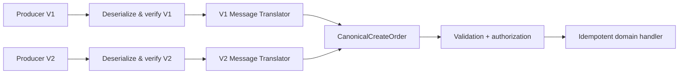
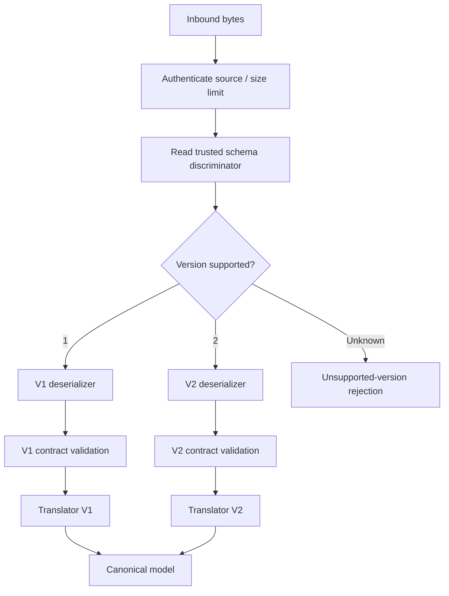
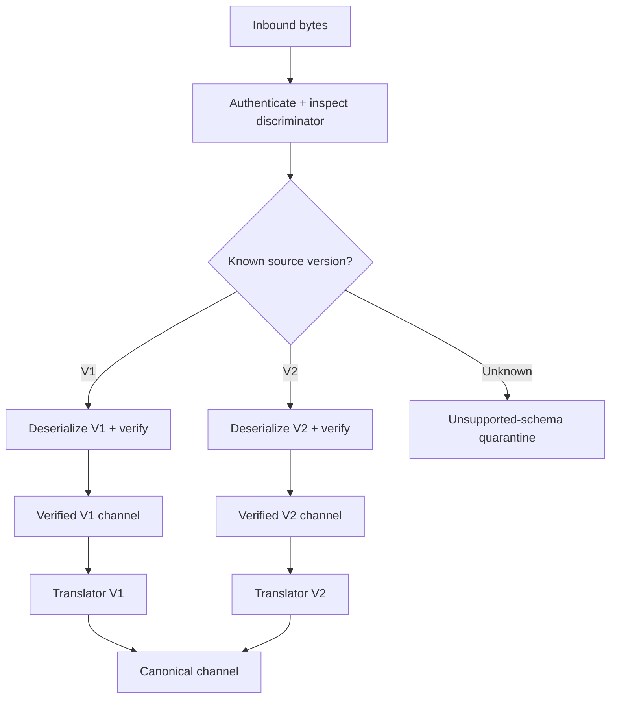
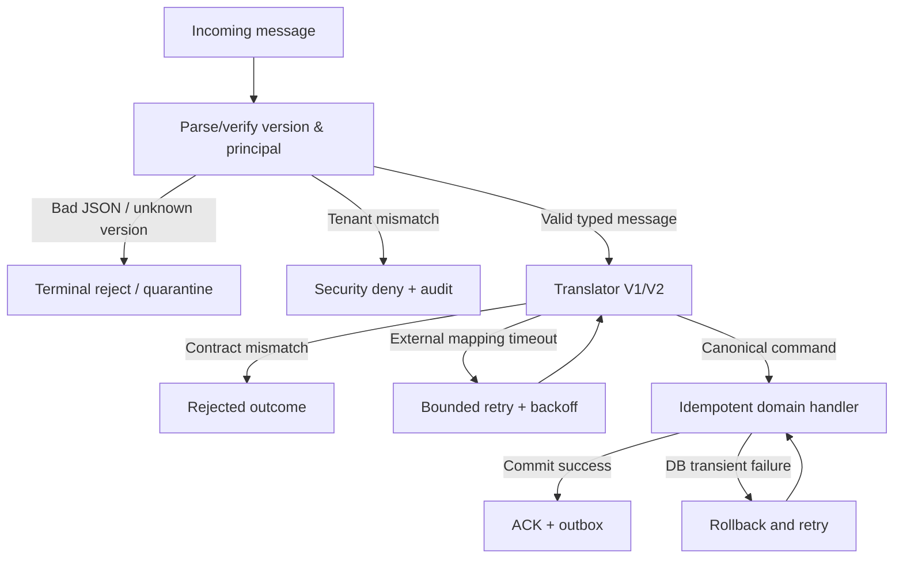

# Translator cho schema version khác nhau

## 1. Bài toán: một sự kiện nghiệp vụ, nhiều phiên bản schema

Một dịch vụ xử lý đơn hàng được kết nối với hai nhóm producer. Hệ thống cũ vẫn phát sự kiện `OrderPlaced` theo **schema V1**, trong khi hệ thống mới đã triển khai **schema V2**. Cả hai cùng biểu diễn hành động tạo đơn, nhưng cấu trúc trường và kiểu dữ liệu khác nhau.

Ví dụ một thông điệp V1:

```json
{
  "schemaVersion": 1,
  "metadata": {
    "tenantId": "tenant-a",
    "eventId": "evt-web-105",
    "occurredAt": "2026-11-21T04:00:00Z"
  },
  "order": {
    "orderRef": "WEB-105",
    "items": [
      {
        "sku": "SKU-A",
        "quantityText": "2",
        "unitPriceVnd": "25000"
      }
    ],
    "totalVnd": "50000"
  }
}
```

Một thông điệp V2 mang cùng nội dung nghiệp vụ nhưng với cách tổ chức khác:

```json
{
  "schemaVersion": 2,
  "context": {
    "tenant": "tenant-a",
    "idempotencyEventKey": "evt-web-105",
    "occurredAtOffset": "2026-11-21T11:00:00+07:00"
  },
  "purchase": {
    "purchaseId": "WEB-105",
    "lines": [
      {
        "productSku": "SKU-A",
        "units": 2,
        "unitPrice": {
          "currency": "VND",
          "minorUnits": 25000
        }
      }
    ],
    "declaredTotal": {
      "currency": "VND",
      "minorUnits": 50000
    }
  }
}
```

Nếu business service phải hiểu cả V1 và V2, nó sẽ có điều kiện `if(version==1)`/`if(version==2)` ở nhiều nơi. Một producer nâng cấp schema có thể kéo theo thay đổi ở Router, Filter, Service Activator, consumer, database mapper và các bài test nghiệp vụ.

**Message Translator** là pattern chuyển một cách biểu diễn message sang một biểu diễn khác để hai thành phần với những hợp đồng khác nhau có thể giao tiếp. Trong bài này, translator nhận các **schema version nguồn khác nhau** và tạo một **canonical application command** chung, trước khi đưa vào các bước xử lý nghiệp vụ.

Trong chương **Message translator** của module **SPRING_INTEGRATION_PATTERN**, người học triển khai Enterprise Integration Patterns bằng Spring Integration để xây dựng các luồng thông điệp ít phụ thuộc, dễ mở rộng. Chủ đề liên quan đến Router, Filter, Transformer, Splitter, Aggregator, Gateway, retry, error channel và correlation, đồng thời cần kiểm thử và quan sát nhiều nhánh xử lý.



**Mục tiêu:** Giữ sự khác biệt schema ở tầng tích hợp, đồng thời **không che giấu những thay đổi thực sự về ngữ nghĩa**, như chuyển tiền tệ, thay định danh sự kiện hoặc sửa cách tính tổng.

## 2. Translator khác Transformer, Normalizer, Converter và Upcaster

| Khái niệm | Trách nhiệm | Trong bài này |
| --- | --- | --- |
| **Message Translator** | Chuyển hợp đồng dữ liệu A thành B giữa hai thành phần | V1/V2 → `CanonicalCreateOrder` |
| **Message Transformer** | Endpoint/cơ chế biến payload hoặc message trong Spring Integration | Công cụ triển khai translator |
| **Normalizer** | Nhiều định dạng đầu vào hội tụ về một cấu trúc chung | Toàn bộ sơ đồ V1+V2 có đặc điểm Normalizer |
| **Message Converter** | Chuyển bytes/JSON/Avro/Protobuf thành Java object hoặc ngược lại | Deserialize V1/V2 trước bước dịch |
| **Schema Upcaster** | Nâng representation cũ lên representation mới theo rule versioned | Có thể dùng V1 → V2 nếu semantics bảo toàn |
| **Envelope Wrapper** | Thêm/bóc thông tin đóng gói quanh payload | Lớp schemaVersion/context ở biên message |
| **Content Enricher** | Bổ sung thông tin từ nguồn khác | Tra catalog SKU nếu hợp đồng cần |
| **Content-Based Router** | Chọn nhánh theo type/version/content | Chọn translator V1 hay V2 |
| **Idempotent Receiver** | Tránh side effect lặp với cùng logical event | Chạy **sau** translation/validation |

Không bắt buộc mọi phiên bản phải đi qua một “upcaster chain”. Với hai schema đơn giản, hai translator độc lập về cùng command dễ đọc. Với nhiều phiên bản và semantics tương thích, có thể cân nhắc pipeline `V1 → V2 → V3 → Canonical`, nhưng mỗi bước phải có hợp đồng test và chính sách lỗi rõ ràng.

### 2.1. Translation không phải sửa dữ liệu tùy ý

Dịch `quantityText="2"` thành `quantity=2` là chuyển kiểu có nghĩa nếu contract nguồn định nghĩa số nguyên dương.

Ngược lại, các phép sau **không nên được âm thầm thực hiện**:
- `quantityText="two" → 2` bằng cách đoán ngôn ngữ.
- `currency="USD" → "VND"` mà không có tỷ giá và thời điểm quy đổi.
- `occurredAtOffset` thiếu timezone → dùng timezone máy chủ.
- `eventId=null → random UUID` khi retry cùng sự kiện.
- `totalVnd` không khớp các dòng → tự sửa tổng mà không báo lỗi.
- Schema V2 đổi ý nghĩa `purchaseId` mà vẫn coi đó là `orderRef` V1.

Translator phải **giữ nguyên ý nghĩa** hoặc từ chối khi không thể chuyển đổi một cách an toàn.

### 2.2. Canonical model là hợp đồng của một phạm vi, không phải toàn doanh nghiệp

Đích của translator nên là một command phù hợp với **bounded context xử lý đơn hàng**, không nhất thiết là một schema khổng lồ áp dụng cho mọi service. Nếu domain thanh toán cần currency đa dạng, có thể dùng `Money` đầy đủ; ví dụ này chỉ minh họa đơn hàng **bằng VND nguyên đơn vị** để giữ phép tính minh bạch.

## 3. Schema version là một discriminator phải được xác minh

Trước khi dịch, adapter phải biết **payload đang tuân theo schema nào**. Discriminator có thể nằm trong JSON envelope, header broker, content type, schema registry ID hoặc thuộc một endpoint chuyên biệt. Nguồn xác định version phải có hợp đồng rõ và được đối chiếu với bytes thực tế.



**Không nên** thử parse vào V1, bắt exception, rồi thử V2 cho tới khi một kiểu tình cờ không lỗi. Một JSON V2 có thể deserialize một phần vào DTO V1 với các field null/default, khiến message bị hiểu nhầm.

### 3.1. Khác biệt giữa source version và canonical version

Một message có thể mang:

```text
sourceSchemaVersion     = 1
canonicalContractVersion = 3
translationRuleVersion  = "order-v1-to-canonical-v3/r4"
```

Ý nghĩa:
- `sourceSchemaVersion`: producer đã gửi hợp đồng gì.
- `canonicalContractVersion`: downstream đang đọc command/model phiên bản nào.
- `translationRuleVersion`: phiên bản rule ánh xạ để có thể giải thích/replay.

Ba giá trị **không phải** cùng một con số và không được thay thế cho event ID hoặc message ID. Trong ví dụ Java, command lưu `sourceSchemaVersion`. Nếu production có nhiều bản rule/contract cùng hoạt động, lưu thêm mapping rule revision tại audit/inbox hoặc source metadata đã chuẩn hóa.

### 3.2. Những thay đổi nào thực sự tương thích?

| Thay đổi nguồn | Có thể dịch bảo toàn nghĩa? | Điều kiện |
| --- | --- | --- |
| Đổi `orderRef` thành `purchaseId` | Có | Ý nghĩa identity không đổi |
| `quantityText="2"` thành integer `2` | Có | Cùng miền giá trị, parser reject sai |
| Timestamp từ UTC sang offset ISO | Có | Cùng instant, đủ thông tin timezone |
| Tiền VND nguyên từ String sang long | Có | Kiểm soát overflow và currency |
| Thêm field optional mới | Có thể | Không thay semantics của field cũ |
| Đổi `eventId` từ ID sự kiện sang ID delivery | **Không mặc nhiên** | Phá idempotency nếu không có key mới |
| Đổi `unitPrice` từ VND sang USD cents | **Breaking** | Cần chính sách conversion/contract mới |
| Đổi `orderRef` từ unique toàn tenant sang unique trong ngày | **Breaking** | Cần thêm scope/version |
| V2 tổng tiền gồm thuế, V1 chưa gồm thuế | **Breaking** | Không gộp vào cùng `totalVnd` thiếu thông tin |

Schema registry có thể phát hiện các thay đổi **cấu trúc** theo chính sách compatibility, nhưng không tự bảo đảm những thay đổi về **ngữ nghĩa nghiệp vụ** đã an toàn.

## 4. Models nguồn V1 và V2 trong Java

Ví dụ sử dụng Java 17 records. Đây là DTOs mô tả payload **đã deserialize**, chưa có nghĩa là đã xác thực tenant/source hay thỏa business rule.

### 4.1. DTO cho V1

```java
import java.util.List;

record OrderMetadataV1(
        String tenantId,
        String eventId,
        String occurredAt) {}

record OrderLineV1(
        String sku,
        String quantityText,
        String unitPriceVnd) {}

record OrderDataV1(
        String orderRef,
        List<OrderLineV1> items,
        String totalVnd) {}

record OrderEventV1(
        int schemaVersion,
        OrderMetadataV1 metadata,
        OrderDataV1 order) {}
```

V1 lưu số lượng và tiền dưới dạng chuỗi. Không tự giả định parser có thể chấp nhận `"2.0"`, `"25,000"` hoặc dấu phẩy theo locale nếu hợp đồng chỉ cho phép integer decimal text.

### 4.2. DTO cho V2

```java
import java.util.List;

record MoneyV2(
        String currency,
        long minorUnits) {}

record OrderContextV2(
        String tenant,
        String idempotencyEventKey,
        String occurredAtOffset) {}

record OrderLineV2(
        String productSku,
        int units,
        MoneyV2 unitPrice) {}

record OrderPurchaseV2(
        String purchaseId,
        List<OrderLineV2> lines,
        MoneyV2 declaredTotal) {}

record OrderEventV2(
        int schemaVersion,
        OrderContextV2 context,
        OrderPurchaseV2 purchase) {}
```

Sự xuất hiện của `MoneyV2` khiến currency **tường minh**. Dù tên `minorUnits` được dùng trong V2, theo contract ví dụ `VND` có đơn vị nguyên (0 chữ số thập phân); không mặc định mọi currency đều có 2 decimals. Translator chỉ chấp nhận `VND` để khớp canonical model của bài.

### 4.3. Không ép mọi version vào một DTO quá nhiều null

Phản mẫu:

```java
record OrderEventAnyVersion(
        String orderRef,
        String purchaseId,
        String quantityText,
        Integer units,
        String unitPriceVnd,
        MoneyV2 unitPrice,
        String eventId,
        String idempotencyEventKey,
        Integer schemaVersion) {}
```

Khi các trường optional tăng, mapper phải đoán “nếu orderRef null thì chắc là V2”. Một payload malformed có thể vô tình bị hiểu thành version khác. **Typed DTO riêng theo version** giúp nhánh dịch không bị lệ thuộc vào các giá trị null để đoán schema.

## 5. Canonical command: một đích chung, không mang DTO nguồn

Ta định nghĩa command mà application service xử lý. Những phần nghiệp vụ **chung giữa V1 và V2** đều có kiểu rõ:

```text
CanonicalCreateOrder
  tenantId              String
  sourceEventId         String
  sourceSchemaVersion   int
  orderId               String
  occurredAt            Instant
  lines                 List<CanonicalLine>
  totalVnd              long
```

### 5.1. Immutable records với invariants

```java
import java.time.Instant;
import java.util.List;
import java.util.Objects;

record CanonicalLine(
        String sku,
        int quantity,
        long unitPriceVnd) {

    CanonicalLine {
        if (sku == null
                || !sku.matches("[A-Z0-9-]{1,32}")
                || quantity <= 0
                || unitPriceVnd < 0) {
            throw new IllegalArgumentException(
                    "INVALID_CANONICAL_LINE");
        }
    }

    long lineTotalVnd() {
        return Math.multiplyExact(
                (long) quantity, unitPriceVnd);
    }
}

record CanonicalCreateOrder(
        String tenantId,
        String sourceEventId,
        int sourceSchemaVersion,
        String orderId,
        Instant occurredAt,
        List<CanonicalLine> lines,
        long totalVnd) {

    CanonicalCreateOrder {
        if (tenantId == null || tenantId.isBlank()
                || sourceEventId == null || sourceEventId.isBlank()
                || sourceSchemaVersion < 1
                || orderId == null || orderId.isBlank()
                || occurredAt == null
                || lines == null || lines.isEmpty()
                || lines.size() > 1000) {
            throw new IllegalArgumentException(
                    "INVALID_CANONICAL_ORDER");
        }

        lines = List.copyOf(lines);
        long expected = 0L;
        for (CanonicalLine line : lines) {
            Objects.requireNonNull(line, "line");
            expected = Math.addExact(
                    expected, line.lineTotalVnd());
        }
        if (totalVnd != expected) {
            throw new IllegalArgumentException(
                    "CANONICAL_TOTAL_MISMATCH");
        }
    }
}
```

Những quyết định quan trọng:

1. `occurredAt` dùng `Instant` để biểu thị thời điểm thực, không phụ thuộc timezone máy chủ.
2. `totalVnd` là số nguyên VND; `Math.multiplyExact` và `Math.addExact` không âm thầm overflow.
3. `List.copyOf` giữ snapshot; nested records chỉ chứa immutable primitives/String.
4. `sourceSchemaVersion` giúp truy vết nguồn, không phải “phiên bản domain entity”.
5. `sourceEventId` là logical event identity **ổn định qua redelivery**, không dùng `MessageHeaders.ID` thay thế.
6. Tổng khai báo của nguồn phải khớp tổng tính từ lines; nếu không khớp, translator **từ chối** thay vì tự sửa số tiền.
7. Constructor kiểm tra tính nhất quán dữ liệu nhưng không xác minh **giá bán có được phép** hay không; đó là trách nhiệm business authorization/pricing service.

### 5.2. Domain port nhận một kiểu duy nhất

```java
interface OrderApplicationService {
    void createOrder(CanonicalCreateOrder order);
}
```

Domain/application service không import `OrderEventV1`, `OrderEventV2`, `MoneyV2`, raw JSON node hoặc Kafka headers. Producer thêm V3 (nếu biểu diễn được cùng contract) sẽ cần translator mới chứ không bắt mọi business handler đổi theo.

## 6. Ranh giới tin cậy: typed verified input

Trước khi translate, adapter phải xác thực nguồn gửi và đối chiếu tenant. Một đối tượng V1/V2 có thể chứa `tenantId` do client tự khai; nó không tự chứng minh quyền của người gửi.

Trong ví dụ, ta diễn tả kết quả đã kiểm tra bằng hai kiểu:

```java
record VerifiedOrderV1(
        OrderEventV1 wire,
        String authorizedTenantId) {}

record VerifiedOrderV2(
        OrderEventV2 wire,
        String authorizedTenantId) {}
```

**Đây chỉ là mô hình của internal validated context.** Một class record có thể được khởi tạo trực tiếp; bản thân kiểu Java không phải chữ ký hay chứng chỉ xác thực. Chỉ một inbound adapter/guard đã dùng transport principal, mTLS/broker ACL/signed webhook thích hợp được phép đưa dữ liệu vào verified channels.

### 6.1. Kiểm tra tenant từ identity đã xác thực

```java
import java.util.Objects;

final class VerifiedOrderFactory {

    VerifiedOrderV1 verifyV1(
            OrderEventV1 event, String authenticatedTenant) {
        Objects.requireNonNull(event, "event");
        if (authenticatedTenant == null
                || authenticatedTenant.isBlank()
                || event.metadata() == null
                || !authenticatedTenant.equals(
                        event.metadata().tenantId())) {
            throw new SecurityException(
                    "TENANT_IDENTITY_MISMATCH");
        }
        return new VerifiedOrderV1(event, authenticatedTenant);
    }

    VerifiedOrderV2 verifyV2(
            OrderEventV2 event, String authenticatedTenant) {
        Objects.requireNonNull(event, "event");
        if (authenticatedTenant == null
                || authenticatedTenant.isBlank()
                || event.context() == null
                || !authenticatedTenant.equals(
                        event.context().tenant())) {
            throw new SecurityException(
                    "TENANT_IDENTITY_MISMATCH");
        }
        return new VerifiedOrderV2(event, authenticatedTenant);
    }
}
```

`authenticatedTenant` **phải do adapter lấy từ nguồn tin cậy**, không gọi `verifyV1(event, event.metadata().tenantId())` rồi tự tuyên bố message đã xác thực.

### 6.2. Version và kiểu payload cần khớp

Nếu `OrderEventV1.schemaVersion() != 1` hoặc `OrderEventV2.schemaVersion() != 2`, translator phải từ chối. Không để V2 được serialize vào kiểu V1 rồi bypass phân loại version. Ở public boundary, hệ thống cần vừa **xác thực discriminator** vừa **xác thực nội dung tương ứng với schema**.

## 7. Hợp đồng lỗi translation

Một message không thể dịch phải có **mã lỗi ổn định** để quyết định reject/quarantine/retry, không cần dò một phần exception message chứa raw payload.

```java
final class TranslationContractException
        extends IllegalArgumentException {

    private final String reasonCode;

    TranslationContractException(String reasonCode) {
        super(reasonCode);
        this.reasonCode = reasonCode;
    }

    String reasonCode() {
        return reasonCode;
    }
}
```

| Lỗi | Mã gợi ý | Phân loại |
| --- | --- | --- |
| Version không hỗ trợ | `UNSUPPORTED_SCHEMA_VERSION` | Terminal/quarantine |
| Trường bắt buộc thiếu | `REQUIRED_FIELD_MISSING` | Data contract |
| Quantity V1 không parse được | `V1_QUANTITY_INVALID` | Data contract |
| Currency V2 không phải VND | `UNSUPPORTED_CURRENCY` | Semantic contract |
| Timestamp thiếu offset | `TIMESTAMP_INVALID` | Data contract |
| Tổng tiền không khớp | `TOTAL_MISMATCH` | Semantic contract |
| Giá vượt long | `AMOUNT_OUT_OF_RANGE` | Data contract |
| Source/tenant mismatch | `TENANT_IDENTITY_MISMATCH` | Security failure |
| Directory DB timeout | Không quy về bad input | Transient infrastructure |
| Unknown source/producer | Không quy về bad schema đơn thuần | Security/contract |

**Không bắt tất cả `RuntimeException` rồi biến thành `TranslationContractException`.** Một `DataAccessException` hoặc network timeout là tình huống có thể phục hồi, còn một `NullPointerException` bất ngờ là lỗi lập trình. Trộn tất cả vào data-invalid sẽ dẫn tới ACK sai và mất message.

## 8. Translator V1: parse chặt và bảo toàn identity

V1 dùng số lượng và số tiền dưới dạng chuỗi. Translator cần kiểm tra đúng version, parse có kiểm soát, giữ event ID nguồn và đối chiếu tổng khai báo.

### 8.1. Helper cho các phép dịch

```java
import java.time.Instant;
import java.util.List;

final class TranslationRules {
    private TranslationRules() {}

    static int positiveQuantity(String raw) {
        try {
            int value = Integer.parseInt(raw);
            if (value <= 0) {
                throw new NumberFormatException();
            }
            return value;
        } catch (NumberFormatException ex) {
            throw new TranslationContractException(
                    "V1_QUANTITY_INVALID");
        }
    }

    static long nonnegativeVnd(String raw, String code) {
        try {
            long value = Long.parseLong(raw);
            if (value < 0) {
                throw new NumberFormatException();
            }
            return value;
        } catch (NumberFormatException ex) {
            throw new TranslationContractException(code);
        }
    }

    static CanonicalCreateOrder command(
            String tenantId, String eventId, int version,
            String orderId, Instant occurredAt,
            List<CanonicalLine> lines, long declaredTotal) {
        try {
            return new CanonicalCreateOrder(
                    tenantId, eventId, version, orderId,
                    occurredAt, lines, declaredTotal);
        } catch (ArithmeticException ex) {
            throw new TranslationContractException(
                    "AMOUNT_OUT_OF_RANGE");
        } catch (IllegalArgumentException ex) {
            throw new TranslationContractException(
                    "TOTAL_OR_CANONICAL_INVARIANT_INVALID");
        }
    }
}
```

Các phép `parseInt`/`parseLong` không “sửa” chuỗi số không hợp lệ. Nếu producer chính thức cho phép phân cách/thập phân theo locale, hãy bổ sung parser versioned có test; không tự lấy quy tắc locale mặc định của JVM.

### 8.2. Code V1OrderTranslator

```java
import java.time.Instant;
import java.time.format.DateTimeParseException;
import java.util.ArrayList;
import org.springframework.stereotype.Component;

@Component
final class V1OrderTranslator {

    CanonicalCreateOrder translate(VerifiedOrderV1 verified) {
        if (verified == null || verified.wire() == null
                || verified.authorizedTenantId() == null) {
            throw new TranslationContractException(
                    "VERIFIED_V1_MISSING");
        }

        OrderEventV1 wire = verified.wire();
        if (wire.schemaVersion() != 1) {
            throw new TranslationContractException(
                    "UNSUPPORTED_SCHEMA_VERSION");
        }

        OrderMetadataV1 meta = wire.metadata();
        OrderDataV1 order = wire.order();
        if (meta == null || order == null
                || blank(meta.eventId())
                || blank(meta.occurredAt())
                || blank(order.orderRef())
                || blank(order.totalVnd())
                || order.items() == null
                || order.items().isEmpty()
                || order.items().size() > 1000) {
            throw new TranslationContractException(
                    "REQUIRED_FIELD_MISSING");
        }

        if (!verified.authorizedTenantId().equals(
                meta.tenantId())) {
            throw new SecurityException(
                    "TENANT_IDENTITY_MISMATCH");
        }

        Instant occurredAt;
        try {
            occurredAt = Instant.parse(meta.occurredAt());
        } catch (DateTimeParseException ex) {
            throw new TranslationContractException(
                    "TIMESTAMP_INVALID");
        }

        var lines = new ArrayList<CanonicalLine>();
        for (OrderLineV1 item : order.items()) {
            if (item == null || blank(item.sku())
                    || blank(item.quantityText())
                    || blank(item.unitPriceVnd())) {
                throw new TranslationContractException(
                        "V1_LINE_MISSING_FIELD");
            }
            int quantity = TranslationRules.positiveQuantity(
                    item.quantityText());
            long unitPrice = TranslationRules.nonnegativeVnd(
                    item.unitPriceVnd(), "V1_PRICE_INVALID");

            try {
                lines.add(new CanonicalLine(
                        item.sku(), quantity, unitPrice));
            } catch (IllegalArgumentException ex) {
                throw new TranslationContractException(
                        "V1_LINE_INVALID");
            }
        }

        long declaredTotal = TranslationRules.nonnegativeVnd(
                order.totalVnd(), "V1_TOTAL_INVALID");

        return TranslationRules.command(
                verified.authorizedTenantId(),
                meta.eventId(), 1, order.orderRef(),
                occurredAt, lines, declaredTotal);
    }

    private static boolean blank(String text) {
        return text == null || text.isBlank();
    }
}
```

**Không làm mất business identity:** Một producer retry cùng V1 event phải tiếp tục dùng `meta.eventId()` cũ. Không dùng `MessageHeaders.ID` mới sinh ở mỗi delivery attempt thay cho giá trị đó.

**Không hợp thức hóa dữ liệu sai:** Translator dùng `declaredTotal` do nguồn khai, rồi constructor canonical so sánh với tổng các dòng. Trường sai phải có error outcome, không được silently thay bằng kết quả tính lại.

## 9. Translator V2: Money và thời gian có offset

V2 cung cấp quantity nguyên và kiểu Money. Điểm khó không phải parse, mà là **diễn giải đúng đơn vị**.

### 9.1. Chỉ nhận tiền VND theo contract của bài

```java
final class MoneyV2Translator {
    private MoneyV2Translator() {}

    static long requireVnd(MoneyV2 money) {
        if (money == null
                || !"VND".equals(money.currency())) {
            throw new TranslationContractException(
                    "UNSUPPORTED_CURRENCY");
        }
        if (money.minorUnits() < 0) {
            throw new TranslationContractException(
                    "V2_AMOUNT_INVALID");
        }
        return money.minorUnits();
    }
}
```

Nếu V2 mở rộng USD/EUR, không biến giá USD cents thành VND nguyên bằng phép ép kiểu. Một phiên bản canonical mới có thể cần `Money(currency,minorUnits)` và business conversion policy rõ ràng.

### 9.2. Code V2OrderTranslator

```java
import java.time.Instant;
import java.time.OffsetDateTime;
import java.time.format.DateTimeParseException;
import java.util.ArrayList;
import org.springframework.stereotype.Component;

@Component
final class V2OrderTranslator {

    CanonicalCreateOrder translate(VerifiedOrderV2 verified) {
        if (verified == null || verified.wire() == null
                || verified.authorizedTenantId() == null) {
            throw new TranslationContractException(
                    "VERIFIED_V2_MISSING");
        }

        OrderEventV2 wire = verified.wire();
        if (wire.schemaVersion() != 2) {
            throw new TranslationContractException(
                    "UNSUPPORTED_SCHEMA_VERSION");
        }

        OrderContextV2 context = wire.context();
        OrderPurchaseV2 purchase = wire.purchase();
        if (context == null || purchase == null
                || blank(context.idempotencyEventKey())
                || blank(context.occurredAtOffset())
                || blank(purchase.purchaseId())
                || purchase.lines() == null
                || purchase.lines().isEmpty()
                || purchase.lines().size() > 1000) {
            throw new TranslationContractException(
                    "REQUIRED_FIELD_MISSING");
        }

        if (!verified.authorizedTenantId().equals(
                context.tenant())) {
            throw new SecurityException(
                    "TENANT_IDENTITY_MISMATCH");
        }

        Instant occurredAt;
        try {
            occurredAt = OffsetDateTime.parse(
                    context.occurredAtOffset()).toInstant();
        } catch (DateTimeParseException ex) {
            throw new TranslationContractException(
                    "TIMESTAMP_INVALID");
        }

        var lines = new ArrayList<CanonicalLine>();
        for (OrderLineV2 item : purchase.lines()) {
            if (item == null || blank(item.productSku())
                    || item.units() <= 0) {
                throw new TranslationContractException(
                        "V2_LINE_INVALID");
            }

            long unitPrice =
                    MoneyV2Translator.requireVnd(item.unitPrice());

            try {
                lines.add(new CanonicalLine(
                        item.productSku(),
                        item.units(), unitPrice));
            } catch (IllegalArgumentException ex) {
                throw new TranslationContractException(
                        "V2_LINE_INVALID");
            }
        }

        long total = MoneyV2Translator.requireVnd(
                purchase.declaredTotal());

        return TranslationRules.command(
                verified.authorizedTenantId(),
                context.idempotencyEventKey(),
                2, purchase.purchaseId(),
                occurredAt, lines, total);
    }

    private static boolean blank(String text) {
        return text == null || text.isBlank();
    }
}
```

Với hai ví dụ đầu bài, V1 timestamp `2026-11-21T04:00:00Z` và V2 timestamp `2026-11-21T11:00:00+07:00` là cùng một `Instant`. Không dùng timezone của server hoặc coi offset chỉ là chuỗi trang trí.

### 9.3. Một translator không nên phụ thuộc side effect

Không trừ kho, ghi invoice, gửi email hay gọi payment API trong `translate`. Tốt nhất translator chỉ chuyển đổi và validate giá trị; nếu cần tra SKU mapping, ưu tiên read-only service có version và phân biệt lỗi mapping thiếu với outage. Transaction/domain side effects đặt **sau khi** command đã được tạo thành công.

## 10. Java DSL: hai phiên bản hội tụ về một domain handler

Spring Integration cho phép dùng Transformer cho từng kiểu input, rồi chuyển cả hai nhánh vào channel chung.

```java
import org.springframework.context.annotation.Bean;
import org.springframework.context.annotation.Configuration;
import org.springframework.integration.channel.DirectChannel;
import org.springframework.integration.config.EnableIntegration;
import org.springframework.integration.dsl.IntegrationFlow;
import org.springframework.messaging.MessageChannel;

@Configuration
@EnableIntegration
class VersionedOrderIntegrationFlows {

    @Bean("orders.v1.verified")
    MessageChannel v1Input() {
        return new DirectChannel();
    }

    @Bean("orders.v2.verified")
    MessageChannel v2Input() {
        return new DirectChannel();
    }

    @Bean("orders.canonical")
    MessageChannel canonicalInput() {
        return new DirectChannel();
    }

    @Bean
    IntegrationFlow v1Flow(V1OrderTranslator translator) {
        return IntegrationFlow.from("orders.v1.verified")
                .transform(VerifiedOrderV1.class,
                        translator::translate)
                .channel("orders.canonical")
                .get();
    }

    @Bean
    IntegrationFlow v2Flow(V2OrderTranslator translator) {
        return IntegrationFlow.from("orders.v2.verified")
                .transform(VerifiedOrderV2.class,
                        translator::translate)
                .channel("orders.canonical")
                .get();
    }

    @Bean
    IntegrationFlow canonicalOrderFlow(
            OrderApplicationService service) {
        return IntegrationFlow.from("orders.canonical")
                .handle(CanonicalCreateOrder.class,
                        (command, headers) -> {
                            service.createOrder(command);
                            return null; // one-way handler
                        })
                .get();
    }
}
```

Ở ví dụ này:
- Adapter/guard đã xác thực và deserialize V1 gửi `VerifiedOrderV1` vào `orders.v1.verified`.
- Adapter/guard cho V2 gửi `VerifiedOrderV2` vào `orders.v2.verified`.
- Mỗi translator tạo `CanonicalCreateOrder`.
- Cả hai phát tới `orders.canonical`.
- Domain service có **một** API, không cần biết tên field V1/V2.

Java DSL được viết theo phong cách các phiên bản Spring Integration hiện đại; chính xác overload trong build dự án cần được xác minh ở bước QA/compile sau này. `DirectChannel` minh họa flow đồng bộ trong một JVM, **không phải durable queue**. Nếu chuyển sang broker/executor, ACK, retry và error handling cần được thiết kế riêng.

### 10.1. Hợp lưu không phải Aggregator

Hai translators gửi tới một channel **không có nghĩa** hai messages sẽ được gộp lại. Mỗi event đi vào domain handler riêng. Nếu muốn gom hàng loạt child messages, cần Aggregator có correlation/release strategy, không chỉ nối cả hai vào một channel.

### 10.2. Gateway request–reply cần một reply path

Flow `canonicalOrderFlow` trả `null` và domain port là `void`, nên đây là **one-way**. Nếu một `MessagingGateway` đang chờ kết quả, phải xây service trả typed result và thiết kế cả success/rejection reply path. Một Filter âm thầm loại V1 malformed có thể làm Gateway timeout thay vì nhận lỗi validation có nghĩa.

### 10.3. Route schemaVersion ở adapter, không cast mù



Không dựa vào một header `schemaVersion=2` do caller tự gắn rồi cast `(OrderEventV2) message.getPayload()`. Schema type/discriminator phải được kiểm tra cùng bytes/serializer hợp đồng. Khi vắng version, không thử mọi parser rồi dùng phiên bản nào “tình cờ parse được”.

## 11. Correlation, headers và stable event identity

Một message đi qua integration flow có thể có:
- `sourceEventId`: logical event ID nghiệp vụ ổn định;
- `orderId`: mã entity đơn hàng;
- `sourceSchemaVersion`: biểu diễn dữ liệu của producer;
- `MessageHeaders.ID`: ID envelope có thể đổi;
- `CORRELATION_ID`: group ID của Splitter/Aggregator hoặc request flow;
- `traceId`: observability context;
- `REPLY_CHANNEL`/`ERROR_CHANNEL`: vị trí reply/lỗi của Spring messaging.

**Schema version không phải event identity.** Nếu producer redeliver cùng logical event bằng V2 sau lần đầu V1, consumer idempotent có thể cần coi chúng là **cùng event** khi business facts giống nhau.

### 11.1. Một idempotency key rõ scope

```java
record OrderIdempotencyKey(
        String consumerName,
        String tenantId,
        String sourceSystem,
        String sourceEventId) {}
```

`sourceSystem` phải lấy từ identity đã xác thực; nếu các producers có vùng ID khác nhau mà bỏ nguồn, hai event cùng `eventId` có thể bị nhận nhầm trùng. Nếu đảm bảo eventId unique toàn tenant, field nguồn có thể không cần; **hợp đồng phải nói rõ**.

Không đưa `sourceSchemaVersion` vào key chỉ để tránh trùng khi V1 và V2 cùng mô tả một logical event: như vậy cùng operation có thể chạy hai lần. Nếu V2 thực sự là **business revision mới**, cần event identity/revision mới có chủ đích.

### 11.2. Duplicate khác key conflict

Khi cùng key đã được xử lý:
- V1 `quantityText="2"` và V2 `units=2`, cùng giá, cùng timestamp theo instant → có thể là duplicate hợp lệ.
- V2 cùng event ID nhưng quantity=3 → **same key, different business content**, cần conflict/reconciliation.
- V2 khác offset string nhưng cùng instant → không nhất thiết là dữ liệu khác về nghĩa.
- Nếu catalog/tỷ giá version đổi giữa attempts, canonical result có thể đổi; cần mapping snapshot/version cho replay.

Một canonical fingerprint phải có quy tắc stable encoding cho field, collection ordering và money/time semantics; không hash một `toString()` tùy ý để quyết định duplicate.

### 11.3. Header propagation phải được kiểm soát

Một Transformer tạo payload mới nhưng Spring Integration có thể giữ nhiều headers nguồn. Điều đó hữu ích cho tracing, nhưng rủi ro khi source header không đáng tin.

| Header | Chính sách |
| --- | --- |
| Tenant/source header | So khớp với authenticated context |
| Business event ID | Derive/đối chiếu với canonical command |
| `MessageHeaders.ID` | Không dùng làm logical eventId |
| `CORRELATION_ID` | Giữ nếu group semantics đúng |
| `SEQUENCE_NUMBER/SIZE` | Bảo toàn khi Splitter/Aggregator cần |
| `REPLY_CHANNEL` | Giữ đúng Gateway request–reply flow |
| `ERROR_CHANNEL` | Theo error handling contract |
| Trace context | Propagate qua tracing policy |
| Schema version | Giữ vào audit/trace metadata phù hợp |
| Raw credential / token | Không copy qua kênh không cần |

Đặc biệt tránh `copyHeaders(input.getHeaders())` không chọn lọc khi phát message ra external broker. Nên dùng allowlist/mapper chủ động và test output message sau các adapter boundaries.

## 12. Những giới hạn khi retry và replay schema cũ

Một event V1 có thể ở DLQ nhiều ngày, trong khi consumer đã chuyển sang V2. Khi replay, phải biết:
1. Parser V1 còn được hỗ trợ hay không?
2. Translator V1 → canonical vẫn dùng semantics đã ký hợp đồng?
3. Mapping SKU và pricing rules có đổi?
4. Bản command/fingerprint lần đầu có được lưu để so sánh?
5. DLQ và pending status còn sống trong retention window không?
6. Downstream idempotency có ngăn side effect lặp sau ACK loss không?

**Không nhất thiết luôn dùng mapping mới nhất khi replay.** Với tài chính/tồn kho, nên có rule revision hoặc snapshot để giải thích vì sao cùng input cho cùng kết quả.

| Tình huống | Loại lỗi | Policy |
| --- | --- | --- |
| `schemaVersion=99` | Unsupported version | Quarantine/terminal reject |
| V1 `quantityText="two"` | Malformed data | Reject, không hot-retry |
| V2 `currency="USD"` | Semantic unsupported | Reject hoặc translator hợp đồng mới |
| `eventId` bị thiếu | Identity contract invalid | Không tự tạo eventId cho same logical event |
| Tenant mismatch | Security | Deny và audit |
| Catalog database timeout | Transient dependency | Bounded retry/backoff |
| Business DB deadlock | Transient transaction | Rollback/retry |
| Gateway timeout | Request/reply liveness | Không coi là rollback side effect |

## 13. Thiết kế schema evolution và chuyển đổi không mất nghĩa

Không phải mọi thay đổi giữa V1 và V2 đều là “đổi tên field”. Một chiến lược nâng cấp schema cần tách **compatibility ở cấu trúc**, **compatibility ở semantics** và **compatibility ở vận hành**.

### 13.1. Ba kiểu thay đổi

| Kiểu | Ví dụ | Cách đánh giá |
| --- | --- | --- |
| **Tương thích biểu diễn** | V1 String `"2"` → V2 int `2` | Có thể translate nếu miền giá trị giống |
| **Tương thích có điều kiện** | V2 thêm `discountCode` optional | Downstream có cần áp dụng giảm giá không? |
| **Không tương thích ngữ nghĩa** | V2 total có thuế, V1 total chưa thuế | Cần canonical contract/rule mới |

Các thay đổi cần xem như breaking: đổi đơn vị tiền, đổi timezone assumption, đổi identity scope, đổi ý nghĩa status hoặc bỏ field cần cho một invariant nghiệp vụ. Nếu không đủ thông tin để chuyển đổi lossless, **reject** hoặc nâng canonical contract, không điền giá trị mặc định do suy đoán.

### 13.2. Direct translators hay upcaster chain?

**Thiết kế A — Mỗi version có translator trực tiếp:**

```text
OrderEventV1 ---> V1OrderTranslator --+
                                      +---> CanonicalCreateOrder
OrderEventV2 ---> V2OrderTranslator --+
```

Ưu điểm: map rõ từng version, không phụ thuộc DTO của phiên bản trung gian. Phù hợp khi chỉ có một số versions hoặc cấu trúc khác nhau nhiều. Nhược điểm: có thể lặp quy tắc chung và cần bảo trì nhiều mapper.

**Thiết kế B — Upcaster chain:**

```text
OrderEventV1 -> UpcastV1ToV2 -> OrderEventV2
                                   |
OrderEventV2 ----------------------+
                                   v
                              CanonicalOrder
```

Ưu điểm: một canonical translator chính; dễ thêm phiên bản kế tiếp nếu upcast lossless. Rủi ro: khi V2 có field bắt buộc không suy ra được từ V1, upcaster có thể bịa giá trị, làm sai ngữ nghĩa hoặc âm thầm làm mất thông tin. Chain nhiều bước cũng làm debugging/replay khó hơn.

Chọn phương án theo số lượng versions, semantics và nhu cầu replay. Không dùng upcaster chain như một bằng chứng tất cả versions tương đương.

### 13.3. Quản lý ma trận hỗ trợ

Một bảng version trong tài liệu vận hành có thể ghi:

| Source schema | Translator | Canonical contract | Trạng thái |
| --- | --- | --- | --- |
| V1 | V1OrderTranslator | CanonicalCreateOrder V1 | Supported trong migration window |
| V2 | V2OrderTranslator | CanonicalCreateOrder V1 | Preferred |
| V3 | Chưa có | Chưa đánh giá | Rejected/quarantine |
| Legacy không có version | Legacy-specific adapter nếu được phê duyệt | Version được gán tường minh | Không fallback tùy ý |

Không tự dựa vào ngày deploy để đoán bản V1 hay V2. Hệ thống có thể có producer cũ, DLQ replay và bản sao message sống lâu. Ma trận cần được công bố trước khi tắt parser/translator cũ.

### 13.4. Đảm bảo kết quả dịch có thể giải thích

Lưu tối thiểu những metadata phù hợp với audit:

```text
sourceSchemaVersion   = 1
canonicalContract     = "create-order/1"
translatorRevision    = "v1-to-canonical/r3"
mappingRevision       = "catalog/2026-11"
logicalEventId        = "evt-web-105"
sourceSystem          = authenticated producer identity
canonicalFingerprint  = stable digest over business facts
```

Đây là trường **gợi ý ở tầng ứng dụng**; không mặc định Spring Integration sinh ra chúng. Nếu mapping SKU hoặc pricing rule thay đổi giữa replay, có thể dùng revision/snapshot để tái tạo quyết định ban đầu, thay vì chỉ báo “V1 translate khác V2”.

## 14. Kiểm thử unit cho V1/V2 và kiểm thử tương đương ngữ nghĩa

Mục tiêu test quan trọng là **hai phiên bản biểu diễn cùng business facts phải cho cùng các trường nghiệp vụ canonical**. Toàn bộ command có thể khác nhau tại `sourceSchemaVersion` — đó là đúng và có nghĩa.

### 14.1. Fixture typed cho hai phiên bản

```java
import java.util.List;

final class VersionedOrderFixtures {
    private VersionedOrderFixtures() {}

    static OrderEventV1 v1() {
        return new OrderEventV1(
                1,
                new OrderMetadataV1(
                        "tenant-a",
                        "evt-web-105",
                        "2026-11-21T04:00:00Z"),
                new OrderDataV1(
                        "WEB-105",
                        List.of(new OrderLineV1(
                                "SKU-A", "2", "25000")),
                        "50000"));
    }

    static OrderEventV2 v2() {
        return new OrderEventV2(
                2,
                new OrderContextV2(
                        "tenant-a",
                        "evt-web-105",
                        "2026-11-21T11:00:00+07:00"),
                new OrderPurchaseV2(
                        "WEB-105",
                        List.of(new OrderLineV2(
                                "SKU-A", 2,
                                new MoneyV2("VND", 25000))),
                        new MoneyV2("VND", 50000)));
    }
}
```

Fixture V1 và V2 mô tả cùng tenant, logical event, order ID, SKU, quantity, đơn giá và instant. Khi xây test trên mẫu thực, nên dùng **hồ sơ dữ liệu tổng hợp**, không đưa tài liệu chứa PII của khách hàng vào repository.

### 14.2. JUnit 5: so khớp canonical business facts

```java
import org.junit.jupiter.api.Test;
import static org.junit.jupiter.api.Assertions.*;

class VersionedOrderTranslatorTest {

    private final VerifiedOrderFactory verified =
            new VerifiedOrderFactory();
    private final V1OrderTranslator v1 =
            new V1OrderTranslator();
    private final V2OrderTranslator v2 =
            new V2OrderTranslator();

    @Test
    void differentVersionsPreserveSameBusinessMeaning() {
        var first = v1.translate(
                verified.verifyV1(
                        VersionedOrderFixtures.v1(), "tenant-a"));
        var second = v2.translate(
                verified.verifyV2(
                        VersionedOrderFixtures.v2(), "tenant-a"));

        assertEquals(first.tenantId(), second.tenantId());
        assertEquals(first.sourceEventId(),
                second.sourceEventId());
        assertEquals(first.orderId(), second.orderId());
        assertEquals(first.occurredAt(), second.occurredAt());
        assertEquals(first.lines(), second.lines());
        assertEquals(first.totalVnd(), second.totalVnd());

        // Provenance/representation được giữ riêng.
        assertEquals(1, first.sourceSchemaVersion());
        assertEquals(2, second.sourceSchemaVersion());
        assertNotEquals(first, second);
    }

    @Test
    void v1RejectsNonIntegerQuantity() {
        var original = VersionedOrderFixtures.v1();
        var malformed = new OrderEventV1(
                1, original.metadata(),
                new OrderDataV1(
                        "WEB-105",
                        java.util.List.of(new OrderLineV1(
                                "SKU-A", "two", "25000")),
                        "50000"));

        var error = assertThrows(
                TranslationContractException.class,
                () -> v1.translate(
                        verified.verifyV1(
                                malformed, "tenant-a")));

        assertEquals("V1_QUANTITY_INVALID",
                error.reasonCode());
    }

    @Test
    void v2RejectsUnsupportedCurrency() {
        var original = VersionedOrderFixtures.v2();
        var wrongCurrency = new OrderEventV2(
                2, original.context(),
                new OrderPurchaseV2(
                        "WEB-105",
                        java.util.List.of(new OrderLineV2(
                                "SKU-A", 2,
                                new MoneyV2("USD", 25000))),
                        new MoneyV2("USD", 50000)));

        var error = assertThrows(
                TranslationContractException.class,
                () -> v2.translate(
                        verified.verifyV2(
                                wrongCurrency, "tenant-a")));

        assertEquals("UNSUPPORTED_CURRENCY",
                error.reasonCode());
    }

    @Test
    void sameIdentityWithWrongTenantIsSecurityFailure() {
        assertThrows(SecurityException.class,
                () -> verified.verifyV1(
                        VersionedOrderFixtures.v1(),
                        "tenant-b"));
    }

    @Test
    void unsupportedVersionDoesNotFallBackToAnotherMapper() {
        var validV1 = VersionedOrderFixtures.v1();
        var future = new OrderEventV1(
                9, validV1.metadata(), validV1.order());

        var error = assertThrows(
                TranslationContractException.class,
                () -> v1.translate(
                        verified.verifyV1(future, "tenant-a")));

        assertEquals("UNSUPPORTED_SCHEMA_VERSION",
                error.reasonCode());
    }
}
```

**Ý nghĩa test tương đương:** V1/V2 có thể tạo hai Java objects khác nhau vì metadata `sourceSchemaVersion`, nhưng thông tin nghiệp vụ phải giống nhau nếu nguồn mô tả cùng logical event. Đừng xóa phiên bản schema khỏi command chỉ để `equals` trả true; thay vào đó so sánh **business projection** đã định nghĩa.

### 14.3. Test total mismatch, overflow, missing field

Thêm test để kiểm tra:

| Input | Expected outcome |
| --- | --- |
| V1 `quantityText="0"` | `V1_QUANTITY_INVALID` |
| V1 `unitPriceVnd="-1"` | `V1_PRICE_INVALID` |
| V1 `totalVnd="50000.0"` | `V1_TOTAL_INVALID` |
| V1 khai tổng 40.000 khi lines 50.000 | `TOTAL_OR_CANONICAL_INVARIANT_INVALID` |
| V1 timestamp thiếu timezone | `TIMESTAMP_INVALID` |
| V2 money null | `UNSUPPORTED_CURRENCY` hoặc code missing field theo policy |
| V2 `currency="USD"` | `UNSUPPORTED_CURRENCY` |
| V2 quantity = 0 | `V2_LINE_INVALID` |
| V2 declaredTotal khác tổng | `TOTAL_OR_CANONICAL_INVARIANT_INVALID` |
| V2 timestamp không có offset | `TIMESTAMP_INVALID` |
| V1 hoặc V2 thiếu eventId | `REQUIRED_FIELD_MISSING` |
| V1 schemaVersion=9 | `UNSUPPORTED_SCHEMA_VERSION` |
| Một line price vượt long khi tính tổng | `AMOUNT_OUT_OF_RANGE` |
| V1/V2 tenant khác principal | `SecurityException` |

Đừng assert thứ tự exception stack hay toàn bộ raw payload trong error message. Test **reasonCode** và việc **không gọi business service** khi translation thất bại.

### 14.4. Property-based tests cho miền giá trị

Các thuộc tính có thể kiểm:
- V1 quantity dương biểu diễn dạng canonical decimal integer → parse đúng số.
- V1/V2 cùng integer price và quantity trong miền an toàn → cùng line total.
- Offset timestamp khác nhau nhưng cùng instant → canonical `occurredAt` giống nhau.
- Các giá trị `long` gần giới hạn → overflow ném lỗi, không bị wrap.
- List/source object bị mutate sau khi tạo canonical command → canonical lines không đổi.

Property-based test không thay integration test với serializer/broker. Nó kiểm tra quy tắc mapping và invariants thuần.

## 15. Integration test: cả hai schemas đi tới một application service

Để chứng minh không có nhánh business riêng theo V1/V2, tạo Spring Integration context thực với hai translators, channel configuration và một mock implementation của domain port.

### 15.1. Kiểm thử wiring

```java
import org.junit.jupiter.api.AfterEach;
import org.junit.jupiter.api.Test;
import org.mockito.ArgumentCaptor;
import org.springframework.beans.factory.annotation.Autowired;
import org.springframework.beans.factory.annotation.Qualifier;
import org.springframework.context.annotation.Bean;
import org.springframework.context.annotation.Configuration;
import org.springframework.messaging.MessageChannel;
import org.springframework.messaging.support.MessageBuilder;
import org.springframework.test.context.junit.jupiter.SpringJUnitConfig;

import static org.junit.jupiter.api.Assertions.*;
import static org.mockito.Mockito.*;

@SpringJUnitConfig(classes = {
        VersionedOrderIntegrationFlows.class,
        V1OrderTranslator.class,
        V2OrderTranslator.class,
        VersionedOrderFlowIT.Dependencies.class
})
class VersionedOrderFlowIT {

    @Autowired
    @Qualifier("orders.v1.verified")
    MessageChannel inputV1;

    @Autowired
    @Qualifier("orders.v2.verified")
    MessageChannel inputV2;

    @Autowired
    OrderApplicationService service;

    private final VerifiedOrderFactory verifier =
            new VerifiedOrderFactory();

    @AfterEach
    void resetMock() {
        reset(service);
    }

    @Test
    void bothVersionsUseExactlyOneCanonicalDomainPort() {
        var first = verifier.verifyV1(
                VersionedOrderFixtures.v1(),
                "tenant-a");
        var second = verifier.verifyV2(
                VersionedOrderFixtures.v2(),
                "tenant-a");

        assertTrue(inputV1.send(
                MessageBuilder.withPayload(first).build()));
        assertTrue(inputV2.send(
                MessageBuilder.withPayload(second).build()));

        var captor =
                ArgumentCaptor.forClass(
                        CanonicalCreateOrder.class);
        verify(service, times(2))
                .createOrder(captor.capture());

        var received = captor.getAllValues();
        assertEquals(2, received.size());
        assertEquals(1, received.get(0).sourceSchemaVersion());
        assertEquals(2, received.get(1).sourceSchemaVersion());
        assertEquals(
                received.get(0).lines(),
                received.get(1).lines());
        assertEquals(
                received.get(0).totalVnd(),
                received.get(1).totalVnd());
    }

    @Test
    void invalidV1NeverInvokesDomainPort() {
        var original = VersionedOrderFixtures.v1();
        var bad = new OrderEventV1(
                1, original.metadata(),
                new OrderDataV1(
                        "WEB-105",
                        java.util.List.of(new OrderLineV1(
                                "SKU-A", "bad", "25000")),
                        "50000"));

        assertThrows(RuntimeException.class,
                () -> inputV1.send(
                        MessageBuilder.withPayload(
                                verifier.verifyV1(
                                        bad, "tenant-a")).build()));

        verifyNoInteractions(service);
    }

    @Configuration
    static class Dependencies {
        @Bean
        OrderApplicationService applicationService() {
            return mock(OrderApplicationService.class);
        }
    }
}
```

**Giới hạn của test:**
- `DirectChannel` đồng bộ nên Mockito verification chạy sau `send()`. Với ExecutorChannel/broker, dùng Awaitility/latch có deadline.
- Tạo verified objects trong test **không kiểm thử thật** mTLS/broker identity; security adapter cần test riêng.
- Cần Spring Integration, Spring Test, Mockito và JUnit versions tương thích.
- Đây là mã hướng dẫn học tập; chưa chạy Gradle/compile trong STEP 4 NEW. Vòng Content QA tiếp theo nên xác nhận các overload Java DSL và dependencies.

### 15.2. Thử round-trip từ bytes đến domain

Một test thực tế hơn dùng converter/schema registry của transport:
1. Nhận bytes V1 có discriminator/registry ID hợp lệ.
2. Deserialize đúng DTO V1, kiểm tra identity từ nguồn tin cậy.
3. Dùng V1 translator tạo CanonicalCreateOrder.
4. Assert domain port nhận đúng business fields.
5. Lặp lại với bytes V2.
6. Thử V3 lạ → không có domain call, có unsupported-schema outcome.
7. Thử tenant spoofing → security rejection.
8. Thử malformed JSON → conversion error **trước translator**.
9. Thử cùng event được redeliver → transactional Idempotent Receiver không ghi trùng.
10. Kiểm tra metadata schema/version và tracing sau các adapter hops.

Không coi unit test dịch DTO là bằng chứng serializer hoặc broker version selection đã được cấu hình đúng.

## 16. Lỗi translation và retry/error channel trong workflow

Một error policy tốt phải tách nguồn lỗi:



### 16.1. Typed rejected outcome khi cần trả lỗi cho caller

Nếu API import cần lý do từ chối, một biến thể có thể trả outcome thay vì chỉ ném exception:

```java
sealed interface TranslationOutcome
        permits TranslatedOrder, RejectedOrderEvent {}

record TranslatedOrder(CanonicalCreateOrder order)
        implements TranslationOutcome {}

record RejectedOrderEvent(
        String trustedTrackingId,
        String reasonCode,
        int sourceSchemaVersion)
        implements TranslationOutcome {}
```

Bước boundary có thể bắt **riêng** `TranslationContractException`, tạo `RejectedOrderEvent` không chứa raw sensitive payload. Những lỗi SecurityException, timeout, provider bug cần đường xử lý riêng. Đừng gắn `reasonCode` chứa nguyên dữ liệu khách gửi vào metric/log.

Nếu dùng Router phân nhánh outcomes, nhánh accepted cần unwrap `TranslatedOrder.order()` trước khi domain handler nhận CanonicalCreateOrder. Nhánh rejected phải có policy lưu/quarantine/reply rõ; không silently drop message mà Gateway/Aggregator đang chờ.

### 16.2. Error channel không tự cung cấp durability

Với `DirectChannel`, lỗi đồng bộ có thể lan ngược về sender. Với poller, broker hoặc executor, lỗi có thể được chuyển thành `ErrorMessage` theo cấu hình.

Nhưng `errorChannel` không tự:
- Lưu nguyên bytes/source event trong một durable DLQ;
- ACK/NACK thay cho adapter;
- Xác định schema version và retry classifier;
- Giữ pending request cho Gateway sau restart;
- Ngăn domain side effect lặp sau redelivery.

Cần error handling, retry advice, persistent storage và Idempotent Receiver theo từng transport.

### 16.3. Một lỗi không nên bị diễn giải khác sau deploy

Một message V1 `quantityText="two"` sẽ không tự trở thành hợp lệ sau retry, trừ khi **hợp đồng parser thay đổi có chủ đích**. Nếu thay parser theo phiên bản mới mà không ghi rule revision, cùng raw event có thể bị xử lý khác ở hai thời điểm.

Nên có:
- Source schema version rõ;
- Translator revision/decision log;
- Quarantine reason code, manual replay policy;
- Stable business event identity;
- Audit khi chuyển từ rejected sang accepted sau khi sửa input;
- Một event revision mới nếu thay đổi nội dung nghiệp vụ.

## 17. Deployment và rollout nhiều phiên bản

Một bản nâng cấp an toàn thường không ép toàn bộ producers đổi schema trong một phút.

### 17.1. Mô hình expand → migrate → contract

1. **Expand:** Deploy consumer hỗ trợ V1 và V2, có metrics theo version.
2. **Verify:** Chạy contract tests và canary V2 với synthetic events, so business projection giữa V1/V2 khi tương đương.
3. **Migrate:** Producer dần phát V2; nếu dual-publish cùng logical event, receiver cần idempotency để không tạo side effect hai lần.
4. **Observe:** Theo dõi unknown-version, translation failures, V1 traffic, DLQ age và version skew.
5. **Contract:** Chỉ tắt V1 sau khi nguồn cũ/DLQ/replay policy đã hết thời gian hỗ trợ và các phụ thuộc được xác nhận.

### 17.2. Không nhầm dual-publish với hai sự kiện khác nhau

Nếu producer tạm phát **cả V1 và V2 của cùng một event** để thử tương thích, downstream có thể nhận hai deliveries. Không được dùng `(eventId,schemaVersion)` làm idempotency key vô điều kiện vì như vậy mỗi version trở thành một operation độc lập.

Ngược lại, nếu V2 là phiên bản **nghiệp vụ mới** (người dùng sửa quantity), phải có event ID hoặc revision riêng; không chặn nó như duplicate chỉ vì orderId giống nhau.

### 17.3. Tắt support V1 phải tính cả DLQ và archive

Một message V1 có thể nằm trong DLQ 30 ngày hoặc file archive vài tháng. Nếu parser V1 bị xóa trước khi hết retention/replay window, manual replay sẽ thất bại. Có thể:
- Giữ compatibility reader V1 trong thời gian đã thỏa thuận;
- Cung cấp công cụ migration/upcast offline có test;
- Chuyển archive sang canonical snapshot có provenance;
- Chấm dứt hỗ trợ V1 công khai, quy định điều kiện manual recovery.

Không khẳng định “không còn traffic V1 hôm nay” có nghĩa mọi nguồn lưu trữ lịch sử đã hết V1.

## 18. Observability, bảo mật và giới hạn tài nguyên

### 18.1. Metric/alert nên có

| Metric gợi ý | Ý nghĩa |
| --- | --- |
| `translator.input.total` | Số messages theo source schema version |
| `translator.output.total` | Số canonical commands phát thành công |
| `translator.rejected.total` | Lỗi dữ liệu/semantic contract |
| `translator.unsupported.version.total` | Schema mới chưa được nhận |
| `translator.duration` | P50/P95/P99 thời gian translate |
| `translator.currency.unsupported` | Loại currency ngoài hợp đồng |
| `translator.total.mismatch` | Tổng khai báo khác tính toán |
| `translator.tenant.denied` | Mismatch tenant/source identity |
| `translator.conversion.error` | Lỗi trước translator |
| `translator.rule.version.skew` | Hai instance dùng mapping revision khác |
| `translator.quarantine.backlog` | Message còn cần điều tra/replay |
| `orders.idempotent.duplicate` | Duplicate sau translation |
| `orders.outbox.backlog` | Domain events chưa publish |
| `orders.gateway.timeout` | Reply không về trong SLA |

Đây là **tên metric gợi ý**, không phải tên built-in mà Spring Integration luôn tự sinh. Labels nên giới hạn ở version, source loại đã xác minh, error category; không dùng eventId, token hay user ID làm metric label cardinality cao.

### 18.2. Không log toàn bộ raw payload

Log có thể ghi: trusted tracking ID, source/schema version, translator revision, outcome, reason code, số lines, processing latency và trace context theo chính sách. Không in raw OrderEvent chứa PII, signature, access token hay toàn bộ MessageHeaders. Nếu cần lưu raw event để sửa, dùng quarantine store có ACL, mã hóa và retention rõ.

### 18.3. Giới hạn trước khi deserialize

Một message có thể chứa JSON quá lớn, list hàng triệu items hoặc chuỗi number rất dài. Kiểm tra `lines.size() <= 1000` trong translator là hữu ích nhưng **sau deserialize**, object đã chiếm memory. Cần:
- Message byte limit ở HTTP/broker adapter;
- JSON depth/collection limits nếu converter hỗ trợ;
- Rate limiting, authentication;
- Strict schema discriminator;
- Bounded validation errors;
- Protection against expensive regex/parsing;
- Monitoring CPU, heap và latency.

Đừng để error handler ghi nguyên message nặng vào log mỗi lần retry.

## 19. Những phản mẫu thường gặp

1. **Cho domain service nhận cả OrderEventV1/OrderEventV2**, tạo coupling với schema ngoài.
2. **Đoán version dựa trên field null** thay vì schema discriminator được xác minh.
3. **Dùng một DTO với hàng chục nullable fields** cho mọi version rồi cast nhiều nơi.
4. **Cho producer tự ghi header schemaVersion rồi cast payload** mà không kiểm tra bytes/type.
5. **Xem thay đổi đơn vị tiền là đổi tên field**, âm thầm biến USD cents thành VND.
6. **Lấy timezone mặc định JVM** khi source timestamp thiếu offset.
7. **Parse quantity lỗi thành 0 hoặc 1** để message đi tiếp.
8. **Tính lại declaredTotal sai mà không báo mismatch**, làm mất dấu vết lỗi.
9. **Tạo eventId mới khi retry**, khiến idempotency bị vô hiệu.
10. **Dùng MessageHeaders.ID làm sourceEventId** qua broker adapter.
11. **Đưa schemaVersion vào idempotency key vô điều kiện**, xử lý cùng event hai lần.
12. **Bỏ schema version khỏi audit**, không giải thích được replay.
13. **Copy headers không allowlist**, kéo credential/replyChannel/correlation sai qua service boundary.
14. **Dùng một translator cho mọi version và catch mọi exception**, che mất bug/outage.
15. **Hot-retry mãi malformed input**, tạo poison-message storm.
16. **Filter silently discard unsupported version**, khiến Gateway chờ timeout hoặc Aggregator kẹt.
17. **Không test V1 và V2 cùng business projection**, chỉ assert output không null.
18. **Bỏ V1 parser khi vẫn còn DLQ V1**, làm manual replay thất bại.
19. **Dùng latest catalog mapping cho replay mà không version hóa**, output không còn deterministic.
20. **Cho translator gọi domain side effect**, khiến lỗi ở dòng cuối tạo tác dụng nửa chừng.
21. **Coi schema registry chứng minh đúng nghĩa tiền/identity**, trong khi chỉ kiểm tra shape.
22. **Cho rằng một channel chung là Aggregator** hoặc tự đảm bảo exactly-once.
23. **Không phân biệt schema v2 với business revision mới**, chặn nhầm hoặc xử lý trùng.
24. **Không có integration test adapter/header propagation**, lỗi chỉ xuất hiện khi deploy.

## 20. Bài tập thực hành và tự đánh giá

**Bài tập:** Một hệ thống nhận `InvoiceIssued` từ nhà cung cấp có V1, V2 và bản V3 sắp triển khai. V1 gửi `amountVnd` String và timestamp UTC; V2 gửi Money/currency và timestamp có offset; V3 bổ sung giảm giá và thuế có thể thay đổi nghĩa của tổng.

1. Viết DTOs bất biến cho V1/V2 và mô tả discriminator đáng tin.
2. Thiết kế canonical command có invoiceId, eventId, tenant, occurredAt, lines và tổng tiền với currency rõ.
3. Chọn hai translators độc lập hay upcaster chain; nêu trade-off và compatibility assumptions.
4. Dịch V1 quantity/price String sang typed values bằng parser strict, không tự sửa malformed input.
5. Dịch V2 Money có currency; từ chối currency chưa hỗ trợ thay vì ép giá.
6. Chuẩn hóa UTC và offset timestamp thành Instant; test hai chuỗi cùng thời điểm.
7. Kiểm tra tổng khai báo khớp lines, overflow không bị bỏ qua.
8. Dùng verified identity để chống tenant/source spoofing ở ingress.
9. Tạo Spring Integration flow V1/V2 hội tụ về một canonical handler.
10. Viết JUnit tests so business projection giữa versions nhưng vẫn giữ provenance/sourceSchemaVersion.
11. Viết integration test chứng minh domain handler không bao giờ nhận raw DTO.
12. Thử malformed JSON và unsupported schemaVersion, phân loại khác nhau.
13. Thử V3 total đã gồm tax còn V1/V2 chưa gồm tax: giải thích vì sao không tự dịch losslessly.
14. Thiết kế stable idempotency key khi cùng event dual-published V1 và V2.
15. Thử hai messages same event key khác amount, chọn conflict/reconciliation policy.
16. Thiết kế DLQ retention và đường replay V1 sau khi V2 trở thành phiên bản chính.
17. Tạo bảng support matrix, rollout expand/migrate/contract và cảnh báo V1 traffic.
18. Đo latency/rejected/unsupported-version/duplicate theo labels cardinality thấp.
19. Kiểm tra header allowlist, replyChannel và correlation khi flow qua Gateway/Splitter.
20. Tài liệu hóa translationRuleVersion và cách tái tạo output lịch sử.
21. Tạo contract tests với synthetic events từ mỗi producer.
22. Giải thích khi nào cần canonical contract V2 thay vì ép mọi schema vào một command cũ.

**Tự đánh giá:** Schema compatibility khác semantic compatibility ở đâu? Vì sao một `schemaVersion` trong header chưa được xác minh không đủ để cast payload? Với cùng logical event phát lại ở V2, nên dùng idempotency key nào? Vì sao `Money(currency,minorUnits)` rõ hơn một trường `price` long không có đơn vị? Nếu V3 thêm thuế vào tổng mà V1 chưa tính thuế, hai message có còn cùng canonical semantics không? Khi DLQ chứa V1 nhưng consumer đã bỏ parser V1, thao tác replay sẽ ra sao? Translator có tự tạo transaction hay exactly-once không?

**Translator cho schema version khác nhau** giúp các producer tiến hóa độc lập mà application/domain service vẫn nhận một hợp đồng nội bộ rõ ràng. Trong Spring Integration, đặt translator theo version tại ingress, sau bước nhận diện schema và xác thực nguồn, rồi hội tụ vào canonical channel trước business processing. Điều quan trọng không chỉ là đổi tên field mà là **giữ ngữ nghĩa của tiền, thời gian, tenant và event identity**, có contract tests cho V1/V2, versioned migration/replay, error policy và Idempotent Receiver để thay đổi schema không gây sai dữ liệu hoặc side effect trùng.
