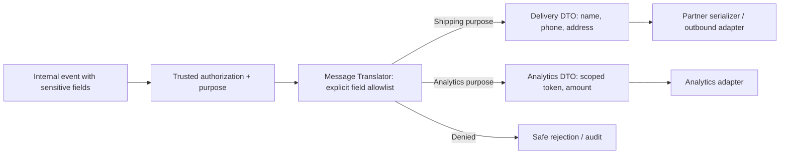
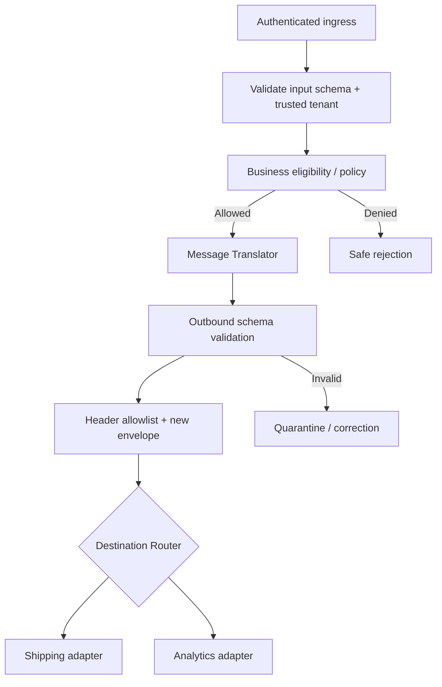
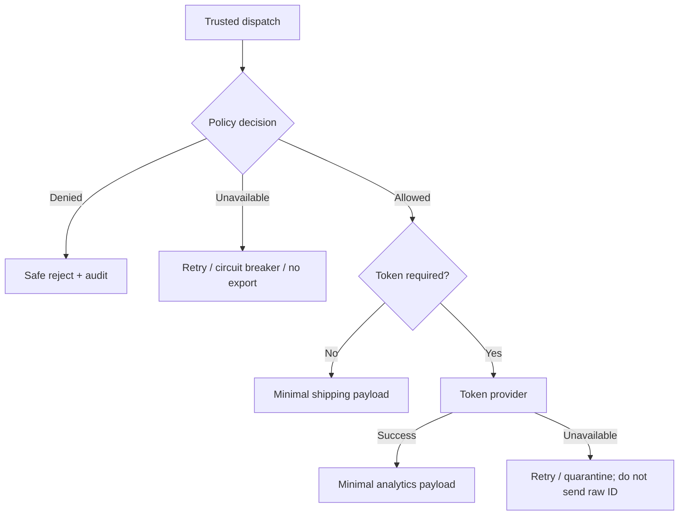
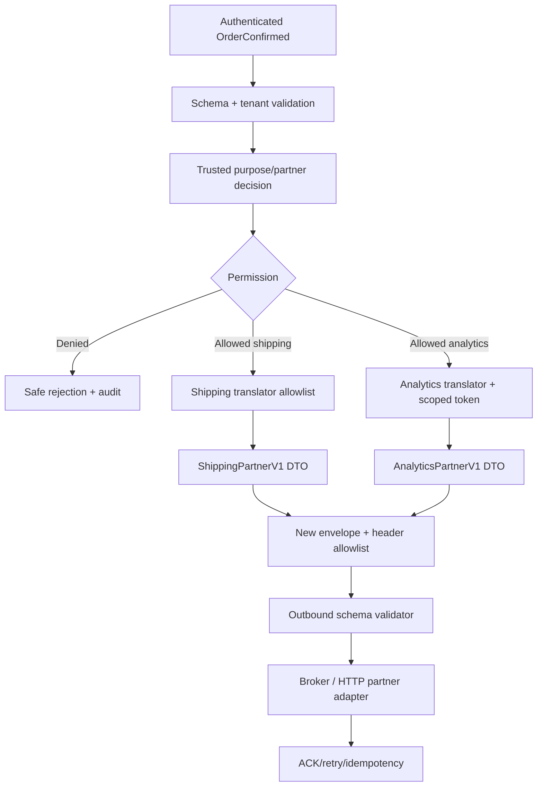

# Mapping dữ liệu nhạy cảm

Một hệ thống tích hợp có thể nhận message chứa tên, số điện thoại, địa chỉ giao hàng, email, định danh khách hàng, mã số thuế, dữ liệu thanh toán hoặc thông tin nghiệp vụ nội bộ. Nhưng không phải mọi consumer trong luồng đều được phép nhận **tất cả** những trường ấy. Một đối tác giao hàng có thể cần tên, số liên hệ và địa chỉ; hệ thống phân tích có thể chỉ cần mã khách hàng đã được thay thế bằng token và tổng tiền; dịch vụ thông báo có thể cần một kênh liên hệ nhưng không cần mã định danh pháp lý.

**Message Translator** là một Enterprise Integration Pattern giúp chuyển một message từ hợp đồng dữ liệu của bên gửi sang hợp đồng của bên nhận. Khi dữ liệu nhạy cảm tham gia, translator không chỉ đổi tên trường, kiểu hoặc định dạng; nó còn phải quyết định **trường nào có quyền đi qua ranh giới**, trường nào phải loại bỏ, thay bằng định danh giả, hoặc chỉ được cung cấp qua một dịch vụ được kiểm soát. Đó là nội dung của bài **“Mapping dữ liệu nhạy cảm”** thuộc chương **Message translator** trong module `SPRING_INTEGRATION_PATTERN`.

Phạm vi module là học triển khai Enterprise Integration Patterns với Spring Integration để xây dựng các luồng message ít phụ thuộc và dễ mở rộng; thực hành Router, Filter, Transformer, Splitter, Aggregator, Gateway, retry, error channel và correlation, đồng thời kiểm thử và theo dõi các nhánh xử lý. Vì vậy, bài này tập trung vào **hợp đồng message và luồng chuyển đổi**, không biến một translator thành hệ thống quản lý toàn bộ chính sách dữ liệu của tổ chức.

**Mục tiêu học tập:**

- Phân biệt **mapping thông thường** và **mapping có kiểm soát dữ liệu nhạy cảm**.
- Định nghĩa phân loại trường, mục đích xử lý, quyền bên nhận và **danh sách trường được phép**.
- Biết khi nào chọn **loại bỏ**, **mask**, **redact**, **pseudonym/token**, **hash/HMAC**, **encrypt** và giới hạn của từng kỹ thuật.
- Thiết kế các DTO khác nhau cho đối tác giao hàng, analytics và một kênh từ chối.
- Viết ví dụ Java 17, Spring Integration Java DSL và JUnit có kiểm tra **không rò rỉ trường ngoài allowlist**.
- Bảo vệ **payload, headers, error channel, log, trace, DLQ, retry và serializer** chứ không chỉ một object Java.
- Đặt mapping ở đúng vị trí so với authentication, Router, Filter, Envelope Wrapper, Idempotent Receiver và Gateway.
- Lập ma trận kiểm thử, giám sát và rollout thay đổi contract mà không vô ý công bố dữ liệu mới.

## 1. Vì sao mapping dữ liệu nhạy cảm khác đổi tên field?

Giả sử hệ thống nội bộ giữ một `Order` gồm:

```text
orderId             = ORD-100
customerId          = CUST-7
recipientName       = Nguyen A
recipientPhone      = 090...
deliveryAddress     = 12 Example Street
email               = user@example.invalid
governmentId        = <restricted>
internalSupportNote = <confidential>
amountMinor         = 30000
currency            = VND
```

Dịch vụ giao hàng chỉ có nhu cầu đã được phê duyệt đối với **đơn, người nhận, số liên hệ và địa chỉ**. Nếu dùng một object mapper tự động copy tất cả property trùng tên sang DTO ngoài, những field mới được thêm vào internal model sau này có thể vô tình xuất hiện ở bên nhận.



**Điểm khác biệt:** Một translator bình thường ưu tiên bảo toàn dữ liệu cần thiết khi đổi cấu trúc; một translator ở ranh giới nhạy cảm cần **cố ý không bảo toàn** những trường mà bên nhận không có quyền hoặc mục đích sử dụng. Đây là một phép chuyển đổi có mất thông tin **được thiết kế**, không phải lỗi thiếu dữ liệu.

### Câu hỏi phải trả lời trước khi viết code

1. Ai là **nguồn tin cậy** của dữ liệu và danh tính tenant?
2. Bên nhận nào đang yêu cầu dữ liệu?
3. **Mục đích** cụ thể của thông điệp này là gì?
4. Hợp đồng bên nhận cho phép những trường nào và trong bao lâu?
5. Có cần nội dung gốc, nội dung đã mask, token hay một kết quả tổng hợp không?
6. Dữ liệu có thể đi qua **headers, log, exception, DLQ hoặc cache** ngoài payload không?
7. Khi chính sách/lookup/token service thất bại, flow sẽ **fail closed hay retry**?

Nếu chưa trả lời được, việc “đổi internal DTO sang partner DTO” vẫn chưa chứng minh an toàn dữ liệu.

## 2. Một taxonomy phân loại trường có thể áp dụng

Dưới đây là ví dụ về phân loại **do ứng dụng/tổ chức tự định nghĩa**, không phải định nghĩa pháp lý chung:

| Mức | Ví dụ | Cách sử dụng trong integration |
| --- | --- | --- |
| **Public** | Tên sự kiện công khai, version schema. | Có thể gửi khi contract cho phép. |
| **Internal** | Mã rule, queue name, ID kỹ thuật. | Không tự động công bố cho partner ngoài. |
| **Confidential** | Tình trạng đơn, email, số điện thoại, địa chỉ. | Chỉ gửi khi đúng mục đích, bên nhận, mức tối thiểu. |
| **Restricted** | Định danh pháp lý, dữ liệu sức khỏe, chứng từ nhạy cảm, credentials. | Cần kiểm soát tăng cường; nhiều trường **không nên đi qua message thông thường**. |

Cùng một field có thể được phân loại khác nhau theo ngữ cảnh. Ví dụ `orderId` có thể trông vô hại nhưng cho phép liên kết giao dịch với cá nhân khi kết hợp nguồn khác. **Không coi field là an toàn chỉ vì không chứa tên người.**

### Phân loại không bằng từ khóa đơn giản

Từ `"token"` trong field name không tự chứng minh giá trị đã được token hóa an toàn; field `"customerRef"` vẫn có thể chứa email hoặc số căn cước. Khi review mapping, kiểm tra **ngữ nghĩa và nguồn tạo dữ liệu**, không chỉ tên biến.

### Một nguyên tắc nền tảng

> **Default deny for outbound fields:** Chỉ các field được chủ động phê duyệt trong contract đích mới được xây vào payload gửi ra ngoài.

Điều này mạnh hơn một danh sách những field bị cấm, vì internal model luôn có thể xuất hiện field mới.

## 3. Data minimization theo mục đích và bên nhận

Hai bên nhận khác nhau không nên chia sẻ một DTO có mọi trường optional:

| Field nội bộ | Đối tác giao hàng | Analytics nội bộ/đối tác | Ghi chú |
| --- | --- | --- | --- |
| `orderId` | Có thể cần mã tham chiếu giao hàng. | Tùy chính sách, có thể chỉ cần event ID. | Không mặc định public. |
| `recipientName` | Có thể cần để giao hàng. | Không cần cho thống kê đơn thuần. | Dữ liệu cá nhân. |
| `recipientPhone` | Có thể cần liên hệ giao nhận. | Không cần. | Phải có mục đích và quyền hợp lệ. |
| `deliveryAddress` | Có thể cần địa chỉ giao. | Không cần địa chỉ chi tiết. | Có thể thay bằng vùng thống kê nếu được phép. |
| `email` | Không cần trong ví dụ. | Không cần trong ví dụ. | Bị loại ở cả hai DTO. |
| `governmentId` | Không được phép trong ví dụ. | Không được phép. | Restricted. |
| `internalSupportNote` | Không được phép. | Không được phép. | Có thể chứa dữ liệu tự do/nhạy cảm. |
| `customerId` | Không cần trong payload giao hàng. | Có thể dùng **partner-scoped token**. | Không gửi ID gốc nếu không cần. |
| `amountMinor` + `currency` | Không cần trong ví dụ giao hàng. | Có thể cần để tổng hợp. | Tuân theo contract analytics. |
| `eventId` | Có, để dedup/truy vết theo contract. | Có, nếu được phê duyệt. | Không log như metric label. |

**Không phải “đối tác giao hàng luôn được nhận tên và địa chỉ”.** Bảng chỉ là **một ví dụ về quyết định đã được phê duyệt** cho mục đích `FULFILL_ORDER`. Nếu đối tác chỉ cần một pickup code hoặc một kho trung gian xử lý giao hàng, payload còn có thể được giảm thêm.

### Tránh dùng DTO lớn với nhiều trường null

```java
// Không nên áp dụng như contract mặc định:
record PartnerMessage(
        String name,
        String phone,
        String address,
        String email,
        String governmentId,
        String internalNote,
        String analyticsToken,
        Long amountMinor
) {}
```

Đặt field thành `null` rồi hy vọng serializer luôn bỏ qua null không tốt bằng **không khai báo field nhạy cảm trong DTO của bên nhận**. DTO tách riêng làm review và contract testing rõ ràng hơn.

## 4. Allowlist khác denylist như thế nào?

Giả sử internal object hôm nay có 10 field; một tháng sau có thêm `bankAccount`:

```java
// Rủi ro: sao chép toàn bộ thuộc tính rồi mới xóa một vài field.
PartnerDto dto = beanMapper.map(internal, PartnerDto.class);
dto.setGovernmentId(null);
dto.setInternalNote(null);
```

Một default mapper, reflection-based copier hoặc `ObjectMapper.convertValue(internal, Map.class)` có thể vô tình xuất thêm `bankAccount` khi DTO/schema đích thay đổi. Cách này phụ thuộc vào **danh sách những thứ biết là phải xóa**.

**Allowlist:**

```java
new ShippingPartnerV1(
        source.eventId(),
        source.orderId(),
        source.recipientName(),
        source.recipientPhone(),
        source.deliveryAddress()
);
```

Chỉ những field được chỉ định bằng code xuất hiện; field mới ở source **không thể tự đi qua** nếu không có sửa đổi mapper và review.

### Ba lớp allowlist nên tách

1. **Destination allowlist:** Partner/service nào được phép nhận loại event này?
2. **Field allowlist:** Những trường nào được phép đi vào DTO đích?
3. **Metadata/header allowlist:** Những headers nào được phép gửi qua transport ngoài?

Một translator an toàn ở payload nhưng outbound adapter **copy mọi headers** vẫn có thể rò credential, tenant context, cookie hoặc thông tin điều phối nội bộ.

## 5. Loại bỏ, masking, redaction, tokenization, hashing và encryption

Các kỹ thuật thường bị gọi chung là “ẩn dữ liệu”, nhưng khả năng phục hồi và mục đích khác nhau.

| Kỹ thuật | Ví dụ | Phục hồi được? | Dùng khi nào? |
| --- | --- | --- | --- |
| **Omit/drop field** | Không đưa `governmentId` vào DTO. | Không từ message đích. | Khi bên nhận không cần dữ liệu. |
| **Redaction** | Thay giá trị bằng `[REDACTED]`. | Không từ giá trị đã thay. | Log/biểu diễn an toàn, nhưng nhiều trường nên **bỏ hẳn**. |
| **Masking** | Chỉ hiển thị 4 ký tự cuối theo policy. | Không đủ để lấy lại toàn bộ từ mask; có thể suy đoán một phần. | Chỉ khi thông tin còn lại thực sự cần. |
| **Tokenization** | `customerId` → token có phạm vi partner. | Có thể tra lại qua dịch vụ token nếu thiết kế reversible. | Liên kết bản ghi theo quyền mà không tiết lộ ID gốc. |
| **Pseudonymization** | Thay định danh trực tiếp bằng alias ổn định. | Có thể vẫn liên kết hoặc tái nhận dạng qua dữ liệu khác. | Giảm lộ định danh nhưng không mặc định ẩn danh. |
| **Hashing** | Digest của input. | Không đảo hàm toán học trực tiếp, nhưng giá trị dễ đoán có thể bị brute force. | Integrity/so sánh có kiểm soát; không tự bảo đảm riêng tư. |
| **Keyed HMAC** | HMAC theo secret/key scope. | Không giải mã gốc, nhưng có thể liên kết trong cùng scope. | Pseudonym có kiểm soát, khi khóa được bảo vệ và policy cho phép. |
| **Encryption** | Ciphertext + thông tin giải mã. | Có, với khóa hợp lệ. | Bảo mật khi lưu/truyền tới bên được cấp quyền giải mã. |

**Không đồng nhất pseudonymization với anonymization.** Một token ổn định có thể theo dõi một cá nhân qua nhiều hoạt động; dữ liệu có thể vẫn được xem là thông tin cá nhân tùy quy định và khả năng liên kết.

### Vì sao chỉ SHA-256(email) thường không đủ?

Email và số điện thoại có không gian giá trị dễ đoán. Kẻ có dictionary có thể tính các hash thử và so sánh. Nếu cần pseudonym ổn định, cân nhắc HMAC có khóa được quản lý an toàn, scope theo tenant/partner/purpose và quy tắc rotation. Khi cần ngăn linkage, **token riêng theo mỗi bên nhận** thường tốt hơn một global token.

### Encryption không thay authorization

Một ciphertext được gửi cho đối tác có khóa giải mã vẫn là cách **chia sẻ dữ liệu** với đối tác. Cần quyết định hợp đồng/quyền trước khi mã hóa, không mã hóa tất cả rồi coi đó là an toàn bất kể ai nhận.

## 6. Mapping là quyết định policy, không chỉ là thao tác chuyển kiểu

Một policy có thể dựa trên:

```text
trustedTenant
destinationPartner
processingPurpose
eventType
dataClassification
authorization
retentionWindow
contractVersion
```

Ví dụ:

```text
tenant         = TENANT-A
destination    = SHIPPING_PARTNER
purpose        = FULFILL_ORDER
eventType      = OrderReadyForDelivery
policyDecision = ALLOW_MINIMAL_DELIVERY_FIELDS
```

Cùng internal event, một destination khác:

```text
destination    = ANALYTICS_PARTNER
purpose        = AGGREGATE_REPORTING
policyDecision = ALLOW_TOKEN_AND_AMOUNT_ONLY
```

Nếu caller tự đặt một header `purpose=FULFILL_ORDER` để xin dữ liệu, đó **không phải policy decision đáng tin**. Hãy lấy identity/destination/purpose từ **trusted gateway, service authorization hoặc workflow được quản lý**, và đối chiếu ở translator.

### Không biến config policy thành nguồn thao túng từ payload

Nếu route hoặc tập field được phép được chọn bằng một string lấy trực tiếp từ message do đối tác gửi, kẻ gửi có thể tự chọn nhánh có nhiều quyền hơn. Message Translator cần ranh giới rõ: **untrusted input values** không được thay thế **trusted authorization context**.

## 7. Bất biến cần giữ cho một translator nhạy cảm

| Mã | Bất biến | Rủi ro nếu vi phạm |
| --- | --- | --- |
| **S1 — Purpose bound** | Mọi mapping có mục đích và bên nhận đã xác minh. | Dữ liệu bị dùng cho mục đích ngoài phạm vi. |
| **S2 — Explicit field allowlist** | DTO ngoài chỉ có trường phê duyệt. | Field mới nội bộ vô tình lộ. |
| **S3 — Deny by default** | Không có quyền/policy → không tạo payload nhạy cảm. | Fail open khi policy service lỗi. |
| **S4 — Integrity** | Số tiền, đơn vị, ID/correlation được chuyển đúng nghĩa. | Mapping gây sai nghiệp vụ dù không rò dữ liệu. |
| **S5 — Trusted context** | Tenant, destination và quyền không được lấy vô điều kiện từ header client. | Cross-tenant exposure. |
| **S6 — Safe failure** | Rejection/log/DLQ không chứa raw sensitive input. | Rò dữ liệu ở đường lỗi. |
| **S7 — Scoped tokens** | Token không cho liên kết ngoài phạm vi được phê duyệt. | Theo dõi chéo partner/purpose. |
| **S8 — Tested serialization** | Wire payload đúng allowlist, không có trường mới tự động. | DTO tưởng an toàn nhưng serializer phát thêm. |
| **S9 — Lifecycle** | Retry/replay và retention không giữ dữ liệu lâu hơn cần thiết. | Bản sao nhạy cảm tồn đọng không kiểm soát. |

Chỉ một test kiểu `assertNotNull(translated)` không chứng minh được bất kỳ bất biến nhạy cảm nào.

## 8. Vị trí mapping trong một Spring Integration flow

Một topology gợi ý:



**Tại sao mapping sau authentication?** Để có context tin cậy về tenant/destination/purpose. **Tại sao validation đầu ra sau mapping?** Vì translator có thể quên một trường bắt buộc, sai type, nhầm đơn vị hoặc tạo field ngoài contract.

### Translator và Filter

- `Filter` quyết định message **có được tiếp tục** một nhánh không.
- Translator quyết định **biểu diễn nào được gửi** và **field nào được phép**.
- Policy có thể tạo nhánh `REJECTED`, nhưng không nên âm thầm drop để gateway timeout.

### Translator và Content Enricher

Content Enricher bổ sung dữ liệu bên ngoài. Nếu không có quyền xuất email, **không được enrich email vào outbound payload** chỉ vì tìm được trong CRM. Enrichment phải tuân theo cùng classification/purpose policy.

## 9. Contract Java 17: internal event khác partner DTO

Ví dụ bên dưới dùng dữ liệu đặt hàng. Dữ liệu nhạy cảm trong object nội bộ chỉ để mô tả tình huống mapping; **không nên cho access token, password hoặc secret xuất hiện trong event/broker**. Mỗi `record` có nội dung nhạy cảm cần lưu ý: Java tự sinh `toString()` liệt kê các field, vì vậy demo ghi đè phương thức này.

```java
enum Destination {
    SHIPPING_PARTNER,
    ANALYTICS_PARTNER
}

enum Purpose {
    FULFILL_ORDER,
    AGGREGATE_REPORTING
}

record InternalOrderEvent(
        String eventId,
        String tenantId,
        String orderId,
        String customerId,
        String recipientName,
        String recipientPhone,
        String deliveryAddress,
        String email,
        String governmentId,
        String internalSupportNote,
        long amountMinor,
        String currency
) {
    @Override
    public String toString() {
        return "InternalOrderEvent[sensitiveFields=REDACTED]";
    }
}

record TrustedDispatch(
        InternalOrderEvent order,
        String authenticatedTenantId,
        Destination destination,
        Purpose purpose,
        String auditId
) {
    @Override
    public String toString() {
        return "TrustedDispatch[details=REDACTED]";
    }
}
```

**Quan trọng:** `TrustedDispatch` chỉ được tạo **sau khi gateway/authorization service xác minh caller và quyết định route**. Việc đặt tên `Trusted` trên record **không tự tạo ra bảo mật**; nếu một HTTP controller map trực tiếp JSON client vào record này, trust boundary đã bị phá vỡ.

### Hai DTO đích tách biệt hoàn toàn

```java
sealed interface PartnerPayload
        permits ShippingPartnerV1, AnalyticsPartnerV1 {}

record ShippingPartnerV1(
        String eventId,
        String orderRef,
        String recipientName,
        String contactPhone,
        String deliveryAddress
) implements PartnerPayload {
    @Override
    public String toString() {
        return "ShippingPartnerV1[sensitiveFields=REDACTED]";
    }
}

record AnalyticsPartnerV1(
        String eventId,
        String customerToken,
        long amountMinor,
        String currency
) implements PartnerPayload {
    @Override
    public String toString() {
        return "AnalyticsPartnerV1[sensitiveFields=REDACTED]";
    }
}

record MappingFailure(
        String auditId,
        String reasonCode
) {}
```

Không có `governmentId`, `email` hoặc `internalSupportNote` trong **bất kỳ DTO đích nào**. Trong hợp đồng giao hàng ví dụ, `recipientName`, `contactPhone`, `deliveryAddress` vẫn là dữ liệu cá nhân, chỉ được gửi vì **mục đích đã phê duyệt** và bên nhận có quyền.

`toString()` được làm an toàn hơn ở đây nhưng **không đủ** chống log nhạy cảm: debugger, JSON serializer, APM instrumentation, exception hoặc heap dump vẫn có thể thấy field thực. Phải kiểm soát từng cơ chế riêng.

## 10. Port của chính sách và token service

Thay vì để translator tự tính `SHA-256(customerId)`, ta đặt việc tạo token ở **dịch vụ chuyên trách** với phạm vi và key management rõ.

```java
interface PartnerPermissionPort {
    boolean permitted(
            String authenticatedTenant,
            Destination destination,
            Purpose purpose,
            String orderId
    );
}

interface RecipientTokenPort {
    String scopedToken(
            String authenticatedTenant,
            Destination destination,
            String customerId
    );
}
```

`PartnerPermissionPort` có thể gọi một policy engine hoặc kiểm tra quyền theo một decision đã được cache an toàn. `RecipientTokenPort` có thể gọi token vault hoặc HMAC service với secret được giữ ở hệ quản lý khóa; **không hardcode secret trong source**.

### Khi nào không nên gọi token service?

Nhánh **giao hàng** trong ví dụ không cần customer token, vì vậy không được gọi token service cho nhánh này chỉ vì class có dependency ấy. Tương tự, nhánh analytics không cần đọc/tính email hay tên người nhận để tạo token.

### Token phải scoped

Cùng `customerId` có thể cần token khác nhau theo `tenantId`, partner hoặc purpose:

```text
Token(TENANT-A, ANALYTICS_PARTNER, CUST-7)
    != Token(TENANT-A, SHIPPING_PARTNER, CUST-7)
    != Token(TENANT-B, ANALYTICS_PARTNER, CUST-7)
```

Đây là **nguyên tắc hợp đồng**; các giá trị chỉ minh họa, không khẳng định mọi tokenization system bắt buộc trả token khác trong mọi cấu hình. Nếu chính sách cần unlinkability, thiết kế vault/key derivation phải bảo đảm điều đó.

## 11. Mapping service có kiểm soát allowlist

Translator sau đây kiểm tra scope, purpose và permission trước khi tạo payload partner. **Lỗi policy service hoặc token service không được âm thầm coi là `allowed=true`**.

```java
import org.springframework.stereotype.Service;

record MappingOutcome(
        PartnerPayload payload,
        String rejectionCode,
        String auditId
) {
    boolean accepted() {
        return payload != null;
    }

    static MappingOutcome pass(
            PartnerPayload payload, String auditId) {
        return new MappingOutcome(payload, null, auditId);
    }

    static MappingOutcome reject(
            String code, String auditId) {
        return new MappingOutcome(null, code, auditId);
    }

    @Override
    public String toString() {
        return "MappingOutcome[details=REDACTED]";
    }
}

@Service
final class SensitivePartnerTranslator {
    private final PartnerPermissionPort permission;
    private final RecipientTokenPort tokens;

    SensitivePartnerTranslator(
            PartnerPermissionPort permission,
            RecipientTokenPort tokens) {
        this.permission = permission;
        this.tokens = tokens;
    }

    MappingOutcome translate(TrustedDispatch request) {
        if (request == null || request.order() == null
                || blank(request.auditId())) {
            return MappingOutcome.reject(
                    "INVALID_DISPATCH", "unknown-audit");
        }

        InternalOrderEvent order = request.order();
        if (blank(request.authenticatedTenantId())
                || !request.authenticatedTenantId()
                        .equals(order.tenantId())) {
            return MappingOutcome.reject(
                    "TENANT_MISMATCH", request.auditId());
        }

        if (request.destination() == null
                || request.purpose() == null
                || !purposeMatches(
                        request.destination(), request.purpose())) {
            return MappingOutcome.reject(
                    "PURPOSE_NOT_ALLOWED", request.auditId());
        }

        if (blank(order.eventId())
                || blank(order.orderId())) {
            return MappingOutcome.reject(
                    "IDENTITY_INVALID", request.auditId());
        }

        // Port truy vấn quyền bằng context đã xác thực.
        // Exception hạ tầng phải đi đến retry/error policy,
        // không được biến thành 'allow'.
        boolean allowed = permission.permitted(
                request.authenticatedTenantId(),
                request.destination(),
                request.purpose(),
                order.orderId());

        if (!allowed) {
            return MappingOutcome.reject(
                    "EXPORT_DENIED", request.auditId());
        }

        if (request.destination() == Destination.SHIPPING_PARTNER) {
            if (blank(order.recipientName())
                    || blank(order.recipientPhone())
                    || blank(order.deliveryAddress())) {
                return MappingOutcome.reject(
                        "DELIVERY_FIELDS_MISSING", request.auditId());
            }

            // Allowlist cố định: không email, governmentId,
            // customerId, supportNote hoặc amountMinor.
            return MappingOutcome.pass(
                    new ShippingPartnerV1(
                            order.eventId(),
                            order.orderId(),
                            order.recipientName(),
                            order.recipientPhone(),
                            order.deliveryAddress()),
                    request.auditId());
        }

        if (blank(order.customerId())
                || order.amountMinor() < 0
                || !"VND".equals(order.currency())) {
            return MappingOutcome.reject(
                    "ANALYTICS_FIELDS_INVALID",
                    request.auditId());
        }

        String token = tokens.scopedToken(
                request.authenticatedTenantId(),
                request.destination(),
                order.customerId());

        if (blank(token)) {
            return MappingOutcome.reject(
                    "TOKEN_UNAVAILABLE", request.auditId());
        }

        // Không gửi raw customerId, name, phone, email,
        // address, governmentId hay internalSupportNote.
        return MappingOutcome.pass(
                new AnalyticsPartnerV1(
                        order.eventId(),
                        token,
                        order.amountMinor(),
                        order.currency()),
                request.auditId());
    }

    private static boolean purposeMatches(
            Destination destination, Purpose purpose) {
        return (destination == Destination.SHIPPING_PARTNER
                    && purpose == Purpose.FULFILL_ORDER)
                || (destination == Destination.ANALYTICS_PARTNER
                    && purpose == Purpose.AGGREGATE_REPORTING);
    }

    private static boolean blank(String value) {
        return value == null || value.isBlank();
    }
}
```

### Các giới hạn của ví dụ

- `permitted(...)` là hợp đồng ứng dụng, **không phải một cơ chế authentication có sẵn**. Phải đảm bảo `authenticatedTenantId` đến từ nguồn được xác thực.
- Mapping không phải lớp validate đầy đủ địa chỉ/số điện thoại/đơn vị tiền. Các field cần **schema và business validation** phù hợp trước/đúng lúc xuất.
- Nhánh analytics lấy token qua service; nếu service gặp timeout, nên để exception chuyển tới retry/error recovery thay vì phát raw ID hoặc token mặc định.
- `TOKEN_UNAVAILABLE` ở ví dụ là trạng thái token trả rỗng; nếu vấn đề là outage hạ tầng, cần phân loại **transient failure** riêng.
- DTO là dữ liệu có thể chứa PII. Chỉ `toString` redacted không ngăn JSON serializer phát các field được phép — đó chính là mục đích của DTO.
- Một policy `allowed=true` **không chứng minh** rằng bên nhận đang cần từng field; field allowlist và contract review vẫn cần thực hiện.
- Không nên serialize raw `TrustedDispatch` sang Kafka ngoài boundary này.

## 12. Không tự động propagate headers vào outbound message

Ngay cả khi translator trả `ShippingPartnerV1` chỉ có 5 field, một Spring Integration endpoint có thể **truyền tiếp headers từ input** theo cơ chế xây reply message. Nếu inbound chứa:

```text
Authorization: Bearer SECRET
x-internal-customer-id: CUST-7
x-support-note: classified
traceId: ...
tenantId: TENANT-A
```

và outbound adapter sao chép tất cả headers, **payload an toàn vẫn rò dữ liệu qua metadata**.

**Hợp đồng an toàn hơn:** ở một outbound boundary riêng, tạo **message mới với allowlist headers**. Không dùng `MessageBuilder.fromMessage(inbound)` hoặc `copyHeaders(inbound.getHeaders())` vô điều kiện.

Ví dụ:

```java
import org.springframework.messaging.Message;
import org.springframework.messaging.support.MessageBuilder;

final class SafePartnerMessageFactory {

    Message<PartnerPayload> build(PartnerPayload payload) {
        String eventType =
                payload instanceof ShippingPartnerV1
                ? "ShippingDispatchV1"
                : "AnalyticsExportV1";

        return MessageBuilder.withPayload(payload)
                .setHeader("partner.eventType", eventType)
                .setHeader("partner.schemaVersion", 1)
                .build();
    }
}
```

`MessageBuilder` sẽ tạo các **technical headers** như `id`/`timestamp`; chúng không phải dữ liệu nghiệp vụ và thường không cần serialize qua broker. **Outbound header mapper** phải tiếp tục allowlist **những header thật sự phát ra transport** và kiểm thử ở mức wire payload. Đừng nghĩ “tạo message mới” đồng nghĩa mọi adapter chắc chắn không thêm header khác.

### Nguy cơ của một `Header Enricher`

Header Enricher có thể tiện để gắn correlation hoặc content-type, nhưng không nên vô tình copy:

```text
headers['authorization']
headers['cookie']
headers['internalCustomerId']
headers['debugPayload']
headers['errorMessage']
```

vào external transport. Những trường chưa có lý do tồn tại ở contract bên nhận nên **không được xuất**.

## 13. Spring Integration Java DSL: translation và egress an toàn

Một flow minh họa nhận `TrustedDispatch` từ channel **nội bộ đã xác thực**, gọi mapper, sau đó chuyển kết quả vào **bridge tạo message mới**. Với rejected outcome, bridge chỉ phát **audit ID và reason code**, không mang raw customer event.

```java
import org.springframework.beans.factory.annotation.Qualifier;
import org.springframework.context.annotation.Bean;
import org.springframework.context.annotation.Configuration;
import org.springframework.integration.channel.DirectChannel;
import org.springframework.integration.channel.QueueChannel;
import org.springframework.integration.config.EnableIntegration;
import org.springframework.integration.dsl.IntegrationFlow;
import org.springframework.messaging.MessageChannel;

final class SafePartnerOutboundBridge {
    private final MessageChannel shipping;
    private final MessageChannel analytics;
    private final MessageChannel rejected;
    private final SafePartnerMessageFactory messages =
            new SafePartnerMessageFactory();

    SafePartnerOutboundBridge(
            MessageChannel shipping,
            MessageChannel analytics,
            MessageChannel rejected) {
        this.shipping = shipping;
        this.analytics = analytics;
        this.rejected = rejected;
    }

    void forward(MappingOutcome outcome) {
        if (!outcome.accepted()) {
            boolean sent = rejected.send(
                    org.springframework.messaging.support.MessageBuilder
                            .withPayload(new MappingFailure(
                                    outcome.auditId(),
                                    outcome.rejectionCode()))
                            .build());

            if (!sent) {
                throw new IllegalStateException(
                        "REJECTION_DELIVERY_FAILED");
            }
            return;
        }

        org.springframework.messaging.Message<PartnerPayload> safe =
                messages.build(outcome.payload());

        MessageChannel destination =
                outcome.payload() instanceof ShippingPartnerV1
                        ? shipping : analytics;

        if (!destination.send(safe)) {
            throw new IllegalStateException(
                    "PARTNER_CHANNEL_DELIVERY_FAILED");
        }
    }
}

@Configuration
@EnableIntegration
class SensitiveMappingFlowConfig {

    @Bean
    DirectChannel trustedPartnerDispatches() {
        return new DirectChannel();
    }

    @Bean
    QueueChannel shippingPartnerOutput() {
        return new QueueChannel();
    }

    @Bean
    QueueChannel analyticsPartnerOutput() {
        return new QueueChannel();
    }

    @Bean
    QueueChannel rejectedPartnerMappings() {
        return new QueueChannel();
    }

    @Bean
    SafePartnerOutboundBridge safePartnerOutboundBridge(
            @Qualifier("shippingPartnerOutput") MessageChannel shipping,
            @Qualifier("analyticsPartnerOutput") MessageChannel analytics,
            @Qualifier("rejectedPartnerMappings") MessageChannel rejected) {
        return new SafePartnerOutboundBridge(
                shipping, analytics, rejected);
    }

    @Bean
    IntegrationFlow sensitivePartnerMappingFlow(
            SensitivePartnerTranslator translator,
            SafePartnerOutboundBridge bridge) {
        return IntegrationFlow.from("trustedPartnerDispatches")
                .handle(TrustedDispatch.class,
                        (dispatch, headers) ->
                                translator.translate(dispatch))
                .handle(MappingOutcome.class,
                        (outcome, headers) -> {
                            bridge.forward(outcome);
                            return null; // terminal, outbound bridge tự gửi
                        })
                .get();
    }
}
```

**Cấu hình trên có mục tiêu giảng dạy:** dùng `DirectChannel` để dễ test, `QueueChannel` để kiểm tra nội dung message gửi vào từng đích. Chưa có Kafka/AMQP/HTTP outbound adapter, schema serializer, policy implementation hay kho bền vững. Việc bridge gọi `send()` trả `true` **không chứng minh partner đã nhận hoặc xử lý thành công**.

Trong production, không nên dùng queue RAM này làm cơ chế bảo đảm giao hàng. Nếu kết quả mapping cần gửi đi chắc chắn sau business commit, hãy cân nhắc **Transactional Outbox**, retry có giới hạn và idempotent downstream.

### Vì sao flow không đơn giản `.transform(...).channel("shipping")`?

Một `.transform()` có thể phù hợp nếu chỉ có một destination và output schema đã tách biệt. Ở ví dụ, ta cần:

- **Kiểm tra policy** trước khi phát.
- **Hai DTO khác nhau** cho hai mục đích.
- **Một nhánh rejection** không rò nội dung.
- **Không sao chép headers đầu vào**.
- **Không để exception transient bị gộp vào business rejection**.

Đây là lý do chia nhiệm vụ thành mapper, outbound bridge và adapter thay vì buộc một lambda làm mọi việc.

## 14. Phân biệt rejection có chủ đích và lỗi kỹ thuật

Khi mapping bị từ chối, không phải lúc nào cũng là một lỗi hạ tầng cần retry.

| Tình huống | Phân loại | Phản ứng |
| --- | --- | --- |
| Tenant trong input không khớp trusted tenant | Security/contract rejection. | Fail closed, audit; không xuất dữ liệu. |
| Purpose không được phép cho destination | Policy rejection. | Trả lý do hữu hạn, không bypass bằng retry. |
| Partner policy quyết định denied | Policy rejection. | Không tạo partner DTO. |
| Thiếu địa chỉ khi mục đích giao hàng cần địa chỉ | Data validation rejection. | Yêu cầu sửa dữ liệu hoặc workflow bổ sung hợp lệ. |
| Token service không trả giá trị | Data/operational issue tùy contract. | Quarantine/retry đúng reason; không gửi ID gốc thay token. |
| Token/policy service timeout | Transient infrastructure error. | Retry/backoff/circuit breaker; **không fail open**. |
| Serializer outbound tạo field cấm | Contract/security defect. | Chặn publish, alert, review mapper. |
| Partner endpoint timeout sau gửi | Outcome không chắc chắn. | Idempotency key và đối soát, không gửi bừa payload khác. |
| Audit/quarantine storage lỗi | Recovery failure. | Không đánh dấu đã xử lý xong khi contract cần lưu bền. |

**Không bắt mọi `Exception` rồi trả `MappingFailure("INVALID_DATA")`.** Làm như vậy che mất outage có thể retry, khó phân biệt security event và có thể khiến hệ thống ACK mất công việc.

## 15. Test unit: mapper không lộ field ngoài allowlist

Một test tốt không chỉ assert đúng những field xuất hiện, mà còn assert **những field nhạy cảm tuyệt đối không được có** trong serialized DTO.

### Fixture có canary để phát hiện leakage

```java
import static org.junit.jupiter.api.Assertions.*;
import org.junit.jupiter.api.Test;

class SensitivePartnerTranslatorTest {

    private final PartnerPermissionPort allowAllForTest =
            (tenant, destination, purpose, orderId) -> true;

    private final RecipientTokenPort fakeToken =
            (tenant, destination, customerId) ->
                    "TEST-PARTNER-SCOPED-TOKEN";

    private final SensitivePartnerTranslator translator =
            new SensitivePartnerTranslator(
                    allowAllForTest, fakeToken);

    private InternalOrderEvent sensitiveOrder() {
        return new InternalOrderEvent(
                "evt-100",
                "TENANT-A",
                "ORD-100",
                "CUST-SECRET-CANARY",
                "Recipient Example",
                "0900000000",
                "12 Example Street",
                "email-secret@example.invalid",
                "ID-SECRET-CANARY",
                "SUPPORT-SECRET-CANARY",
                30_000L,
                "VND");
    }

    @Test
    void shippingMappingContainsOnlyApprovedFields() {
        MappingOutcome mapped = translator.translate(
                new TrustedDispatch(
                        sensitiveOrder(),
                        "TENANT-A",
                        Destination.SHIPPING_PARTNER,
                        Purpose.FULFILL_ORDER,
                        "audit-100"));

        assertTrue(mapped.accepted());
        assertInstanceOf(
                ShippingPartnerV1.class, mapped.payload());

        ShippingPartnerV1 payload =
                (ShippingPartnerV1) mapped.payload();

        assertEquals("ORD-100", payload.orderRef());
        assertEquals("Recipient Example", payload.recipientName());
        assertEquals("0900000000", payload.contactPhone());
        assertEquals("12 Example Street",
                payload.deliveryAddress());
    }

    @Test
    void analyticsMappingUsesPartnerScopedTokenNotRawId() {
        MappingOutcome mapped = translator.translate(
                new TrustedDispatch(
                        sensitiveOrder(),
                        "TENANT-A",
                        Destination.ANALYTICS_PARTNER,
                        Purpose.AGGREGATE_REPORTING,
                        "audit-101"));

        assertTrue(mapped.accepted());
        assertInstanceOf(
                AnalyticsPartnerV1.class, mapped.payload());

        AnalyticsPartnerV1 payload =
                (AnalyticsPartnerV1) mapped.payload();

        assertEquals(
                "TEST-PARTNER-SCOPED-TOKEN",
                payload.customerToken());
        assertEquals(30_000L, payload.amountMinor());
        assertEquals("VND", payload.currency());
    }

    @Test
    void wrongTenantNeverMapsSensitivePayload() {
        MappingOutcome mapped = translator.translate(
                new TrustedDispatch(
                        sensitiveOrder(),
                        "TENANT-B",
                        Destination.SHIPPING_PARTNER,
                        Purpose.FULFILL_ORDER,
                        "audit-102"));

        assertFalse(mapped.accepted());
        assertNull(mapped.payload());
        assertEquals(
                "TENANT_MISMATCH", mapped.rejectionCode());
    }

    @Test
    void unauthorizedPurposeIsRejected() {
        MappingOutcome mapped = translator.translate(
                new TrustedDispatch(
                        sensitiveOrder(),
                        "TENANT-A",
                        Destination.ANALYTICS_PARTNER,
                        Purpose.FULFILL_ORDER,
                        "audit-103"));

        assertFalse(mapped.accepted());
        assertEquals(
                "PURPOSE_NOT_ALLOWED", mapped.rejectionCode());
    }
}
```

Những test này chứng minh **logic mapper với fake policy/token**, không chứng minh policy engine thực đã cấp quyền, token không thể bị đảo, hoặc partner transport không sao chép header.

### Hạn chế của test theo field accessor

Chỉ kiểm tra `payload.recipientName()` là đúng chưa đủ. Cần **serialize DTO thật** để chắc chắn `email`, `governmentId`, `customerId` hoặc `internalSupportNote` không xuất hiện do Jackson annotation, property accessor, mixin hay reflection configuration.

## 16. Serialization contract test: kiểm tra cả field được có và bị cấm

```java
import static org.junit.jupiter.api.Assertions.*;

import java.util.Set;
import java.util.HashSet;
import java.util.Iterator;

import com.fasterxml.jackson.databind.JsonNode;
import com.fasterxml.jackson.databind.ObjectMapper;
import org.junit.jupiter.api.Test;

class PartnerPayloadSerializationTest {

    private final ObjectMapper mapper = new ObjectMapper();

    @Test
    void shippingWireShapeIsExactlyAllowlisted() {
        ShippingPartnerV1 payload =
                new ShippingPartnerV1(
                        "evt-100",
                        "ORD-100",
                        "Recipient Example",
                        "0900000000",
                        "12 Example Street");

        JsonNode json = mapper.valueToTree(payload);
        Set<String> fields = new HashSet<>();
        Iterator<String> names = json.fieldNames();
        names.forEachRemaining(fields::add);

        assertEquals(Set.of(
                "eventId", "orderRef", "recipientName",
                "contactPhone", "deliveryAddress"),
                fields);

        String wire = json.toString();
        assertFalse(wire.contains("email-secret"));
        assertFalse(wire.contains("governmentId"));
        assertFalse(wire.contains("internalSupportNote"));
        assertFalse(wire.contains("customerId"));
    }

    @Test
    void analyticsWireShapeIsExactlyAllowlisted() {
        AnalyticsPartnerV1 payload =
                new AnalyticsPartnerV1(
                        "evt-100", "TOK-100",
                        30_000L, "VND");

        JsonNode json = mapper.valueToTree(payload);
        Set<String> fields = new HashSet<>();
        json.fieldNames().forEachRemaining(fields::add);

        assertEquals(Set.of(
                "eventId", "customerToken",
                "amountMinor", "currency"), fields);

        assertFalse(json.has("recipientName"));
        assertFalse(json.has("email"));
        assertFalse(json.has("deliveryAddress"));
        assertFalse(json.has("governmentId"));
    }
}
```

Một **exact-field-set assertion** đặc biệt có giá trị: nếu ai đó sửa `ShippingPartnerV1` để thêm `email` mà quên review, test sẽ fail. Nếu chỉ assert field `email == null`, serializer có thể vẫn phát tên field hoặc thêm dữ liệu từ getter khác.

### Serializing sang format khác cũng phải test

Nếu một partner dùng XML/CSV/Avro/Protobuf, các DTO/field tags và default của encoder phải được kiểm thử ở **wire representation** tương ứng. Không suy rằng một Jackson JSON test bảo đảm XML serializer không phát field nhạy cảm.

## 17. Integration test: không rò header khi qua Spring Integration

Một `TrustedDispatch` có thể đến với một số headers nội bộ; outbound bridge **phải tạo message mới** và không cho chúng lọt vào partner channel.

Ví dụ test Spring context:

```java
import static org.junit.jupiter.api.Assertions.*;

import org.junit.jupiter.api.Test;
import org.springframework.beans.factory.annotation.Autowired;
import org.springframework.beans.factory.annotation.Qualifier;
import org.springframework.context.annotation.Bean;
import org.springframework.context.annotation.Configuration;
import org.springframework.integration.channel.QueueChannel;
import org.springframework.messaging.Message;
import org.springframework.messaging.MessageChannel;
import org.springframework.messaging.support.MessageBuilder;
import org.springframework.test.annotation.DirtiesContext;
import org.springframework.test.context.junit.jupiter.SpringJUnitConfig;

@SpringJUnitConfig({
        SensitiveMappingFlowConfig.class,
        SensitiveMappingFlowTest.TestPorts.class
})
@DirtiesContext(classMode = DirtiesContext.ClassMode.AFTER_EACH_TEST_METHOD)
class SensitiveMappingFlowTest {

    @Configuration
    static class TestPorts {
        @Bean
        PartnerPermissionPort partnerPermissionPort() {
            return (tenant, dest, purpose, orderId) -> true;
        }

        @Bean
        RecipientTokenPort recipientTokenPort() {
            return (tenant, dest, customerId) ->
                    "TEST-TOKEN-100";
        }

        @Bean
        SensitivePartnerTranslator sensitivePartnerTranslator(
                PartnerPermissionPort permissions,
                RecipientTokenPort tokens) {
            return new SensitivePartnerTranslator(
                    permissions, tokens);
        }
    }

    @Autowired @Qualifier("trustedPartnerDispatches")
    MessageChannel input;

    @Autowired @Qualifier("shippingPartnerOutput")
    QueueChannel shipping;

    @Autowired @Qualifier("analyticsPartnerOutput")
    QueueChannel analytics;

    @Autowired @Qualifier("rejectedPartnerMappings")
    QueueChannel rejected;

    private static InternalOrderEvent order() {
        return new InternalOrderEvent(
                "evt-200", "TENANT-A", "ORD-200",
                "CUST-SENSITIVE",
                "Recipient Example", "0900000000",
                "12 Example Street",
                "private-email@example.invalid",
                "PRIVATE-GOV-ID",
                "PRIVATE-SUPPORT-NOTE",
                30_000L, "VND");
    }

    @Test
    void shippingOutputDoesNotCopyIncomingPrivateHeaders() {
        TrustedDispatch request = new TrustedDispatch(
                order(), "TENANT-A",
                Destination.SHIPPING_PARTNER,
                Purpose.FULFILL_ORDER,
                "audit-200");

        Message<TrustedDispatch> incoming =
                MessageBuilder.withPayload(request)
                        .setHeader(
                                "Authorization",
                                "Bearer HEADER-SECRET")
                        .setHeader(
                                "internalCustomerId",
                                "CUST-SENSITIVE")
                        .build();

        assertTrue(input.send(incoming));

        Message<?> outbound = shipping.receive(1_000);
        assertNotNull(outbound);
        assertInstanceOf(
                ShippingPartnerV1.class,
                outbound.getPayload());

        assertFalse(outbound.getHeaders()
                .containsKey("Authorization"));
        assertFalse(outbound.getHeaders()
                .containsKey("internalCustomerId"));

        assertEquals(
                "ShippingDispatchV1",
                outbound.getHeaders().get("partner.eventType"));

        assertNull(analytics.receive(0));
        assertNull(rejected.receive(0));
    }

    @Test
    void deniedTenantProducesOnlySafeFailure() {
        TrustedDispatch request = new TrustedDispatch(
                order(), "TENANT-B",
                Destination.SHIPPING_PARTNER,
                Purpose.FULFILL_ORDER,
                "audit-201");

        assertTrue(input.send(
                MessageBuilder.withPayload(request).build()));

        Message<?> failure = rejected.receive(1_000);
        assertNotNull(failure);
        assertInstanceOf(
                MappingFailure.class, failure.getPayload());

        MappingFailure payload =
                (MappingFailure) failure.getPayload();
        assertEquals(
                "TENANT_MISMATCH", payload.reasonCode());
        assertEquals("audit-201", payload.auditId());

        assertNull(shipping.receive(0));
        assertNull(analytics.receive(0));
    }
}
```

Đây là test **trong JVM** với policy/token fake và `QueueChannel`. Nó chứng minh bridge không copy hai headers được cài chủ đích; **không** chứng minh Kafka/HTTP header mapper thật hoặc network đã an toàn. Production cần test adapter/serializer thật và kiểm tra packet/event tại consumer sandbox.

**Cần lưu ý Spring wiring:** snippet dùng cả `@Service SensitivePartnerTranslator` ở mục 11 và `@Bean` trong test; khi tạo context, chỉ chọn **một** cách đăng ký service để tránh duplicate bean. Cấu hình mẫu ở đây không bật component scan, nên test `@Bean` là lựa chọn có chủ đích. Khi copy vào project Spring Boot có component scan, cần điều chỉnh fixture hoặc dùng bean override phù hợp.

## 18. Security test theo hướng negative/forbidden fields

Đối với dữ liệu nhạy cảm, **test không xuất hiện** thường quan trọng bằng test có xuất hiện.

| Case | Khi nào PASS? |
| --- | --- |
| Internal model thêm `bankAccount` | Không có field mới trong DTO/wire partner. |
| Shipping message | Không có email, raw customer ID, government ID, support note hoặc amount ngoài contract. |
| Analytics message | Không có name, phone, address, email, government ID, internal note. |
| Unauthorized tenant | Không có partner payload nào; chỉ audit reason. |
| Wrong purpose/destination | Không có mapping nhạy cảm. |
| Incoming headers có Authorization | Header không được sao chép ra egress. |
| Error message từ translator | Không có raw input, full stack trace hoặc PII trong outbound error. |
| Partner serializer đổi version | Wire exact field set được review và test. |
| Token service lỗi | Không fallback sang raw customer ID. |
| Policy engine timeout | Không mặc định `allowed=true`. |
| Message duplicate/replay | Không làm nhân đôi side effect ngoài ý muốn. |
| Test fixture chứa secret canary | Không xuất hiện trong JSON/header/log/DLQ được kiểm tra. |

Một cách nâng mức độ an toàn là dùng **canary strings** trong test input để quét output wire/rejection/log thuộc test environment. Tuy nhiên, không nên log hay tạo dữ liệu nhạy cảm thật chỉ để thử; dùng dữ liệu tổng hợp không phải thông tin cá nhân thực.

## 19. Masking trong log khác mapping cho partner

Một lỗi thường gặp là dùng cùng hàm `maskPhone()` cho cả log và thông điệp giao hàng:

```text
Log:
  phone = ******0000   (phù hợp nếu được phép)

Shipping partner:
  phone = ******0000   (không thể gọi người nhận)
```

**Log minimization** và **partner contract** là hai mục đích khác nhau. Partner giao hàng có thể được phép nhận số điện thoại đầy đủ **chỉ cho đơn cần giao**, trong khi log vận hành không cần. Không tự mask dữ liệu được phép nếu làm hỏng nghiệp vụ; cũng không phát full PII trong log vì partner cần nó.

### Tránh “redact theo regex” như giải pháp duy nhất

Một bộ regex che số điện thoại có thể bỏ sót định danh mới, trường nested hoặc dữ liệu trong `Map<String,Object>`. Giải pháp vững hơn là **không log raw payload**, ghi structured audit với **allowlist** và chỉ dùng redaction như một lớp phòng thủ bổ sung.

### Java record `toString()` là một nguy cơ cụ thể

Java record tự sinh `toString()` chứa từng component. Logging kiểu:

```java
log.info("Translating {}", internalOrder);
```

có thể làm lộ toàn bộ email/phone/address/governmentId. Trong demo, `toString()` được override; nhưng code thật vẫn nên **cấm log input sensitive DTO** và cấu hình log scrubber/diagnostic policy. Một lỗi stack trace có message chứa `payload.toString()` cũng có thể lan tới error channel.

## 20. Error channel, retry và DLQ: bề mặt rò rỉ ít được chú ý

Trong Spring Integration, `ErrorMessage` có thể gắn với exception và **failedMessage**, tùy endpoint và topology. Nếu failed message chứa `InternalOrderEvent`, việc serialize nguyên `ErrorMessage` hoặc ghi `exception.toString()` có thể rò data nhạy cảm.

```text
InternalOrderEvent
   -> translator
      -> exception
         -> errorChannel
            -> generic logger / DLQ serializer
               -> sensitive payload leaked
```

**Đường xử lý lỗi cần thiết kế riêng**:

1. Phân biệt `EXPORT_DENIED`, `TENANT_MISMATCH`, `MAPPING_INVALID` với `TOKEN_SERVICE_TIMEOUT` và `BROKER_UNAVAILABLE`.
2. Tạo `SafeErrorRecord(auditId, reasonCode, stage)` thay vì đẩy raw `failedMessage` cho nơi không có quyền.
3. Nếu cần lưu raw payload để điều tra, dùng **kho quarantine được bảo vệ** với quyền và retention riêng, không phải một topic DLQ chung cho mọi đội.
4. Không biến policy denial thành retry vô hạn.
5. Khi hạ tầng timeout, retry có deadline/backoff và giữ business identity ổn định.
6. Nếu không ghi được audit/quarantine mà contract yêu cầu durability, không ACK mất công việc vô điều kiện.
7. Khi chuyển incident sang hệ ticketing, không copy nguyên PII từ exception vào ticket.

### Không suy rằng `errorChannel` luôn nhận mọi exception

Với flow đồng bộ qua `DirectChannel`, exception có thể truyền thẳng về caller. Với poller/executor/broker listener, error handler hoặc `errorChannel` được cấu hình sẽ quyết định cách phát `ErrorMessage`. Thiết kế cần test đúng topology của hệ thống; không mặc định mọi runtime error đều có một DLQ record.

## 21. Retry, idempotency và token stability

Nếu partner endpoint timeout **sau khi đã nhận message**, hệ thống có thể retry. Nếu mỗi retry sinh event ID hoặc token ngẫu nhiên mới, partner có thể không nhận ra hai message cùng một lệnh.

Một hợp đồng hợp lý:

```text
businessEventId = evt-100
partner         = SHIPPING_PARTNER
operation       = CREATE_DELIVERY
idempotencyKey  = (tenant, partner, eventId, operation)
```

Khi retry, giữ **cùng business identity**. Token analytics có thể cần ổn định trong một **partner/tenant/purpose scope** đủ để bên nhận liên kết bản ghi, nhưng không nên ổn định xuyên mọi partner nếu không có nhu cầu.

### Nếu token service rotation thì sao?

Key rotation/token rotation có thể làm cùng customer ID sinh token khác. Cần chính sách:

- Token cũ có còn được giải mã/đối chiếu trong cửa sổ replay?
- Một event cũ được replay sau rotation nên dùng token cũ hay token mới?
- Idempotency ở partner dựa vào event ID hay token?
- Cách migration có vô ý nối hai tập dữ liệu đáng ra phải tách không?
- Có cần version/issuer metadata của token theo contract không?

Đừng chọn **token làm khóa idempotency duy nhất** nếu token có thể rotation hoặc một customer có nhiều events hợp lệ.

### “Exactly once” không xuất hiện nhờ translator

Translator là bước mapping. Nếu business DB, Kafka và remote partner là ba hệ thống độc lập, chúng không tự có một transaction nguyên tử end-to-end. Khi cần bảo đảm giao hàng và tránh side effect lặp, dùng **outbox, inbox/idempotent receiver, broker ACK đúng mốc và downstream idempotency/reconciliation**.

## 22. Envelope Wrapper và version của dữ liệu nhạy cảm

Một payload đích có thể có envelope:

```json
{
  "envelopeVersion": 1,
  "eventType": "ShippingDispatch",
  "payloadSchemaVersion": 1,
  "eventId": "evt-100",
  "data": {
    "orderRef": "ORD-100",
    "recipientName": "Recipient Example",
    "contactPhone": "0900000000",
    "deliveryAddress": "12 Example Street"
  }
}
```

**Lưu ý:** Ngay cả khi metadata envelope không chứa PII, `data` vẫn có PII. Nếu mục đích giao hàng đã được phê duyệt, việc chia sẻ đó có thể là chủ đích; phải kết hợp transport encryption, access control, retention và audit.

### Thay đổi schema có thể làm tăng rò rỉ

Giả sử `ShippingPartnerV2` thêm `email`. Đây không chỉ là một thay đổi schema; nó là **thay đổi phạm vi dữ liệu được cung cấp**. Contract review phải xác nhận:

- Email thật sự cần cho mục đích nào?
- Partner có quyền nhận và giữ không?
- Có thể dùng một notification service nội bộ thay vì chia sẻ email không?
- Partner đang giữ V1/V2 cùng lúc hay phải bỏ field khi rollback?
- Có negative contract test phát hiện field mới không?

Không nên coi một field **optional** là tự động an toàn về mặt privacy.

## 23. Version compatibility và dữ liệu đã từng được phát

Một translator có thể hỗ trợ:

```text
InternalOrderV1 -> ShippingPartnerV1
InternalOrderV2 -> ShippingPartnerV1
InternalOrderV2 -> ShippingPartnerV2 (only after authorization)
```

Khi internal model thêm một trường confidential mới, mapping sang V1 nên **không đổi**. Khi partner nâng contract, cần kiểm thử **backward/forward compatibility và thay đổi quyền dữ liệu** tách biệt.

| Thay đổi | Test cần có |
| --- | --- |
| Internal thêm field nhạy cảm | Output V1 exact field set vẫn giữ nguyên. |
| Partner thêm optional field | V1 reader xử lý V2 được không? Privacy review có phê duyệt field mới không? |
| Partner đổi field/encoding | Mapping đúng semantics và schema version. |
| Đổi `customerId` sang token | Không mất idempotency/correlation cần thiết. |
| Partner ngừng nhận raw phone | Không còn phone ở JSON, headers, logs, retry payload. |
| Nhánh analytics thêm regional aggregation | Có thể không cần customer token nữa; giảm dữ liệu. |
| Old messages trong DLQ được replay | Policy hiện tại và contract migration được áp dụng nhất quán. |

**Hợp đồng dữ liệu và chính sách chia sẻ đều cần version/review.** Có thể xảy ra trường hợp message cũ hợp lệ về schema nhưng **không còn được phép gửi** theo chính sách hiện hành; replay không phải đặc quyền bỏ qua authorization.

## 24. Router, Filter, Splitter và Aggregator với dữ liệu nhạy cảm

### Router

Một Router có thể định tuyến cùng internal event tới hai destinations. **Không fan-out nguyên payload nhạy cảm rồi mới hy vọng mỗi consumer tự lọc** nếu các nhánh không có quyền đọc nội dung gốc.

```text
Trusted event
   -> policy decision
   -> translate for destination A
   -> translate for destination B
   -> deliver separate minimal DTOs
```

Một publish-subscribe channel chứa full PII có thể mở rộng đối tượng đọc dữ liệu vô tình. Cần phân định trust boundaries ở ngay trước fan-out hoặc dùng kênh có quyền riêng.

### Filter

Filter loại event không phù hợp; nếu event bị từ chối vì export không có quyền, **ghi audit reason** thay vì drop im lặng. Khi Gateway chờ reply, Filter discard cần có một response phù hợp.

### Splitter

Một đơn có ba kiện có thể Splitter thành ba message giao hàng. Không copy toàn bộ `InternalOrderEvent` cho từng kiện nếu worker mỗi kiện chỉ cần **recipient/contact/address và item refs**. Có thể split **sau khi đã tạo minimal per-shipment DTO**, hoặc thiết kế splitter nội bộ và translator riêng cho từng message con.

### Aggregator

Khi Aggregator gom kết quả, group store có thể lưu **toàn bộ message payload** trong thời gian dài. Nếu message chưa được sanitize, group store trở thành **kho dữ liệu nhạy cảm mới**. Nên giữ minimal result, TTL/retention và tenant-aware correlation key.

### Scatter–Gather

Nếu một request gửi tới nhiều partners, mỗi recipient cần **DTO riêng**. Đừng gửi một object “superset” chứa thông tin mọi partner có thể cần chỉ vì số nhánh nhiều.

## 25. Gateway và response: chống rò rỉ chiều ngược

Một request–reply Gateway có thể trả lỗi hoặc kết quả từ partner. Không chỉ outbound request, **reply translator** cũng cần mapping có kiểm soát:

```text
External partner reply:
  deliveryId
  status
  partnerInternalNote
  rawTrackingMetadata
  externalCustomerReference

Internal caller reply:
  orderId
  deliveryStatus
  approvedTrackingRef
```

Nếu trả nguyên partner payload về client, có thể tiết lộ thông tin nội bộ của partner hoặc những field không thuộc quyền của caller. Do đó, **mapping outbound và inbound là hai hợp đồng riêng**.

### Duplicate retry cũng cần reply an toàn

Nếu client retry cùng `commandId`, một Idempotent Receiver có thể trả cached outcome. Cached response không được vượt quyền chỉ vì caller biết ID. Gateway phải xác minh principal/tenant **trước khi trả lại kết quả**.

### Error reply cũng là data egress

Không để HTTP error response chứa `MappingRejected: governmentId=...`, stack trace hay raw serialized DTO. Dùng `errorCode`, audit ID và message không tiết lộ dữ liệu khi có thể.

## 26. Quan hệ với Claim Check và dữ liệu payload lớn

Claim Check chuyển payload lớn/nhạy cảm ra khỏi message và thay bằng ticket. Nhưng ticket **không tự là quyết định cấp quyền**.

```text
Internal sensitive document
    -> Claim Check In (secure store)
    -> claim ticket
    -> workflow
    -> authorized checkout
    -> minimal partner-specific mapping
```

Cần xác minh:

- Ticket có scope tenant, expiry và operation.
- Chỉ thành phần có quyền được check-out dữ liệu gốc.
- Partner không được nhận ticket nội bộ nếu ticket cho phép lấy raw document.
- Cleanup và retention không làm retry mất dữ liệu hoặc giữ dữ liệu quá lâu.
- Metadata claim và outbox/broker có consistency/recovery policy.
- Mapper không xuất signed URL hoặc object key nhạy cảm trừ khi đó là hợp đồng có thời hạn và kiểm soát quyền.

**Ẩn payload bằng ticket không giống data minimization.** Nếu ticket trao quyền truy xuất toàn bộ payload, việc gửi ticket có thể còn nguy hiểm hơn gửi một DTO tối thiểu.

## 27. Khi policy/token service không khả dụng

Một translator có thể phụ thuộc vào policy engine và token service. Đây là hai failure boundaries đặc biệt quan trọng:



**Không fail open:** Khi policy engine timeout, không được tự cho phép vì “sẽ ảnh hưởng throughput”. Khi token service lỗi, không gửi raw customer ID để duy trì dịch vụ. Thay vào đó có thể:

- Retry có exponential backoff, jitter và deadline.
- Dùng cache **policy decision** nếu cache được thiết kế an toàn, còn hiệu lực, đúng principal/scope/version; không phải cache bừa kết quả allow.
- Đưa sự kiện vào pending/quarantine phù hợp với retention, tránh mất message.
- Trả trạng thái `PENDING` cho caller nếu workflow hỗ trợ.
- Cảnh báo hạ tầng và có runbook khôi phục.

**Fail closed không đồng nghĩa drop dữ liệu vô vết.** Một hệ thống tin cậy cần giữ audit, recovery và source ACK theo đúng contract.

## 28. Concurrency: không trộn dữ liệu giữa hai message

Một mapper là Spring singleton có thể xử lý nhiều message đồng thời qua executor/broker listener. **Không lưu state của request trên field mutable của mapper**:

```java
// Sai: request A có thể bị ghi đè khi B xử lý đồng thời.
private String currentTenant;

PartnerPayload translate(TrustedDispatch input) {
    currentTenant = input.authenticatedTenantId();
    // request khác thay currentTenant ở giữa quá trình
    ...
}
```

`SensitivePartnerTranslator` ở mục 11 chỉ có dependency ports; state request là **local variables**, giúp tránh trộn tenant/destination giữa các invocations. Nhưng các port được inject cũng phải thread-safe theo contract.

### Test concurrency có chủ đích

Có thể chạy hai batches song song:

```text
A: TENANT-A -> SHIPPING -> order A -> recipient A
B: TENANT-B -> ANALYTICS -> order B -> token B
C: TENANT-A -> ANALYTICS -> order C -> token C
```

Assert output của mỗi event có **đúng destination, audit, tenant scope, token và field set**, không lộ recipient A vào analytics B. Test phải có **nhiều worker, nhiều thứ tự xen kẽ** thay vì một vòng `for` tuần tự.

**Race trong token vault/policy cache** cũng cần test độc lập nếu chúng có trạng thái mutable hoặc cập nhật chính sách trong runtime.

## 29. Performance mà không đánh đổi minimization

Mapping với reflection, JSON tree hoặc policy lookup từ xa có thể tốn thời gian. Cần tối ưu nhưng không bỏ authorization.

Các lựa chọn:

- Precompile **schema và field mapping** theo version thay vì parse config cho từng message.
- Cache policy theo **tenant, partner, purpose, policy version, principal/scope và expiry** nếu có cơ chế invalidation rõ.
- Batch tokenization khi được phép, nhưng giữ request isolation và rate limits.
- Không xây full `Map<String,Object>` chứa mọi field rồi mới xóa; giảm bản sao nhạy cảm trong heap.
- Giới hạn kích thước input, nesting, header count và payload xuất.
- Đặt outbound serializer/header mapping riêng theo partner contract.
- Sử dụng backpressure, bounded queues và retry budget để tránh tích lũy payload nhạy cảm trong RAM.

### Vì sao cache policy là điểm rủi ro?

Một cached `ALLOW` cũ có thể tiếp tục cho phép chia sẻ sau khi quyền bị thu hồi. Cần thiết kế TTL/invalidation và xác định những tác vụ có thể dùng quyết định cũ trong bao lâu. Không coi “cache hit” là bằng chứng authorization luôn hợp lệ.

### Java memory không phải môi trường giữ bí mật tuyệt đối

Java `String` immutable có thể tồn tại trong heap đến khi GC; không có bảo đảm xóa ngay. Nếu hệ thống xử lý secret đặc biệt nhạy cảm, cân nhắc kiến trúc không đưa secret vào message chung và sử dụng vault/HSM/secure enclave hoặc cơ chế phù hợp; việc đổi `String` sang `char[]` chỉ có ích trong những trường hợp lifetime/control thực sự được quản lý.

## 30. Observability: đo mapping mà không tạo một nguồn rò mới

Đội vận hành cần biết bao nhiêu message đã được xuất, bị từ chối hoặc chờ token service, nhưng không nên dùng giá trị PII làm nhãn metrics.

| Metric minh họa | Mục đích |
| --- | --- |
| `translator_received_total{destination}` | Số message cần mapping theo đích hữu hạn. |
| `translator_approved_total{purpose}` | Số quyết định cho phép theo mục đích. |
| `translator_rejected_total{reason}` | Số denial/contract error theo mã hữu hạn. |
| `translator_duration_seconds{destination}` | Độ trễ mapping/policy/token. |
| `translator_token_failure_total{reason}` | Token service lỗi hoặc trả kết quả không hợp lệ. |
| `translator_policy_failure_total{reason}` | Policy engine unavailable/timeout. |
| `translator_outbound_schema_failure_total` | DTO/wire không đúng contract. |
| `translator_header_leak_test_failure_total` | Test/scan phát hiện header ngoài allowlist. |
| `translator_retry_total{reason}` | Số lần retry đường transient. |
| `translator_quarantine_write_total{outcome}` | Kết quả ghi rejection bền vững. |

Đây là **các tên metric gợi ý**, không phải Spring Integration tự cam kết tạo đúng như vậy. Không đưa customer ID, phone, email, order ID, token hay full event ID vào metric labels vì high cardinality và rủi ro liên kết dữ liệu.

Log có cấu trúc:

```text
auditId=map-a100
destination=SHIPPING_PARTNER
purpose=FULFILL_ORDER
outcome=ACCEPTED
schema=ShippingPartnerV1
traceRef=trace-a100

auditId=map-a101
destination=ANALYTICS_PARTNER
purpose=FULFILL_ORDER
outcome=REJECTED
reason=PURPOSE_NOT_ALLOWED
traceRef=trace-a101
```

Các ID trong log cần tuân thủ chính sách tổ chức; nếu audit ID là bearer secret hoặc có thể truy cập PII, không log trực tiếp. **Không log raw payload, partner token hay recipient data** để “debug cho tiện”.

## 31. Ma trận kiểm thử trước production

| ID | Tình huống | Kỳ vọng |
| --- | --- | --- |
| MAP-01 | Shipping đúng tenant/purpose, đủ dữ liệu. | DTO shipping chỉ có 5 field approved. |
| MAP-02 | Analytics đúng purpose và token hợp lệ. | DTO analytics chỉ có eventId/token/amount/currency. |
| MAP-03 | Internal thêm email mới/định danh mới. | Không tự xuất thêm field ra wire. |
| MAP-04 | Trusted tenant khác `order.tenantId`. | Reject, không partner output. |
| MAP-05 | Destination/purpose không khớp. | Reject `PURPOSE_NOT_ALLOWED`. |
| MAP-06 | Policy trả denied. | Không tạo DTO nhạy cảm. |
| MAP-07 | Policy service timeout. | Fail closed, retry/error policy; không `ALLOW` mặc định. |
| MAP-08 | Token service timeout. | Không fallback sang raw customer ID. |
| MAP-09 | Token service trả blank. | Rejection/recovery đúng policy. |
| MAP-10 | Shipping thiếu address. | Reject, không gửi payload lỗi. |
| MAP-11 | Analytics amount âm/currency không hỗ trợ. | Reject đúng semantic constraint. |
| MAP-12 | Customer token scoped tenant/partner. | Không nhầm token giữa scope. |
| HEADER-01 | Inbound có `Authorization`/cookie. | Outbound headers không chứa. |
| HEADER-02 | Inbound có `internalCustomerId`. | Không sang partner transport. |
| HEADER-03 | `replyChannel` nội bộ hiện diện. | Không serialize object channel ra external broker. |
| SERIAL-01 | Jackson JSON serialization. | Exact field set; không có private fields. |
| SERIAL-02 | Partner thêm field mới ở V2. | Privacy review và contract test trước release. |
| ERROR-01 | Policy denial qua error flow. | Chỉ audit ID/reason code, không raw payload. |
| ERROR-02 | Exception chứa `failedMessage`. | DLQ/logger không công bố PII. |
| ERROR-03 | Quarantine storage unavailable. | Recovery/ACK policy không làm mất dữ liệu. |
| RETRY-01 | Partner timeout sau nhận. | Idempotent resend/reconciliation theo event identity. |
| RETRY-02 | Replay sau token rotation. | Không tạo duplicate ngoài ý muốn hoặc nối scope sai. |
| IDEMP-01 | Cùng event redelivered. | Không gây side effect mới nếu đã completed. |
| TENANT-01 | Hai tenant có cùng order ID. | Quyền/receipt/token scoped đúng. |
| SPLIT-01 | Một đơn có nhiều kiện. | Mỗi item chỉ nhận fields cần thiết. |
| AGGR-01 | Aggregator group store giữ message. | Không lưu raw restricted data nếu không được phép. |
| GATE-01 | Client retry cùng command ID. | Cached reply được xác thực quyền trước khi trả. |
| CONC-01 | Nhiều requests song song. | Không trộn tenant/destination hoặc dữ liệu PII. |
| OBS-01 | Metrics/traces. | Không có PII/token làm labels/attributes nhạy cảm. |
| PERF-01 | Payload/header gần size limit. | Bounded resource consumption, không fail open. |

**Một mock unit test chỉ chứng minh branch logic của mapper.** Để xác nhận không rò rỉ end-to-end, cần kiểm tra serializer, broker/HTTP adapter, header mapper, DLQ/error handling, log/tracing pipeline và bên nhận sandbox.

## 32. Tình huống thực hành: giao vận và phân tích đơn hàng

**Bối cảnh:** Một hệ thống thương mại nhận `OrderConfirmed`. Internal event chứa thông tin khách và địa chỉ. Hai đối tác nhận dữ liệu:

- **Đơn vị giao vận:** được cấp quyền nhận tên người nhận, số liên hệ và địa chỉ để giao hàng.
- **Đối tác analytics:** được cấp quyền nhận event ID, token khách hàng có phạm vi riêng, tổng tiền và loại tiền; không có tên/email/phone/address.

Một số message có thể bị broker redeliver. Spring Integration dùng Router để chọn destination, Transformer để tạo DTO, Outbound Gateway/Adapter để gửi và `errorChannel` để xử lý lỗi. Hệ thống chạy nhiều instance và cần audit.



### Yêu cầu thiết kế

1. **Phân loại dữ liệu:** xác định mức nhạy cảm từng trường, kể cả event ID, order ID và địa chỉ.
2. **Purpose:** ai quyết định `FULFILL_ORDER`/`AGGREGATE_REPORTING`, và làm sao ngăn client tự tăng quyền qua header?
3. **Allowlist:** mỗi DTO đích có chính xác những fields nào? Có nên gửi email cho shipping không?
4. **Tokenization:** customer token có scope tenant/partner/purpose, key rotation và retention ra sao?
5. **Security:** policy service outage sẽ làm gì? Có quyền dùng cached decision không?
6. **Spring Integration:** đặt translator trước hay sau Router/Filter; chặn header propagation ở đâu?
7. **Error flow:** khi mapping fail, điều gì được đưa vào `errorChannel`, DLQ và log?
8. **Gateway reply:** nếu có HTTP request từ caller, rejection có structured reply hay caller chỉ timeout?
9. **Idempotency:** broker redelivery sau partner ACK mất có được gửi lại một event khác ID không?
10. **Schema version:** partner V2 muốn thêm email, yêu cầu review nào trước khi đổi DTO?
11. **Batch:** Splitter tạo từng parcel message, Aggregator gom kết quả bằng correlation nào và group store lưu gì?
12. **Retention:** bao lâu raw event, tokens, outbox, retry, DLQ và audit records được giữ?
13. **Tests:** exact wire field sets, incoming private headers, tenant mismatch, policy denial, token outage, logging canary, concurrency và retry.
14. **Observability:** metric nào phân biệt policy denied với token service outage mà không lộ danh tính?

### Câu hỏi tự đánh giá

**Câu 1:** Nếu JSON serializer bỏ qua các field `null`, việc để `governmentId` trong DTO partner nhưng luôn set null có an toàn bằng không khai báo field không? **Không.** Cấu hình serializer có thể thay đổi, DTO vẫn có khả năng biểu diễn dữ liệu cấm.

**Câu 2:** Một `ShippingPartnerV1` chỉ chứa các field được phê duyệt có đủ chứng minh không rò dữ liệu không? **Chưa.** Headers, error channel, DLQ, log, trace và serializer/adapter vẫn có thể rò.

**Câu 3:** Dùng SHA-256(email) có tự làm dữ liệu vô danh không? **Không.** Email dễ đoán và có thể liên kết; cần phân tích khả năng tái nhận dạng, token/HMAC scope và chính sách.

**Câu 4:** Token service lỗi có thể gửi raw `customerId` thay thế để không gián đoạn flow không? **Không**, trừ khi một hợp đồng/phê duyệt khác cho phép rất rõ; ví dụ này yêu cầu fail closed và recovery.

**Câu 5:** Client khai header `tenantId=TENANT-A` có chứng minh họ được phép xuất dữ liệu TENANT-A không? **Không.** Cần trusted authentication context và authorization.

**Câu 6:** `MessageBuilder.withPayload(partnerDto)` tạo message mới đã bảo đảm transport không gửi technical/private headers chưa? **Chưa hoàn toàn.** Outbound header mapper và wire test vẫn phải xác nhận.

**Câu 7:** Retry sau timeout với event ID mới có thể gây duplicate ở partner không? **Có.** Cần event ID/idempotency key ổn định và đối soát outcome.

**Câu 8:** Thêm email như một field optional vào partner schema V2 chỉ là thay đổi kỹ thuật không cần privacy review? **Không.** Đó là thay đổi dữ liệu được cung cấp.

## 33. Checklist review triển khai

- [ ] Có data classification và mục đích xử lý cho từng field nhạy cảm.
- [ ] Quyền xuất dữ liệu được xác minh bằng trusted tenant/principal/partner context.
- [ ] Allowlist cho từng destination/operation, default deny khi policy không cho phép.
- [ ] DTO đích khác internal DTO; không dùng reflection copy toàn bộ object.
- [ ] Sensitive fields không cần thiết **không hiện diện** trong DTO/wire schema.
- [ ] Mask/redact/tokenize/encrypt được chọn theo mục đích, không dùng thay nhau.
- [ ] Pseudonym/token có scope, key rotation và khả năng liên kết được phân tích.
- [ ] Không đặt credentials/password/long-lived secrets trong message chung.
- [ ] Không copy toàn bộ inbound headers sang outbound transport.
- [ ] Có outbound schema/serialization contract test với exact field set.
- [ ] Không log `record.toString()` chứa PII; error channel/DLQ cũng được sanitize.
- [ ] Policy/token outage không làm fail open hoặc gửi raw identifier.
- [ ] Rejection dùng reason code/audit ID, không gửi raw payload cho kênh không có quyền.
- [ ] Router/Filter/Gateway tạo nhánh và reply rõ; không drop im lặng.
- [ ] Splitter/Aggregator không nhân bản/lưu giữ dữ liệu nhạy cảm ngoài nhu cầu.
- [ ] Idempotency/ACK/retry giữ business identity ổn định khi redelivery.
- [ ] Privacy/contract review khi schema V2 thêm field, kể cả optional field.
- [ ] TTL, retention, xóa và audit được xác định cho payload, token và quarantine.
- [ ] Metrics/log/tracing không dùng customer ID/email/token/PII làm labels.
- [ ] Có unit tests, Spring Integration wiring tests, wire/DLQ/error/log leakage tests.
- [ ] QA học thuật, biên dịch và end-to-end tests với hạ tầng thật được thực hiện ở giai đoạn kiểm chứng riêng.

## Tổng kết

- **Mapping dữ liệu nhạy cảm** trong Message Translator không chỉ đổi tên/kiểu field; nó là phép chuyển đổi **theo mục đích, bên nhận và quyền**, có chủ đích loại bỏ dữ liệu mà destination không được phép sử dụng.
- **Allowlist và DTO riêng cho từng partner** an toàn và dễ review hơn một internal object “superset” rồi xóa vài field bằng denylist. Field mới ở source không được tự xuất ra ngoài.
- **Omit, redact, masking, tokenization, HMAC và encryption** giải quyết các nhu cầu khác nhau; hash/email và token ổn định không tự tạo ra dữ liệu vô danh hay quyền truy cập hợp lệ.
- **Trusted authorization context** phải tồn tại trước khi xuất dữ liệu; header do client tự khai, version hợp lệ hoặc token hợp lệ không thay authentication, authorization và privacy policy.
- **Payload, Spring headers, outbound serializer, log, trace, errorChannel, failedMessage, DLQ, cache và Claim Check ticket** đều là bề mặt có thể rò rỉ. Cần kiểm tra toàn đường đi, không chỉ mapper method.
- Với Spring Integration, có thể tách **policy → translator → safe outbound bridge → schema validator → adapter**; khi policy/token service lỗi thì fail closed và có retry/recovery chứ không gửi dữ liệu gốc thay thế.
- Kiểm thử cả **những field được phép và không được phép** trong wire payload, header, rejection, lỗi và side effect; duy trì idempotency/correlation và review lại quyền dữ liệu khi schema/partner contract thay đổi.
