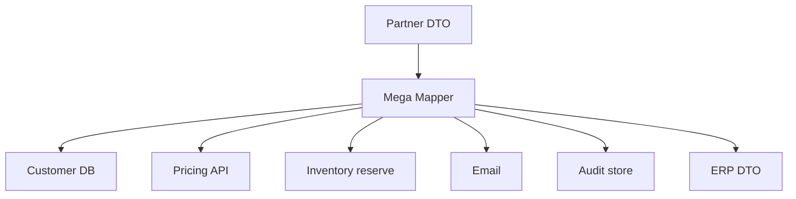
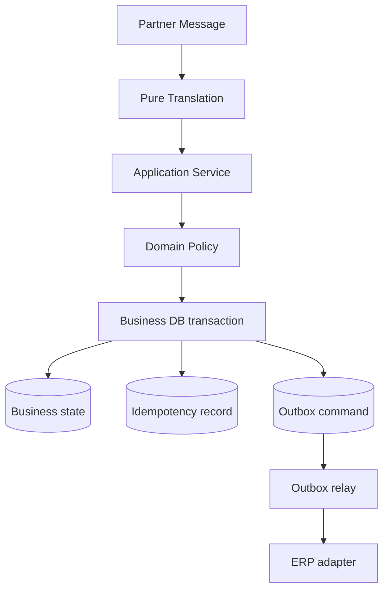
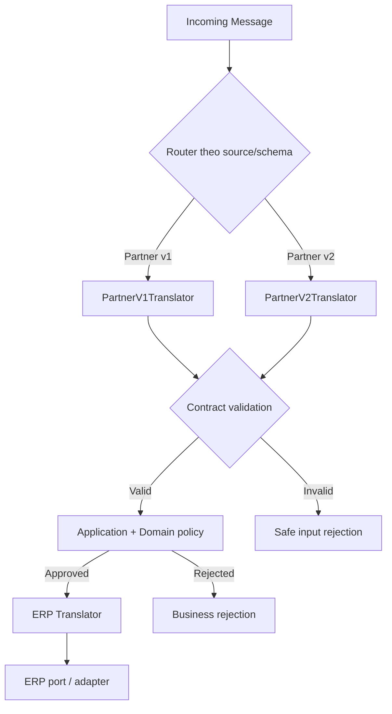

# Không gắn logic nghiệp vụ lớn vào mapping

Trong một hệ thống tích hợp, đối tác gửi yêu cầu tạo đơn với số tiền `"49.95"` USD, mã khách hàng `CUS-9` và các dòng hàng. ERP lại yêu cầu số tiền bằng cent, mã account ERP và tên trường khác. Một **Message Translator** có thể đổi dạng dữ liệu của đối tác thành lệnh ERP; đây là nhiệm vụ của mẫu Enterprise Integration Patterns (EIP) giúp hai hệ thống giao tiếp mà không phải chia sẻ trực tiếp mô hình dữ liệu.

Vấn đề xuất hiện khi hàm `mapPartnerToErp()` dần **truy vấn database khách hàng, kiểm tra hạn mức tín dụng, gọi pricing API, trừ tồn kho, áp dụng chiết khấu, gửi email và tự retry lệnh ERP**. Khi đó, hàm mang tên *mapping* thực tế là một application service khổng lồ: thay đổi schema vô tình kéo theo thay đổi business policy, unit test phải có DB/HTTP, retry có thể lặp side effect và sự cố mạng có thể bị hiểu nhầm là lỗi dữ liệu.

**Nguyên tắc:** Translator chỉ nên chịu trách nhiệm chuyển đổi **hợp đồng Message**: cấu trúc, trường, kiểu, enum, đơn vị, version và metadata cần thiết. **Domain policy** quyết định có duyệt đơn hay không; **application service** lấy dữ liệu và điều phối; **port/adapter** thực hiện I/O, transaction, transport và các hoạt động có side effect. Không phải mọi điều kiện `if` trong mapper đều sai: kiểm tra định dạng và tính khả biểu diễn của dữ liệu có thể là một phần của translation. Cần tách **logic dịch hợp đồng** khỏi **quy tắc nghiệp vụ lớn và việc tác động lên các hệ thống khác**.

Bài **Không gắn logic nghiệp vụ lớn vào mapping** thuộc chương **Message translator** của module `SPRING_INTEGRATION_PATTERN`. Mục tiêu module là học Enterprise Integration Patterns bằng Spring Integration để xây luồng Message ít phụ thuộc, dễ mở rộng, thực hành Router, Filter, Transformer, Splitter, Aggregator, Gateway, retry, error channel và correlation; đồng thời kiểm thử và theo dõi các nhánh. Bài dùng tình huống **Partner API → Canonical Order → Domain Approval → ERP** và cung cấp Java 17, Spring Integration DSL, JUnit, các failure window cùng checklist thiết kế.

## 1. Phân biệt ba loại trách nhiệm trong một luồng

Đối tác gửi:

```json
{
  "tenantId": "tenant-7",
  "eventId": "evt-1001",
  "orderId": "ORD-1001",
  "customerRef": "CUS-9",
  "expectedTotalText": "49.95",
  "currency": "USD",
  "lines": [
    {"lineNo": 1, "sku": "BOOK-01", "quantity": 2},
    {"lineNo": 2, "sku": "PEN-02", "quantity": 5}
  ]
}
```

ERP cần một command với `totalMinorUnits=4995`, `customerAccount="ERP-CUS-9"` và `positions[].materialCode`. Nhưng trước khi gửi, hệ thống phải biết khách hàng có được phép đặt hàng, báo giá server có khớp tổng do khách khai và hạn mức tín dụng có đủ hay không.

| Công việc | Ví dụ | Thành phần chịu trách nhiệm |
| --- | --- | --- |
| Đọc và đổi hợp đồng nguồn | String `"49.95"` → `BigDecimal("49.95")`, tên trường | Partner Translator |
| Lấy context đáng tin | Customer profile, giá sản phẩm hiện hành | Application service gọi port |
| Ra quyết định nghiệp vụ | Customer active, quote hợp lệ, hạn mức | Domain policy |
| Đổi sang hợp đồng đích | `BigDecimal USD` → số cent `long`, ERP field names | ERP Translator |
| Gửi command tới ERP | HTTP/broker request, timeout và retry | ERP port và adapter |


Trong bài, `ApprovedOrder` biểu thị **policy nội bộ cho phép gửi command**, không có nghĩa ERP đã commit hay fulfill.

## 2. Message Translator, Transformer và Anti-Corruption Layer

Một Message Translator EIP thường được hiện thực bằng **Message Transformer** trong Spring Integration. Hai tên gọi khác nhau ở **mục đích kiến trúc**:

| Khái niệm | Trọng tâm | Ví dụ |
| --- | --- | --- |
| Message Translator | Hai hệ thống khác hợp đồng hiểu nhau | Partner v1 → ERP v2 |
| Message Transformer | Kỹ thuật đổi payload/Message trong flow | String → DTO, đổi units |
| Normalizer | Nhiều định dạng về một canonical shape | CRM/ERP/CSV → CanonicalOrder |
| Envelope Wrapper | Bọc payload với metadata tích hợp | EventEnvelope chứa source/event ID |
| Channel Adapter | Kết nối external transport | HTTP outbound gateway, Kafka |
| Router | Chọn tuyến dựa trên thông tin Message | Source version → translator tương ứng |
| Domain policy | Quyết định nghiệp vụ | Duyệt hạn mức tín dụng |

Một **Anti-Corruption Layer (ACL)** có thể chứa nhiều Translator, validator và adapter để ngăn mô hình bên ngoài thấm vào domain. Nhưng ACL là **ranh giới kiến trúc**, không phải lý do để viết toàn bộ logic của ACL trong một hàm `map()`.

### 2.1. Nhiều dòng mapping không đồng nghĩa thiết kế xấu

Một mapper 150 dòng có thể hợp lý nếu nó đổi 50 trường cùng validation kiểu, enum, version và precision. Một mapper 20 dòng đã vượt ranh giới nếu gọi `paymentGateway.charge()` hoặc `inventory.reserve()`. Điều cần xem xét là **side effect, dependency và quyền ra quyết định**, không phải chỉ đếm dòng code.

### 2.2. Không cần Canonical Data Model trong mọi trường hợp

Với đúng hai hệ thống, dịch trực tiếp Partner → ERP có thể đủ. Nhưng khi có nhiều nguồn và đích, canonical model giúp dùng chung policy mà không nhân bản quy tắc trong từng mapper. Canonical model phải chứa **ngữ nghĩa chung thật sự**, không phải hợp nhất mọi field riêng của từng hệ thống.

## 3. Anti-pattern: Mega Mapper làm tất cả

```java
// ANTI-PATTERN: chỉ để nhận diện vấn đề, không dùng trong production.
public ErpCreateOrder map(PartnerOrderV1 order) {
    var customer = customerRepository.find(
            order.customerRef());
    if (!customer.isActive()) {
        throw new IllegalStateException("Inactive customer");
    }
    var quote = pricingClient.quote(order);
    if (quote.total().compareTo(customer.creditLimit()) > 0) {
        emailClient.sendRejectedNotice(order.orderId());
        throw new IllegalStateException("Credit limit exceeded");
    }
    inventoryService.reserve(order.lines());
    auditRepository.save(order.eventId());
    return erpDtoFrom(order, quote);
}
```

Mã trên trộn ít nhất năm loại công việc:

1. `customerRepository.find()` là **đọc state ngoài**.
2. `pricingClient.quote()` là **gọi network**.
3. Credit limit là **quyết định nghiệp vụ**.
4. `inventoryService.reserve()`, email và audit tạo **side effect**.
5. `erpDtoFrom()` mới là **translation sang hợp đồng ERP**.



Nếu Retry Advice chạy lại `map()` sau một timeout, email hoặc reservation có thể bị thực hiện nhiều lần. Nếu database hoặc pricing API lỗi, caller nhận một exception từ mapper mà khó phân biệt **input sai** với **sự cố hạ tầng**. Khi Partner v2 xuất hiện, developer dễ copy toàn bộ code, khiến cùng quy tắc tín dụng sống trong nhiều mapper.

**Đổi tên `map` thành `process` mà không thay ranh giới I/O và domain không giải quyết coupling**. Phải phân rã dependency và đặt rõ người sở hữu từng quyết định.

## 4. Quy tắc xác định điều kiện nào thuộc mapper

Một mapper nên gần với hàm:

\[
f(\text{source DTO},\text{mapping rules})=\text{target DTO}
\]

Với cùng đầu vào và cùng phiên bản mapping, nó cho cùng kết quả và **không** thay đổi database, gửi email, publish event hay tự đọc thông tin từ network.

| Câu hỏi | Vị trí gợi ý | Vì sao? |
| --- | --- | --- |
| String có parse thành decimal được không? | Translator / contract validation | Tính biểu diễn dữ liệu |
| Decimal có thể biểu diễn chính xác thành cents không? | ERP Translator | Hợp đồng đơn vị đích |
| Field bắt buộc thiếu? | Input contract validator | Không thể dịch an toàn |
| Mã ERP enum có giá trị nào? | Target Translator | Bảng enum của transport đích |
| Khách hàng hiện được phép đặt đơn? | Domain policy | Điều kiện kinh doanh |
| Giảm giá Gold được áp dụng bao nhiêu? | Pricing/Promotion domain | Chính sách thay đổi |
| Hạn mức còn đủ khi có 2 đơn cạnh tranh? | Domain service/transaction | Phụ thuộc state và concurrency |
| Gửi bằng Kafka hay HTTP? | Channel adapter | Transport |
| Timeout thì retry hay tra trạng thái ERP? | Application/error policy | Reliability |

Một số quy tắc như `quantity > 0` có thể thuộc **contract validation** hoặc **domain invariant**, tùy hệ thống. Quyết định ấy phải được ghi trong hợp đồng và test thống nhất; không âm thầm copy logic theo từng schema input.

### 4.1. Phân biệt chuyển đơn vị với tính giá

`49.95 USD → 4995 cents` là **một giá trị được biểu diễn bằng đơn vị khác**. `49.95 → 44.955` vì khách Gold giảm 10% là **quyết định về giá**. Việc làm tròn, thuế, phí vận chuyển và ai có quyền ưu đãi thuộc domain/pricing theo policy, không phải phép đổi tên field.

### 4.2. Tránh thời gian ẩn

Nếu mapper tự gọi `Instant.now()` để quyết định chiến dịch còn hạn, phép dịch phụ thuộc clock. Cùng payload replay ngày khác có thể cho kết quả khác. Application service/policy nên nhận **time context hoặc campaign snapshot có version** một cách tường minh.

## 5. Vì sao tách lớp giúp giảm coupling?

Giả sử ba nguồn Partner v1, Partner v2 và CSV cùng tạo đơn:

```text
Partner v1 ── Translator v1 ─┐
Partner v2 ── Translator v2 ─┤
CSV import ── CSV Translator ┴─> CanonicalOrder
                                      |
                            DomainApprovalPolicy
                                      |
                                 ApprovedOrder
                                      |
                              ERP v2 Translator
```

Khi công ty thay đổi hạn mức tín dụng, ta sửa policy/test của policy. Khi Partner v2 chuyển tiền từ decimal string sang integer minor units, ta sửa **PartnerV2Translator**. Khi ERP đổi schema, ta sửa **ErpV3Translator**. Các trục thay đổi không buộc toàn bộ flow thay đổi cùng một lúc.

Đây là ý nghĩa thực tế của **ít phụ thuộc** trong module `SPRING_INTEGRATION_PATTERN`, không đơn thuần là chia code vào nhiều file.

### 5.1. Tránh overengineering

Không cần tạo interface cho từng phép `String → BigDecimal`. Hãy tạo boundary khi có I/O, ownership khác, phiên bản hợp đồng khác hoặc nhiều implementation rõ. Domain policy đơn giản có thể là một class thuần, không cần framework phức tạp.

## 6. Luồng đề xuất và nguồn sự thật của giá

Một request Partner chứa `expectedTotalText`. Đây là **giá client khai**; nó không tự trở thành giá bán được phép. Trong ví dụ:

1. Partner Translator parse thành `CanonicalOrder.expectedTotal`.
2. `PricingPort` tạo `PriceQuote` từ một catalog giá do ứng dụng kiểm soát.
3. Domain policy so sánh `expectedTotal` với quote và xét trạng thái/hạn mức khách.
4. Khi approved, ERP Translator dùng **giá trong quote đã duyệt**, không lấy text đầu vào thô.
5. ERP port gửi command theo contract đích.

```text
Partner total = 49.95 (input claim)
    |
    v
CanonicalOrder.expectedTotal = BigDecimal("49.95")

Server price catalog:
  2 × BOOK-01 (10.00) = 20.00
  5 × PEN-02  (5.99)  = 29.95
  total = 49.95
    |
    v
Domain policy: match? customer active? credit limit?
    |
    v
ApprovedOrder.quote.total = 49.95
    |
    v
ErpCreateOrder.totalMinorUnits = 4995
```

Điểm then chốt: **không được tạo fake quote chỉ bằng cách copy expectedTotal và tự gọi nó là authoritative**, vì khi đó so sánh giá không còn ý nghĩa. Fake pricing trong bài sẽ dùng bảng giá riêng; production cần pricing engine, thuế, promotion, currency và concurrency theo domain thật.

## 7. Các kiểu DTO ở những boundary khác nhau

Các `record` Java 17 sau là **mô hình minh họa**, được đặt cùng một class chứa kiểu lồng nhau để các ví dụ khác import dễ dàng.

```java
package example.integration;

import java.math.BigDecimal;
import java.util.List;

public final class OrderContracts {

    private OrderContracts() {
    }

    public record PartnerLine(int lineNo, String sku, int quantity) {
    }

    public record PartnerOrderV1(
            String tenantId,
            String eventId,
            String orderId,
            String customerRef,
            String expectedTotalText,
            String currency,
            List<PartnerLine> lines) {
    }

    public record CanonicalLine(int lineNo, String sku, int quantity) {
    }

    public record CanonicalOrder(
            String tenantId,
            String eventId,
            String orderId,
            String customerRef,
            BigDecimal expectedTotal,
            String currency,
            List<CanonicalLine> lines) {
        public CanonicalOrder {
            lines = List.copyOf(lines);
        }
    }

    public record CustomerProfile(
            String tenantId,
            String customerRef,
            boolean active,
            BigDecimal creditLimit) {
    }

    public record PriceQuote(
            BigDecimal total,
            String currency,
            String priceListVersion) {
    }

    // Được policy duyệt để gửi ERP, không phải ERP đã hoàn tất.
    public record ApprovedOrder(
            CanonicalOrder order,
            PriceQuote quote) {
    }

    public record ErpLine(
            int position, String materialCode, int units) {
    }

    public record ErpCreateOrder(
            String tenant,
            String sourceEventId,
            String externalDocumentId,
            String customerAccount,
            long totalMinorUnits,
            String currencyCode,
            List<ErpLine> positions,
            String idempotencyKey) {
    }

    public record ErpReceipt(
            String sourceEventId,
            String externalDocumentId,
            String erpDocumentId,
            String resultCode) {
    }

    public record PartnerReceipt(
            String eventId,
            String orderId,
            String erpReference,
            String status) {
    }
}
```

Phân biệt các kiểu:

- `PartnerOrderV1`: dữ liệu nguồn theo hợp đồng Partner.
- `CanonicalOrder`: dữ liệu chuẩn, chưa quyết định business approval.
- `CustomerProfile` và `PriceQuote`: context được application service lấy từ các nguồn tin cậy.
- `ApprovedOrder`: kết quả policy cho phép tạo command, **không** xác nhận remote success.
- `ErpCreateOrder`: hợp đồng gửi tới ERP.
- `ErpReceipt`: kết quả theo ngôn ngữ ERP.
- `PartnerReceipt`: phản hồi theo ngôn ngữ Partner.

`List.copyOf` giúp không thay đổi list sau khi tạo canonical order, nhưng không thay thế validation, serialization và quyền truy cập. Production cần schema version, nullable policy, authentication và những invariant domain cụ thể.

## 8. Partner Translator thuần: chỉ xử lý input contract

```java
package example.integration;

import java.math.BigDecimal;
import java.util.HashSet;
import java.util.List;
import java.util.Set;

import example.integration.OrderContracts.*;

public final class PartnerTranslator {

    public CanonicalOrder toCanonical(PartnerOrderV1 source) {
        if (source == null) {
            throw new IllegalArgumentException(
                    "PARTNER_ORDER_REQUIRED");
        }

        String tenant = requiredId(source.tenantId(), "TENANT");
        String event = requiredId(source.eventId(), "EVENT");
        String order = requiredId(source.orderId(), "ORDER");
        String customer = requiredId(
                source.customerRef(), "CUSTOMER");
        String currency = requireUsd(source.currency());
        BigDecimal expected = parseAmount(source.expectedTotalText());
        List<CanonicalLine> lines = mapLines(source.lines());

        return new CanonicalOrder(
                tenant, event, order, customer,
                expected, currency, lines);
    }

    private static String requiredId(String value, String kind) {
        if (value == null
                || !value.matches("[A-Za-z0-9_-]{1,80}")) {
            throw new IllegalArgumentException(
                    "INVALID_" + kind + "_ID");
        }
        return value;
    }

    private static String requireUsd(String currency) {
        // Demo chỉ dịch đúng hợp đồng USD với hai chữ số lẻ.
        if (!"USD".equals(currency)) {
            throw new IllegalArgumentException(
                    "UNSUPPORTED_CURRENCY");
        }
        return currency;
    }

    private static BigDecimal parseAmount(String value) {
        if (value == null
                || !value.matches("[0-9]{1,12}(\\.[0-9]{1,2})?")) {
            throw new IllegalArgumentException(
                    "INVALID_AMOUNT_FORMAT");
        }
        return new BigDecimal(value).setScale(2);
    }

    private static List<CanonicalLine> mapLines(
            List<PartnerLine> source) {
        if (source == null || source.isEmpty()
                || source.size() > 100) {
            throw new IllegalArgumentException(
                    "INVALID_LINE_COUNT");
        }
        Set<Integer> positions = new HashSet<>();
        return source.stream().map(line -> {
            if (line == null
                    || line.lineNo() < 1
                    || line.lineNo() > source.size()
                    || !positions.add(line.lineNo())) {
                throw new IllegalArgumentException(
                        "INVALID_LINE_POSITION");
            }
            if (line.quantity() <= 0) {
                throw new IllegalArgumentException(
                        "INVALID_LINE_QUANTITY");
            }
            return new CanonicalLine(
                    line.lineNo(),
                    requiredId(line.sku(), "SKU"),
                    line.quantity());
        }).toList();
    }
}
```

### 8.1. Vì sao mapper vẫn có nhiều `if`?

Các điều kiện trên kiểm tra **contract**, không phải chính sách tín dụng: ID đúng format, tiền parse được, số lượng có thể biểu diễn, lineNo không trùng. Nếu dự án xem số lượng dương là domain invariant thay vì schema constraint, hãy chuyển validation đó sang domain; điểm quan trọng là không copy **quy tắc kinh doanh biến động** vào từng source mapper.

### 8.2. Không để mapper tự gọi `Instant.now()` hoặc nguồn dữ liệu ngoài

Mapper nhận đầy đủ input để tạo canonical DTO. Nó không tự tạo giá bán, không gọi repository, không giữ tồn kho, không gửi email. Với cùng input, nó tạo cùng canonical value và có thể được unit test **không cần Spring context**.

### 8.3. Không dùng `double` cho tiền

`BigDecimal("49.95")` tránh những sai số biểu diễn nhị phân có thể xảy ra khi dùng floating point. Đối với ERP chỉ nhận cents, bước chuyển sang `long` nên sử dụng phép chuyển **exact**, không ép kiểu âm thầm làm tròn.

## 9. Ports đưa business context vào policy

Application service cần hồ sơ khách và báo giá tin cậy, nhưng mapper **không được tự đi tìm**. Định nghĩa port:

```java
package example.integration;

import example.integration.OrderContracts.*;

@FunctionalInterface
public interface CustomerProfilePort {
    CustomerProfile find(String tenantId, String customerRef);
}
```

```java
package example.integration;

import example.integration.OrderContracts.*;

@FunctionalInterface
public interface PricingPort {
    PriceQuote price(CanonicalOrder order);
}
```

Implementation thật có thể dùng JDBC, REST, cache hoặc domain service. Lỗi kết nối của chúng phải được phân loại là **dependency failure**, không giả là `INVALID_AMOUNT_FORMAT`.

**Đừng tạo port cho mọi phép đổi String.** Interface có ý nghĩa khi có external resource, nhiều implementation hoặc ownership boundary thật. Đây là phương tiện tách trách nhiệm, không phải mục tiêu tự thân.

## 10. Domain policy thuần: một nơi sở hữu luật duyệt đơn

```java
package example.integration;

import java.math.BigDecimal;
import java.util.Objects;

import example.integration.OrderContracts.*;

public final class DomainApprovalPolicy {

    public static final class Rejection
            extends RuntimeException {
        private final String code;

        public Rejection(String code) {
            super(code);
            this.code = code;
        }

        public String code() {
            return code;
        }
    }

    public ApprovedOrder approve(
            CanonicalOrder order,
            CustomerProfile customer,
            PriceQuote quote) {

        Objects.requireNonNull(order, "order");
        Objects.requireNonNull(customer, "customer");
        Objects.requireNonNull(quote, "quote");

        if (!order.tenantId().equals(customer.tenantId())
                || !order.customerRef().equals(
                        customer.customerRef())) {
            throw new Rejection("CUSTOMER_SCOPE_MISMATCH");
        }
        if (!customer.active()) {
            throw new Rejection("CUSTOMER_INACTIVE");
        }
        // Ví dụ business rule; không phải giới hạn Spring Integration.
        if (order.lines().size() > 20) {
            throw new Rejection("ORDER_TOO_MANY_LINES");
        }
        if (quote.total() == null
                || quote.total().compareTo(BigDecimal.ZERO) < 0
                || !"USD".equals(quote.currency())) {
            throw new Rejection("PRICE_QUOTE_INVALID");
        }
        if (order.expectedTotal().compareTo(quote.total()) != 0) {
            throw new Rejection("ORDER_TOTAL_MISMATCH");
        }
        if (customer.creditLimit() == null
                || quote.total().compareTo(
                        customer.creditLimit()) > 0) {
            throw new Rejection("CREDIT_LIMIT_EXCEEDED");
        }
        return new ApprovedOrder(order, quote);
    }
}
```

Policy chỉ nhận value objects và trả decision; không đọc database hay gọi pricing HTTP. Đó là **logic nghiệp vụ lớn cần được test và version riêng**, khác với việc đổi đơn vị tiền ở Translator.

### 10.1. Hạn mức trong demo là minh họa, không phải kiểm soát tài chính hoàn chỉnh

Credit limit thực tế thường phụ thuộc số dư, công nợ đang chờ, currency, nhiều lệnh đồng thời và reservation. So sánh quote với `creditLimit` là ví dụ để học **tách policy khỏi mapper**, chưa chứng minh ngăn vượt hạn mức trong production. Những bất biến tài chính cần transaction/locking hoặc reservation protocol phù hợp.

### 10.2. Tại sao trả `ApprovedOrder`?

`ApprovedOrder` là một **kiểu mang quyết định tường minh**. ERP Translator nhận kiểu đó, thay vì có thể được gọi trực tiếp từ DTO chưa được policy đánh giá. Nếu nghiệp vụ có nhiều kết quả, một kiểu `Decision.Approved/Rejected` có thể phù hợp hơn; ở bài này dùng `Rejection` có mã cố định để minh họa lỗi nghiệp vụ.

## 11. Application service: I/O và orchestration ở đúng chỗ

`OrderApplicationService` được phép gọi các port để **lấy dữ liệu đã kiểm chứng**, sau đó giao decision cho policy:

```java
package example.integration;

import java.util.Objects;

import example.integration.OrderContracts.*;

public final class OrderApplicationService {

    private final CustomerProfilePort customers;
    private final PricingPort pricing;
    private final DomainApprovalPolicy policy;

    public OrderApplicationService(
            CustomerProfilePort customers,
            PricingPort pricing,
            DomainApprovalPolicy policy) {
        this.customers = Objects.requireNonNull(customers);
        this.pricing = Objects.requireNonNull(pricing);
        this.policy = Objects.requireNonNull(policy);
    }

    public ApprovedOrder prepare(CanonicalOrder order) {
        CustomerProfile customer =
                customers.find(order.tenantId(), order.customerRef());
        PriceQuote quote = pricing.price(order);
        return policy.approve(order, customer, quote);
    }
}
```

Ba bước bên trong khác rõ ràng:

1. `customers.find(...)`: truy xuất state bên ngoài domain policy.
2. `pricing.price(...)`: lấy báo giá từ một nguồn mà ứng dụng xem là đáng tin.
3. `policy.approve(...)`: đánh giá business rules **không làm I/O**.

`prepare()` chưa gửi ERP và chưa cam kết giao dịch nghiệp vụ. Khi cần reserve credit, giữ inventory hoặc phát lệnh bền vững, application service phải được bổ sung **transaction boundary/outbox/workflow**. Không đưa những tác vụ này trở lại `PartnerTranslator` chỉ vì mapper ở đầu pipeline.

### 11.1. Không làm giá từ client thành nguồn sự thật

Một anti-pattern tinh vi:

```java
PriceQuote quote = new PriceQuote(
        order.expectedTotal(), order.currency(), "server-price");
```

Đoạn này chỉ đổi nhãn từ client price thành “server-price”. So sánh `expectedTotal` với `quote.total()` luôn đúng và **không bảo vệ** khỏi thao túng giá.

Trong demo tiếp theo, `DemoPricingPort` có một **bảng giá riêng**, để người học quan sát trường hợp input decimal hợp lệ nhưng khác giá được phép.

## 12. ERP Translator: chỉ đổi ApprovedOrder thành hợp đồng ERP

ERP v2 dùng `long totalMinorUnits`, `customerAccount`, `positions` và `sourceEventId`. Translator đích cần đổi kiểu và đơn vị, **không tự phê duyệt thêm một lần**.

```java
package example.integration;

import java.math.BigDecimal;
import java.util.List;

import example.integration.OrderContracts.*;

public final class ErpTranslator {

    public ErpCreateOrder toErp(ApprovedOrder approved) {
        if (approved == null || approved.order() == null
                || approved.quote() == null) {
            throw new IllegalArgumentException(
                    "APPROVED_ORDER_REQUIRED");
        }

        CanonicalOrder order = approved.order();
        PriceQuote quote = approved.quote();

        if (!"USD".equals(quote.currency())) {
            throw new IllegalArgumentException(
                    "UNSUPPORTED_ERP_CURRENCY");
        }

        long cents = toMinorUnits(quote.total());
        List<ErpLine> positions = order.lines().stream()
                .map(line -> new ErpLine(
                        line.lineNo(),
                        line.sku(),
                        line.quantity()))
                .toList();

        String idempotencyKey =
                order.tenantId() + ":PARTNER_API:"
                + order.eventId() + ":CREATE_ORDER";

        return new ErpCreateOrder(
                order.tenantId(),
                order.eventId(),
                order.orderId(),
                "ERP-" + order.customerRef(),
                cents,
                quote.currency(),
                positions,
                idempotencyKey);
    }

    private static long toMinorUnits(BigDecimal amount) {
        if (amount == null || amount.signum() < 0) {
            throw new IllegalArgumentException(
                    "INVALID_ERP_AMOUNT");
        }
        try {
            // Phải exact: số lẻ cent hoặc overflow đều không hợp lệ.
            return amount.multiply(new BigDecimal("100"))
                    .longValueExact();
        } catch (ArithmeticException ex) {
            throw new IllegalArgumentException(
                    "ERP_AMOUNT_NOT_REPRESENTABLE", ex);
        }
    }

    public PartnerReceipt toPartnerReceipt(ErpReceipt response) {
        if (response == null) {
            throw new IllegalArgumentException(
                    "ERP_RECEIPT_REQUIRED");
        }
        return switch (response.resultCode()) {
            case "ACCEPTED" -> new PartnerReceipt(
                    response.sourceEventId(),
                    response.externalDocumentId(),
                    response.erpDocumentId(),
                    "SUBMITTED");
            case "REJECTED" -> new PartnerReceipt(
                    response.sourceEventId(),
                    response.externalDocumentId(),
                    null,
                    "REJECTED");
            default -> throw new IllegalArgumentException(
                    "UNKNOWN_ERP_RESULT");
        };
    }
}
```

### 12.1. Giá đi tới ERP là giá quote đã được duyệt

`totalMinorUnits` được tạo từ `approved.quote().total()`, **không** parse lại raw `expectedTotalText` của Partner. Nhờ đó target mapper không vô tình bỏ qua kết quả domain policy.

### 12.2. Việc chuyển 49.95 USD thành 4995 cents không phải tính giá

Đây là phép biến đổi **cùng một giá trị qua hai đơn vị biểu diễn**. Việc quyết định có giảm giá, giảm bao nhiêu hoặc cộng thuế nào thuộc pricing/promotion domain. Demo chỉ dùng USD; không được mặc định mọi currency có hai chữ số thập phân.

### 12.3. Giả định cần thay trong production

Ở ví dụ, `customerAccount="ERP-"+customerRef` và mã SKU giữ nguyên. Trong thực tế, CRM/Partner customer ID và ERP account ID có thể thuộc hai namespace không tương đương. Nếu phải lookup, application service nên lấy `ResolvedCustomerIdentity` qua một port riêng rồi **truyền vào target Translator**. Không chôn HTTP/database lookup trong mapper.

Đồng thời, kết quả `ACCEPTED` của fake ERP được dịch thành `SUBMITTED` chỉ theo **hợp đồng demo**; ERP thật có thể phân biệt accepted, posted, committed, fulfilled. Cần mapping trạng thái dựa trên contract thật.

## 13. Fake ports: mô phỏng business context và ERP transport

Để test flow không cần PostgreSQL hay REST server, ta tạo fake cho các port. Fake không được xem là production integration.

```java
package example.integration;

import java.math.BigDecimal;

import example.integration.OrderContracts.*;

public final class DemoCustomerProfilePort
        implements CustomerProfilePort {

    @Override
    public CustomerProfile find(
            String tenantId, String customerRef) {
        if (!"tenant-7".equals(tenantId)
                || !"CUS-9".equals(customerRef)) {
            throw new DomainApprovalPolicy.Rejection(
                    "CUSTOMER_NOT_FOUND");
        }
        return new CustomerProfile(
                tenantId, customerRef, true,
                new BigDecimal("100.00"));
    }
}
```

`DemoPricingPort` sử dụng giá riêng của server demo:

```java
package example.integration;

import java.math.BigDecimal;

import example.integration.OrderContracts.*;

public final class DemoPricingPort implements PricingPort {

    @Override
    public PriceQuote price(CanonicalOrder order) {
        BigDecimal total = BigDecimal.ZERO;
        for (CanonicalLine line : order.lines()) {
            BigDecimal unitPrice = switch (line.sku()) {
                case "BOOK-01" -> new BigDecimal("10.00");
                case "PEN-02" -> new BigDecimal("5.99");
                default -> throw new DomainApprovalPolicy.Rejection(
                        "SKU_NOT_PRICED");
            };
            total = total.add(unitPrice.multiply(
                    BigDecimal.valueOf(line.quantity())));
        }
        return new PriceQuote(
                total, "USD", "demo-price-list-v1");
    }
}
```

Với hai quyển sách và năm cây bút:

\[
2\times 10.00+5\times 5.99=49.95\ \text{USD}
\]

ERP port là boundary riêng:

```java
package example.integration;

import example.integration.OrderContracts.*;

@FunctionalInterface
public interface ErpSubmissionPort {
    ErpReceipt submit(ErpCreateOrder command);
}
```

Implementation fake ghi số lần được gọi:

```java
package example.integration;

import java.util.concurrent.atomic.AtomicInteger;
import java.util.concurrent.atomic.AtomicReference;

import example.integration.OrderContracts.*;

public final class RecordingErpSubmissionPort
        implements ErpSubmissionPort {

    private final AtomicInteger calls = new AtomicInteger();
    private final AtomicReference<ErpCreateOrder> last =
            new AtomicReference<>();

    @Override
    public ErpReceipt submit(ErpCreateOrder command) {
        last.set(command);
        calls.incrementAndGet();
        return new ErpReceipt(
                command.sourceEventId(),
                command.externalDocumentId(),
                "ERP-DOC-777",
                "ACCEPTED");
    }

    public int submissionCount() {
        return calls.get();
    }

    public ErpCreateOrder lastCommand() {
        return last.get();
    }
}
```

Fake port **không có idempotency**: nếu gọi `submit()` hai lần, `calls` tăng hai. Đây là điều kiện chủ ý để chứng minh **mapping thuần không tự làm side effect ERP đúng một lần**. Khi triển khai thật, phải xem idempotency của ERP, durable state, response loss và reconciliation.

## 14. Java DSL: thể hiện ranh giới bằng các endpoint riêng

Một Spring Integration flow có thể ghép các bước:

```text
partnerOrdersInput
  -> PartnerTranslator.toCanonical
  -> OrderApplicationService.prepare
  -> ErpTranslator.toErp
  -> ErpSubmissionPort.submit
  -> ErpTranslator.toPartnerReceipt
  -> partnerReceipts
```

```java
package example.integration;

import org.springframework.context.annotation.Bean;
import org.springframework.context.annotation.Configuration;
import org.springframework.integration.channel.DirectChannel;
import org.springframework.integration.channel.QueueChannel;
import org.springframework.integration.config.EnableIntegration;
import org.springframework.integration.dsl.IntegrationFlow;
import org.springframework.messaging.MessageChannel;
import org.springframework.messaging.PollableChannel;

import example.integration.OrderContracts.*;

@Configuration
@EnableIntegration
public class SeparatedTranslatorFlowConfiguration {

    @Bean
    public MessageChannel partnerOrdersInput() {
        return new DirectChannel();
    }

    @Bean
    public PollableChannel partnerReceipts() {
        return new QueueChannel(20);
    }

    @Bean
    public PartnerTranslator partnerTranslator() {
        return new PartnerTranslator();
    }

    @Bean
    public DomainApprovalPolicy approvalPolicy() {
        return new DomainApprovalPolicy();
    }

    @Bean
    public CustomerProfilePort customerProfilePort() {
        return new DemoCustomerProfilePort();
    }

    @Bean
    public PricingPort pricingPort() {
        return new DemoPricingPort();
    }

    @Bean
    public OrderApplicationService applicationService(
            CustomerProfilePort customers,
            PricingPort pricing,
            DomainApprovalPolicy policy) {
        return new OrderApplicationService(
                customers, pricing, policy);
    }

    @Bean
    public ErpTranslator erpTranslator() {
        return new ErpTranslator();
    }

    @Bean
    public RecordingErpSubmissionPort erpSubmissionPort() {
        return new RecordingErpSubmissionPort();
    }

    @Bean
    public IntegrationFlow partnerToErpFlow(
            PartnerTranslator partnerTranslator,
            OrderApplicationService application,
            ErpTranslator erpTranslator,
            ErpSubmissionPort erpPort) {

        return IntegrationFlow.from("partnerOrdersInput")
                .transform(PartnerOrderV1.class,
                        partnerTranslator::toCanonical)
                .handle(CanonicalOrder.class,
                        (order, headers) -> application.prepare(order))
                .transform(ApprovedOrder.class,
                        erpTranslator::toErp)
                .handle(ErpCreateOrder.class,
                        (command, headers) -> erpPort.submit(command))
                .transform(ErpReceipt.class,
                        erpTranslator::toPartnerReceipt)
                .channel("partnerReceipts")
                .get();
    }
}
```

### 14.1. Vì sao `.transform` xen kẽ `.handle`?

| Endpoint | Vai trò |
| --- | --- |
| `transform(PartnerOrderV1, ...)` | Dịch source contract thành canonical DTO |
| `handle(CanonicalOrder, ...)` | Gọi application service: dữ liệu và domain decision |
| `transform(ApprovedOrder, ...)` | Dịch sang ERP command |
| `handle(ErpCreateOrder, ...)` | Gọi ERP port; đây là side effect boundary |
| `transform(ErpReceipt, ...)` | Dịch phản hồi ERP thành Partner receipt |

Chọn DSL endpoint phù hợp **không tự thực thi ranh giới kiến trúc**. Developer vẫn có thể viết một `.transform(...)` gọi HTTP nếu muốn; ranh giới phải được bảo vệ bằng code review, dependency structure và tests.

### 14.2. Cấu hình này mang tính demo đồng bộ

`DirectChannel` xử lý trên caller thread; `QueueChannel(20)` ở cuối để demo/test đọc kết quả. Queue này **không bền vững qua restart**. Flow chưa có transaction DB, broker ACK, durable outbox hay remote ERP thật; chúng phải được xây riêng ở các boundary thực.

### 14.3. Gateway không tự được bảo đảm bởi output queue

Nếu dùng `@MessagingGateway`, cần cấu hình request/reply route và timeout phù hợp. Không mặc định một Gateway sẽ nhận phản hồi khi flow kết thúc vào `QueueChannel` tùy ý; nên test Gateway với channel/reply configuration thực tế. Với ERP async qua broker, cần completion state và correlation qua transport.

## 15. Demo: một đơn hàng đi qua translation, policy và ERP port

```java
package example.integration;

import java.util.List;

import org.springframework.context.annotation.AnnotationConfigApplicationContext;
import org.springframework.messaging.Message;
import org.springframework.messaging.MessageChannel;
import org.springframework.messaging.PollableChannel;
import org.springframework.messaging.support.MessageBuilder;

import example.integration.OrderContracts.*;

public class SeparatedTranslatorDemo {

    public static void main(String[] args) {
        try (var context = new AnnotationConfigApplicationContext(
                SeparatedTranslatorFlowConfiguration.class)) {

            MessageChannel input = context.getBean(
                    "partnerOrdersInput", MessageChannel.class);
            PollableChannel output = context.getBean(
                    "partnerReceipts", PollableChannel.class);
            RecordingErpSubmissionPort erp = context.getBean(
                    RecordingErpSubmissionPort.class);

            PartnerOrderV1 order = new PartnerOrderV1(
                    "tenant-7", "evt-1001", "ORD-1001",
                    "CUS-9", "49.95", "USD",
                    List.of(
                            new PartnerLine(1, "BOOK-01", 2),
                            new PartnerLine(2, "PEN-02", 5)));

            input.send(MessageBuilder.withPayload(order).build());

            Message<?> message = output.receive(0);
            if (message == null) {
                throw new IllegalStateException(
                        "Expected PartnerReceipt");
            }
            PartnerReceipt receipt =
                    (PartnerReceipt) message.getPayload();

            System.out.println(receipt.status()); // SUBMITTED
            System.out.println(erp.submissionCount()); // 1
            System.out.println(
                    erp.lastCommand().totalMinorUnits()); // 4995
            System.out.println(
                    erp.lastCommand().idempotencyKey());
            // tenant-7:PARTNER_API:evt-1001:CREATE_ORDER
        }
    }
}
```

Ở demo, chỉ có fake ERP trả `ACCEPTED`, nên `PartnerReceipt.status=SUBMITTED` phản ánh **quy tắc mapping giả định**, không phải bằng chứng ERP đã tạo đơn hay commit. Một ERP thật cần hợp đồng xác định `ACCEPTED` là accepted into queue, validated, posted hay fulfilled.

## 16. JUnit 5: Partner Mapper chỉ cần input, không cần Spring

Unit test mapper phải trả lời: dữ liệu có được dịch đúng không, *không* cần hỏi database hoặc giả lập HTTP.

```java
package example.integration;

import static org.junit.jupiter.api.Assertions.*;

import java.math.BigDecimal;
import java.util.List;

import org.junit.jupiter.api.Test;

import example.integration.OrderContracts.*;

class PartnerTranslatorTest {

    private final PartnerTranslator translator =
            new PartnerTranslator();

    static PartnerOrderV1 validRequest() {
        return new PartnerOrderV1(
                "tenant-7", "evt-1001", "ORD-1001",
                "CUS-9", "49.95", "USD",
                List.of(
                        new PartnerLine(1, "BOOK-01", 2),
                        new PartnerLine(2, "PEN-02", 5)));
    }

    @Test
    void mapsShapeWithoutRunningBusinessDecision() {
        CanonicalOrder order =
                translator.toCanonical(validRequest());

        assertEquals("evt-1001", order.eventId());
        assertEquals("CUS-9", order.customerRef());
        assertEquals(new BigDecimal("49.95"),
                order.expectedTotal());
        assertEquals("BOOK-01", order.lines().get(0).sku());
        assertEquals(5, order.lines().get(1).quantity());
    }

    @Test
    void sameInputProducesSameCanonicalData() {
        assertEquals(
                translator.toCanonical(validRequest()),
                translator.toCanonical(validRequest()));
    }

    @Test
    void malformedAmountIsContractError() {
        PartnerOrderV1 bad = new PartnerOrderV1(
                "tenant-7", "evt-1001", "ORD-1001",
                "CUS-9", "49.999", "USD",
                List.of(new PartnerLine(1, "BOOK-01", 2)));

        var ex = assertThrows(
                IllegalArgumentException.class,
                () -> translator.toCanonical(bad));
        assertEquals("INVALID_AMOUNT_FORMAT", ex.getMessage());
    }

    @Test
    void duplicateLineNumbersAreRejected() {
        PartnerOrderV1 bad = new PartnerOrderV1(
                "tenant-7", "evt-1001", "ORD-1001",
                "CUS-9", "49.95", "USD",
                List.of(
                        new PartnerLine(1, "BOOK-01", 2),
                        new PartnerLine(1, "PEN-02", 5)));
        assertThrows(IllegalArgumentException.class,
                () -> translator.toCanonical(bad));
    }
}
```

**Đây là một tín hiệu kiến trúc quan trọng:** không phải mock repository, pricing API, clock hoặc ERP port chỉ để kiểm tra `String → BigDecimal`. Mapper được tái chạy để kiểm tra format mà không làm thay đổi tồn kho hoặc gửi lệnh.

Unit test tự nó không chặn hoàn toàn một developer thêm network call trong tương lai; cần thêm dependency rules/static analysis hoặc review tương ứng nếu hệ thống yêu cầu bảo vệ nghiêm ngặt boundary.

## 17. JUnit 5: domain policy không biết input từ Partner v1

Tạo canonical data và domain context trực tiếp để test luật kinh doanh:

```java
package example.integration;

import static org.junit.jupiter.api.Assertions.*;

import java.math.BigDecimal;
import java.util.List;

import org.junit.jupiter.api.Test;

import example.integration.OrderContracts.*;

class DomainApprovalPolicyTest {

    private final DomainApprovalPolicy policy =
            new DomainApprovalPolicy();

    private static CanonicalOrder order() {
        return new CanonicalOrder(
                "tenant-7", "evt-1001", "ORD-1001",
                "CUS-9", new BigDecimal("49.95"), "USD",
                List.of(
                        new CanonicalLine(1, "BOOK-01", 2),
                        new CanonicalLine(2, "PEN-02", 5)));
    }

    private static CustomerProfile customer(
            boolean active, String limit) {
        return new CustomerProfile(
                "tenant-7", "CUS-9", active,
                new BigDecimal(limit));
    }

    private static PriceQuote quote(String total) {
        return new PriceQuote(
                new BigDecimal(total), "USD", "price-list-v1");
    }

    @Test
    void approvesMatchingTrustedQuoteForActiveCustomer() {
        ApprovedOrder result = policy.approve(
                order(), customer(true, "100.00"), quote("49.95"));
        assertEquals("ORD-1001", result.order().orderId());
        assertEquals(new BigDecimal("49.95"),
                result.quote().total());
    }

    @Test
    void rejectsInactiveCustomerByBusinessRule() {
        var ex = assertThrows(
                DomainApprovalPolicy.Rejection.class,
                () -> policy.approve(
                        order(), customer(false, "100.00"),
                        quote("49.95")));
        assertEquals("CUSTOMER_INACTIVE", ex.code());
    }

    @Test
    void validDecimalButMismatchedPriceIsBusinessRejection() {
        var ex = assertThrows(
                DomainApprovalPolicy.Rejection.class,
                () -> policy.approve(
                        order(), customer(true, "100.00"),
                        quote("49.96")));
        assertEquals("ORDER_TOTAL_MISMATCH", ex.code());
    }

    @Test
    void creditLimitRuleChangesWithoutChangingMapper() {
        var ex = assertThrows(
                DomainApprovalPolicy.Rejection.class,
                () -> policy.approve(
                        order(), customer(true, "40.00"),
                        quote("49.95")));
        assertEquals("CREDIT_LIMIT_EXCEEDED", ex.code());
    }
}
```

Test này chạy **không cần Spring Context, Partner DTO hay ERP DTO**. Tách này cho phép thay đổi business rule độc lập với hợp đồng đầu vào/đầu ra.

### 17.1. Unit test policy không chứng minh tính nhất quán tài chính

Hai transaction đồng thời có thể cùng nhìn thấy hạn mức còn đủ trước khi cả hai ghi reservation. Nếu cần chống overspending, phải test transaction/locking hoặc một reservation protocol thật. Ví dụ chỉ minh họa **nơi đặt business decision**.

## 18. JUnit 5: ERP mapping và toàn luồng trong Spring context

### 18.1. Test ERP Translator bằng ApprovedOrder

```java
package example.integration;

import static org.junit.jupiter.api.Assertions.*;

import java.math.BigDecimal;
import java.util.List;

import org.junit.jupiter.api.Test;

import example.integration.OrderContracts.*;

class ErpTranslatorTest {

    @Test
    void approvedOrderMapsExactlyToErpCents() {
        CanonicalOrder order = new CanonicalOrder(
                "tenant-7", "evt-1001", "ORD-1001",
                "CUS-9", new BigDecimal("49.95"), "USD",
                List.of(new CanonicalLine(1, "BOOK-01", 2)));

        ApprovedOrder approved = new ApprovedOrder(
                order,
                new PriceQuote(new BigDecimal("49.95"),
                        "USD", "price-v1"));

        ErpCreateOrder command = new ErpTranslator().toErp(approved);
        assertEquals(4995L, command.totalMinorUnits());
        assertEquals("ERP-CUS-9", command.customerAccount());
        assertEquals("BOOK-01",
                command.positions().get(0).materialCode());
        assertEquals(
                "tenant-7:PARTNER_API:evt-1001:CREATE_ORDER",
                command.idempotencyKey());
    }

    @Test
    void acceptedReplyMeansSubmittedInThisDemoContract() {
        PartnerReceipt receipt = new ErpTranslator()
                .toPartnerReceipt(new ErpReceipt(
                        "evt-1001", "ORD-1001",
                        "ERP-DOC-777", "ACCEPTED"));
        assertEquals("SUBMITTED", receipt.status());
        assertEquals("ERP-DOC-777", receipt.erpReference());
    }
}
```

### 18.2. Test integration đi qua các endpoint thật

```java
package example.integration;

import static org.junit.jupiter.api.Assertions.*;

import java.util.List;

import org.junit.jupiter.api.Test;
import org.springframework.context.annotation.AnnotationConfigApplicationContext;
import org.springframework.messaging.Message;
import org.springframework.messaging.MessageChannel;
import org.springframework.messaging.PollableChannel;
import org.springframework.messaging.support.MessageBuilder;

import example.integration.OrderContracts.*;

class SeparatedTranslatorFlowIntegrationTest {

    private static PartnerOrderV1 request(String total) {
        return new PartnerOrderV1(
                "tenant-7", "evt-1001", "ORD-1001",
                "CUS-9", total, "USD",
                List.of(
                        new PartnerLine(1, "BOOK-01", 2),
                        new PartnerLine(2, "PEN-02", 5)));
    }

    @Test
    void approvedOrderReachesErpAfterPolicy() {
        try (var context = new AnnotationConfigApplicationContext(
                SeparatedTranslatorFlowConfiguration.class)) {

            MessageChannel input = context.getBean(
                    "partnerOrdersInput", MessageChannel.class);
            PollableChannel output = context.getBean(
                    "partnerReceipts", PollableChannel.class);
            RecordingErpSubmissionPort port = context.getBean(
                    RecordingErpSubmissionPort.class);

            assertTrue(input.send(
                    MessageBuilder.withPayload(
                            request("49.95")).build()));

            Message<?> result = output.receive(0);
            assertNotNull(result);
            PartnerReceipt receipt = (PartnerReceipt) result.getPayload();
            assertEquals("SUBMITTED", receipt.status());
            assertEquals("evt-1001", receipt.eventId());
            assertEquals(1, port.submissionCount());
            assertEquals(4995L,
                    port.lastCommand().totalMinorUnits());
            assertNull(output.receive(0));
        }
    }

    @Test
    void validFormatButRejectedByPolicyNeverCallsErp() {
        try (var context = new AnnotationConfigApplicationContext(
                SeparatedTranslatorFlowConfiguration.class)) {

            MessageChannel input = context.getBean(
                    "partnerOrdersInput", MessageChannel.class);
            PollableChannel output = context.getBean(
                    "partnerReceipts", PollableChannel.class);
            RecordingErpSubmissionPort port = context.getBean(
                    RecordingErpSubmissionPort.class);

            // "49.96" đúng format, nhưng khác giá tin cậy 49.95.
            assertThrows(RuntimeException.class, () ->
                    input.send(MessageBuilder.withPayload(
                            request("49.96")).build()));

            assertEquals(0, port.submissionCount());
            assertNull(output.receive(0));
        }
    }
}
```

Test thứ hai rất quan trọng: `PartnerTranslator` **parse được** `"49.96"`, nhưng domain policy đối chiếu giá catalog rồi từ chối. ERP port không bị gọi. Bằng chứng này cho thấy điều kiện nghiệp vụ **không nằm trong mapper**.

Các đoạn Java/JUnit trong bài **chưa được thực thi tại STEP 4**. Khi áp dụng dự án, cần kiểm tra version Spring Integration DSL, compile và chạy unit/integration/adapter tests; những test trong JVM chưa chứng minh transport ERP thật có durability hay idempotency.

## 19. Error taxonomy: đừng biến lỗi kỹ thuật thành lỗi mapping

Khi các boundary được tách, mỗi lỗi có **ý nghĩa và chính sách xử lý khác nhau**:

| Nơi xảy ra | Ví dụ | Kết luận hợp lý | Hướng xử lý |
| --- | --- | --- | --- |
| Partner Translator | `INVALID_AMOUNT_FORMAT` | Input không thể parse theo source contract | Reject/quarantine; thường không retry |
| Domain policy | `CUSTOMER_INACTIVE` | Policy từ chối đơn | Business rejection, không retry như timeout |
| Domain policy | `CREDIT_LIMIT_EXCEEDED` | Không đạt hạn mức tại thời điểm xét | Business rejection/review |
| PricingPort | Kết nối pricing server timeout | Chưa biết giá đúng | Retry bounded hoặc circuit breaker |
| CustomerProfilePort | Database connection lỗi | Chưa thể kiểm tra trạng thái khách | Technical failure |
| ERP Translator | Tiền không biểu diễn chính xác thành cents | Target contract incompatible | Chặn gửi ERP, điều tra mapping |
| ERP port | HTTP 503 | ERP không khả dụng, outcome tùy trạng thái request | Retry theo key, kiểm tra remote |
| ERP port | Timeout sau khi request có thể đã tới | Không rõ ERP đã tạo đơn hay chưa | Lookup/reconciliation, không giả bị từ chối |
| ERP response | `REJECTED` hợp lệ | ERP từ chối theo contract | Map sang business receipt |
| ERP response | Result code lạ | Source/target protocol drift | Quarantine và nâng version |

Anti-pattern:

```java
try {
    return giantMapper.process(order);
} catch (Exception ex) {
    return new PartnerReceipt(
            order.eventId(), order.orderId(),
            null, "INVALID_INPUT");
}
```

Nếu `giantMapper` chứa lời gọi HTTP, một lỗi **mạng** sẽ bị gắn nhãn **input sai**. Caller có thể không retry, công việc bị mất hoặc metrics không phản ánh nguyên nhân thực. Khi tách lớp, lỗi và owner của chúng rõ ràng hơn.

### 19.1. Business rejection không nhất thiết phải ném Exception

Demo dùng `DomainApprovalPolicy.Rejection` vì ngắn gọn. Production có thể dùng sealed result:

```java
// Phác thảo hướng thiết kế, không phải class đã dùng trong demo.
public sealed interface ApprovalResult {
    record Approved(ApprovedOrder value)
            implements ApprovalResult {}
    record Rejected(String safeCode)
            implements ApprovalResult {}
}
```

Khi flow yêu cầu reply cho Gateway, một `Rejected` có thể được chuyển thành DTO phản hồi an toàn; technical exception vẫn chạy qua retry/error policy riêng. Chọn kiểu result hay exception tùy contract và transaction behavior của hệ thống.

### 19.2. `errorChannel` và `discardChannel` không có cùng ý nghĩa

Spring Integration Filter có thể chuyển Message không đạt predicate tới `discardChannel`. Lỗi technical ở một poller/executor hoặc adapter có thể đi tới `errorChannel` theo cấu hình. Một `DomainApprovalPolicy.Rejection` trong `DirectChannel` demo thường có thể lan ngược về caller; nó không tự biến thành một `PartnerReceipt` và không mặc định được gửi qua một error channel.

**Đừng dùng Filter để nuốt mọi exception:** reject vì rule nghiệp vụ, lỗi transport và sai schema phải có cách quan sát và retry khác nhau.

## 20. Transaction và side effect không thuộc mapper

Xét chuỗi:

```text
BEGIN business DB transaction
  UPDATE order
  CALL ERP HTTP  -> ERP đã tạo đơn
  INSERT audit  -> SQL lỗi
ROLLBACK local DB
```

DB rollback **không rollback được lời gọi ERP**. Đặt `@Transactional` lên một method tên `map()` không thể khiến database, ERP, broker và email tham gia một transaction chung.

Nếu cần gửi lệnh ERP sau khi trạng thái business đã commit, có thể thiết kế:



Với **cùng một database và transaction manager**, các cập nhật business, marker chống trùng và outbox intent có thể commit hoặc rollback cùng nhau. Sau commit, relay gửi ERP; remote ERP cần idempotency/reconciliation vì relay vẫn có thể gửi lại.

### 20.1. Cửa sổ lỗi cần thiết kế

| Thời điểm | Rủi ro | Yêu cầu |
| --- | --- | --- |
| Mapper lỗi trước side effect | Không tạo ERP request từ lượt này | Error code rõ; không retry poison input mãi |
| Pricing service lỗi | Không có quote để quyết định | Retry bounded; không giả business rejected |
| Domain approve xong, chưa gửi ERP | Có thể crash trước delivery | Outbox/durable workflow nếu cần |
| ERP tạo đơn, response mất | Client có thể retry | Stable event ID + remote lookup/idempotency |
| DB commit xong, input ACK chưa gửi | Message input bị redeliver | Dedupe với business transaction |
| Outbox publish xong, relay crash trước mark sent | ERP nhận command hai lần | Idempotent ERP receiver |
| Output broker lỗi lâu | Backlog outbox tăng | Backpressure, retry/dead-letter, metrics |

Tách mapper khỏi I/O khiến **ranh giới bắt đầu side effect** nhìn thấy rõ trong code và Flow, nhưng không tự tạo exactly-once semantics. Cần thiết kế reliability theo từng tài nguyên.

### 20.2. Transaction context và luồng bất đồng bộ

`DirectChannel` có thể thực thi đồng bộ trong thread hiện tại. Khi chuyển qua `ExecutorChannel` hoặc broker, transaction context của thread trước **không tự theo sang** thread mới. Application service ở worker mới cần transaction boundary riêng nếu thao tác DB.

### 20.3. Khi nào không nên retry?

Một mapper được viết thuần thường có thể được gọi lại, nhưng lỗi **format không hợp lệ** sẽ tiếp tục sai nếu input không đổi. Không nên retry vô hạn một Message chứa `"expectedTotalText":"NaN"`. Ngược lại, một lỗi connection timeout của pricing port có thể đáng retry, với backoff, giới hạn số lần và chính sách dừng.

## 21. Idempotency: dịch lại an toàn chưa đủ để gửi ERP lại an toàn

Một lệnh có thể đến nhiều lần vì broker delivery at-least-once:

```text
Event evt-1001:
  PartnerTranslator.toCanonical() -> OK
  DomainApprovalPolicy.approve()  -> OK
  ERP created order               -> OK
  Process crash before input ACK
  Broker redeliver evt-1001
```

`PartnerTranslator` và `ErpTranslator` có thể chạy lại mà không tạo side effect. Nhưng `ErpSubmissionPort.submit()` là **tác động từ xa**, có thể tạo đơn thêm lần nữa nếu ERP không có cơ chế chống trùng.

Một key ổn định theo logical operation:

```text
tenantId + ":" + sourceSystem + ":" + eventId
  + ":" + consumerOperation

tenant-7:PARTNER_API:evt-1001:CREATE_ORDER
```

Tùy hệ thống, cần:

1. ERP cung cấp idempotency key và giữ kết quả tương ứng.
2. Ứng dụng tích hợp có marker/completion state bền vững.
3. Có thể tìm ERP document theo external ID khi remote call timeout.
4. Có atomic dedupe với transaction business hoặc outbox.
5. Mọi retry giữ **cùng event ID và operation**, không tạo ID mới ngẫu nhiên.

### 21.1. Correlation ID không phải idempotency key

Một workflow Splitter có thể tạo nhiều child Message cùng correlation ID; chúng **không phải duplicate**. Dedupe nên có khóa theo event/child/operation ổn định. `MessageHeaders.ID` của Spring Messaging cũng có thể thay đổi khi tạo Message mới, nên không tự là ID nghiệp vụ bền vững.

### 21.2. Cùng key nhưng dữ liệu khác

Nếu lần đầu `evt-1001` có tổng 49.95, lần thứ hai cùng key nhưng tổng 149.95, không nên âm thầm coi đây là duplicate hợp lệ. Cần quy tắc **key reuse conflict**, có thể dựa trên fingerprint/version của request và audit phù hợp.

### 21.3. Translator không cần biết broker retry policy

Không truyền cả `retryTemplate`, `KafkaTemplate`, `HTTP client`, `JDBC transaction` vào mapper. Retry được thiết kế quanh I/O endpoint theo semantics idempotency, còn mapper nhận dữ liệu và chuyển đổi **theo hợp đồng**.

## 22. Kết hợp Router, Filter, Splitter, Aggregator và Gateway

Tách mapping và policy giúp các EIP còn lại hoạt động rõ nghĩa:



### 22.1. Router chọn phiên bản, không quyết định business approval

Router có thể chọn `PartnerV1Translator` hoặc `PartnerV2Translator` theo schema version đã xác thực. Không route dựa trên một header `sourceSystem` do client tự khai mà chưa được kiểm tra tại ingress.

### 22.2. Filter nên làm rõ nhánh bị loại

Filter có thể loại DTO không thỏa contract trước khi business service. Nhưng với Gateway request-reply, discard một Message mà không tạo rejection response có thể khiến caller timeout. Cần reply/error policy rõ ràng.

### 22.3. Splitter và Aggregator không thay thế domain policy

Khi chia batch đơn hàng thành nhiều Message con, mỗi child cần định danh nghiệp vụ và correlation/sequence phù hợp. Một Aggregator gom kết quả theo `batchAttemptId` rồi release khi đủ; việc **cho phép bán hàng** vẫn thuộc domain policy. Đừng dùng correlation key như một cách giấu quy tắc tín dụng trong aggregation expression.

### 22.4. Content Enricher có thể cấp context cho Translator

Nếu target ERP cần `erpAccountId` mà Partner chỉ có `customerRef`, có thể dùng Content Enricher/service để lấy mapping:

```text
CanonicalOrder
   -> CustomerMappingPort.resolve(tenant, customerRef)
   -> Enriched/ResolvedCustomerIdentity
   -> ErpTranslator(ApprovedOrder, ResolvedCustomerIdentity)
```

Như vậy, Translator nhận **dữ liệu mapping đã được giải quyết**, không tự mở connection database trong lúc chuyển field.

### 22.5. Gateway cần hợp đồng reply/correlation

Khi dùng `@MessagingGateway`, một reply có thể quay về đúng caller nếu flow/correlation và reply route được cấu hình đúng. Flow trong bài dùng `QueueChannel` đầu ra để demo; nó **không tự chứng minh** Gateway sẽ nhận reply qua mọi adapter và timeout.

## 23. Schema version và policy version không nên trộn

Một hệ thống có thể có các version:

| Version | Ý nghĩa | Ví dụ |
| --- | --- | --- |
| `sourceSchemaVersion` | Partner payload được giải mã theo hợp đồng nào? | `partner-order-v1` |
| `canonicalSchemaVersion` | Canonical model có shape nào? | `canonical-order-v1` |
| `targetSchemaVersion` | ERP đang nhận API/DTO nào? | `erp-order-v2` |
| `mappingVersion` | Quy tắc đổi field/đơn vị đang sử dụng | `partner-erp-map-v1` |
| `policyVersion` | Bộ quy tắc duyệt tín dụng/đơn hàng | `approval-policy-demo-v1` |
| `priceListVersion` | Bảng giá được dùng để tính quote | `demo-price-list-v1` |

ERP đổi từ `totalMinorUnits` sang `Money.amountMinor` có thể yêu cầu nâng **target mapping version** mà không sửa credit policy. Nếu chương trình Gold giảm 10% được triển khai, **pricing/promotion policy** thay đổi nhưng Partner DTO vẫn có thể giữ nguyên.

### 23.1. Vì sao không chôn campaign logic trong mapper?

Campaign thường phụ thuộc thời điểm, tenant, nhóm khách, hạn mức áp dụng, inventory và các quy định bổ sung. Nếu mapper tự đọc `LocalDate.now()` rồi trừ 10%, replay event cũ bằng mapper mới có thể tạo tổng tiền khác mà không biết đó là thay đổi **business policy** hay thay đổi **schema**.

### 23.2. Replay-as-was và reprocess-as-new

Khi cần replay:

- **Replay-as-was:** tái lập kết quả theo source schema, mapping version, quote/policy snapshot của thời điểm cũ nếu có.
- **Reprocess-as-new:** áp dụng chính sách và version mới, ghi nhận đây là một lần xử lý mới với ID/side effect policy phù hợp.

Một mapper thuần giúp thao tác replay dễ dự đoán hơn, nhưng nếu application service lấy giá/credit limit hiện tại, kết quả decision **vẫn có thể khác**. Metadata version và snapshot phải được thiết kế theo nhu cầu audit.

## 24. Bảo mật và quyền truy cập: mapping không phải authorization

Một input:

```text
tenantId    = tenant-admin
customerRef = CUS-9
```

có thể qua validation regex của `PartnerTranslator`, nhưng điều đó **không chứng minh** người gửi được quyền tạo đơn cho tenant-admin.

Một ranh giới bảo mật đúng cần:

1. Inbound adapter **xác thực** source (mTLS/OAuth/broker ACL theo thực tế).
2. Kiểm tra **tenant authorization** và loại bỏ/ghi đè header không đáng tin.
3. Contract validator kiểm tra schema, kiểu, kích thước và version.
4. Domain policy kiểm tra quyền kinh doanh và trạng thái cần thiết.
5. Outbound adapter chỉ gửi dữ liệu mà ERP cần, theo allowlist.
6. Log/audit có redaction, quyền truy cập và retention.

### 24.1. Đừng tin `isAdmin=true` từ MessageHeader

Nếu mapper quyết định bỏ qua hạn mức dựa trên `headers.get("isAdmin")`, một producer không được xác thực có thể giả mạo header. Quyền phải đến từ **security context đáng tin**, được application service/domain nhận như dữ liệu đã xác minh, không phải một chuỗi bất kỳ trong payload.

### 24.2. Không log raw Message để debug lỗi mapping

Payload có thể chứa email, địa chỉ, giá, số điện thoại và token. `logger.info("{}", message)` có thể đưa cả headers và payload ra log; exception message từ SQL/HTTP có thể tiết lộ URL hoặc credential. Dùng **mã lỗi an toàn** và ID truy vết được phân quyền; không nội suy raw client input vào public reason.

### 24.3. Header mapping qua HTTP/Kafka/AMQP

Spring Integration MessageHeaders có thể mang object như `replyChannel`, `errorChannel` hoặc metadata JVM. Khi ra transport ngoài, dùng **adapter-specific allowlist** và test serialization thực tế. Không serialize nguyên `MessageHeaders` vào ERP request hoặc outbound envelope chỉ vì tiện.

## 25. Observability: đo lỗi đúng theo tầng

Một log minh họa:

```json
{
  "stage": "erp-order-submission",
  "sourceSystem": "PARTNER_API",
  "sourceSchema": "partner-order-v1",
  "canonicalSchema": "canonical-order-v1",
  "targetSchema": "erp-order-v2",
  "mappingVersion": "partner-erp-map-v1",
  "policyVersion": "approval-demo-v1",
  "eventId": "evt-1001",
  "outcome": "SUBMITTED"
}
```

Đây là **schema log do ứng dụng đề xuất**, không phải cấu trúc mặc định của Spring Integration.

| Metric đề xuất | Ý nghĩa |
| --- | --- |
| `translation.source.success` | Đầu vào chuyển thành canonical thành công |
| `translation.source.failure` | Lỗi source schema/format |
| `domain.approval.accepted` | Policy cho phép xử lý |
| `domain.approval.rejected` | Policy từ chối |
| `application.customer.lookup.failure` | Không lấy được context khách |
| `application.pricing.failure` | Lỗi pricing service |
| `translation.target.failure` | Không đổi được sang ERP contract |
| `erp.submission.success` | ERP xác nhận theo contract |
| `erp.submission.timeout` | Remote outcome chưa rõ |
| `erp.submission.rejected` | ERP từ chối nghiệp vụ |
| `integration.retry.count` | Số lần retry transport |
| `outbox.pending.count` | Command bền vững đang chờ phát |

Các tên metric này là **gợi ý instrument**, không phải tên có sẵn chắc chắn trong Micrometer. Dùng tags có tập giá trị hữu hạn như source/schema/version/outcome, không tag metric bằng `eventId`, `orderId`, `customerRef` hoặc exception message vì cardinality cao và rủi ro bảo mật.

### 25.1. Truy vết qua một workflow

`eventId` nhận diện logical input, `correlationId` liên hệ các bước của một workflow, `mappingVersion` giải thích phép chuyển và `policyVersion` giải thích quyết định. Không nên dùng `MessageHeaders.ID` thay tất cả các ID này.

### 25.2. Mọi tầng có owner vận hành

Khi lỗi `INVALID_AMOUNT_FORMAT`, người điều tra kiểm tra producer contract. Khi `CREDIT_LIMIT_EXCEEDED`, cần policy/customer operations. Khi `PRICING_TIMEOUT`, cần dependency/infra. Khi `ERP_REMOTE_TIMEOUT`, cần integration/reconciliation. Việc tách layer giúp **nguyên nhân vận hành không bị gói trong một `HugeMapperException` duy nhất**.

## 26. Cách refactor một mapper đã quá tải

Không cần sửa mọi thứ trong một lần. Một lộ trình có kiểm soát:

1. **Liệt kê dependency:** database, HTTP, broker, email, clock, cache mutable bên trong mapper.
2. **Viết bảng mapping hiện tại:** field, type, units, status, schema versions và default.
3. **Viết characterization tests** cho đầu vào/đầu ra hiện tại, dùng dữ liệu đã ẩn danh.
4. **Tách DTO nguồn, canonical và đích**, tránh một class chứa trường của mọi hệ thống.
5. **Rút các phép parse/convert thuần** thành Translator; test không cần I/O.
6. **Rút business decisions** thành policy/service có đầu vào tường minh.
7. **Rút I/O** thành các port/adapters; application service gọi đúng thứ tự.
8. **Xác định transaction boundary** và nơi giữ dedupe/outbox/completion state.
9. **Phân loại lỗi**: contract, business reject, dependency, remote timeout và unknown outcome.
10. **Biểu diễn từng bước trong Spring Integration DSL**, tránh nhét lại mọi logic vào một lambda.
11. **Thêm unit tests, flow integration tests, adapter contract tests và failure-injection tests**.
12. **Chuyển traffic từng phần**, quan sát metrics theo mapping/policy version và có rollback plan.

Trước:

```java
.transform(PartnerOrderV1.class, megaMapper::processEverything)
.channel("erpOutput")
```

Sau:

```java
.transform(PartnerOrderV1.class, partnerTranslator::toCanonical)
.handle(CanonicalOrder.class,
        (order, headers) -> application.prepare(order))
.transform(ApprovedOrder.class, erpTranslator::toErp)
.handle(ErpCreateOrder.class,
        (command, headers) -> erpPort.submit(command))
```

Thay đổi quan trọng không phải từ một bước thành bốn bước, mà là **mỗi bước có một trách nhiệm và test boundary rõ**. Không chấp nhận “refactor” làm mất `tenantId`, stable event ID, correlation, source version hoặc semantics số tiền vốn cần thiết cho audit/retry.

## 27. Checklist review trước khi đưa vào production

- Mapper có thể gọi **chỉ với source DTO và mapping configuration** hay cần DB/network?
- Mapper có tự giữ tồn kho, trừ tiền, ghi audit, gửi email hoặc gọi ERP không?
- Quy tắc khách active, credit limit, promotion có ở **domain policy**, không copy qua các mapper?
- Input price có bị dùng như **authoritative server price** không?
- Việc đổi đơn vị `BigDecimal → cents` có exact và test range/precision không?
- Có phân biệt lỗi source contract, domain rejection và lỗi technical không?
- Application service có owner cho I/O, transaction và retry không?
- ERP port có stable idempotency key, lookup/reconciliation khi remote timeout không?
- Khi thêm Partner v2/ERP v3 có phải sửa domain policy không dù nghiệp vụ không đổi?
- Domain policy có thể unit test **không cần Spring/HTTP/JDBC** không?
- Mapper có unit test cho field, units, enum, schema version, missing data không?
- IntegrationFlow có test cả đường approved và rejected, xác nhận ERP port không bị gọi sai không?
- Gateway/Filter có reply/error contract, không để caller chờ vô hạn không?
- Splitter/Aggregator có correlation và release strategy đúng phạm vi business không?
- Transaction/ACK/outbox được xác định theo tài nguyên thật, không giả exactly-once không?
- Header mapping có allowlist và adapter serialization test không?
- Tenant authorization và raw error redaction có được thực hiện tại boundary không?
- Metrics có tách mapper/policy/port, không dùng high-cardinality tags không?

## 28. Bài tập: nâng ERP v3 và thêm chính sách khách Gold

Product owner đưa hai yêu cầu:

1. Khách Gold được giảm 10% cho sản phẩm đủ điều kiện trong thời gian chiến dịch, với version campaign riêng.
2. ERP v3 đổi `totalMinorUnits` thành object `Money {amountMinor, currency}`.

Một developer đề xuất:

```java
// ANTI-PATTERN: discount và remote DB trong mapper.
public ErpCreateOrderV3 map(PartnerOrderV1 raw) {
    var customer = customerRepository.find(raw.customerRef());
    var total = parseAmount(raw.expectedTotalText());
    if (customer.isGold() && LocalDate.now().isBefore(campaignEnd)) {
        total = total.multiply(new BigDecimal("0.90"));
    }
    inventory.reserve(raw.lines());
    return toErpV3(raw, total);
}
```

**Hãy trả lời:**

1. Vì sao không nên đặt truy vấn Gold tier, thời gian chiến dịch và reservation trong mapper?
2. Nếu Partner v1 vẫn giữ nguyên schema, `PartnerTranslator` có cần thay không?
3. Giá và giảm giá nên tính ở `PricingPort` hoặc Promotion domain theo những dữ liệu/version nào?
4. ERP v3 thay đổi target contract có bắt buộc đổi `DomainApprovalPolicy` không?
5. Nếu client expected total khác quote sau discount, đó là lỗi format hay domain price mismatch?
6. Nếu ERP tạo đơn rồi timeout trước khi trả receipt, có nên retry bằng event ID mới không?
7. Những test nào cần để chứng minh không gọi ERP khi policy từ chối, không double-discount và không duplicate remote side effect?

**Hướng giải:** giữ source Translator làm phép chuyển hợp đồng; pricing/promotion domain tính giá được phép theo campaign rule và time context được kiểm soát; policy nhận quote đã xác thực để quyết định; `ErpV3Translator` chỉ đổi `ApprovedOrder` sang `Money` của ERP v3; side effect nằm ở application service/adapter có idempotency và reconciliation. Test riêng mapping, policy, luồng integration, adapter bytes và failure windows.

---

**Không gắn logic nghiệp vụ lớn vào mapping không có nghĩa loại mọi phép kiểm tra khỏi Translator.** Translator vẫn phải chuyển hợp đồng **đúng kiểu, đúng đơn vị, đúng phiên bản và giữ các định danh quan trọng**. Nhưng các câu hỏi *có cho tạo đơn không, giá nào được phép, cần giữ tồn kho ra sao, commit/ACK hoặc retry lúc nào* phải được domain policy, application service và adapter xử lý đúng phạm vi. Khi dùng Spring Integration theo cách này, các luồng ít phụ thuộc hơn, có thể kiểm thử từng lớp và an toàn hơn khi schema, nghiệp vụ hoặc hệ thống đích thay đổi.
