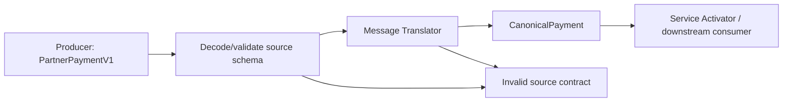
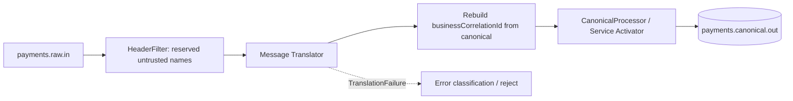
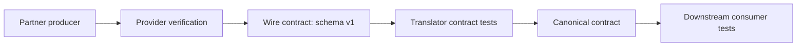
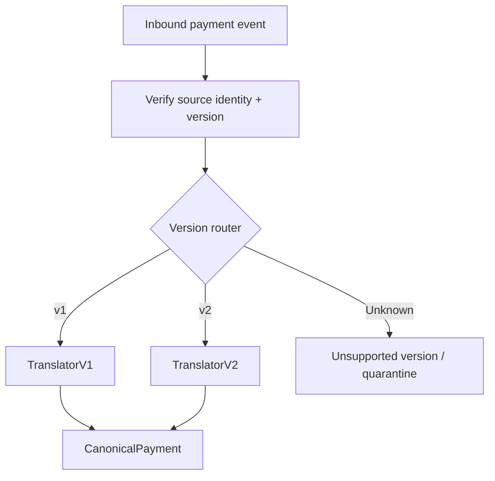
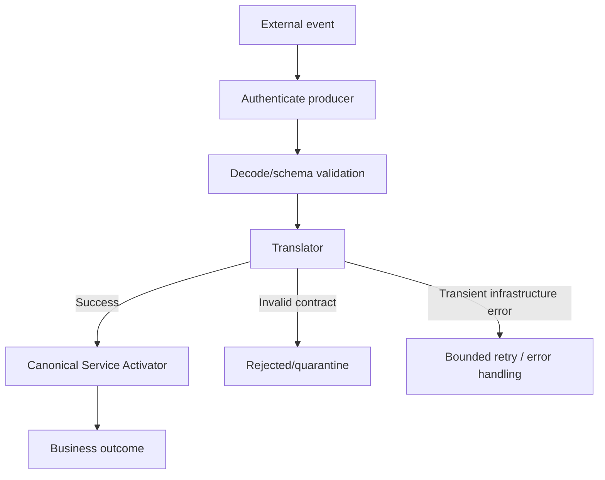

# Kiểm thử contract của Message Translator trong Spring Integration

## Mục tiêu bài học

Một dịch vụ thanh toán đối tác gửi sự kiện `PartnerPaymentV1`:

```json
{
  "schemaVersion": 1,
  "eventId": "EVT-42",
  "paymentReference": "PAY-42",
  "grossText": "1250.50",
  "currencyCode": "USD",
  "partnerStatus": "CAPTURED",
  "eventTime": "2026-11-21T12:00:00+07:00",
  "generation": 1
}
```

Ứng dụng bên nhận dùng một mô hình nội bộ khác: `CanonicalPayment` với tiền ở **đơn vị nhỏ nhất** (`amountMinor=125050`), trạng thái `SETTLED` và thời điểm `Instant` chuẩn UTC. Một `Message Translator` chuyển thông điệp nguồn sang hợp đồng đích.

Nếu code chuyển đổi trả một đối tượng không null nhưng **nhân số tiền sai 100 lần**, tự suy currency lạ thành USD, đánh tráo trạng thái `DECLINED` thành `SETTLED`, mất correlation khi qua Transformer hoặc âm thầm đọc `tenantId` giả trong header, các bài test chỉ kiểm tra “message đã đến output channel” đều có thể **PASS trong khi hệ thống xử lý sai**.

**Kiểm thử contract của translator** phải chứng minh đồng thời: **định nghĩa dữ liệu đầu vào**, **quy tắc mapping**, **các bất biến của output**, **phản ứng với input không hợp lệ**, **quy tắc header/trust boundary** và **tính tương thích phiên bản**. Khi message đi qua Spring Integration, test còn phải kiểm tra sự tương tác của Translator với các channel, Router, Filter, Aggregator, Gateway, retry và error path.

Bài thuộc chương **Message translator** của module **SPRING_INTEGRATION_PATTERN**. Module hướng dẫn triển khai Enterprise Integration Patterns với Spring Integration để xây dựng luồng thông điệp ít phụ thuộc, dễ mở rộng; thực hành Router, Filter, Transformer, Splitter, Aggregator, Gateway, retry, error channel và correlation; đồng thời kiểm thử, theo dõi những nhánh xử lý.

Sau bài học, bạn có thể:

1. Định nghĩa **contract kiểm thử được** cho Translator: source schema, destination schema, field mapping, semantics và failure policy.
2. Tách **unit tests của hàm dịch** khỏi **integration tests của `IntegrationFlow`** và **consumer-driven/producer compatibility tests**.
3. Dùng Java 17, Java DSL, JUnit 5, AssertJ kiểm tra mapping tiền, status, thời gian, trường bắt buộc và version.
4. Kiểm tra input sai bị từ chối **trước Service Activator**, không phát canonical message giả.
5. Kiểm thử header propagation, correlation, reserved-header spoofing và ranh giới Kafka/HTTP/JMS.
6. Phân biệt **dịch đúng giá trị** với **đúng side effect**, **idempotency**, **authorization** và **distributed tracing**.
7. Lập bộ regression/golden fixtures, kiểm thử tương thích tiến/lùi và quản lý thay đổi contract có chủ đích.

---

## 1. Message Translator khác Transformer ở chỗ nào?

Trong Enterprise Integration Patterns, **Message Translator** chuyển thông tin từ biểu diễn hoặc ngôn ngữ dữ liệu của một hệ thống sang biểu diễn mà hệ thống khác hiểu. Translator chú trọng **ngữ nghĩa và hợp đồng giữa hai bên**, không chỉ đổi kiểu Java.

Trong Spring Integration, một hoặc nhiều **Transformer endpoint** thường là cách triển khai Message Translator. Tên pattern mô tả **trách nhiệm tích hợp**, trong khi `.transform(...)` là một API kỹ thuật cụ thể.



Ví dụ các quyết định translator phải đưa ra:

- `grossText="1250.50"` là 1.250,50 USD hay một chuỗi trong locale nào?
- `currencyCode="USD"` tương ứng **2** chữ số nhỏ nhất trong hợp đồng demo; `VND` tương ứng **0**.
- `partnerStatus="CAPTURED"` có thể map thành `SETTLED`; nó **không có nghĩa** downstream phải gọi provider để thu tiền lần nữa.
- `eventTime` có offset `+07:00` phải chuyển thành thời điểm UTC; không biến thành thời gian local không rõ timezone.
- `tenantId` thuộc authenticated ingress context, không lấy từ JSON/header do đối tác tự khai.
- `schemaVersion=2` khi consumer chỉ hỗ trợ v1 phải **bị từ chối có kiểm soát**, không giả định các field vẫn tương đương.

### Translator có thể “chạy được” nhưng vẫn phá contract

Một đoạn sai nguy hiểm:

```java
long cents = (long) (Double.parseDouble(grossText) * 100);
```

Nó có thể gặp sai số do binary floating point, tràn số, xử lý dấu và khả năng parse locale không được quy định. Với tiền, nên dùng `BigDecimal`, quy định số chữ số thập phân, chuyển sang minor units bằng phép toán **exact**, rồi kiểm tra giới hạn.

Một đoạn sai khác:

```java
PaymentState state =
    "CAPTURED".equals(status)
        ? PaymentState.SETTLED
        : PaymentState.AUTHORIZED;
```

Mọi trạng thái không biết — kể cả `DECLINED` — bị coi là `AUTHORIZED`. Đây là **contract bug** dù test `assertNotNull(output)` vẫn qua.

---

## 2. Những lớp contract cần kiểm thử

| Lớp | Câu hỏi phải trả lời | Bằng chứng |
| --- | --- | --- |
| **Source schema** | Có đúng field, kiểu, nullability và version? | Decode/JSON schema test, fixture |
| **Semantic mapping** | Tiền, timezone, trạng thái, ID được hiểu đúng? | Unit test theo bảng và ví dụ biên |
| **Destination invariants** | Canonical DTO có giá trị hợp lệ, không mất dữ liệu bắt buộc? | Assertions trên output |
| **Failure contract** | Input sai sẽ fail/route reject với mã nào? | Negative tests không phát output |
| **Message envelope** | Headers, correlation và identity có được xử lý đúng? | IntegrationFlow test |
| **Consumer contract** | Consumer tiếp theo có hiểu output thật của translator? | Contract test giữa producer/consumer |
| **Operational contract** | Retry, DLQ, error channel, timeout, idempotency có nhất quán? | Integration/fault tests |
| **Security contract** | Tenant/issuer đến từ nguồn đáng tin? Dữ liệu có bị lộ? | Negative security/boundary tests |
| **Compatibility contract** | Producer v2 có phá consumer v1 không? | Matrix version + fixture regression |

**Một test duy nhất không thể chứng minh tất cả.** Nên tách test **nhanh, thuần Java** cho mapping khỏi test **khởi động Spring** cho message flow, rồi có thêm một lớp test qua broker/adapter thực khi chuẩn bị triển khai.

### Contract là phát biểu cụ thể, không phải “JSON parse được”

Ví dụ một hợp đồng:

> Với một sự kiện schema v1, currency=USD, grossText là số thập phân không âm có tối đa hai chữ số sau dấu chấm, và status=CAPTURED, Translator phải trả amountMinor đúng từng cent, state=SETTLED, happenedAt theo UTC. Với input sai hoặc version không hỗ trợ, nó phải từ chối trước khi gọi Service Activator.

Một câu như vậy đủ cụ thể để biến thành các ca kiểm thử.

---

## 3. Quy định input/output trước khi viết Translator

### Đầu vào của đối tác v1

```java
public record PartnerPaymentV1(
    int schemaVersion,
    String eventId,
    String paymentReference,
    String grossText,
    String currencyCode,
    String partnerStatus,
    String eventTime,
    int generation
) {}
```

Các trường `tenantId` và `issuer` **không nằm trong DTO từ đối tác**. Application lấy chúng từ một context đã được xác thực và cấp ở ingress.

### Đầu ra canonical

```java
public enum PaymentState {
    AUTHORIZED, SETTLED, REJECTED
}

public record CanonicalPayment(
    String tenantId,
    String issuer,
    String eventId,
    String paymentId,
    long amountMinor,
    String currency,
    PaymentState state,
    java.time.Instant happenedAt,
    int generation
) {}
```

### Bảng mapping v1

| Source field | Target field | Quy tắc |
| --- | --- | --- |
| Trusted caller tenant | `tenantId` | Lấy từ verified context, không lấy header ngoài |
| Trusted caller issuer | `issuer` | Gắn nguồn đã xác thực, không suy từ payload |
| `eventId` | `eventId` | Không rỗng; regex ID được chấp nhận |
| `paymentReference` | `paymentId` | Stable business ID, không dùng Message ID mới |
| `grossText` + `currencyCode` | `amountMinor` | `BigDecimal`, scale theo currency, tính exact |
| `currencyCode` | `currency` | Chỉ `USD`/`VND` ở bài tập; uppercase nếu contract cho phép |
| `partnerStatus=AUTHORIZED` | `state=AUTHORIZED` | Chưa khẳng định đã captured |
| `partnerStatus=CAPTURED` | `state=SETTLED` | Chỉ mô tả trạng thái, không tạo capture mới |
| `partnerStatus=DECLINED` | `state=REJECTED` | Không đổi thành authorized/settled |
| `eventTime` | `happenedAt` | Parse timestamp có offset rồi chuyển `Instant` |
| `generation` | `generation` | Phải lớn hơn 0, tách các workflow run |
| `schemaVersion` | Được kiểm tra, không đưa vào mọi business operation | Chỉ chấp nhận `1` trong translator v1 |

### Quy tắc tiền của ví dụ

- `USD`: chính xác đến 2 chữ số thập phân; `"1" → 100`, `"1.20" → 120` minor units.
- `VND`: số tiền nguyên; `"1200" → 1200`, `"1200.00"` được chấp nhận vì phần lẻ bằng 0.
- Dùng dấu chấm thập phân; `"1,200.50"` hoặc `"1.200,50"` **bị từ chối**, không tự đoán locale.
- Không chấp nhận scientific notation, dấu âm, khoảng trắng trong số, hơn hai chữ số thập phân hoặc số bằng 0.
- Không chuyển qua `double`; không làm tròn ngoài hợp đồng.
- Từ chối kết quả vượt phạm vi `long`, thay vì tự tràn số.

**Đây là quy tắc demo**, không đại diện cho mọi currency và payment provider. Production có thể dùng một `Money` value object, bảng minor units/version được quản lý hoặc `BigDecimal` nhất quán theo business contract.

---

## 4. Ma trận kiểm thử hợp đồng dịch

### Happy path phải kiểm tra giá trị từng field

| Input | Expected |
| --- | --- |
| USD `"1250.50"`, CAPTURED | `125050`, `SETTLED` |
| USD `"1"`, AUTHORIZED | `100`, `AUTHORIZED` |
| USD `"0.01"`, DECLINED | `1`, `REJECTED` |
| VND `"1200"`, CAPTURED | `1200`, `SETTLED` |
| VND `"1200.00"`, CAPTURED | `1200`, `SETTLED` |
| `"usd"`, `"1.50"` | `currency="USD"`, `amountMinor=150` |
| `"2026-11-21T12:00:00+07:00"` | `2026-11-21T05:00:00Z` |

### Negative cases phải xác nhận lỗi có chủ đích

| Input | Mã lỗi kỳ vọng |
| --- | --- |
| `schemaVersion=2` | `UNSUPPORTED_SCHEMA_VERSION` |
| `eventId=""` | `INVALID_EVENT_ID` |
| `paymentReference="PAY|42"` | `INVALID_PAYMENT_ID` |
| `generation=0` | `INVALID_GENERATION` |
| `grossText=null` | `AMOUNT_REQUIRED` |
| `grossText="0"` | `AMOUNT_NOT_POSITIVE` |
| `grossText="-1"` | `AMOUNT_FORMAT_INVALID` |
| `grossText="1,20"` | `AMOUNT_FORMAT_INVALID` |
| `grossText="1.234"` | `AMOUNT_FORMAT_INVALID` |
| VND `grossText="1.50"` | `AMOUNT_PRECISION_INVALID` |
| `currencyCode="ABC"` | `UNSUPPORTED_CURRENCY` |
| `partnerStatus="PENDING_CAPTURE"` | `UNKNOWN_PARTNER_STATUS` |
| `eventTime="2026-11-21T12:00:00"` | `INVALID_EVENT_TIME` |
| Cỡ tiền vượt `long` | `AMOUNT_OUT_OF_RANGE` |

Mỗi hàng trong bảng là **một assertion cần có**, không chỉ là ghi chú tài liệu. Bộ test đầy đủ có thể chuyển thành parameterized tests hoặc test dữ liệu theo `@MethodSource`.

---

## 5. Một Translator thuần Java, không phụ thuộc messaging

Hãy bắt đầu với logic dịch **không cần Spring context**. Điều này cho phép unit test chạy nhanh và kiểm soát chính xác failure code.

### Mô hình tin cậy của ví dụ

`VerifiedSource` là một value object do **thành phần ingress đã xác thực** tạo. Trong demo, nó được inject một lần với `tenant-a` và `partner-payments` để test. Production phải tạo/tái xác minh context theo request, partition hoặc consumer identity thật, không dùng một singleton mutable `currentTenant`.

### Translator đầy đủ (Java 17+)

```java
import java.math.BigDecimal;
import java.math.RoundingMode;
import java.time.Instant;
import java.time.OffsetDateTime;
import java.time.format.DateTimeParseException;
import java.util.Locale;
import java.util.Objects;
import java.util.Set;
import java.util.regex.Pattern;

public final class PartnerPaymentTranslator {

    public record VerifiedSource(
        String tenantId,
        String issuer
    ) {}

    public record PartnerPaymentV1(
        int schemaVersion,
        String eventId,
        String paymentReference,
        String grossText,
        String currencyCode,
        String partnerStatus,
        String eventTime,
        int generation
    ) {}

    public enum PaymentState {
        AUTHORIZED, SETTLED, REJECTED
    }

    public record CanonicalPayment(
        String tenantId,
        String issuer,
        String eventId,
        String paymentId,
        long amountMinor,
        String currency,
        PaymentState state,
        Instant happenedAt,
        int generation
    ) {}

    public static final class TranslationFailure
            extends RuntimeException {

        private final String code;

        public TranslationFailure(String code) {
            super(code);
            this.code = code;
        }

        public String code() {
            return code;
        }
    }

    private static final Pattern ID_PATTERN =
        Pattern.compile("[A-Za-z0-9_-]{1,80}");

    private static final Pattern MONEY_PATTERN =
        Pattern.compile("[0-9]+(\\.[0-9]{1,2})?");

    private static final Set<String> CURRENCIES =
        Set.of("USD", "VND");

    private final VerifiedSource source;

    public PartnerPaymentTranslator(VerifiedSource source) {
        this.source = Objects.requireNonNull(
            source, "verifiedSource");

        if (!validId(source.tenantId())
                || !validId(source.issuer())) {
            throw new IllegalArgumentException(
                "INVALID_VERIFIED_SOURCE");
        }
    }

    private static boolean validId(String id) {
        return id != null
            && ID_PATTERN.matcher(id).matches();
    }

    public CanonicalPayment translate(PartnerPaymentV1 raw) {
        if (raw == null) {
            throw new TranslationFailure("INPUT_REQUIRED");
        }

        if (raw.schemaVersion() != 1) {
            throw new TranslationFailure(
                "UNSUPPORTED_SCHEMA_VERSION");
        }

        if (!validId(raw.eventId())) {
            throw new TranslationFailure(
                "INVALID_EVENT_ID");
        }

        if (!validId(raw.paymentReference())) {
            throw new TranslationFailure(
                "INVALID_PAYMENT_ID");
        }

        if (raw.generation() < 1) {
            throw new TranslationFailure(
                "INVALID_GENERATION");
        }

        String currency = normalizeCurrency(
            raw.currencyCode());

        long amountMinor = parseAmountMinor(
            raw.grossText(), currency);

        PaymentState state = mapStatus(
            raw.partnerStatus());

        Instant happenedAt = parseEventTime(
            raw.eventTime());

        return new CanonicalPayment(
            source.tenantId(),
            source.issuer(),
            raw.eventId(),
            raw.paymentReference(),
            amountMinor,
            currency,
            state,
            happenedAt,
            raw.generation());
    }

    private static String normalizeCurrency(String input) {
        if (input == null) {
            throw new TranslationFailure(
                "UNSUPPORTED_CURRENCY");
        }

        String value = input.toUpperCase(Locale.ROOT);

        if (!CURRENCIES.contains(value)) {
            throw new TranslationFailure(
                "UNSUPPORTED_CURRENCY");
        }

        return value;
    }

    private static long parseAmountMinor(
        String amountText,
        String currency
    ) {
        if (amountText == null || amountText.isBlank()) {
            throw new TranslationFailure(
                "AMOUNT_REQUIRED");
        }

        if (amountText.length() > 40
                || !MONEY_PATTERN.matcher(
                    amountText).matches()) {
            throw new TranslationFailure(
                "AMOUNT_FORMAT_INVALID");
        }

        BigDecimal value = new BigDecimal(amountText);

        if (value.signum() <= 0) {
            throw new TranslationFailure(
                "AMOUNT_NOT_POSITIVE");
        }

        int scale = "USD".equals(currency) ? 2 : 0;

        try {
            // Không làm tròn: nếu VND có phần lẻ khác 0
            // thì setScale(0, UNNECESSARY) sẽ ném lỗi.
            BigDecimal exact =
                value.setScale(
                    scale, RoundingMode.UNNECESSARY);

            return exact.movePointRight(scale)
                .longValueExact();

        } catch (ArithmeticException ex) {
            // Chỉ để đơn giản cho ví dụ:
            // cần phân loại precision vs overflow riêng.
            if (value.scale() > scale) {
                try {
                    value.setScale(
                        scale, RoundingMode.UNNECESSARY);
                } catch (ArithmeticException precisionFailure) {
                    throw new TranslationFailure(
                        "AMOUNT_PRECISION_INVALID");
                }
            }
            throw new TranslationFailure(
                "AMOUNT_OUT_OF_RANGE");
        }
    }

    private static PaymentState mapStatus(
        String partnerStatus
    ) {
        if (partnerStatus == null) {
            throw new TranslationFailure(
                "UNKNOWN_PARTNER_STATUS");
        }

        return switch (partnerStatus) {
            case "AUTHORIZED" -> PaymentState.AUTHORIZED;
            case "CAPTURED" -> PaymentState.SETTLED;
            case "DECLINED" -> PaymentState.REJECTED;
            default -> throw new TranslationFailure(
                "UNKNOWN_PARTNER_STATUS");
        };
    }

    private static Instant parseEventTime(
        String eventTime
    ) {
        if (eventTime == null) {
            throw new TranslationFailure(
                "INVALID_EVENT_TIME");
        }

        try {
            return OffsetDateTime.parse(eventTime)
                .toInstant();
        } catch (DateTimeParseException ex) {
            throw new TranslationFailure(
                "INVALID_EVENT_TIME");
        }
    }
}
```

### Vì sao không gọi API hoặc DB trong Translator?

Translator chịu trách nhiệm **chuyển biểu diễn**. Nếu nó vừa ghi DB, vừa gọi payment provider, unit test mapping không còn độc lập và retry ở cấp Transformer có thể tạo side effect. Hãy để Service Activator thực hiện nghiệp vụ sau khi Translator đã tạo dữ liệu canonical hợp lệ.

### Đừng biến lỗi vào một giá trị “UNKNOWN” rồi cho đi tiếp

Ví dụ không nên làm:

```java
// Sai: trạng thái mới bị dịch thành trạng thái mặc định.
PaymentState state = switch (partnerStatus) {
    case "CAPTURED" -> PaymentState.SETTLED;
    default -> PaymentState.AUTHORIZED;
};
```

Khi đối tác thêm `"REFUNDED"`, code này âm thầm dịch sai. Contract test cần yêu cầu trạng thái mới **bị từ chối hoặc được map theo phiên bản mới đã được phê duyệt**.

### Phân biệt parse failure, precision và overflow

Ba lỗi này khác nhau:

- `"1,50"` không có trong grammar nguồn → `AMOUNT_FORMAT_INVALID`.
- VND `"1.50"` có grammar đúng nhưng có phần lẻ không được phép → `AMOUNT_PRECISION_INVALID`.
- Một lượng USD rất lớn tạo minor units ngoài phạm vi `long` → `AMOUNT_OUT_OF_RANGE`.

Không để một `NumberFormatException` hoặc `ArithmeticException` thô bị map thành `NETWORK_TIMEOUT` rồi retry vô hạn.

### Hạn chế của mã demo

- Không xử lý locale ngoài dấu chấm; đây là **quyết định contract**.
- Không hỗ trợ tất cả currency trên thế giới.
- ID chỉ chấp nhận ASCII trong ví dụ, không phải yêu cầu chung.
- Chưa có version registry, lịch sử mapping hoặc policy signed envelope.
- `VerifiedSource` đang được cấp từ fixture, không phải xác thực production.
- Chưa có cơ chế ghi kết quả business idempotency, vì đó không phải việc của Translator.

---

## 6. Unit test: contract mapping chính xác

### JUnit 5 và AssertJ

```java
import static org.assertj.core.api.Assertions.assertThat;
import static org.assertj.core.api.Assertions.assertThatThrownBy;

import java.time.Instant;

import org.junit.jupiter.api.Test;

class PartnerPaymentTranslatorTest {

    private final PartnerPaymentTranslator translator =
        new PartnerPaymentTranslator(
            new PartnerPaymentTranslator.VerifiedSource(
                "tenant-a", "partner-payments"));

    private PartnerPaymentTranslator.PartnerPaymentV1 base() {
        return new PartnerPaymentTranslator.PartnerPaymentV1(
            1,
            "EVT-42",
            "PAY-42",
            "1250.50",
            "USD",
            "CAPTURED",
            "2026-11-21T12:00:00+07:00",
            1);
    }

    @Test
    void mapsAllBusinessFieldsNotOnlyObjectPresence() {
        var canonical = translator.translate(base());

        assertThat(canonical.tenantId())
            .isEqualTo("tenant-a");
        assertThat(canonical.issuer())
            .isEqualTo("partner-payments");
        assertThat(canonical.eventId())
            .isEqualTo("EVT-42");
        assertThat(canonical.paymentId())
            .isEqualTo("PAY-42");
        assertThat(canonical.amountMinor())
            .isEqualTo(125_050L);
        assertThat(canonical.currency())
            .isEqualTo("USD");
        assertThat(canonical.state())
            .isEqualTo(
                PartnerPaymentTranslator.PaymentState.SETTLED);
        assertThat(canonical.happenedAt())
            .isEqualTo(
                Instant.parse("2026-11-21T05:00:00Z"));
        assertThat(canonical.generation()).isEqualTo(1);
    }

    @Test
    void mapsDeclinedAndAuthorizedAsDifferentStates() {
        var authorized =
            new PartnerPaymentTranslator.PartnerPaymentV1(
                1, "EVT-A", "PAY-A", "1", "USD",
                "AUTHORIZED",
                "2026-11-21T05:00:00Z", 1);

        var declined =
            new PartnerPaymentTranslator.PartnerPaymentV1(
                1, "EVT-B", "PAY-B", "0.01", "USD",
                "DECLINED",
                "2026-11-21T05:00:00Z", 1);

        assertThat(translator.translate(authorized).state())
            .isEqualTo(
                PartnerPaymentTranslator.PaymentState.AUTHORIZED);

        assertThat(translator.translate(declined).state())
            .isEqualTo(
                PartnerPaymentTranslator.PaymentState.REJECTED);

        assertThat(translator.translate(declined).amountMinor())
            .isEqualTo(1L);
    }

    @Test
    void normalizesCurrencyOnlyAsDefinedByContract() {
        var event =
            new PartnerPaymentTranslator.PartnerPaymentV1(
                1, "EVT-C", "PAY-C", "1.50", "usd",
                "CAPTURED",
                "2026-11-21T05:00:00Z", 1);

        var result = translator.translate(event);

        assertThat(result.currency()).isEqualTo("USD");
        assertThat(result.amountMinor()).isEqualTo(150L);
    }

    @Test
    void vndIntegralAmountWithZeroFractionIsExact() {
        var event =
            new PartnerPaymentTranslator.PartnerPaymentV1(
                1, "EVT-D", "PAY-D", "1200.00", "VND",
                "CAPTURED",
                "2026-11-21T05:00:00Z", 1);

        assertThat(translator.translate(event).amountMinor())
            .isEqualTo(1_200L);
    }

    @Test
    void unsupportedVersionFailsClosed() {
        var v2 =
            new PartnerPaymentTranslator.PartnerPaymentV1(
                2, "EVT-E", "PAY-E", "1.00", "USD",
                "CAPTURED",
                "2026-11-21T05:00:00Z", 1);

        assertThatThrownBy(() -> translator.translate(v2))
            .isInstanceOf(
                PartnerPaymentTranslator.TranslationFailure.class)
            .hasMessage("UNSUPPORTED_SCHEMA_VERSION");
    }

    @Test
    void unknownStatusDoesNotDefaultToSuccess() {
        var unknown =
            new PartnerPaymentTranslator.PartnerPaymentV1(
                1, "EVT-F", "PAY-F", "1.00", "USD",
                "REFUNDED",
                "2026-11-21T05:00:00Z", 1);

        assertThatThrownBy(() -> translator.translate(unknown))
            .isInstanceOf(
                PartnerPaymentTranslator.TranslationFailure.class)
            .hasMessage("UNKNOWN_PARTNER_STATUS");
    }

    @Test
    void amountCannotBeRoundedSilently() {
        var invalid =
            new PartnerPaymentTranslator.PartnerPaymentV1(
                1, "EVT-G", "PAY-G", "1.50", "VND",
                "CAPTURED",
                "2026-11-21T05:00:00Z", 1);

        assertThatThrownBy(() -> translator.translate(invalid))
            .isInstanceOf(
                PartnerPaymentTranslator.TranslationFailure.class)
            .hasMessage("AMOUNT_PRECISION_INVALID");
    }

    @Test
    void malformedMoneyCannotBeGuessedAsLocale() {
        var malformed =
            new PartnerPaymentTranslator.PartnerPaymentV1(
                1, "EVT-H", "PAY-H", "1,250.50", "USD",
                "CAPTURED",
                "2026-11-21T05:00:00Z", 1);

        assertThatThrownBy(() -> translator.translate(malformed))
            .isInstanceOf(
                PartnerPaymentTranslator.TranslationFailure.class)
            .hasMessage("AMOUNT_FORMAT_INVALID");
    }

    @Test
    void timestampWithoutOffsetIsRejected() {
        var noOffset =
            new PartnerPaymentTranslator.PartnerPaymentV1(
                1, "EVT-I", "PAY-I", "1.00", "USD",
                "CAPTURED",
                "2026-11-21T12:00:00", 1);

        assertThatThrownBy(() -> translator.translate(noOffset))
            .isInstanceOf(
                PartnerPaymentTranslator.TranslationFailure.class)
            .hasMessage("INVALID_EVENT_TIME");
    }

    @Test
    void hugeValueMustNotOverflowLong() {
        var huge =
            new PartnerPaymentTranslator.PartnerPaymentV1(
                1, "EVT-J", "PAY-J",
                "99999999999999999999.99", "USD",
                "CAPTURED",
                "2026-11-21T05:00:00Z", 1);

        assertThatThrownBy(() -> translator.translate(huge))
            .isInstanceOf(
                PartnerPaymentTranslator.TranslationFailure.class)
            .hasMessage("AMOUNT_OUT_OF_RANGE");
    }
}
```

### Vì sao phải assert từng field?

Một test chỉ có:

```java
assertThat(translator.translate(event)).isNotNull();
```

…chỉ chứng minh translator đã tạo một object. Nó không chứng minh amountMinor, currency, trạng thái, timestamp, tenant, generation hay event identity đúng. **Contract testing kiểm tra ý nghĩa dữ liệu**, không chỉ kiểu dữ liệu.

### Test lỗi nên assert vào contract, không vào stack trace

Lỗi `TranslationFailure` trong demo dùng mã ổn định như `INVALID_EVENT_TIME`. Unit test assert vào mã đó. Không nên bind test vào câu tiếng Anh chi tiết từ `DateTimeParseException` vì message có thể thay theo JDK hoặc input.

---

## 7. Parameterized tests: bao phủ bảng quyết định không cần lặp code

Thay vì viết hàng chục phương thức giống nhau, dùng `@ParameterizedTest` với `@CsvSource` hoặc `@MethodSource`. Dùng test dữ liệu khi mỗi case có cùng cấu trúc và assertion.

```java
import static org.assertj.core.api.Assertions.assertThat;

import org.junit.jupiter.params.ParameterizedTest;
import org.junit.jupiter.params.provider.CsvSource;

class PartnerPaymentAmountMatrixTest {

    private final PartnerPaymentTranslator translator =
        new PartnerPaymentTranslator(
            new PartnerPaymentTranslator.VerifiedSource(
                "tenant-a", "partner-payments"));

    @ParameterizedTest
    @CsvSource({
        "USD, 1,       100",
        "USD, 1.20,    120",
        "USD, 0.01,    1",
        "VND, 1200,    1200",
        "VND, 1200.00, 1200",
        "usd, 2.05,    205"
    })
    void validAmountsMapToExactMinorUnits(
        String currency,
        String amount,
        long expectedMinor
    ) {
        var event = new PartnerPaymentTranslator.PartnerPaymentV1(
            1, "EVT-M", "PAY-M", amount, currency,
            "CAPTURED", "2026-11-21T05:00:00Z", 1);

        var actual = translator.translate(event);
        assertThat(actual.amountMinor())
            .isEqualTo(expectedMinor);
    }
}
```

### Dùng `@MethodSource` cho payload phức tạp

`@CsvSource` phù hợp với vài scalar đơn giản. Với nhiều field có null, chuỗi rỗng, Unicode, nested JSON, schema version hay status, `@MethodSource` giúp bạn đặt tên test case và giữ typed values.

Ví dụ ý tưởng:

```java
static java.util.stream.Stream<
    org.junit.jupiter.params.provider.Arguments
> invalidCases() {
    return java.util.stream.Stream.of(
        org.junit.jupiter.params.provider.Arguments.of(
            "comma decimal", "1,20",
            "AMOUNT_FORMAT_INVALID"),
        org.junit.jupiter.params.provider.Arguments.of(
            "three decimals", "1.234",
            "AMOUNT_FORMAT_INVALID"),
        org.junit.jupiter.params.provider.Arguments.of(
            "zero", "0",
            "AMOUNT_NOT_POSITIVE")
    );
}
```

Đây là **hàm nguồn dữ liệu minh họa**; để chạy, thêm `@ParameterizedTest @MethodSource("invalidCases")` cùng method tạo event, gọi translator và assert mã lỗi.

### Không chọn nhiều test case chỉ để tăng số lượng

Mỗi case phải phục vụ một lớp biên hoặc một nhánh quyết định thực: số 0, tràn số, currency, timezone, schema version, unknown status, identity, null, whitespace, format locale, precision và retry.

---

## 8. Spring Integration Java DSL: Translator trong message flow

Unit tests chưa kiểm tra message header, channel wiring và đường đi tới Service Activator. Hãy đăng ký flow thật:



Trong ví dụ này:

- Raw message có thể mang header `tenantId` hoặc `businessCorrelationId` giả. Flow loại các header đó.
- Translator được inject một `VerifiedSource` tin cậy **giả lập** cho bài test.
- Translator trả **payload** `CanonicalPayment`, không tự tạo `Message<?>` mới.
- Header `traceId`/`requestId` ở trong process được framework truyền qua theo cấu hình thông thường.
- Sau translation, flow tính `businessCorrelationId` từ canonical payload; dùng `overwrite=true` để định nghĩa ưu tiên rõ.
- Service Activator chỉ thấy dữ liệu canonical.
- Nếu dịch thất bại trên `DirectChannel`, exception truyền ngược theo topology; output channel không nhận canonical message.

### Cấu hình đầy đủ

```java
import java.util.concurrent.atomic.AtomicInteger;

import org.springframework.context.annotation.Bean;
import org.springframework.context.annotation.Configuration;
import org.springframework.integration.channel.DirectChannel;
import org.springframework.integration.channel.QueueChannel;
import org.springframework.integration.config.EnableIntegration;
import org.springframework.integration.dsl.IntegrationFlow;
import org.springframework.messaging.MessageChannel;
import org.springframework.messaging.PollableChannel;

@Configuration
@EnableIntegration
public class PartnerTranslationFlowConfig {

    public static final class CanonicalProcessor {
        private final AtomicInteger calls = new AtomicInteger();

        public PartnerPaymentTranslator.CanonicalPayment process(
            PartnerPaymentTranslator.CanonicalPayment payment
        ) {
            calls.incrementAndGet();
            // Chỉ trả payload trong demo; không ghi DB/provider.
            return payment;
        }

        public int invocations() {
            return calls.get();
        }
    }

    @Bean
    PartnerPaymentTranslator partnerPaymentTranslator() {
        // Fixture tin cậy cho test/demo. Không dùng hằng
        // tenant này làm thay thế authentication production.
        var verified =
            new PartnerPaymentTranslator.VerifiedSource(
                "tenant-a", "partner-payments");

        return new PartnerPaymentTranslator(verified);
    }

    @Bean
    CanonicalProcessor canonicalProcessor() {
        return new CanonicalProcessor();
    }

    @Bean("payments.raw.in")
    MessageChannel rawInput() {
        return new DirectChannel();
    }

    @Bean("payments.canonical.out")
    PollableChannel normalizedOutput() {
        return new QueueChannel();
    }

    @Bean
    IntegrationFlow partnerTranslationFlow(
        PartnerPaymentTranslator translator,
        CanonicalProcessor processor
    ) {
        return IntegrationFlow.from("payments.raw.in")

            // Không để header client tự ghi tenant/issuer.
            .headerFilter(
                "tenantId",
                "issuer",
                "businessCorrelationId")

            // Dịch theo source contract v1.
            .transform(
                PartnerPaymentTranslator.PartnerPaymentV1.class,
                translator::translate)

            // ID phục vụ truy nguyên business, lấy từ
            // payload canonical chứ không tin header ban đầu.
            .enrichHeaders(h -> h.headerFunction(
                "businessCorrelationId",
                message -> {
                    var payment =
                        (PartnerPaymentTranslator.CanonicalPayment)
                            message.getPayload();

                    return payment.tenantId() + "|"
                        + payment.paymentId() + "|"
                        + payment.generation();
                },
                true))

            // Service Activator ở sau điểm đã kiểm tra.
            .handle(
                PartnerPaymentTranslator.CanonicalPayment.class,
                (payment, headers) ->
                    processor.process(payment))

            .channel("payments.canonical.out")
            .get();
    }
}
```

### Giải thích giới hạn của `headerFilter`

`headerFilter(...)` loại đúng **những header được liệt kê** trong message đi qua endpoint. Nó không kiểm chứng người gửi, không validate raw JSON và không xóa mọi header nguy hiểm theo một allowlist đầy đủ. Ở một inbound adapter công khai, nên thiết kế thêm header mapper/allowlist và xác thực độc lập.

### Vì sao Translator không trả `Message<?>` hoàn chỉnh?

Theo Spring Integration Reference, khi Transformer trả **payload**, inbound headers thường được truyền tiếp; khi Transformer trả **Message<?> hoàn chỉnh**, developer chịu trách nhiệm với toàn bộ outbound message và headers. Bài chọn đường trả payload để giữ contract mapping dễ kiểm thử.

**Đừng coi header propagation là bất biến trong mọi topology.** HTTP/Kafka/JMS adapter, custom Transformer, header filter và các endpoint tạo message mới có thể thay hoặc mất metadata. Cần test tại boundary thật.

### Transformer không được dùng `return null` để drop

Theo Spring Integration, một Transformer không được trả null để biểu thị “không dịch được”; hành vi này gây `MessageTransformationException`. Chọn một chính sách rõ:

- **Fail fast** với `TranslationFailure` (demo này), và cấu hình error handling ở caller/adapter.
- **Typed outcome** như `Accepted`/`Rejected` rồi Router qua hai nhánh.
- **Filter** trước Translator nếu contract nói những message đó có thể bị bỏ theo predicate, đồng thời có discard/reply policy thích hợp.

Không kết luận từ việc test output rỗng rằng message đã bị từ chối đúng hợp đồng; nó có thể bị mất do lỗi wiring.

---

## 9. Integration test: header, service side effect và routing

Dùng Spring Test + JUnit 5 cho flow có `DirectChannel` và `QueueChannel`. Vì handler có counter và queue được giữ trong Spring context, test dùng `@DirtiesContext` để tránh lẫn trạng thái giữa các case.

```java
import static org.assertj.core.api.Assertions.assertThat;
import static org.assertj.core.api.Assertions.assertThatThrownBy;

import org.junit.jupiter.api.Test;
import org.springframework.beans.factory.annotation.Autowired;
import org.springframework.beans.factory.annotation.Qualifier;
import org.springframework.messaging.Message;
import org.springframework.messaging.MessageChannel;
import org.springframework.messaging.PollableChannel;
import org.springframework.messaging.support.MessageBuilder;
import org.springframework.test.annotation.DirtiesContext;
import org.springframework.test.context.junit.jupiter.SpringJUnitConfig;

@SpringJUnitConfig(PartnerTranslationFlowConfig.class)
@DirtiesContext(
    classMode = DirtiesContext.ClassMode.AFTER_EACH_TEST_METHOD)
class PartnerTranslationFlowTest {

    @Autowired
    @Qualifier("payments.raw.in")
    MessageChannel input;

    @Autowired
    @Qualifier("payments.canonical.out")
    PollableChannel output;

    @Autowired
    PartnerTranslationFlowConfig.CanonicalProcessor processor;

    private PartnerPaymentTranslator.PartnerPaymentV1 event(
        String amount,
        String status,
        int version
    ) {
        return new PartnerPaymentTranslator.PartnerPaymentV1(
            version,
            "EVT-42",
            "PAY-42",
            amount,
            "USD",
            status,
            "2026-11-21T12:00:00+07:00",
            1);
    }

    @Test
    void translatesAndPreservesSafeTracingHeaders() {
        var inbound = MessageBuilder
            .withPayload(event("1250.50", "CAPTURED", 1))
            .setHeader("tenantId", "spoofed-tenant")
            .setHeader("issuer", "spoofed-issuer")
            .setHeader(
                "businessCorrelationId", "wrong-group")
            .setHeader("traceId", "trace-42")
            .setHeader("requestId", "REQ-42")
            .build();

        assertThat(input.send(inbound)).isTrue();

        Message<?> result = output.receive(2_000);
        assertThat(result).isNotNull();
        assertThat(result.getPayload()).isInstanceOf(
            PartnerPaymentTranslator.CanonicalPayment.class);

        var canonical =
            (PartnerPaymentTranslator.CanonicalPayment)
                result.getPayload();

        assertThat(canonical.amountMinor())
            .isEqualTo(125_050L);
        assertThat(canonical.state()).isEqualTo(
            PartnerPaymentTranslator.PaymentState.SETTLED);
        assertThat(canonical.tenantId())
            .isEqualTo("tenant-a");
        assertThat(canonical.issuer())
            .isEqualTo("partner-payments");

        assertThat(result.getHeaders().get("traceId"))
            .isEqualTo("trace-42");
        assertThat(result.getHeaders().get("requestId"))
            .isEqualTo("REQ-42");
        assertThat(
            result.getHeaders().get("businessCorrelationId"))
            .isEqualTo("tenant-a|PAY-42|1");

        assertThat(result.getHeaders())
            .doesNotContainKeys("tenantId", "issuer");

        assertThat(processor.invocations()).isEqualTo(1);
        assertThat(output.receive(0)).isNull();
    }

    @Test
    void unsupportedSchemaCannotReachServiceActivator() {
        assertThatThrownBy(() ->
            input.send(MessageBuilder
                .withPayload(event("1.00", "CAPTURED", 2))
                .build()))
            .isInstanceOf(RuntimeException.class);

        assertThat(processor.invocations()).isZero();
        assertThat(output.receive(0)).isNull();
    }

    @Test
    void invalidStatusCannotReachServiceActivator() {
        assertThatThrownBy(() ->
            input.send(MessageBuilder
                .withPayload(
                    event("1.00", "REFUNDED", 1))
                .build()))
            .isInstanceOf(RuntimeException.class);

        assertThat(processor.invocations()).isZero();
        assertThat(output.receive(0)).isNull();
    }

    @Test
    void independentEventsAreBothTranslated() {
        var first = event("1.00", "AUTHORIZED", 1);

        var second = new PartnerPaymentTranslator.PartnerPaymentV1(
            1, "EVT-43", "PAY-43",
            "2.50", "USD", "CAPTURED",
            "2026-11-21T05:00:00Z", 1);

        assertThat(input.send(
            MessageBuilder.withPayload(first).build())).isTrue();
        assertThat(input.send(
            MessageBuilder.withPayload(second).build())).isTrue();

        Message<?> a = output.receive(2_000);
        Message<?> b = output.receive(2_000);

        assertThat(a).isNotNull();
        assertThat(b).isNotNull();

        assertThat(
            ((PartnerPaymentTranslator.CanonicalPayment)
                a.getPayload()).paymentId())
            .isEqualTo("PAY-42");

        assertThat(
            ((PartnerPaymentTranslator.CanonicalPayment)
                b.getPayload()).paymentId())
            .isEqualTo("PAY-43");

        assertThat(processor.invocations()).isEqualTo(2);
        assertThat(output.receive(0)).isNull();
    }
}
```

**Các test này chứng minh** đúng input → đúng canonical payload, header giả không được xem là tenant đã xác thực, trace/request metadata đi qua ví dụ nội bộ, error trước handler không tạo output/service call.

**Các test này chưa chứng minh** hành vi khi adapter thực deserialize JSON, broker redelivery, Kafka header mapper, multi-instance, DB transaction hay chữ ký xác thực. Không tự gọi bộ test này là “end-to-end production proof”.

### Lỗi trong flow đồng bộ và bất đồng bộ khác nhau

Ở `DirectChannel`, exception do Translator ném thường truyền về `send(...)`, có thể được framework wrap. Với poller/executor/broker, lỗi có thể được chuyển đến error flow tùy adapter/cấu hình. Unit test assert chính xác `TranslationFailure.code()`; integration test assert **không chạm processor** và **không có output**, rồi kiểm thử thêm mapping lỗi ở boundary thực.

---

## 10. Golden fixtures và “expected contract snapshots”

Một bộ contract tốt chứa những **input/output mẫu đã được phê duyệt**. Fixtures có thể lưu trong repository test, nhưng STEP 4 này chỉ trình bày mẫu trong Markdown — không tạo thêm file test/JSON.

### Golden input

```json
{
  "schemaVersion": 1,
  "eventId": "EVT-42",
  "paymentReference": "PAY-42",
  "grossText": "1250.50",
  "currencyCode": "USD",
  "partnerStatus": "CAPTURED",
  "eventTime": "2026-11-21T12:00:00+07:00",
  "generation": 1
}
```

### Golden canonical output

```json
{
  "tenantId": "tenant-a",
  "issuer": "partner-payments",
  "eventId": "EVT-42",
  "paymentId": "PAY-42",
  "amountMinor": 125050,
  "currency": "USD",
  "state": "SETTLED",
  "happenedAt": "2026-11-21T05:00:00Z",
  "generation": 1
}
```

Để tránh snapshot test báo lỗi giả khi thêm field kỹ thuật, có hai mức:

- **Semantics assertions:** kiểm tra các field nghiệp vụ quan trọng bằng typed assertions — nhất quán và dễ đọc.
- **Schema/serialization assertions:** kiểm tra tên field, type, nullability, enum representation, số chữ số và naming policy tại boundary.

Không chỉ so sánh nguyên JSON nếu thứ tự field vốn không phải một phần contract; parse thành tree/DTO theo policy để so semantic equality.

### Golden fixture phải “độc lập” với code translator

Nếu test dựng expected result bằng cùng helper `toMinorUnits(...)` đang dùng trong production, một bug ở helper có thể khiến **actual và expected đều sai giống nhau**. Với những giá trị tiền cơ bản, viết expected literal `125050L` đã được duyệt, không gọi lại hàm cần kiểm thử để tính expected.

---

## 11. Kiểm thử schema/serialization: JSON đẹp vẫn có thể sai

Một DTO Java hợp lệ chưa chứng minh JSON wire contract hợp lệ. Serialization còn có:

- Casing của field: `paymentReference` hay `payment_reference`?
- Field không có: missing và explicit `null` có khác nhau không?
- Enum: `SETTLED` hay `settled`?
- Time: ISO-8601 có offset hay epoch milliseconds?
- Số tiền: JSON number có thể mất precision ở một số client; source contract chọn String?
- Field mới không biết: ignore, reject hay lưu vào extension map?
- Schema version nằm trong payload hay transport header?
- Encoding và Unicode normalization.

### Ví dụ Jackson binding test (tùy dependency)

```java
import static org.assertj.core.api.Assertions.assertThat;

import com.fasterxml.jackson.databind.ObjectMapper;
import org.junit.jupiter.api.Test;

class PartnerJsonBindingTest {

    private final ObjectMapper mapper = new ObjectMapper();

    @Test
    void partnerV1JsonFieldsBindToExpectedNames() throws Exception {
        String json = """
            {
              "schemaVersion": 1,
              "eventId": "EVT-42",
              "paymentReference": "PAY-42",
              "grossText": "1.20",
              "currencyCode": "USD",
              "partnerStatus": "CAPTURED",
              "eventTime": "2026-11-21T05:00:00Z",
              "generation": 1
            }
            """;

        var raw = mapper.readValue(
            json,
            PartnerPaymentTranslator.PartnerPaymentV1.class);

        assertThat(raw.grossText()).isEqualTo("1.20");
        assertThat(raw.schemaVersion()).isEqualTo(1);
        assertThat(raw.partnerStatus()).isEqualTo("CAPTURED");
    }
}
```

Đây là **test bổ sung nếu dự án có Jackson** và cấu hình mapper phù hợp. Với cơ chế deserialize có annotation/config riêng, phải dùng **cùng ObjectMapper/serializer mà inbound adapter thực dùng**, không tạo một mapper mặc định khác rồi cho rằng đã kiểm chứng contract production.

### Missing, null và primitive default

Record có trường `int generation`. Một binding library có thể gán giá trị `0` khi field không có, rồi translator từ chối nhờ `generation < 1`. Nhưng cách hoạt động khi missing/null phụ thuộc serializer và các thiết lập strict mode. **Contract test phải kiểm tra cả raw JSON bị thiếu field** và behavior của mapper đang chạy thật.

Nếu cần phân biệt “không gửi” với “gửi 0”, có thể dùng boxed `Integer` hoặc validation tại raw JSON schema/binding layer. Translator không thể tự biết nguồn của một giá trị primitive đã bị gán mặc định trước khi nó nhận object.

---

## 12. Contract tests với producer và consumer

Unit test Translator mới kiểm chứng code **theo cách chúng ta hiểu contract**. Nhưng đối tác có thể thay field hoặc ngữ nghĩa mà chưa thông báo. Do đó cần đồng thuận hợp đồng giữa **provider/producer** và **consumer**.

### Ba điểm cần kiểm chứng

1. **Producer xuất đúng dữ liệu như đã thỏa thuận?** Fixture/contract test ở producer.
2. **Translator hiểu đúng dữ liệu đó?** Mapping unit tests và integration tests ở consumer.
3. **Hệ thống downstream hiểu canonical output?** Consumer contract tests giữa translator và processor tiếp theo.



### Consumer-driven contract testing (CDC)

Với các tổ chức dùng Pact hoặc một contract registry, consumer có thể mô tả các request/response hoặc event shape mình cần; producer chạy verification để chứng minh hợp đồng vẫn được đáp ứng.

Nhưng CDC **không tự kiểm tra** rằng `CAPTURED` nên trở thành `SETTLED` hay rằng `1250.50` phải thành `125050`. Đó là **business semantic contract** cần test Translator riêng.

Đặc biệt với asynchronous messaging, phải kiểm tra khả năng framework/contract tool hỗ trợ **message payload + headers + metadata** và xác định boundary nào thuộc consumer, boundary nào thuộc broker.

### Điều cần tránh

- Test producer bằng mẫu JSON do consumer tự viết nhưng producer chưa bao giờ xác nhận.
- Bỏ qua schema version và chấp nhận mọi unknown field với giả định “thêm field luôn backward compatible”.
- Chỉ test schema mà không test enum semantics và money precision.
- Trộn internal canonical DTO vào public contract của đối tác, khiến mọi thay đổi nội bộ phá producer.
- Dùng test mô phỏng `MockWebServer` rồi tuyên bố adapter/broker thật đã tương thích.

---

## 13. Compatibility matrix: v1, v2, enum mới và field mới

Giả sử đối tác sẽ phát hành v2:

```json
{
  "schemaVersion": 2,
  "eventId": "EVT-42",
  "paymentReference": "PAY-42",
  "grossMinor": 125050,
  "currencyCode": "USD",
  "partnerStatus": "CAPTURED",
  "eventTime": "2026-11-21T05:00:00Z",
  "generation": 1
}
```

V2 chuyển từ `grossText` sang `grossMinor`. Nếu một consumer v1 âm thầm coi v2 như v1, nó có thể bỏ qua tiền hoặc dùng số tiền mặc định sai.

### Matrix

| Producer | Translator | Kỳ vọng |
| --- | --- | --- |
| v1 | v1 | Chấp nhận các giá trị hợp lệ theo v1 |
| v1 | v2 hỗ trợ legacy | Chấp nhận và giữ nguyên semantics v1 |
| v2 | v1 | **Reject unsupported schema version**, không đoán |
| v2 | v2 | Chấp nhận và map `grossMinor` chính xác |
| v1 có enum `REFUNDED` mới | v1 chưa có mapping | Fail closed/quarantine theo policy |
| v2 thêm field tùy chọn không thay nghĩa | Consumer được cấu hình ignore | Có thể compatible, nhưng phải test |
| v2 thêm field quyết định quyền/classification | Consumer v1 bỏ qua | Có thể **không** tương thích về an toàn |

### Những thay đổi thường cần test regression

- Đổi tên/kiểu một field.
- Chuyển String amount sang number/minor units.
- Thêm hoặc đổi status enum.
- Đổi từ timestamp có offset sang local time.
- Đổi timezone hoặc nguồn eventTime.
- Bổ sung tenant/issuer classification.
- Thay thế ID ổn định bằng ID của mỗi delivery.
- Bỏ một field trước đây bắt buộc.
- Đổi ý nghĩa của `generation`/revision.
- Đổi chính sách missing/null/default.

**Phiên bản schema không phải là nhãn trang trí**. Nó điều khiển lựa chọn Translator và các quy tắc biến đổi.

### Một cách tổ chức nhiều translator



Không để unknown version rơi vào default route v1 rồi xử lý số tiền. Nếu upgrade v2 thay đổi business semantics, viết test **cả v1, v2 và mixed-version traffic**.

---

## 14. Kiểm thử failure contract: không có partial success

Một Translator có thể thất bại ở bất kỳ bước nào: parse tiền, map status, parse time, validate ID. Cần xác định **không có canonical output một nửa**.

```text
PartnerPaymentV1
   -> validate required fields
   -> normalize currency
   -> parse exact money
   -> map status
   -> parse Instant
   -> construct CanonicalPayment
```

Với code demo, `CanonicalPayment` chỉ được dựng sau khi tất cả điều kiện ở trên PASS. Mọi failure ném `TranslationFailure(code)`.

### Các anti-pattern thường gặp

**Sai 1 — Im lặng thay bằng default**

```java
// Sai: "REFUNDED" không được định nghĩa sẽ thành AUTHORIZED.
PaymentState state = "CAPTURED".equals(input)
    ? PaymentState.SETTLED
    : PaymentState.AUTHORIZED;
```

**Sai 2 — Đọc lỗi nhưng tiếp tục**

```java
// Sai: dữ liệu malformed vẫn có thể chạm service.
try {
    translator.translate(raw);
} catch (RuntimeException ex) {
    log.warn("translation failed");
}
service.process(fallbackPayment);
```

**Sai 3 — Return null để làm Filter**

```java
// Sai với Spring Integration Transformer:
.transform(PartnerPaymentV1.class, raw ->
    isSupported(raw) ? translator.translate(raw) : null)
```

**Sai 4 — Gộp mọi lỗi vào một `UNKNOWN`**

Nếu mất schema version, tràn tiền và time sai đều trở thành `UNKNOWN`, operator không biết producer cần sửa contract hay hệ thống đang có bug.

### Fail fast hay typed rejection?

| Policy | Khi dùng | Lưu ý |
| --- | --- | --- |
| Ném `TranslationFailure` | Message không đạt contract; caller/error flow phân loại được | Với async adapter cần mapping tới DLQ/rejected |
| Trả `Accepted/Rejected` rồi Router | Muốn một terminal outcome rõ, đặc biệt request-reply hoặc batch | Rejected phải có consumer/reply |
| Quarantine malformed raw event | Cần sửa/replay sau deploy schema mới | Bảo vệ PII và kiểm soát retention |
| Discard với Filter | Chỉ khi hợp đồng cho phép bỏ không cần outcome | Không dùng cho command cần reply |

Không có lựa chọn duy nhất cho mọi message. **Contract test phải ghi rõ chính sách đã chọn**, không chỉ assert “không crash”.

---

## 15. Bài test không được biến dịch vụ nghiệp vụ thành công cụ kiểm thử mapping

Một cách viết test kém hiệu quả:

```text
Gửi raw event -> gọi DB thật -> đọc lại DB -> đoán translator đúng.
```

Khi test fail, nguyên nhân có thể là translator, DB transaction, migration, service validation hoặc asynchronous consumer. Với message contract, nên chia:

- **Pure unit tests:** Translator trả đúng CanonicalPayment hoặc TranslationFailure.
- **IntegrationFlow tests:** HeaderFilter/Transformer/Handler/Channel wiring.
- **Adapter binding tests:** JSON/Avro/Protobuf/headers thực của transport.
- **Provider verification/CDC:** Producer phát đúng contract.
- **End-to-end/fault tests:** Broker, DB, retry, idempotency, DLQ và metrics.

### Dùng test double phù hợp

| Mục tiêu | Test double | Điều cần tránh |
| --- | --- | --- |
| Kiểm tra mapping thuần | Không cần mock | Mock cả hàm cần kiểm thử |
| Kiểm tra Service Activator không chạy khi invalid | Counter/fake hoặc Mockito verifyNoInteractions | Chỉ assert output rỗng |
| Kiểm tra broker mapping | Embedded broker/test container khi có | Chỉ send Message trực tiếp rồi tuyên bố broker PASS |
| Kiểm tra lỗi registry transient | Stub registry ném timeout | Biến exception thành input rejected tùy tiện |
| Kiểm tra consumer downstream | Contract fixture hoặc mocked handler | Test chỉ có DTO do cùng code tạo |
| Kiểm tra exactly-once effect | Ledger/transaction + fault injection | Chỉ đếm số lần endpoint chạy trong JVM |

### Spring Integration Test Framework

Spring Integration có `spring-integration-test-support` và `spring-integration-test`. Khi cần thay/kiểm tra MessageHandler trong flow đang chạy, có thể dùng `@SpringIntegrationTest` và `MockIntegrationContext` để substitute handler, rồi `resetBeans()` sau test.

Đó là **lớp test tùy chọn**, không bắt buộc cho demo dùng `QueueChannel` và counter. Nếu dùng mock endpoint, bảo đảm bạn không vô tình thay chính Transformer cần kiểm thử bằng mock.

---

## 16. Properties cần giữ: cùng input, same semantics

Ngoài bảng ví dụ, có thể kiểm thử các **tính chất** (properties) của Translator.

### Determinism

Với cùng `PartnerPaymentV1` và cùng `VerifiedSource`, kết quả phải bằng nhau:

```java
var first = translator.translate(raw);
var second = translator.translate(raw);

assertThat(first).isEqualTo(second);
```

Trường `eventTime` là giá trị từ message; Translator không tự thay nó bằng `Instant.now()`. Nếu phát hành timestamp “đã dịch lúc nào” để audit, đặt trường kỹ thuật riêng hoặc tiêm `Clock` và quy định rõ nó **không phải** business eventTime.

### No rounding

```text
USD "1.23" -> 123
USD "1.234" -> REJECT

VND "10.00" -> 10
VND "10.50" -> REJECT
```

Không có hai raw amounts khác nhau về business value mà bị làm tròn về một canonical amount trừ khi contract **chính thức** quy định rounding.

### Tenant isolation

Hai `VerifiedSource` khác tenant dịch cùng raw event phải cho ra `CanonicalPayment.tenantId` và business correlation khác nhau:

```text
source tenant-a + PAY-42 -> tenant-a|PAY-42|1
source tenant-b + PAY-42 -> tenant-b|PAY-42|1
```

Đây là property về **scope**, nhưng VerifiedSource phải được xác thực; việc cho caller tùy chọn tenantId sẽ phá ranh giới bảo mật.

### Monotonic? Không phải lúc nào cũng đúng

Không tự giả định `AUTHORIZED → SETTLED` là thứ tự sự kiện tuyệt đối dựa trên thời điểm nhận, hoặc `DECLINED` luôn kết thúc mọi workflow. Domain/payment provider có thể phát correction/reversal. Translator chỉ map trạng thái nguồn sang mô hình đích theo contract; kiểm tra **state transition hợp lệ** thường thuộc service/domain state machine.

### Property-based testing

Có thể dùng jqwik/QuickTheories hoặc generator tương đương để tạo hàng nghìn money strings, timestamps và IDs. Những tính chất đáng kiểm tra:

- Không output amountMinor âm hoặc bằng 0 trong hợp đồng này.
- Mọi output currency nằm trong allowlist.
- Mọi output issuer/tenant đến từ verified context.
- Không accept status/source schema không được hỗ trợ.
- Mọi output paymentId không rỗng và đúng định dạng.
- Với USD amount hợp lệ, kết quả bằng `BigDecimal.movePointRight(2).longValueExact()`; lưu ý **test oracle nên độc lập** với mã implementation nếu muốn tìm bug thật.

Property test hỗ trợ bao phủ rộng; vẫn cần **golden examples** do người hiểu nghiệp vụ xác nhận để không lặp cùng một sai lầm ở actual và oracle.

---

## 17. Metamorphic tests: đổi input theo một biến có dự đoán được output

Metamorphic testing hữu ích khi không thể liệt kê mọi input.

| Biến đổi trên input | Kết quả kỳ vọng |
| --- | --- |
| `eventTime` từ `12:00+07:00` sang `05:00Z` | `Instant` output **giống nhau** |
| `currencyCode="usd"` thành `"USD"` | Cùng currency/minor amount |
| `grossText="1.2"` thành `"1.20"` | Cùng minor amount USD |
| `paymentReference` đổi từ PAY-42 sang PAY-43 | Payment ID/correlation đổi, tiền không đổi |
| `generation` tăng từ 1 lên 2 | Business correlation đổi, mapping tiền không đổi |
| `partnerStatus` CAPTURED thành DECLINED | Chỉ state đổi theo contract |
| `schemaVersion` 1 thành 2 | Không output canonical; fail unsupported |

Ví dụ UTC equivalence:

```java
var utc = new PartnerPaymentTranslator.PartnerPaymentV1(
    1, "EVT-1", "PAY-1", "1.00", "USD",
    "CAPTURED", "2026-11-21T05:00:00Z", 1);

var plusSeven = new PartnerPaymentTranslator.PartnerPaymentV1(
    1, "EVT-1", "PAY-1", "1.00", "USD",
    "CAPTURED", "2026-11-21T12:00:00+07:00", 1);

assertThat(translator.translate(utc).happenedAt())
    .isEqualTo(translator.translate(plusSeven).happenedAt());
```

Đây là trích đoạn test với biến `translator` đã được tạo như ở mục 6.

---

## 18. Round-trip và lossy translation: không đòi điều không thể

Đôi khi hệ thống có cả hai hướng:

```text
PartnerPaymentV1 -> CanonicalPayment
CanonicalPayment -> PartnerPaymentV1
```

Không phải lúc nào cũng có phép nghịch đảo hoàn hảo:

- `"usd"` và `"USD"` cùng thành `"USD"`.
- `"1.2"` và `"1.20"` cùng thành 120 cents.
- Time `12:00+07:00` và `05:00Z` cùng một `Instant`.
- Status mapping nhiều-đến-một có thể mất phân biệt.
- Translator có thể bỏ trường nguồn không còn ý nghĩa.

Vì vậy, assertion:

```text
translateBack(translate(raw)).equals(raw)
```

…có thể **sai về hợp đồng** dù cả hai chiều dịch đúng.

### Round-trip phù hợp hơn

```text
translateBack(translate(raw))
  -> semantically equivalent to raw
```

Hoặc:

```text
translate(translateBack(canonical))
  -> same canonical fields
```

Chọn tập field nào phải giữ, cách canonicalize timestamp/amount/ID và điều kiện status map 1-1 hay nhiều-đến-một. Nếu bắt buộc giữ raw formatting cho audit, lưu raw source hoặc normalized representation riêng với retention và quyền truy cập phù hợp.

---

## 19. Header và correlation cũng nằm trong contract

`Message Translator` dịch payload; nhưng trong một workflow dài, message còn phải liên kết đúng request và nhánh.

Ví dụ input headers:

```text
traceId=trace-42
requestId=REQ-42
tenantId=spoofed-tenant
businessCorrelationId=spoofed-group
replyChannel=<internal channel>
```

Một contract nội bộ có thể quy định:

1. `traceId`/`requestId` được bảo tồn khi đi qua các endpoint cùng trust boundary.
2. `tenantId` đầu vào từ client bị strip/reject; tenant của canonical DTO đến từ verified context.
3. `businessCorrelationId` được **tính lại** từ canonical tenant/paymentId/generation.
4. `replyChannel`/`errorChannel` chỉ được giữ khi topology request-reply cần; không đẩy object channel qua broker.
5. Không ghi raw payload nhạy cảm vào headers, trace hoặc metrics.

### Correlation không phải Message ID

- `MessageHeaders.ID` là ID kỹ thuật của message instance.
- `businessCorrelationId` là khóa liên kết **cùng payment workflow**.
- `traceId` giúp quan sát distributed spans, có thể đổi giữa các lần retry lâu.
- `idempotencyKey` bảo vệ một side effect; có thể là `tenant + operation + paymentId + generation`.

Một Translator có thể giữ business identity từ payload, nhưng việc gửi message qua adapter khác có thể tạo Message ID mới. **Không viết test yêu cầu ID message gốc luôn bằng ID message sau Transformer**, trừ khi topology và contract thật sự định nghĩa như vậy.

### Nếu downstream dùng Aggregator

Correlation header phải phù hợp với **group cần gom**, không chỉ là event ID của một nhánh. Nếu mỗi branch có `eventId` riêng, đừng dùng eventId để gom cả ba branch. Chọn `tenant + paymentId + generation` hoặc một group ID khác có semantics rõ.

### Header collision qua broker

Khi Kafka/JMS/HTTP header mapper có thể bỏ `businessCorrelationId`, receiver cần tái dựng từ canonical payload hoặc truyền metadata theo schema; đồng thời phải xác thực nguồn. Test round-trip trên adapter thật nếu business correlation đi qua nhiều process.

---

## 20. Invalid input: Filter, Router, errorChannel hay DLQ?

Message Translator thường là một bước của flow lớn:



### Translator thuần, lỗi dữ liệu dự kiến

`TranslationFailure("UNKNOWN_PARTNER_STATUS")` hoặc `UNSUPPORTED_SCHEMA_VERSION` cho biết producer gửi một giá trị mà consumer hiện tại chưa hỗ trợ. Nếu không có thay đổi input/contract, retry nóng không làm nó hợp lệ.

### Lỗi hạ tầng

Nếu Translator thực tế phụ thuộc một schema registry hoặc currency metadata service và dịch vụ ấy timeout, đó là lỗi **transient**, không phải input sai. Cần retry có giới hạn/backoff, metric và error flow phù hợp.

### Filter và discard

Filter có thể chặn những source không thuộc chương trình. Nhưng nếu message là một **business event cần đối soát**, drop im lặng sẽ làm mất khả năng phát hiện producer đã thay contract. Nên có rejected outcome hoặc quarantine.

### Error channel phụ thuộc topology

- Với `DirectChannel` đồng bộ trong demo, exception thường được truyền về caller.
- Với poller/executor/broker, exception có thể vào `ErrorMessage`/error flow hoặc được adapter xử lý.
- Không tự khẳng định mọi `TranslationFailure` đều đến `errorChannel` nếu chưa có cấu hình và test đường đi thực.

### Quarantine record mẫu

```json
{
  "source": "partner-payments",
  "eventRef": "EVT-42",
  "schemaVersion": 1,
  "reasonCode": "UNKNOWN_PARTNER_STATUS",
  "mappingVersion": "partner-payment-v1.3",
  "traceRef": "trace-42",
  "rawPayloadRef": "protected-storage-reference"
}
```

Đây là schema **ứng dụng tự thiết kế**. Không bỏ nguyên dữ liệu thẻ, token hoặc raw payload vào log; nếu lưu bản gốc, cần TTL, mã hóa, phân quyền và audit.

---

## 21. Request-reply và Gateway: tránh timeout khi contract fail

Một Gateway gọi Translator rồi Service Activator có thể chờ reply:

```text
Caller -> Gateway -> Translator
                     |
                     +-- Accepted -> canonical result
                     |
                     +-- Rejected -> explicit error/result
```

Nếu chỉ dùng Filter discard message invalid mà không tạo reply, caller có thể chờ đến timeout dù lý do thực chỉ là `INVALID_EVENT_TIME`.

Hai hợp đồng gợi ý:

- **Fail-fast exception** được gateway/controller map ra lỗi 4xx hoặc domain reply thích hợp.
- **Typed outcome** trả `Accepted(CanonicalPayment)` hoặc `Rejected(code)` và định tuyến về reply channel đúng.

Không bắt buộc một Translator phải biết HTTP status code; **adapter boundary** quyết định cách biểu diễn lỗi trong giao thức ngoài.

### Đừng reply hai lần

Nếu Router phân phối một input sang nhiều nhánh, xác định có đúng **một terminal outcome** cho request. Khi có Splitter/Scatter-Gather, các nhánh có thể tạo nhiều part outcomes nhưng Gateway nên nhận kết quả tổng hợp theo hợp đồng.

---

## 22. Splitter/Aggregator và contract của từng phần

Một batch chứa 3 payment events:

```text
Splitter emits 3 parts:
  #1 valid -> CanonicalPayment
  #2 invalid status -> rejected
  #3 valid -> CanonicalPayment
```

Nếu Aggregator downstream chỉ thấy 2 phần accepted nhưng vẫn chờ `sequenceSize=3`, nhóm có thể không release.

### Thiết kế contract rõ ràng

Có thể phát một `TranslationOutcome` cho **mỗi part**:

```java
public sealed interface TranslationOutcome
    permits TranslationAccepted, TranslationRejected {}

public record TranslationAccepted(
    String partId,
    PartnerPaymentTranslator.CanonicalPayment payment
) implements TranslationOutcome {}

public record TranslationRejected(
    String partId,
    String errorCode
) implements TranslationOutcome {}
```

Sau đó Aggregator nhận đủ outcomes; success branch tiếp tục tới Service Activator, rejected branch được ghi nhận trong summary.

Nếu batch policy yêu cầu fail toàn bộ khi có một part invalid, có thể validate/translate tất cả trước side effect rồi **không commit batch**; đó là contract khác. Không chọn ngầm bằng cách discard một part.

### Sequence/correlation không phải source schema

Headers `sequenceNumber`/`sequenceSize`/`correlationId` là metadata flow. Translator không nên tùy tiện thay chúng khi chuyển payload. Nếu cần thay đổi cấp grouping, phải có chiến lược rõ và test nested Splitter/Aggregator.

---

## 23. Idempotency không nằm trong phép dịch

Một event `EVT-42` có thể được broker giao nhiều lần. Translator pure và deterministic sẽ trả **cùng CanonicalPayment** mỗi lần — đó là điều tốt cho reproducibility, nhưng không đảm bảo Service Activator chỉ ghi DB hoặc gọi provider một lần.

```text
T1 EVT-42 -> translate -> CanonicalPayment -> DB commit
T2 ACK mất
T3 EVT-42 redelivery -> translate -> same CanonicalPayment
T4 Service lại gọi provider nếu không có business ledger
```

Bảo vệ side effect bằng:

- Stable idempotency key, ví dụ `tenant + paymentId + generation + operation`.
- Unique constraint/transaction cho business write.
- Result/terminal state ledger để trả kết quả cũ.
- Transactional outbox nếu cần phát downstream event.
- Provider idempotency key/reconciliation nếu có external API.

**Không biến Translator thành nơi ghi “message đã xử lý” trước business commit**; một crash sau đánh dấu và trước ghi DB có thể khiến retry bị drop dù công việc chưa hoàn tất.

### Kiểm thử hai tầng

- Unit: cùng raw input → canonical DTO bằng nhau.
- Integration/fault: cùng command được giao lại → **business effect** không nhân đôi theo policy.

Hai tầng kiểm thử **khác nghĩa**.

---

## 24. Security của Translator: đừng dịch quyền từ header giả

Translator có thể tạo DTO canonical hợp lệ nhưng sai **nguồn quyền**.

### Ví dụ attack

```text
Authenticated client: partner-service for tenant-a
Untrusted header: tenantId=tenant-b
Payload paymentId: PAY-42
```

Nếu Translator chọn tenant từ header, payment có thể được ghi vào tenant-b.

### Thiết kế an toàn

1. Authenticate producer/service ở ingress.
2. Xác định tenant, issuer và contract version từ identity/registry tin cậy.
3. Xóa hoặc reject các reserved headers không đáng tin.
4. Dịch business payload theo source schema đã chọn.
5. Gắn metadata tin cậy vào canonical DTO/envelope.
6. Check authorization đối với business object tại service.
7. Nếu đi qua broker không tin cậy, verify signed envelope/transport identity.
8. Không biến business correlation hoặc event ID thành access token.
9. Hạn chế log raw payload; loại PII/token/credentials.
10. Có test khác tenant, spoofed source và unknown schema.

### Test không chỉ sửa header một lần

Để có bằng chứng mạnh, cần một bộ test gồm:

- Header `tenantId=tenant-b` bị strip khi verified tenant là `tenant-a`.
- Body có mã tenant giả (nếu schema có) bị đối chiếu và reject.
- Hai inbound service principals khác nhau cùng paymentId không trộn business ledger.
- Header mappings qua broker không cho unknown/sensitive header quay lại như trusted.
- Remote call không nhận `replyChannel` Java object hoặc raw security context từ process khác.

Demo của bài test **strip spoofed header**, nhưng không phải bộ xác thực producer hoàn chỉnh.

---

## 25. Observability: biết Translator nào phá contract

Nên quan sát từng lớp lỗi, không chỉ một counter “transform failed”.

| Metric gợi ý | Mục đích |
| --- | --- |
| `translator_received_total{source,version}` | Số inbound đã nhận |
| `translator_accepted_total{version}` | Số dịch thành công |
| `translator_rejected_total{reason}` | Lỗi contract theo mã |
| `translator_unsupported_version_total` | Version lạ |
| `translator_unknown_status_total` | Status lạ cần update mapping |
| `translator_money_precision_rejected_total` | Sai scale/minor units |
| `translator_time_parse_rejected_total` | Timestamp/offset invalid |
| `translator_header_conflict_total{header}` | Header nguồn ngoài xung đột policy |
| `translator_latency_seconds{version}` | Thời gian dịch |
| `translator_quarantine_write_failed_total` | Không lưu được message rejected |
| `translator_replay_total{outcome}` | Tái xử lý sau repair/deploy |
| `translator_downstream_failure_total` | Lỗi sau dịch, không gộp với lỗi translator |

Đây là **tên metric do ứng dụng có thể tự định nghĩa**, không phải Spring Integration mặc định xuất đủ những metric này. Không đưa raw `eventId`/`paymentId`/`correlationId` thành metric labels cardinality cao.

### Structured log gợi ý

```text
event=translation_accepted
source=partner-payments schemaVersion=1
mappingVersion=partner-payment-v1.3
currency=USD state=SETTLED
traceId=trace-42 eventRef=<redacted>

event=translation_rejected
source=partner-payments schemaVersion=2
reason=UNSUPPORTED_SCHEMA_VERSION
traceId=trace-43 eventRef=<redacted>

event=translation_replayed
source=partner-payments schemaVersion=1
reason=PRIOR_UNKNOWN_STATUS_RESOLVED
traceId=trace-44 eventRef=<redacted>
```

Không log raw account numbers, payment credentials, token, HMAC secret hoặc dữ liệu cá nhân. Khi cần điều tra payment cụ thể, tìm trong audit store được phân quyền bằng reference đã che hoặc surrogate key.

---

## 26. Consumer contract evolution và quy trình release

### Trước khi cập nhật Translator

1. Thu thập schema và ví dụ chính thức của producer.
2. Xác định mapping mới có thay nghĩa của trạng thái/tiền/time không.
3. Bổ sung golden fixture có expected output **được business owner xác nhận**.
4. Cập nhật decision table cho valid và invalid cases.
5. Chạy unit, parameterized, serialization và integration tests của tất cả version hỗ trợ.
6. Chạy provider verification/CDC nếu có công cụ và contract broker.
7. Kiểm tra data classification, tenant/provenance và log redaction.
8. Kiểm tra compatibility với downstream canonical consumers.
9. Thử rollback/replay một message cũ sau deploy mới.
10. Xác định thời hạn duy trì mapping cũ.

### Khi có unknown enum trong production

```text
Partner adds: PARTIALLY_CAPTURED
Translator v1: unknown status
-> reject/quarantine with UNKNOWN_PARTNER_STATUS
-> alert contract owner
-> review domain meaning
-> implement explicit mapping and tests
-> controlled replay if appropriate
```

Không tự thêm một dòng `default -> SETTLED` để xử lý nhanh; điều đó biến chưa hiểu nghĩa thành một trạng thái thanh toán có thể sai.

### Cần xét luật “forward compatibility” thật kỹ

Một số producer thêm field optional, consumer ignore được; đó có thể backward compatible. Nhưng nếu field mới như `fraudHold` hoặc `dataClassification` làm thay đổi **ngữ nghĩa/ràng buộc quyền**, bỏ qua nó có thể là lỗi nghiêm trọng. Compatibility là **hợp đồng ngữ nghĩa**, không chỉ parse thành công.

---

## 27. Bảng chẩn đoán lỗi thường gặp

| Triệu chứng | Gốc rễ có thể | Kiểm thử/khắc phục |
| --- | --- | --- |
| USD `1.20` thành 1 hoặc 12000 | Nhầm scale hoặc dùng double | Assert minor=120, property tests |
| VND `1.50` được làm tròn | Không dùng exact scaling | Reject AMOUNT_PRECISION_INVALID |
| Timestamp mất 7 giờ | Parse local time sai offset | UTC equivalence test |
| `DECLINED` trở thành `AUTHORIZED` | Default enum mapping | Negative test tất cả unknown statuses |
| Schema v2 được xử lý như v1 | Không kiểm version | Unsupported version test |
| Output có đủ field nhưng customer sai tenant | Tin header do client gửi | Forged header integration test |
| Transform trả null làm flow lỗi | Dùng Transformer như Filter | Typed outcome hoặc fail fast |
| Tracing mất sau transform | Trả Message mới không copy header | Header propagation test |
| `businessCorrelationId` giả được giữ | Không override/reject | Derive từ canonical trusted payload |
| Gateway timeout với raw invalid | Filter discard không reply | Error mapper/typed rejection |
| DLQ chứa toàn payload nhạy cảm | Log/error flow forward raw data | Redaction/secure quarantine |
| Unknown enum gây retry vô hạn | Permanent error bị coi transient | Error classification policy |
| Aggregator chờ mãi một part | Translator reject nhưng không emit terminal outcome | PartOutcome(REJECTED) |
| Cùng EVT-42 ghi DB hai lần | Retry redelivery, thiếu idempotency | Business ledger + unique key |
| JSON test pass nhưng broker lỗi | Test ObjectMapper không giống adapter | Real adapter/serializer contract test |
| Provider thay field mà không báo | Không có provider verification | CDC/schema registry checks |
| Unit test expected sai cùng implementation | Test oracle dùng helper của code thật | Golden literal và independent oracle |
| Một test fail ngẫu nhiên | Shared QueueChannel/context hoặc async race | Isolation, deterministic clock, bounded wait |
| Tràn long âm tiền | Chuyển qua double/cast | BigDecimal + longValueExact |
| New canonical field làm consumer hỏng | Không chạy downstream contract suite | Compatibility matrix + consumer verification |
| Metric system chậm | Raw IDs được dùng làm label | Low-cardinality labels, ID trong log |
| Dữ liệu sai được gán currency default | Fallback không được duyệt | Fail closed và review mapping |

---

## 28. Bài tập thực hành

### Bài 1 — Viết mapping table có thể test

Với `PartnerPaymentV1` và `CanonicalPayment`, viết một bảng cho từng field: source, target, quy tắc chuyển, null handling, lỗi tương ứng. Không bỏ qua tenant/issuer dù chúng không đến từ JSON.

### Bài 2 — Unit test mapping đầy đủ

Dùng `PartnerPaymentTranslatorTest`. Assert mọi field của sự kiện CAPTURED/USD, kể cả `Instant` đã chuyển từ offset `+07:00` sang UTC.

### Bài 3 — Decimal precision

Viết parameterized test: USD `"1"`, `"1.2"`, `"1.20"`, `"0.01"`, VND `"1200.00"`, `"1200.50"`. Không dùng `double` trong expected oracle.

### Bài 4 — Unknown enum

Gửi `"PARTIALLY_CAPTURED"` và `"REFUNDED"`. Assert không map thành một state mặc định; cần contract owner quyết định nghĩa mới.

### Bài 5 — Schema v2

Tạo một payload v2 với `grossMinor` và version 2. Xác nhận translator v1 reject. Sau đó viết `TranslatorV2` riêng, test mixed-version traffic và output canonical tương đương khi hai input có cùng nghĩa.

### Bài 6 — Missing/null/JSON binding

Cho JSON thiếu `eventId`, thiếu `generation`, `grossText=null`. Dùng ObjectMapper như adapter thật và xác minh lỗi ở đúng lớp decode hay translator.

### Bài 7 — IntegrationFlow contract

Gửi input vào `payments.raw.in`; kiểm tra output ở `payments.canonical.out`, metadata `traceId`/`requestId` và business correlation được tính lại từ canonical.

### Bài 8 — MessageHeader spoofing

Gửi `tenantId=tenant-b`, `issuer=evil` và `businessCorrelationId=wrong` trong inbound headers. Assert output canonical vẫn thuộc verified tenant và header điều khiển không bị chiếm quyền.

### Bài 9 — Invalid không gọi Service Activator

Dùng counter hoặc Mockito để chứng minh version/status/time sai không gọi `CanonicalProcessor` và không phát output.

### Bài 10 — Producer contract verification

Viết mẫu event v1 tiêu chuẩn từ producer; xác minh JSON payload/headers mà producer thực sự phát khớp schema. Chạy mapping test của consumer bằng chính fixture đã được hai bên duyệt.

### Bài 11 — CDC và semantics

Thiết kế consumer-driven contract cho field `grossText` và `partnerStatus`. Liệt kê những lỗi mà CDC không tìm được (sai chuyển cents, sai state) và viết unit tests bổ sung.

### Bài 12 — Metamorphic timezone

Một thời điểm biểu diễn bằng `05:00Z` và `12:00+07:00`. Assert Translator trả cùng `Instant`.

### Bài 13 — Round-trip semantics

Viết Translator chiều ngược `CanonicalPayment → PartnerPaymentV1`. Phân biệt exact equality của raw string với semantic equivalence; xây test đúng mục tiêu.

### Bài 14 — Splitter/Aggregator

Batch ba payment events có một event unknown status. Chọn policy fail whole batch hoặc phát `PartOutcome(REJECTED)` để Aggregator không chờ mãi; kiểm tra correlation và `sequenceSize`.

### Bài 15 — Broker adapter round trip

Gửi một sự kiện thực qua Kafka/AMQP/JMS test environment nếu có. Kiểm tra adapter header mapping, serializer, schema version, timestamp và business correlation không thay đổi.

### Bài 16 — Replay/idempotency

Broker redeliver cùng `eventId` sau khi service ghi DB. Translator vẫn có thể trả cùng canonical DTO, nhưng service không được tạo side effect thứ hai. Bổ sung business ledger/unique key và fault injection.

### Bài 17 — Performance và fuzz tests

Sinh input tiền rất dài, field ID lớn, Unicode lạ, giá trị null và timestamp sai. Đo độ trễ parsing và giới hạn payload; không để một message gây tốn CPU/RAM vô hạn.

### Bài 18 — Quy trình contract change

Đối tác đề xuất status `"PARTIALLY_CAPTURED"`. Viết thay đổi schema, mapping review, golden fixture, unit tests, provider verification, feature rollout và kế hoạch replay những event đã vào quarantine.

---

## 29. Checklist trước khi merge/deploy một thay đổi Translator

1. **Source schema, schemaVersion và expected producer đã được xác nhận chưa?**
2. Canonical target schema và các business invariants có được mô tả?
3. Mapping table bao gồm **tất cả fields**, cả trường bị cố ý bỏ?
4. Amount/currency có dùng exact arithmetic và minor units đúng contract?
5. Timestamp có timezone/offset và UTC conversion được test?
6. Status enum có mapping tường minh, không default nguy hiểm?
7. Missing/null/blank/type-invalid/unknown version có failure policy?
8. Những giá trị số quá lớn hoặc precision sai có bị reject thay vì wrap/round?
9. Có golden fixtures với **expected values độc lập** với implementation?
10. Có parameterized tests cho equivalence classes và boundary values?
11. Có integration test của **IntegrationFlow** với message headers/Channels?
12. Có test chứng minh **invalid không gọi Service Activator**?
13. Transformer không trả null để dùng như Filter?
14. Khi Translator trả `Message<?>`, có test header propagation chủ đích?
15. Tenant/issuer có đến từ identity tin cậy, không phải raw message header?
16. Business correlation và trace metadata có được giữ/tạo lại theo policy?
17. Có contract tests cho serializer/broker adapter thật khi cần?
18. Có provider verification/consumer-driven contract hoặc producer-consumer agreement?
19. Compatibility matrix v1/v2, unknown enum/new field và rollback được test?
20. Gateway/error path có terminal response, không drop gây timeout?
21. Với Splitter/Aggregator, invalid part có terminal outcome/timeout policy?
22. Error handling phân biệt permanent schema lỗi với transient hạ tầng?
23. Quarantine có audit, redaction, access control và replay policy?
24. Retry/redelivery có business idempotency protection tại nơi commit?
25. Có quan sát rejected reason, mapping version và latency, không log payload nhạy cảm?
26. Test suite có deterministic fixtures/clock và cách ly state, không flaky?
27. Đã kiểm tra thay đổi semantics với business owner, không chỉ compile PASS?
28. Có tài liệu consumer biết khi nào phải thay contract và version mới?
29. Có kế hoạch loại bỏ mapping cũ sau thời hạn được phê duyệt?
30. Có thông báo rõ “test pass” ở **tầng nào**: unit, integration, provider contract hay end-to-end?

### Ghi nhớ

**Message Translator** kết nối hai mô hình dữ liệu với **ý nghĩa khác nhau**. Một Transformer chạy không lỗi không có nghĩa nó đã tuân thủ hợp đồng; contract test phải kiểm tra **mapping field-by-field**, quy tắc tiền và timezone, enum status, ID, version, cách xử lý null/unknown input và các invariant của canonical output.

Trong Spring Integration, nên tách **Translator thuần Java** cho unit/parameterized tests, **IntegrationFlow** cho channel/header/routing tests, **serializer/adapter tests** cho wire contract và **provider/consumer contract verification** cho tương thích giữa các hệ thống. Transformer trả payload thường được propagate headers; Transformer trả `Message<?>` phải chịu trách nhiệm với outbound headers; không dùng `return null` để drop message.

Khi có retry, broker redelivery, nhiều tenant hoặc batch, cần thêm các lớp kiểm thử **security, correlation, idempotency và terminal outcomes**. Những lớp ấy không thay đổi nhiệm vụ cốt lõi của Translator: **dịch chính xác, dự đoán được, không âm thầm bịa dữ liệu và fail rõ ràng khi không thể đáp ứng contract**.

### Tài liệu tham khảo

- [Enterprise Integration Patterns — Message Translator](https://www.enterpriseintegrationpatterns.com/patterns/messaging/MessageTranslator.html)
- [Spring Integration Reference — Transformer](https://docs.spring.io/spring-integration/reference/transformer.html)
- [Spring Integration Reference — Message / Header Propagation](https://docs.spring.io/spring-integration/reference/message.html)
- [Spring Integration Reference — Testing Support](https://docs.spring.io/spring-integration/reference/testing.html)
- [Spring Integration Reference — Java DSL](https://docs.spring.io/spring-integration/reference/dsl.html)
- [Spring Integration Reference — Header Filter](https://docs.spring.io/spring-integration/reference/transformer.html#header-filter)
- [Spring Integration Reference — Error Handling](https://docs.spring.io/spring-integration/reference/error-handling.html)
- [Spring Integration Reference — Aggregator](https://docs.spring.io/spring-integration/reference/aggregator.html)
- [Spring Integration API — BaseIntegrationFlowDefinition](https://docs.spring.io/spring-integration/api/org/springframework/integration/dsl/BaseIntegrationFlowDefinition.html)
- [Spring Integration API — HeaderEnricherSpec](https://docs.spring.io/spring-integration/api/org/springframework/integration/dsl/HeaderEnricherSpec.html)
- [JUnit 5 — Parameterized Tests](https://junit.org/junit5/docs/current/user-guide/#writing-tests-parameterized-tests)
