# Service Activator gọi phương thức ứng dụng từ message

**Service Activator** là một Enterprise Integration Pattern (EIP) kết nối **thế giới message** với **một phương thức thực thi logic ứng dụng**. Message đi đến một endpoint; endpoint chọn và gọi phương thức thích hợp, chuyển payload/headers thành tham số, rồi tùy kết quả mà phát reply message hoặc kết thúc luồng.

Ví dụ, hệ thống nhận một `PlaceOrder` qua channel `orders.commands`. Ta muốn gọi `OrderApplicationService.place(command)` — một phương thức Java bình thường — thay vì bắt lớp nghiệp vụ phải biết broker, tên channel hay cơ chế nhận `Message<?>`. Đó chính là vai trò của Service Activator.

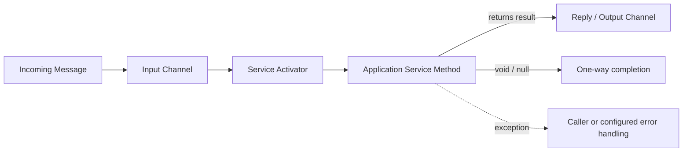

Bài **“Service Activator gọi phương thức ứng dụng từ message”** thuộc chương **Service activator** của module **SPRING_INTEGRATION_PATTERN**. Module tập trung học triển khai Enterprise Integration Patterns bằng Spring Integration để xây dựng luồng thông điệp ít phụ thuộc, dễ mở rộng; phối hợp Router, Filter, Transformer, Splitter, Aggregator, Gateway, retry, error channel, correlation, đồng thời kiểm thử và theo dõi các nhánh xử lý.

**Mục tiêu học tập:** hiểu Service Activator khác Transformer/Gateway ở đâu; triển khai bằng `@ServiceActivator` hoặc Java DSL `.handle(...)`; chọn cách truyền payload và headers; kiểm soát reply, exception, transaction, idempotency; rồi viết unit/integration tests chứng minh endpoint đã thực sự gọi phương thức nghiệp vụ đúng một cách có kiểm soát.

> **Ý chính:** Service Activator là **adapter ở ranh giới messaging và ứng dụng**, không phải nơi buộc mọi business service biết chi tiết hạ tầng.

## 1. Bài toán khi message cần gọi logic Java

Một luồng xử lý đơn hàng có thể là:

1. HTTP inbound gateway hoặc broker adapter nhận yêu cầu.
2. Decoder/Validator tạo `PlaceOrder` hợp lệ.
3. Router phân loại các loại lệnh.
4. Một endpoint gọi `OrderApplicationService.place(...)`.
5. Kết quả `OrderReceipt` được phát về output channel hoặc reply channel.

Nếu đặt code repository, email, HTTP client và rule nghiệp vụ trực tiếp trong mọi message handler, logic bị buộc chặt vào Spring Integration. Rất khó gọi lại nó từ REST controller, scheduled job hoặc unit test thuần Java.

Với Service Activator:

```text
Messaging concern:
  receive Message<PlaceOrder>
  resolve handler method
  bind parameters
  send reply / propagate failure

Business concern:
  place(PlaceOrder)
  validate domain invariants
  persist order
  return OrderReceipt
```

Lớp nghiệp vụ không cần phụ thuộc vào `MessageChannel` chỉ để tạo đơn hàng. Endpoint messaging chịu trách nhiệm **gọi đúng phương thức** và chuyển kết quả theo contract.

## 2. Service Activator khác các pattern kế cận

| Pattern/thành phần | Trách nhiệm chính | Quan hệ với Service Activator |
| --- | --- | --- |
| **Service Activator** | Gọi một phương thức ứng dụng từ message | Điểm nối message → business logic |
| **Transformer** | Chuyển đổi dữ liệu/message sang dạng khác | Có thể chạy trước/sau handler |
| **Filter** | Chỉ cho message thỏa điều kiện đi tiếp | Có thể chặn input trước handler |
| **Router** | Chọn một hoặc nhiều channel/handler | Quyết định endpoint nào nhận message |
| **Gateway** | Cấp giao diện request-reply hoặc một chiều cho caller | Thường gửi yêu cầu đến flow có Service Activator |
| **Splitter** | Tách một message thành các phần | Mỗi phần có thể đi tới Service Activator |
| **Aggregator** | Gom kết quả theo correlation/release policy | Có thể nhận reply từ nhiều Service Activator |
| **Channel Adapter** | Nối hệ thống transport và message channel | Đưa message vào/ra luồng |
| **Error Channel** | Mang `ErrorMessage` khi error handler công bố exception | Không thay thế business rejection/reply |

**Không nên phân biệt chỉ bằng việc “phương thức có trả object không”.** Một Transformer cũng có thể gọi phương thức Java, và Service Activator cũng có thể trả một payload khác. Khác biệt quan trọng là **vai trò thiết kế**: Service Activator kích hoạt thao tác ứng dụng; Transformer tập trung đổi biểu diễn message.

### Ví dụ một flow phối hợp

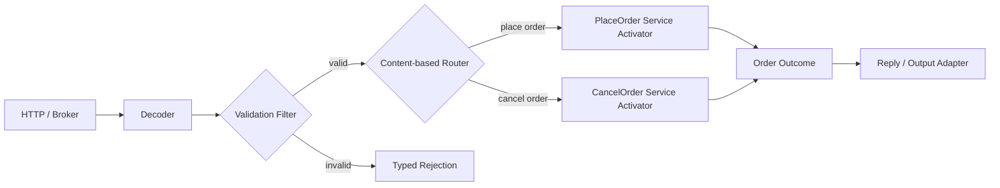

Mỗi endpoint có một trách nhiệm; không đưa mọi điều kiện routing, mapping và nghiệp vụ vào một handler khổng lồ.

## 3. Bốn bước cốt lõi của Service Activator

Khi một message tới input channel, Spring Integration thường thực hiện theo sơ đồ:

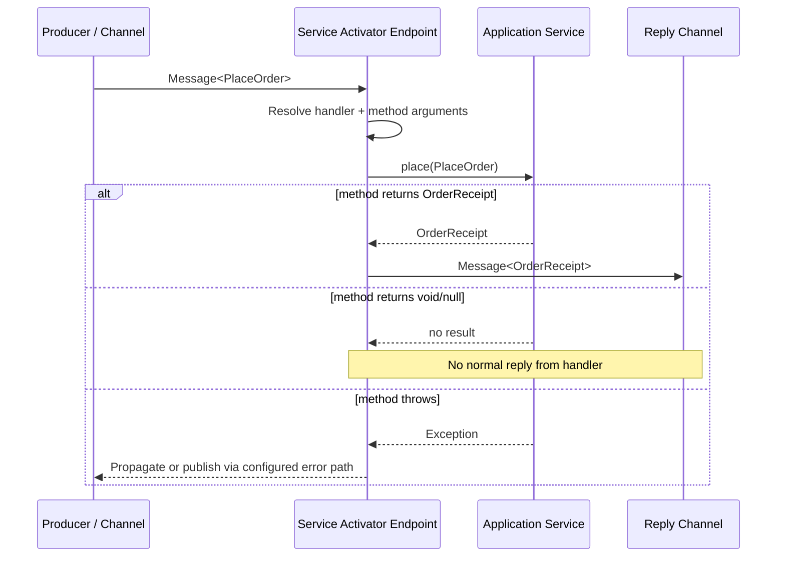

Bốn bước:

1. **Nhận message:** Channel dispatcher hoặc poller giao message đến endpoint.
2. **Chọn phương thức:** Endpoint dùng cấu hình, annotation, method name và chữ ký tham số để xác định method.
3. **Gọi ứng dụng:** Giá trị payload/headers/message được truyền vào method theo rules của endpoint.
4. **Xử lý kết quả:** Return value có thể trở thành payload của reply message; `void`/`null` có nghĩa không có reply bình thường; exception theo semantics của execution context.

**Không tự suy ra** mọi handler trả `null` sẽ báo “thành công” cho Gateway. Caller đang chờ reply có thể gặp reply timeout hoặc lỗi required-reply theo cấu hình.

## 4. Contract đơn hàng cho ví dụ xuyên suốt

Dùng Java 17+ và các record đơn giản. Hợp đồng nghiệp vụ:

- `tenantId`, `orderId`, `customerId` phải có giá trị.
- Mỗi line có `sku`, `quantity > 0`.
- Lệnh `PlaceOrder` tạo đơn theo identity `(tenantId, orderId)`.
- Kết quả có status `CREATED` hoặc `ALREADY_EXISTS`.
- Nhiều lần gửi cùng lệnh không tạo hai đơn trùng.
- Input hợp lệ về format chưa đồng nghĩa caller có quyền với tenant.

```java
import java.util.List;

record OrderLine(String sku, int quantity) {}

record PlaceOrder(
    String tenantId,
    String orderId,
    String customerId,
    List<OrderLine> lines
) {
    PlaceOrder {
        if (lines != null) {
            lines = List.copyOf(lines);
        }
    }
}

record OrderReceipt(
    String tenantId,
    String orderId,
    String status
) {}
```

Các record này là DTO minh họa. Không mặc định constructor đã xác thực tenant hoặc bảo đảm business invariants. Ở production, đặt validation/authorization tại trust boundary và kiểm tra invariants ở service nơi cần thiết.

### Một message tương ứng

```json
{
  "tenantId": "tenant-a",
  "orderId": "ORD-101",
  "customerId": "CUS-9",
  "lines": [
    {"sku": "SKU-1", "quantity": 2}
  ]
}
```

Payload này sẽ là input trực tiếp cho phương thức ứng dụng `place(PlaceOrder)`.

## 5. Lớp ứng dụng vẫn là Java thông thường

Đầu tiên hãy định nghĩa repository contract:

```java
interface OrderRepository {
    // Phải atomic và có ràng buộc business uniqueness.
    // true nếu vừa tạo, false nếu đã có cùng (tenantId, orderId).
    boolean insertIfAbsent(PlaceOrder command);
}
```

Sau đó viết service:

```java
class InvalidOrderException extends RuntimeException {
    InvalidOrderException(String code) {
        super(code);
    }
}

class OrderApplicationService {
    private final OrderRepository repository;

    OrderApplicationService(OrderRepository repository) {
        this.repository = repository;
    }

    public OrderReceipt place(PlaceOrder command) {
        validate(command);

        boolean created = repository.insertIfAbsent(command);

        return new OrderReceipt(
            command.tenantId(),
            command.orderId(),
            created ? "CREATED" : "ALREADY_EXISTS");
    }

    private static void validate(PlaceOrder command) {
        if (command == null
                || blank(command.tenantId())
                || blank(command.orderId())
                || blank(command.customerId())
                || command.lines() == null
                || command.lines().isEmpty()) {
            throw new InvalidOrderException(
                "ORDER_INPUT_INVALID");
        }

        for (OrderLine line : command.lines()) {
            if (line == null || blank(line.sku())
                    || line.quantity() <= 0) {
                throw new InvalidOrderException(
                    "ORDER_LINE_INVALID");
            }
        }
    }

    private static boolean blank(String s) {
        return s == null || s.isBlank();
    }
}
```

**Điểm đặc biệt:** `OrderApplicationService` không import `Message<?>`, `IntegrationFlow` hay `MessageChannel`. Lớp này có thể được gọi trong test thuần Java, từ REST controller, batch job hoặc Service Activator.

### Repository in-memory cho test học tập

```java
import java.util.concurrent.ConcurrentHashMap;
import java.util.concurrent.ConcurrentMap;

class InMemoryOrderRepository implements OrderRepository {
    private record OrderKey(String tenantId, String orderId) {}

    private final ConcurrentMap<OrderKey, PlaceOrder> orders =
        new ConcurrentHashMap<>();

    @Override
    public boolean insertIfAbsent(PlaceOrder command) {
        OrderKey key = new OrderKey(
            command.tenantId(), command.orderId());

        return orders.putIfAbsent(key, command) == null;
    }

    int size() {
        return orders.size();
    }
}
```

Đây là **test double**, không phải repository production. Nó không durable, không hỗ trợ transaction hay kiểm tra trường hợp `orderId` trùng nhưng nội dung khác nhau. Với business quan trọng, dùng unique constraint, payload fingerprint hoặc rule phát hiện conflict theo domain.

## 6. Service Activator bằng annotation `@ServiceActivator`

Một cách khai báo quen thuộc của Spring Integration là đánh dấu phương thức cần được gọi.

```java
import org.springframework.integration.annotation.ServiceActivator;
import org.springframework.stereotype.Component;

@Component
class AnnotatedOrderEndpoint {
    private final OrderApplicationService service;

    AnnotatedOrderEndpoint(OrderApplicationService service) {
        this.service = service;
    }

    @ServiceActivator(
        inputChannel = "orders.annotation.in",
        outputChannel = "orders.annotation.out")
    public OrderReceipt handle(PlaceOrder order) {
        return service.place(order);
    }
}
```

Ở đây:

- `@ServiceActivator` chỉ định **input channel** và **output channel**.
- `handle(PlaceOrder order)` nhận payload phù hợp với phương thức.
- Phần business thực sự nằm ở `service.place(order)`.
- `OrderReceipt` được đưa vào output channel như kết quả của handler.
- Khi method ném exception, error handling phụ thuộc vào channel/endpoint context.

Các channel phải tồn tại trong application context; bean `OrderApplicationService` cũng phải được đăng ký. Ví dụ method annotation và ví dụ Java DSL sau là **hai lựa chọn độc lập**. Không đăng ký cả hai subscriber cho cùng input một cách vô ý rồi kết luận có một handler duy nhất.

### Trường hợp annotation trực tiếp trên service

Có thể đặt `@ServiceActivator` ngay trên method của một Spring-managed service nếu service đó thực sự là endpoint. Nhưng với codebase lớn, một **adapter lớp mỏng** như `AnnotatedOrderEndpoint` giúp business service ít phụ thuộc framework và dễ test độc lập hơn.

**Không biến mọi phương thức nghiệp vụ thành integration endpoint.** Chỉ expose những operation mà messaging flow cần gọi; tránh để method chỉ dành cho nội bộ trở thành entrypoint có thể bị kích hoạt qua message.

## 7. Cấu hình Java DSL với `.handle(...)`

Spring Integration Java DSL cho phép xây flow và khai báo một endpoint Service Activator bằng `.handle(...)`.

Ví dụ:

```java
import org.springframework.context.annotation.Bean;
import org.springframework.context.annotation.Configuration;
import org.springframework.integration.channel.DirectChannel;
import org.springframework.integration.channel.QueueChannel;
import org.springframework.integration.config.EnableIntegration;
import org.springframework.integration.dsl.IntegrationFlow;
import org.springframework.messaging.MessageChannel;
import org.springframework.messaging.PollableChannel;

@Configuration
@EnableIntegration
class OrderServiceActivatorConfiguration {

    @Bean("orders.commands")
    MessageChannel ordersCommands() {
        return new DirectChannel();
    }

    @Bean("orders.receipts")
    PollableChannel orderReceipts() {
        // Cho test: in-memory, không durable.
        return new QueueChannel();
    }

    @Bean
    InMemoryOrderRepository exampleOrderRepository() {
        return new InMemoryOrderRepository();
    }

    @Bean
    OrderApplicationService orderApplicationService(
            InMemoryOrderRepository repository) {
        return new OrderApplicationService(repository);
    }

    @Bean
    IntegrationFlow placeOrderFlow(
            OrderApplicationService service) {
        return IntegrationFlow.from("orders.commands")
            .handle(PlaceOrder.class,
                (order, headers) -> service.place(order))
            .channel("orders.receipts")
            .get();
    }
}
```

### Đọc từng bước

1. `orders.commands` là `DirectChannel`, nên handler thường chạy trong call stack của sender.
2. `handle(PlaceOrder.class, ...)` nhận payload `PlaceOrder`.
3. Lambda gọi `OrderApplicationService.place`.
4. Return value `OrderReceipt` trở thành kết quả message của handler.
5. `orders.receipts` là `QueueChannel` để test có thể poll.
6. Cấu hình bean dùng test-double repository; production cần repository bền và transaction phù hợp.

**Handler không đọc một payload có kiểu tùy tiện rồi tự ép cast về `PlaceOrder`**. Nếu input là string/JSON raw, cần decoder/converter và kiểm tra kiểu **trước** endpoint này.

### Một dạng DSL khác: gọi method theo tên

Khi có Spring bean với method rõ ràng, có thể cấu hình method-invoking Service Activator:

```java
@Bean
IntegrationFlow placeOrderViaMethod(
        OrderApplicationService service) {
    return IntegrationFlow.from("orders.method.in")
        .handle(service, "place")
        .channel("orders.method.out")
        .get();
}
```

Đây là **phương án thay thế**, cần đăng ký `orders.method.in` và `orders.method.out`. Không tự copy vào cùng configuration ở trên mà thiếu hai channel.

Khai báo tên method tường minh giúp tránh mơ hồ khi bean có nhiều methods. Với **overloaded methods**, message-to-method resolution có thể không hiển nhiên; ưu tiên một adapter entrypoint với chữ ký rõ ràng và test lựa chọn method.

## 8. `@ServiceActivator` và `.handle(...)`: chọn cách nào?

| Tiêu chí | Annotation | Java DSL |
| --- | --- | --- |
| Chỗ khai báo | Trên method của Spring bean | Trong bean `IntegrationFlow` |
| Dễ nhìn message topology | Phân tán qua nhiều classes | Tập trung theo flow |
| Dễ giữ business service thuần | Dùng endpoint adapter mỏng | Dùng lambda hoặc method-invoking adapter |
| Hợp khi nào | Endpoint nhỏ, ít cấu hình | Flow nhiều bước cần nhìn thứ tự |
| Chọn method | Annotation và signature | Explicit lambda/method name |
| Test quan trọng | Method được thực sự subscribe đúng channel | Flow nhận/đẩy tới channel đúng |
| Rủi ro | Annotation không được scan; channel name sai | DSL route sai; method overload; reply semantics |

Không cần theo đuổi “annotation luôn tốt hơn DSL” hoặc ngược lại. Với một dự án đa module, nên có **quy ước nhất quán** để người vận hành dễ truy vết message từ source đến business method.

### Tránh hai endpoint cạnh tranh trên cùng channel

Nếu có hai subscriber trên một `DirectChannel`, dispatcher của point-to-point channel thường chọn một subscriber theo chiến lược dispatch, **không broadcast** cùng message cho cả hai. Nếu muốn gửi đến nhiều handlers, hãy dùng `PublishSubscribeChannel` hoặc `Recipient List` với contract fan-out.

Đừng đăng ký cả `@ServiceActivator(inputChannel="orders.commands")` và DSL handler cùng input chỉ vì đang thử hai cách rồi tưởng mỗi command sẽ chạy chính xác một endpoint cố định.

## 9. Method arguments: payload, headers hay cả message?

Service Activator có thể gọi phương thức với nhiều loại chữ ký được framework hỗ trợ, tùy handler method resolution và annotation.

### Nhận payload trực tiếp

```java
public OrderReceipt handle(PlaceOrder payload) {
    return service.place(payload);
}
```

Cách này phù hợp nhất nếu business method chỉ cần dữ liệu nghiệp vụ.

### Nhận cả Spring message

```java
import org.springframework.messaging.Message;

public OrderReceipt handle(Message<PlaceOrder> message) {
    PlaceOrder order = message.getPayload();

    // Chỉ dùng metadata/hợp đồng đã được xác thực.
    return service.place(order);
}
```

Phù hợp khi endpoint adapter cần trace hoặc header điều phối, nhưng **không tự chuyển `Message<?>` thành tham số domain trong mọi service**.

### Lấy header được chỉ định

```java
import org.springframework.messaging.handler.annotation.Header;
import org.springframework.messaging.handler.annotation.Payload;

public OrderReceipt handle(
        @Payload PlaceOrder payload,
        @Header("businessTenantId") String tenantId) {

    if (!payload.tenantId().equals(tenantId)) {
        throw new InvalidOrderException("TENANT_MISMATCH");
    }

    return service.place(payload);
}
```

Header binding có thể cần sự hiện diện và kiểu phù hợp. **Một raw client header có tên `businessTenantId` không tự đáng tin**: upstream phải xác thực principal/producer và xây header nội bộ từ nguồn đã xác minh.

### Tùy chọn toàn bộ headers

Spring Messaging hỗ trợ truy cập `MessageHeaders`/`@Headers` trong các method invocation thích hợp. Tuy nhiên, tránh chuyển trọn vẹn mọi header vào domain code nếu chỉ cần một hoặc hai metadata fields.

**Chủ đích chọn chữ ký method** giúp Service Activator làm adapter mỏng thay vì trộn routing, bảo mật và logic nghiệp vụ.

## 10. Type conversion và phương thức overload

Đầu vào có thể đến từ HTTP/JMS/Kafka như bytes, string, JSON map hoặc DTO.

```text
Kafka bytes / HTTP JSON
    -> Message Converter / Decoder
    -> PlaceOrder object
    -> Service Activator
    -> OrderApplicationService.place(PlaceOrder)
```

Đừng kỳ vọng `place(PlaceOrder)` tự nhận mọi `String` JSON do Spring Integration ép kiểu đúng. Nếu application có message conversion service được đăng ký, việc chuyển đổi **phụ thuộc cấu hình**, nhưng đó không thay thế schema validation, strict JSON type check hoặc authorization.

### Overloaded method nguy hiểm

```java
class AmbiguousHandler {
    public Object handle(Object input) {
        return "generic";
    }

    public Object handle(PlaceOrder input) {
        return "order";
    }
}
```

Một endpoint chọn method qua tên `"handle"` có thể gây **method resolution phức tạp** khi payload/conversion thay đổi. Dù framework có cơ chế chọn method tốt nhất, test phải chứng minh behavior trong các input thực.

Hướng giảm mơ hồ:

- Đặt một method cụ thể như `handlePlaceOrder(PlaceOrder)`.
- Dùng `.handle(PlaceOrder.class, (payload, headers) -> ...)`.
- Tách các message types qua Router tới handlers riêng.
- Không dùng `Object` rộng để che hợp đồng type sai.
- Test sai kiểu đầu vào và conversion error ở ingress.

Một type mismatch thường là **contract/decoder error**, không phải một business rejection như “số lượng đặt hàng không hợp lệ”.

## 11. Return value trở thành reply message thế nào?

Khi method trả một **payload object**, Spring Integration có thể tạo một reply message để đưa tới output channel đã cấu hình hoặc reply destination thích hợp.

```java
public OrderReceipt handle(PlaceOrder command) {
    return service.place(command);
}
```

Kết quả `OrderReceipt` có thể được đóng thành `Message<OrderReceipt>`. Một số headers có thể được propagates theo cơ chế tạo reply/endpoint và configuration, **không nên giả định mọi header gốc đều giữ nguyên** qua từng Transformer/handler.

### Nếu method trả một Message

```java
import org.springframework.messaging.Message;
import org.springframework.messaging.support.MessageBuilder;

public Message<OrderReceipt> handle(Message<PlaceOrder> incoming) {
    OrderReceipt result = service.place(incoming.getPayload());

    return MessageBuilder.withPayload(result)
        .setHeader("businessEventId",
            incoming.getHeaders().get("businessEventId"))
        .build();
}
```

Ở đây method kiểm soát message reply tường minh. **Hãy allowlist headers có lý do nghiệp vụ**, không sao chép `replyChannel`/`errorChannel` từ nguồn không đáng tin.

Thư viện có quy tắc merge headers khi chuyển một `Message<?>` thành reply, và behavior có thể phụ thuộc cấu hình. Muốn kiểm soát chính xác, viết integration test quan sát headers của reply trên phiên bản Spring Integration được sử dụng.

### Khi nào nên trả một object, khi nào trả Message?

- Trả DTO nếu chỉ cần **business result**.
- Trả `Message<DTO>` nếu endpoint cần phát **một số metadata reply** theo contract.
- Đừng để business service tự phụ thuộc vào `MessageBuilder` nếu metadata là concern của transport/adapter.

## 12. One-way Service Activator: phương thức `void` hoặc `null`

Không phải mọi command cần request-reply. Một event consumer có thể lưu dữ liệu hoặc gửi một lệnh sang downstream rồi kết thúc.

```java
interface AuditSink {
    void append(String tenantId, String orderId);
}

class AuditCommandHandler {
    private final AuditSink sink;

    AuditCommandHandler(AuditSink sink) {
        this.sink = sink;
    }

    public void record(PlaceOrder command) {
        sink.append(command.tenantId(), command.orderId());
    }
}
```

DSL một chiều:

```java
@Bean
IntegrationFlow oneWayAuditFlow(AuditCommandHandler handler) {
    return IntegrationFlow.from("orders.audit.in")
        .handle(PlaceOrder.class, (order, headers) -> {
            handler.record(order);
            return null; // Không phát reply bình thường.
        })
        .get();
}
```

Các channel/bean trong code snippet cần đăng ký khi ghép thành ứng dụng. Cách này phù hợp với fire-and-forget/event consumer **khi contract không đòi reply**. **One-way không đồng nghĩa asynchronous**: khi dùng `DirectChannel`, phương thức vẫn có thể chạy đồng bộ ngay trong thread gửi, chỉ là không phát reply bình thường; muốn bất đồng bộ phải chọn channel/adapter và execution model tương ứng.

### Không dùng một-way handler phía sau Gateway cần reply

Nếu Gateway đang chờ `OrderReceipt`, một handler `void` không trả reply có thể dẫn đến timeout hoặc required-reply failure. Phải quyết định:

- Request-reply: method trả receipt/outcome, error path rõ.
- One-way: caller chỉ biết lệnh đã được gửi/chấp nhận theo semantics của channel, **không mặc định biết business đã commit**.
- Async command: lưu outcome rồi cho caller query/callback về sau.

**Không tạo reply giả `"OK"` chỉ vì sender timeout** khi handler có thể chưa hoàn thành hoặc side effect chưa rõ.

## 13. Request-reply: output channel và replyChannel

Một Service Activator có hai nguồn đích reply thường gặp:

1. **Output channel tường minh** từ annotation/DSL.
2. **replyChannel header** dùng trong request-reply flow/Gateway khi endpoint không ấn định đích khác.

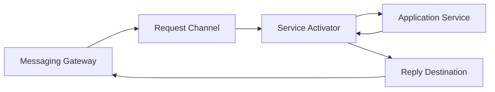

Với một flow có `.channel("orders.receipts")` sau handler, reply đi tới channel đã khai báo trong flow. Trong một Gateway request-reply, cấu hình destination cần phù hợp để reply **trở về đúng caller**.

### Reply channel không phải correlation nghiệp vụ

`replyChannel` phục vụ **đưa reply về chỗ người gọi**, không thay thế `orderId`, `businessEventId` hay `correlationId` của workflow. Khi có nhiều caller đồng thời, gateway infrastructure cần điều phối reply; đừng ép idempotency hoặc Aggregator group theo địa chỉ reply.

### Security boundary

Không nhận nguyên văn `replyChannel` hoặc `errorChannel` từ HTTP header và chuyển thành một Spring `MessageChannel` nội bộ. Đó là control-plane metadata; nếu cho client quyết định, họ có thể làm lệch reply hoặc error routing.

## 14. Gateway gọi Service Activator qua một interface

Messaging Gateway giúp caller Java sử dụng interface giống phương thức bình thường:

```java
import org.springframework.integration.annotation.Gateway;
import org.springframework.integration.annotation.MessagingGateway;

@MessagingGateway
interface OrderGateway {
    @Gateway(requestChannel = "orders.gateway.in")
    OrderReceipt place(PlaceOrder command);
}
```

Một flow khác nhận request:

```java
@Bean
IntegrationFlow gatewayOrderFlow(OrderApplicationService service) {
    return IntegrationFlow.from("orders.gateway.in")
        .handle(PlaceOrder.class,
            (order, headers) -> service.place(order))
        .get();
}
```

Đây là **một phương án độc lập** với channel `orders.commands` của ví dụ trước; cần đăng ký bean gateway và input channel đúng theo ứng dụng.

Cách hiểu:

- Caller gọi `gateway.place(command)`.
- Gateway tạo message và gửi vào `orders.gateway.in`.
- Service Activator xử lý và trả `OrderReceipt`.
- Reply theo cơ chế request-reply của Gateway.
- Exception/timeout phải có hợp đồng rõ tại caller.

### Rủi ro timeout

Một Gateway timeout **không chứng minh business transaction đã rollback**. Nếu repository đã commit nhưng reply thất lạc, caller có thể retry và phải được bảo vệ bởi idempotency key/domain uniqueness.

Không dùng timeout như lý do tự tạo một lệnh mới với ID mới; đó có thể dẫn đến đặt hàng hoặc thanh toán trùng.

## 15. Header binding và metadata phải được xác minh

Ví dụ message có:

```text
payload:
  tenantId = tenant-a
  orderId  = ORD-101

headers:
  businessTenantId = tenant-a
  businessEventId  = evt-101
  businessCorrelationId = corr-77
```

Service Activator có thể đọc `businessTenantId` và `businessEventId`, nhưng cần phân biệt:

| Dữ liệu | Vai trò | Nguồn tin cậy? |
| --- | --- | --- |
| `payload.tenantId` | Nghiệp vụ yêu cầu tenant nào | Chỉ được tin sau authorization |
| `businessTenantId` header | Scope nội bộ đã xác minh | Chỉ khi adapter tạo từ trusted principal |
| `businessEventId` | Event identity để idempotency | Phải ổn định từ producer/ingress đáng tin |
| `MessageHeaders.ID` | Message ID framework | Không thay business event identity |
| `businessCorrelationId` | Workflow/batch identity | Cần kiểm tra quyền/manifest |
| `replyChannel` | Destination reply nội bộ | Không do client tùy ý đặt |
| `errorChannel` | Destination lỗi nội bộ | Không do client tùy ý đặt |

Một helper ở trusted ingress có thể tạo headers:

```java
import org.springframework.messaging.Message;
import org.springframework.messaging.support.MessageBuilder;

final class TrustedOrderMessageFactory {
    Message<PlaceOrder> wrap(
            PlaceOrder order, String verifiedTenant,
            String businessEventId) {
        if (order == null
                || !verifiedTenant.equals(order.tenantId())) {
            throw new InvalidOrderException("TENANT_MISMATCH");
        }

        return MessageBuilder.withPayload(order)
            .setHeader("businessTenantId", verifiedTenant)
            .setHeader("businessEventId", businessEventId)
            .build();
    }
}
```

**Đây là minh họa tạo message, không tự làm authentication.** Caller phải lấy `verifiedTenant` từ nguồn đáng tin; `businessEventId` cũng phải được validate/authorize theo contract. Không copy tràn lan raw HTTP headers vào message.

## 16. Validation và authorization trước khi gọi service

Service Activator có thể nhận một DTO **đúng kiểu nhưng sai miền giá trị** hoặc chứa ID của tenant khác. Cần bảo vệ ở hai lớp:

- **Ingress:** decode, schema validation, authentication, authorization và rate limits.
- **Application service/domain:** xác minh bất biến quan trọng và quyền trước side effect; không dựa hoàn toàn vào Filter upstream nếu service có thể được gọi theo đường khác.

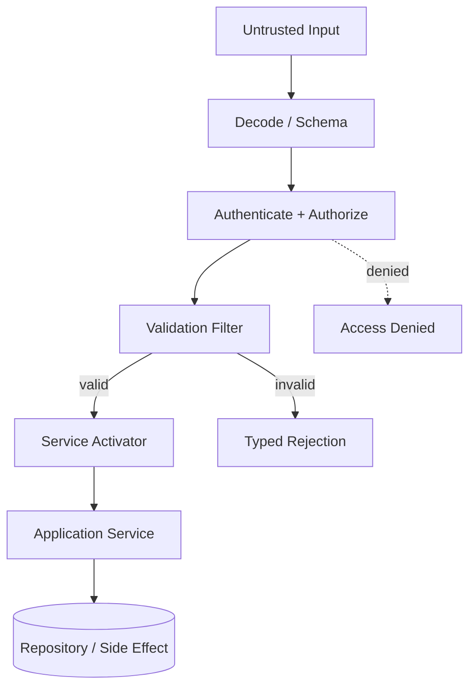

**Business validation failure** như `quantity=-2` thường nên tạo typed rejection thay vì retry vô hạn. **Authorization failure** cần phản hồi phù hợp quyền truy cập; không dùng code `ORDER_LINE_INVALID` để che lỗi tenant.

Nếu validator phụ thuộc Catalog Service và service đó timeout, trạng thái là `VALIDATION_UNAVAILABLE` chứ không phải “SKU không tồn tại”. Một handler lỗi hạ tầng có thể cần bounded retry, hold/quarantine hoặc error message theo execution context.

## 17. Exception đồng bộ: DirectChannel có thể ném về sender

Một `DirectChannel` thường gọi subscriber trong thread của sender. Nếu `OrderApplicationService.place(...)` ném exception, exception có thể lan ngược vào `send(...)` hoặc Gateway call, có thể được framework wrap trong messaging exception.

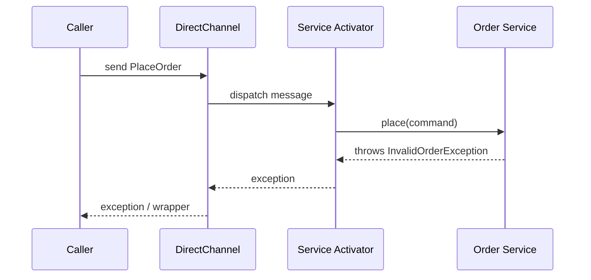

**Global `errorChannel` không tự bắt mọi exception đồng bộ.** Khi caller cần nhận HTTP 400/422, một adapter/controller/advice phải phân loại exception thành API response an toàn.

Không tự khẳng định exception có class đúng y như domain type tại boundary; một `MessageHandlingException` hoặc wrapper khác có thể chứa cause gốc. Integration test nên kiểm tra **cause/category**, không dựa vào chuỗi message tự do.

## 18. Exception bất đồng bộ: ErrorMessage phụ thuộc error handler

Khi flow chạy trên `ExecutorChannel`, poller, inbound adapter hoặc broker consumer, exception có thể được error handler bắt và công bố thành **Spring `ErrorMessage`**.

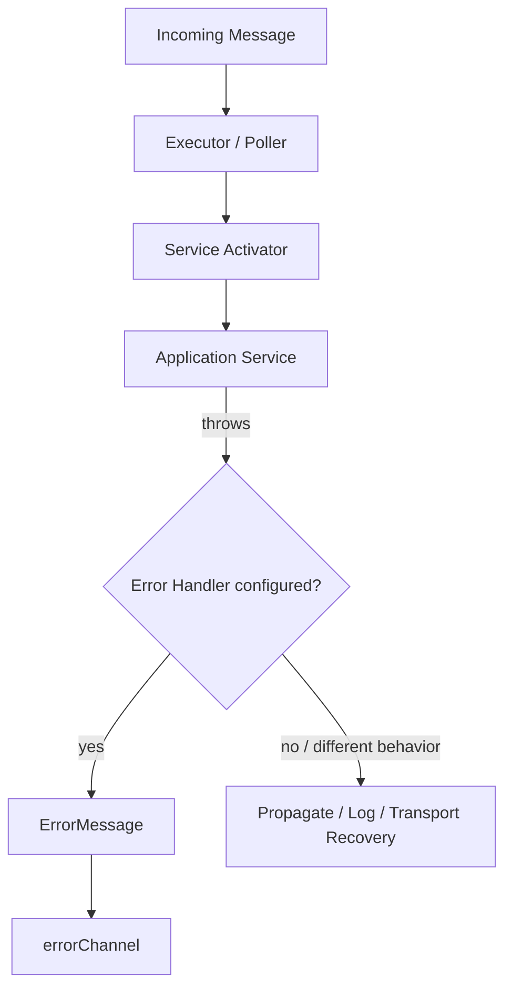

**Không có một quy tắc “mọi Service Activator lỗi đều tự đi đến errorChannel”**. Behavior phụ thuộc source adapter, channel, transaction, advice, thread context và error publisher.

Lưu ý:

- `ErrorMessage` có payload `Throwable`, **không phải** `OrderReceipt` hay typed domain rejection.
- `MessagingException.failedMessage` có thể chứa payload nhạy cảm.
- Nếu Service Activator **trả `null`** bình thường, đó không phải exception nên không tự tạo `ErrorMessage`.
- Async source có thể ACK trước khi business xử lý, hoặc ACK sau khi commit tùy transport/configuration; không suy từ việc errorChannel có message.

### Với một notification yêu cầu caller biết lỗi

Nếu caller đã nhận HTTP `202 Accepted` rồi hệ thống xử lý async, không thể trả HTTP 422 trên cùng kết nối đã đóng. Cần **status resource, callback, reply topic hoặc rejection event**.

## 19. Typed rejection khác exception

Đối với nghiệp vụ quan trọng, nên định nghĩa một output hợp đồng:

```java
import java.util.List;

record OrderRejected(
    String tenantId,
    String orderId,
    String errorCode,
    List<String> violationCodes
) {}
```

Ví dụ:

```json
{
  "tenantId": "tenant-a",
  "orderId": "ORD-101",
  "errorCode": "ORDER_VALIDATION_FAILED",
  "violationCodes": [
    "QUANTITY_MUST_BE_POSITIVE"
  ]
}
```

Bạn có thể thiết kế một validation step **trước Service Activator** để route invalid message sang rejected channel, và để handler chỉ nhận `PlaceOrder` hợp lệ. Hoặc service có thể ném một domain exception mà API boundary map thành DTO lỗi.

**Không bắt mọi `Throwable` rồi trả `OrderRejected(errorCode="INVALID_INPUT")`.** Database outage, bug và remote API timeout không chứng minh input sai. Chúng cần retry/recovery và monitoring khác.

Nếu nghiệp vụ quyết định trả một `Result<Success,Rejection>` typed union, flow sau Service Activator cần Router/Transformer thích hợp để chọn accepted vs rejected output.

## 20. Service Activator và transaction boundary

Một handler có thể ghi nhiều dữ liệu nghiệp vụ. Nếu mọi dữ liệu nằm trong **cùng một database/transaction manager**, nên bao quanh service method hoặc orchestration call bằng transaction rõ ràng.

```java
import org.springframework.transaction.annotation.Transactional;

class TransactionalOrderApplicationService {
    private final OrderRepository repository;
    private final OrderOutbox outbox;

    TransactionalOrderApplicationService(
            OrderRepository repository, OrderOutbox outbox) {
        this.repository = repository;
        this.outbox = outbox;
    }

    @Transactional
    public OrderReceipt place(PlaceOrder command) {
        // Validation và tenant authorization giả định đã có
        // ở ranh giới được quy định.
        boolean created = repository.insertIfAbsent(command);

        if (created) {
            outbox.enqueueOrderPlaced(command);
        }

        return new OrderReceipt(
            command.tenantId(), command.orderId(),
            created ? "CREATED" : "ALREADY_EXISTS");
    }
}

interface OrderOutbox {
    void enqueueOrderPlaced(PlaceOrder command);
}
```

Điều kiện để ví dụ đạt ngữ nghĩa kỳ vọng:

- `TransactionalOrderApplicationService` phải là **Spring-managed bean** và được gọi qua proxy/interceptor phù hợp; không tự `new` rồi mong `@Transactional` có hiệu lực.
- Repository và outbox cùng **transaction manager/resource** nếu muốn atomic commit.
- `insertIfAbsent` phải dựa trên unique constraint hoặc atomic write, không phải `SELECT EXISTS` rồi `INSERT` dễ race.
- Nếu outbox enqueue thất bại trong transaction, cả business state và outbox phải rollback theo policy.
- Nếu gọi hệ thống **bên ngoài database**, `@Transactional` không rollback được side effect ở hệ thống ngoài.
- Không coi ví dụ in-memory repository là một transaction bền vững.

### Service Activator không tự tạo transaction

Việc dùng `.handle(service, "place")` không tự biến mọi handler thành transactional. Transaction có thể nằm ở service layer, poller, advice chain hoặc inbound transaction boundary; cần chọn một nơi đúng với cơ chế ACK và resource.

## 21. Idempotency: nhận một message hai lần không đồng nghĩa tạo hai đơn

Ở hệ thống at-least-once, broker có thể redeliver cùng message sau khi business method đã commit nhưng trước khi ACK.

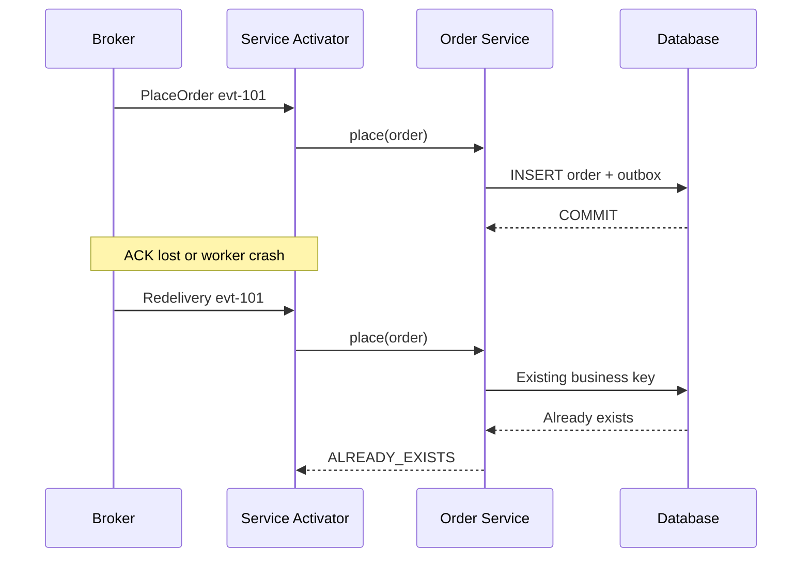

Service Activator **không tự khử duplicate**. Những cơ chế cần cân nhắc:

- **Idempotent Receiver** trước side effect.
- **Unique constraint** theo business operation (ví dụ tenantId + orderId cho “create order”).
- **Stable businessEventId** qua retry/replay.
- **Transactional inbox/outbox** nếu có nhiều consumer/producer.
- **Outcome store** để trả kết quả cũ cho Gateway khi response mất.
- **Conflict detection** nếu cùng idempotency key nhưng payload khác.
- **Retention window** dài đủ theo retry, DLQ và manual replay horizon.

Trong ví dụ học tập, `ALREADY_EXISTS` không phân biệt duplicate giống hệt với một lệnh khác dùng cùng order ID. Production phải xác định khi nào trả `ALREADY_EXISTS`, khi nào là `IDEMPOTENCY_KEY_CONFLICT` và khi nào phải đối soát.

**Không dedup theo `MessageHeaders.ID`** nếu identity có thể đổi qua Transformer hoặc broker. Dùng khóa nghiệp vụ ổn định và scope đúng.

## 22. Retry có thể gọi lại toàn bộ phương thức ứng dụng

Một retry advice quanh Service Activator có thể gọi lại `place(...)` sau exception. Nếu method đã thực hiện side effect trước khi exception xảy ra, retry có thể **lặp tác động**.

Ví dụ nguy hiểm:

```text
place(command):
  chargePaymentGateway()  // remote service already charged
  saveOrder()             // database operation times out
  throw exception

retry:
  chargePaymentGateway()  // could charge again
```

Hướng xử lý:

1. **Phân loại lỗi:** validation deterministic không retry nguyên message mãi.
2. **Bounded retry:** có max attempts, backoff và retryable exception types.
3. **Idempotency key:** truyền cùng key tới provider hỗ trợ.
4. **Reconciliation:** khi outcome của external call không rõ, hỏi trạng thái thay vì gọi lại mù.
5. **Outbox/Saga/compensation:** dùng khi nghiệp vụ cần điều phối nhiều resource.
6. **Circuit breaker/bulkhead:** ngăn một dependency lỗi kéo sập mọi handler.
7. **Error recovery:** record trạng thái chưa rõ, không tự tuyên bố thất bại chắc chắn.

Một Service Activator trả exception không chứng minh side effect chưa xảy ra. Điều này phải được thể hiện trong test crash/retry.

## 23. Concurrency: endpoint không ngầm đảm bảo thứ tự tuyệt đối

Service Activator chạy theo cách channel cấp message:

| Channel/nguồn | Đặc điểm | Điều cần kiểm tra |
| --- | --- | --- |
| `DirectChannel` | Thường dispatch đồng bộ trong caller thread | Thời gian handler kéo dài có thể chặn sender |
| `ExecutorChannel` | Dispatch qua executor | Có thể song song, thứ tự hoàn thành không bảo đảm |
| `QueueChannel` + poller | Tách producer và consumer | Polling, batch size, transaction, error handling |
| Kafka/JMS inbound adapter | Theo consumer/thread/partition/session configuration | ACK/redelivery/ordering và concurrency |
| Publish-subscribe channel | Fan-out tới nhiều subscribers | Không mặc định mỗi handler chỉ được gọi một lần |

**Service Activator không tự serialize mọi request theo `orderId`.** Hai commands cùng order có thể chạy đồng thời trên hai instance; repository/business state phải có locking, optimistic version hoặc unique constraints.

### Handler và thread safety

Nếu một Spring bean handler là singleton và được gọi đồng thời, tránh dùng mutable fields cho state của một request:

```java
// Không nên dùng shared field để giữ request hiện tại:
class UnsafeOrderHandler {
    private String currentOrderId;

    public void handle(PlaceOrder command) {
        currentOrderId = command.orderId();
        // Thread khác có thể thay field trước khi method kết thúc.
    }
}
```

Ưu tiên local variables, immutable DTOs và state bền vững có đồng bộ. ThreadLocal hoặc request-scoped context cũng cần kiểm soát khi chuyển thread qua ExecutorChannel.

## 24. Method resolution và lifecycle của Spring bean

Một handler method phải thực sự được đăng ký làm endpoint.

Các lỗi cấu hình thường gặp:

- Quên `@Component` hoặc bean registration, nên method annotated không được scan.
- Channel name khai báo sai, input không có subscriber.
- Hai endpoints cùng nhận một point-to-point channel và cạnh tranh message.
- Method bị overload khiến invocation chọn khác dự kiến.
- Dùng handler object tạo bằng `new` nên mất `@Transactional`/AOP hoặc dependencies.
- Gọi method private/internal mà proxy hoặc reflection không sử dụng đúng.
- Bean khởi tạo xong nhưng endpoint bị stop, poller không chạy.
- Handler trả null dù Gateway cần reply.
- Input raw JSON nhưng method chỉ nhận DTO và converter không được cấu hình.

Một integration test nên xác minh **Spring context thật có endpoint đang subscribe**, thay vì chỉ gọi `service.place(...)` trong test rồi kết luận annotation/DSL hoạt động.

## 25. Service Activator trong chuỗi Transformer và Filter

Một flow có thể:

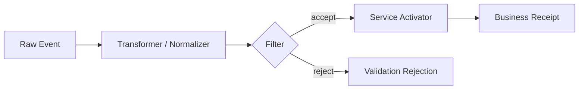

Lợi ích:

- **Transformer** đổi input thành `PlaceOrder` đúng contract.
- **Filter** chặn dữ liệu không đạt quy tắc ở ingress.
- **Service Activator** gọi phương thức nghiệp vụ.
- **Outcome handler** phát reply hoặc lưu kết quả theo contract.

Nhưng Filter không đủ bảo vệ domain nếu Service Activator còn có thể bị gọi từ một nguồn khác. Business service nên kiểm tra bất biến quan trọng trước khi commit.

### Không dùng `.handle(...)` để giả một Transformer bỏ qua output

Một handler one-way trả `null` sẽ dừng normal reply flow. Nếu muốn sửa payload và tiếp tục, nên dùng `.transform(...)` hoặc một service method trả result theo hợp đồng. Không viết `.handle(...); .channel("next")` rồi mong có output khi method luôn trả `null`.

## 26. Service Activator sau Splitter và trước Aggregator

Giả sử một batch có ba item. Splitter tạo ba message, mỗi item gọi một service method độc lập. Replies phải được Aggregator gom đúng.

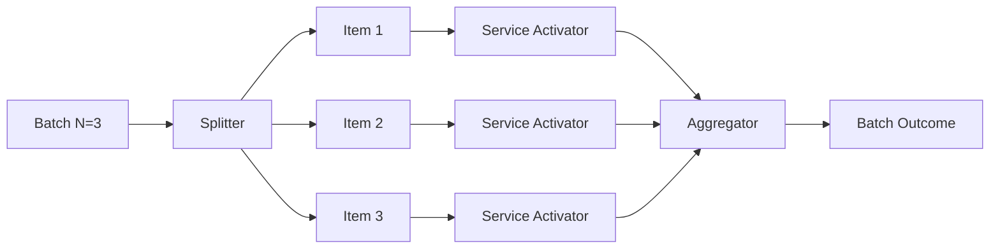

Cần bảo đảm:

1. **Correlation key** ổn định theo tenant/batch/generation.
2. **Part ID** duy nhất để chống duplicate.
3. **Sequence metadata** được giữ khi ordering/release phụ thuộc nó.
4. Nếu Service Activator trả `null`, Aggregator có thể thiếu một reply.
5. Nếu handler ném exception, cần một `ItemResult(FAILED)` hoặc fail-fast policy; không coi lỗi là một phần đã hoàn tất mà không có outcome.
6. **Release strategy** không chỉ đếm raw messages, nếu broker redeliver có thể đưa một item vào nhóm hai lần.
7. Timeout và late arrival policy rõ; không để một error/Filter discard làm group chờ mãi.

### Khi cần tạo reply cho từng item

```java
record ItemCommand(
    String batchId,
    String itemId,
    int quantity
) {}

record ItemResult(
    String batchId,
    String itemId,
    String status
) {}

class ItemApplicationService {
    public ItemResult process(ItemCommand command) {
        if (command.quantity() <= 0) {
            return new ItemResult(
                command.batchId(), command.itemId(), "REJECTED");
        }
        return new ItemResult(
            command.batchId(), command.itemId(), "COMPLETED");
    }
}
```

Đây là pattern **typed item outcome**: mỗi part trả một kết quả đã nhận, dù success hay rejected. Cần thêm tenant/generation và provenance khi dùng đa tenant hoặc nhiều lần batch cùng ID.

## 27. Service Activator trong Publish-Subscribe và Recipient List

Một event `OrderPlaced` có thể được phân tới:

- Ledger handler.
- Notification handler.
- Analytics handler.

Nếu mỗi subscriber là một Service Activator, **mỗi consumer scope phải có idempotency riêng**. Cùng event được xử lý một lần ở ledger **không đồng nghĩa** notification cũng đã thực hiện.

```text
(tenant-a, ledger-consumer, evt-101)
(tenant-a, notification-consumer, evt-101)
(tenant-a, analytics-consumer, evt-101)
```

Nếu các endpoint dùng chung một idempotency key toàn cục và store, subscriber đầu tiên có thể đánh dấu “seen” làm subscriber sau bị bỏ qua.

Ngoài ra, fan-out có thể làm một message tới nhiều handlers; đừng dựa vào `DirectChannel` point-to-point nếu yêu cầu là broadcast. Khi subscriber có dữ liệu nhạy cảm, cần giới hạn payload được gửi theo quyền; không phải mọi người nhận có eventId đều nên có full order details.

## 28. Correlation, causation và reply identity

Ba khái niệm thường xuất hiện cùng Service Activator:

| Khái niệm | Dùng để | Không dùng để |
| --- | --- | --- |
| `businessEventId` | Nhận diện event cho dedup/audit | Thay thế security authorization |
| `businessCorrelationId` | Nối message cùng workflow/batch | Tự xác định recipient reply |
| `causationId` | Nối event mới với event đã gây ra nó | Mặc định thay event ID |
| Spring `MessageHeaders.ID` | Nhận diện message framework | Dedup business xuyên mọi transport |
| `replyChannel` | Đường reply cho exchange | Business group key |
| `errorChannel` | Đường công bố error khi cấu hình | Validation DTO mặc định |

Nếu Service Activator tạo **event nghiệp vụ mới** (ví dụ `OrderPlaced` sau `PlaceOrder`), nên có event ID/causation riêng. Nếu chỉ **trả receipt** cho cùng command, business request ID có thể tiếp tục được dùng để correlate, nhưng không mặc định receipt cùng identity với original command event.

Đừng copy wholesale tất cả headers của input sang event mới; làm rõ scope và ownership.

## 29. Quan sát một Service Activator trong production

Metrics gợi ý:

```text
service_activator_messages_total{flow="orders",handler="place",outcome="success"}
service_activator_messages_total{flow="orders",handler="place",outcome="validation_rejected"}
service_activator_messages_total{flow="orders",handler="place",outcome="failed"}
service_activator_duration_seconds{flow="orders",handler="place"}
service_activator_retries_total{flow="orders",handler="place"}
service_activator_inflight{flow="orders",handler="place"}
service_activator_timeouts_total{flow="orders",handler="place"}
service_activator_idempotent_duplicates_total{flow="orders"}
```

Đây là **metric đề xuất do ứng dụng instrument**, không phải tên metric Spring Integration tự tạo. Nếu dùng Micrometer/Spring Integration management, kiểm tra naming/registration theo phiên bản và cấu hình thực tế.

Không đưa `orderId`, `eventId`, `correlationId`, email hoặc raw payload làm metric labels vì cardinality cao và rủi ro dữ liệu nhạy cảm.

### Structured log an toàn

```json
{
  "event": "service_activator_completed",
  "flow": "orders",
  "handler": "place",
  "businessEventId": "evt-101",
  "tenantScope": "tenant-a",
  "orderId": "ORD-101",
  "durationMs": 12,
  "outcome": "CREATED"
}
```

Ví dụ là schema log ứng dụng đề xuất. Log có thể cần masking/authorization và retention riêng. Không log toàn bộ `PlaceOrder` khi có PII, không log `ErrorMessage.failedMessage` nguyên bản.

### Một trace hữu ích

```text
HTTP inbound / broker receive
  -> decode/validate span
  -> router span
  -> service-activator: place span
     -> db insert span
     -> outbox insert span
  -> reply/publish span
```

Trace giúp tìm bottleneck nhưng **trace ID không thay business idempotency key**.

## 30. Unit test service mà không cần Spring

Vì business service không phụ thuộc messaging, ta kiểm thử như Java thông thường.

```java
import static org.junit.jupiter.api.Assertions.*;
import java.util.List;
import org.junit.jupiter.api.Test;

class OrderApplicationServiceTest {
    private final InMemoryOrderRepository repository =
        new InMemoryOrderRepository();
    private final OrderApplicationService service =
        new OrderApplicationService(repository);

    private PlaceOrder validCommand() {
        return new PlaceOrder(
            "tenant-a", "ORD-101", "CUS-9",
            List.of(new OrderLine("SKU-1", 2)));
    }

    @Test
    void firstCommandCreatesAnOrder() {
        OrderReceipt receipt =
            service.place(validCommand());

        assertEquals("CREATED", receipt.status());
        assertEquals("ORD-101", receipt.orderId());
        assertEquals(1, repository.size());
    }

    @Test
    void duplicateBusinessKeyDoesNotCreateSecondOrder() {
        OrderReceipt first =
            service.place(validCommand());
        OrderReceipt replay =
            service.place(validCommand());

        assertEquals("CREATED", first.status());
        assertEquals("ALREADY_EXISTS", replay.status());
        assertEquals(1, repository.size());
    }

    @Test
    void invalidQuantityDoesNotReachRepository() {
        PlaceOrder invalid = new PlaceOrder(
            "tenant-a", "ORD-102", "CUS-9",
            List.of(new OrderLine("SKU-1", -2)));

        assertThrows(InvalidOrderException.class,
            () -> service.place(invalid));
        assertEquals(0, repository.size());
    }
}
```

Unit test này chứng minh business logic và in-memory uniqueness **trong cùng process**; nó **không chứng minh** Spring endpoint subscribe đúng channel, không có transaction thật hoặc đúng ACK/redelivery từ broker.

Cần các test riêng cho repository production, nhất là unique constraint và race condition nhiều instance.

## 31. Spring Integration integration test: message thực sự gọi method

Dùng `OrderServiceActivatorConfiguration` ở mục 7.

```java
import static org.junit.jupiter.api.Assertions.*;
import java.util.List;
import org.junit.jupiter.api.Test;
import org.springframework.beans.factory.annotation.Autowired;
import org.springframework.beans.factory.annotation.Qualifier;
import org.springframework.messaging.Message;
import org.springframework.messaging.MessageChannel;
import org.springframework.messaging.PollableChannel;
import org.springframework.messaging.support.MessageBuilder;
import org.springframework.test.context.junit.jupiter.SpringJUnitConfig;

@SpringJUnitConfig(OrderServiceActivatorConfiguration.class)
class OrderServiceActivatorIntegrationTest {

    @Autowired
    @Qualifier("orders.commands")
    MessageChannel input;

    @Autowired
    @Qualifier("orders.receipts")
    PollableChannel replies;

    @Autowired
    InMemoryOrderRepository repository;

    @Test
    void invokesBusinessMethodAndPublishesReply() {
        PlaceOrder command = new PlaceOrder(
            "tenant-a", "ORD-101", "CUS-9",
            List.of(new OrderLine("SKU-1", 2)));

        assertTrue(input.send(MessageBuilder
            .withPayload(command).build()));

        Message<?> reply = replies.receive(1_000);
        assertNotNull(reply);

        OrderReceipt result =
            (OrderReceipt) reply.getPayload();

        assertEquals("ORD-101", result.orderId());
        assertEquals("CREATED", result.status());
        assertEquals(1, repository.size());

        assertNull(replies.receive(50));
    }
}
```

Khi chạy test nhiều methods trên cùng ApplicationContext, dùng **orderId duy nhất cho từng test** hoặc reset repository/queue để tránh nhiễm state. Không bật chạy song song trên một queue chung rồi kỳ vọng mỗi test chỉ nhận reply của mình.

### Test failure path

Với `DirectChannel`, khi gửi `PlaceOrder` có quantity âm, có thể nhận một `MessagingException` bọc domain exception tùy framework version.

```java
// Phác thảo bên trong Spring integration test:
PlaceOrder invalid = new PlaceOrder(
    "tenant-a", "ORD-invalid", "CUS-9",
    java.util.List.of(new OrderLine("SKU-1", -2)));

Exception failure = assertThrows(Exception.class, () ->
    input.send(MessageBuilder.withPayload(invalid).build()));

// Kiểm tra cause chain chứa InvalidOrderException;
// không chỉ assert bất kỳ exception nào là PASS.
// Assert repository không có order "ORD-invalid"
// và queue không phát OrderReceipt thành công.
```

Đây là **phác thảo**, không phải test độc lập. Production test cần assertion cụ thể hơn trên cause chain, exception category và state repository để chứng minh handler **không tạo side effect khi validation fail**.

## 32. Test phương thức annotation và binding header

Khi dùng `@ServiceActivator`, test phải tạo context có:

- `@EnableIntegration` và component scanning hoặc bean registration cho endpoint.
- Input/output channel như `orders.annotation.in`/`orders.annotation.out`.
- `AnnotatedOrderEndpoint` được quản lý bởi Spring.
- `OrderApplicationService` và dependencies.
- Một test gửi `PlaceOrder` vào input rồi assert receipt.

Để test `@Header("businessTenantId")`:

1. Gửi payload tenant A với trusted header tenant A → accept.
2. Gửi payload tenant A với header tenant B → handler từ chối.
3. Gửi thiếu header bắt buộc → binding/invocation failure rõ.
4. Gửi header sai kiểu → conversion/binding error theo contract.
5. Gửi raw client header tự khai nhưng không được xác thực → ingress authorization phải chặn trước endpoint.

**Không chỉ gọi trực tiếp method annotated trong unit test rồi kết luận annotation đã hoạt động.** Test trực tiếp bỏ qua message-to-method binding, header resolution, channel dispatch và reply channel.

## 33. Test null, sai kiểu và serialization boundary

Ordinary Spring `Message` thường yêu cầu **payload không null**. Vì vậy:

```java
MessageBuilder.withPayload(null).build();
```

không phải fixture hợp lệ để kiểm tra `OrderApplicationService.place(null)` thông qua một Service Activator.

Nếu HTTP body rỗng hoặc JSON root `null`, cần test ở **inbound decoder/gateway** trước khi tạo message. Có thể unit test `service.place(null)` riêng để bảo vệ domain, nhưng đừng kết luận null có thể đi qua ordinary Spring Message như thế.

### JSON sai kiểu

Ví dụ:

```json
{
  "tenantId": "tenant-a",
  "orderId": "ORD-101",
  "customerId": "CUS-9",
  "lines": "not-an-array"
}
```

Decoder có thể thất bại trước Service Activator. Kiểm tra JSON/schema ở adapter, không mặc định `.handle(PlaceOrder.class, ...)` sẽ tạo typed `OrderRejected` cho mọi mapping error.

### Message mang sai Java type

Nếu gửi `Message<String>` vào channel dành cho `PlaceOrder`, có thể xảy ra method argument conversion/binding error tùy converter. Test contract nên assert:

- Business service **không** bị gọi với dữ liệu không hợp lệ.
- Không có `OrderReceipt("CREATED")`.
- Lỗi được phát qua đúng error boundary của execution context.
- Không log nguyên raw input nếu chứa dữ liệu nhạy cảm.

Nếu ứng dụng cố ý hỗ trợ nhiều payload types, dùng Router hoặc type guard trước endpoint thay vì một method `handle(Object)` tùy tiện.

## 34. Test retry, crash và concurrency

Một số test chỉ có ý nghĩa khi dùng **hạ tầng thật hoặc test double kiểm soát được fail point**:

| Tình huống | Điều cần chứng minh |
| --- | --- |
| Hai messages cùng key tới đồng thời | Unique constraint/atomic insert, chỉ một order |
| Business commit xong, ACK mất | Redelivery không tạo side effect trùng |
| Transaction rollback trước commit | Retry có thể thực hiện lại mà không mất việc |
| Outbox insert lỗi trong transaction | Không commit order nhưng mất event |
| Remote provider thành công, response mất | Không gọi lại mù; reconciliation/idempotency |
| Gateway timeout sau commit | Caller retry theo cùng business key |
| Service Activator trả null | Reply channel không có successful reply |
| Service Activator ném validation exception | Không retry vô hạn message invalid |
| Handler ném infrastructure exception | Bounded retry/recovery đúng |
| ExecutorChannel nhận messages song song | Handler thread-safe, ordering contract |
| Shared store nhiều instances | Ownership/locking và idempotent outcome |
| Downstream output publish lỗi | Không báo client “đã công bố” nếu chưa chắc |
| Error channel handler tự lỗi | Không tạo vòng lặp xử lý lỗi vô hạn |
| Splitter phát nhiều parts | Mỗi part có result/correlation đúng |
| Recipient List phát tới nhiều subscribers | Idempotency theo từng consumer scope |

### Test concurrency có ranh giới rõ

Dùng một database thật hoặc test container với unique constraint và `CountDownLatch`/barrier để hai requests cố insert cùng key. Sau khi cả hai kết thúc, assert **một domain row và đúng outcome policy**, không chỉ “hai threads không ném exception”.

### Test external side effect

Dùng mock server/provider để mô phỏng “API đã làm việc nhưng response thất lạc”. Nếu Service Activator retry, provider phải nhận **cùng idempotency key** hoặc ứng dụng phải query outcome, không lặp một giao dịch nguy hiểm.

## 35. Hiệu năng và backpressure

Service Activator là nơi logic nghiệp vụ có thể:

- Gọi database.
- Truy cập REST/gRPC service.
- Ghi outbox.
- Tạo báo cáo.
- Gửi thông báo.
- Chạy CPU-intensive transformation.

Nếu đặt handler chậm trên `DirectChannel`, sender bị chặn theo semantics đồng bộ. Nếu chuyển sang `ExecutorChannel`, throughput có thể tăng nhưng cần quản lý:

- Giới hạn thread pool và queue capacity.
- Backpressure/rejection policy.
- Timeout và circuit breaker cho nguồn phụ.
- Connection pool database.
- Maximum in-flight theo tenant/consumer.
- Idempotency dưới cạnh tranh cao.
- Trạng thái khi queue đầy hoặc app restart.
- Bảo toàn correlation/trace context khi chuyển thread.

**Tăng số worker không tự làm business operation an toàn khi chạy song song.** Khi các lệnh cùng entity yêu cầu ordering, cần per-key serialization, optimistic lock hoặc domain version guard theo SLA.

Không gửi payload lớn qua nhiều channels nếu có thể dùng Claim Check với retention/quyền phù hợp.

## 36. Bảo mật khi method được kích hoạt từ message

Một Service Activator có thể đang gọi phương thức có quyền cao: thanh toán, tạo user, đổi trạng thái đơn, gửi email. Vì thế không được coi input channel là tự động an toàn.

Threat model tối thiểu:

- Client giả `tenantId` hoặc `businessTenantId`.
- Client đặt `replyChannel`/`errorChannel` để điều hướng message.
- Producer gửi `payloadType` không khớp với business operation.
- Một message bị replay sau khi quyền của actor thay đổi.
- Một header chứa API token vô tình bị log trong `failedMessage`.
- Payload vượt kích thước hoặc mang cấu trúc sâu gây DoS.
- Một listener thứ hai vô tình subscribe channel chứa PII.
- Error handler đưa nguyên `Throwable` cho bên ngoài.

Các biện pháp:

1. Authenticate nguồn/producer ở adapter.
2. Authorize tenant và operation trước side effect.
3. Chỉ map allowlisted headers từ trusted context.
4. Chọn method/handler qua configuration, không cho client tự chọn tên bean/method.
5. Validate payload type/format/domain.
6. Giới hạn size, concurrency và timeout.
7. Dùng business idempotency key.
8. Mask log, hạn chế DLQ/error channel, audit quyền.
9. Test cross-tenant/forged headers ngay ở ingress.
10. Không tiết lộ stack trace hoặc raw message cho caller.

**Không dùng `MessageHeaders.ID` hoặc `traceId` làm authorization proof.** Chúng phục vụ messaging/observability, không xác nhận actor được phép thực hiện operation.

## 37. Ma trận kiểm thử Service Activator

| ID | Kịch bản | Kỳ vọng |
| --- | --- | --- |
| SA01 | Message `PlaceOrder` hợp lệ | Service method được gọi |
| SA02 | Method trả `OrderReceipt` | Reply channel nhận đúng payload |
| SA03 | Method trả `null` | Không có normal reply |
| SA04 | Method `void` | One-way flow kết thúc theo contract |
| SA05 | Invalid quantity | Không tạo order, exception/rejection đúng |
| SA06 | Thiếu Spring message payload | Lỗi ở message/ingress boundary |
| SA07 | Raw JSON sai schema | Decoder lỗi trước handler |
| SA08 | Java payload sai kiểu | Type/conversion error, không gọi service |
| SA09 | Missing businessTenantId header | Binding/validation từ chối |
| SA10 | Header tenant khác payload | Từ chối, không ghi chéo tenant |
| SA11 | Authenticated actor không có tenant permission | Authorization denied dù input đúng format |
| SA12 | `@ServiceActivator` registration | Endpoint thật subscribe input channel |
| SA13 | Java DSL method invocation | Gọi đúng method, không mơ hồ overload |
| SA14 | Hai subscribers trên DirectChannel | Không giả định broadcast |
| SA15 | Gateway request-reply hợp lệ | Reply đúng caller |
| SA16 | Gateway đi vào one-way method | Timeout/required-reply policy được test |
| SA17 | Exception trên DirectChannel | Caller nhận exception/cause đúng |
| SA18 | Exception trên async handler | ErrorMessage tới đúng error channel nếu được cấu hình |
| SA19 | Invalid business input và retry | Không retry vô hạn |
| SA20 | Lỗi hạ tầng tạm thời | Retry có giới hạn, không mất correlation |
| SA21 | Duplicate event | Không lặp side effect |
| SA22 | Hai request cùng order chạy đồng thời | Atomic uniqueness |
| SA23 | Commit xong nhưng ACK mất | Redelivery an toàn |
| SA24 | Transaction rollback | Không để idempotency record COMPLETED sai |
| SA25 | Outbox publish thất bại | Recovery/outcome không sai |
| SA26 | Transformer tạo reply Message | Header allowlist/propagation đúng |
| SA27 | Handler sau Splitter | Part identity và correlation giữ đúng |
| SA28 | Handler trả null trong Aggregator flow | Test thiếu reply/timeout policy |
| SA29 | Recipient List nhiều scopes | Mỗi consumer xử lý một lần |
| SA30 | Slow handler/queue full | Backpressure và timeout rõ |
| SA31 | ErrorMessage chứa PII | Không log/echo raw payload |
| SA32 | App restart với in-memory state | Không tuyên bố durable/exactly-once |
| SA33 | Broker serializer làm mất businessEventId | Contract test FAIL |
| SA34 | Trace ID khác nhau trên replay | Business event identity vẫn giữ |
| SA35 | Thay đổi method signature | Contract/integration tests phát hiện |
| SA36 | Deploy nhiều instances | Handler và repository thread-safe |

Nên chia suite thành **unit service**, **Spring Integration channel/method binding**, **transport/Gateway**, **transaction/idempotency**, **security**, **async/performance**, thay vì viết một test class lớn khó xác định nguyên nhân lỗi.

## 38. Sai lầm thường gặp

**“Service Activator là tên khác của một REST controller.”** Nó là message-driven endpoint; HTTP controller/gateway chỉ có thể là nguồn cung cấp message.

**“Đặt `@ServiceActivator` lên method là đủ.”** Method cần được Spring quản lý, endpoint được đăng ký và input channel có message thật.

**“Handler nào cũng phải trả reply.”** One-way method có thể `void`/`null`; nhưng Gateway đòi reply cần contract khác.

**“Trả `null` nghĩa là đã ACK/commit đúng.”** ACK/transaction phụ thuộc transport và execution context.

**“Thêm `.channel("next")` sau handler null sẽ có output.”** Không có reply payload để gửi nếu handler one-way.

**“Tên input channel chính là method name.”** Channel và method được nối bằng cấu hình; không cần và không nên để client chọn method.

**“Method nhận `PlaceOrder` thì Spring tự parse mọi JSON string.”** Conversion/decoder phải được thiết kế và test.

**“MessageHeaders.ID là business event ID.”** Không đảm bảo ổn định qua transform/replay.

**“Có errorChannel thì mọi exception tự được công bố.”** Sync DirectChannel có thể lan exception về caller.

**“Service Activator tự xử lý duplicate.”** Không; cần business key, store và idempotency.

**“@Transactional rollback được API thanh toán ngoài.”** Không; transaction database không bao phủ remote call.

**“Tăng ExecutorChannel threads giải quyết mọi latency.”** Cần backpressure, limits và kiểm soát ordering/state.

**“Gọi trực tiếp method trong JUnit chứng minh messaging hoạt động.”** Không; cần integration test gửi/nhận qua channel.

**“Gắn annotation trên class final/private method và proxy luôn hoạt động.”** AOP/proxy và method visibility phụ thuộc cấu hình; nên dùng Spring-managed service và test transaction thật.

**“Mọi subscriber đều được đọc full event payload.”** Fan-out cần authorization và data minimization theo recipient.

**“Cứ log `ErrorMessage` toàn bộ cho dễ debug.”** `failedMessage` và Throwable có thể chứa PII/secrets.

## 39. Bài tập: Service Activator cho xử lý thanh toán đơn hàng

Một hệ thống nhận `CapturePayment` qua broker. Flow:

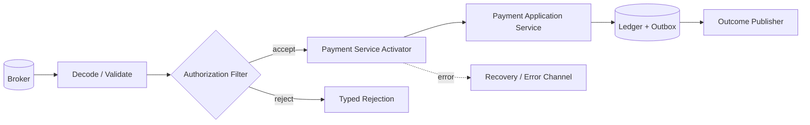

Ràng buộc:

- Một lệnh có `tenantId`, `paymentId`, `eventId`, `amountMinor`, `currency`.
- Consumer có thể nhận duplicate do mất ACK.
- Một payment không được capture hai lần.
- Payment provider có API idempotency key nhưng thời hạn key hữu hạn.
- Database ledger và outbox trong cùng transaction.
- Handler phải trả một `PaymentReceipt` hoặc typed outcome cho request-reply, và có thể dùng one-way consumer cho broker.
- Một số payload bị lỗi domain; một số lỗi là timeout provider.
- Correlation phải giữ qua error/retry để đối soát.
- Producer không được chọn internal reply/error channel.

**Yêu cầu thực hành:**

1. Viết `PaymentApplicationService.capture(command)` không phụ thuộc `MessageChannel`.
2. Tạo flow Java DSL với `.handle(CapturePayment.class, ...)`.
3. Tạo phương án `@ServiceActivator` có annotation trên endpoint adapter.
4. Phân biệt handler return `PaymentReceipt` và one-way `void`.
5. Nêu cách Gateways nhận reply đúng, và chuyện gì xảy ra khi method trả null.
6. Thiết kế stable idempotency key theo tenant/payment/operation.
7. Bảo vệ hai message cùng payment tới đồng thời bằng atomic constraint.
8. Thiết kế transaction ledger + outbox và xử lý publish sau commit.
9. Khi external provider thành công nhưng reply mất, tại sao retry mù nguy hiểm?
10. Phân biệt invalid amount với provider timeout trong error policy.
11. Viết test business service riêng không cần Spring.
12. Viết integration test gửi `Message<CapturePayment>` và assert reply channel.
13. Test missing/wrong Java payload type ở decoder/boundary.
14. Test header tenant giả mạo từ client.
15. Test duplicate event qua broker redelivery.
16. Test error channel khi handler chạy bất đồng bộ.
17. Test queue pressure và thời gian xử lý chậm.
18. Nếu thêm Scatter-Gather, mỗi nhánh có cần trả một result không? Vì sao?

**Tiêu chí hoàn thành:** Có business method thuần, Service Activator thực sự gọi đúng method, request-reply/one-way rõ, validation/tenant guard, transaction và idempotency an toàn, cùng test cho happy path, lỗi, concurrency và replay.

## 40. Checklist triển khai Service Activator

- [ ] Business operation được định nghĩa bằng một method có tên và contract rõ.
- [ ] Service Activator đóng vai trò adapter, không nhét toàn bộ logic nghiệp vụ vào flow.
- [ ] Spring bean/endpoint được đăng ký và subscribe đúng input channel.
- [ ] Chọn `@ServiceActivator` hoặc DSL `.handle(...)` theo quy ước dự án.
- [ ] Không vô tình đăng ký hai competing subscribers trên một DirectChannel.
- [ ] Handler method không overload mơ hồ hoặc nhận `Object` quá rộng.
- [ ] Decoder/conversion bảo đảm payload type trước khi handler chạy.
- [ ] Các required headers được lấy từ trusted ingress và kiểm tra consistency.
- [ ] Client không điều khiển internal replyChannel/errorChannel.
- [ ] Có validation, authorization và resource limits trước side effect.
- [ ] Business service kiểm tra invariants quan trọng khi được gọi từ nhiều entrypoints.
- [ ] Return value, `Message<?>` return và `void`/`null` có semantics rõ.
- [ ] Request-reply/Gateway nhận đúng destination, timeout có chính sách.
- [ ] One-way handler không đứng sau một Gateway đòi reply nếu không có outcome khác.
- [ ] DirectChannel exception propagation được test.
- [ ] Async error publishing được cấu hình và kiểm thử theo execution context.
- [ ] Domain rejection không bị đánh đồng với lỗi hạ tầng.
- [ ] Retry chỉ cho lỗi phù hợp, có giới hạn và backoff.
- [ ] Business idempotency key ổn định qua retry/broker redelivery.
- [ ] Unique constraint/locking bảo vệ nhiều instances cùng thao tác.
- [ ] Transaction boundary bao phủ repository/outbox khi cùng DB.
- [ ] External side effect có idempotency/reconciliation; không giả định DB rollback remote API.
- [ ] Splitter/Aggregator có correlation, part identity và expected reply đúng.
- [ ] Fan-out subscribers có idempotency scope và phân quyền dữ liệu riêng.
- [ ] Thread safety và backpressure phù hợp với channel/executor.
- [ ] Metrics/traces cho handler duration, success, rejection, retry, error.
- [ ] Không log nguyên Message/failedMessage chứa dữ liệu nhạy cảm.
- [ ] Có unit tests cho service method thuần Java.
- [ ] Có integration tests gửi message tới channel và quan sát reply.
- [ ] Có tests invalid input, missing headers, wrong type, retry và gateway timeout.
- [ ] Có test concurrency, crash recovery và database idempotency khi cần.
- [ ] Đã đối chiếu Java DSL/annotation/transaction behavior với Spring Integration và Spring Framework version thực tế.

## Ghi nhớ

**Service Activator gọi phương thức ứng dụng từ message** bằng cách nối input channel với một method Java. Trong Spring Integration, `@ServiceActivator` và Java DSL `.handle(...)` là hai cách khai báo endpoint; payload, headers hoặc cả `Message<?>` có thể được gán vào tham số theo cấu hình/chữ ký. Return value có thể tạo reply message; `void`/`null` thường không tạo normal reply.

Một Service Activator chất lượng **giữ business service độc lập với messaging**, phân biệt request-reply và one-way, không tin raw header/tenant từ client, không tự cho rằng exception luôn đi qua errorChannel hoặc transaction luôn bao phủ remote side effect. Kết hợp validation, authorization, retry có giới hạn, idempotency, transaction/outbox và observability để handler an toàn trước duplicate, concurrency và failure.

**Kiểm thử đúng không chỉ gọi trực tiếp method trong JUnit, mà còn gửi một message qua Spring Integration flow, quan sát kết quả/reply hoặc lỗi tại đúng boundary, và chứng minh side effect nghiệp vụ không bị thực hiện sai.**

