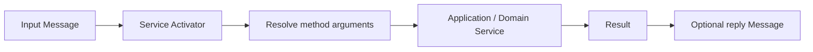
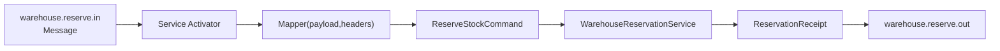
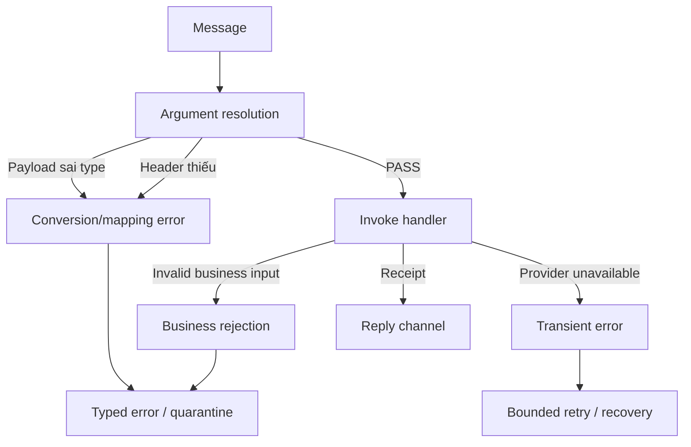
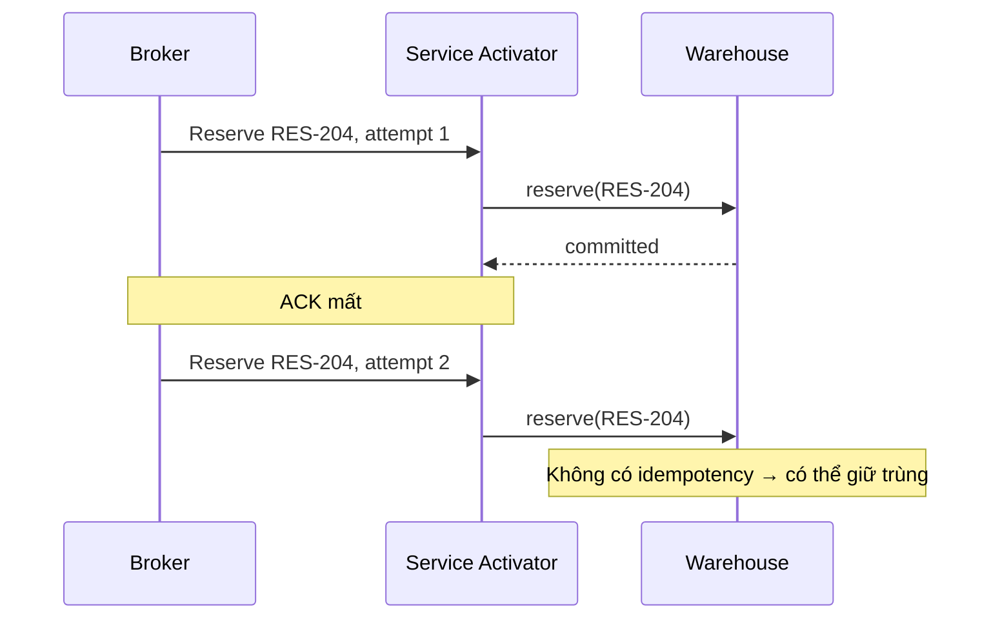

# Mapping payload vào method argument

## 1. Bài toán: một Message nhưng method cần nhiều dữ kiện

Một hệ thống quản lý kho nhận lệnh giữ hàng:

```text
Message<ReserveStockRequest>
  payload:
    reservationId = "RES-204"
    sku           = "SKU-RED-01"
    quantity      = 2
  headers:
    verifiedTenantId = "tenant-A"
    requestRef       = "req-701"
    traceRef         = "trace-801"
```

Khi message đến **Service Activator**, Spring Integration cần biết đối số nào trong method lấy từ payload, đối số nào lấy từ header, và liệu method có cần toàn bộ `Message<?>` hay không.

Một implementation khó bảo trì thường viết:

```java
// Anti-pattern: trộn integration headers và nghiệp vụ.
public Object reserve(Message<?> message) {
    String tenant = (String) message.getHeaders()
        .get("verifiedTenantId");
    String trace = (String) message.getHeaders()
        .get("traceRef");
    ReserveStockRequest request =
        (ReserveStockRequest) message.getPayload();

    // Lớp nghiệp vụ bắt đầu phụ thuộc Message, trace, headers.
    return warehouse.reserve(request, tenant, trace);
}
```

Cách tiếp cận tốt hơn là làm rõ **argument mapping tại integration boundary** và gọi một domain port dùng command/value object có kiểu.

Bài **“Mapping payload vào method argument”** thuộc chương **Service activator**, module **SPRING_INTEGRATION_PATTERN**. Module hướng dẫn triển khai Enterprise Integration Patterns với Spring Integration để xây dựng luồng message ít phụ thuộc và dễ mở rộng, thực hành Router, Filter, Transformer, Splitter, Aggregator, Gateway, retry, error channel, correlation và kiểm thử theo dõi các nhánh xử lý.

Sau bài, bạn có thể:

1. Phân biệt truyền payload, toàn bộ `Message<T>`, header riêng và tập headers vào method.
2. Viết `@ServiceActivator` với `@Payload`, `@Header`, `@Headers`.
3. Sử dụng Java DSL `.handle(...)` để ánh xạ payload/header vào domain command.
4. Hiểu những lỗi do payload type, header required/optional và conversion.
5. Xử lý kết quả method trả payload, Message hoặc `void` đối với reply flow.
6. Viết test chứng minh Spring thực sự resolve method arguments.
7. Giữ domain logic độc lập transport và trusted header naming.
8. Tách mapping ra khỏi authorization, error handling, retry và idempotency.

## 2. Service Activator trong Enterprise Integration Patterns

**Service Activator** nối một hệ thống messaging với một service/method xử lý nghiệp vụ. Nó nhận message, gọi hành động phù hợp, sau đó có thể phát message kết quả.



Không phải cứ có một method trả object mới là Transformer. So sánh:

| Pattern | Mục tiêu | Ví dụ |
| --- | --- | --- |
| Service Activator | Kết nối message với hành vi/service | Giữ hàng trong kho |
| Transformer | Đổi biểu diễn dữ liệu | String JSON → ReserveStockRequest |
| Filter | Quyết định đi tiếp hay reject | Quantity vượt giới hạn |
| Router | Chọn channel/nhánh | EXPRESS → priority |
| Gateway | Kết nối caller với messaging flow | API chờ ReservationReceipt |
| Idempotent Receiver | Chống lặp business side effect | Một reservationId không reserve hai lần |
| Aggregator | Gom nhiều message thành kết quả | Nhiều line receipts → OrderSummary |

Một Service Activator không tự bảo đảm transaction, retry, idempotency hoặc business authorization. Đó là các hợp đồng phải thiết kế thêm.

## 3. Message và nguồn dữ liệu của argument

Spring Messaging mô hình hóa:

```text
Message<T>
  ├── payload: T
  └── headers: MessageHeaders
        ├── id
        ├── timestamp
        ├── correlationId
        ├── requestRef
        └── verifiedTenantId
```

Từ một message, method có thể nhận:

```mermaid
flowchart TD
    M["Message<ReserveStockRequest>"] --> P["@Payload ReserveStockRequest"]
    M --> H["@Header(\"verifiedTenantId\") String"]
    M --> HS["@Headers Map<String,Object>"]
    M --> ALL["Message<ReserveStockRequest>"]
    P --> F["Handler invocation"]
    H --> F
    HS --> F
    ALL --> F
```

**Không có nghĩa phải sử dụng đồng thời cả bốn cách.** Mỗi method nên nhận đúng những dữ kiện cần thiết. Một domain method cần xử lý kho chỉ nên biết command có nghĩa nghiệp vụ; trace ID và broker offset có thể ở integration layer.

## 4. Method chỉ nhận payload

Với message có `ReserveStockRequest` trong payload, cách đơn giản:

```java
public ReservationReceipt handle(ReserveStockRequest request) {
    return service.reserve(new ReserveStockCommand(
        "tenant-A",
        request.reservationId(),
        request.sku(),
        request.quantity()));
}
```

Spring Integration có khả năng gọi POJO method dựa trên payload khi endpoint được cấu hình tương ứng. Nhưng việc lấy tenant hard-code trong ví dụ chỉ mang tính giải thích; production phải dùng trusted identity.

Cách này thích hợp nếu:

- Tất cả business facts đã nằm trong payload/application command.
- Method không cần correlation/header metadata.
- Service cần dễ unit test.
- Ingress trước đó đã chuyển message thành đúng type.

Nếu input vẫn là `Message<String>` chứa JSON, nó **không mặc nhiên tự trở thành record**. Cần converter/deserializer/Transformer phù hợp trước khi gọi handler.

## 5. Method nhận toàn bộ `Message<T>`

Một integration-facing handler có thể khai báo:

```java
import org.springframework.messaging.Message;

public ReservationReceipt handle(
        Message<ReserveStockRequest> message) {

    ReserveStockRequest request = message.getPayload();
    Object tenantValue =
        message.getHeaders().get("verifiedTenantId");

    // Tầng adapter xử lý headers, không truyền raw Message
    // vào domain service.
    return service.reserve(
        mapToDomain(request, tenantValue));
}
```

Ưu điểm:

- Truy cập payload và headers cùng lúc.
- Phù hợp với integration components cần correlation, sequence hoặc reply context.
- Có thể tạo reply Message với metadata do adapter kiểm soát.

Nhược điểm:

- Handler phụ thuộc Spring Messaging.
- Dễ lẫn delivery ID với business ID.
- Nếu mọi service đều nhận Message, domain dần phụ thuộc transport.
- Phải tự ép kiểu header khi chưa có typed resolver.

Nên giữ `Message<T>` ở boundary; domain port dùng command/value object.

## 6. `@Payload` ánh xạ payload vào tham số

Annotation:

```java
import org.springframework.messaging.handler.annotation.Payload;

public ReservationReceipt handle(
        @Payload ReserveStockRequest request) {

    // request đến từ inbound Message.getPayload()
}
```

Khi message chứa đúng kiểu, parameter được resolve trực tiếp. Nếu payload có kiểu khác, Spring có thể dùng conversion service/message converter đã cấu hình **khi cơ chế handler hỗ trợ**, hoặc báo lỗi.

Không nên giả định:

```text
Message<String> JSON
  → @Payload ReserveStockRequest
```

sẽ luôn hoạt động mà không cần deserializer/converter.

### Khi cần mapping từ nhiều schema

```text
Raw JSON / Legacy DTO
    ↓ Adapter / Transformer / Normalizer
ReserveStockRequest
    ↓ Service Activator
ReservationReceipt
```

Tách bước chuẩn hóa khỏi business handler giúp dễ test lỗi schema và giữ method signature ổn định.

### Không tự chia payload thành nhiều argument

```java
// Tránh kỳ vọng framework tự tách fields theo tên parameter.
public ReservationReceipt handle(String sku, int quantity) {
    // ...
}
```

Tốt hơn:

```java
public ReservationReceipt handle(
        @Payload ReserveStockRequest request) {
    String sku = request.sku();
    int quantity = request.quantity();
    // ...
}
```

Nếu muốn extract nested fields bằng expressions, phải dựa trên API/argument resolver được hỗ trợ và test rõ; một DTO có kiểu thường an toàn hơn SpEL dài rải rác.

## 7. `@Header` ánh xạ một metadata field

```java
import org.springframework.messaging.handler.annotation.Header;

public ReservationReceipt handle(
        @Payload ReserveStockRequest request,
        @Header("verifiedTenantId") String tenantId) {
    // ...
}
```

Spring tìm header theo tên khai báo. Khi thiếu header bắt buộc hoặc không thể resolve kiểu tham số, việc gọi method có thể thất bại.

### Required và optional

```java
public void observe(
        @Payload ReserveStockRequest request,
        @Header("verifiedTenantId") String tenantId,
        @Header(name = "traceRef", required = false)
            String traceRef) {
    // traceRef có thể null khi absent.
}
```

Lưu ý:

- `@Header("verifiedTenantId")` mặc định yêu cầu header tồn tại.
- Với header tùy chọn, nên dùng reference type có thể nhận `null`.
- Không dùng `traceRef` như bằng chứng authorization.
- Header name cần khớp chính xác contract.
- Nếu header có kiểu không mong đợi, đừng tự động coi conversion thành công là dữ liệu được tin cậy.

Ví dụ một header integer `42` bị chuyển thành String `"42"` **không chứng minh** người gửi được cấp tenant 42.

## 8. `@Headers` lấy một tập metadata

```java
import org.springframework.messaging.handler.annotation.Headers;
import java.util.Map;

public void inspect(
        @Payload ReserveStockRequest request,
        @Headers Map<String, Object> headers) {

    Object requestRef = headers.get("requestRef");
    Object traceRef = headers.get("traceRef");
}
```

Dùng khi adapter cần nhiều metadata hoặc audit/tracing. Nếu chỉ cần một field, `@Header` cụ thể thường rõ hơn.

Tránh đưa nguyên `Map<String,Object>` sâu vào domain; ở đó lỗi ép kiểu, tên header và logic bảo mật dễ bị phân tán.

Không chỉnh sửa Map được inject rồi kỳ vọng Message thay đổi. Muốn thêm/sửa header trong Spring Integration, dùng Header Enricher hoặc tạo message có headers được xây dựng hợp lệ.

## 9. Cách chọn argument signature

| Nhu cầu | Signature gợi ý | Ghi chú |
| --- | --- | --- |
| Xử lý một typed payload | `method(PayloadType)` | Ngắn và dễ test |
| Thể hiện rõ nguồn payload | `method(@Payload PayloadType)` | Rõ trong multi-arg method |
| Cần một header | `method(@Payload P, @Header H)` | Dễ kiểm soát |
| Cần nhiều metadata tại integration boundary | `method(@Payload P, @Headers Map)` | Không kéo raw Map vào domain |
| Xử lý Message-aware protocol | `method(Message<P>)` | Integration code, không phải domain mặc định |
| Dùng Java DSL lambda | `.handle(P.class, (payload, headers) -> ...)` | Mapping explicit tại flow |
| Gọi POJO bean method | `.handle(bean, "methodName")` | Tránh overload mơ hồ |

Một method có nhiều argument vẫn nên có **một nguồn payload rõ ràng**; các argument metadata dùng annotations hoặc mapping function thay vì dựa vào suy đoán.

## 10. Mô hình nghiệp vụ xuyên suốt

Dùng request cho integration flow, command cho domain và receipt cho reply:

```java
record ReserveStockRequest(
        String reservationId,
        String sku,
        int quantity) {}

record ReserveStockCommand(
        String tenantId,
        String reservationId,
        String sku,
        int quantity) {}

record ReservationReceipt(
        String tenantId,
        String reservationId,
        String sku,
        String status) {}
```

- `ReserveStockRequest` là typed payload được inbound adapter hoặc Transformer tạo.
- `tenantId` phải được lấy từ trusted ingress, không từ header client tự khai.
- `ReserveStockCommand` có business identity và được dùng bởi domain.
- `ReservationReceipt` không phụ thuộc Kafka/HTTP response classes.

Domain service:

```java
import java.util.concurrent.atomic.AtomicInteger;

final class WarehouseReservationService {

    private final AtomicInteger attempts =
        new AtomicInteger();

    ReservationReceipt reserve(ReserveStockCommand command) {
        if (command == null
                || blank(command.tenantId())
                || blank(command.reservationId())
                || blank(command.sku())
                || command.quantity() <= 0
                || command.quantity() > 100) {
            throw new IllegalArgumentException(
                "Invalid reserve-stock command");
        }

        attempts.incrementAndGet();

        return new ReservationReceipt(
            command.tenantId(),
            command.reservationId(),
            command.sku(),
            "SIMULATED_RESERVED");
    }

    int attempts() {
        return attempts.get();
    }

    private static boolean blank(String value) {
        return value == null || value.isBlank();
    }
}
```

**Giới hạn demo:** service chỉ mô phỏng reserve, không dùng database hoặc provider thật. Nó không bảo đảm idempotency khi retry, không thực thi transaction và không kiểm tra quyền trên inventory resource.

### Vì sao command không chứa trace ID?

Trace ID là integration/observability metadata. Nó có thể được giữ ở message header trong suốt flow. Domain không cần biết nó để ra quyết định reserve. Nếu business thật sự cần `actorId`, `policyVersion` hoặc `businessDeadline`, hãy mô hình hóa chúng thành field có ngữ nghĩa, không lấy nguyên một Header Map.

## 11. Mapper chuyển payload và trusted header thành domain command

```java
import java.util.Map;

final class ReservationArgumentMapper {

    private ReservationArgumentMapper() {}

    static ReserveStockCommand toCommand(
            ReserveStockRequest request,
            Map<String, Object> headers) {

        if (request == null) {
            throw new IllegalArgumentException(
                "Missing reservation payload");
        }

        Object rawTenant =
            headers.get("verifiedTenantId");

        if (!(rawTenant instanceof String tenantId)
                || tenantId.isBlank()) {
            throw new IllegalArgumentException(
                "Missing verified tenant");
        }

        return new ReserveStockCommand(
            tenantId,
            request.reservationId(),
            request.sku(),
            request.quantity());
    }
}
```

Mapper thuộc **integration/application boundary**, không thuộc domain entity. Nó xử lý source/typing của metadata, không giải quyết authentication thật.

```text
Message:
  payload: ReserveStockRequest("RES-204","SKU-RED-01",2)
  verifiedTenantId: tenant-A
    ↓ ReservationArgumentMapper
ReserveStockCommand("tenant-A","RES-204","SKU-RED-01",2)
    ↓ WarehouseReservationService
ReservationReceipt
```

Unit test mapper có thể kiểm tra missing/wrong-type headers trước khi chạy Spring context.

## 12. Java DSL `.handle(Payload.class, (payload, headers) -> ...)`

Một Service Activator được khai báo trực tiếp trong flow:

```java
.handle(ReserveStockRequest.class,
    (request, headers) -> {
        ReserveStockCommand command =
            ReservationArgumentMapper.toCommand(
                request, headers);
        return reservationService.reserve(command);
    })
```

- `request` là typed payload.
- `headers` là header map/context tương ứng message đầu vào.
- Mapping nằm ở integration boundary.
- Domain service nhận một command thuần Java.
- Handler trả `ReservationReceipt` nên tạo reply trong flow.

Với DSL lambda này, không dùng `@Payload`/`@Header` trên hai tham số lambda: chính kiểu GenericHandler và callback đã định nghĩa signature. Hai mô hình khai báo **khác nhau nhưng cùng mục tiêu**.

### Tránh lambda quá dài

Đừng đặt các business rules, query, retry, output serialization và security policy vào một lambda 200 dòng. Tách:

```text
IntegrationFlow
  → ReservationArgumentMapper
  → WarehouseReservationService
  → Outbound adapter
```

Nhờ đó domain dễ unit test và migration transport không sửa business code.

## 13. Spring Integration Java DSL cấu hình đầy đủ



```java
import org.springframework.context.annotation.Bean;
import org.springframework.context.annotation.Configuration;
import org.springframework.integration.channel.DirectChannel;
import org.springframework.integration.channel.QueueChannel;
import org.springframework.integration.config.EnableIntegration;
import org.springframework.integration.dsl.IntegrationFlow;

@Configuration
@EnableIntegration
public class ReservationDslConfig {

    @Bean
    WarehouseReservationService warehouseReservationService() {
        return new WarehouseReservationService();
    }

    @Bean("warehouse.reserve.in")
    DirectChannel reserveInput() {
        return new DirectChannel();
    }

    @Bean("warehouse.reserve.out")
    QueueChannel reserveOutput() {
        return new QueueChannel();
    }

    @Bean
    IntegrationFlow reserveFlow(
            WarehouseReservationService service) {

        return IntegrationFlow
            .from("warehouse.reserve.in")
            .handle(
                ReserveStockRequest.class,
                (request, headers) ->
                    service.reserve(
                        ReservationArgumentMapper.toCommand(
                            request, headers)))
            .channel("warehouse.reserve.out")
            .get();
    }
}
```

Các trách nhiệm:

1. Adapter có quyền gửi `Message<ReserveStockRequest>` vào `warehouse.reserve.in`.
2. Header `verifiedTenantId` đã được xác thực ở adapter.
3. Service Activator nhận payload và map header bằng mapper.
4. Domain service trả `ReservationReceipt`.
5. Flow gửi reply ra `warehouse.reserve.out`.

`DirectChannel` và `QueueChannel` ở đây hỗ trợ test đồng bộ. QueueChannel chưa được cấu hình persistence; nó không đảm bảo survive restart hoặc điều phối nhiều pod.

### Dùng bean method thay lambda

Spring Integration DSL cũng có dạng:

```java
// Minh họa lựa chọn khi bean có method public phù hợp.
.handle(reservationInboundBean, "handleReservation")
```

Đây là method-invoking handler. Nếu bean có nhiều overload, nên chọn method tên/parameter rõ hoặc tách facade để tránh ambiguity.

**Không cần dùng mọi phương án đồng thời.** Một endpoint chỉ nên có một đường xử lý được dự kiến cho từng message.

## 14. `@ServiceActivator` và mapping qua annotations

Một handler integration-facing được Spring quản lý có thể dùng `@Payload`, `@Header`:

```java
import org.springframework.integration.annotation.ServiceActivator;
import org.springframework.messaging.handler.annotation.Payload;
import org.springframework.messaging.handler.annotation.Header;
import org.springframework.stereotype.Component;

@Component
public class ReservationInboundHandler {

    private final WarehouseReservationService service;

    public ReservationInboundHandler(
            WarehouseReservationService service) {
        this.service = service;
    }

    @ServiceActivator(
        inputChannel = "warehouse.annotation.in",
        outputChannel = "warehouse.annotation.out")
    public ReservationReceipt handleReservation(
            @Payload ReserveStockRequest request,
            @Header("verifiedTenantId") String tenantId,
            @Header(name = "requestRef", required = false)
                String requestRef) {

        return service.reserve(new ReserveStockCommand(
            tenantId,
            request.reservationId(),
            request.sku(),
            request.quantity()));
    }
}
```

Giải nghĩa:

- `@ServiceActivator` tạo endpoint nhận/gửi theo channel.
- `@Payload` ánh xạ inbound payload.
- `@Header("verifiedTenantId")` lấy một header cần thiết.
- `@Header(required=false)` cho phép requestRef vắng mặt.
- `service.reserve(...)` chỉ nhận domain command có kiểu.

Cấu hình đăng ký annotated handler, **thay thế** DSL example:

```java
import org.springframework.context.annotation.Bean;
import org.springframework.context.annotation.Configuration;
import org.springframework.context.annotation.Import;
import org.springframework.integration.channel.DirectChannel;
import org.springframework.integration.channel.QueueChannel;
import org.springframework.integration.config.EnableIntegration;

@Configuration
@EnableIntegration
@Import(ReservationInboundHandler.class)
public class ReservationAnnotationConfig {

    @Bean
    WarehouseReservationService warehouseReservationService() {
        return new WarehouseReservationService();
    }

    @Bean("warehouse.annotation.in")
    DirectChannel annotationInput() {
        return new DirectChannel();
    }

    @Bean("warehouse.annotation.out")
    QueueChannel annotationOutput() {
        return new QueueChannel();
    }
}
```

Có thể dùng component scan thay `@Import`. Không đăng ký bean trùng nếu dự án đã scan cùng class.

**Chú ý:** method nên public, channel names phải đúng, bean phải được Spring quản lý và cần xác minh annotation processing theo version. Hai ví dụ dùng hai bộ channel khác nhau và được thử ở hai Spring test contexts riêng.

## 15. DSL và annotation: nên chọn cái nào?

| Khía cạnh | Java DSL `.handle(...)` | `@ServiceActivator` |
| --- | --- | --- |
| Định nghĩa flow | Tập trung trong IntegrationFlow | Đặt trên method của bean |
| Mapping payload | GenericHandler typed lambda | Parameter resolver + `@Payload` |
| Mapping headers | Header map trong callback | `@Header`, `@Headers` |
| Ưu điểm | Topology dễ đọc từ một nơi | Method signature thể hiện contract |
| Nguy cơ | Lambda phình to, tự cast headers | Overload/annotation resolution không rõ |
| Test domain | Tách service và mapper | Tách facade và service |
| Hợp với | Flow nhiều bước, DSL-first project | Annotated endpoint convention |
| Tạo idempotency tự động? | Không | Không |

**Không có lợi thế “đúng hơn” giữa hai cách** nếu thiết kế domain boundary và failure policy tương đương. Chọn nhất quán theo project conventions.

## 16. JUnit 5: kiểm thử DSL argument mapping

Đặt các DTO, mapper, service và configuration trong cùng package hoặc bổ sung imports tương ứng. JUnit 5 + Spring Test + AssertJ:

```java
import static org.assertj.core.api.Assertions.assertThat;
import static org.assertj.core.api.Assertions.assertThatThrownBy;

import org.junit.jupiter.api.Test;
import org.springframework.beans.factory.annotation.Autowired;
import org.springframework.beans.factory.annotation.Qualifier;
import org.springframework.integration.channel.QueueChannel;
import org.springframework.messaging.Message;
import org.springframework.messaging.MessageChannel;
import org.springframework.messaging.support.MessageBuilder;
import org.springframework.test.context.junit.jupiter.SpringJUnitConfig;

@SpringJUnitConfig(ReservationDslConfig.class)
class ReservationDslFlowTest {

    @Autowired
    @Qualifier("warehouse.reserve.in")
    MessageChannel input;

    @Autowired
    @Qualifier("warehouse.reserve.out")
    QueueChannel output;

    @Autowired
    WarehouseReservationService service;

    private ReserveStockRequest request(
            String reservationId, int quantity) {

        return new ReserveStockRequest(
            reservationId, "SKU-RED-01", quantity);
    }

    private void send(
            ReserveStockRequest request,
            String tenantId) {

        MessageBuilder<ReserveStockRequest> builder =
            MessageBuilder.withPayload(request);

        if (tenantId != null) {
            builder.setHeader("verifiedTenantId", tenantId);
        }

        assertThat(input.send(builder
            .setHeader("requestRef", "req-" + request.reservationId())
            .build())).isTrue();
    }

    @Test
    void payloadAndHeaderBecomeDomainCommand() {
        int before = service.attempts();

        send(request("RES-204", 2), "tenant-A");

        Message<?> reply = output.receive(1_000);
        assertThat(reply).isNotNull();

        ReservationReceipt receipt =
            (ReservationReceipt) reply.getPayload();

        assertThat(receipt.tenantId()).isEqualTo("tenant-A");
        assertThat(receipt.reservationId()).isEqualTo("RES-204");
        assertThat(receipt.sku()).isEqualTo("SKU-RED-01");
        assertThat(receipt.status())
            .isEqualTo("SIMULATED_RESERVED");
        assertThat(service.attempts() - before).isEqualTo(1);
        assertThat(output.receive(0)).isNull();
    }

    @Test
    void missingVerifiedTenantNeverCallsService() {
        int before = service.attempts();

        assertThatThrownBy(() ->
            send(request("RES-205", 2), null))
            .isInstanceOf(RuntimeException.class);

        assertThat(service.attempts() - before).isZero();
        assertThat(output.receive(0)).isNull();
    }

    @Test
    void negativeQuantityIsRejected() {
        int before = service.attempts();

        assertThatThrownBy(() ->
            send(request("RES-206", -1), "tenant-A"))
            .isInstanceOf(RuntimeException.class);

        assertThat(service.attempts() - before).isZero();
        assertThat(output.receive(0)).isNull();
    }

    @Test
    void differentOperationsEachProduceReply() {
        int before = service.attempts();

        send(request("RES-207", 1), "tenant-A");
        send(request("RES-208", 1), "tenant-A");

        ReservationReceipt first =
            (ReservationReceipt) output.receive(1_000)
                .getPayload();
        ReservationReceipt second =
            (ReservationReceipt) output.receive(1_000)
                .getPayload();

        assertThat(first.reservationId()).isEqualTo("RES-207");
        assertThat(second.reservationId()).isEqualTo("RES-208");
        assertThat(service.attempts() - before).isEqualTo(2);
    }
}
```

Các test dùng IDs khác nhau để hạn chế state interference. Khi Spring Test cache context, beans và queue có thể được dùng lại; không chạy các test trên song song cùng context nếu chưa cô lập fixture.

**Phạm vi chứng minh:** payload/header được map đúng, handler gọi domain và tạo reply. Không chứng minh authentication thật, durable broker, transaction hoặc exactly-once.

## 17. Integration test cho `@Payload` và `@Header`

Gọi trực tiếp method `handler.handleReservation(request,tenant,null)` **không kiểm tra annotation resolver**, vì chính test đã truyền argument.

Muốn xác minh mapping framework, gửi message vào channel annotated:

```java
import static org.assertj.core.api.Assertions.assertThat;
import static org.assertj.core.api.Assertions.assertThatThrownBy;

import org.junit.jupiter.api.Test;
import org.springframework.beans.factory.annotation.Autowired;
import org.springframework.beans.factory.annotation.Qualifier;
import org.springframework.integration.channel.QueueChannel;
import org.springframework.messaging.MessageChannel;
import org.springframework.messaging.support.MessageBuilder;
import org.springframework.test.context.junit.jupiter.SpringJUnitConfig;

@SpringJUnitConfig(ReservationAnnotationConfig.class)
class ReservationAnnotationFlowTest {

    @Autowired
    @Qualifier("warehouse.annotation.in")
    MessageChannel input;

    @Autowired
    @Qualifier("warehouse.annotation.out")
    QueueChannel output;

    private void send(
            String reservationId,
            String tenantId,
            boolean withOptionalRef) {

        MessageBuilder<ReserveStockRequest> builder =
            MessageBuilder.withPayload(
                new ReserveStockRequest(
                    reservationId, "SKU-BLUE-02", 3));

        if (tenantId != null) {
            builder.setHeader("verifiedTenantId", tenantId);
        }
        if (withOptionalRef) {
            builder.setHeader("requestRef", "req-" + reservationId);
        }
        assertThat(input.send(builder.build())).isTrue();
    }

    @Test
    void annotatedParametersResolveFromMessage() {
        send("RES-301", "tenant-B", true);

        ReservationReceipt receipt = (ReservationReceipt)
            output.receive(1_000).getPayload();

        assertThat(receipt.tenantId()).isEqualTo("tenant-B");
        assertThat(receipt.reservationId()).isEqualTo("RES-301");
    }

    @Test
    void optionalHeaderCanBeAbsent() {
        send("RES-302", "tenant-B", false);

        ReservationReceipt receipt = (ReservationReceipt)
            output.receive(1_000).getPayload();

        assertThat(receipt.reservationId()).isEqualTo("RES-302");
    }

    @Test
    void missingRequiredHeaderFails() {
        assertThatThrownBy(() ->
            send("RES-303", null, true))
            .isInstanceOf(RuntimeException.class);

        assertThat(output.receive(0)).isNull();
    }
}
```

**Lưu ý:** Exception do argument resolver có thể được framework wrap. Với các phiên bản Spring khác nhau, nên kiểm tra root cause và việc **không có successful reply**, thay vì ràng buộc một message exception string cố định.

## 18. Unit test domain service độc lập Spring

```java
import static org.assertj.core.api.Assertions.assertThat;
import static org.assertj.core.api.Assertions.assertThatThrownBy;

import org.junit.jupiter.api.Test;

class WarehouseReservationServiceTest {

    @Test
    void validCommandReturnsReceipt() {
        WarehouseReservationService service =
            new WarehouseReservationService();

        ReservationReceipt receipt = service.reserve(
            new ReserveStockCommand(
                "tenant-A", "RES-500",
                "SKU-RED-01", 2));

        assertThat(receipt.status())
            .isEqualTo("SIMULATED_RESERVED");
        assertThat(receipt.tenantId())
            .isEqualTo("tenant-A");
        assertThat(service.attempts()).isEqualTo(1);
    }

    @Test
    void invalidQuantityCannotTriggerAttempt() {
        WarehouseReservationService service =
            new WarehouseReservationService();

        assertThatThrownBy(() ->
            service.reserve(
                new ReserveStockCommand(
                    "tenant-A", "RES-501",
                    "SKU-RED-01", -2)))
            .isInstanceOf(IllegalArgumentException.class);

        assertThat(service.attempts()).isZero();
    }
}
```

Domain test không import `Message<?>`, annotation resolver hoặc Spring context. Việc tách này giúp phân biệt **lỗi wiring** với **lỗi nghiệp vụ**.

## 19. Payload type mismatch và conversion

Các input khác nhau:

```text
Message<ReserveStockRequest> → method(ReserveStockRequest)
Message<String> JSON         → cần decode/convert
Message<LegacyReservation>   → cần map version/semantics
Message<Map<String,Object>>  → cần schema validation
```

Không nên cast tùy tiện:

```java
ReserveStockRequest request =
    (ReserveStockRequest) message.getPayload();
```

Nếu payload là String, runtime cast sẽ lỗi. Có thể chuyển input tại ingress:

```text
HTTP/Kafka adapter
    ↓ deserialize JSON/schema
Transformer/Normalizer
    ↓ ReserveStockRequest
Service Activator
    ↓ ReservationReceipt
```

Nếu dựa trên `ConversionService`/`MessageConverter`, cần kiểm tra bean/configuration, target type, exception và test dữ liệu thực. **Không mặc định automatic JSON-to-record mapping luôn được bật**.

### Conversion khác validation

Chuyển `quantity="2"` thành số nguyên chỉ giải quyết biểu diễn. Nghiệp vụ vẫn phải kiểm tra quantity dương, giới hạn và stock availability. Payload typed không tự chứng minh quyền tenant hoặc operation chưa được xử lý.

## 20. Overloaded methods và ambiguity

Ví dụ khó bảo trì:

```java
ReservationReceipt handle(ReserveStockRequest request) {
    // ...
}

ReservationReceipt handle(String json) {
    // ...
}

ReservationReceipt handle(Object input) {
    // ...
}
```

Nếu cấu hình gọi theo method name và input type không ổn định, có nguy cơ ambiguity hoặc selected method không đúng ý. Tốt hơn:

1. Decode/normalize input thành một typed payload trước.
2. Đặt tên method theo use case: `reserveStock`, `parseLegacy`.
3. Dùng `.handle(bean,"reserveStock")` khi cần method cụ thể.
4. Tránh overload chỉ khác annotation/header source.
5. Kiểm thử cả subtype, proxy, method visibility và version framework.
6. Không dựa vào thứ tự reflection như một hợp đồng xử lý.

Một method handler public với một payload argument và header annotations rõ thường dễ bảo trì hơn một tập overload mơ hồ.

## 21. Reply: trả payload, Message hoặc `void`

Khi method trả một POJO:

```java
public ReservationReceipt reserve(
        @Payload ReserveStockRequest request) {
    return new ReservationReceipt(
        "tenant-A",
        request.reservationId(),
        request.sku(),
        "SIMULATED_RESERVED");
}
```

Framework tạo/định tuyến reply message theo endpoint/output-channel/Gateway semantics.

```text
Input Message<ReserveStockRequest>
    ↓ Service Activator
ReservationReceipt
    ↓ reply message
Output Message<ReservationReceipt>
```

Nếu method trả `Message<?>`, integration handler có thể kiểm soát reply headers:

```java
import org.springframework.messaging.Message;
import org.springframework.messaging.support.MessageBuilder;

public Message<ReservationReceipt> handle(
        Message<ReserveStockRequest> input) {

    ReservationReceipt receipt = new ReservationReceipt(
        "tenant-A",
        input.getPayload().reservationId(),
        input.getPayload().sku(),
        "SIMULATED_RESERVED");

    return MessageBuilder.withPayload(receipt)
        .setHeader(
            "businessOperationRef",
            input.getPayload().reservationId())
        .build();
}
```

**Không giả định tất cả inbound headers tự động được giữ nguyên** khi tự tạo reply Message hoặc gửi qua transport. Test những header/correlation phải bảo toàn.

### One-way handler

```java
@ServiceActivator(inputChannel = "audit.events.in")
public void record(@Payload AuditEvent event) {
    auditService.record(event);
}
```

Method `void` không tạo payload reply. Nếu Gateway request–reply đang chờ một response, caller có thể timeout nếu không có đường trả kết quả khác. Đừng “sửa” bằng timeout lớn hơn; thiết kế một reply/ack contract rõ.

DSL one-way tương tự có thể dùng:

```java
.handle(AuditEvent.class, (event, headers) -> {
    auditService.record(event);
    return null;
})
```

Chỉ dùng trong flow đúng semantics không cần reply.

## 22. Header propagation và correlation

Một message có headers:

```text
requestRef = req-204
correlationId = group-101
verifiedTenantId = tenant-A
traceRef = trace-801
```

Sau Service Activator, kết quả có thể cần giữ requestRef, correlation hoặc trace để đưa về đúng Gateway/caller.

Nhưng:

- Transformer hoặc handler tự tạo Message có thể thay đổi headers.
- Kafka/AMQP/HTTP adapter có header mapper riêng.
- `replyChannel`/`errorChannel` là đối tượng nội bộ không mặc định serializable qua transport.
- Header do client gửi có thể chưa đáng tin.
- Correlation ID của messaging không nhất thiết là business operation ID.

Khi qua broker, dùng reply topic/address và correlation contract có thể serializable. Kiểm thử đường đi thực, không chỉ kiểm tra Spring `DirectChannel` trong cùng JVM.

## 23. Security: argument mapping không phải authentication

Một handler:

```java
@Header("tenantId") String tenantId
```

chỉ đọc một value. Nếu client tự gửi `tenantId=tenant-B`, method vẫn có thể nhận giá trị đó. **Annotation không cấp bằng chứng quyền**.

Quy trình đúng:

1. Adapter kiểm chứng actor/producer bằng JWT, mTLS, ACL hoặc signature.
2. Adapter xác định tenant/scope có thẩm quyền.
3. Adapter tạo server-owned `verifiedTenantId` cho internal message.
4. Handler chỉ map trusted context vào domain command.
5. Domain/application service kiểm tra resource ownership và authorization tại điểm hành động.
6. Không cho external caller ghi đè trusted headers.
7. Không log token/secret hoặc raw headers ra error path.
8. Nếu quyền có thể thay đổi trong thời gian message chờ queue, có policy kiểm tra lại trước side effect.

Một DTO hoặc header tên `verified` không tự trở thành trusted nếu đường ingress cho phép người gửi tự tạo nó.

## 24. Xử lý lỗi khi mapping và invocation



| Tình huống | Nhóm lỗi | Xử lý |
| --- | --- | --- |
| Missing verifiedTenantId | Security/context | Reject; không fallback tenant mặc định |
| Unsupported payload schema | Validation/conversion | Reject/quarantine |
| Wrong payload Java type | Mapping | Sửa adapter/Transformer |
| Quantity âm | Domain validation | Permanent rejection |
| Warehouse DB timeout | Infrastructure | Bounded retry/alert |
| Provider outcome unknown | Reconciliation | Không tự gửi operation ID mới |
| Duplicate reservationId | Idempotency | Trả result cũ/ACK |
| Missing reply channel | Wiring | Fix configuration/Gateway contract |
| Exception trong async poller | Infrastructure | Error channel/recovery callback |

**Không phải mọi exception đi vào global `errorChannel`**. Qua DirectChannel đồng bộ, exception có thể lan về sender. Qua poller/executor/broker listener, error flow phụ thuộc endpoint và container. Khi test, phải biết thread nào gọi handler và ai ACK message.

## 25. Retry và idempotency không phát sinh từ đúng signature



Để xử lý side effect đúng hơn:

- Dùng stable business ID như `reservationId`, không dùng `MessageHeaders.ID`.
- Key có scope: `(tenantId, RESERVE_STOCK, reservationId)`.
- Shared ledger có unique constraint/atomic claim, state PROCESSING/COMPLETED/UNKNOWN.
- Nếu provider hỗ trợ idempotency key, dùng **cùng key** khi retry.
- Nếu response mơ hồ, reconcile trước khi tạo operation mới.
- Retention phù hợp broker/DLQ replay.
- Đảm bảo transaction/outbox nếu phát event sau khi cập nhật state.

Mapping payload/headers chỉ giúp gọi đúng method; **không bảo đảm exactly-once**.

## 26. Concurrency và multi-instance

Nếu hai worker cùng nhận `RES-204`, mỗi instance có thể gọi domain method dù method signature hoàn toàn đúng. ConcurrentHashMap local trên từng pod không đủ đảm bảo idempotency toàn hệ thống.

Production có thể cần:

- Shared transactional ledger.
- Atomic key claim/unique part ID.
- Partition/collocation theo business key.
- Optimistic locking hoặc atomic inventory reservation.
- Expiry/lease/fencing và recovery.
- Reconciliation cho remote outcome.
- Bounded retry với backoff và DLQ.

**Check-then-act không phải atomicity**: hai consumer cùng thấy còn 1 sản phẩm có thể cùng reserve nếu không có cơ chế tranh chấp đúng.

## 27. Tracing và observability

Log gợi ý:

```text
event=service_activator_invoked
handler=ReservationInboundHandler.handleReservation
payloadType=ReserveStockRequest
tenantScope=tenant-A
operationRef=RES-204
argumentMapping=SUCCESS
resultType=ReservationReceipt
durationMs=3
```

Khi fail:

```text
event=service_activator_argument_error
handler=ReservationInboundHandler.handleReservation
reason=MISSING_VERIFIED_TENANT
retryable=false
```

Đây là schema ứng dụng đề xuất, không phải log tự phát của Spring Integration.

| Metric | Vai trò |
| --- | --- |
| `service_activator.invocations.total{handler}` | Số lần gọi method |
| `service_activator.mapping_errors.total{reason}` | Lỗi payload/header |
| `service_activator.duration{handler}` | Latency |
| `service_activator.replies.total{type}` | Reply types |
| `service_activator.domain_rejections.total{reason}` | Business errors |
| `service_activator.infrastructure_errors.total{source}` | Database/provider errors |
| `service_activator.duplicates.total` | Duplicate business operation |
| `service_activator.unknown_outcomes.total` | Remote outcome cần reconcile |

Không đưa full payload, token, trace ID hoặc reservation ID làm metric labels có cardinality cao. Dùng logs/traces có quyền truy cập để điều tra từng request.

## 28. Troubleshooting

| Triệu chứng | Nguyên nhân có thể | Cách xử lý |
| --- | --- | --- |
| Handler không nhận DTO | Input vẫn là String/Map | Thêm adapter/converter/Transformer |
| `@Header` thành null | Header không tồn tại/optional | Kiểm tra mapping, required contract |
| Tenant sai | Client tự chọn header | Trusted ingress + authorization |
| Method không chạy | Bean chưa scan/import | Kiểm tra annotations và bean registration |
| Method overload không đúng | Ambiguous method selection | Chọn method cụ thể |
| Hai handler thay phiên nhận message | Cùng DirectChannel có nhiều subscribers | Dùng publish-subscribe khi thật sự broadcast |
| Service trả object nhưng Gateway timeout | Reply channel/wiring không đúng | Test reply contract |
| Handler `void` gây Gateway timeout | Không có reply | One-way hoặc explicit receipt |
| Message ID đổi sau Transformer | Framework tạo message mới | Không dùng ID kỹ thuật cho business key |
| Lỗi không vào global errorChannel | Sync DirectChannel/adapter semantics | Kiểm tra execution model |
| Header mất sau broker | Header mapper/serialization | Test transport thực |
| Quantity đúng mà reserve hai lần | Broker redelivery, không idempotent | Ledger/operation ID |
| Test chạy riêng pass, chạy suite fail | Shared ApplicationContext/QueueChannel | Cô lập fixture/context |
| Header numeric được convert thành string | Conversion không gắn với auth | Validate trusted type trước |
| AOP/transaction không áp dụng | Proxy/method visibility | Kiểm tra proxy invocation |
| Output channel thiếu | Wiring/config mismatch | Context integration test |

## 29. Ma trận kiểm thử quan trọng

| Trường hợp | Kỳ vọng |
| --- | --- |
| Typed payload | Method nhận đúng payload |
| `@Payload` annotated | Resolved đúng qua channel |
| `@Header` required | Có đúng value hoặc fail |
| `@Header(required=false)` | Có thể thiếu |
| `@Headers Map` | Đọc metadata cần thiết |
| Input là Message<P> | Handler đọc payload/headers |
| Input String JSON | Phải có decode/conversion |
| Wrong payload type | Rejected hoặc mapped có kiểm soát |
| Header wrong type | Fail safe |
| Untrusted tenant header | Không được coi là authorized |
| DTO hợp lệ | Trả ReservationReceipt |
| Business reject | Không tạo success reply |
| Handler trả Message | Reply header contract đúng |
| Handler void | One-way, không chờ reply |
| Gateway reply | Correlation và timeout đúng |
| Method overload | Chọn method rõ |
| Splitter → handler | Part identity và correlation giữ đúng |
| Broker redelivery | Không lặp business effect |
| Hai pod cùng command | Shared idempotency/atomicity |
| Provider timeout | Recovery/reconciliation |
| Async handler exception | Error flow/DLQ hoạt động |
| Transport header mapping | Các field bắt buộc được giữ |
| Retry sau deploy | Schema/method compatibility |
| PII/secret trong headers | Không log raw |

## 30. Bài tập thực hành

### Bài 1 — Chọn chữ ký method

Với ba nhu cầu: chỉ xử lý DTO, cần một verified tenant header, cần toàn bộ metadata để audit, hãy chọn lần lượt giữa `method(Payload)`, `@Payload + @Header`, `@Headers Map` và `Message<P>`. Giải thích vì sao domain port nên nhận command thuần Java.

### Bài 2 — Java DSL

Chạy `ReservationDslConfig`, gửi `ReserveStockRequest("RES-204","SKU-RED-01",2)` với `verifiedTenantId=tenant-A`. Assert ReservationReceipt và số lần domain method được gọi.

### Bài 3 — Annotation resolver

Đăng ký `ReservationInboundHandler`, gửi Message qua `warehouse.annotation.in`. Test `@Payload` và `@Header` được resolve đúng; đừng chỉ gọi handler method trực tiếp.

### Bài 4 — Missing header

Gửi request thiếu verifiedTenantId. Kiểm tra flow fail và domain service không thực hiện. Thử header tenant là Integer để kiểm tra validation type.

### Bài 5 — Optional header

Gửi `requestRef` có/không có. Test handler không cần trace/requestRef vẫn xử lý business command; không dùng các field đó làm idempotency key.

### Bài 6 — JSON conversion

Gửi Message<String> chứa JSON. Thêm Transformer hoặc MessageConverter để tạo ReserveStockRequest. Test malformed JSON và unsupported version không tới business handler.

### Bài 7 — Method overload

Tạo các overload `handle(String)`, `handle(ReserveStockRequest)` và `handle(Object)`. Thử input biến thể, phân tích ambiguity; refactor thành một typed method + normalization trước đó.

### Bài 8 — Request–reply vs one-way

Tạo handler `void` ghi audit và handler trả ReservationReceipt. Kiểm tra Gateway request–reply không được cấu hình chờ reply từ handler `void`.

### Bài 9 — Reply headers

Một integration handler trả Message<ReservationReceipt> kèm businessOperationRef. Test header propagation/correlation; giữ domain result độc lập Spring Message.

### Bài 10 — Security

Client khai tenant-B, nhưng ingress xác thực tenant-A. Thiết kế adapter tạo server-owned verifiedTenantId và kiểm tra resource ownership ở application service. Test không thể override header trusted.

### Bài 11 — Retry/idempotency

Broker redeliver RES-204 sau khi warehouse đã commit nhưng ACK mất. Thiết kế ledger theo `(tenantId,RESERVE_STOCK,reservationId)` và trả stored outcome thay vì reserve hai lần.

### Bài 12 — Async error flow

Đổi flow sang async/poller hoặc Kafka listener. Làm handler ném transient lỗi; cấu hình retry, error channel, DLQ và observability. Không retry vô hạn missing required header.

### Bài 13 — Splitter/Aggregator

Một đơn có ba lines; Splitter tạo các ReserveStockRequest, mỗi Service Activator xử lý một part. Aggregator release theo expected unique part IDs và trusted correlation, không theo duplicate message count.

### Bài 14 — Production runbook

Viết runbook khi sau nâng cấp consumer, 20% Message bị lỗi argument mapping. Phân biệt String payload, header dropped, method overload và proxy/annotation registration trước khi sửa business rules.

**Tiêu chí hoàn thành:** người học giải thích payload/header đi vào method nào, viết test mapping qua Spring context, giữ domain không phụ thuộc transport, và phân biệt lỗi invocation với lỗi nghiệp vụ, retry và idempotency.

## 31. Checklist trước production

- [ ] Input payload type và schema của mỗi channel rõ ràng.
- [ ] Service Activator có trách nhiệm cụ thể, không chứa toàn bộ flow.
- [ ] `@Payload`/`@Header` được dùng đúng ý nghĩa.
- [ ] Header required/optional, tên và kiểu có contract.
- [ ] Trusted tenant/identity chỉ do authorized ingress tạo.
- [ ] Không đưa toàn bộ headers/Message vào domain port nếu không cần.
- [ ] JSON/legacy DTO được convert/normalize trước handler.
- [ ] Validation type/semantic và authorization không bị bỏ qua.
- [ ] Không có method overload mơ hồ.
- [ ] Bean annotated được Spring scan/import đúng.
- [ ] Có test DSL payload/header mapping.
- [ ] Có test annotation-based argument resolver bằng Message channel.
- [ ] Domain logic có unit tests độc lập Spring.
- [ ] Reply method có output/reply channel contract.
- [ ] One-way method không gây Gateway chờ vô hạn.
- [ ] Header propagation/correlation qua transport được test.
- [ ] Error handling khác biệt permanent/transient/unknown outcome.
- [ ] Retry bounded với stable operation identity.
- [ ] Có idempotent receiver/ledger khi side effect quan trọng.
- [ ] Có transaction/outbox/recovery khi dùng external API hoặc broker.
- [ ] Multi-instance/concurrent processing được kiểm chứng.
- [ ] Logs/metrics không làm lộ PII/token/raw headers.
- [ ] Kiểm chứng Java DSL và annotation overloads theo version dependency.

## 32. Tổng kết

**Mapping payload vào method argument** là cách Spring Integration biến message thành các đối số mà Service Activator gọi.

```text
Message<ReserveStockRequest>
   ├── payload → @Payload ReserveStockRequest
   ├── header  → @Header("verifiedTenantId") String
   ├── headers → @Headers Map
   └── full message → Message<ReserveStockRequest>

       Service Activator
               ↓
       Domain command
               ↓
       Application service
               ↓
       ReservationReceipt / reply Message
```

- Với **`@ServiceActivator`**, mapping được biểu diễn trên method parameters.
- Với **Java DSL `.handle(...)`**, callback nhận typed payload và headers context.
- Khi handler chỉ cần nghiệp vụ, truyền **typed domain command**, không ép nó biết Kafka/HTTP headers.
- Conversion, validation, security, reply behavior, error channel và idempotency là những hợp đồng liên quan nhưng **không tự xuất hiện chỉ nhờ đúng signature**.

**Dùng argument mapping để làm rõ ranh giới giữa thông điệp và nghiệp vụ: đọc đúng payload, chỉ lấy những header cần thiết, rồi gọi domain bằng ngôn ngữ của domain.**

## Tài liệu tham khảo

- [Enterprise Integration Patterns — Service Activator](https://www.enterpriseintegrationpatterns.com/patterns/messaging/MessagingAdapter.html)
- [Spring Integration Reference — Service Activator](https://docs.spring.io/spring-integration/reference/service-activator.html)
- [Spring Integration Reference — Java DSL](https://docs.spring.io/spring-integration/reference/dsl.html)
- [Spring Integration Reference — Message Transformation](https://docs.spring.io/spring-integration/reference/transformer.html)
- [Spring Integration Reference — Message Channels](https://docs.spring.io/spring-integration/reference/channel.html)
- [Spring Integration Reference — Messaging Gateways](https://docs.spring.io/spring-integration/reference/gateway.html)
- [Spring Integration Reference — Error Handling](https://docs.spring.io/spring-integration/reference/error-handling.html)
- [Spring Integration Reference — Idempotent Receiver](https://docs.spring.io/spring-integration/reference/handler-advice/idempotent-receiver.html)
- [Spring Framework — Messaging](https://docs.spring.io/spring-framework/reference/integration.html)

Ví dụ sử dụng Java 17+, Spring Integration Java DSL, Spring Messaging annotations và JUnit 5/AssertJ. Warehouse service chỉ mô phỏng reserve. Khi áp dụng thực tế, cần kiểm chứng API/overloads, argument resolvers, conversion, proxy, header mapping, authentication, transaction và retry trên dependency/framework của dự án. Bài thuộc STEP 4 NEW; biên dịch, kiểm thử hạ tầng và Content QA chuyên môn được thực hiện ở bước riêng.
