# Void method và output channel trong Service Activator của Spring Integration

> **Chương:** Service activator  
> **Bài học:** Void method và output channel  
> **Module:** `SPRING_INTEGRATION_PATTERN` — học triển khai Enterprise Integration Patterns bằng Spring Integration để xây dựng luồng thông điệp ít phụ thuộc, dễ mở rộng; thực hành Router, Filter, Transformer, Splitter, Aggregator, Gateway, retry, error channel, correlation và kiểm thử các nhánh xử lý.
>
> **Trọng tâm:** Phân biệt **handler nhận message để làm một tác vụ không trả kết quả** với **handler tạo reply cho output channel**. Giải thích tác động của `void`, `null`, output channel, reply channel, Gateway, lỗi và async execution; đưa ra các bài test cho từng hợp đồng.

## 1. Tình huống: đã cấu hình output channel nhưng không thấy message

Một ứng dụng nhận sự kiện tạo đơn hàng và muốn ghi audit. Developer viết:

```java
@ServiceActivator(
    inputChannel = "auditRequests",
    outputChannel = "auditResults")
public void writeAudit(OrderCreated event) {
    auditRepository.save(event);
}
```

Sau đó một component khác chờ nhận message ở `auditResults` nhưng không thấy gì. Nhiều người nghĩ cấu hình `outputChannel="auditResults"` có nghĩa **framework sẽ tự phát dữ liệu sau khi method hoàn thành**. Thực tế, method `void` **không có reply payload để phát**.

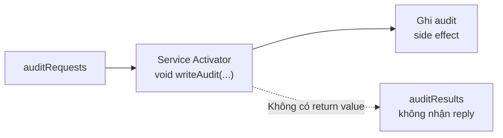

Điểm cần nhớ:

- `inputChannel` cho biết endpoint nhận message từ đâu.
- `void` cho biết method không cung cấp giá trị trả về.
- `outputChannel` chỉ định **đích của reply nếu endpoint có reply**; nó không biến method `void` thành một producer trả kết quả.
- Gọi handler thành công không đồng nghĩa downstream tự nhận một message.
- Trường hợp một handler muốn **báo kết quả xử lý**, cần thiết kế return value/reply message hoặc outbound event riêng.
- Với caller dùng **Messaging Gateway**, không có reply có thể khiến lời gọi chờ đến timeout, trừ khi hợp đồng là one-way hoặc có một reply path khác.

### Ví dụ đối lập

```java
@ServiceActivator(
    inputChannel = "auditRequests",
    outputChannel = "auditResults")
public AuditReceipt writeAudit(OrderCreated event) {
    auditRepository.save(event);

    return new AuditReceipt(
        event.eventId(),
        "RECORDED");
}
```

Lần này method trả một object `AuditReceipt`, nên endpoint có dữ liệu để gửi tới `auditResults` theo quy tắc reply của Spring Integration.

## 2. Mục tiêu học tập

Sau bài học, bạn có thể:

1. Giải thích Service Activator nhận và xử lý message như thế nào.
2. Phân biệt `void`, trả về `null`, trả về payload và trả về `Message<?>`.
3. Hiểu input channel, output channel và `replyChannel` không cùng trách nhiệm.
4. Tránh giả định rằng output channel tự nhận message khi handler chỉ làm side effect.
5. Viết `@ServiceActivator` one-way và reply-producing bằng Java.
6. Viết flow tương đương với Spring Integration Java DSL.
7. Kiểm thử **không có output** sau `void` handler bằng kênh đồng bộ.
8. Kiểm thử **có output** khi handler trả `AuditReceipt`.
9. Nhận biết tình huống `requiresReply` biến việc thiếu reply thành lỗi.
10. Phân biệt completion, acknowledgement, commit và reply.
11. Thiết kế Gateway, async channel và error channel đúng semantics.
12. Liên hệ Router, Filter, Splitter, Aggregator, idempotency, transaction và observability.
13. Xây checklist lựa chọn `void` hay return value cho một production flow.

## 3. Service Activator trong Enterprise Integration Patterns

**Service Activator** là một endpoint nối message flow với một method/service xử lý nghiệp vụ. Nó chuyển một message thành invocation của một method Java và, **nếu method trả kết quả**, có thể chuyển kết quả thành một reply message.

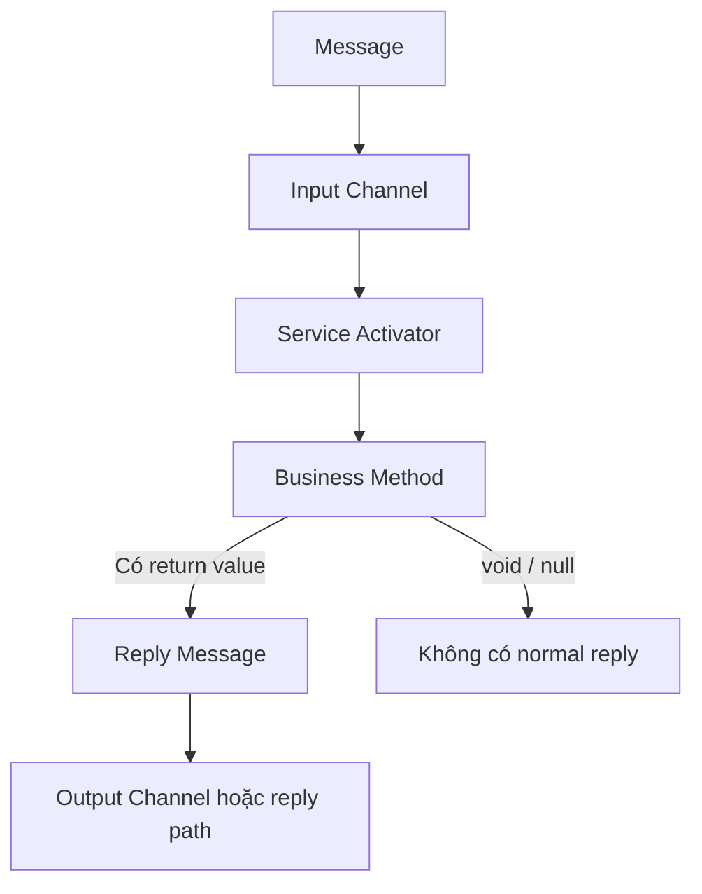

Cách diễn giải quan trọng:

- **Message endpoint** quyết định message nào được dispatch tới method.
- **Service method** thực thi domain logic và có thể tác động DB/API.
- **Return value** quyết định có reply payload cho dòng chảy tiếp theo hay không.
- **Output channel** là tuyến đường cho reply; **không phải** một lệnh tạo reply.
- **Error handling** xử lý exception hoặc reply-required violation theo cấu hình, không phải tự tạo business result từ method `void`.

### Service Activator khác Transformer như thế nào?

| Tiêu chí | Service Activator | Transformer |
| --- | --- | --- |
| Mục đích | Gọi service/method để xử lý nghiệp vụ | Biến đổi payload/message |
| Side effect | Có thể có, thường là điểm nối domain/service | Thường nên hạn chế |
| Trả kết quả | Có thể `void` hoặc trả value | Thường phải có output để tiếp tục transform |
| One-way use case | Ghi audit, phát metric, gọi service không có reply | Không điển hình |
| Reply use case | Tạo `AuditReceipt`, `OrderResult` | Tạo canonical DTO |
| Test quan trọng | Invocation, effect, reply/no reply, lỗi | Payload/header trước-sau |

Không phải cứ method trả `void` là Service Activator “sai”; nó hoàn toàn phù hợp với **one-way endpoint** khi không có consumer đang chờ reply.

## 4. Mô hình Message, inputChannel, outputChannel và replyChannel

Một Spring Message gồm:

```java
org.springframework.messaging.Message<T> {
    T getPayload();
    MessageHeaders getHeaders();
}
```

Ví dụ:

```text
Message<OrderCreated>
  payload:
    OrderCreated(eventId=EV-101, orderId=ORD-101)
  headers:
    id=runtime-uuid
    timestamp=...
    businessCorrelationId=order:ORD-101
    replyChannel=... (chỉ khi cần request/reply)
```

### Input channel

`inputChannel` là kênh Service Activator đang subscribe/consume:

```text
"ordersForAudit" -> Service Activator
```

### Output channel

`outputChannel` là kênh **cho reply do handler tạo ra**, khi có return value và endpoint xử lý nó thành message.

```text
Service Activator -> "auditReceipts"
```

### Reply channel trong message headers

Một request có thể mang header `replyChannel`, do Messaging Gateway hoặc một framework endpoint thiết lập để biết đích trả lời. Một handler reply-producing có thể sử dụng nó khi không có output channel cố định, theo cấu hình reply của endpoint.

**Không trộn hai khái niệm:**

- `outputChannel`: reply destination được cấu hình ở endpoint.
- `replyChannel`: reply destination gắn với một message/request cụ thể.

Khi output channel được cấu hình rõ, reply có thể được gửi theo tuyến cố định thay vì theo header của caller. Vì vậy cần test request/reply thực tế nếu endpoint đứng trong luồng Gateway.

### Khi return value là void

Không có normal return value để định tuyến, nên việc có output channel hoặc replyChannel **không làm cho một reply tự xuất hiện**.

## 5. Bảng ngữ nghĩa của các return types

| Method contract | Có normal reply? | Output channel nhận gì? |
| --- | --- | --- |
| `void handle(OrderCreated)` | Không | Không có message chỉ vì method kết thúc |
| `Void handle(...)` trả `null` | Không | Không có normal reply |
| `AuditReceipt handle(...)` trả object | Có | Một message có payload `AuditReceipt` |
| `Message<AuditReceipt> handle(...)` | Có | Reply message theo handler framework và header policy |
| `Object handle(...)` trả `null` | Không | Không có normal reply |
| Handler ném exception | Không phải normal reply | Exception/error flow theo cấu hình |
| Handler gửi thủ công tới channel khác rồi trả `void` | Có message **do lệnh send riêng** | Phụ thuộc tuyến gửi thủ công, không phải return reply |
| Handler trả `CompletionStage`/reactive type | Phụ thuộc endpoint/support và async contract | Không suy từ kiểu `void` |

Các điểm cần phân biệt:

1. **Không có reply** khác với reply có payload `null`. Spring Message thông thường yêu cầu payload không-null; method trả `null` thường được hiểu là không có normal reply.
2. `void` không đồng nghĩa exception. Một one-way handler xử lý thành công mà không reply là hợp lệ nếu endpoint không bắt buộc reply.
3. `requiresReply=true` có thể làm việc thiếu reply trở thành lỗi, nhưng **không tự tạo kết quả**.
4. Một method trả `Message<?>` có thể tùy chỉnh reply headers; không được dùng để sao chép mọi header nguồn ngoài một cách mù quáng.
5. Nếu handler gửi vào một channel khác như side effect rồi cũng return value, có thể tạo **hai messages** ở các tuyến riêng. Cần đặt tên và contract rõ.

## 6. One-way và request-reply: hai hợp đồng khác nhau

### One-way

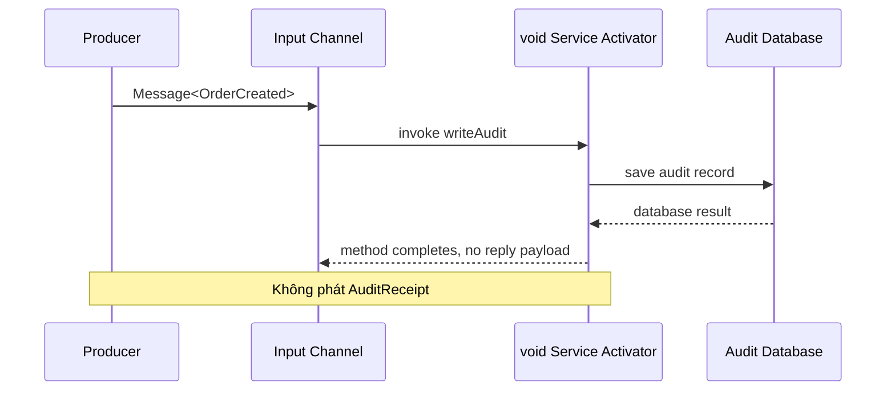

Với `DirectChannel` đồng bộ, caller của `send(...)` có thể đợi method hoàn thành hoặc thấy exception. Nhưng việc `send` kết thúc **không phải** reply message và cũng không tự cam kết durability khi có broker.

### Request-reply

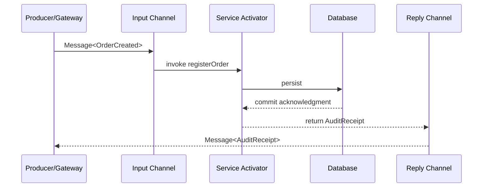

Nếu caller cần biết `AuditReceipt`, method nên trả một object có ý nghĩa, hoặc một service khác phát kết quả qua **reply protocol riêng**. Đừng sửa bằng cách thêm `outputChannel` lên method `void` rồi hy vọng framework tạo reply.

## 7. Những lựa chọn thiết kế khi không muốn trả payload

Có ba kiểu contract thường gặp:

**A. Fire-and-forget domain event:**

```java
public void recordAudit(OrderCreated event) {
    // ghi audit; không tạo business reply
}
```

**B. Trả trạng thái xử lý:**

```java
public AuditReceipt recordAudit(OrderCreated event) {
    // ghi audit
    return new AuditReceipt(event.eventId(), "RECORDED");
}
```

**C. Trả acknowledgement ở giao thức bên ngoài, xử lý async:**

```text
HTTP API:
  202 Accepted + operationId

Async event flow:
  void audit handler

Result store:
  GET /operations/{operationId}
```

C là lựa chọn hữu ích nếu thao tác có thể kéo dài, không muốn giữ một Gateway chờ cho tới khi business effect hoàn tất. `202 Accepted` nghĩa là hệ thống đã **tiếp nhận yêu cầu theo contract**, không chứng minh DB effect cuối đã thành công.

### Anti-pattern: boolean giả làm reply

```java
public boolean process(OrderCreated event) {
    auditRepository.save(event);
    return true;
}
```

Điều này có thể hợp lệ nếu `true` có nghĩa được tài liệu hóa. Nhưng một `true` mơ hồ không nói commit, duplicate, warning hay reconciliation. Nếu consumer cần nhiều trạng thái, dùng typed receipt/result sẽ rõ và kiểm thử được hơn.

## 8. Use case xuyên bài: ghi audit cho đơn hàng

Ta xây một ứng dụng đơn giản:

- Producer nhận `OrderCreated`.
- One-way Service Activator ghi audit, không trả reply.
- Một Service Activator khác làm công việc tương tự **nhưng trả receipt**.
- Test xác minh channel one-way không sinh output.
- Test xác minh channel reply-producing có `AuditReceipt` chính xác.
- Test error path khi repository throw exception.
- Test Gateway khi cần reply.
- Bàn về idempotency, retry và concurrency của business effect.

### Domain records

```java
package example.integration;

import java.time.Instant;

public record OrderCreated(
    String tenantId,
    String orderId,
    String eventId,
    Instant occurredAt
) {
    public OrderCreated {
        if (tenantId == null || tenantId.isBlank()
                || orderId == null || orderId.isBlank()
                || eventId == null || eventId.isBlank()
                || occurredAt == null) {
            throw new IllegalArgumentException(
                "OrderCreated thiếu trường bắt buộc");
        }
    }
}
```

```java
package example.integration;

public record AuditReceipt(
    String tenantId,
    String eventId,
    String status
) {
    public AuditReceipt {
        if (tenantId == null || eventId == null
                || status == null) {
            throw new IllegalArgumentException(
                "AuditReceipt không hợp lệ");
        }
    }
}
```

Mỗi `public record` là một file `.java` riêng trong project thực. Bài dùng Java 17+ cho cú pháp record; nếu hệ thống sử dụng Java thấp hơn, có thể dùng immutable POJO.

### Phân biệt business ID và message ID

`eventId` định danh một logical domain event. `MessageHeaders.id` là một ID của Spring Message instance. Khi broker redelivery hoặc message được rebuild, Message ID có thể khác; vì vậy nếu cần chống audit trùng, không dùng Message ID làm business idempotency key.

## 9. Service repository giả để nhìn được side effect

Ta tạo một port để Service Activator không phụ thuộc hạ tầng:

```java
package example.integration;

public interface AuditStore {
    void append(OrderCreated event);
}
```

Bản test in-memory:

```java
package example.integration;

import java.util.ArrayList;
import java.util.List;

public final class InMemoryAuditStore implements AuditStore {

    private final List<OrderCreated> records =
        new ArrayList<>();

    @Override
    public synchronized void append(OrderCreated event) {
        records.add(event);
    }

    public synchronized int count() {
        return records.size();
    }

    public synchronized List<OrderCreated> snapshot() {
        return List.copyOf(records);
    }
}
```

### Vì sao đồng bộ hóa trong test store?

Nếu muốn test nhiều sender threads, `ArrayList` không tự thread-safe. `synchronized` tránh race của test fixture, nhưng **không** biến store này thành database có transaction, durability, rollback hoặc multi-pod visibility.

### Vì sao không đưa repository call vào Transformer?

`append(...)` là một business side effect, không phải chuyển đổi payload thuần. Service Activator là điểm ghép tự nhiên giữa message flow và domain service. Trong một flow cần biến đổi data trước khi ghi, đặt Transformer ở trước Service Activator.

## 10. Một service có hai methods với reply contract khác nhau

```java
package example.integration;

import java.util.Objects;

public final class AuditApplicationService {

    private final AuditStore store;

    public AuditApplicationService(AuditStore store) {
        this.store = Objects.requireNonNull(store);
    }

    // One-way: xử lý side effect nhưng không trả reply.
    public void recordWithoutReply(OrderCreated event) {
        store.append(event);
    }

    // Request-reply: có payload để đưa tới output channel.
    public AuditReceipt recordWithReceipt(OrderCreated event) {
        store.append(event);

        return new AuditReceipt(
            event.tenantId(),
            event.eventId(),
            "RECORDED");
    }
}
```

Cả hai methods đều làm **cùng loại side effect**, chỉ khác giao diện giao tiếp với message flow:

```text
recordWithoutReply:
  OrderCreated -> void

recordWithReceipt:
  OrderCreated -> AuditReceipt
```

### Quan trọng: receipt không tự chứng minh commit thật

Ở ví dụ `InMemoryAuditStore`, `append` chỉ cập nhật list. Trong production, `recordWithReceipt` nên chỉ trả `RECORDED` sau khi nghiệp vụ thực sự đạt trạng thái mà contract cam kết (ví dụ transaction commit hoặc outbox record đã được ghi thành công). Nếu method trả receipt trước khi transaction commit rồi commit fail, caller đã nhận kết quả quá sớm.

### Với phương thức async

Không nên đổi signature thành `void` rồi tự chạy `CompletableFuture.runAsync` để giả làm xử lý bất đồng bộ mà không quan tâm error/transaction. Một async Service Activator cần có ownership của executor, acknowledgement, error handling và completion semantics rõ.

## 11. @ServiceActivator: khai báo input và output channel

Đây là cách dùng annotation truyền thống. Tạo các channels bằng configuration:

```java
package example.integration;

import org.springframework.context.annotation.Bean;
import org.springframework.context.annotation.Configuration;
import org.springframework.integration.channel.DirectChannel;
import org.springframework.integration.channel.QueueChannel;
import org.springframework.integration.config.EnableIntegration;
import org.springframework.messaging.MessageChannel;

@Configuration
@EnableIntegration
public class AnnotatedActivatorConfiguration {

    @Bean
    public MessageChannel voidAuditRequests() {
        return new DirectChannel();
    }

    @Bean
    public QueueChannel unusedVoidReplies() {
        return new QueueChannel();
    }

    @Bean
    public MessageChannel receiptAuditRequests() {
        return new DirectChannel();
    }

    @Bean
    public QueueChannel receiptAuditReplies() {
        return new QueueChannel();
    }

    @Bean
    public InMemoryAuditStore inMemoryAuditStore() {
        return new InMemoryAuditStore();
    }

    @Bean
    public AuditApplicationService auditApplicationService(
            InMemoryAuditStore store) {
        return new AuditApplicationService(store);
    }
}
```

Ta có thể đặt methods `@ServiceActivator` trong một Spring bean riêng, inject `AuditApplicationService` và tham chiếu channels theo name:

```java
package example.integration;

import org.springframework.integration.annotation.ServiceActivator;
import org.springframework.stereotype.Component;

@Component
public class AnnotatedAuditEndpoints {

    private final AuditApplicationService service;

    public AnnotatedAuditEndpoints(AuditApplicationService service) {
        this.service = service;
    }

    @ServiceActivator(
        inputChannel = "voidAuditRequests",
        outputChannel = "unusedVoidReplies")
    public void consumeWithoutReply(OrderCreated event) {
        service.recordWithoutReply(event);
    }

    @ServiceActivator(
        inputChannel = "receiptAuditRequests",
        outputChannel = "receiptAuditReplies")
    public AuditReceipt consumeWithReceipt(OrderCreated event) {
        return service.recordWithReceipt(event);
    }
}
```

### Điểm cần quan sát

- `consumeWithoutReply` **không** trả `AuditReceipt`. `unusedVoidReplies` không nhận normal reply chỉ vì được khai báo.
- `consumeWithReceipt` trả object, nên `receiptAuditReplies` có message khi flow xử lý thành công.
- `inputChannel` xác định nơi nhận message, không phải channel chứa kết quả.
- Không nên đặt tên channel `unusedVoidReplies` trong hệ thống thật nếu không có lý do; ở đây nó được khai báo để tạo một **phép thử khẳng định output channel không thể sinh reply từ void**.

### Một lưu ý về đăng ký bean

Nếu dùng `@Component`, package scanning cần phát hiện `AnnotatedAuditEndpoints`. Trong test context chỉ liệt kê `AnnotatedActivatorConfiguration.class`, bạn có thể `@Import(AnnotatedAuditEndpoints.class)` trên configuration hoặc khai báo endpoint bean một cách tường minh; **đừng cho rằng mọi test context tự quét package**.

Ví dụ cấu hình hỗ trợ test:

```java
@Configuration
@EnableIntegration
@org.springframework.context.annotation.Import(
    AnnotatedAuditEndpoints.class)
public class AnnotatedActivatorConfiguration {
    // Giữ nguyên các @Bean ở trên.
}
```

Đây là phần bổ sung annotation vào configuration ở trên, không phải khai báo **hai** classes cùng tên trong một project.

## 12. Vì sao outputChannel không biến void thành reply?

Tư duy đúng là một pipeline có điều kiện:

```text
Input Message
    |
    v
Invoke Service Method
    |
    +-- returns AuditReceipt ---> build reply -> outputChannel
    |
    +-- returns void/null ------> no reply value
```

`outputChannel` trả lời **“gửi reply tới đâu?”**, không trả lời **“tự tạo reply gì?”**.

Một implementation có thể cho phép handler trả Spring `Message<?>` đầy đủ hoặc một payload thông thường. Dù framework có tạo wrapper message cho object trả về, nó cũng không thể suy ra `AuditReceipt` có business meaning gì nếu method không trả về.

### Cùng side effect, khác message semantics

```text
void recordAudit(OrderCreated):
  database write = 1
  normal reply = 0

AuditReceipt recordAudit(OrderCreated):
  database write = 1
  normal reply = 1
```

Đó là kỳ vọng theo một input đơn trong demo đồng bộ, không phải guarantee exactly-once khi broker redelivery.

### Nếu dùng @SendTo?

Các annotation định tuyến result không làm `void` method tự có result. Cần xem API/flow configuration của endpoint thực; không dựa vào tên annotation để suy ra reply.

## 13. Java DSL: flow one-way và flow có reply

Spring Integration Java DSL giúp mô tả pipeline trực tiếp trong `@Configuration`.

### 13.1. One-way flow kết thúc ở void handler

```java
package example.integration;

import org.springframework.context.annotation.Bean;
import org.springframework.context.annotation.Configuration;
import org.springframework.integration.channel.DirectChannel;
import org.springframework.integration.channel.QueueChannel;
import org.springframework.integration.config.EnableIntegration;
import org.springframework.integration.dsl.IntegrationFlow;
import org.springframework.messaging.MessageChannel;

@Configuration
@EnableIntegration
public class AuditDslConfiguration {

    @Bean
    public MessageChannel voidDslInput() {
        return new DirectChannel();
    }

    @Bean
    public MessageChannel receiptDslInput() {
        return new DirectChannel();
    }

    @Bean
    public QueueChannel receiptDslOutput() {
        return new QueueChannel();
    }

    @Bean
    public InMemoryAuditStore auditStore() {
        return new InMemoryAuditStore();
    }

    @Bean
    public AuditApplicationService auditService(
            InMemoryAuditStore store) {
        return new AuditApplicationService(store);
    }

    @Bean
    public IntegrationFlow auditOneWay(
            AuditApplicationService service) {

        return IntegrationFlow.from("voidDslInput")
            .handle(service, "recordWithoutReply")
            .get();
    }

    @Bean
    public IntegrationFlow auditWithReply(
            AuditApplicationService service) {

        return IntegrationFlow.from("receiptDslInput")
            .handle(service, "recordWithReceipt")
            .channel("receiptDslOutput")
            .get();
    }
}
```

Đây là hai entry points cho hai hợp đồng riêng:

```text
voidDslInput
  -> recordWithoutReply(OrderCreated)
  -> end of one-way flow

receiptDslInput
  -> recordWithReceipt(OrderCreated)
  -> receiptDslOutput (AuditReceipt)
```

### Vì sao one-way flow không có `.channel(...)` ở cuối?

Vì handler `void` là endpoint **không tạo normal reply**, nên một output stage đặt ngay sau nó có thể là “đường ống không có gì đi qua” hoặc gây nhầm lẫn khi cấu hình. Ví dụ DSL đúng mục tiêu nhất là cho one-way flow **kết thúc tại handler**.

Để minh họa chính xác trường hợp **đã khai báo outputChannel nhưng vẫn không có reply**, xem `@ServiceActivator(inputChannel=..., outputChannel=...)` ở mục 11 và test ở mục 16.

### Nếu muốn có output sau void thì làm sao?

- Trả một `AuditReceipt` từ service method.
- Thay one-way handler bằng một reply-producing adapter/handler rõ ràng.
- Dùng một bước xử lý riêng sau khi effect hoàn tất, nhưng phải truyền tiếp **message đầu vào** bằng một flow đã thiết kế (ví dụ pub/sub hoặc wire tap), không dựa vào reply của `void`.
- Phát một sự kiện độc lập bằng outbound gateway/adapter/outbox, có semantics và idempotency riêng.

Không nên giả định DSL tự propagate input payload qua `.handle(...)` nếu handler không trả kết quả.

## 14. Phân biệt `@ServiceActivator` và Java DSL `.handle(...)`

Hai cách có thể phục vụ cùng EIP nhưng tạo endpoint theo kiểu cấu hình khác nhau.

| Khía cạnh | Annotation | Java DSL |
| --- | --- | --- |
| Khai báo input | `@ServiceActivator(inputChannel="...")` | `IntegrationFlow.from(...)` |
| Gắn service method | Annotation trên method | `.handle(service, "method")` |
| Output | `outputChannel="..."` | `.channel("...")` khi có reply |
| Đọc pipeline nhiều bước | Nhiều endpoint declarations | DSL chuỗi stage |
| Void semantics | Không có normal reply | Không có normal reply |
| Return payload | Có reply nếu handler hỗ trợ | Có thể nối stage sau handler |
| Test | Kiểm tra listener/channel wiring | Kiểm tra IntegrationFlow beans |

### Khi nào dùng annotation?

Khi service nhỏ, một endpoint gắn trực tiếp với một method và không cần pipeline dài.

### Khi nào dùng DSL?

Khi cần kết hợp validation → Router/Filter/Transformer → Service Activator → response channel một cách dễ đọc và có thể xác định các nhánh.

### Một lỗi cấu hình

Không đăng ký **cùng một handler** cho **cùng input channel** bằng cả annotation và DSL một cách vô ý. Với `DirectChannel` có nhiều subscribers, cơ chế dispatch có thể gửi mỗi message tới một subscriber được chọn, không phải “mọi handler đều chạy”; nếu mong fan-out, hãy dùng Publish-Subscribe Channel hoặc Recipient List theo yêu cầu.

## 15. Thiết kế integration test: đo cả effect và output

Muốn chứng minh `void` không tạo reply, chỉ nhìn output channel là chưa đủ. Nếu input không được nhận, output cũng rỗng nhưng test vô nghĩa.

Một test đáng tin cần ba bằng chứng:

1. **Message đã đi vào endpoint.**
2. **Side effect giả định đã chạy một lần** trong test.
3. **Không có normal reply** ở output channel.

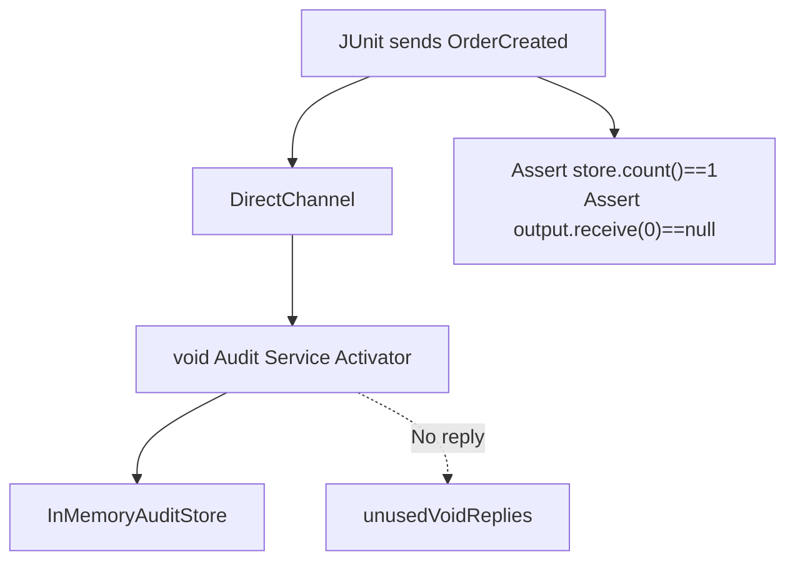

### Tại sao dùng `DirectChannel`?

Trong ví dụ đồng bộ, `DirectChannel.send(...)` dispatch tới handler trong cùng luồng gửi; khi nó trả về không exception, ta có thể kiểm tra state store ngay. `QueueChannel.receive(0)` phù hợp để kiểm tra **không có message sẵn trong queue tại thời điểm đó**.

Nếu thay bằng `ExecutorChannel` hoặc broker, một lần `receive(0)` trước khi xử lý hoàn tất không chứng minh handler không phát reply; cần đồng bộ bằng latch/completion signal, timeouts và metric hay effect state.

### Điều test không chứng minh

- Không có duplicate do broker redelivery.
- Database commit thực sự đã được ghi bền.
- Producer đã nhận ACK của transport.
- Gateway đang chờ reply đã hoàn tất đúng hợp đồng.
- Async handler không có late output.

Các phạm vi này được phân tích ở các mục sau.

## 16. JUnit 5: void method chạy nhưng output channel rỗng

Dùng cấu hình annotation ở mục 11 sau khi bổ sung `@Import(AnnotatedAuditEndpoints.class)` vào `AnnotatedActivatorConfiguration`.

```java
package example.integration;

import static org.junit.jupiter.api.Assertions.*;

import java.time.Instant;

import org.junit.jupiter.api.Test;
import org.springframework.beans.factory.annotation.Autowired;
import org.springframework.beans.factory.annotation.Qualifier;
import org.springframework.integration.channel.QueueChannel;
import org.springframework.messaging.MessageChannel;
import org.springframework.messaging.support.MessageBuilder;
import org.springframework.test.annotation.DirtiesContext;
import org.springframework.test.context.junit.jupiter.SpringJUnitConfig;

@SpringJUnitConfig(AnnotatedActivatorConfiguration.class)
@DirtiesContext(
    classMode = DirtiesContext.ClassMode.AFTER_EACH_TEST_METHOD)
class VoidServiceActivatorTest {

    @Autowired
    @Qualifier("voidAuditRequests")
    MessageChannel voidInput;

    @Autowired
    @Qualifier("unusedVoidReplies")
    QueueChannel unusedReplies;

    @Autowired
    @Qualifier("receiptAuditRequests")
    MessageChannel receiptInput;

    @Autowired
    @Qualifier("receiptAuditReplies")
    QueueChannel receipts;

    @Autowired
    InMemoryAuditStore store;

    private OrderCreated order() {
        return new OrderCreated(
            "shop-01",
            "ORD-101",
            "EV-101",
            Instant.parse("2026-11-21T08:30:00Z"));
    }

    @Test
    void voidMethodExecutesSideEffectButSendsNoReply() {
        assertTrue(voidInput.send(
            MessageBuilder.withPayload(order()).build()));

        assertEquals(1, store.count());
        assertEquals(order(), store.snapshot().get(0));

        // Output channel được khai báo trong annotation,
        // nhưng void method không trả payload để gửi tới đó.
        assertNull(unusedReplies.receive(0));
    }
}
```

### Phân tích assertions

- `voidInput.send(...)` trả true trong ví dụ vì DirectChannel có subscriber và dispatch được message. Đây **không phải** xác nhận broker ACK/durable commit.
- `store.count()==1` cho thấy handler đã thực hiện side effect giả.
- `unusedReplies.receive(0)==null` cho thấy endpoint không phát normal reply trong cấu hình này.
- Test dùng một message, không giả định exactly-once trong môi trường redelivery.
- `@DirtiesContext` cô lập queue và store giữa các tests.

### Một test dễ gây hiểu sai

```java
assertNull(unusedReplies.receive(0));
```

nếu chạy **trước khi gửi message** thì không chứng minh `void` semantics. Luôn kiểm tra side effect hoặc invocation count sau khi gửi thành công.

## 17. JUnit 5: method trả AuditReceipt có reply

Bổ sung method tiếp theo vào `VoidServiceActivatorTest`:

```java
@Test
void returnedReceiptIsDeliveredToOutputChannel() {
    assertTrue(receiptInput.send(
        MessageBuilder.withPayload(order()).build()));

    org.springframework.messaging.Message<?> output =
        receipts.receive(1_000);

    assertNotNull(output);
    assertInstanceOf(
        AuditReceipt.class, output.getPayload());

    AuditReceipt receipt =
        (AuditReceipt) output.getPayload();

    assertEquals("shop-01", receipt.tenantId());
    assertEquals("EV-101", receipt.eventId());
    assertEquals("RECORDED", receipt.status());

    assertEquals(1, store.count());
    assertNull(receipts.receive(0));
}
```

### Vì sao đây là phép đối chứng cần có?

Cùng input event, cùng service/store, nhưng:

- `void`: hiệu ứng xảy ra, output channel **không có** normal reply.
- `AuditReceipt`: hiệu ứng xảy ra, output channel **có một** reply.

Kết quả này giúp xác định lỗi khi developer đã đặt `outputChannel` mà quên method return value: channel vẫn “không nhận gì” không phải do Router, Filter hay broker, mà do **contract của handler**.

### Không nên đưa receipt vào payload “cho có”

Nếu downstream không dùng receipt, one-way có thể tốt hơn. Đừng phát hàng triệu success receipts không cần thiết rồi tạo thêm queue/broker overhead. Chỉ tạo result khi có business contract cần nó.

## 18. Java DSL integration test cho hai loại flow

Kiểm tra DSL bean wiring độc lập với annotation:

```java
package example.integration;

import static org.junit.jupiter.api.Assertions.*;

import java.time.Instant;

import org.junit.jupiter.api.Test;
import org.springframework.beans.factory.annotation.Autowired;
import org.springframework.beans.factory.annotation.Qualifier;
import org.springframework.integration.channel.QueueChannel;
import org.springframework.messaging.Message;
import org.springframework.messaging.MessageChannel;
import org.springframework.messaging.support.MessageBuilder;
import org.springframework.test.annotation.DirtiesContext;
import org.springframework.test.context.junit.jupiter.SpringJUnitConfig;

@SpringJUnitConfig(AuditDslConfiguration.class)
@DirtiesContext(
    classMode = DirtiesContext.ClassMode.AFTER_EACH_TEST_METHOD)
class AuditDslFlowTest {

    @Autowired
    @Qualifier("voidDslInput")
    MessageChannel voidInput;

    @Autowired
    @Qualifier("receiptDslInput")
    MessageChannel receiptInput;

    @Autowired
    @Qualifier("receiptDslOutput")
    QueueChannel output;

    @Autowired
    InMemoryAuditStore store;

    private OrderCreated order(String eventId) {
        return new OrderCreated(
            "shop-01",
            "ORD-101",
            eventId,
            Instant.parse("2026-11-21T08:30:00Z"));
    }

    @Test
    void oneWayDslFlowTerminatesAfterVoidHandler() {
        assertTrue(voidInput.send(
            MessageBuilder.withPayload(
                order("EV-VOID")).build()));

        assertEquals(1, store.count());

        // Receipt flow là endpoint tách biệt;
        // one-way input không tạo output ở đây.
        assertNull(output.receive(0));
    }

    @Test
    void replyDslFlowEmitsReceipt() {
        assertTrue(receiptInput.send(
            MessageBuilder.withPayload(
                order("EV-REPLY")).build()));

        Message<?> reply = output.receive(1_000);
        assertNotNull(reply);
        assertInstanceOf(
            AuditReceipt.class, reply.getPayload());

        assertEquals(
            "EV-REPLY",
            ((AuditReceipt) reply.getPayload()).eventId());

        assertEquals(1, store.count());
        assertNull(output.receive(0));
    }
}
```

### Cẩn thận khi diễn giải one-way test DSL

Ở `AuditDslConfiguration`, `receiptDslOutput` được nối **chỉ với receiptDslInput**. Test one-way xác nhận nhánh void không tạo output cho receipt flow. Phép thử mạnh hơn về **khai báo outputChannel trên cùng void endpoint** là test annotation ở mục 16.

### Khi dùng ExecutorChannel

Nếu `voidDslInput` chuyển thành `ExecutorChannel`, `send` có thể trả về trước khi handler kết thúc. Khi đó `store.count()==1` ngay sau `send` có thể flaky. Dùng synchronization/latch trong fixture thay vì `Thread.sleep`. Điều này liên quan đến **channel dispatch semantics**, không đổi bản chất `void` không tạo normal reply.

## 19. Method trả null: cùng kết quả reply nhưng khác signature

Một method khai báo trả object vẫn có thể trả `null`:

```java
public AuditReceipt handlePossiblySkipped(
        OrderCreated event) {

    if (event.orderId().startsWith("SKIP-")) {
        return null;
    }

    return new AuditReceipt(
        event.tenantId(),
        event.eventId(),
        "RECORDED");
}
```

Nếu handler trả `null` và endpoint không bắt buộc reply, thông thường **không có normal reply**. Nhưng điều này có khác biệt về **ý nghĩa chương trình** so với `void`:

- `void`: contract cho biết handler không dự kiến cung cấp result.
- Nullable `AuditReceipt`: contract có thể có result hoặc không, tùy nhánh.
- Return `null` đôi khi biểu thị “filter/drop”, nhưng nếu cần business rejection, nên định nghĩa Filter, error outcome hoặc typed result rõ ràng.

### Vì sao null reply dễ gây bug?

Một Gateway có thể đang chờ output. Nếu handler trả `null` vì dữ liệu không hợp lệ, caller chỉ thấy timeout thay vì nhận một lỗi/validation result đúng nghĩa.

### Hướng khắc phục

- Với dữ liệu invalid: ném exception có phân loại, hoặc trả `OrderRejected`/`ProcessingResult`.
- Với message không cần xử lý: đặt một Filter trước handler, ghi discard policy.
- Với workflow one-way: giữ method `void` và không dùng Gateway đồng bộ đợi reply.
- Với optional business response: định nghĩa explicit trạng thái `SKIPPED/RECORDED/FAILED`.

## 20. Khi `requiresReply` được bật

Một số reply-producing endpoints trong Spring Integration hỗ trợ cấu hình `requiresReply`. Khi bật, endpoint không chấp nhận việc handler trả về `null` nếu hợp đồng yêu cầu có reply.

```text
Handler returns null
  -> requiresReply=false: no normal reply
  -> requiresReply=true: reply-required failure
```

Với method `void`, đặt `requiresReply=true` không “ép framework tạo reply”; nó có thể dẫn tới một lỗi khi handler không có result.

### Diễn giải đúng

- `requiresReply` là một **assertion về hợp đồng**.
- Nó làm lỗi trả về null trở nên phát hiện được sớm hơn.
- Nó không đưa event gốc vào output channel một cách tự động.
- Exception sẽ theo cơ chế error của endpoint/channel, không phải success reply.

### Ví dụ thiết kế

Một service xác thực đơn luôn phải tạo `ValidationDecision`:

```java
public ValidationDecision validate(OrderCreated event) {
    // return ACCEPTED/REJECTED; không được null.
}
```

Khi pipeline/gateway bắt buộc có reply, đặt endpoint ở chế độ yêu cầu reply nếu API/version đang dùng hỗ trợ, và kiểm thử null path có lỗi rõ ràng.

### Không đặt requiresReply cho một one-way handler hợp lệ

`AuditApplicationService.recordWithoutReply` được thiết kế là one-way; bật bắt buộc reply sẽ biến một success hợp lệ thành failure. Hãy thiết kế flow đúng trước khi thêm constraint.

### Lưu ý về API phiên bản

Cách khai báo `requiresReply` có thể thay đổi tùy kiểu endpoint hoặc Java DSL builder/version. Trong bước tạo nội dung này, bài tập giữ ở mức semantics; khi áp dụng project thực, đối chiếu API/configuration trên dependency đang sử dụng và có integration test xác nhận hành vi.

## 21. Reply payload khác reply Message

Một handler có thể trả payload:

```java
public AuditReceipt recordWithReceipt(OrderCreated event) {
    return new AuditReceipt(
        event.tenantId(),
        event.eventId(),
        "RECORDED");
}
```

Hoặc trả một Spring Message đầy đủ:

```java
public org.springframework.messaging.Message<AuditReceipt>
        recordWithReceiptMessage(OrderCreated event) {

    AuditReceipt receipt = new AuditReceipt(
        event.tenantId(),
        event.eventId(),
        "RECORDED");

    return org.springframework.messaging.support.MessageBuilder
        .withPayload(receipt)
        .setHeader(
            "businessCorrelationId",
            "order:" + event.tenantId()
                + ":" + event.orderId())
        .setHeader("receiptSchemaVersion", 1)
        .build();
}
```

### Khi nào trả Message?

Khi reply cần headers rõ ràng ngoài payload, ví dụ `businessCorrelationId`, `receiptSchemaVersion` hoặc custom status markers.

### Rủi ro khi tạo Message mới

- Không bảo toàn reply/error context mà Gateway yêu cầu.
- Copy headers từ nguồn không đáng tin.
- Ghi đè `correlationId` của Aggregator.
- Mang stale channel object qua broker.
- Làm mất idempotency identity nếu source event ID chỉ nằm trong headers.
- Dùng `MessageHeaders.id` mới và tưởng đó là một business event mới.

Hãy xác định **header contract** thay vì copy nguyên MessageHeaders tùy tiện.

## 22. Không cần có reply vẫn có thể phát sự kiện downstream

Một Service Activator `void` có thể gọi một dịch vụ phát business event riêng:

```java
public void approveAndPublish(OrderCreated event) {
    orderService.approve(event);
    eventPublisher.publish(
        new OrderApproved(event.orderId()));
}
```

Lúc này:

- Normal reply từ method: **không có**.
- Message/event do `eventPublisher.publish(...)` gửi: **có thể có**.
- Đó là **side effect chủ động**, không phải reply do Service Activator framework sinh.
- Nếu publisher gửi trước khi DB transaction commit, có nguy cơ event được publish mà business state rollback.
- Nếu DB commit rồi publish thất bại, event có thể bị mất.

### Khuyến nghị: transactional outbox

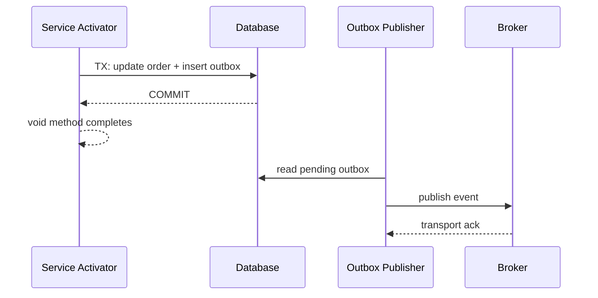

**Không cần biến void method thành return-producing để phát domain event.** Cần phân biệt:

- *Reply:* phản hồi cho request hiện tại.
- *Domain event:* thông báo một fact nghiệp vụ tới downstream subscribers.
- *ACK:* xác nhận transport delivery.
- *Commit:* side effect được lưu bền.

Mỗi loại có lifecycle, lỗi và idempotency khác nhau.

## 23. Gateway có đợi reply từ một void Service Activator được không?

Một Messaging Gateway cung cấp giao diện Java kiểu request/reply:

```java
public interface OrderAuditGateway {
    AuditReceipt record(OrderCreated event);
}
```

Giao diện này **hứa với caller** rằng method trả `AuditReceipt`. Nếu flow đằng sau Gateway gọi một `void` Service Activator và không có thành phần nào phát reply, Gateway không có result để hoàn tất hợp đồng.

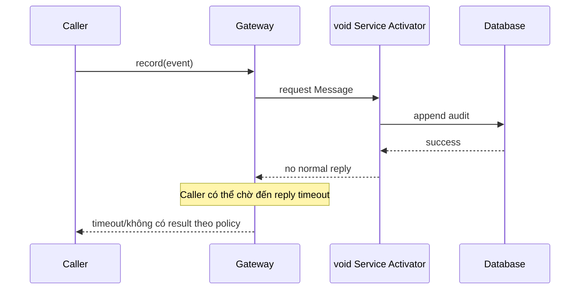

### Vì sao Gateway timeout dù DB đã ghi thành công?

Do **reply lifecycle khác effect lifecycle**:

- Handler đã thực thi và có thể commit DB.
- Handler không trả result.
- Gateway đang chờ reply để trả về caller.
- Không có reply ⇒ timeout hoặc outcome theo gateway contract.
- Caller retry sau timeout có thể làm business effect bị thực thi lần nữa nếu không có idempotency.

Đây là một trong những nguyên nhân phổ biến tạo duplicate events: **effect thành công nhưng caller nghĩ operation thất bại**.

### Cách thiết kế đúng

**Nếu cần synchronous result:**

```text
Gateway -> AuditReceipt-returning Service Activator
        -> replyChannel về đúng caller
```

**Nếu chỉ gửi command one-way:**

```text
One-way gateway / message sender
        -> void Service Activator
        -> effect
        -> không chờ business reply
```

**Nếu xử lý lâu:**

```text
HTTP/Gateway -> Accepted(operationId)
Async command -> void handler
Result store -> caller polling/callback
```

Không nên biến method `void` thành `AuditReceipt` chỉ để che timeout mà không có cam kết rõ receipt đại diện cho điều gì.

## 24. Dùng replyChannel động thay vì output channel cố định

Một Gateway thường cần nhận reply vào kênh được gắn trong request. Nếu Service Activator trả value nhưng lại được cấu hình **output channel cố định không hướng về Gateway**, caller có thể vẫn timeout.

### Hai dạng routing

```text
Explicit output channel:
  @ServiceActivator(outputChannel="auditResults")
  -> reply đi vào auditResults

Dynamic request reply:
  MessageHeaders.REPLY_CHANNEL = callerReplyChannel
  @ServiceActivator(inputChannel="auditRequests")
  -> reply về callerReplyChannel (khi không có fixed output)
```

Cần kiểm tra quy tắc precedence thực tế trong Spring Integration endpoint/version đang dùng, nhưng về thiết kế không nên có **hai đích reply cạnh tranh** mà không có policy.

### Test động với method trả result

Dùng một channel tự tạo làm reply destination:

```java
org.springframework.integration.channel.QueueChannel callerReply =
    new org.springframework.integration.channel.QueueChannel();

Message<OrderCreated> request =
    MessageBuilder.withPayload(order())
        .setHeader(
            org.springframework.messaging.MessageHeaders.REPLY_CHANNEL,
            callerReply)
        .build();

// Gửi request vào một endpoint trả AuditReceipt
// KHÔNG cấu hình outputChannel cố định.
assertTrue(dynamicReceiptInput.send(request));

Message<?> reply = callerReply.receive(1_000);
assertNotNull(reply);
assertInstanceOf(AuditReceipt.class, reply.getPayload());
```

Đây là **fragment**: `dynamicReceiptInput` phải được nối tới một reply-producing Service Activator không có output channel cố định.

### Tương tự với void

```java
org.springframework.integration.channel.QueueChannel callerReply =
    new org.springframework.integration.channel.QueueChannel();

Message<OrderCreated> request =
    MessageBuilder.withPayload(order())
        .setHeader(
            org.springframework.messaging.MessageHeaders.REPLY_CHANNEL,
            callerReply)
        .build();

assertTrue(dynamicVoidInput.send(request));

// Handler void chạy xong nhưng không phát normal reply.
assertNull(callerReply.receive(0));
```

Đây cũng là fragment cần một `dynamicVoidInput` nối tới void endpoint. Nó minh họa việc **request có replyChannel không biến void thành response**.

### Lưu ý trust boundary

Một `replyChannel` Spring object chỉ hợp lệ trong runtime/context phù hợp. Không lấy header `replyChannel` do khách HTTP tự gửi rồi coi đó là đối tượng có quyền chọn destination nội bộ. Đối với broker, cần reply destination/correlation ID theo protocol, không serialize Java channel object.

## 25. Khi void method throw exception, output channel nhận gì?

Giả sử repository gặp lỗi:

```java
public void recordWithoutReply(OrderCreated event) {
    store.append(event); // ném IllegalStateException
}
```

Kết quả là một **exception/error path**, không phải normal business reply.

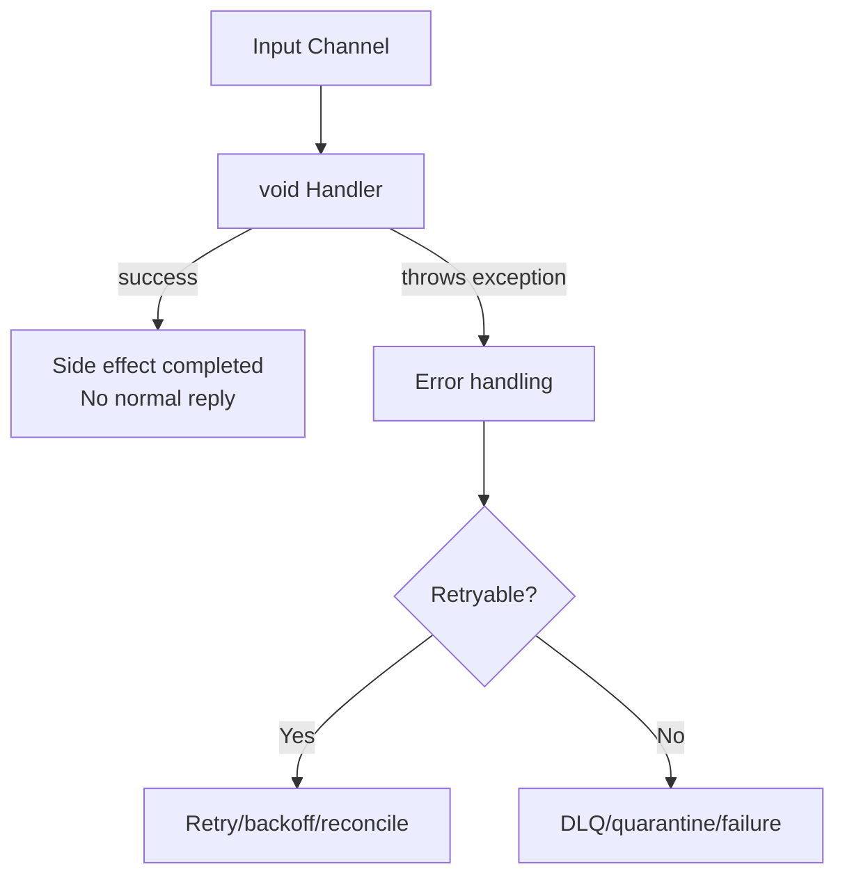

### Trong DirectChannel đồng bộ

Exception từ handler thường có thể được propagates/wrapped lên thread gọi `send(...)`. Code caller cần kiểm tra error type/cause, không coi `send(...)` trả false là cách duy nhất biểu thị lỗi.

### Trong ExecutorChannel hoặc adapter bất đồng bộ

Handler có thể chạy trên executor thread hoặc listener thread. Exception có thể được chuyển thành `ErrorMessage` và đi tới `errorChannel` đã cấu hình. Tùy adapter, nó còn ảnh hưởng ack/requeue/retry.

**Đừng giả định** tất cả exceptions ở mọi topology đều tự động vào global `errorChannel`.

### Error channel khác output channel

| Channel | Mục đích |
| --- | --- |
| `outputChannel` | Nhận **normal reply** do handler tạo |
| `replyChannel` | Nhận reply của request cụ thể |
| `errorChannel` | Nhận lỗi theo integration error handling contract |
| `discardChannel` | Nhận message bị Filter loại nếu cấu hình |
| `deadLetterChannel`/DLQ | Lưu sự kiện thất bại sau policy retry |

`void` handler có thể không phát output nào **và** vẫn cần error channel để theo dõi exception.

## 26. Unit test một lỗi được ném thay vì phát reply

Ta có thể tạo một `AuditStore` luôn lỗi:

```java
package example.integration;

public final class FailingAuditStore implements AuditStore {

    @Override
    public void append(OrderCreated event) {
        throw new IllegalStateException(
            "Simulated storage failure");
    }
}
```

Test thuần service:

```java
@Test
void voidHandlerPropagatesFailureFromStore() {
    AuditApplicationService service =
        new AuditApplicationService(
            new FailingAuditStore());

    OrderCreated input = new OrderCreated(
        "shop-01", "ORD-X", "EV-X",
        java.time.Instant.parse("2026-11-21T08:30:00Z"));

    IllegalStateException error =
        assertThrows(IllegalStateException.class, () ->
            service.recordWithoutReply(input));

    assertEquals(
        "Simulated storage failure",
        error.getMessage());
}
```

### Muốn kiểm tra errorChannel thật

Hãy tạo một integration test riêng với endpoint async hoặc adapter có `errorChannel`, gửi message, rồi assert `ErrorMessage` chứa exception/cause đúng. Một `DirectChannel` one-way test không có cấu hình error flow **không đủ** để chứng minh global error channel nhận message.

### Không tự coi exception là reply payload

Nếu người gọi cần nhận `AuditFailed` như một business result, thiết kế handler/exception translator rõ ràng. Không bắt tất cả lỗi rồi return `"FAILED"` mà bỏ qua thông tin idempotency/rollback/trạng thái transaction.

## 27. Async channel: không có reply và chưa có completion là hai chuyện khác nhau

Khi dùng `ExecutorChannel`, thread gửi có thể tiếp tục trước khi handler chạy xong.

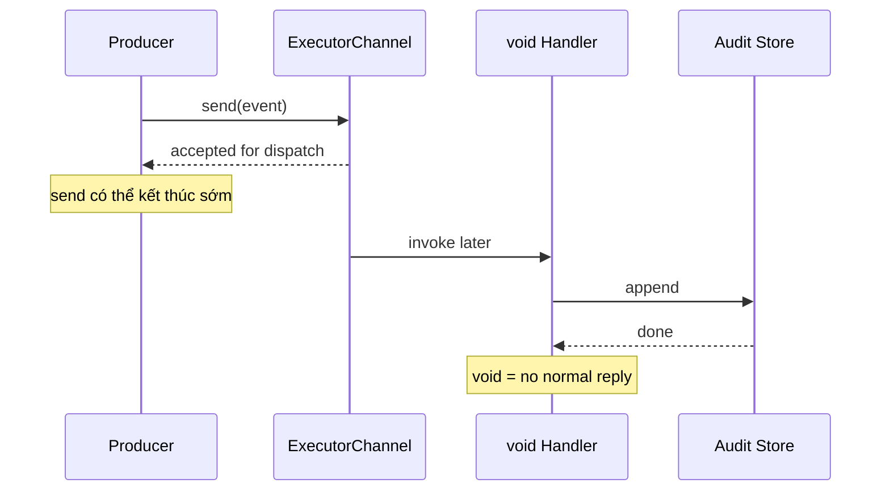

### Sai lầm test thường gặp

```java
input.send(message);
assertEquals(1, store.count());
```

Ngay sau `send`, handler có thể chưa chạy nếu executor xử lý async. Assertion này flaky.

### Dùng latch tại fixture

Ví dụ store test báo completion:

```java
package example.integration;

import java.util.concurrent.CountDownLatch;
import java.util.concurrent.TimeUnit;
import java.util.concurrent.atomic.AtomicInteger;

public final class LatchingAuditStore implements AuditStore {

    private final CountDownLatch completed =
        new CountDownLatch(1);

    private final AtomicInteger invocations =
        new AtomicInteger();

    @Override
    public void append(OrderCreated event) {
        invocations.incrementAndGet();
        completed.countDown();
    }

    public boolean awaitOne(long timeoutMillis)
            throws InterruptedException {

        return completed.await(
            timeoutMillis, TimeUnit.MILLISECONDS);
    }

    public int count() {
        return invocations.get();
    }
}
```

Test có thể gửi vào `ExecutorChannel`, chờ `store.awaitOne(2_000)`, assert invocation và sau đó kiểm tra queue output theo thời hạn phù hợp.

### Điều test cần nói rõ

- Latch chứng minh **handler đã gọi store**.
- Latch không chứng minh transaction durable hoặc broker ack.
- Khi store có work dài sau `countDown`, latch phải được đặt **sau** điểm completion cần đo.
- `QueueChannel.receive(0)` sau latch cho thấy không có message **tại thời điểm kiểm tra**; để chứng minh không có delayed reply do nhánh khác, cần biết topology và thời gian/lifecycle của mọi publisher.

## 28. Void Service Activator không tự chặn các Subscriber khác

Một `PublishSubscribeChannel` có thể fan-out cùng một event tới nhiều subscribers:

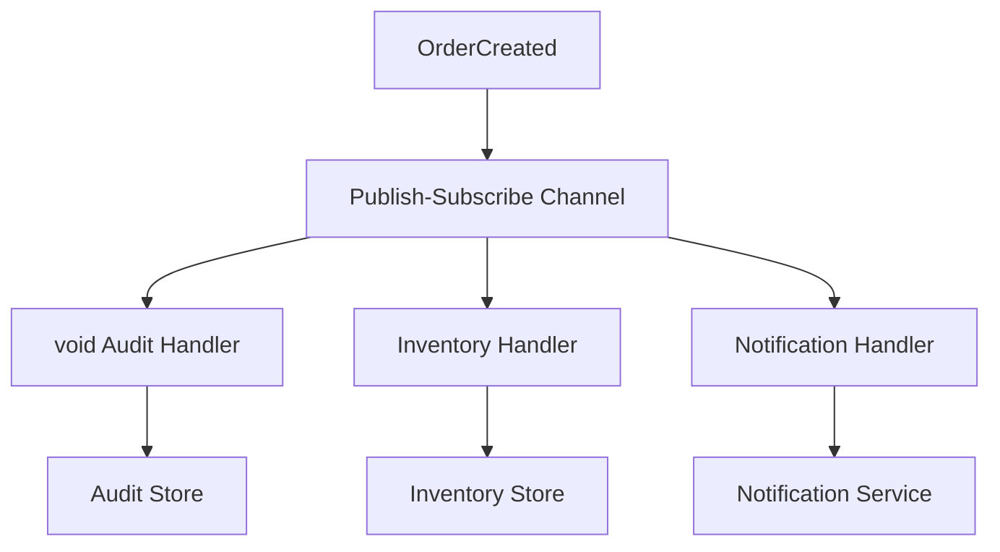

Tại đây:

- Audit handler trả `void` không có nghĩa Inventory và Notification không nhận message.
- Channel chủ động phân phát input tới các subscribers.
- Không có **reply** từ Audit handler, nhưng các subscriber khác vẫn có **input message riêng**.
- Một subscriber lỗi có thể ảnh hưởng những subscriber khác tùy synchronous/asynchronous dispatch và error policy.
- Publish-Subscribe không tự bảo đảm atomic completion của tất cả subscribers.

### Phân biệt với pipeline tuần tự

```text
Sequential chain:
  Input -> void Handler -> next stage
  => void Handler không cung cấp reply cho next stage

Publish-subscribe:
  Input -> PubSub
     +-> void Handler
     +-> Other Handler
  => Other Handler nhận message vì PubSub fan-out,
     không phải vì void Handler trả message.
```

Đây là khác biệt quan trọng khi review integration topology.

### Wire Tap

Nếu cần ghi audit mà **không chặn luồng chính**, có thể dùng `Wire Tap` để copy message sang audit channel:

```text
Main flow:
  Input -> WireTap("auditChannel") -> Business Handler

Side flow:
  auditChannel -> void Audit Service Activator
```

Wire Tap tạo một **nhánh side channel riêng**; nó không cần audit handler trả reply về main flow. Phải kiểm tra cách cấu hình dispatch, retry/error isolation và side effect duplication.

## 29. Router và Filter: void handler nằm ở vị trí nào?

### Content-based Router

Router quyết định đưa message tới channel phù hợp:

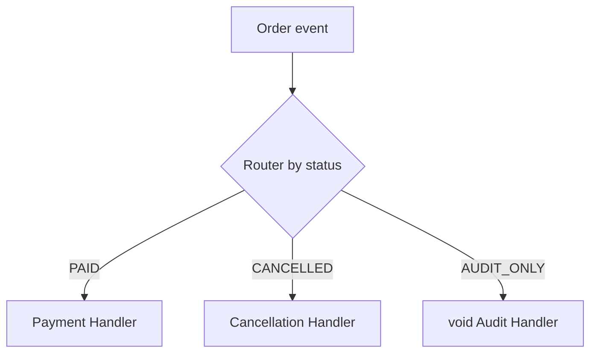

Nếu route tới void Audit handler, nhánh đó có thể kết thúc ở side effect. Các nhánh khác chỉ tạo reply khi handler được cấu hình để trả result.

### Filter

Filter có thể loại message trước khi gọi Service Activator. Nếu một test chỉ nhìn output rỗng, có hai khả năng:

1. **Message bị Filter loại**, Service Activator chưa chạy.
2. Message qua Filter, Service Activator `void` đã chạy, nhưng không có reply.

Muốn phân biệt, kiểm tra invocation count/side effect, discard channel và lý do Filter.

### Không dùng void method để âm thầm bỏ dữ liệu bị invalid

Nếu một validation method được khai báo `void` và chỉ “return khi invalid”, Gateway/downstream có thể treo chờ. Nên sử dụng Filter, explicit validation result hoặc error path để bộc lộ rejection.

## 30. Splitter → void Service Activator → Aggregator: cái bẫy thiếu phần tử

Một batch có 3 dòng:

```text
Splitter:
  Child 1/3
  Child 2/3
  Child 3/3
```

Nếu mỗi child đi qua một `void` Service Activator rồi Aggregator chờ **các kết quả xử lý**, Aggregator có thể không nhận được child outcomes nào:

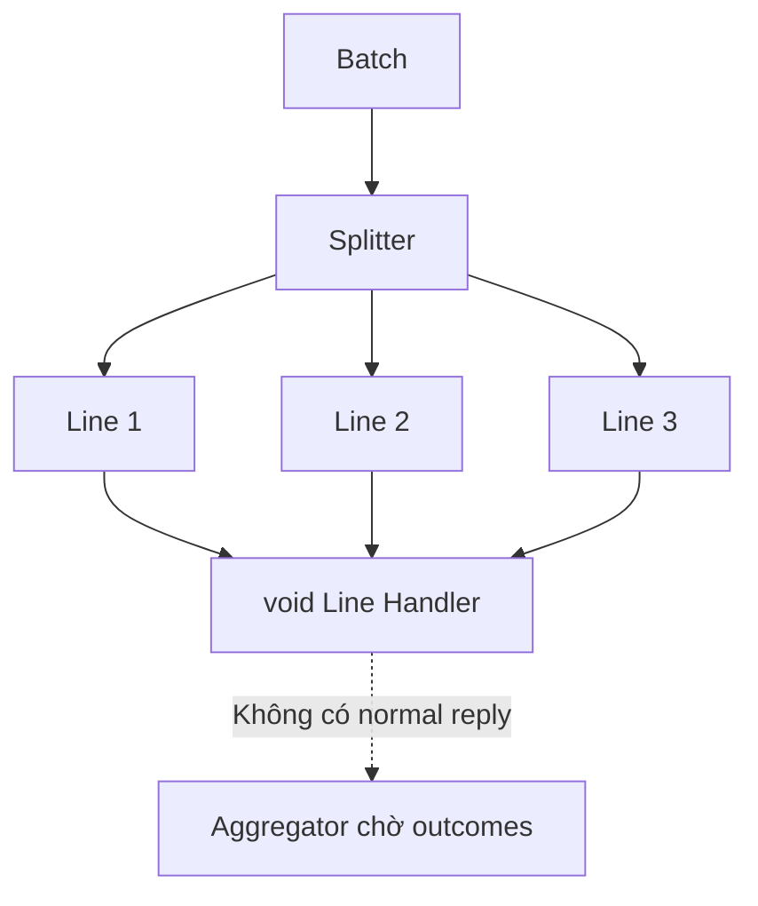

### Cách sửa 1: trả một PartOutcome

```java
public record PartOutcome(
    String batchId,
    int partIndex,
    boolean success,
    String reasonCode
) {}
```

```java
public PartOutcome processLine(OrderLine line) {
    lineService.process(line);

    return new PartOutcome(
        line.batchId(),
        line.index(),
        true,
        null);
}
```

Bây giờ mỗi child tạo một result cho Aggregator, và ReleaseStrategy có thể chờ đủ số outcome đã được xác minh.

### Cách sửa 2: aggregate trước side effect

Nếu Aggregator chỉ cần dữ liệu gốc, có thể gom lại **trước** khi gọi một `void` handler ghi kết quả cuối.

```text
Splitter -> per-line pure transform -> Aggregator
         -> BatchSummary -> void PersistBatchSummary
```

### Cách sửa 3: phát completion events riêng

Nếu từng child được xử lý bất đồng bộ, có thể phát `LineProcessed` event khi business transaction hoàn tất. Aggregator gom **completion events**, không chờ reply của `void` handler. Cần correlation, idempotency, timeout và recovery rõ.

### Tại sao không sửa bằng cách giảm sequenceSize?

Nếu Splitter đã tạo 3 parts, việc thiếu reply không có nghĩa batch chỉ có 0 hoặc 2 parts. Không thay `sequenceSize` tùy tiện để cho Aggregator release sớm và tạo kết quả sai.

## 31. Void handler và Resequencer

Resequencer cần các message có `correlationId`/`sequenceNumber` và release policy phù hợp. Nếu đặt void handler **trước Resequencer** và kỳ vọng handler chuyển tiếp message gốc, chuỗi có thể dừng ở đó.

Một thiết kế tốt hơn:

```text
Input -> Resequencer -> void Business Handler
```

hoặc:

```text
Input -> void side branch (Wire Tap)
      -> Resequencer -> Reply-producing downstream
```

**Không có return value** thì không có một message mới để downstream tự sắp thứ tự. Dùng Resequencer ở nơi thực sự có thông điệp đi qua.

### Nested group/sequence metadata

Một service có nhiều Splitter/Aggregator/Resequencer có thể sử dụng các group keys khác nhau. Khi trả `Message<?>` hoặc tạo side-branch event, cần biết header nào phục vụ group hiện tại, không thay tất cả bằng một business correlation ID duy nhất.

## 32. Idempotent Receiver: void không đồng nghĩa với idempotent

Giả sử broker gửi lại cùng `OrderCreated(eventId=EV-101)` hai lần. Một `void` Service Activator có thể ghi audit **hai lần**:

```text
Delivery #1 -> void recordAudit -> append EV-101
Delivery #2 -> void recordAudit -> append EV-101
Final store count = 2
```

`void` chỉ nói rằng handler không trả normal reply; nó **không** giới hạn số lần handler được gọi.

### Idempotency key đúng

```text
(tenantId, eventId, operationType)
= (shop-01, EV-101, WRITE_AUDIT)
```

Một key như `MessageHeaders.id` không phù hợp nếu redelivery tạo Message instance mới.

### Kiểm thử phơi bày duplicate

```java
@Test
void withoutIdempotencyDuplicateEventWritesTwice() {
    OrderCreated same = order();

    assertTrue(voidInput.send(
        MessageBuilder.withPayload(same).build()));

    assertTrue(voidInput.send(
        MessageBuilder.withPayload(same).build()));

    // Test cho thấy giới hạn demo, KHÔNG phải kết quả
    // mong muốn của hệ thống production.
    assertEquals(2, store.count());
    assertNull(unusedReplies.receive(0));
}
```

Đặt test này trong `VoidServiceActivatorTest`. Nó chứng minh một method `void` **không tự chống duplicate**.

### Cách bảo vệ business effect

- Dùng Idempotent Receiver theo logical key, với store/transaction phù hợp.
- Đặt unique constraint trên key nghiệp vụ khi ghi DB.
- Giữ processing/completed state nếu retry có thể xảy ra sau claim.
- Dùng outbox cho domain event phát sau transaction.
- Có reconciliation khi external effect có kết quả không chắc chắn.
- Giữ key/completion record trong replay window có liên quan.

Không coi việc thêm một `ConcurrentHashMap.newKeySet()` ở mỗi pod là giải pháp multi-instance durable.

## 33. Transaction: void method kết thúc không phải DB commit guarantee

Một Service Activator có thể gọi service `@Transactional`. Việc method return không đồng nghĩa mọi hệ thống bên ngoài đã commit.

### Trong cùng DB transaction

```text
Receive message
  -> begin transaction
  -> write audit record
  -> write outbox record
  -> commit transaction
  -> handler completes
```

Nếu transaction nằm đúng phạm vi method/service và không có async boundary tách riêng, có thể thiết kế handler trả kết quả sau khi transaction hoàn tất. Nhưng vẫn cần **kiểm tra transaction advice/proxy order** để xác định thời điểm commit thực tế so với reply dispatch.

### Gửi event trước commit là nguy hiểm

```text
write DB
publish "AuditRecorded"
transaction rollback
```

Consumer khác nhận event dù bản ghi audit không tồn tại. Transactional outbox giúp liên kết persist business state và intent publish trong cùng DB transaction.

### Crash sau commit, trước broker ACK

Consumer có thể redeliver cùng event. Nếu handler void và không có idempotency, audit bị ghi lần hai. Output channel không liên quan tới vấn đề này.

### Self-invocation của @Transactional

Khi dùng Spring proxy-based transaction, gọi method `@Transactional` bằng `this.someMethod()` từ cùng bean có thể không đi qua proxy như kỳ vọng. Hãy thiết kế transaction boundary rõ tại service bean được container quản lý và kiểm thử rollback/commit, không chỉ kiểm tra annotation có mặt.

## 34. Return value có phải ACK cho producer không?

Không tự động.

```text
Producer/Client
   -> Broker/HTTP
   -> Spring Message
   -> Service Activator
   -> AuditReceipt return
```

`AuditReceipt` là **business reply payload**. Nó khác:

- Kafka consumer offset commit.
- RabbitMQ basicAck/nack.
- HTTP status 200/202.
- Database transaction commit.
- Publisher confirm của outbound broker.

Tùy inbound adapter và Gateway, business reply có thể được chuyển thành HTTP response hoặc broker reply message, nhưng cần **explicit response mapping/protocol**.

### Test cần phân tầng

| Kiểm thử | Chứng minh điều gì? |
| --- | --- |
| Unit test service method | Return type và side effect giả |
| DirectChannel integration test | Endpoint invocation và local output |
| DB integration test | Transaction/unique constraint |
| HTTP Gateway test | Response status/body, timeout |
| Broker adapter test | ACK/redelivery, error path |
| Multi-pod test | Shared state/idempotency, concurrency |
| Failure injection | Crash windows và recovery |

Không tuyên bố exactly-once hoặc producer ACK chỉ từ test nhận `AuditReceipt` ở QueueChannel.

## 35. Observability: tách trạng thái side effect và reply

Một observability pipeline hữu ích phân biệt:

```text
MESSAGE_RECEIVED
  -> HANDLER_INVOKED
  -> SIDE_EFFECT_COMMITTED
  -> REPLY_CREATED (chỉ nếu có)
  -> REPLY_DISPATCHED (chỉ nếu có)
```

Với `void` handler, `REPLY_CREATED` và `REPLY_DISPATCHED` không xuất hiện — đó có thể là **hành vi đúng**.

### Log minh họa

```text
eventId=EV-101 tenantId=shop-01
endpoint=voidAudit
stage=HANDLER_INVOKED

eventId=EV-101 tenantId=shop-01
endpoint=voidAudit
stage=SIDE_EFFECT_COMMITTED
replyExpected=false

eventId=EV-102 tenantId=shop-01
endpoint=receiptAudit
stage=REPLY_DISPATCHED
replyType=AuditReceipt
```

### Metrics đề xuất

| Metric | Ý nghĩa |
| --- | --- |
| `activator.messages.received` | Số message đi tới endpoint |
| `activator.invocations` | Số lần gọi business method |
| `activator.success` | Số invocation kết thúc thành công |
| `activator.failed` | Exception/failure |
| `activator.side_effect.commits` | Commit thực tế nếu có thể đo |
| `activator.replies.produced` | Số return values thành reply |
| `activator.replies.missing` | Thiếu reply ở endpoint yêu cầu reply |
| `activator.gateway.timeouts` | Số Gateway calls không nhận reply |
| `activator.retry.attempts` | Số local retry thực |
| `activator.duplicate.received` | Số logical event duplicates |
| `activator.error_backlog` | Số lỗi đang chờ xử lý |
| `activator.latency` | Độ trễ xử lý per endpoint |

Đây là tên metrics **đề xuất cho ứng dụng**, không phải tất cả đều là metric Spring Integration tự phát. Không nên tạo alert cho `void` endpoint chỉ vì `replies.produced=0`; đó là thiết kế bình thường. Alert có ý nghĩa hơn là `requiresReply endpoint thiếu reply` hoặc `Gateway timeout tăng`.

### Tránh high-cardinality labels

`eventId`, `orderId`, `businessCorrelationId` có thể xuất hiện trong structured logs/traces với chính sách bảo mật, nhưng không nên dùng làm metric labels tùy tiện. Dùng label như endpoint, result status, exception class và low-cardinality operation type.

## 36. Test nhiều sender threads: void vẫn không tạo reply

Một singleton Service Activator có thể nhận message từ nhiều threads. Với một service method chỉ sử dụng collaborator thread-safe và không giữ mutable state theo request, các invocations có thể xử lý độc lập.

### Test nhiều events khác nhau

Thêm method này vào `VoidServiceActivatorTest` từ mục 16:

```java
@Test
void concurrentVoidEventsAllReachStoreWithoutReplies()
        throws Exception {

    final int count = 8;
    var executor = java.util.concurrent.Executors
        .newFixedThreadPool(count);

    var ready =
        new java.util.concurrent.CountDownLatch(count);
    var start =
        new java.util.concurrent.CountDownLatch(1);

    var futures = new java.util.ArrayList<
        java.util.concurrent.Future<?>>();

    try {
        for (int i = 1; i <= count; i++) {
            final int index = i;

            futures.add(executor.submit(() -> {
                ready.countDown();

                if (!start.await(
                        5,
                        java.util.concurrent.TimeUnit.SECONDS)) {
                    throw new IllegalStateException(
                        "Concurrent start timeout");
                }

                OrderCreated event = new OrderCreated(
                    "shop-01",
                    "ORD-" + index,
                    "EV-" + index,
                    java.time.Instant.parse(
                        "2026-11-21T08:30:00Z"));

                assertTrue(voidInput.send(
                    MessageBuilder.withPayload(event)
                        .build()));

                return null;
            }));
        }

        assertTrue(ready.await(
            5, java.util.concurrent.TimeUnit.SECONDS));

        start.countDown();

        for (var future : futures) {
            future.get(5,
                java.util.concurrent.TimeUnit.SECONDS);
        }

        assertEquals(count, store.count());

        java.util.Set<String> ids = store.snapshot().stream()
            .map(OrderCreated::eventId)
            .collect(java.util.stream.Collectors.toSet());

        assertEquals(count, ids.size());
        assertNull(unusedReplies.receive(0));
    } finally {
        start.countDown();
        executor.shutdownNow();
    }
}
```

### Vì sao không assert thứ tự bản ghi?

Với nhiều threads, thứ tự `store.snapshot()` có thể khác thứ tự tạo tasks. Nếu nghiệp vụ cần ordering, phải dùng partition/sequence contract, không mặc định JVM scheduling sẽ giữ thứ tự.

### Điều test chứng minh

- Mỗi event khác ID được chuyển đến one-way handler.
- Store fixture thread-safe lưu đủ events.
- Output channel không nhận normal reply.
- Handler không dùng mutable `currentEvent` toàn cục gây trộn ID.

### Điều test không chứng minh

- Multi-instance shared database transaction.
- External API exactly-once semantics.
- Broker redelivery/reordering.
- Authentication và tenant authorization.
- Việc một thread crash có làm transaction rollback không.

Không dùng một bài test concurrency duy nhất thay cho resilience tests ở những boundary còn lại.

## 37. Kiểm thử trạng thái “gửi được nhưng effect thất bại”

Những lựa chọn kết quả thường gặp:

| Tình huống | `send` của producer | Side effect | Normal reply | Điều cần làm |
| --- | --- | --- | --- | --- |
| DirectChannel, void handler thành công | Dispatch thành công | Đã gọi | Không | Theo one-way contract |
| DirectChannel, reply handler thành công | Dispatch thành công | Đã gọi | Có receipt | Verify receipt |
| DirectChannel, handler throw | Có thể throw | Chưa/chỉ một phần | Không phải success reply | Phân loại exception |
| ExecutorChannel nhận message, handler chưa chạy | Có thể hoàn thành trước | Chưa | Chưa | Await completion/monitor |
| Handler đã commit, caller timeout | Request có thể timeout | Đã commit | Reply không đến caller | Idempotency/result lookup |
| Filter loại message trước void handler | Dispatch qua upstream | Không chạy | Không | Verify discard policy |
| Void handler phát domain event qua publisher | Dispatch hoàn tất | Có side effect | Không | Kiểm tra event publish riêng |
| Gateway cần reply nhưng handler void | Gateway gửi request | Có thể đã commit | Không | Timeout/reply contract |
| Broker redelivery cùng event | Nhiều deliveries | Có thể chạy nhiều lần | Tùy flow | Business idempotency |

### Vì sao cần ba loại log?

`message dispatched`, `handler completed` và `business committed` là ba sự kiện khác nhau. Một log “success” ngay sau `send` trong flow bất đồng bộ có thể khiến đội vận hành lầm tưởng DB đã ghi thành công.

## 38. Lỗi thực tế: output channel rỗng phải debug theo thứ tự nào?

Giả sử đội vận hành báo: “Service Activator chạy không ra `auditResults`.”

Thay vì chỉnh tên channel ngay, kiểm tra:

1. **Có gửi message vào đúng input channel không?** Dùng integration test và metric `messages.received`.
2. **Channel có subscriber đúng endpoint không?** Với `DirectChannel`, absence subscriber có thể gây dispatch failure.
3. **Filter/Router trước đó có loại/chuyển message không?** Kiểm tra discard/error routes.
4. **Method có được invoke không?** Dùng invocation counter/test store, tránh chỉ nhìn log.
5. **Method signature có `void` không?** Nếu có, không kỳ vọng normal reply.
6. **Có return `null` ở một nhánh không?** Một branch có thể làm output rỗng.
7. **Có exception xảy ra trước return không?** Kiểm tra stack/error channel.
8. **`requiresReply` có đang bật không?** Nó có thể biến thiếu reply thành lỗi.
9. **Có output channel cố định khác với nơi consumer đang nghe không?** Kiểm tra route precedence.
10. **Có Gateway và dynamic replyChannel không?** Kiểm tra request/reply correlation và timeout.
11. **Có async boundary không?** Cần chờ completion, không chỉ `receive(0)` tức thì.
12. **Có nhiều subscribers hoặc concurrent consumer không?** Một consumer khác có thể lấy message khỏi QueueChannel.
13. **Có message serialization lỗi khi qua adapter không?** Header/type/codec có thể làm publish fail.
14. **Có output được gửi nhưng downstream Filter loại không?** Phân biệt publisher và consumer.
15. **Có duplicate/idempotency gate chặn processing không?** Xem business key và completion state.

### Decision tree

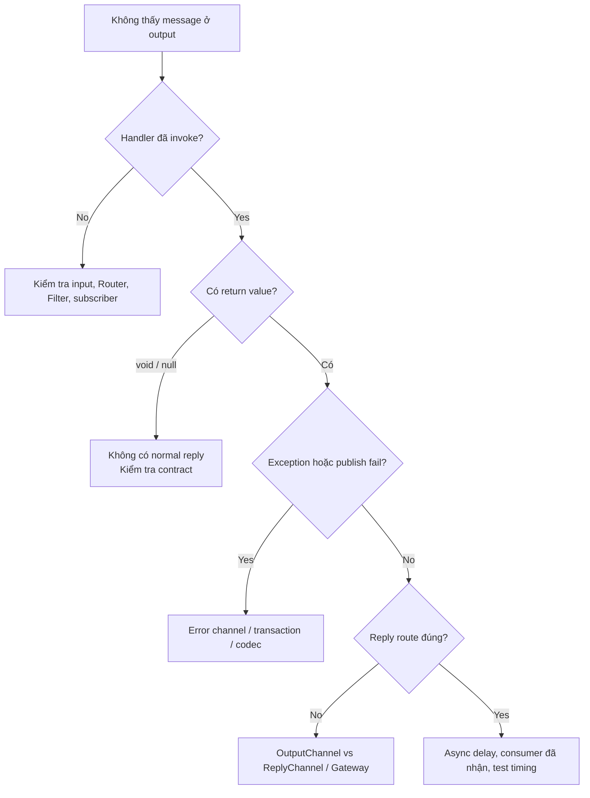

**Kết luận debug:** “output rỗng” không tự chứng minh method chưa chạy; và “method đã chạy” không chứng minh output có reply.

## 39. Những phản mẫu thường gặp

### 39.1. Khai báo outputChannel trên void method rồi chờ result

`outputChannel` không tự sinh payload. Đổi method trả typed result hoặc bỏ kỳ vọng reply.

### 39.2. Trả `null` để biểu diễn lỗi nghiệp vụ

Gateway dễ timeout; dùng typed rejection/error contract.

### 39.3. Dùng `requiresReply=true` cho fire-and-forget handler

Biến completion hợp lệ thành reply-required failure.

### 39.4. Coi `MessageChannel.send` là broker ACK hoặc DB commit

Dispatch semantics khác transaction/ack semantics.

### 39.5. Thêm `.channel("next")` sau void handler và nghĩ input sẽ chảy tiếp

Một reply-producing stage cần actual return value; void không tự pass-through input message.

### 39.6. Đặt void handler trong đường tạo results cho Aggregator

Aggregator không có contributions để release đúng, dù side effect các child đã chạy.

### 39.7. Dùng void handler như Filter ngầm

Không tạo output nhưng không có discard reason; khó quan sát và retry.

### 39.8. Gửi thủ công tới output channel rồi cũng return receipt

Có thể phát hai messages vào hai tuyến; cần thiết kế ai là producer duy nhất.

### 39.9. Ghi audit trực tiếp từ Wire Tap nhưng tưởng đã có transaction chung

Side branch có thể async hoặc có lỗi riêng; business effect và audit có thể lệch nhau.

### 39.10. Bỏ qua replyChannel khi tạo Message mới trong Gateway flow

Caller timeout dù handler đã trả data; phải giữ trusted reply context theo contract hoặc đổi topology.

### 39.11. Copy raw `replyChannel` từ input không đáng tin

Làm lộ nội bộ, cho phép routing không mong muốn hoặc stale channel object.

### 39.12. Đếm `void` invocation thành exactly-once effect

Broker có thể redeliver; side effect cần idempotency/transaction.

### 39.13. Bật retry cho non-idempotent void handler không có kiểm soát

Một lỗi sau commit có thể tạo effect thứ hai khi retry.

### 39.14. Test `receive(0)` trước khi handler async chạy xong

Test có thể pass sai hoặc flaky; dùng latch/completion event.

### 39.15. Nhầm business correlation với request/reply correlation

Hai callers cùng order có thể có reply destinations khác; cần IDs đúng scope.

### 39.16. Ghi “success” trong log trước transaction commit

Observability sai sự thật; ghi mốc side effect đúng.

### 39.17. Không ghi failure ở one-way handler

Không có reply không đồng nghĩa lỗi sẽ tự biến mất; cấu hình error channel/monitoring.

### 39.18. Tạo success receipt nhưng không gắn với một business guarantee

Consumer tưởng có commit hoặc remote API success khi chỉ mới gửi task async.

## 40. So sánh kiến trúc: đặt Service Activator ở đâu?

| Kiến trúc | Cách dùng `void` | Khi phù hợp | Lưu ý |
| --- | --- | --- | --- |
| `Input -> void Handler` | Terminal consumer | Fire-and-forget one-way | Error/idempotency |
| `Input -> returning Handler -> output` | Không dùng void | Request-reply / next stage | Result contract |
| `Input -> Wire Tap -> main flow` | Void ở side branch | Audit/log/metrics không chặn main | Side-effect reliability |
| `Input -> PubSub -> multiple handlers` | Void ở một nhánh | Fan-out events | Error isolation |
| `Splitter -> result handlers -> Aggregator` | Tránh void nếu aggregator cần outcomes | Batch/composite result | Unique parts, release |
| `Aggregator -> void Persist` | Terminal side effect | Ghi batch result cuối | Transaction |
| `Gateway -> returning Handler` | Không dùng void nếu reply bắt buộc | Synchronous API | Timeout/correlation |
| `Accepted response -> async void handler` | Void sau accepted command | Long-running workflow | Result store/recovery |
| `DB TX + outbox -> void publisher trigger` | Void thực thi command | Event-driven architecture | Atomic record/dispatch |
| `Resequencer -> void Handler` | Terminal consumer sau ordering | Ordered side effect | Stateful grouping |

### Quy tắc chọn nhanh

Nếu câu trả lời cho “có ai cần **business result ngay** từ lời gọi này không?” là **không**, hãy cân nhắc one-way void handler.

Nếu câu trả lời là **có**, handler nên trả dữ liệu có nghĩa hoặc có một reply-producing downstream endpoint được thiết kế rõ.

Nếu kết quả chỉ có sau nhiều phút, dùng workflow/result store thay vì giữ một Gateway chờ vô hạn.

## 41. Bài thực hành A: chứng minh void không tạo output

### Yêu cầu

1. Tạo `OrderCreated` có tenant, orderId, eventId, occurredAt.
2. Tạo `InMemoryAuditStore` thread-safe.
3. Tạo `AuditApplicationService` có `recordWithoutReply` và `recordWithReceipt`.
4. Cấu hình `voidAuditRequests`, `unusedVoidReplies`, `receiptAuditRequests` và `receiptAuditReplies`.
5. Khai báo `@ServiceActivator` cho cả hai methods.
6. Test gửi một event vào void input.
7. Assert `store.count()==1`.
8. Assert `unusedVoidReplies.receive(0)==null`.
9. Gửi cùng loại event vào receipt input trong test context riêng.
10. Assert output có `AuditReceipt(status=RECORDED)`.
11. Đổi method receipt thành trả `null` theo điều kiện và quan sát thiếu output.
12. Định nghĩa policy khi Gateway bắt buộc reply.

### Bảng kết quả

| Input / Handler | Store count | Output message |
| --- | ---: | --- |
| Một event -> void Service Activator | 1 | 0 |
| Một event -> receipt Service Activator | 1 | 1 |
| Method trả `null` (không requiresReply) | Theo implementation | 0 |
| Method trả `null` (requiresReply) | Theo implementation | Reply-required error |
| Method throw trước append | 0 | Exception/error |
| Method throw sau append | Có thể 1 | Exception/error; outcome cần reconcile |

**Các counts ở bảng mô tả demo với input đơn, không phải guarantee của broker hoặc multi-pod deployment.**

## 42. Bài thực hành B: Gateway và timeout

**Tình huống:** API muốn nhận `AuditReceipt` nhưng bên trong dùng void handler.

### Thực hiện

1. Tạo một Gateway interface kỳ vọng `AuditReceipt`.
2. Nối nó tới `void` endpoint.
3. Cấu hình reply timeout nhỏ và có giới hạn trong test.
4. Gửi event và xác minh side effect có thể thành công dù caller không nhận reply.
5. Ghi rõ exception/timeout result thực tế theo Gateway configuration.
6. Đổi handler thành trả `AuditReceipt`.
7. Bỏ output channel cố định nếu Gateway cần dynamic replyChannel.
8. Kiểm tra caller nhận đúng receipt.
9. Gửi hai requests đồng thời và xác minh reply không bị gán nhầm caller.
10. Giả lập handler commit rồi reply dispatch lỗi; retry cùng logical event.
11. Thêm idempotency key theo tenant/event/operation.
12. Thiết kế stored-result replay hoặc status endpoint cho request retry.

### Câu hỏi thực hành

**Nếu Gateway timeout nhưng store đã có audit record, API nên trả lỗi gì?**

Không có một mã HTTP duy nhất đúng cho mọi hệ thống. Cần phân biệt **outcome đã biết** và **outcome không chắc**. Nếu biết operation đã commit, có thể tra cứu/replay result. Nếu chưa biết, trả trạng thái pending/unknown theo contract và không retry side effect mù.

## 43. Bài thực hành C: Splitter, Aggregator và event-driven completion

**Bối cảnh:** một đơn có 3 lines. Mỗi line cần được xử lý, sau đó caller muốn biết tất cả thành công hay thất bại.

### Thiết kế sai cần mô phỏng

```text
Splitter(3 lines)
   -> void processLine()
   -> Aggregator(expect 3 replies)
```

Test cho thấy `processLine` có thể chạy ba lần nhưng Aggregator không nhận ba reply messages.

### Thiết kế sửa

```text
Splitter(3 lines)
   -> processLine() returns PartOutcome
   -> Aggregator(3 unique outcomes)
   -> BatchResult
```

Hoặc:

```text
Splitter(3 lines)
   -> async void command handlers
   -> each publishes LineProcessed after commit
   -> Aggregator consumes LineProcessed events
   -> BatchResult
```

### Yêu cầu kiểm thử

1. Gửi 3 lines theo thứ tự `3,1,2`.
2. Assert các handlers đã chạy đúng số lần.
3. Với thiết kế sai, assert không có các normal reply outcomes.
4. Với thiết kế sửa, assert đủ `PartOutcome` theo group key.
5. Assert part indexes 1,2,3 duy nhất.
6. Gửi duplicate part và kiểm tra idempotency trước Aggregator.
7. Gây lỗi line 2; quyết định có trả `FAILED PartOutcome` không.
8. Nếu line 2 bị drop, kiểm tra timeout/expiry policy.
9. Test hai batches A/B xen kẽ không trộn correlation.
10. Kiểm tra output order theo part index, không theo arrival order.

### Điều cốt lõi

**CorrelationStrategy, ReleaseStrategy và output processor chỉ hoạt động trên những messages thật sự được đưa tới Aggregator.** Một void handler không tạo message mới cho stage sau chỉ vì đã làm xong side effect.

## 44. Câu hỏi tự đánh giá

**Câu 1.** Đặt `outputChannel` lên `@ServiceActivator` method `void` có tự phát message không?

*Không. Output channel là đích của reply nếu có; `void` không có normal return value để phát.*

**Câu 2.** Vì sao `store.count()==1` nhưng `unusedReplies.receive(0)==null` có thể là kết quả đúng?

*Side effect đã chạy, nhưng method không trả result. Hai tính chất độc lập.*

**Câu 3.** Method khai báo trả `AuditReceipt` nhưng trả `null` có giống `void` không?

*Giống ở chỗ không có normal reply tại lần gọi đó, nhưng signature và contract khác nhau; null có thể là nhánh lỗi/skip cần xử lý rõ.*

**Câu 4.** Bật `requiresReply` cho method `void` có tạo `AuditReceipt` không?

*Không. Nó có thể khiến việc thiếu reply bị xem là lỗi.*

**Câu 5.** `outputChannel` có giống header `replyChannel` không?

*Không. Output channel là destination cấu hình trên endpoint; replyChannel có thể là destination của request cụ thể, nhất là Gateway.*

**Câu 6.** Tại sao Gateway gọi void handler có thể timeout dù DB đã commit?

*Vì Gateway chờ reply message, không chỉ chờ side effect xảy ra.*

**Câu 7.** Có thể dùng `MessageChannel.send` trả true làm bằng chứng đã commit DB không?

*Không. Ý nghĩa của send phụ thuộc channel/dispatch; ack/commit có lifecycle riêng.*

**Câu 8.** Void handler ở PubSub channel có ngăn subscriber khác không?

*Không theo semantics fan-out của PubSub; các subscribers nhận message từ channel, không từ reply của void handler.*

**Câu 9.** Wire Tap giải quyết vấn đề gì với void audit handler?

*Nó tách audit ra một nhánh phụ trong khi message chính vẫn đi tiếp mà không cần audit handler phát reply.*

**Câu 10.** Tại sao đặt void handler trước Aggregator có thể làm group không release?

*Nếu Aggregator chờ per-part outputs mà void handler không tạo replies, nhóm không nhận đủ contributions.*

**Câu 11.** Method `void` có tự idempotent không?

*Không. Cùng logical event được redeliver có thể làm side effect bị lặp.*

**Câu 12.** Test `receive(0)==null` ngay sau send trên ExecutorChannel có đủ chứng minh không có reply không?

*Không. Handler có thể chưa chạy hoặc output chưa được dispatch. Cần synchronization/timeout/topology-aware assertions.*

**Câu 13.** Một method `void` có thể phát domain event khác không?

*Có nếu nó chủ động gọi publisher hoặc ghi outbox. Nhưng đó là side effect riêng, không phải normal reply từ method.*

**Câu 14.** Return `Message<AuditReceipt>` khác return `AuditReceipt` ở đâu?

*Handler có thể cung cấp reply headers tường minh; cần chú ý header propagation và Gateway/correlation.*

**Câu 15.** Làm thế nào xác nhận trạng thái thành công cuối của một workflow dài mà không giữ Gateway chờ?

*Dùng accepted response, operation ID, persistent result store và callback/polling contract có idempotency/recovery.*

## 45. Checklist triển khai production

- **Contract:** xác định handler one-way hay request-reply trước khi chọn return type.
- **Void:** hiểu rằng `void` không tạo normal reply.
- **Null:** xử lý skip/rejection có chủ đích, không để Gateway timeout mù.
- **Output channel:** chỉ route các replies thực sự tồn tại.
- **Reply channel:** Gateway/request context không được trộn với fixed output channel ngoài ý muốn.
- **requiresReply:** dùng cho endpoint bắt buộc result, không đặt cho one-way thành công.
- **Annotation/DSL:** tránh đăng ký trùng subscriber ngoài ý muốn.
- **Side effect:** đánh giá transaction/commit thay vì chỉ invocation.
- **ACK:** tách broker/HTTP acknowledgements khỏi business reply.
- **Async:** dùng latch/completion signal, không test dựa trên timing không ổn định.
- **Error channel:** xác định exception handling tại DirectChannel/ExecutorChannel/inbound adapter.
- **Retry:** phân biệt transient, deterministic business failure và uncertain outcome.
- **Idempotency:** ổn định theo logical event/operation, không theo Spring Message ID.
- **Outbox:** liên kết DB write và publish intent khi có thể.
- **Gateway:** reply timeout, late reply, request correlation, stored result replay.
- **Router:** xác định route không có reply và route cần reply.
- **Filter:** discard/failure policy rõ, không dùng void làm Filter ngầm.
- **PubSub:** fan-out độc lập, void subscriber không tạo data cho nhánh khác.
- **Wire Tap:** audit side effect có reliability riêng.
- **Splitter/Aggregator:** chỉ chờ outputs thực sự được tạo, có correlation/sequence.
- **Resequencer:** giữ metadata group khi cần, đặt void handler cuối chuỗi nếu phù hợp.
- **Serialization:** không chuyển Java replyChannel object qua broker.
- **Security:** trusted tenant và business identity không lấy từ raw headers tự khai.
- **Observability:** tách received/invoked/committed/replied.
- **Tests:** side effect + no reply, return receipt, null, exception, Gateway, concurrent, duplicate, async.
- **Scale:** multi-pod unique effect constraints và message store/partitioning khi cần.
- **Runbook:** phân biệt “không có reply” là đúng contract hay lỗi runtime.

## 46. Kết luận

**Void method và output channel** thể hiện một nguyên tắc quan trọng của Service Activator trong Spring Integration: **kết thúc xử lý nghiệp vụ không đồng nghĩa tạo một reply message**. Một method `void` có thể ghi DB, gọi service hoặc phát domain event qua cơ chế riêng, nhưng **không tự gửi normal reply vào `outputChannel`**. Muốn downstream nhận `AuditReceipt` hoặc Gateway có response, phải có một return value hoặc reply-producing flow hợp lệ.

Cách học chắc chắn nhất là viết hai endpoint chỉ khác nhau ở return type, rồi kiểm thử **cả side effect lẫn output channel**. Với one-way method, test phải chứng minh handler thực sự chạy nhưng output rỗng; với reply-producing method, test phải khẳng định output payload đúng. Khi thêm `requiresReply`, Gateway, ExecutorChannel, Router/Filter, Splitter/Aggregator, idempotency và retry, cần giữ nguyên sự phân biệt này.

Trong production, lựa chọn `void` hay trả result phải bắt đầu từ **hợp đồng nghiệp vụ và độ tin cậy của toàn pipeline**, không từ một annotation hay tên channel. Thiết kế đúng reply, error, transaction, ACK, correlation và observability sẽ giúp workflow Enterprise Integration Patterns dễ kiểm thử, dễ mở rộng và tránh các lỗi “đã xử lý nhưng không trả kết quả” hoặc “đợi reply không bao giờ tới”.
