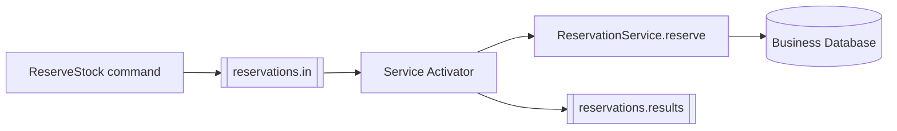
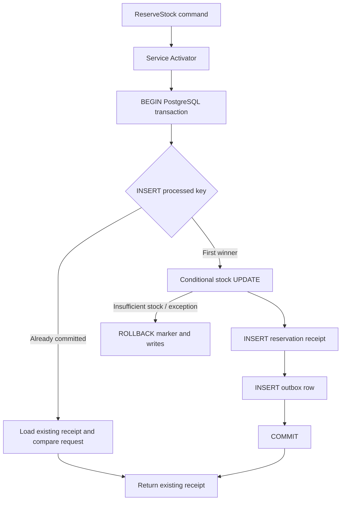
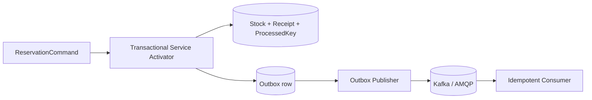
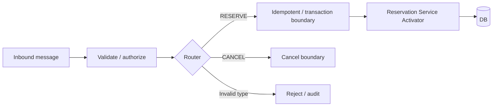
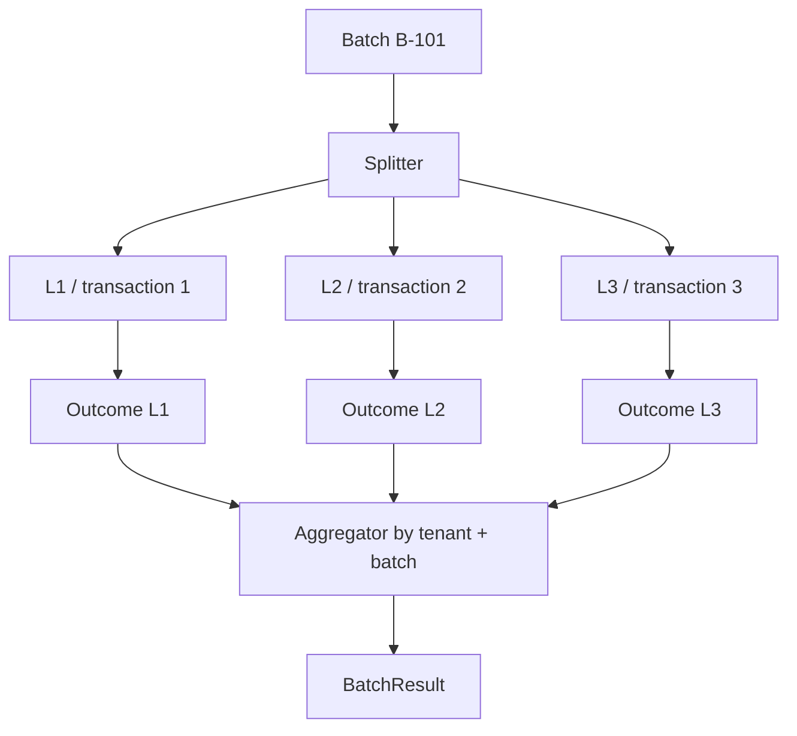

# Service activator có transaction

Một message `ReserveStock` được gửi vào Spring Integration. **Service Activator** nhận message, gọi một service Java để trừ tồn kho và tạo phiếu giữ hàng. Cơ sở dữ liệu ghi nhận thành công, nhưng ứng dụng bị dừng trước khi broker nhận acknowledgment. Broker phát lại cùng message. Nếu handler thực hiện lại phép trừ tồn, khách hàng có thể bị giữ hàng hai lần cho **một thao tác nghiệp vụ**.

Một tình huống khác: Service Activator đã trừ tồn, sau đó phát event `StockReserved` sang hệ thống khác. Broker tạm lỗi. Nếu coi giao dịch database và thao tác publish là **một transaction duy nhất** mà không có cơ chế phù hợp, hệ thống có thể rơi vào trạng thái **tồn kho đã trừ nhưng không có event**, hoặc **event đã phát nhưng database rollback**.

**Service Activator có transaction** là cách thiết kế một endpoint Spring Integration gọi business service trong một **ranh giới giao dịch được xác định rõ**, bảo vệ những cập nhật **có thể commit/rollback cùng nhau**, đồng thời xử lý có chủ đích những bước **nằm ngoài giao dịch** như broker acknowledgment, outbound HTTP, Payment API hay nhiều database khác nhau.

Bài thuộc chương **Service activator**, module `SPRING_INTEGRATION_PATTERN`, phục vụ mục tiêu học **Enterprise Integration Patterns với Spring Integration**: xây dựng luồng thông điệp ít phụ thuộc, dễ mở rộng; thực hành Router, Filter, Transformer, Splitter, Aggregator, Gateway, retry, error channel và correlation, đồng thời kiểm thử và theo dõi các nhánh xử lý. Ở đây, trọng tâm là **transaction boundary của Service Activator**, không phải chỉ đặt một annotation rồi mặc nhiên có exactly-once end-to-end.

> **Nguyên tắc:** `@Transactional` trên business method có thể bảo vệ **những thao tác tham gia cùng transaction manager**, điển hình là các câu SQL trên một database. Nó **không tự bao phủ** message đã được gửi sang broker khác, HTTP call, message ở thread khác, hoặc những bước sau khi method đã return. **Thời điểm ACK và trạng thái idempotency** phải được thiết kế riêng.

## 1. Service Activator trong EIP là gì?

**Service Activator** là endpoint nối một **message flow** với một **service method** thực hiện logic nghiệp vụ. Trong Spring Integration, ta thường dùng:

- `@ServiceActivator(inputChannel = "...")` đặt trên method/endpoint.
- Java DSL `.handle(service, "method")` hoặc `.handle(PayloadType.class, (payload, headers) -> ...)`.
- Một `MessageHandler` hoặc service method được framework gọi từ message channel.

Ví dụ về tuyến:



Service Activator **không đồng nghĩa** transaction manager. Nó là **điểm kích hoạt** business service. Khi method được gọi qua Spring-managed transactional proxy và transaction manager được cấu hình đúng, business operations bên trong method có thể tham gia giao dịch.

### 1.1. Một `.handle(...)` có thể làm những gì?

| Ví dụ handler | Cần transaction? | Nhận xét |
| --- | --- | --- |
| Tính tổng giá tiền thuần túy từ DTO | Thường không. | Nếu không thay đổi state, transaction có thể không cần. |
| Trừ tồn và ghi phiếu giữ hàng cùng database | Có. | Cần atomicity và constraint ở DB. |
| Đọc dữ liệu rồi trả DTO | Tùy consistency; có thể `readOnly`. | `readOnly=true` là hint/semantics tùy DB/transaction manager. |
| Gọi HTTP Payment API | Không được bảo vệ chỉ bởi local DB transaction. | Cần idempotency, timeout và reconciliation. |
| Ghi DB rồi publish Kafka event | Local `@Transactional` chưa tự atomic với Kafka. | Cân nhắc transactional outbox. |
| Ghi nhiều database độc lập | Một local manager không đủ. | Cần thiết kế distributed transaction hoặc saga/outbox theo yêu cầu. |

### 1.2. Service Activator khác Message Translator

**Message Translator** đổi cách biểu diễn message. **Service Activator** gọi một service có thể thực hiện **side effect**. Một flow tốt thường tách:

```text
Wire message
  → parse/normalize/validate
  → Router / Filter
  → Service Activator
  → transactional business service
  → result / outbox / response
```

Nếu Transformer lén thực hiện trừ tồn hay charge tiền trong lúc đổi format, retry của bước dịch có thể gây tác động phụ khó kiểm soát. **Đặt side effect tại business boundary rõ ràng** giúp cấu hình transaction, idempotency và tests đúng chỗ.

## 2. Transaction thực sự bảo vệ cái gì?

Một **database transaction** thường hướng tới các tính chất ACID trong phạm vi database/transaction manager tương ứng. Đối với ứng dụng tích hợp, cần hỏi cụ thể:

1. **Atomicity:** marker chống trùng, cập nhật tồn kho và phiếu giữ hàng có cùng commit hoặc cùng rollback không?
2. **Consistency:** unique constraint, check constraint và business invariants được bảo vệ thế nào?
3. **Isolation:** hai worker đồng thời reserve một SKU có thể làm tồn âm hoặc double-reserve không?
4. **Durability:** DB đã trả commit thành công; broker ACK mất thì redelivery được xử lý ra sao?

### 2.1. Transaction boundary không phải toàn bộ IntegrationFlow

Với service:

```java
@Transactional
public ReservationReceipt reserve(ReservationCommand command) {
    // Business SQL operations...
}
```

ranh giới giao dịch thường là:

```text
IntegrationFlow:
   input channel
      → Service Activator invokes proxy
           BEGIN TRANSACTION
             SQL 1
             SQL 2
             SQL 3
           COMMIT
      → next endpoint / output channel
```

Nếu endpoint tiếp theo lỗi **sau khi `reserve(...)` return và transaction đã commit**, local transaction của `reserve(...)` **không quay ngược thời gian để rollback**. Đó là một trong những nhầm lẫn quan trọng nhất khi đặt `@Transactional` trong message flow.

### 2.2. Sơ đồ ranh giới

```mermaid
sequenceDiagram
    autonumber
    participant C as Message Channel
    participant A as Service Activator
    participant P as Spring Transaction Proxy
    participant D as Business DB
    participant O as Output Channel
    C->>A: ReservationCommand
    A->>P: reserve(command)
    P->>D: BEGIN
    P->>D: processed key + stock + reservation + outbox
    D-->>P: COMMIT
    P-->>A: ReservationReceipt
    A->>O: Send result
    Note over O: Send xảy ra sau transaction method; không tự được rollback bởi transaction vừa commit
```

### 2.3. Transaction manager phải phù hợp resource

Một `DataSourceTransactionManager` quản lý JDBC connections của **một `DataSource`** theo cơ chế Spring. `JpaTransactionManager` dùng cho JPA persistence context và resource tương ứng. Transaction của Kafka/JMS có resource semantics riêng.

Không có phép màu kiểu:

```text
@Transactional
  ├── PostgreSQL
  ├── remote Payment API
  ├── Kafka broker
  └── email server
```

`@Transactional` đơn giản tự commit/rollback đồng nhất cả bốn là **sai**. Dù một vài framework cung cấp phối hợp transaction hay synchronization, cần đọc chính xác **guarantee và crash window** của chúng trước khi tuyên bố atomic end-to-end.

## 3. Hai vị trí cấu hình transaction khác nhau

### 3.1. Transaction tại business service

```text
Message enters flow
  → Service Activator
      → @Transactional ReservationService.reserve(...)
          → local DB operations
      ← COMMIT / ROLLBACK
  → next endpoint
```

Đây là lựa chọn rõ ràng khi **business invariant** và những SQL cần commit cùng nhau đều nằm trong một service method.

### 3.2. Transaction tại poller/consumer boundary

Một **polling endpoint** có thể nhận message từ `QueueChannel`, JDBC poller hoặc message source, rồi chạy downstream trong **transaction do poller advice mở**. Khi cấu hình đúng, transaction có thể bao quanh **poll + downstream synchronous processing** trên cùng thread.

```text
Poller transaction advice:
    BEGIN
      receive/poll
      synchronous handler chain
    COMMIT / ROLLBACK
```

**Khác biệt:**

| Tiêu chí | `@Transactional` ở business service | Transaction advice của poller |
| --- | --- | --- |
| Bắt đầu | Khi Spring transactional proxy gọi method. | Khi poll task/advice bắt đầu theo cấu hình. |
| Phạm vi | Nội dung method và các resource tham gia transaction. | Polling + downstream **cùng execution context** khi được advice bao. |
| Dùng với `DirectChannel` | Có; handler thường chạy cùng thread gọi `send()`. | Có thể giữ một transaction qua các handler sync. |
| Qua `ExecutorChannel`/async | Không tự propagate transaction sang thread mới. | Không tự trải sang thread khác. |
| Qua remote broker/HTTP | Không atomic chỉ nhờ annotation. | Không atomic chỉ nhờ advice. |
| Vai trò | Ràng buộc nghiệp vụ ở service. | Phối hợp receive/processing trong polling boundary. |

Không nên đặt **cả hai** mà không hiểu propagation: chúng có thể **join cùng transaction** (`REQUIRED`) hoặc tạo nested/new boundaries (`REQUIRES_NEW`), ảnh hưởng rollback và visibility.

## 4. Kênh thông điệp quyết định transaction có tiếp tục được không

### 4.1. `DirectChannel`: cùng thread, nhưng không tự có transaction

`DirectChannel` thường dispatch handler **đồng bộ** trên thread gửi. Nếu caller có transaction đang mở và handler dùng cùng transaction manager, các thao tác có thể join transaction. Tuy nhiên **sự đồng bộ của channel không tự khởi tạo transaction**.

```text
DirectChannel:
  thread A → handler 1 → handler 2 → return
```

**Chú ý:** Nếu transaction chỉ được mở **bên trong** handler 1 và commit khi handler 1 return, handler 2 chạy cùng thread nhưng **không còn ở transaction ấy**.

### 4.2. `ExecutorChannel`: thread boundary

```text
thread A → ExecutorChannel → queue
                               └─ thread B → handler
```

Spring transaction context thường **thread-bound**. Không nên giả định thread B thừa hưởng transaction của A. Nếu handler B cần DB transaction, mở **transaction riêng tại B** hoặc thiết kế transactional consumer phù hợp.

### 4.3. `QueueChannel`: nhận sau không có nghĩa còn transaction cũ

Một `QueueChannel` có thể lưu message trong bộ nhớ để poll sau. Sending message vào queue và xử lý message ở một poller khác là **hai bước thời gian**; transaction của sender không tự kéo dài qua khoảng chờ.

Nếu queue đầy, `send` có thể thất bại hoặc timeout theo cấu hình, nhưng điều đó **không mặc nhiên rollback SQL đã commit trước đó**. Cần quyết định có dùng outbox, bounded retry hoặc cơ chế transactional store/queue tương ứng.

### 4.4. So sánh nhanh

| Channel/boundary | Cùng thread? | Cùng local transaction một cách tự động? | Điểm cần test |
| --- | --- | --- | --- |
| `DirectChannel` | Thông thường có. | Chỉ nếu đã có transaction được chia sẻ theo cấu hình. | Handler sau lỗi có nằm trong cùng boundary không? |
| `ExecutorChannel` | Không. | Không mặc nhiên. | Task có tự mở transaction không? |
| `QueueChannel` + poller | Có ranh giới gửi/nhận khác nhau. | Không mặc nhiên; poller advice có thể mở transaction mới. | Poller retry, rollback, duplicate. |
| Kafka/AMQP/JMS adapter | Tùy container/executor/ack mode. | Không có một câu trả lời chung. | Listener transaction, ACK/offset, DLT. |
| HTTP outbound Gateway | Remote request. | Không trong local DB transaction. | Timeout và unknown remote outcome. |

**Nguyên tắc kiểm tra:** vẽ transaction boundary **trên sơ đồ topology và theo thread**, thay vì nói “cả flow có transaction” mà không chỉ rõ ai mở, ai commit và ai chịu trách nhiệm khi fail.

## 5. Spring AOP: `@Transactional` có chạy thật không?

Một cấu hình Spring transaction điển hình sử dụng **proxy-based advice**. Annotation phát huy tác dụng khi lời gọi đi qua **Spring-managed proxy**, có transaction manager đúng và method phù hợp.

### 5.1. Trường hợp đúng

```text
Spring Integration handler
   → Spring bean proxy: ReservationService.reserve(...)
       → @Transactional interceptor
           → business SQL
```

### 5.2. Trường hợp dễ sai

```java
public class ReservationService {

    public void handle(ReservationCommand command) {
        // Gọi cùng object (self-invocation).
        reserve(command);
    }

    @Transactional
    public void reserve(ReservationCommand command) {
        // Nếu chỉ được gọi từ this.handle(...),
        // proxy-based transaction advice có thể không chạy.
    }
}
```

Với **proxy mode**, `this.reserve(...)` là self-invocation; không đi qua proxy. Dễ dẫn đến trạng thái tưởng có transaction nhưng SQL đang chạy auto-commit hoặc dưới boundary khác.

### 5.3. Các điều kiện cần chú ý

- Bean phải được **Spring quản lý**, không tự `new ReservationService(...)` rồi mong annotation hoạt động.
- Có `@EnableTransactionManagement`/auto-configuration tương ứng và `PlatformTransactionManager` phù hợp.
- Thực hiện lời gọi qua proxy, không chỉ gọi method trong cùng class.
- Với JDK proxy/interface hoặc class proxy, method visibility/proxy compatibility phải đúng; **public method** là lựa chọn rõ ràng cho ví dụ.
- `@Transactional` mặc định thường rollback với **unchecked exception/Error**, không mặc định với mọi checked exception; cần `rollbackFor` nếu hợp đồng đòi.
- Nếu một method bắt exception rồi **nuốt lỗi**, transaction advice có thể thấy method kết thúc bình thường và commit.
- Khi có nhiều transaction manager, cần chọn đúng manager/qualifier và không để handler dùng nhầm DataSource.

### 5.4. Exception bị nuốt có thể biến rollback thành commit

```java
@Transactional
public void unsafe(ReservationCommand command) {
    try {
        inventoryRepository.decrement(command);
        reservationRepository.insert(command);
    } catch (RuntimeException ex) {
        log.warn("failed", ex);
        // Nguy hiểm: nuốt lỗi rồi return thành công.
    }
}
```

Nếu không đánh dấu rollback-only/throw lại theo policy, method có thể **commit phần trạng thái đã thay đổi**. Đừng dùng `errorChannel` hoặc một catch block chỉ để log mà phá transaction semantics.

## 6. Transaction propagation: `REQUIRED`, `REQUIRES_NEW` và `NESTED`

Ví dụ:

| Propagation | Ý nghĩa khái quát | Nguy cơ trong Service Activator |
| --- | --- | --- |
| `REQUIRED` | Join transaction đang có; nếu chưa có, tạo mới. | Phù hợp cho business service khi boundary rõ. |
| `REQUIRES_NEW` | Tạm ngưng transaction hiện tại và mở transaction riêng. | Audit/marker có thể commit **ngay cả khi business transaction ngoài rollback**. |
| `NESTED` | Savepoint trong transaction phù hợp nếu manager hỗ trợ. | Không tương đương một distributed nested transaction; phụ thuộc JDBC/savepoint. |
| `SUPPORTS` | Tham gia nếu có, có thể chạy không transaction. | Dễ chạy auto-commit nếu caller không mở transaction. |
| `MANDATORY` | Yêu cầu transaction đã tồn tại. | Giúp fail sớm nếu service chỉ được gọi bên trong boundary khác. |
| `NOT_SUPPORTED` | Chạy ngoài transaction. | Không phù hợp cho các update cần atomicity. |

### 6.1. Vì sao `REQUIRES_NEW` cần cẩn trọng?

```text
Outer transaction:
  reserve stock
  → AuditService.record(REQUIRES_NEW): commit
  → outer throws, rollback stock

Kết quả: audit record vẫn tồn tại
```

Điều này **có thể là chủ ý** với audit kỹ thuật, nhưng sai nếu audit record được hiểu là business reservation đã commit. Tương tự, nếu idempotency marker được ghi `REQUIRES_NEW` còn stock update ở outer transaction, một crash/rollback có thể để lại marker “đã xử lý” dù business effect chưa xảy ra.

### 6.2. Nested service calls và rollback-only

Nếu inner `REQUIRED` method ném exception khiến transaction bị đánh dấu rollback-only, outer method cố bắt lỗi và return thành công có thể gặp `UnexpectedRollbackException` khi commit. Cần test propagation và error handling **thực tế**, không dựa vào việc catch exception là đã an toàn.

## 7. Bài toán xuyên suốt: giữ hàng một lần cho một operation

Ta chọn bài toán **Reserve Stock**. Lệnh có:

```json
{
  "tenantId": "TENANT-A",
  "operationId": "RESERVE-101",
  "orderId": "ORD-101",
  "sku": "PEN-01",
  "quantity": 3
}
```

Một Service Activator cần:

1. Kiểm tra request/schema và tenant context đáng tin.
2. Phát hiện liệu **cùng operation** đã commit trước đó.
3. Nếu chưa, **trừ tồn kho có điều kiện**, không cho tồn âm.
4. Lưu **phiếu giữ hàng** và result để retry có thể trả lại.
5. Lưu **outbox event** `StockReserved` để publisher phát sau.
6. **Commit marker, stock, reservation và outbox cùng một DB transaction**.
7. Cho adapter ACK theo transport policy sau khi handler hoàn tất/commit.



**Ranh giới cố ý:** tất cả các bảng này cùng **một PostgreSQL database và một transaction manager**. Event **chưa được publish tới broker trong transaction**; chỉ outbox row được ghi cùng commit. Sau đó một outbox worker chịu trách nhiệm publish/retry.

### 7.1. Vì sao cần khóa operation?

Nếu broker redeliver:

```text
Attempt 1: operationId=RESERVE-101 → stock -3 → COMMIT
Attempt 2: operationId=RESERVE-101 → duplicate
```

Consumer cần biết attempt thứ hai là **cùng thao tác đã commit**, chứ không phải một request mới. Khóa nên có **consumer/operation scope** và **tenant** khi cần:

```text
idempotency key = (consumerName, tenantId, operationId)
```

Không dùng mỗi `orderId`, vì một order có thể reserve nhiều line hoặc chạy operation generation khác nhau. Không dùng `MessageHeaders.ID` vì adapter/Transformer có thể tạo Message mới sau redelivery.

### 7.2. Khi cùng key nhưng payload khác?

```text
RESERVE-101, sku=PEN-01, quantity=3
RESERVE-101, sku=PEN-01, quantity=8
```

Hai command này **không được coi là cùng một request hợp lệ** chỉ vì operation ID trùng. Cần lưu và đối chiếu các trường bất biến (hoặc canonical payload fingerprint) với receipt đã commit. Khi mismatch, trả **idempotency conflict**, không chạy lại stock update.

### 7.3. Khi không đủ tồn kho?

Có hai business policy khác nhau:

- **Retryable stock failure:** không đủ tồn nên rollback marker; lần thử sau khi stock được bổ sung có thể thành công với cùng operation ID.
- **Terminal business rejection:** lưu **một terminal result `REJECTED`** (có thể cần record idempotency và result) để retry cùng operation luôn trả rejection trước đó, ngay cả khi stock sau này tăng.

Ví dụ code sau chọn **rollback để retry được** cho trường hợp không đủ hàng. Đây là **lựa chọn của bài học**, không phải mặc định duy nhất cho hệ thống bán hàng.

## 8. PostgreSQL schema: ràng buộc ở database

Sử dụng PostgreSQL để minh họa `ON CONFLICT DO NOTHING` và `JSONB`. Các bảng:

```sql
CREATE TABLE stock_levels (
    tenant_id VARCHAR(80) NOT NULL,
    sku VARCHAR(80) NOT NULL,
    available INTEGER NOT NULL CHECK (available >= 0),
    PRIMARY KEY (tenant_id, sku)
);

CREATE TABLE processed_commands (
    consumer_name VARCHAR(100) NOT NULL,
    tenant_id VARCHAR(80) NOT NULL,
    operation_id VARCHAR(120) NOT NULL,
    processed_at TIMESTAMPTZ NOT NULL DEFAULT now(),
    PRIMARY KEY (consumer_name, tenant_id, operation_id)
);

CREATE TABLE reservation_records (
    receipt_id UUID PRIMARY KEY,
    tenant_id VARCHAR(80) NOT NULL,
    operation_id VARCHAR(120) NOT NULL,
    order_id VARCHAR(120) NOT NULL,
    sku VARCHAR(80) NOT NULL,
    quantity INTEGER NOT NULL CHECK (quantity > 0),
    UNIQUE (tenant_id, operation_id)
);

CREATE TABLE outbox_events (
    event_id UUID PRIMARY KEY,
    tenant_id VARCHAR(80) NOT NULL,
    aggregate_id VARCHAR(120) NOT NULL,
    event_type VARCHAR(80) NOT NULL,
    payload_json JSONB NOT NULL,
    created_at TIMESTAMPTZ NOT NULL DEFAULT now(),
    published_at TIMESTAMPTZ NULL
);
```

**Ý nghĩa của các constraint:**

- `stock_levels` có primary key theo tenant/SKU và check `available >= 0`.
- `processed_commands` có unique identity theo **consumer + tenant + operation**, giúp hai instance không cùng thắng một operation.
- `reservation_records` lưu receipt và nội dung command để duplicate trả lại **same result** và phát hiện conflict.
- `outbox_events` lưu event ID **được cấp một lần trong transaction**, publisher có thể retry cùng event ID.

### 8.1. Atomic update chống oversell

```sql
UPDATE stock_levels
SET available = available - :quantity
WHERE tenant_id = :tenant_id
  AND sku = :sku
  AND available >= :quantity;
```

Ứng dụng phải kiểm tra số hàng được cập nhật **bằng 1**. Nếu `0`, SKU có thể không tồn tại hoặc không đủ stock theo contract; ném lỗi để rollback toàn transaction (trong chính sách retryable của ví dụ).

Điều kiện `available >= quantity` được đánh giá tại **database write boundary** thay vì chỉ kiểm tra một bản sao tồn kho trước đó. Với concurrency và isolation phù hợp của PostgreSQL, phép UPDATE có điều kiện cùng row lock/transaction giúp tránh việc hai operation hợp lệ cùng trừ vượt khả năng.

### 8.2. Vì sao `INSERT marker` phải ở cùng transaction?

```text
BEGIN;
INSERT processed_commands ... ON CONFLICT DO NOTHING;
UPDATE stock_levels ...;
INSERT reservation_records ...;
INSERT outbox_events ...;
COMMIT;
```

Nếu bất kỳ bước sau marker lỗi **trước commit**, transaction rollback cả marker. Broker redelivery sẽ không thấy marker `COMPLETED` giả khi chưa có reservation. Ngược lại, nếu đã commit mà ACK thất bại, redelivery nhìn thấy marker và **không trừ tồn lần nữa**.

**Không đặt marker vào một Redis `SETNX` độc lập rồi tự coi đó là cùng transaction**. Một atomic first-seen claim không có nghĩa business effect đã commit.

### 8.3. Phạm vi unique key phải khớp nghiệp vụ

Trong schema này, một `operationId` unique **trong tenant cho Service Activator reservation**. Nếu cùng bảng dedup được chia sẻ cho nhiều consumer, primary key đã có `consumer_name`. Nếu `reservation_records` dùng cho nhiều operation type/service, cần thêm `operation_type` hoặc unique scope tương ứng. Không copy nguyên schema sang một domain khác mà không xét identity contract.

## 9. Java DTO và các lỗi miền nghiệp vụ

Code được viết theo Java 17+ với records và text blocks. Các lớp là ví dụ độc lập trong một module minh họa; trong project thật cần import, package, Spring/Jackson/JDBC dependencies tương ứng.

### 9.1. Command nhận tại trusted ingress

```java
// ReservationCommand.java
public record ReservationCommand(
    String tenantId,
    String operationId,
    String orderId,
    String sku,
    int quantity
) {
    public ReservationCommand {
        if (tenantId == null || tenantId.isBlank()
                || operationId == null || operationId.isBlank()
                || orderId == null || orderId.isBlank()
                || sku == null || sku.isBlank()
                || quantity <= 0 || quantity > 100) {
            throw new IllegalArgumentException(
                "INVALID_RESERVATION_COMMAND");
        }
    }
}
```

`tenantId` trong DTO **phải do trusted adapter xác nhận** bằng authentication và tenant ownership; record constructor chỉ kiểm tra giá trị không rỗng, **không thay authorization**. Hạn mức quantity 100 là một business rule minh họa.

### 9.2. Receipt và outbound event

```java
// ReservationReceipt.java
import java.util.UUID;

public record ReservationReceipt(
    UUID receiptId,
    String operationId,
    String orderId,
    String sku,
    int quantity
) {}
```

```java
// StockReservedEvent.java
import java.util.UUID;

public record StockReservedEvent(
    UUID eventId,
    String tenantId,
    String operationId,
    String orderId,
    String sku,
    int quantity,
    UUID receiptId
) {}
```

### 9.3. Exception để Spring Transaction rollback

```java
// InsufficientStockException.java
public final class InsufficientStockException
        extends RuntimeException {
    public InsufficientStockException() {
        super("INSUFFICIENT_STOCK");
    }
}
```

```java
// IdempotencyConflictException.java
public final class IdempotencyConflictException
        extends RuntimeException {
    public IdempotencyConflictException() {
        super("IDEMPOTENCY_KEY_CONFLICT");
    }
}
```

Ở đây đều là **unchecked exceptions**, phù hợp với rollback mặc định của `@Transactional` khi không có policy override. Nếu nghiệp vụ muốn lưu terminal rejection thay vì rollback, cần một **đường lưu kết quả lỗi trong transaction** rõ ràng.

## 10. Business service có `@Transactional`

Đây là **trọng tâm code**: một service Spring-managed cập nhật cả bốn bảng bằng một `JdbcTemplate` với cùng `DataSourceTransactionManager`.

```java
// TransactionalReservationService.java
import com.fasterxml.jackson.core.JsonProcessingException;
import com.fasterxml.jackson.databind.ObjectMapper;
import java.util.Objects;
import java.util.UUID;
import org.springframework.jdbc.core.JdbcTemplate;
import org.springframework.transaction.annotation.Transactional;

public class TransactionalReservationService {

    private static final String CONSUMER = "stock-reservation";

    private final JdbcTemplate jdbc;
    private final ObjectMapper mapper;

    public TransactionalReservationService(
            JdbcTemplate jdbc, ObjectMapper mapper) {
        this.jdbc = Objects.requireNonNull(jdbc);
        this.mapper = Objects.requireNonNull(mapper);
    }

    @Transactional
    public ReservationReceipt reserve(ReservationCommand command) {
        Objects.requireNonNull(command, "command");

        int inserted = jdbc.update("""
            INSERT INTO processed_commands
                (consumer_name, tenant_id, operation_id)
            VALUES (?, ?, ?)
            ON CONFLICT DO NOTHING
            """,
            CONSUMER, command.tenantId(), command.operationId());

        if (inserted == 0) {
            // Duplicate của một operation đã commit.
            // Cùng key nhưng khác request => conflict.
            ReservationReceipt previous =
                loadCommittedReceipt(command);
            if (!previous.orderId().equals(command.orderId())
                    || !previous.sku().equals(command.sku())
                    || previous.quantity() != command.quantity()) {
                throw new IdempotencyConflictException();
            }
            return previous;
        }

        // Conditional SQL update chống oversell.
        int updated = jdbc.update("""
            UPDATE stock_levels
            SET available = available - ?
            WHERE tenant_id = ?
              AND sku = ?
              AND available >= ?
            """,
            command.quantity(), command.tenantId(),
            command.sku(), command.quantity());

        if (updated != 1) {
            // Ném RuntimeException, cả marker cũng rollback.
            throw new InsufficientStockException();
        }

        UUID receiptId = UUID.randomUUID();
        jdbc.update("""
            INSERT INTO reservation_records
              (receipt_id, tenant_id, operation_id,
               order_id, sku, quantity)
            VALUES (?, ?, ?, ?, ?, ?)
            """,
            receiptId,
            command.tenantId(), command.operationId(),
            command.orderId(), command.sku(), command.quantity());

        // Chỉ cấp eventId khi tạo outbox row LẦN ĐẦU;
        // duplicate sẽ không đi vào nhánh này.
        UUID eventId = UUID.randomUUID();
        StockReservedEvent event = new StockReservedEvent(
            eventId,
            command.tenantId(), command.operationId(),
            command.orderId(), command.sku(),
            command.quantity(), receiptId);

        String json;
        try {
            json = mapper.writeValueAsString(event);
        } catch (JsonProcessingException ex) {
            throw new IllegalStateException(
                "OUTBOX_SERIALIZATION_FAILED", ex);
        }

        jdbc.update("""
            INSERT INTO outbox_events
              (event_id, tenant_id, aggregate_id,
               event_type, payload_json)
            VALUES (?, ?, ?, ?, CAST(? AS jsonb))
            """,
            eventId, command.tenantId(), command.orderId(),
            "StockReserved", json);

        return new ReservationReceipt(
            receiptId,
            command.operationId(), command.orderId(),
            command.sku(), command.quantity());
    }

    private ReservationReceipt loadCommittedReceipt(
            ReservationCommand command) {
        return jdbc.queryForObject("""
            SELECT receipt_id, operation_id, order_id, sku, quantity
            FROM reservation_records
            WHERE tenant_id = ? AND operation_id = ?
            """,
            (rs, rowNum) -> new ReservationReceipt(
                rs.getObject("receipt_id", UUID.class),
                rs.getString("operation_id"),
                rs.getString("order_id"),
                rs.getString("sku"),
                rs.getInt("quantity")),
            command.tenantId(), command.operationId());
    }
}
```

### 10.1. Điều gì xảy ra ở lần nhận đầu?

1. Spring proxy mở transaction trước khi chạy method `reserve(...)`.
2. `INSERT processed_commands` nhận quyền đầu tiên cho key `(stock-reservation, TENANT-A, RESERVE-101)`.
3. `UPDATE stock_levels` trừ tồn **nếu tồn còn đủ**.
4. `INSERT reservation_records` lưu receipt để caller có thể nhận lại khi retry.
5. `INSERT outbox_events` lưu một event ID ổn định qua publish retries.
6. Method trả `ReservationReceipt`; **transaction commit trước khi lời gọi qua proxy hoàn tất thành công**.

### 10.2. Điều gì xảy ra ở lần redelivery sau commit?

1. `INSERT ... ON CONFLICT DO NOTHING` trả update count `0`.
2. Service tải receipt đã lưu từ `reservation_records`.
3. Service so sánh `orderId`, `sku`, `quantity` để phát hiện **cùng key nhưng payload khác**.
4. Nếu đúng cùng request, trả **cùng receipt**.
5. Không trừ tồn, không insert thêm reservation hay outbox event.

### 10.3. Vì sao hai instance không cùng thắng?

Unique constraint trong PostgreSQL là điểm bảo vệ chung. Hai transaction tranh cùng primary key có thể phải chờ nhau. Nếu transaction đầu commit, transaction thứ hai nhận conflict/no-op và tải receipt. Nếu transaction đầu rollback, transaction khác có thể trở thành winner và xử lý operation.

Điều này **phụ thuộc vào database concurrency, isolation và transaction thực sự đang chạy**. Không suy từ một `HashSet` trong JVM rằng hai pod đã được bảo vệ.

### 10.4. Điều gì xảy ra khi không đủ hàng?

`updated != 1` ném `InsufficientStockException`. Vì đây là unchecked exception đi ra khỏi `@Transactional` method, transaction rollback:

- Không còn processed marker chưa commit.
- Stock update không được commit.
- Không có receipt/outbox row mới.

Nếu trong domain **thiếu hàng là terminal failure** cần được nhớ lâu dài, không dùng policy rollback này như kết quả cuối. Thay bằng state machine lưu rejection/idempotency result **trong transaction**, và caller nhận lại terminal result khi retry cùng key.

### 10.5. Không để exception commit một phần

Nếu thay:

```java
if (updated != 1) {
    return new ReservationReceipt(...); // Kết quả giả
}
```

thì marker đầu tiên có thể commit dù **không hề reserve được stock**. Nếu return vì terminal business rejection, phải có **record kết quả terminal nhất quán**; nếu return chỉ để tránh ném exception, sẽ làm mất xử lý.

### 10.6. Phạm vi của JSON outbox

`ObjectMapper` serialize `StockReservedEvent` thành JSONB **trong transaction**. Việc tạo payload có thể thất bại và làm rollback toàn bộ database writes. Một **outbox publisher khác** sẽ đọc row, publish tới Kafka/AMQP và cập nhật trạng thái gửi theo policy. Nếu publisher chết sau khi broker đã nhận message nhưng trước khi mark `published_at`, event có thể được phát lại với **cùng `eventId` đã lưu**.

**Không gọi broker.send(...) trực tiếp trong method rồi coi thao tác đó rollback cùng JDBC transaction.**

## 11. Cấu hình Spring transaction và IntegrationFlow

Ví dụ dùng Spring Framework/Spring Integration Java DSL. `DataSource` là bean được cấu hình từ môi trường ứng dụng, còn `ReservationFlowConfiguration` khai báo một `DataSourceTransactionManager` cho đúng DataSource đó.

```java
// ReservationFlowConfiguration.java
import com.fasterxml.jackson.databind.ObjectMapper;
import javax.sql.DataSource;
import org.springframework.context.annotation.Bean;
import org.springframework.context.annotation.Configuration;
import org.springframework.integration.channel.QueueChannel;
import org.springframework.integration.config.EnableIntegration;
import org.springframework.integration.dsl.IntegrationFlow;
import org.springframework.jdbc.core.JdbcTemplate;
import org.springframework.jdbc.datasource.DataSourceTransactionManager;
import org.springframework.transaction.PlatformTransactionManager;
import org.springframework.transaction.annotation.EnableTransactionManagement;

@Configuration
@EnableIntegration
@EnableTransactionManagement
public class ReservationFlowConfiguration {

    @Bean
    PlatformTransactionManager transactionManager(
            DataSource dataSource) {
        return new DataSourceTransactionManager(dataSource);
    }

    @Bean
    JdbcTemplate reservationJdbc(DataSource dataSource) {
        return new JdbcTemplate(dataSource);
    }

    @Bean
    ObjectMapper reservationJsonMapper() {
        return new ObjectMapper();
    }

    @Bean
    TransactionalReservationService reservationService(
            JdbcTemplate reservationJdbc,
            ObjectMapper reservationJsonMapper) {
        return new TransactionalReservationService(
            reservationJdbc, reservationJsonMapper);
    }

    @Bean("reservations.results")
    QueueChannel reservationResults() {
        return new QueueChannel(32);
    }

    @Bean
    IntegrationFlow reserveStockFlow(
            TransactionalReservationService reservationService) {
        return IntegrationFlow.from("reservations.in")
            .handle(ReservationCommand.class,
                (command, headers) ->
                    reservationService.reserve(command))
            .channel("reservations.results")
            .get();
    }
}
```

**Chú ý quan trọng:**

- `reservationService` là **Spring bean**, nên Spring transaction proxy có thể áp dụng `@Transactional`. DSL gọi `reservationService.reserve(...)` qua bean được inject, **không tự tạo instance bằng `new` trong handler**.
- `JdbcTemplate` dùng `DataSource` của `DataSourceTransactionManager`; SQL trong method tham gia cùng local JDBC transaction.
- Input `reservations.in` được DSL tạo theo cấu hình channel mặc định, thường là direct/synchronous trong ví dụ này. Hãy xác minh topology thực tế khi tích hợp.
- Output là `QueueChannel` **trong bộ nhớ**, dùng để test đọc; nó không có durability và không phải là một phần của PostgreSQL transaction.
- Nếu project đã có transaction manager do Spring Boot cấu hình, **không thêm bean duplicate** một cách máy móc. Chọn đúng manager theo resources đang dùng.
- Ví dụ giả định code/service cùng Java/Spring version hỗ trợ APIs được viết; STEP 4 NEW không chạy Gradle/build.

### 11.1. Cùng logic qua `@ServiceActivator` annotation

Thay vì DSL, có thể dùng annotation trên một adapter/service method:

```java
import org.springframework.integration.annotation.ServiceActivator;

public final class ReservationEndpoint {
    private final TransactionalReservationService service;

    public ReservationEndpoint(
            TransactionalReservationService service) {
        this.service = service;
    }

    @ServiceActivator(
        inputChannel = "reservations.annotation.in",
        outputChannel = "reservations.annotation.out")
    public ReservationReceipt handle(ReservationCommand command) {
        return service.reserve(command);
    }
}
```

**Đây là ví dụ thay thế**, không nên bật cùng lúc với DSL trong cùng kênh mà không có thiết kế recipient/competing consumer. Khi dùng annotation, `ReservationEndpoint` phải được đăng ký làm Spring bean và các channel `reservations.annotation.in/out` phải được cấu hình hoặc khai báo tương ứng.

Ở đây transaction nằm trong **`service.reserve(...)`**, không phải do annotation `@ServiceActivator` tự mở. Endpoint gọi qua bean proxy để đảm bảo `@Transactional` hoạt động.

### 11.2. Kênh output lỗi sau commit thì sao?

`ReservationReceipt` đã được tạo và commit trong service trước khi output message được dispatch tới `reservations.results`. Nếu output queue full/send thất bại:

```text
DB transaction COMMITTED
    → output channel send FAILED
    → caller sees exception / timeout
    → caller or broker retries
```

Lần retry phải trả **cùng receipt**, không trừ tồn lại. Nếu nghiệp vụ còn cần gửi event cho hệ thống khác, **outbox row đã commit** bảo đảm publisher có đầu việc để làm; không dựa vào output queue in-memory làm nguồn dữ liệu duy nhất.

### 11.3. `@Transactional` tại handler lambda có hợp lệ?

`.handle((payload, headers) -> service.reserve(payload))` không yêu cầu lambda tự mang annotation. Điều cần là lời gọi tới **business service proxy**. Không nên tin `@Transactional` đặt trên một private helper hoặc một lambda không được proxy bằng Spring tự nhiên hoạt động.

## 12. Kiểm thử JUnit 5 với PostgreSQL thật

Để chứng minh **transactional rollback, unique constraint và concurrent dedup**, nên dùng **PostgreSQL/Testcontainers** hoặc database có semantics giống production. Một test chỉ dùng mock `JdbcTemplate` không xác minh được transaction của database.

### 12.1. Chuẩn bị môi trường test

Ví dụ dùng Spring Test/JUnit 5 với **Testcontainers PostgreSQL**. Các dependency cần tương thích: Spring Integration, Spring JDBC/TX, Spring Test, Jackson, PostgreSQL driver và Testcontainers JDBC/PostgreSQL.

Áp dụng **bốn lệnh `CREATE TABLE` ở mục 8** cho test database trước khi chạy test, bằng Flyway/Liquibase hoặc test setup. Ví dụ dưới đây giả định schema đã tồn tại và reset dữ liệu giữa các test; **không phải một standalone test có thể chạy ngay khi chưa tạo schema**.

```java
// ReservationFlowIntegrationTest.java
import static org.junit.jupiter.api.Assertions.*;

import javax.sql.DataSource;
import org.junit.jupiter.api.BeforeEach;
import org.junit.jupiter.api.Test;
import org.springframework.beans.factory.annotation.Autowired;
import org.springframework.context.ApplicationContext;
import org.springframework.context.annotation.Bean;
import org.springframework.context.annotation.Configuration;
import org.springframework.integration.channel.QueueChannel;
import org.springframework.jdbc.core.JdbcTemplate;
import org.springframework.jdbc.datasource.DriverManagerDataSource;
import org.springframework.messaging.Message;
import org.springframework.messaging.MessageChannel;
import org.springframework.messaging.support.MessageBuilder;
import org.springframework.test.context.junit.jupiter.SpringJUnitConfig;
import org.testcontainers.containers.PostgreSQLContainer;

@SpringJUnitConfig({
    ReservationFlowConfiguration.class,
    ReservationFlowIntegrationTest.PostgresTestConfig.class
})
class ReservationFlowIntegrationTest {

    static final PostgreSQLContainer<?> POSTGRES =
        new PostgreSQLContainer<>("postgres:16-alpine");

    static {
        POSTGRES.start();
    }

    @Configuration
    static class PostgresTestConfig {
        @Bean
        DataSource dataSource() {
            DriverManagerDataSource ds =
                new DriverManagerDataSource();
            ds.setDriverClassName("org.postgresql.Driver");
            ds.setUrl(POSTGRES.getJdbcUrl());
            ds.setUsername(POSTGRES.getUsername());
            ds.setPassword(POSTGRES.getPassword());
            return ds;
        }
    }

    @Autowired ApplicationContext context;
    @Autowired JdbcTemplate jdbc;
    @Autowired TransactionalReservationService service;

    @BeforeEach
    void reset() {
        // Precondition: migration ở mục 8 đã chạy.
        jdbc.execute("""
            TRUNCATE TABLE outbox_events, reservation_records,
                           processed_commands, stock_levels
            """);
        jdbc.update("""
            INSERT INTO stock_levels (tenant_id, sku, available)
            VALUES (?, ?, ?)
            """, "TENANT-A", "PEN-01", 5);
    }

    private ReservationCommand command(String id, int qty) {
        return new ReservationCommand(
            "TENANT-A", id, "ORD-101", "PEN-01", qty);
    }

    private ReservationReceipt send(ReservationCommand command) {
        MessageChannel in = context.getBean(
            "reservations.in", MessageChannel.class);
        assertTrue(in.send(
            MessageBuilder.withPayload(command).build()));

        QueueChannel out = context.getBean(
            "reservations.results", QueueChannel.class);
        Message<?> result = out.receive(1000);
        assertNotNull(result);
        return (ReservationReceipt) result.getPayload();
    }

    private int stock() {
        return jdbc.queryForObject("""
            SELECT available FROM stock_levels
            WHERE tenant_id = ? AND sku = ?
            """, Integer.class, "TENANT-A", "PEN-01");
    }

    private long count(String table) {
        // Chỉ dùng trong test với tên table cố định từ code,
        // KHÔNG xây SQL từ input không đáng tin trong production.
        return switch (table) {
            case "markers" -> jdbc.queryForObject(
                "SELECT count(*) FROM processed_commands", Long.class);
            case "receipts" -> jdbc.queryForObject(
                "SELECT count(*) FROM reservation_records", Long.class);
            case "outbox" -> jdbc.queryForObject(
                "SELECT count(*) FROM outbox_events", Long.class);
            default -> throw new IllegalArgumentException();
        };
    }

    @Test
    void redeliveryDoesNotReserveTwice() {
        ReservationCommand c = command("RESERVE-101", 3);

        ReservationReceipt first = send(c);
        ReservationReceipt duplicate = send(c);

        assertEquals(first.receiptId(), duplicate.receiptId());
        assertEquals(2, stock());
        assertEquals(1, count("markers"));
        assertEquals(1, count("receipts"));
        assertEquals(1, count("outbox"));
    }

    @Test
    void insufficientStockRollsBackProcessedMarker() {
        ReservationCommand c = command("RESERVE-102", 8);

        RuntimeException error = assertThrows(
            RuntimeException.class, () -> send(c));
        // Trong flow thật exception có thể được framework
        // bọc trong MessagingException/MessageHandlingException.
        assertTrue(hasCause(error,
            InsufficientStockException.class));

        assertEquals(5, stock());
        assertEquals(0, count("markers"));
        assertEquals(0, count("receipts"));
        assertEquals(0, count("outbox"));
    }

    @Test
    void sameOperationIdDifferentPayloadIsConflict() {
        send(command("RESERVE-103", 2));

        RuntimeException error = assertThrows(
            RuntimeException.class,
            () -> send(command("RESERVE-103", 4)));
        assertTrue(hasCause(error,
            IdempotencyConflictException.class));

        assertEquals(3, stock());
        assertEquals(1, count("markers"));
        assertEquals(1, count("receipts"));
        assertEquals(1, count("outbox"));
    }

    private static boolean hasCause(
            Throwable error, Class<?> expected) {
        for (Throwable current = error;
                current != null;
                current = current.getCause()) {
            if (expected.isInstance(current)) {
                return true;
            }
        }
        return false;
    }
}
```

**Giải thích các assertion:**

- **Đường thành công + redelivery:** số lượng tồn chỉ giảm một lần; một marker, một receipt và một outbox row.
- **Thiếu tồn:** exception phải đi ra để rollback; processed key không được “kẹt” ở trạng thái đã xử lý.
- **Same key, different payload:** kết quả là conflict; không sửa reservation hoặc stock của lần đầu.
- **Dùng container PostgreSQL thật:** kiểm tra SQL `ON CONFLICT`, unique key và transaction semantics thay vì suy từ mock.

**Lưu ý kỹ thuật:** Ví dụ start Testcontainers trong static initializer để tập trung vào logic; trong test suite thực tế nên dùng JUnit Testcontainers lifecycle hoặc cơ chế Spring Boot service connection/DynamicPropertySource tương ứng, quản lý startup/cleanup và migrations tập trung. Spring context caching, test parallelism và trạng thái DB có thể ảnh hưởng isolation của tests. Không chạy Docker/build trong bước viết nội dung này.

### 12.2. Test rollback khi lỗi nằm **sau** stock update

Test `insufficientStock` ở trên rollback sau marker nhưng **trước** reservation/outbox. Nên thêm fault injection sau `UPDATE stock_levels` hoặc trong `INSERT outbox_events`:

```text
BEGIN
  processed_commands inserted
  stock_levels decremented
  reservation_records inserted
  outbox_events INSERT fails (simulated)
ROLLBACK
```

Điều phải chứng minh:

| Bảng | Trước attempt | Sau rollback |
| --- | --- | --- |
| `stock_levels.available` | 5 | 5 |
| `processed_commands` | 0 row | 0 row |
| `reservation_records` | 0 row | 0 row |
| `outbox_events` | 0 row | 0 row |

Có thể tạo một test seam/fault-injection strategy trong service, database constraint/trigger thử nghiệm hoặc simulated serialization failure. **Đừng catch lỗi rồi return receipt thành công**; test phải xác minh rollback thật ở JDBC/DB.

### 12.3. Test cạnh tranh giữa hai consumer

Cho hai thread/pod cùng gọi `reserve(command("RESERVE-104", 3))`:

1. Đồng bộ thời điểm bắt đầu để tăng khả năng race.
2. Cả hai dùng **cùng PostgreSQL database**, không phải hai H2 instance riêng.
3. Xác minh cả hai cuối cùng nhận **cùng receipt** hoặc một call retry theo policy nếu gặp lock timeout.
4. Xác minh chỉ một stock decrement, một marker và một outbox event commit.
5. Kiểm tra timeout/deadlock policy dưới tải thật.

**Đừng kết luận test race đã đúng chỉ bằng cách chạy tuần tự hai lần.** Test `redeliveryDoesNotReserveTwice` kiểm tra duplicate sau commit; concurrency race cần bài test riêng với executor/barrier và **shared state**.

### 12.4. Kiểm tra transaction proxy thực sự có mặt

Một kiểm thử bổ sung có thể xác minh Spring bean được proxy (ví dụ dùng `AopUtils.isAopProxy(service)`), nhưng **proxy present chưa đủ**. Test DB rollback khi ném exception qua endpoint mới chứng minh transaction tham gia đúng resource. Nếu @Transactional chạy nhưng `JdbcTemplate` trỏ tới DataSource khác, rollback của transaction manager không bảo vệ câu SQL đó.

## 13. Crash windows: commit, ACK và redelivery

Một ma trận cần được thỏa mãn trước khi gọi consumer là an toàn:

| Crash xảy ra | Marker DB | Business effect | ACK broker | Sau redelivery |
| --- | --- | --- | --- | --- |
| Trước khi handler bắt đầu | Chưa có | Chưa | Chưa | Xử lý lần đầu bình thường. |
| Trong transaction, sau insert marker | Chưa commit | Chưa commit hoặc một phần chưa commit | Chưa | Rollback; retry không bị drop nhầm. |
| Sau stock update, trước commit | Chưa commit | Chưa commit | Chưa | Rollback cả stock/marker. |
| Sau commit, trước ACK | Đã commit | Đã commit | Chưa | Duplicate branch, trả receipt cũ. |
| Sau ACK | Đã commit | Đã commit | Có | Thường không cần redeliver; nếu replay vẫn no-op. |
| Sau outbox publish, trước mark published | Đã commit | Đã commit | Không liên quan trực tiếp | Publisher có thể gửi lại **cùng event ID**, downstream dedup. |

### 13.1. ACK trước commit là một cửa sổ mất xử lý

```text
Consumer nhận message
  → ACK broker ngay
  → DB update
  → JVM crash trước commit

Broker coi message đã xong;
business transaction chưa hoàn tất.
```

Không được suy mọi adapter có ack mode giống nhau. Với Kafka, commit offset và DB transaction khác resource; với AMQP/JMS, ack/rollback/redelivery phụ thuộc listener container, transaction và broker policy.

### 13.2. Commit trước ACK có thể tạo duplicate, nhưng phải chấp nhận

```text
DB COMMIT completed
  → JVM crash
  → broker chưa nhận ACK
  → broker redelivers
```

Thiết kế **at-least-once delivery + idempotent business effect** chấp nhận duplicate delivery để tránh mất message, rồi dùng unique processed key để không double-effect.

Không tự gọi đây là **exactly-once end-to-end**. Cần phân biệt:

- **At-least-once delivery:** một event có thể được giao nhiều lần.
- **At-most-once delivery:** một event có thể bị mất khi failure.
- **Effectively-once business outcome:** duplicate deliveries không tạo thêm committed effect trong scope đã bảo vệ.
- **Exactly-once** ở một broker transaction: thường có phạm vi cụ thể, không mặc nhiên bao gồm external database hay HTTP service.

### 13.3. Khi ACK báo lỗi mà DB đã commit

Hãy lưu **cùng operationId** cho mọi retry. Nếu producer tự cấp operation ID mới sau timeout, duplicate gate chỉ theo operation ID có thể không nhận ra **cùng hành động**. Contract API phải quyết định một logical operation được cấp key khi nào và giữ trong bao lâu.

## 14. Transactional outbox: DB và broker không được commit thần kỳ cùng nhau

Mẫu **Transactional Outbox** phù hợp với Service Activator vừa ghi DB vừa cần phát event:



**Điểm bảo đảm:** nếu stock reservation commit thì outbox record cũng commit. Publisher có thể đọc row sau, publish và đánh dấu gửi. Nếu publish thất bại tạm thời, row vẫn tồn tại để retry.

**Điểm không bảo đảm tự động:** Publisher có thể publish hai lần nếu chết sau broker accept nhưng trước khi ghi `published_at`. Vì vậy:

- Event ID được tạo **một lần trong outbox transaction**.
- Các lần publish retry giữ **cùng event ID/payload contract**.
- Downstream Idempotent Receiver bảo vệ side effect của nó.
- Có monitoring outbox backlog, age, retry count và dead-letter policy.

### 14.1. Có thể gửi event trực tiếp trong transaction DB không?

Bạn có thể **gọi** một outbound adapter trong `@Transactional` method, nhưng nếu broker nhận message rồi DB rollback, event đã đi ra mà business effect không commit. Nếu DB commit rồi network send fail, có thể thiếu event. **Local transaction không bao trùm broker**, trừ một cơ chế phối hợp với guarantee được chứng minh rõ.

### 14.2. Có nên dùng XA/2PC?

XA/two-phase commit có thể được xem xét khi các resource/manager thực sự hỗ trợ và yêu cầu consistency biện minh được chi phí/độ phức tạp. Nhưng **không mặc định** Kafka, AMQP, HTTP và database đều tham gia một transaction XA chung. Đối với nhiều kiến trúc microservice, **outbox + idempotent consumer + reconciliation** là lựa chọn thực tế hơn.

## 15. Cấu hình transaction tại poller: có ích, nhưng phải hiểu source

Khi nhận từ `PollableChannel` hoặc một `MessageSource`, ta có thể cấu hình transaction advice ở poller. Ví dụ Java DSL **cho một flow riêng**, không đăng ký đồng thời với `reserveStockFlow` ở mục 11 trên cùng input để tránh nhiều consumer tranh message:

```java
// Polling transaction demonstration.
// Imports minh họa:
// org.springframework.integration.channel.QueueChannel
// org.springframework.integration.dsl.IntegrationFlow
// org.springframework.integration.dsl.Pollers
// org.springframework.transaction.PlatformTransactionManager

@Bean("reservations.pollable")
QueueChannel pollableReservations() {
    return new QueueChannel(100);
}

@Bean
IntegrationFlow pollableReservationFlow(
        PlatformTransactionManager transactionManager,
        TransactionalReservationService service) {
    return IntegrationFlow.from("reservations.pollable",
            e -> e.poller(Pollers.fixedDelay(1000)
                .transactional(transactionManager)))
        .handle(ReservationCommand.class,
            (command, headers) -> service.reserve(command))
        .channel("reservations.pollable.results")
        .get();
}
```

**Lưu ý khi áp dụng snippet:** `reservations.pollable.results` cần được khai báo là channel/consumer phù hợp; không dùng flow này nguyên xi cùng `reserveStockFlow` trong một cấu hình chưa giải quyết ownership. Overload `Pollers.fixedDelay(...).transactional(...)` và source polling endpoint có thể khác theo phiên bản Spring Integration; cần đối chiếu API/version trước khi chạy build.

### 15.1. Điều gì nằm trong transaction của poller?

Transaction advice có thể bao **poll task và synchronous downstream execution** tùy message source/endpoint. Nếu handler gọi service `@Transactional(REQUIRED)` dùng cùng manager, nó có thể **join** transaction đã mở.

Tuy nhiên, khi dùng một **in-memory QueueChannel**, việc lấy message ra khỏi queue **không tự là database operation có rollback**. Nếu SQL rollback, không được giả định message đã poll sẽ tự trở lại QueueChannel trừ khi source/channel có transactional semantics đúng và được cấu hình phù hợp.

### 15.2. JDBC MessageStore và broker cần cấu hình khác nhau

Một **JDBC polling adapter/message store** có thể hỗ trợ transaction gắn với cùng DataSource, nhưng phải xác định cách nó claim/remove row, lock, retry và recover.

Một **Kafka/AMQP/JMS inbound listener** lại có container ack/transaction semantics của transport. Cấu hình **poller transaction trên một QueueChannel** không tự tạo atomicity giữa Kafka offset và PostgreSQL, hoặc AMQP ACK và database commit.

### 15.3. Khi có lỗi rồi retry trong poller

```text
poller starts transaction
  → receive message
  → handler throws
  → advice marks rollback
  → message-source / DB / broker recovery policy
```

Muốn kết luận message được phát lại và DB rollback chính xác, phải test:

- Message source có support rollback/recovery không?
- Exception có đi ra tới transaction advice không?
- Error handler có nuốt lỗi và làm task return success không?
- Transaction manager có bao đúng DataSource của handler không?
- Retry advice đặt **bên trong hay bên ngoài** transaction boundary?
- Thread có chuyển sang executor/async trước handler không?

**Tư duy đúng:** transactional poller là một công cụ phối hợp receive/process, không phải một lời hứa exactly-once cho mọi kiểu channel.

## 16. Retry advice và transaction boundary

Spring Integration có thể kết hợp retry advice (ví dụ `RequestHandlerRetryAdvice`) với Service Activator. Nhưng **vị trí đặt retry quanh transaction** quyết định mỗi attempt dùng transaction nào.

### 16.1. Retry **bên ngoài** transactional service

```text
Retry advice
  attempt 1 → @Transactional service → BEGIN → FAIL → ROLLBACK
  attempt 2 → @Transactional service → BEGIN → COMMIT
```

Với mỗi lời gọi mới qua service proxy, business transaction có thể được mở/rollback **riêng** nếu không có outer transaction. Đây thường là pattern dễ hiểu cho transient DB failures.

### 16.2. Retry **bên trong** một transaction bao toàn poller

```text
Outer transaction BEGIN
  attempt 1 → DB operation → exception / rollback-only
  attempt 2 → vẫn trong outer transaction?
Outer commit → có thể UnexpectedRollbackException
```

Nếu retry attempts dùng cùng outer transaction đã bị đánh dấu rollback-only hoặc PostgreSQL transaction đã vào trạng thái aborted sau SQL exception, retry tại chỗ có thể không thành công dù lần thứ hai không lỗi. Cần thiết kế để **mỗi attempt có transaction phù hợp**, hoặc để whole polling task rollback và redeliver/retry ở boundary bên ngoài.

**Không áp dụng một cấu hình `retryAdvice` mẫu máy móc mà bỏ qua thứ tự advice/transaction/ack**.

### 16.3. Transient lỗi nào nên retry?

| Lỗi | Chính sách |
| --- | --- |
| Deadlock, lock timeout, kết nối DB gián đoạn | Retry có giới hạn **sau rollback/recovery**, có backoff+jitter. |
| Validation input sai cố định | Reject/quarantine, không retry payload cũ vô hạn. |
| Duplicate operation đã commit | Trả receipt cũ, không retry business update. |
| Cùng operation key nhưng payload khác | Conflict/alert, không tạo key mới tự động. |
| Stock không đủ | Tùy domain: retryable (mẫu này) hoặc terminal result. |
| External Payment API timeout | Outcome chưa chắc thất bại; dùng provider ID và reconciliation. |
| Outbox publisher lỗi | Retry publish **cùng event ID**, không chạy lại DB business handler. |
| Auth/tenant mismatch | Không retry như lỗi hạ tầng, audit. |

### 16.4. Retry storm

Một operation có thể được retry bởi HTTP caller, Gateway, handler advice, broker và outbox worker. Nếu mỗi tầng retry độc lập, tổng attempts có thể tăng nhanh, tạo lock contention, DB load và duplicate deliveries. Nên có:

- Một **retry owner** ở mỗi boundary.
- **Max attempts**, deadline và exponential backoff/jitter.
- Stable operation ID qua mọi attempt cùng business action.
- Circuit breaker/bounded concurrency với dependency bên ngoài.
- Poison-message DLT/quarantine policy.
- Metrics về rollback, redelivery, duplicate, retry exhausted.

## 17. Error channel: lỗi có thể đến nơi khác nhưng transaction phải đúng

Một Service Activator có thể ném:

```text
InvalidCommandException
InsufficientStockException
IdempotencyConflictException
DataAccessException
ExternalDependencyTimeoutException
```

Trong Spring Integration:

- **Đồng bộ:** lỗi từ handler qua `DirectChannel` thường truyền ngược caller, có thể được bọc trong `MessagingException`.
- **Poller/async/inbound adapter:** lỗi có thể được đóng gói thành `ErrorMessage` đến một `errorChannel` khi có cấu hình tương ứng.
- **Transport listener:** lỗi có thể ảnh hưởng ACK/NACK, requeue và DLT theo container/transaction policy.

### 17.1. Đừng nuốt lỗi để “tránh crash”

```java
try {
    service.reserve(command);
} catch (RuntimeException ex) {
    errorChannel.send(errorMessage);
    // Bỏ qua exception và kết thúc handler bình thường.
}
```

Nếu đây là boundary quyết định ACK/commit, **nuốt exception** có thể làm adapter thấy “xử lý thành công” và xác nhận message dù DB chưa commit. Cần chọn:

1. **Phát hiện lỗi, ghi log, rồi rethrow** nếu muốn rollback/retry.
2. **Chuyển thành terminal business outcome** và commit status theo policy nếu đó là rejection hợp lệ.
3. **Quarantine/DLT với acknowledgment rõ ràng** nếu payload permanent invalid.

**Error channel là tuyến xử lý lỗi**, không tự làm transaction manager rollback, cũng không tự quyết định message có được requeue.

### 17.2. Không đồng nhất failure của business với failure của output reply

```text
Case A: SQL failed → service transaction ROLLBACK
Case B: SQL committed → output channel failed
```

Case B không nên bị xử lý như Case A. Nếu caller retry, Idempotent Receiver/receipt store trả kết quả đã có. Nếu output reply quan trọng, cần một durable reply/status mechanism hoặc recovery. Không thể rollback một commit đã thành công chỉ bằng retry send output.

### 17.3. DLT replay phải giữ operation identity

Một record vào DLT do timeout hay schema error có thể được sửa và replay:

- Nếu replay là **cùng logical operation**, giữ `operationId` gốc và phân loại đã commit/failed/unknown.
- Nếu nghiệp vụ chủ đích tạo **operation mới**, cấp ID/generation mới và liên kết causation.
- Nếu payload khác nhưng giữ key, áp dụng **conflict policy** thay vì âm thầm overwrite.
- Không cho operator phát lại mà không kiểm tra authorization và trạng thái business.

## 18. Gateway: transaction hoàn tất không có nghĩa caller đã nhận reply

Một Gateway ẩn chi tiết message flow:

```java
import org.springframework.integration.annotation.MessagingGateway;

@MessagingGateway(defaultRequestChannel = "reservations.in")
public interface ReservationGateway {
    ReservationReceipt reserve(ReservationCommand command);
}
```

Gateway này minh họa **request–reply** từ caller Java tới Service Activator. Để nó hoạt động, phải có reply path đúng; ví dụ `reserveStockFlow` ở mục 11 đang chủ đích gửi kết quả sang `QueueChannel` để test, **không phải cấu hình mặc định phù hợp với Gateway đồng bộ**.

### 18.1. Vì sao `.channel("reservations.results")` có thể làm Gateway timeout?

Trong một request–reply flow, Gateway thường dựa trên **trusted reply channel/header** do runtime thiết lập để nhận response. Nếu Service Activator gửi result cố định tới một queue mà **không có thành phần chuyển lại kết quả tới caller**, Gateway có thể không nhận reply.

Một flow **dành riêng cho Gateway** có thể kết thúc ngay sau handler trả kết quả:

```java
// Dùng thay thế flow dùng QueueChannel ở mục 11
// khi triển khai request–reply đồng bộ.
@Bean
IntegrationFlow gatewayReservationFlow(
        TransactionalReservationService service) {
    return IntegrationFlow.from("reservations.gateway.in")
        .handle(ReservationCommand.class,
            (command, headers) -> service.reserve(command))
        .get();
}
```

Lúc đó `@MessagingGateway(defaultRequestChannel = "reservations.gateway.in")` phải trỏ đúng kênh, và framework cần được cấu hình giữ request–reply semantics. Không đăng ký hai flow nhận cùng tên kênh nếu chưa muốn competing subscribers.

**Điểm chính:** business transaction có thể commit **trước khi reply đi tới caller**. Nếu Gateway timeout sau commit, caller cần retry **cùng operation ID** và Service Activator trả **cùng receipt**.

### 18.2. Không đặt transaction quanh toàn HTTP request để “ép mọi thứ atomic”

Giữ DB transaction mở trong lúc chờ HTTP Gateway/remote service có thể:

- Giữ row locks và connection lâu.
- Tăng contention/deadlock và giảm throughput.
- Khi client timeout, remote call có thể vẫn tiếp tục.
- Không khiến external API rollback cùng DB.

Thường nên chia **short local transactions**, outbox/inbox và explicit asynchronous workflow. Nếu bắt buộc có consistency mạnh khác, thiết kế một cơ chế phối hợp thực tế và đánh đổi rõ.

### 18.3. Reply timeout khác transaction timeout

| Timeout | Điều gì hết hạn? | Có chứng minh DB rollback không? |
| --- | --- | --- |
| Gateway `replyTimeout` | Caller ngừng chờ reply. | **Không.** |
| Transaction timeout | Transaction manager phát hiện quá hạn theo implementation. | Có thể dẫn tới rollback, nhưng cần xem propagation/resource semantics. |
| HTTP client timeout | Remote reply chưa tới hạn. | **Không.** |
| Broker send timeout | Không có xác nhận phù hợp trong hạn. | **Không kết luận** broker không nhận. |
| Aggregator group timeout | Chưa có đủ parts/replies. | **Không kết luận** các part handler đã rollback. |

## 19. Router và Filter: validation xảy ra trước side effect



### 19.1. Một Router không nên tự mở transaction cho mọi nhánh

Trong thực tế, mỗi nhánh có **side effects và resource managers** khác nhau. Ví dụ:

- `RESERVE`: update stock/receipt/outbox trong DB transaction.
- `CANCEL`: update reservation state, có thể tạo outbox event mới.
- `READ`: read-only query với isolation phù hợp.
- `PAYMENT`: external provider, cần idempotency/reconciliation thay vì giả định DB rollback.

Định nghĩa **transaction per business boundary**, không đặt một annotation ở Router rồi mặc định mọi remote call đều atomic.

### 19.2. Filter có được loại message sau khi đã ghi DB?

Nếu Filter phía sau Service Activator nhận `ReservationReceipt` và loại vì một điều kiện hiển thị, database reservation **đã commit**. Nếu đó là kết quả terminal mà caller/Gather cần, drop im lặng có thể tạo timeout và retry không cần thiết. Hãy:

- Validate input sớm trước side effect.
- Phân biệt **rejected request** với **business result không phù hợp một nhánh**.
- Có discard/rejected channel với consumer và ack policy thực.
- Không dùng Filter để giả làm rollback sau một transaction đã commit.

### 19.3. Cùng key nhưng thiếu tenant authorization

`(consumerName, tenantId, operationId)` là key của processed record, **không phải giấy phép** để gọi một tenant. Một client không có quyền trên TENANT-B không thể chỉ cần truyền `tenantId=TENANT-B` và `operationId` hợp lệ để lấy cached receipt. Cần auth **trước cả nhánh duplicate**.

## 20. Splitter và Aggregator: một transaction không bao trùm các part chạy song song

Batch có ba dòng cần reserve:

```text
Batch B-101
  line L1: quantity 2
  line L2: quantity 3
  line L3: quantity 1
```

Splitter phát ba message. Nếu mỗi part được xử lý ở một Service Activator và thread/container khác nhau, có thể có **ba transaction độc lập**:



### 20.1. Không tự suy all-or-nothing

Nếu L1 và L2 commit nhưng L3 thiếu stock, transaction của L3 rollback **không rollback** hai transaction khác đã commit. Có thể chọn:

1. **All-or-nothing trên một database:** validate/lock/update toàn batch trong **một business transaction** trước khi chia async work, nếu hợp đồng và throughput cho phép.
2. **Partial success:** mỗi part có terminal outcome và Aggregator tạo summary.
3. **Saga/compensation:** nếu batch phải đảo lại khi một part lỗi nhưng các part đã commit độc lập, cần các bước **release reservation** idempotent và recovery state.

Đừng nghĩ một Aggregator khi release ra `FAILED` sẽ tự rollback SQL của các part đã commit.

### 20.2. Correlation và idempotency theo part

Khóa phù hợp có thể là:

```text
group key   = (tenantId, batchId, batchGeneration)
effect key  = (tenantId, batchId, lineId, operationType)
```

Nếu chỉ dùng `batchId` làm effect key, part đầu có thể làm những part khác bị coi duplicate. Nếu chỉ dùng `sequenceNumber`, nhiều batch đều có part 1. Cần **stable line/operation identity** riêng.

### 20.3. Lỗi part cần một terminal outcome

Giả sử L3 không đủ stock và Service Activator ném `InsufficientStockException`. Aggregator đang chờ **3 outcomes** có thể chỉ nhận L1 và L2. Nếu chính sách cho phép partial batch, cần một handler phù hợp để chuyển **business rejection** thành:

```json
{
  "batchId": "B-101",
  "lineId": "L3",
  "status": "REJECTED",
  "reason": "INSUFFICIENT_STOCK"
}
```

Outcome phải giữ **tenant/group/part identity** đã xác thực và được gửi qua tuyến thích hợp. Với **technical failure** cần retry, đừng phát terminal rejection trước khi xác định failure policy. Aggregator cần release strategy theo **đủ part/role duy nhất**, không chỉ count total messages khi có duplicate redelivery.

### 20.4. Resequencer không thay transaction

Resequencer có thể xuất L1, L2, L3 theo sequence sau khi các part đến lộn thứ tự. Nó **không khiến ba transaction trước đó cùng atomic**, không tự chống duplicate hoặc thực hiện compensation. Ordering, idempotency và transaction là ba trách nhiệm riêng.

## 21. Scatter–Gather và Recipient List

Một order cần gọi hai service:

```text
Scatter:
  Payment Service Activator
  Inventory Service Activator

Gather:
  PaymentOutcome + InventoryOutcome
```

Nếu Payment đã capture thành công còn Inventory hết hàng:

- Inventory DB rollback không rollback **remote Payment**.
- Gather có thể tạo business result `REJECTED`, nhưng capture vẫn tồn tại.
- Cần **compensation/refund/reversal** nếu contract yêu cầu.
- Mỗi bước bên ngoài cần **stable operation ID** và idempotency.
- Cần persist workflow state để recover khi Gather process crash.

### 21.1. Hai replies không có nghĩa đủ hai service

```text
PAYMENT APPROVED
PAYMENT APPROVED (duplicate)
INVENTORY chưa có
```

Nếu release strategy `group.size() == 2`, hệ thống có thể release sai. Kiểm tra **distinct required roles** (Payment, Inventory) và correlation theo **tenant + workflow/generation**.

### 21.2. Recipient List chọn nhánh động

Một order có thể chỉ cần Inventory, không cần Payment cho hàng miễn phí. Tập required outcomes phụ thuộc **recipients đã được chọn**, không phải danh sách hard-code mọi service. Transaction của mỗi service không tự thay business decision về required recipients và deadline.

### 21.3. Vì sao không giữ transaction DB mở khi scatter?

Chờ remote calls, retries và asynchronous replies trong khi giữ JDBC transaction có thể khiến connection/locks bị giữ lâu, nghẽn nguồn lực và vẫn **không đạt distributed atomicity**. Thường tốt hơn:

```text
TX 1: Persist workflow + outbox commands
async send to recipients
TX 2..N: Each recipient commits locally
TX final: Persist Aggregate decision + outbox result
```

Mỗi TX có idempotency và sự kiện riêng, liên kết bằng correlation.

## 22. Content Enricher và Gateway outbound

Một Content Enricher cần giá sản phẩm từ Pricing API trước khi reserve. Nếu pricing timeout trong lúc đang giữ DB transaction:

- JDBC connection/locks có thể bị giữ đến timeout.
- Retry nội bộ có thể kéo dài transaction.
- Pricing có thể trả kết quả muộn hoặc dữ liệu đã thay đổi.
- Rollback local DB không hủy remote request.

Nếu chỉ cần giá/metadata để validation, thường làm **remote lookup trước khi mở short database transaction**, sau đó **kiểm tra lại business invariants tại commit boundary**. Nếu remote lookup có side effect, cần idempotency riêng tại provider.

### 22.1. TOCTOU vẫn xảy ra dù đã validate

```text
T0: Inventory lookup says stock=5
T1: Another order reserves 4
T2: Current order wants 3
```

Không được coi lookup ở T0 là bằng chứng T2 có đủ hàng. Phép `UPDATE ... WHERE available >= quantity` trong `@Transactional` service mới là nơi bảo vệ business invariant.

### 22.2. Gateway timeout không nhất thiết làm lời gọi ngoài dừng lại

Nếu Java/HTTP Gateway timeout, remote service có thể đã commit. Đừng gửi lại payment capture với operation ID mới; hãy dùng **provider idempotency key** và query/reconciliation theo API contract. Local `@Transactional` không thể quyết định kết quả remote nếu timeout khiến outcome unknown.

## 23. Claim Check và MessageStore

Khi payload lớn, Claim Check có thể lưu original data trong `MessageStore` và chuyển token. Một Service Activator cần document gốc sẽ:

1. Xác minh tenant/claim ownership.
2. Restore payload (Claim Check Out) theo chính sách.
3. Parse/validate payload.
4. Thực hiện business DB transaction.
5. Cleanup claim theo **completion/retention**, không chỉ sau lần đọc đầu tiên.

**Claim store và business database có thể là hai resource khác nhau.** Nếu claim được xóa **trước business commit** rồi handler crash, retry có thể không lấy lại payload. Với remove-on-read/one-time claim, cần transaction coordination hoặc recovery design phù hợp.

### 23.1. `MessageGroupStore` của Aggregator cũng có transaction boundary

Một Aggregator có thể lưu message groups bền trong JDBC/Redis. Business Service Activator cập nhật Order DB ở resource khác. Không mặc định transaction của group store và business transaction là một, kể cả chúng cùng xuất hiện trong một IntegrationFlow.

Nếu cần exactly-once group finalization, cân nhắc:

- State machine có `FINALIZED` bền.
- Unique key cho business result/event.
- Group lock/partition ownership khi multi-instance.
- Atomic DB write khi group state và business effect **thực sự nằm trong một resource**, hoặc outbox/saga nếu không.
- Idempotent handling khi group re-released hoặc replay.

## 24. Multi-instance: bảo vệ side effect chung, không chỉ từng JVM

Hai instance Spring Integration cùng nhận logical command:

```text
Pod A: RESERVE-101, TENANT-A
Pod B: RESERVE-101, TENANT-A
```

Nếu mỗi pod có một `Set<String> processedIds` hoặc `SimpleMetadataStore` trong memory, cả hai đều có thể coi command là **new**. Chỉ giữ cùng operation ID trong message **chưa đủ** để tránh double-effect.

### 24.1. Cơ chế chung

Trong ví dụ:

- PostgreSQL primary key `(consumer_name, tenant_id, operation_id)` bảo vệ **một committed operation**.
- `stock_levels` được cập nhật có điều kiện để tránh oversell giữa **hai operation khác nhau**.
- `reservation_records` có unique key riêng theo tenant/operation.
- `outbox_events` có event ID duy nhất cho event được commit.

Đây là các bảo vệ **trong cùng database**. Nếu chuyển reservation store hay marker sang database/cluster khác, cần xem lại atomicity.

### 24.2. Một unique key không giải quyết mọi race

Hai operation **khác nhau**:

```text
RESERVE-101: quantity 3
RESERVE-102: quantity 3
Stock initial: 5
```

Không có duplicate identity nào ở đây; hai command hợp lệ cùng cạnh tranh stock. Conditional SQL UPDATE và database constraints bảo vệ **state invariant**. Idempotent Receiver chỉ giải quyết **cùng operation được giao lại**, không ngăn oversell giữa những operation hợp lệ khác nhau.

### 24.3. Isolation level và lock timeout

Trong PostgreSQL `READ COMMITTED` thường là mức isolation mặc định của transaction. Conditional UPDATE có row lock semantics; unique index xử lý cạnh tranh operation key. Tuy vậy:

- Transaction có thể phải chờ lock.
- Có thể xuất hiện deadlock/serialization failure nếu nhiều bảng được cập nhật theo thứ tự khác nhau.
- Retry phải thực hiện sau rollback phù hợp, không cứ lặp SQL trong transaction đã bị lỗi.
- Cần index đúng để tránh lock/scan tốn kém.
- Lựa chọn isolation mạnh hơn có thể tăng contention; hãy đo và test thực tế.

Không tự thêm `SERIALIZABLE` cho mọi transaction chỉ vì nghe “an toàn hơn”; cần hiểu tải, retry semantics và business invariants.

### 24.4. Rolling deployment

Nếu pod v1 dùng key:

```text
(tenantId, operationId)
```

còn pod v2 dùng:

```text
(tenantId, orderId, operationId, generation)
```

thì cùng command có thể bị nhận dạng khác nhau trong thời gian rolling deploy. Cần versioning/migration cho idempotency key và inbox records, hoặc một **canonical identity** được chốt xuyên phiên bản.

### 24.5. Transaction timeout, pool và capacity

Giữ transaction quá lâu có thể làm cạn connection pool, tăng lock wait và latency của toàn hệ thống. Một Service Activator có transaction nên:

- Chỉ làm các DB writes cần commit cùng nhau.
- Không sleep/retry long-running HTTP trong transaction.
- Giới hạn concurrency/poller rate theo connection pool.
- Có transaction timeout và query timeout theo SLA.
- Đo p95/p99 transaction latency, lock waits, pool wait.
- Dùng outbox cho outbound integration chậm hoặc không ổn định.

## 25. Security và tenant isolation tại transaction boundary

### 25.1. `tenantId` không được tin chỉ vì là một field String

Một producer có thể gửi:

```json
{
  "tenantId": "TENANT-B",
  "operationId": "RESERVE-101",
  "orderId": "ORD-101",
  "sku": "PEN-01",
  "quantity": 3
}
```

Nếu caller thực sự chỉ có quyền TENANT-A, Service Activator không được dùng `TENANT-B` để update stock hoặc tra receipt theo key. **Lớp ingress/authorization** phải so khớp principal/producer identity với tenant. Business service nên enforce tenant scope tại data-access boundary theo chính sách:

```sql
SELECT available
FROM stock_levels
WHERE tenant_id = :authenticated_tenant
  AND sku = :sku;
```

**Bảo vệ từ nhiều lớp:** DTO validation, authentication, authorization, tenant predicate trên SQL/row-level security khi phù hợp, audit, unique key có tenant scope.

### 25.2. Duplicate receipt không được tiết lộ cho người ngoài

Nhánh `inserted == 0` tải receipt cũ. Đây vẫn là **đọc dữ liệu nghiệp vụ cần phân quyền**. Không bỏ qua authorization chỉ vì operation đã được xử lý.

### 25.3. Idempotency key do attacker chọn

Một attacker có thể dùng operation ID của người khác để cố:

- “Claim” key làm legitimate request sau bị coi duplicate.
- Nhận cached result chứa dữ liệu không thuộc quyền.
- Làm phình processed table bằng vô số unique keys.
- Gửi cùng key nhưng payload khác để tạo nhiễu.

Cần xác định **key provenance, scope, TTL/retention và rate limit**. Nếu operation ID được caller tạo, phải có hợp đồng cho phép, ownership và anti-abuse. UUID không phải authorization token.

### 25.4. Outbox và DLT không nên lưu secrets ngoài ý muốn

Outbox payload và DLT messages có thể được backup, replicate hoặc đọc bởi đội vận hành. Không đưa raw access token, thẻ thanh toán, password hoặc những field không cần thiết vào `payload_json`. Cấu hình retention, ACL, encryption và audit phù hợp với dữ liệu.

### 25.5. Correlation và trace

`correlationId` giúp nhóm message của một workflow; `traceId` hỗ trợ quan sát. Không dùng `traceId` làm idempotency key, không lấy tenant từ tracing baggage chưa xác thực, không coi một header `replyChannel` đến từ nguồn ngoài là destination đáng tin.

## 26. Observability: làm sao biết transaction bảo vệ đúng?

Theo dõi ít nhất bốn lớp: **message delivery**, **transaction**, **business effect** và **outbox/reply**.

| Metric đề xuất | Ý nghĩa |
| --- | --- |
| `service_activator_received_total` | Tổng message tới endpoint. |
| `service_activator_completed_total` | Số handler call hoàn tất không exception. |
| `service_activator_failed_total` | Số handler call thất bại theo loại lỗi. |
| `reservation_first_commit_total` | Số unique operation commit lần đầu. |
| `reservation_duplicate_completed_total` | Số redelivery được trả receipt cũ. |
| `reservation_idempotency_conflict_total` | Same key, different immutable request. |
| `reservation_stock_rejected_total` | Số business rejection thiếu tồn. |
| `reservation_transaction_rollbacks_total` | Số transaction rollback theo nguyên nhân. |
| `reservation_transaction_duration_seconds` | Duration/p95/p99 của local DB transaction. |
| `reservation_lock_wait_seconds` | Thời gian chờ DB lock khi đo được. |
| `reservation_optimistic_conflicts_total` | Version conflicts khi có optimistic locking. |
| `reservation_outbox_pending_total` | Số event chưa publish. |
| `reservation_outbox_oldest_age_seconds` | Tuổi event outbox chờ lâu nhất. |
| `reservation_outbox_publish_retries_total` | Số publish retries. |
| `reservation_broker_redelivery_total` | Redeliveries theo adapter khi có metadata. |
| `reservation_reply_failures_total` | DB committed nhưng reply/output delivery lỗi. |
| `reservation_gateway_timeouts_total` | Caller timeout, không đồng nghĩa rollback. |
| `reservation_error_channel_total` | Lỗi đi vào configured error flow. |

Đây là **metric gợi ý do ứng dụng instrument**, không phải toàn bộ có sẵn mặc định từ `@Transactional` hoặc `.handle(...)`. Labels nên có cardinality thấp, ví dụ `result=COMMITTED`, `error_code=DEADLOCK`, `consumer=stock-reservation`. **Không dùng `operationId`, `eventId`, `orderId`, `traceId` làm metric labels**.

### 26.1. Log có cấu trúc và an toàn

```text
event=reservation_operation_committed
consumer=stock-reservation
tenant_scope=authorized
operation_ref=opaque-operation-ref
receipt_ref=opaque-receipt-ref
result=COMMITTED
transaction_boundary=postgresql
```

```text
event=reservation_operation_replayed
consumer=stock-reservation
operation_ref=opaque-operation-ref
result=DUPLICATE_COMMITTED
side_effect_executed=false
```

```text
event=reservation_transaction_rolled_back
consumer=stock-reservation
error_code=INSUFFICIENT_STOCK
retry_policy=BUSINESS_DEFINED
```

Đừng log full payload chưa validate, thông tin thanh toán hoặc credentials. Sử dụng correlation/trace trong hệ thống observability được phân quyền để tra cứu cụ thể, không nhúng mọi ID riêng vào metric tags.

### 26.2. Chẩn đoán khi stock giảm hai lần

1. Hai delivery có cùng **logical `operationId`** không?
2. Một Transformer/adapter có tự tạo UUID mới ở lần retry không?
3. Dùng `MessageHeaders.ID` thay cho business key?
4. Hai pod có cùng processed table và unique index không?
5. `@Transactional` đã chạy qua Spring proxy chưa?
6. `JdbcTemplate` và transaction manager có cùng `DataSource` không?
7. Marker được ghi `REQUIRES_NEW` hoặc ở Redis độc lập?
8. Business UPDATE có chạy cả khi `inserted == 0`?
9. TTL/cleanup có xóa processed record trước manual replay?
10. Có một business operation khác hợp lệ trông giống duplicate không?

### 26.3. Chẩn đoán khi message mất xử lý

1. Broker ACK trước DB commit?
2. Handler exception bị error advice nuốt thành success?
3. Marker đã commit riêng trước business write rồi handler crash?
4. Poller lấy message từ in-memory queue, rollback DB nhưng message không được đưa lại?
5. DLT/quarantine publish failed rồi nguồn vẫn ACK?
6. Unique key quá rộng làm chặn nhầm command hợp lệ?
7. Filter/Router loại message trước Service Activator nhưng không có terminal outcome?
8. Group store đã expire trước khi required reply về?
9. Output channel full sau commit, caller không query/retry lại?
10. Một payment/HTTP request timeout bị coi sai là đã rollback?

**Quan sát số lượng rollback thấp không đủ** nếu hệ thống đang **ACK sai hoặc drop message chưa xử lý**. Cần đối chiếu delivered/committed/acknowledged/outbox status với nhau.

## 27. Ma trận kiểm thử transaction của Service Activator

| Kịch bản | Điều cần xác minh |
| --- | --- |
| Command mới, stock đủ | Một processed marker, một reservation, một outbox event cùng commit; stock giảm đúng lượng. |
| Redelivery cùng operation | Không giảm stock lần hai; trả cùng receipt ID. |
| Hai Spring Messages với technical ID khác nhau | Vẫn nhận diện cùng logical operation bằng stable key. |
| Cùng key nhưng order/SKU/quantity khác | Conflict; không overwrite effect đã commit. |
| Stock thiếu | Rollback marker và mọi writes; policy retryable/terminal rõ. |
| Throw sau marker trước stock update | Marker rollback; retry không bị chặn nhầm. |
| Throw sau stock UPDATE trước receipt INSERT | Stock rollback, marker rollback. |
| Throw khi outbox INSERT | Stock, receipt, marker rollback cùng transaction. |
| Crash sau commit trước broker ACK | Redelivery chỉ trả receipt cũ; no double reserve. |
| Crash trước commit | DB không có partial committed effect. |
| Output QueueChannel full sau commit | DB vẫn có receipt/outbox; retry trả lại result. |
| Hai pods cùng một key | Unique constraint/locking cho tối đa một committed effect. |
| Hai operation khác key cùng SKU, stock không đủ cả hai | Conditional UPDATE không cho tồn âm. |
| `@Transactional` self-invocation | Test phát hiện không rollback như kỳ vọng hoặc thiếu proxy boundary. |
| `@Transactional(rollbackFor=...)` với checked exception | Rollback đúng khi domain policy yêu cầu. |
| `REQUIRES_NEW` idempotency marker | Test phát hiện marker commit sai nếu outer business rollback. |
| Retry advice bên trong outer poller TX | Test rollback-only/aborted transaction, tránh retry trong cùng TX lỗi. |
| Poller nhận in-memory message rồi SQL rollback | Không giả định message tự requeue; verify source recovery policy. |
| Kafka/AMQP/JMS listener fail | ACK/NACK/offset/DLT behavior đúng adapter/container thực. |
| HTTP Gateway timeout | Backend có thể đã commit; retry cùng operation ID an toàn. |
| Outbox publish lại một event | Same outbox eventId, downstream consumer idempotent. |
| Splitter ba part, một part lỗi | Không suy một DB transaction rollback tất cả part đã commit. |
| Aggregator nhận hai Payment duplicate nhưng thiếu Inventory | Không release sớm bằng total group size. |
| Unauthorized tenant | Từ chối trước cả nhánh duplicate receipt. |
| Schema/operation ID không hợp lệ | Không ghi processed key rồi ACK sai. |
| PostgreSQL unavailable giữa transaction | Failure/retry budget, no partial committed state. |
| Rolling deploy key format thay đổi | Stable dedup/generation migration, không double-effect. |

### 27.1. Chia test theo boundary

**Unit tests**: validate command, chính sách terminal/retryable rejection, mapping result, kiểm tra payload conflict.

**Spring Integration flow tests**: `.handle(...)` nhận payload đúng, service bean được inject, output/rejected/error paths có behavior rõ.

**PostgreSQL integration tests**: actual rollback/commit, unique key, conditional UPDATE, `@Transactional` proxy, Testcontainers concurrency.

**Transport tests**: adapter ACK/NACK/offset commit, broker redelivery và DLQ; không lấy unit test làm bằng chứng broker guarantee.

**Fault-injection tests**: crash giữa SQL stages, sau commit trước ACK, sau outbox publish trước update `published_at`, downtime của DB/provider.

**Load tests**: contention cùng SKU, connection pool, latency transaction và backlog outbox.

## 28. Những sai lầm thường gặp

### Sai lầm 1 — “`@ServiceActivator` tự động mở transaction”

**Sai.** Đây là endpoint gọi service. Transaction cần `@Transactional` proxy hoặc advice/manager được cấu hình đúng.

### Sai lầm 2 — “Gắn `@Transactional` lên bất kỳ method nào là đủ”

**Sai.** Self-invocation, object tạo bằng `new`, method không qua proxy, thiếu manager hoặc sai DataSource đều có thể khiến SQL không được bảo vệ đúng.

### Sai lầm 3 — “`@Transactional` bao phủ toàn bộ IntegrationFlow”

**Không mặc nhiên.** Method boundary khác downstream output channel/async handler, kể cả khi cùng DirectChannel.

### Sai lầm 4 — “DirectChannel đồng bộ nên tự có transaction”

**Sai.** DirectChannel thường cùng thread nhưng không tự mở transaction. Caller/handler/advice mới quyết định boundary.

### Sai lầm 5 — “ExecutorChannel tiếp tục transaction của thread gửi”

**Không mặc nhiên.** Thread-local transaction không tự truyền sang executor thread.

### Sai lầm 6 — “QueueChannel poller transaction chắc chắn requeue message khi DB rollback”

**Sai.** In-memory queue không tự rollback removal theo DB transaction. Phải có source/store transaction semantics hoặc retry/recovery thiết kế riêng.

### Sai lầm 7 — “Bắt lỗi rồi log là transaction sẽ rollback”

**Sai.** Nếu handler nuốt unchecked exception, proxy có thể thấy return bình thường và commit.

### Sai lầm 8 — “Mọi checked exception đều rollback mặc định”

**Sai.** Default rule thường rollback cho RuntimeException/Error; cần cấu hình `rollbackFor` khi cần.

### Sai lầm 9 — “Marker `SEEN` ở Redis đủ chứng minh đã xử lý”

**Sai.** Crash trước business commit có thể khiến redelivery bị drop nhầm.

### Sai lầm 10 — “`REQUIRES_NEW` luôn an toàn hơn”

**Sai.** Một marker/audit transaction độc lập có thể commit khi outer business operation rollback.

### Sai lầm 11 — “Nếu DB commit và broker ACK lỗi thì phải chạy lại business SQL”

**Sai.** Redelivery phải được nhận diện theo stable operation ID và trả lại outcome đã commit.

### Sai lầm 12 — “Broker có exactly-once là đủ cho remote DB”

**Không mặc nhiên.** Guarantee của broker có scope riêng, database và HTTP side effects có boundary khác.

### Sai lầm 13 — “Gọi Kafka publish trong `@Transactional` là atomic cùng PostgreSQL”

**Sai nếu chỉ có local JDBC transaction.** Dùng outbox hoặc cơ chế coordination với guarantee được chứng minh.

### Sai lầm 14 — “Ghi outbox row rồi publish một lần là chắc chắn không trùng”

**Sai.** Publisher có thể crash sau publish, rồi gửi lại; downstream cần dedup cùng event ID.

### Sai lầm 15 — “Chỉ dùng orderId làm idempotency key”

**Không đủ** khi cùng order có nhiều operation/line/generation hợp lệ.

### Sai lầm 16 — “Insufficient stock luôn phải retry”

**Tùy domain.** Có thể là terminal rejection; nếu lưu terminal outcome thì retry phải trả lại kết quả đã ghi.

### Sai lầm 17 — “Rollback transaction của một part sẽ rollback cả batch”

**Sai.** Splitter/parallel handlers có thể đã commit các part khác. Cần all-or-nothing boundary hoặc saga/partial-result policy.

### Sai lầm 18 — “Aggregator release là business transaction commit”

**Sai.** Group release và business DB commit là hai sự kiện khác nhau trừ khi resource/transaction được phối hợp cụ thể.

### Sai lầm 19 — “Gateway timeout là service method đã rollback”

**Sai.** Backend có thể đã commit và reply đến muộn. Dùng stable operation ID/status store.

### Sai lầm 20 — “Transaction giải quyết luôn authorization”

**Sai.** SQL có transaction vẫn có thể ghi sai tenant nếu tenant identity chưa xác thực.

### Sai lầm 21 — “Số lần gọi handler bằng một thì mới gọi là idempotent”

**Không chính xác.** Handler có thể được gọi lại nhiều lần vì redelivery, trong khi **committed business effect chỉ xuất hiện một lần**.

### Sai lầm 22 — “Không cần test database vì Mockito đã pass”

**Sai.** Mock không chứng minh unique constraint, row locks, transaction rollback hoặc interaction giữa nhiều instance.

## 29. Bài tập thực hành

**Bài 1 — Vẽ transaction boundary.** Từ flow `reservations.in → Service Activator → reservations.results`, xác định thời điểm BEGIN/COMMIT và vì sao output send lỗi có thể xảy ra sau commit.

**Bài 2 — Phân biệt endpoint và service.** Tạo một flow dùng `@ServiceActivator`, một flow dùng Java DSL `.handle(...)`, cùng gọi `TransactionalReservationService`. Giải thích component nào thực thi business transaction.

**Bài 3 — Proxy.** Viết một method self-invocation gọi `@Transactional reserve(...)` trong cùng object, test rollback; sửa bằng cách đưa business method sang Spring-managed bean được inject.

**Bài 4 — Propagation.** Dùng `REQUIRES_NEW` cho marker và `REQUIRED` cho stock update. Gây lỗi sau marker để chứng minh nguy cơ mất xử lý; thiết kế lại cùng transaction.

**Bài 5 — PostgreSQL schema.** Tạo bốn bảng ở mục 8, giải thích vai trò của unique constraint, `CHECK(available >= 0)` và outbox.

**Bài 6 — Successful reserve.** Gửi `RESERVE-101 quantity=3` khi stock=5. Xác minh stock còn 2, marker/receipt/outbox đều có đúng một row.

**Bài 7 — Duplicate.** Gửi lại `RESERVE-101`. Xác minh trả cùng `receiptId` và không trừ stock lại.

**Bài 8 — Conflict.** Gửi `RESERVE-101 quantity=2` rồi `RESERVE-101 quantity=4`. Xác minh `IDEMPOTENCY_KEY_CONFLICT` và không thay result cũ.

**Bài 9 — Rollback.** Tiêm lỗi ngay trước outbox INSERT. Xác minh marker, stock, receipt đều rollback.

**Bài 10 — Concurrency.** Hai threads/pods gửi cùng operation ID đồng thời. Dùng PostgreSQL unique index để kiểm chứng chỉ một committed effect.

**Bài 11 — Oversell.** Hai operation ID khác nhau cùng reserve quantity=3 từ stock=5. Chứng minh conditional UPDATE không cho stock âm.

**Bài 12 — Poller transaction.** Cấu hình một polling flow và so sánh với `@Transactional` service. Test rollback SQL và quan sát message có được requeue hay không khi dùng in-memory QueueChannel.

**Bài 13 — Retry advice.** Đặt retry advice trước/ngoài transaction và sau/trong outer poller transaction. Gây deadlock hoặc SQL failure giả lập, giải thích rollback-only behavior.

**Bài 14 — Kafka redelivery.** Commit DB thành công rồi giả lập mất ACK/offset commit. Gửi lại cùng command và xác minh không có reservation thứ hai.

**Bài 15 — Outbox.** Sau commit, publisher cố ý publish cùng row hai lần. Downstream Idempotent Receiver cần dedup theo stable event ID.

**Bài 16 — Gateway timeout.** Caller timeout trước khi backend trả receipt. Retry với operation ID cũ; xem service trả receipt đã lưu thế nào.

**Bài 17 — Splitter.** Batch ba part, part L3 thiếu stock. Thiết kế `PARTIAL_SUCCESS` hoặc compensation, không giả định ba transactions sẽ rollback cùng nhau.

**Bài 18 — Scatter–Gather.** Payment capture thành công nhưng Inventory reserve thất bại. Thiết kế saga step để refund/release idempotent.

**Bài 19 — Security.** Client A cố gửi command với `tenantId=TENANT-B`, operation ID của B. Test bị từ chối trước khi đọc cached receipt.

**Bài 20 — Observability.** Thiết kế dashboard delivered/committed/rollback/duplicate/conflict/outbox backlog/reply timeout và cảnh báo khi outbox già hơn SLA.

## 30. Checklist triển khai Service Activator có transaction

| Câu hỏi | Điều kiện đạt |
| --- | --- |
| Business side effects cần commit cùng nhau đã liệt kê? | Các SQL trong một local database transaction được xác định rõ. |
| Service Activator gọi đúng bean? | Spring-managed proxy, không self-invocation ngoài ý muốn. |
| Có transaction manager phù hợp? | Cùng DataSource/EntityManager với business writes. |
| `@Transactional` rollback đúng exception? | Runtime/checked/rollbackFor policies đã được test. |
| Có exception bị nuốt? | Error handling không biến failed transaction thành success giả. |
| Propagation có chủ đích? | `REQUIRED/REQUIRES_NEW/NESTED` không phá atomicity. |
| Kênh có đổi thread không? | Direct/Executor/Queue boundaries được mô tả. |
| Poller có transaction không? | Poll source và message removal semantics được test. |
| Có inbound broker không? | ACK/NACK/offset commit sau business boundary theo contract. |
| Stable operation ID có mặt không? | Không dùng technical Message ID hoặc random key trên mỗi retry. |
| Có unique processed key không? | Scope theo consumer/tenant/operation và DB enforce atomic. |
| Có same-key payload conflict policy? | Không silently ignore request khác nội dung. |
| Marker có cùng transaction với business write? | Rollback cùng stock/receipt/outbox nếu lỗi. |
| Có concurrency guard cho những operation khác nhau? | Conditional UPDATE/locking/version để giữ business invariant. |
| Có stored result cho duplicate? | Retry có thể nhận cùng receipt hoặc terminal outcome. |
| Có external side effect? | Payment/HTTP dùng provider idempotency và reconciliation. |
| Có outgoing event? | Transactional outbox và downstream idempotency. |
| Có output reply thất bại sau commit? | Query/retry/result store; không chạy business effect hai lần. |
| Có Gateway timeout? | Phân biệt timeout caller với transaction rollback. |
| Có Splitter/Aggregator/Resequencer? | Group/part identity, partial/compensation/expiry policy rõ. |
| Có Scatter–Gather? | Required roles và saga cho nhiều services độc lập. |
| Có MessageStore/Claim Check? | Cleanup/ownership không đi trước commit/retry cần thiết. |
| Có retry/error channel/DLT không? | Permanent vs transient, no retry storm, no ACK sai. |
| Có nhiều instance không? | Shared unique keys/store, lock timeout, concurrency tests. |
| Có migration/schema rolling deploy? | Idempotency key format ổn định; outbox event versioned. |
| Có tenant isolation? | Auth trước duplicate branch, SQL tenant predicate và ACL. |
| Có observability? | Metrics DB commits, rollbacks, duplicate, outbox lag, reply timeouts. |
| Có failure injection? | Crash trước/sau commit, output failure, broker ACK loss, publisher retry. |
| Có test với database thật? | PostgreSQL/Testcontainers xác minh rollback/unique/concurrency. |
| Có biết phạm vi bảo đảm? | Local atomicity khác distributed exactly-once. |

## Kết luận

**Service activator có transaction** là một cách xây dựng **điểm thực thi nghiệp vụ có ranh giới commit/rollback rõ ràng** trong Spring Integration. Service Activator nhận message và gọi business service; `@Transactional` qua **Spring-managed proxy** bảo vệ các resource tham gia đúng transaction manager. Khi dùng **DirectChannel, ExecutorChannel, QueueChannel, poller, Gateway hoặc broker adapter**, phải hiểu **execution thread, transaction advice và ACK boundary** để không nhầm một local transaction với toàn bộ message flow.

Trong bài toán giữ hàng, **processed marker, cập nhật tồn kho có điều kiện, receipt và outbox row được ghi trong cùng PostgreSQL transaction**. Redelivery dùng **stable operation identity** để trả lại kết quả đã commit mà không trừ tồn lần nữa; lỗi trước commit rollback tất cả. Những side effect qua HTTP, Payment API, Kafka/AMQP và các Service Activator chạy song song cần **idempotency, outbox, saga, retry/error policy và reconciliation** ở đúng nơi, chứ không thể dựa riêng vào `@Transactional`.

Khi kết hợp với **Router, Filter, Transformer, Splitter, Aggregator, Resequencer, Scatter–Gather, Gateway, Claim Check, correlation, Idempotent Receiver và observability**, hãy xác định rõ **điều gì thuộc cùng transaction, điều gì chỉ có thể retry, và điều gì cần compensation**. Đó là nền tảng để xây dựng hệ thống tích hợp **không mất nghiệp vụ, không tạo side effect lặp ngoài ý muốn và có thể phục hồi sau crash/redelivery một cách kiểm chứng được**.
