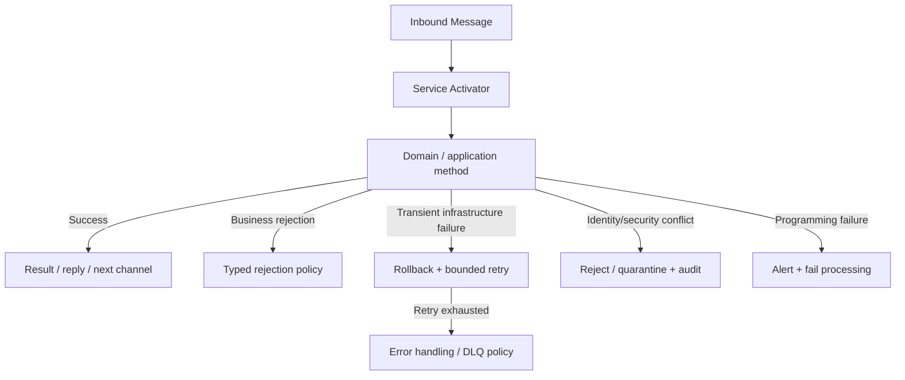
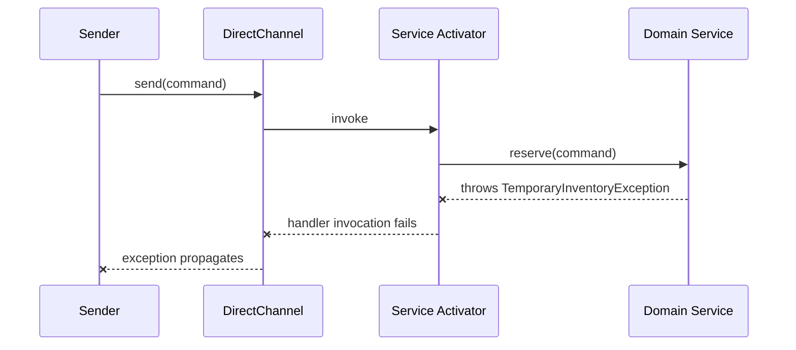
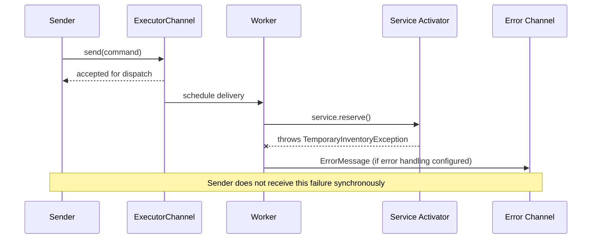
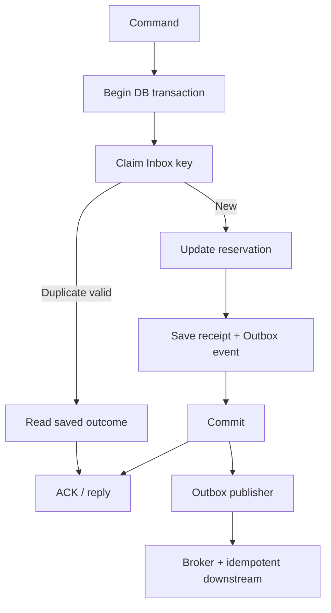

# Xử lý exception từ service method

## 1. Bài toán: một service method ném exception trong luồng message

Một hệ thống nhận yêu cầu giữ hàng trước khi xác nhận đơn. Message được gửi vào Spring Integration, Service Activator gọi `InventoryReservationService.reserve(...)`, và method có thể trả kết quả hoặc ném exception:

```text
ReservationRequested(tenant-a, order-105, SKU-A, qty=2)
    -> Service Activator
    -> InventoryReservationService.reserve(...)
       |
       +-- giữ hàng thành công       -> ReservationReceipt
       +-- thiếu hàng               -> StockUnavailableException
       +-- eventId đã dùng sai nội dung -> ReservationConflictException
       +-- database tạm mất kết nối -> TemporaryInventoryException
```

Cách ứng dụng xử lý bốn kết quả này **không thể giống nhau**. Với lỗi nghiệp vụ, caller cần câu trả lời rõ; với database tạm lỗi, có thể retry; với xung đột identity, cần quarantine/điều tra; với lỗi lập trình, không nên che giấu thành “hết hàng”.

**Service Activator** là Enterprise Integration Pattern (EIP) kết nối một message với phương thức thực thi của ứng dụng. Khi phương thức ném exception, exception không tự động biến thành một message nghiệp vụ hợp lệ. Nó được xử lý thế nào còn tùy loại channel, endpoint, gateway, transaction và adapter.

Trong chương **Service activator** của module **SPRING_INTEGRATION_PATTERN**, chúng ta học xây dựng các luồng Enterprise Integration Patterns với Spring Integration ít phụ thuộc và dễ mở rộng, kết hợp Router, Filter, Transformer, Splitter, Aggregator, Gateway, retry, error channel và correlation, đồng thời thực hành kiểm thử và quan sát nhiều nhánh xử lý.



**Trọng tâm:** Giữ rõ ranh giới giữa **exception của service**, **cách Spring Messaging vận chuyển exception**, và **quyết định nghiệp vụ đối với failure**. Không coi mọi exception là lỗi input, cũng không giả định mọi lỗi tự được gửi đến global `errorChannel`.

## 2. Service Activator làm gì, và không làm gì?

Trong Spring Integration, một Service Activator có thể được đăng ký bằng `@ServiceActivator` hoặc Java DSL `.handle(...)`. Nó lấy payload/headers từ message, gọi Java method, rồi có thể tạo reply message nếu method trả một kết quả.

| Thành phần | Trách nhiệm |
| --- | --- |
| **Inbound adapter** | Nhận HTTP/broker/JMS/file và quản lý transport |
| **Message converter** | Deserialize thành Java payload có kiểu |
| **Filter/Router** | Chọn message được chấp nhận và đích xử lý |
| **Service Activator** | Gọi logic ứng dụng từ message |
| **Domain/Application service** | Kiểm tra business invariants, thực thi use case, transaction |
| **Error handler** | Phân loại, quan sát, retry hoặc ghi nhận failure |
| **MessageChannel** | Quy định cách dispatch message và thread boundary |
| **Gateway** | Cung cấp API request–reply cho caller |
| **Idempotent Receiver** | Ngăn side effect lặp khi delivery được thử lại |

**Service Activator không tự tạo transaction hoặc exactly-once**. Nếu service ném exception sau khi gửi email hay gọi API bên ngoài, việc Java stack unwind không thu hồi được side effect đó. Muốn rollback database, cần transaction boundary đúng; muốn retry an toàn, cần idempotency.

### 2.1. Hai hình thức kết quả

Một Service Activator có thể có kiểu request–reply:

```java
ReservationReceipt reserve(ReservationCommand command);
```

hoặc one-way:

```java
void onReservedEvent(ReservationEvent event);
```

Với kiểu request–reply, caller có thể mong đợi `ReservationReceipt` **hoặc một kết quả lỗi có hợp đồng**. Với `void`/`null`, không được mặc định framework sẽ có reply cho một Gateway đang chờ. Khi method ném exception, cách quan sát và đưa exception đến caller khác nhau giữa đường đồng bộ và bất đồng bộ.

### 2.2. Exception không đồng nghĩa ErrorMessage

```text
service method throws exception
            |
            v
endpoint invokes method and handles throwable
            |
            +-- synchronous path: may propagate exception to sender/Gateway
            |
            +-- async/poller path: can publish an ErrorMessage
            |   when an error-handling strategy is configured
            |
            +-- application catches typed business error
                and returns a normal typed rejection result
```

`ErrorMessage` là loại Spring Messaging message có payload là `Throwable`. Nó không tự sinh trong mọi trường hợp. Đặc biệt ở `DirectChannel`, gửi message thường diễn ra trên cùng call stack; lỗi có thể lan trực tiếp về nơi gọi `send()`, thay vì đi qua một error channel như người học hay mặc định.

## 3. Mô hình ReservationCommand, kết quả và exception

Một ví dụ Java 17 dùng record để tập trung vào hành vi xử lý lỗi.

### 3.1. Payload có stable identity

```java
record ReservationCommand(
        String tenantId,
        String eventId,
        String orderId,
        String sku,
        int quantity) {

    ReservationCommand {
        if (tenantId == null || tenantId.isBlank()
                || eventId == null || eventId.isBlank()
                || orderId == null || orderId.isBlank()
                || sku == null || sku.isBlank()
                || quantity <= 0) {
            throw new IllegalArgumentException(
                    "INVALID_RESERVATION_COMMAND");
        }
    }
}

record ReservationReceipt(
        String tenantId,
        String eventId,
        String reservationId,
        int reservedQuantity) {}
```

`eventId` là định danh **logical event/operation** được giữ ổn định qua retry, không phải ID message envelope do Spring sinh. `tenantId` phải được đối chiếu với authenticated identity tại ingress: constructor kiểm tra không rỗng **không phải authorization**.

### 3.2. Những exception có ngữ nghĩa khác nhau

```java
final class StockUnavailableException
        extends RuntimeException {
    StockUnavailableException() {
        super("STOCK_UNAVAILABLE");
    }
}

final class ReservationConflictException
        extends RuntimeException {
    ReservationConflictException() {
        super("RESERVATION_IDENTITY_CONFLICT");
    }
}

final class TemporaryInventoryException
        extends RuntimeException {
    TemporaryInventoryException(Throwable cause) {
        super("INVENTORY_TEMPORARILY_UNAVAILABLE", cause);
    }
}

final class InvalidReservationException
        extends RuntimeException {
    InvalidReservationException(String code) {
        super(code);
    }
}
```

**Không cần đặt thông tin nhạy cảm vào exception message.** Tenant, customer ID, số tài khoản và raw payload không nên bị tự động in trong exception stack hay đẩy ra công khai. Nếu cần điều tra, dùng tracking ID và secure audit store.

### 3.3. Phân loại lỗi để có quyết định đúng

| Exception hoặc tình huống | Loại | Quyết định điển hình |
| --- | --- | --- |
| `StockUnavailableException` | Business rejection | Trả `OUT_OF_STOCK`, không hot-retry vô hạn |
| `InvalidReservationException` | Contract/validation error | Trả reject hoặc quarantine |
| `ReservationConflictException` | Same key, different payload | Reject/quarantine, không coi duplicate hợp lệ |
| `TemporaryInventoryException` | Transient dependency | Rollback + bounded retry/backoff |
| `TransientDataAccessException` | Transient DB | Retry transaction nếu chính sách cho phép |
| `SecurityException` | Unauthorized | Deny + security audit |
| Unexpected `NullPointerException` | Programming defect | Alert, fail processing, không gắn nhãn lỗi user |
| Gateway timeout | Liveness/reply deadline | Không kết luận business operation đã rollback |
| Broker ACK lost | Delivery uncertainty | Redelivery + idempotent receiver |

Một quy tắc nghiệp vụ “hết hàng” có thể thay đổi theo thời gian, nhưng với **yêu cầu đặt hàng hiện tại** thường là quyết định từ chối theo snapshot/contract. Nếu nghiệp vụ cho phép chờ restock, phải mô hình hóa `BACKORDER/PENDING` và SLA riêng, không đơn giản retry nóng mỗi vài mili-giây.

## 4. Service method thuộc tầng nghiệp vụ; adapter chỉ gọi và dịch kết quả

Định nghĩa một port tách biệt với Spring Messaging:

```java
interface InventoryReservationService {
    ReservationReceipt reserve(ReservationCommand command);
}
```

Một implementation thực có thể:
1. Kiểm tra ownership/tenant và quyền đặt hàng.
2. Atomic claim idempotency key `(consumer, tenantId, eventId)`.
3. Đối chiếu payload của duplicate.
4. Kiểm tra tồn kho hiện hành theo transaction/locking phù hợp.
5. Ghi reservation và outbox cùng transaction.
6. Trả receipt lần đầu hoặc replay outcome của duplicate.
7. Ném typed exception nếu business rule hoặc hạ tầng thất bại.

Không cần đưa `Message<?>`, `replyChannel`, `errorChannel` hoặc đối tượng Kafka/Rabbit vào domain port. Tầng integration chịu trách nhiệm chuyển message thành command và diễn giải exception thành **transport/application outcome**.

### 4.1. Annotation-based Service Activator

```java
import org.springframework.integration.annotation.ServiceActivator;
import org.springframework.stereotype.Component;

@Component
final class ReservationEndpoint {
    private final InventoryReservationService service;

    ReservationEndpoint(InventoryReservationService service) {
        this.service = service;
    }

    @ServiceActivator(inputChannel = "reservations.requests")
    public ReservationReceipt handle(ReservationCommand command) {
        // Exception của service không bị bắt chung tại đây.
        return service.reserve(command);
    }
}
```

Ở flow này, method `handle` trả kết quả bình thường nếu thành công. Nếu `service.reserve` ném exception, exception có thể được framework bọc trong `MessageHandlingException` hay exception khác tùy endpoint/call path. **Đừng viết test phụ thuộc tuyệt đối vào đúng một wrapper exception type** khi mục tiêu là kiểm tra nguyên nhân nghiệp vụ.

### 4.2. Cấu hình input channel cho đường đồng bộ

```java
import org.springframework.context.annotation.Bean;
import org.springframework.context.annotation.Configuration;
import org.springframework.integration.channel.DirectChannel;
import org.springframework.integration.config.EnableIntegration;
import org.springframework.messaging.MessageChannel;

@Configuration
@EnableIntegration
class ReservationChannels {
    @Bean("reservations.requests")
    MessageChannel requests() {
        return new DirectChannel();
    }
}
```

Để chạy ví dụ, ứng dụng cần component scan hoặc đăng ký `ReservationEndpoint`, đồng thời cung cấp bean hiện thực của `InventoryReservationService`. `DirectChannel` gọi subscriber trên thread sender trong điều kiện dispatch thông thường, do đó exception synchronous thường lan ngược tới sender.

### 4.3. Java DSL thay thế

```java
import org.springframework.context.annotation.Bean;
import org.springframework.context.annotation.Configuration;
import org.springframework.integration.dsl.IntegrationFlow;

@Configuration
class ReservationDslFlow {

    @Bean
    IntegrationFlow reservationServiceFlow(
            InventoryReservationService service) {
        return IntegrationFlow.from("reservations.requests")
                .handle(ReservationCommand.class,
                        (command, headers) ->
                                service.reserve(command))
                .get();
    }
}
```

**Đây là topology thay thế**, không đăng ký đồng thời `ReservationEndpoint` ở mục 4.1 và `ReservationDslFlow` vào cùng một `DirectChannel`. Một `DirectChannel` thường giao mỗi message cho **một** subscriber theo dispatch strategy; hai endpoints cạnh tranh có thể tạo hành vi không dự kiến. Chọn một cách wiring cho một bài test/ứng dụng.

## 5. Exception trên DirectChannel: caller quan sát điều gì?

Với flow đồng bộ:



Code caller minh họa:

```java
import org.springframework.messaging.MessageChannel;
import org.springframework.messaging.support.MessageBuilder;

void sendReservation(
        MessageChannel requests,
        ReservationCommand command) {
    requests.send(MessageBuilder
            .withPayload(command)
            .build());
}
```

Nếu service ném lỗi, `send(...)` có thể ném một messaging exception mang cause, thay vì trả `false`. Một lời gọi `send()` trả `true` chỉ nói message đã được chấp nhận để dispatch theo semantics của channel; **không phải một bằng chứng giao dịch DB đã commit ở mọi kiểu channel**.

### 5.1. Đừng nhầm error channel với catch của caller

Với `DirectChannel` trực tiếp, exception có thể đi theo call stack của sender. Việc tạo một bean tên `errorChannel` **không bảo đảm** mọi exception synchronous bị chuyển thành ErrorMessage. Muốn chuyển lỗi thành outcome trên đường request–reply, có thể dùng typed adapter boundary, Gateway error handling theo contract, hoặc advice cụ thể.

### 5.2. Service method trả null thì sao?

Nếu một request–reply handler trả `null`, đường reply có thể không có message để trả cho Gateway đang chờ. `null` không tương đương “xử lý thất bại có cấu trúc”. Một handler one-way được thiết kế trả `void` là hợp lý; nhưng nếu caller cần kết quả, hãy trả `ReservationReceipt` hay `ReservationRejected` thay vì silently drop.

### 5.3. Exception cause chain

Exception từ phương thức service có thể được bọc bởi Spring Integration/Messaging; việc unwrap cause chain hữu ích cho logs và classifier nhưng phải giới hạn, tránh vòng lặp và không phá thông tin stack trace. Một `MessagingException` có thể tham chiếu tới `failedMessage` (chứa payload/headers nhạy cảm). **Không log toàn bộ `failedMessage`** trong môi trường công khai.

## 6. Gateway đồng bộ: exception, rejected reply và timeout

Một Gateway có thể đưa một Java method vào luồng message:

```java
import org.springframework.integration.annotation.Gateway;
import org.springframework.integration.annotation.MessagingGateway;

@MessagingGateway
interface ReservationGateway {
    @Gateway(
            requestChannel = "reservations.requests",
            replyTimeout = 5_000)
    ReservationReceipt reserve(ReservationCommand command);
}
```

Để tạo Gateway proxy, ứng dụng phải bật component scanning cho interface, ví dụ `@IntegrationComponentScan` hoặc cấu hình tương đương trong context có `@EnableIntegration`. Với một `DirectChannel` + Service Activator trả receipt, reply routing được framework/Gateway quản lý theo lời gọi.

**Ba tình huống không được trộn:**

| Trạng thái | Caller quan sát | Ý nghĩa |
| --- | --- | --- |
| Handler trả `ReservationReceipt` | Reply thành công | Có kết quả theo contract |
| Handler ném exception | Lỗi có thể lan qua Gateway, có wrapper | Không phải một receipt |
| Handler không trả reply trước deadline | Timeout/không có reply theo cấu hình | Không chắc backend đã dừng |

Gateway timeout **không rollback mặc nhiên** những side effect phía sau nếu service/remote worker vẫn đang chạy. Nếu caller retry, dùng stable `eventId` và Idempotent Receiver để ngăn tạo hai reservations.

### 6.1. Khi nào nên trả typed business rejection?

Với API cho người dùng, “hết hàng” thường là **kết quả nghiệp vụ dự kiến**. Có thể mô hình hóa outcome:

```java
sealed interface ReservationOutcome
        permits Reserved, Rejected {}

record Reserved(ReservationReceipt receipt)
        implements ReservationOutcome {}

record Rejected(
        String tenantId,
        String eventId,
        String reasonCode)
        implements ReservationOutcome {}
```

Một integration adapter có thể bắt **riêng typed business exception** rồi trả `Rejected`. Lỗi database/network/bug phải đi qua failure path, **không** chuyển tất cả thành `Rejected("UNKNOWN")` rồi ACK thành công.

### 6.2. Gateway return type phải thống nhất

Nếu Gateway khai báo trả `ReservationReceipt` thì không thể giả định một nhánh tự trả `Rejected` mà caller vẫn nhận được đúng kiểu. Khi cần cả hai, định nghĩa Gateway trả `ReservationOutcome` (hoặc một DTO response có trạng thái) và cấu hình reply path cho cả accepted/rejected, thay vì trả một kiểu khác bất ngờ.

### 6.3. Một helper boundary dịch business exception thành outcome

```java
final class ReservationOutcomeAdapter {
    private final InventoryReservationService service;

    ReservationOutcomeAdapter(InventoryReservationService service) {
        this.service = service;
    }

    ReservationOutcome reserve(ReservationCommand command) {
        try {
            return new Reserved(service.reserve(command));
        } catch (StockUnavailableException expected) {
            return new Rejected(
                    command.tenantId(),
                    command.eventId(),
                    "STOCK_UNAVAILABLE");
        } catch (InvalidReservationException expected) {
            return new Rejected(
                    command.tenantId(),
                    command.eventId(),
                    "INVALID_RESERVATION");
        }
        // Transient DB, security và programming errors
        // vẫn propagate ra failure path.
    }
}
```

Đây là **một lựa chọn khác cho endpoint** nếu Gateway contract là `ReservationOutcome`. Không sử dụng helper này rồi vẫn khai báo Gateway trả `ReservationReceipt`. Để tránh giữ business rejection ở trạng thái “chưa xử lý” qua redelivery, cần định nghĩa liệu outcome từ chối là terminal và có lưu kết quả theo event ID hay không.

## 7. Phân loại exception bằng type, không theo chuỗi message

Một số hệ thống viết:

```java
// PHẢN MẪU:
if (exception.getMessage().contains("timeout")) {
    retry();
}
```

Cách này dễ sai khi exception message bị đổi ngôn ngữ, provider/version thay đổi, exception được bọc hoặc message chứa dữ liệu của user. Nên dùng **exception type và error code ổn định**.

### 7.1. Failure dispositions

```java
enum FailureDisposition {
    BUSINESS_REJECT,
    RETRY_TRANSIENT,
    SECURITY_DENY,
    QUARANTINE_CONFLICT,
    FAIL_FAST
}

record FailureDecision(
        FailureDisposition disposition,
        String reasonCode) {}
```

Một decision chỉ nói **nên xử lý loại lỗi nào**. Nó không tự ACK broker, rollback transaction hay ghi DLQ. Những hành động đó thuộc về error handler/adapter được cấu hình.

### 7.2. Classifier tách khỏi transport

```java
import org.springframework.dao.TransientDataAccessException;

final class ReservationFailureClassifier {

    FailureDecision classify(Throwable thrown) {
        Throwable current = thrown;

        for (int depth = 0; depth < 8 && current != null;
                depth++, current = current.getCause()) {
            if (current instanceof StockUnavailableException) {
                return new FailureDecision(
                        FailureDisposition.BUSINESS_REJECT,
                        "STOCK_UNAVAILABLE");
            }
            if (current instanceof InvalidReservationException) {
                return new FailureDecision(
                        FailureDisposition.BUSINESS_REJECT,
                        "INVALID_RESERVATION");
            }
            if (current instanceof ReservationConflictException) {
                return new FailureDecision(
                        FailureDisposition.QUARANTINE_CONFLICT,
                        "RESERVATION_IDENTITY_CONFLICT");
            }
            if (current instanceof SecurityException) {
                return new FailureDecision(
                        FailureDisposition.SECURITY_DENY,
                        "NOT_AUTHORIZED");
            }
            if (current instanceof TemporaryInventoryException
                    || current instanceof TransientDataAccessException) {
                return new FailureDecision(
                        FailureDisposition.RETRY_TRANSIENT,
                        "TEMPORARY_INFRASTRUCTURE_FAILURE");
            }
        }
        return new FailureDecision(
                FailureDisposition.FAIL_FAST,
                "UNCLASSIFIED_PROCESSING_FAILURE");
    }
}
```

**Giới hạn của ví dụ:** Một class ngoại lệ tình cờ có cause chứa `StockUnavailableException` nhưng bối cảnh bên ngoài là lỗi logic khác có thể cần ưu tiên exception ở tầng outer. Nếu production dùng nhiều wrappers đặc thù (`CompletionException`, `MessagingException`, HTTP exception), điều chỉnh classifier có test để tránh một cause vô tình thay đổi chính sách. Không tự coi tất cả `IllegalArgumentException` là dữ liệu người dùng sai; chúng cũng có thể là bug.

## 8. Async channel: exception không còn ở call stack của sender

Với `ExecutorChannel`, service có thể chạy trên một worker thread khác. Người gửi trả về sau khi message được chấp nhận để dispatch, **trước khi service method có kết quả**.



**Điều kiện quan trọng:** lỗi worker có thể được gửi qua `MessagePublishingErrorHandler` tới error channel theo cách channel/endpoint được cấu hình. Một lỗi executor từ chối task ngay lúc gửi vẫn có thể phát sinh trên thread sender. Không nên mặc định mọi exception bất đồng bộ luôn tới một global `errorChannel`.

### 8.1. Cấu hình ExecutorChannel và error channel riêng

```java
import org.springframework.beans.factory.annotation.Qualifier;
import org.springframework.context.annotation.Bean;
import org.springframework.context.annotation.Configuration;
import org.springframework.integration.channel.DirectChannel;
import org.springframework.integration.channel.ExecutorChannel;
import org.springframework.integration.config.EnableIntegration;
import org.springframework.messaging.MessageChannel;
import org.springframework.scheduling.concurrent.ThreadPoolTaskExecutor;

@Configuration
@EnableIntegration
class AsyncReservationChannels {

    @Bean("reservationTaskExecutor")
    ThreadPoolTaskExecutor reservationTaskExecutor() {
        var executor = new ThreadPoolTaskExecutor();
        executor.setCorePoolSize(2);
        executor.setMaxPoolSize(4);
        executor.setQueueCapacity(50);
        executor.setThreadNamePrefix("reservation-");
        return executor;
    }

    @Bean("reservations.async.work")
    MessageChannel asyncWork(
            @Qualifier("reservationTaskExecutor")
            ThreadPoolTaskExecutor executor) {
        return new ExecutorChannel(executor);
    }

    @Bean("reservations.async.errors")
    MessageChannel asyncErrors() {
        return new DirectChannel();
    }
}
```

Đây là **topology riêng** so với channel đồng bộ `reservations.requests`. Để hoàn chỉnh cần đăng ký một handler trên `reservations.async.work` và một handler nhận `ErrorMessage` ở `reservations.async.errors`.

Một publisher nội bộ có thể gắn error channel:

```java
import org.springframework.messaging.MessageChannel;
import org.springframework.messaging.MessageHeaders;
import org.springframework.messaging.support.MessageBuilder;

void publishAsync(
        MessageChannel asyncWork,
        MessageChannel asyncErrors,
        ReservationCommand command) {

    asyncWork.send(MessageBuilder.withPayload(command)
            .setHeader(MessageHeaders.ERROR_CHANNEL, asyncErrors)
            .build());
}
```

Với mỗi endpoint/adapter, cần integration test chứng minh error handler **thực sự nhận ErrorMessage** và kiểm tra khi không có subscriber/error channel. Không cho caller chưa đáng tin tùy ý chọn error destination; adapter phải cấp/allowlist channel nội bộ.

### 8.2. Service Activator một chiều

```java
import org.springframework.integration.annotation.ServiceActivator;
import org.springframework.stereotype.Component;

@Component
final class AsyncReservationEndpoint {
    private final InventoryReservationService service;

    AsyncReservationEndpoint(InventoryReservationService service) {
        this.service = service;
    }

    @ServiceActivator(inputChannel = "reservations.async.work")
    public void handle(ReservationCommand command) {
        service.reserve(command);
    }
}
```

Phương thức `void` phù hợp khi caller không đợi receipt qua cùng messaging invocation. Nếu workflow cần result, hãy ghi outcome có thể tra cứu, phát event qua outbox hoặc dùng request–reply flow riêng. `send()` thành công **không chứng minh database commit** trong một async handler.

### 8.3. Quan sát ErrorMessage an toàn

```java
import org.springframework.integration.annotation.ServiceActivator;
import org.springframework.messaging.MessagingException;
import org.springframework.messaging.support.ErrorMessage;
import org.springframework.stereotype.Component;

interface ReservationFailureReporter {
    void report(String reasonCode, String throwableType);
}

@Component
final class ReservationErrorObserver {
    private final ReservationFailureClassifier classifier =
            new ReservationFailureClassifier();
    private final ReservationFailureReporter reporter;

    ReservationErrorObserver(ReservationFailureReporter reporter) {
        this.reporter = reporter;
    }

    @ServiceActivator(inputChannel = "reservations.async.errors")
    public void observe(ErrorMessage error) {
        Throwable throwable = error.getPayload();
        FailureDecision decision = classifier.classify(throwable);
        reporter.report(
                decision.reasonCode(),
                throwable.getClass().getSimpleName());

        if (throwable instanceof MessagingException messaging) {
            // Có thể có failedMessage chứa raw payload/headers.
            // Đừng log hoặc gửi nguyên đối tượng này.
            var failedMessage = messaging.getFailedMessage();
        }
    }
}
```

Observer chỉ đo/ghi nhận lỗi, **không** tự thực hiện rollback, ACK/NACK, retry hoặc lưu DLQ. Nếu chính error observer hỏng, failure có thể mất nếu channel lỗi chỉ là in-memory. Cần chính sách durability và recovery riêng cho luồng trọng yếu.

### 8.4. Global errorChannel và dispatch

Nếu global error channel có nhiều consumers, không giả định `DirectChannel` sẽ broadcast lỗi tới tất cả: thông thường nó chọn **một subscriber**. Khi cần nhiều observers, cân nhắc `PublishSubscribeChannel` hoặc phát một error event bền vững cho nhiều consumers độc lập.

## 9. Poller và QueueChannel: không tự requeue sau exception

Với `QueueChannel` và poller, người gửi có thể đã rời call stack trước khi Service Activator chạy.

```text
Producer -> QueueChannel -> Poller -> Service Activator
                                      -> method throws
                                 -> configured error handler
                                 -> recovery / retry policy
```

Những câu hỏi phải trả lời:
- Poller dùng transaction manager/advice nào?
- Message được coi là đã lấy khỏi source vào thời điểm nào?
- Exception có khiến message được đưa lại source không?
- Nếu source là broker, ai quyết định ACK/NACK/DLQ?
- Nếu QueueChannel in-memory, message có sống qua restart không?
- Error channel có durable hay chỉ nằm trong JVM?

Không suy ra “method throw thì QueueChannel tự trả message về hàng đợi”. Điều đó phụ thuộc source, adapter, poller và transaction configuration.

### 9.1. Database transaction khác broker transaction

Transaction manager của JDBC không tự bao trùm ACK Kafka/Rabbit/JMS. Một cách giảm rủi ro là dùng **Inbox + business update + Outbox cùng DB transaction** và Idempotent Receiver; nếu ACK thất bại sau commit, broker redelivers nhưng domain side effect không chạy lần hai.

## 10. Retry phải được giới hạn theo exception type

Retry có ích khi DB lock timeout, connection tạm mất hoặc dependency transient. Nó không nên hot-retry tất cả lỗi:

```java
// PHẢN MẪU: mọi lỗi đều retry vô hạn.
try {
    service.reserve(command);
} catch (RuntimeException ignored) {
    retryForever(command);
}
```

Với thiếu hàng, identity conflict, tenant spoofing hoặc lỗi code, chạy lại cùng input không sửa được nguyên nhân và có thể tạo retry storm.

### 10.1. RequestHandlerRetryAdvice với Spring Retry

```java
import java.util.HashMap;
import java.util.Map;
import org.springframework.context.annotation.Bean;
import org.springframework.context.annotation.Configuration;
import org.springframework.dao.TransientDataAccessException;
import org.springframework.integration.handler.advice.RequestHandlerRetryAdvice;
import org.springframework.retry.RetryPolicy;
import org.springframework.retry.backoff.ExponentialBackOffPolicy;
import org.springframework.retry.policy.SimpleRetryPolicy;
import org.springframework.retry.support.RetryTemplate;

@Configuration
class ReservationRetryConfiguration {

    @Bean
    RequestHandlerRetryAdvice reservationRetryAdvice() {
        Map<Class<? extends Throwable>, Boolean> retryable =
                new HashMap<>();
        retryable.put(TemporaryInventoryException.class, true);
        retryable.put(TransientDataAccessException.class, true);

        RetryPolicy policy =
                new SimpleRetryPolicy(3, retryable, true);

        var backoff = new ExponentialBackOffPolicy();
        backoff.setInitialInterval(100L);
        backoff.setMultiplier(2.0);
        backoff.setMaxInterval(1_000L);

        var template = new RetryTemplate();
        template.setRetryPolicy(policy);
        template.setBackOffPolicy(backoff);

        var advice = new RequestHandlerRetryAdvice();
        advice.setRetryTemplate(template);
        return advice;
    }
}
```

`SimpleRetryPolicy` minh họa tra xét nested causes của framework exception, giới hạn ba attempts. Đây là **policy ví dụ**; production cần max total attempts, deadline, jitter/circuit breaker nếu cần và dependency Spring Retry phù hợp với phiên bản Spring Integration.

### 10.2. Gắn advice vào Service Activator bằng Java DSL

```java
import org.springframework.context.annotation.Bean;
import org.springframework.context.annotation.Configuration;
import org.springframework.integration.dsl.IntegrationFlow;
import org.springframework.integration.handler.advice.RequestHandlerRetryAdvice;

@Configuration
class ReservationRetryFlow {

    @Bean
    IntegrationFlow retryReservationHandler(
            InventoryReservationService service,
            RequestHandlerRetryAdvice reservationRetryAdvice) {

        return IntegrationFlow.from("reservations.retry.input")
                .handle(ReservationCommand.class,
                        (command, headers) ->
                                service.reserve(command),
                        endpoint ->
                                endpoint.advice(reservationRetryAdvice))
                .get();
    }
}
```

Cần đăng ký bean cho input channel `reservations.retry.input` khi sử dụng topology này. Không đồng thời đăng ký một handler khác cạnh tranh cùng channel nếu không có mục đích.

Sau khi retry exhausted, exception thường tiếp tục theo failure path của endpoint/adapter. Advice **không tự tạo durable DLQ**. Recovery callback (nếu dùng) phải đảm bảo terminal disposition được ghi nhận đáng tin trước khi thông báo “đã xử lý”.

### 10.3. Retry phải tạo transaction attempt đúng cách

Một lỗi thường gặp là mở một DB transaction **bên ngoài toàn bộ khối retry** rồi chạy lại query trong transaction đã aborted/rollback-only. Thiết kế thường mong muốn:

```text
Retry advice (outer)
  attempt 1 -> transaction A -> rollback
  backoff
  attempt 2 -> transaction B -> commit
```

Nếu `@Transactional` service được gọi qua Spring proxy bên trong mỗi attempt, transaction có thể được mở đúng cách theo propagation. Nếu retry diễn ra **bên trong** một transaction outer hoặc self-invocation bypass proxy, hành vi khác. Cần test với DB thật và transaction manager thật, không chỉ mock method.

### 10.4. Nhiều tầng retry có thể nhân số lần gọi

Gateway client retry 3 lần, advice retry 3 lần và broker redeliver 3 lần có thể tạo rất nhiều attempts. Idempotency chặn side effect lặp nhưng không giảm hoàn toàn tải DB/CPU. Cần retry budgets, backoff, deadline, metrics theo attempt và quarantine khi không thể hồi phục.

## 11. Exception và rollback không thu hồi external side effect

Một service có thể thực hiện:

```text
BEGIN DB transaction
  update inventory
  send email / payment request / broker event
  throw exception
ROLLBACK DB
```

Database rollback **không tự hủy** email, payment hoặc broker event đã gửi. Khi message được redeliver, side effect bên ngoài có thể lặp.

### 11.1. Inbox/Outbox và idempotent receiver



Khi Inbox claim, domain update, receipt và outbox được ghi cùng DB transaction, chúng cùng commit hoặc cùng rollback. Broker ACK và external API **không** nằm trong transaction đó nếu không có cơ chế phối hợp riêng.

### 11.2. ACK bị mất sau commit

```text
t0: reserve() commits DB
t1: ACK bị lỗi mạng
t2: broker redelivers same eventId
t3: Inbox kiểm tra duplicate -> trả saved receipt
t4: không giữ hàng lần thứ hai
```

Idempotency key nên là `(consumerName, tenantId, eventId)`, bổ sung source đã xác thực khi event IDs chỉ unique trong source. **Same key, different content** phải được coi là conflict, không silently ACK như duplicate hợp lệ.

### 11.3. Những lỗi phải có quyết định riêng

| Kịch bản | Hướng xử lý |
| --- | --- |
| DB chưa commit, exception | Rollback, bounded retry nếu transient |
| DB commit, broker ACK fail | Redelivery + idempotent replay |
| External payment status unknown | Query/reconcile theo stable payment idempotency key |
| ErrorMessage chỉ nằm trong memory | Không giả định có durability |
| Duplicate đã committed | Replay outcome, không chạy lại side effect |
| Trùng event ID nhưng SKU/quantity khác | Conflict/quarantine |
| Service programmer bug | Alert và failure path; không giả thành terminal input reject |

## 12. Broker ACK/NACK, ErrorMessage và DLQ khác nhau

Khi inbound adapter đến từ Kafka, RabbitMQ hoặc JMS, exception của Service Activator **có thể** ảnh hưởng ACK/NACK/requeue theo listener container, error handler, retry và transaction configuration. Annotation `@ServiceActivator` tự nó không định nghĩa chính sách ACK của broker.

| Điểm lỗi | Điều có thể xảy ra | Điều cần bảo đảm |
| --- | --- | --- |
| Trước DB commit | Business transaction rollback | Event có thể thử lại nếu transient |
| DB commit trước ACK | Broker redelivery | Side effect vẫn chỉ thực hiện một lần |
| ACK trước commit | Crash làm mất event | Không ACK sớm khi chưa đạt tiêu chí xử lý |
| ErrorMessage đi vào DirectChannel in-memory | App crash có thể mất dấu | Durable failure record nếu cần |
| Quarantine/DLQ bền vững | Có thể replay thủ công | Retention, quyền truy cập, idempotency |
| Retry exhausted | Hết budget | Terminal/recovery disposition rõ |

**Error channel không phải DLQ**: một `ErrorMessage` trong memory chưa chắc đã lưu raw broker message bền vững. Chỉ ACK terminal khi failure disposition đã được ghi nhận theo hợp đồng xử lý; không dùng `catch(Exception ignored) { ack(); }`.

### 12.1. Phân biệt retryable và non-retryable

- `StockUnavailableException`: trả business outcome theo contract; không hot-retry vô hạn.
- `InvalidReservationException`: reject/quarantine input sai.
- `ReservationConflictException`: conflict, điều tra nguồn/replay.
- `TemporaryInventoryException`: retry giới hạn với backoff.
- `SecurityException`: deny + audit, không retry như DB timeout.
- Unexpected NPE: alert/code fix, không trả success.
- Broker adapter error: xem exception từ đâu (conversion, scheduling, handler, ACK), không gộp hết thành domain failure.

## 13. Error contract cho caller và hệ thống vận hành

Caller cần biết đã giữ hàng, bị từ chối, còn chờ, hay không thể xác định kết quả. Ops cần biết error category, attempt, correlation và nơi replay.

```java
enum ReservationStatus {
    RESERVED, REJECTED, PENDING, UNKNOWN
}

record ReservationResult(
        String tenantId,
        String eventId,
        ReservationStatus status,
        String reservationId,
        String reasonCode) {}
```

| Result | Ý nghĩa |
| --- | --- |
| `RESERVED` | Receipt/DB commit đã xác nhận theo contract |
| `REJECTED` | Business decision terminal |
| `PENDING` | Async work chưa có kết quả |
| `UNKNOWN` | Timeout hoặc trạng thái chưa thể xác minh |

**Không tự đổi một Gateway timeout thành business FAILURE**: service bên kia có thể đã commit. Caller nên giữ stable eventId và có API tra trạng thái/reconciliation để retry an toàn.

### 13.1. Ví dụ mapping lỗi ra HTTP/API

| Case | HTTP response gợi ý | Messaging outcome |
| --- | --- | --- |
| Thành công | 200/201 theo use case | `ReservationReceipt` |
| Input invalid | 400/422 | Rejected với reason code |
| Hết hàng | 409 hoặc business code | `STOCK_UNAVAILABLE` |
| Idempotency conflict | 409 | Conflict/quarantine |
| Service tạm lỗi | 503/504 hoặc PENDING | Recoverable failure |
| Unauthorized | 401/403 theo auth state | Deny |
| Không rõ sau timeout | 202/PENDING hoặc status query | Correlation/reconciliation |

Những mã HTTP là **lựa chọn giao thức gợi ý**, Spring Integration không tự suy ra chúng từ các Java exception types trong bài. Không đưa stack trace/failedMessage nguyên vẹn vào public response.

## 14. Observability và bảo vệ dữ liệu lỗi

Các trường hữu ích:
- Trusted event ID, stage, source, correlation/trace context;
- Error category/reason code ổn định;
- Attempt count, retry budget/exhaustion;
- Transaction commit/rollback nếu trạng thái được xác định;
- Latency và durable DLQ/quarantine reference;
- Notification của lần phát lại hoặc trùng.

### 14.1. Gợi ý metrics

| Metric | Ý nghĩa |
| --- | --- |
| `service_activator.invocations.total` | Tổng handler invocations |
| `service_activator.success.total` | Thực thi thành công |
| `service_activator.business_reject.total` | Business rejections |
| `service_activator.transient_failure.total` | DB/network failures |
| `service_activator.security_deny.total` | Security failures |
| `service_activator.retry.attempts` | Attempts đã retry |
| `service_activator.retry.exhausted.total` | Vượt retry budget |
| `service_activator.error_publish.failed.total` | Gửi error event lỗi |
| `service_activator.processing.duration` | P50/P95/P99 |
| `service_activator.transaction.rollback.total` | DB rollbacks |
| `service_activator.dlq.backlog` | Items cần phục hồi |
| `service_activator.duplicate.suppressed.total` | Redelivery không gây side effect |

Đây là **tên ứng dụng tự instrument**, không phải danh sách Spring Integration auto-expose ở mọi phiên bản. Metric labels nên là consumer, disposition, exception family và stage trong tập hữu hạn; không dùng eventId, tenantId hay raw SKU làm labels cardinality cao.

### 14.2. Không log nguyên Throwable có failedMessage

`MessagingException.getFailedMessage()` có thể mang payload/headers nhạy cảm. Không in toàn bộ Throwable/Message vào một log công khai. Tạo sanitized error summary với tracking ID, reason code và trace reference; raw payload chỉ lưu vào secure quarantine store nếu cần, kèm ACL, mã hóa và retention.

## 15. Unit test: exception classification và business rejection

Một test quan trọng là **lỗi nghiệp vụ không bị retry như hạ tầng**, còn `TemporaryInventoryException` không bị trả thành kết quả `Rejected` rồi ACK mất message. Các test dưới đây dùng JUnit 5, không cần broker hoặc database.

### 15.1. Classifier theo typed exception

```java
import org.junit.jupiter.api.Test;
import org.springframework.messaging.MessageHandlingException;
import org.springframework.messaging.support.MessageBuilder;

import static org.junit.jupiter.api.Assertions.*;

class ReservationFailureClassifierTest {

    private final ReservationFailureClassifier classifier =
            new ReservationFailureClassifier();

    @Test
    void businessRejectionIsNotTransient() {
        var result = classifier.classify(
                new StockUnavailableException());

        assertEquals(FailureDisposition.BUSINESS_REJECT,
                result.disposition());
        assertEquals("STOCK_UNAVAILABLE", result.reasonCode());
    }

    @Test
    void temporaryFailureMayBeRetried() {
        var result = classifier.classify(
                new TemporaryInventoryException(
                        new IllegalStateException("connection lost")));

        assertEquals(FailureDisposition.RETRY_TRANSIENT,
                result.disposition());
    }

    @Test
    void nestedMessagingExceptionPreservesCause() {
        var command = new ReservationCommand(
                "tenant-a", "evt-105",
                "order-105", "SKU-A", 2);

        var wrapped = new MessageHandlingException(
                MessageBuilder.withPayload(command).build(),
                new StockUnavailableException());

        var result = classifier.classify(wrapped);
        assertEquals(FailureDisposition.BUSINESS_REJECT,
                result.disposition());
    }

    @Test
    void conflictIsQuarantinedNotRetried() {
        var result = classifier.classify(
                new ReservationConflictException());

        assertEquals(FailureDisposition.QUARANTINE_CONFLICT,
                result.disposition());
    }

    @Test
    void programmingErrorIsNotSilentlyMarkedInvalid() {
        var result = classifier.classify(
                new NullPointerException("unexpected"));

        assertEquals(FailureDisposition.FAIL_FAST,
                result.disposition());
    }
}
```

Kiểm tra phân loại theo **exception type**, không so toàn bộ stack trace hoặc message string. Nếu app dùng `CompletionException`/`MessagingException` nhiều lớp, bổ sung test nested causes và chính sách ưu tiên outer/inner exception.

### 15.2. Outcome adapter không nuốt lỗi transient

```java
import org.junit.jupiter.api.Test;
import static org.junit.jupiter.api.Assertions.*;
import static org.mockito.Mockito.*;

class ReservationOutcomeAdapterTest {
    private final ReservationCommand command =
            new ReservationCommand(
                    "tenant-a", "evt-105",
                    "order-105", "SKU-A", 2);

    @Test
    void outOfStockReturnsTypedBusinessRejection() {
        var service = mock(InventoryReservationService.class);
        when(service.reserve(command))
                .thenThrow(new StockUnavailableException());

        var outcome = new ReservationOutcomeAdapter(service)
                .reserve(command);

        assertInstanceOf(Rejected.class, outcome);
        assertEquals("STOCK_UNAVAILABLE",
                ((Rejected) outcome).reasonCode());
        verify(service).reserve(command);
    }

    @Test
    void dbOutageStillPropagates() {
        var service = mock(InventoryReservationService.class);
        when(service.reserve(command))
                .thenThrow(new TemporaryInventoryException(
                        new IllegalStateException("db outage")));

        assertThrows(TemporaryInventoryException.class,
                () -> new ReservationOutcomeAdapter(service)
                        .reserve(command));
    }
}
```

Đây là test hợp đồng adapter, chưa chứng minh gateway/error channel wiring. Cần test ở tầng integration cho những điều đó.

## 16. Integration test: exception từ Service Activator qua DirectChannel

Một test `service.reserve(command)` trực tiếp không cho biết annotation `@ServiceActivator` đã được Spring xử lý hay chưa. Dùng Spring Test để đăng ký channel, endpoint và mock domain port.

### 16.1. Spring Integration context với DirectChannel

```java
import org.junit.jupiter.api.AfterEach;
import org.junit.jupiter.api.Test;
import org.springframework.beans.factory.annotation.Autowired;
import org.springframework.beans.factory.annotation.Qualifier;
import org.springframework.context.annotation.Bean;
import org.springframework.context.annotation.Configuration;
import org.springframework.messaging.MessageChannel;
import org.springframework.messaging.support.MessageBuilder;
import org.springframework.test.context.junit.jupiter.SpringJUnitConfig;

import static org.junit.jupiter.api.Assertions.*;
import static org.mockito.Mockito.*;

@SpringJUnitConfig(classes = {
        ReservationChannels.class,
        ReservationEndpoint.class,
        ReservationServiceActivatorIT.Dependencies.class
})
class ReservationServiceActivatorIT {

    @Autowired
    @Qualifier("reservations.requests")
    MessageChannel input;

    @Autowired
    InventoryReservationService service;

    private final ReservationCommand command =
            new ReservationCommand(
                    "tenant-a", "evt-105",
                    "order-105", "SKU-A", 2);

    @AfterEach
    void resetMocks() {
        reset(service);
    }

    @Test
    void happyPathCallsDomainOnce() {
        when(service.reserve(command)).thenReturn(
                new ReservationReceipt(
                        "tenant-a", "evt-105", "res-105", 2));

        // Reply-producing handler cần một reply destination.
        var replies = new org.springframework.integration.channel.QueueChannel();
        assertTrue(input.send(
                MessageBuilder.withPayload(command)
                        .setHeader(
                                org.springframework.messaging.MessageHeaders.REPLY_CHANNEL,
                                replies)
                        .build()));
        var reply = replies.receive(1_000);
        assertNotNull(reply);
        assertInstanceOf(ReservationReceipt.class, reply.getPayload());
        verify(service).reserve(command);
    }

    @Test
    void serviceExceptionPropagatesToSender() {
        when(service.reserve(command))
                .thenThrow(new StockUnavailableException());

        RuntimeException failure = assertThrows(
                RuntimeException.class,
                () -> input.send(
                        MessageBuilder.withPayload(command).build()));

        assertTrue(hasCause(
                failure, StockUnavailableException.class));
        verify(service).reserve(command);
    }

    private static boolean hasCause(
            Throwable error, Class<? extends Throwable> kind) {
        Throwable current = error;
        for (int i = 0; i < 12 && current != null; i++) {
            if (kind.isInstance(current)) {
                return true;
            }
            current = current.getCause();
        }
        return false;
    }

    @Configuration
    static class Dependencies {
        @Bean
        InventoryReservationService reservationService() {
            return mock(InventoryReservationService.class);
        }
    }
}
```

**Cách đọc test:** `DirectChannel` xử lý đồng bộ nên việc verify mock ngay sau `send()` có ý nghĩa. Vì handler trả `ReservationReceipt`, test gắn `REPLY_CHANNEL` với `QueueChannel` để result có đích nhận hợp lệ. Test cũng kiểm tra exception có cause nghiệp vụ, **không khẳng định** nó sẽ vào global error channel hay caller phải thấy chính xác một wrapper class cố định. Muốn xác minh Gateway quản lý reply thực tế, đăng ký Gateway và kiểm thử qua interface request–reply của nó.

### 16.2. Gateway test scenarios

| Service method / flow | Kết quả cần assert |
| --- | --- |
| Trả receipt thành công | Caller nhận đúng eventId/receipt |
| Ném StockUnavailableException | Caller nhận typed rejection hoặc exception đúng hợp đồng |
| Ném TemporaryInventoryException | Retry/error path được kích hoạt |
| Handler trả null | Không có receipt tự xuất hiện |
| Handler xử lý chậm hơn replyTimeout | Timeout theo cấu hình Gateway |
| Worker commit nhưng reply thất lạc | Trạng thái phải được đối soát, không giả rollback |
| Hai requests đến và replies về đảo thứ tự | Không ghép nhầm caller |
| Header replyChannel bị mất ở Transformer | Test phát hiện reply routing hỏng |

Nếu Gateway return type là `ReservationReceipt` thì không thể tự trả `Rejected` cho một nhánh mà không đổi interface/contract. Chọn một kiểu outcome chung hoặc map exception theo API boundary.

## 17. Test async error channel và transaction/retry

### 17.1. Kịch bản tích hợp cho ExecutorChannel

```text
Given:
  ExecutorChannel reservations.async.work
  ERROR_CHANNEL = reservations.async.errors
  Service method throws TemporaryInventoryException

When:
  Producer sends message
  Worker invokes service and fails

Then:
  Sender need not see domain exception synchronously
  Configured error handler receives an ErrorMessage
  Failure classifier returns RETRY_TRANSIENT
  Reporter records sanitized reasonCode
  No success event is published
```

Với xử lý bất đồng bộ, test dùng `CountDownLatch` hoặc Mockito `timeout(5000)` để chờ có giới hạn, không dùng `Thread.sleep(...)` làm bằng chứng. Nếu error observer không nhận ErrorMessage, cần kiểm tra actual endpoint error handler, header `ERROR_CHANNEL`, subscriber, executor rejection và cách Spring Integration version đó dispatch lỗi. Đừng “sửa test xanh” bằng cách bỏ qua error path.

### 17.2. Test observer đơn vị không bằng test error delivery

Có thể tạo thủ công `new ErrorMessage(new TemporaryInventoryException(...))` rồi gửi vào `reservations.async.errors` để test observer. Điều đó **chỉ** xác minh observer nhận message; nó **không chứng minh** lỗi của service ở worker thread thực sự được chuyển đến channel ấy. Test wiring riêng rất quan trọng.

### 17.3. Test với DB/transaction thật

| Kịch bản | Điều phải kiểm chứng |
| --- | --- |
| Throw trước commit | Business update và Inbox cùng rollback |
| Retry lần đầu fail, lần hai success | Hai attempts có transaction hợp lệ; cuối cùng commit một lần |
| Hai deliveries cùng eventId đồng thời | Một side effect được commit |
| ACK lost sau commit | Redelivery chỉ replay receipt |
| Same key, different payload | Conflict, không chấp nhận duplicate sai |
| Outbox insert fail | Business update rollback |
| Publish outbox thành công nhưng ACK publisher mất | Downstream vẫn idempotent |
| Domain service self-invocation với `@Transactional` | Kiểm tra thực tế proxy và transaction scope |
| Gateway timeout sau commit | Status query phản ánh commit; không khởi tạo ID mới |
| Error channel thiếu subscriber | Failure không biến mất trong giả định thành công |

Mock repository không thể chứng minh locking, transaction isolation hoặc unique constraints. Khi cần kiểm thử atomicity, dùng database tương đương production, ví dụ PostgreSQL Testcontainers với schema thật.

### 17.4. Nên assert state chứ không chỉ số lần gọi method

Retry hợp lệ có thể gọi method hai lần nhưng lần đầu rollback, lần thứ hai commit — đó **không phải** duplicate business side effect. Với test durability hãy assert:
- Trạng thái cuối DB chỉ có một reservation;
- Inbox đánh dấu một logical event;
- Outbox có event ID ổn định;
- Retry attempt/transaction rollback được quan sát;
- Không có side effect bên ngoài không thể đối soát;
- Delivery bị redeliver không làm kết quả thay đổi.

## 18. Troubleshooting: chẩn đoán lỗi từ service method

Không phải symptom nào cũng nằm ở chính service method. Cùng một exception có thể biểu hiện khác nhau nếu qua Gateway, ExecutorChannel, poller hoặc broker adapter.

| Triệu chứng | Khả năng | Hướng kiểm tra |
| --- | --- | --- |
| `send()` ném exception ngay | DirectChannel handler fail hoặc executor scheduling fail | Channel type, root cause, thread |
| `send()` thành công nhưng DB không cập nhật | Async worker fail sau dispatch | Error handler, worker logs, transaction |
| `errorChannel` không nhận ErrorMessage | Synchronous error path hoặc cấu hình error handler sai | Endpoint type, ERROR_CHANNEL header, subscribers |
| Gateway chỉ timeout khi thiếu hàng | Handler drop/null, không có rejection reply | Gateway contract và reply path |
| Service method bị gọi hai lần | Retry advice, broker redelivery, duplicate subscribers | Retry attempts, eventId, unique Inbox |
| Method được gọi một lần mà DB vẫn nhân đôi | Transaction/SQL update ngoài Idempotent Receiver | DB state và unique constraints |
| DB rollback nhưng email đã gửi | External side effect ngoài transaction | Outbox hoặc idempotency của provider |
| Retry cứ lỗi DB | Retry trong transaction aborted hoặc lỗi không transient | Transaction order, rollback-only |
| Một lỗi security bị retry | Classifier quá rộng | Typed exceptions, security denial path |
| Error observer nhận lỗi nhưng broker vẫn retry | Observer không quyết định ACK | Listener container error handler |
| Hai error observers chỉ một được gọi | DirectChannel dispatch cạnh tranh | PublishSubscribeChannel/durable event |
| Header mất khi Transformer chạy | Không giữ reply/correlation context phù hợp | Header propagation test |
| Không tìm được cause gốc | Wrapper exception nhiều lớp | Bounded cause inspection, sanitized logging |
| DLQ replay lại tạo reservation | Inbox retention hoặc eventId bị thay | Stable key, retention window |
| Unclassified exception tăng sau deploy | Bug/version dependency hoặc exception mới | Release diff, classifier contract |
| CPU tăng bất thường khi DB lỗi | Nhiều lớp retry và thiếu backoff | Attempt budgets, circuit breaker, metrics |

### 18.1. Phương pháp điều tra theo một logical event

Cho một `eventId=evt-105`, hãy theo dấu:
1. Inbound adapter đã xác thực tenant/source và deserialize chưa?
2. Message vào channel nào, với `MessageHeaders.ID` và eventId nào?
3. Có bao nhiêu Service Activator invocations và attempts?
4. Exception phát sinh **trước**, **trong**, hay **sau** DB transaction?
5. Inbox/outbox/receipt đã commit hay rollback?
6. ErrorMessage có được publish? Tới kênh nào? Có subscriber?
7. Broker record được ACK, NACK, requeue hay DLQ theo adapter policy?
8. Nếu caller timeout, trạng thái nghiệp vụ hiện tại có thể truy vấn không?
9. Redelivery có cùng stable eventId và fingerprint không?
10. Có external side effect nào không được transaction bảo vệ?

Đừng dựa hoàn toàn vào log của Service Activator. **Source of truth** cho việc một reservation đã xảy ra thường là DB/business ledger, không phải việc Java method đã được gọi bao nhiêu lần.

### 18.2. Khi tăng tải hoặc đổi channel type

Một refactor từ `DirectChannel` sang `ExecutorChannel` có thể thay đổi:
- Thread thực thi;
- Thời điểm sender thấy failure;
- Nơi publish ErrorMessage;
- Transaction context được propagate hay không;
- Backpressure/executor queue saturation;
- Thứ tự xử lý message;
- Cách test nên chờ kết quả;
- Correlation giữa request và reply.

Không coi đổi loại channel là một thay đổi hiệu năng không liên quan semantics. Hãy chạy lại bộ test exception, transaction, idempotency và Gateway khi đổi channel.

## 19. Các phản mẫu thường gặp

1. **Bắt mọi exception trong Service Activator rồi trả success** để hệ thống trông “ổn định”.
2. **Retry mọi RuntimeException** và vô tình retry security/validation/conflict.
3. **Giả định ErrorMessage luôn được tạo** khi service method throw.
4. **Giả định DirectChannel luôn chuyển lỗi vào global errorChannel**, bỏ qua exception tại sender.
5. **Giả định ExecutorChannel trả exception của worker cho lời gọi `send()`** đã hoàn tất.
6. **Xem ErrorMessage trong memory là durable DLQ**, mất dấu lỗi khi app restart.
7. **Để Gateway nhận `null` khi cần receipt**, rồi coi timeout là business rejection.
8. **Khai báo Gateway trả `ReservationReceipt` nhưng nhánh lỗi trả `Rejected`** không đồng nhất kiểu.
9. **Dựa vào substring của exception message để retry**, thay vì typed error policy.
10. **Đặt retry trong một transaction rollback-only**, khiến mọi attempt sau đều thất bại.
11. **Dùng self-invocation `@Transactional`**, tưởng service luôn được proxy bảo vệ.
12. **Gọi email/payment trực tiếp bên trong transaction** rồi tin rằng rollback sẽ hủy chúng.
13. **ACK broker trước khi nghiệp vụ đạt trạng thái bền vững**, gây mất message.
14. **Không có idempotency khi broker redelivers**, gây side effect lặp.
15. **Tạo eventId mới cho mỗi attempt**, phá khóa idempotency.
16. **Coi same key/different payload là duplicate hợp lệ**, che identity conflict.
17. **Chỉ log ErrorMessage mà không có recovery disposition**, rồi vẫn báo xử lý xong.
18. **Đẩy raw payload, credentials và failedMessage vào error log/DLQ công khai**.
19. **Dùng hai subscribers trên DirectChannel khi mong broadcast**, chỉ một nhận message.
20. **Không test exception trên broker/adapter thật**, chỉ mock method.
21. **Không giới hạn retries/deadline**, gây retry storm khi DB mất kết nối.
22. **Không phân biệt không còn hàng với lỗi DB**, trả sai quyết định nghiệp vụ.
23. **Coi timeout là rollback**, trong khi backend có thể đã commit.
24. **Không version hóa error response/reason codes**, client phải parse text message.
25. **Chỉ assert số lần service được gọi**, bỏ qua committed state và Outbox.
26. **Không kiểm tra tác động của Router/Filter/Splitter/Aggregator lên error path**, làm mất rejected outcome hoặc chờ thiếu child.
27. **Sửa channel type mà không sửa test đồng bộ/bất đồng bộ**, khiến lỗi production bị bỏ qua.

## 20. Bài tập thực hành và tự đánh giá

**Bài tập:** Tạo một flow nhận `PaymentAuthorized` và gọi `OrderPaymentService.confirm(...)`. Service có thể trả kết quả, từ chối theo business rule, phát hiện event key conflict, lỗi DB tạm thời hoặc nhận timeout từ payment provider.

1. Định nghĩa `PaymentCommand` với tenant, stable eventId, orderId, amount và currency.
2. Tách domain port khỏi Spring `Message<?>` và broker-specific types.
3. Tạo một `@ServiceActivator` đồng bộ trên DirectChannel, test exception lan đến sender.
4. Tạo Java DSL tương đương làm topology **thay thế**, không đăng ký hai subscribers cạnh tranh.
5. Viết một classifier phân loại business/validation/security/conflict/transient/bug.
6. Xây `ReservationOutcome` tương tự cho payment, cho Gateway trả cả accepted/rejected.
7. Test rằng lỗi DB không bị adapter nuốt rồi trả kết quả reject có vẻ thành công.
8. Tạo ExecutorChannel với giới hạn thread pool và error destination riêng.
9. Cấu hình ErrorMessage handler ghi reason code đã sanitize.
10. Test worker exception thực sự đến error handler trên kênh async.
11. Gắn RequestHandlerRetryAdvice chỉ retry lỗi transient với backoff/attempt limit.
12. Test max attempts và không retry lỗi validation/conflict.
13. Đặt transaction boundary để mỗi attempt có transaction hợp lệ.
14. Tạo Inbox claim với unique key theo consumer/tenant/eventId.
15. Ghi Outbox event trong cùng transaction với payment state.
16. Mô phỏng ACK lost sau commit, xác nhận redelivery không gọi payment hai lần.
17. Nếu payment API timeout không rõ kết quả, tra cứu bằng stable payment idempotency key.
18. Test tenant spoofing được deny và ghi security audit.
19. Với một batch có một phần tử invalid, thiết kế rejected outcome/completion marker để Aggregator không kẹt.
20. Gắn metrics retry exhaustion, business reject, transient errors, DLQ backlog và callback latency.
21. Viết runbook cho trạng thái UNKNOWN sau Gateway timeout.
22. Dùng test architecture ngăn domain module import Kafka/Rabbit/Spring Message.

**Tự đánh giá:** Tại sao Service Activator không tự tạo transaction? Khi domain method ném exception, DirectChannel và ExecutorChannel khác nhau thế nào? Có phải mỗi exception đều tạo ErrorMessage? Khi retry DB, nên mở transaction ở đâu? Vì sao broker vẫn redeliver sau DB commit? Điều gì ngăn double side effect? Gateway timeout có chắc backend đã rollback? Error channel và DLQ khác nhau thế nào? Khi nào nên trả typed business rejection thay vì ném exception?

**Xử lý exception từ service method** là thiết kế rõ ràng đường lỗi từ application service đến messaging channel, caller, broker và công cụ vận hành. Trong Spring Integration, Service Activator gọi Java method nhưng cách exception đi tiếp phụ thuộc channel, Gateway, poller, transaction và inbound adapter. Hãy **phân loại exception theo ngữ nghĩa, retry có giới hạn, bảo vệ transaction/idempotency, trả business outcome có contract, và kiểm thử cả đồng bộ lẫn bất đồng bộ** để không đánh mất message hoặc chạy side effect nhiều lần.
