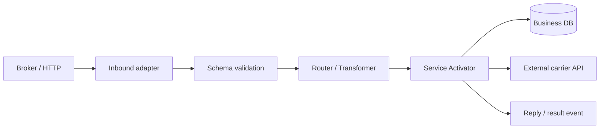
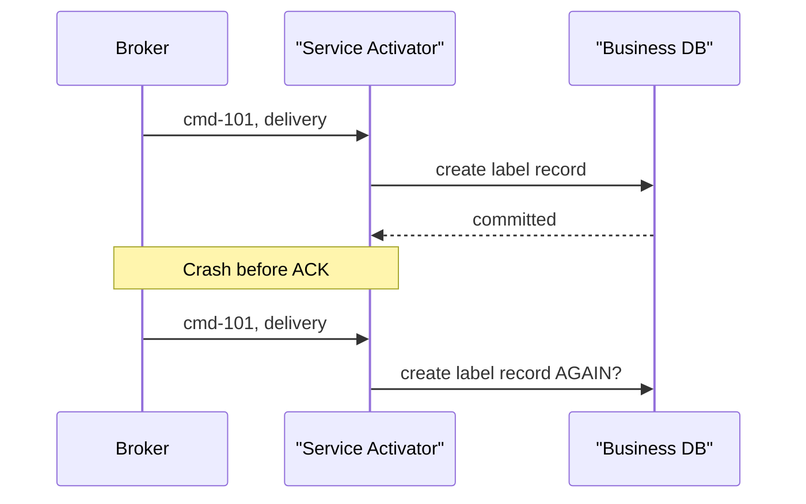
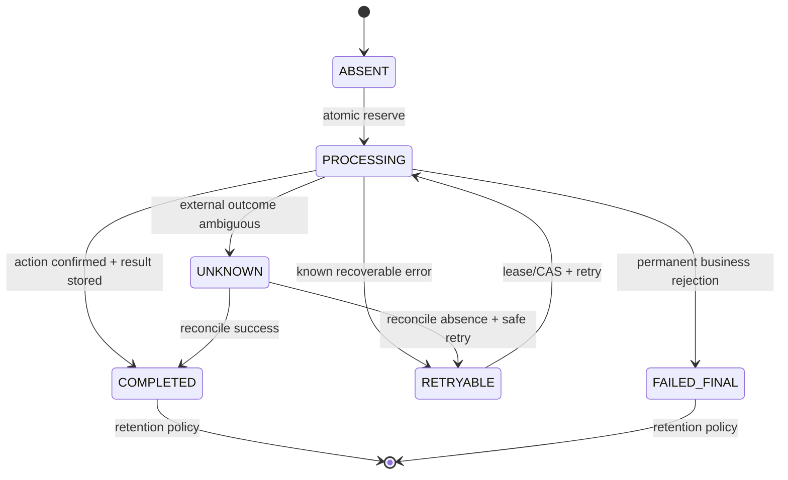
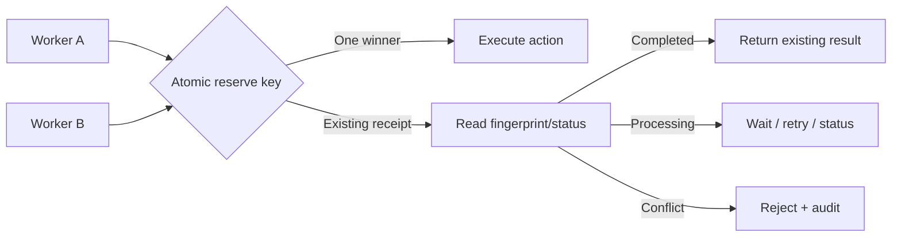
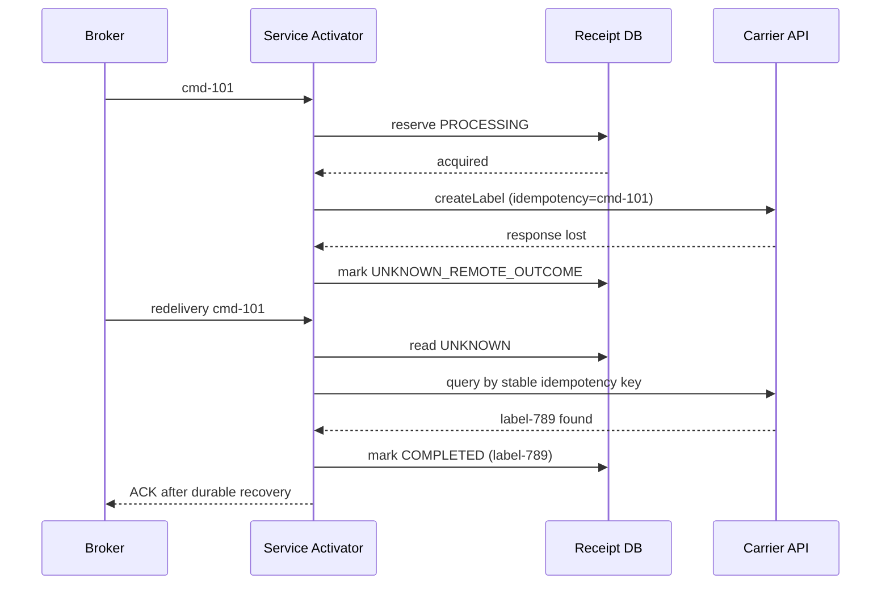
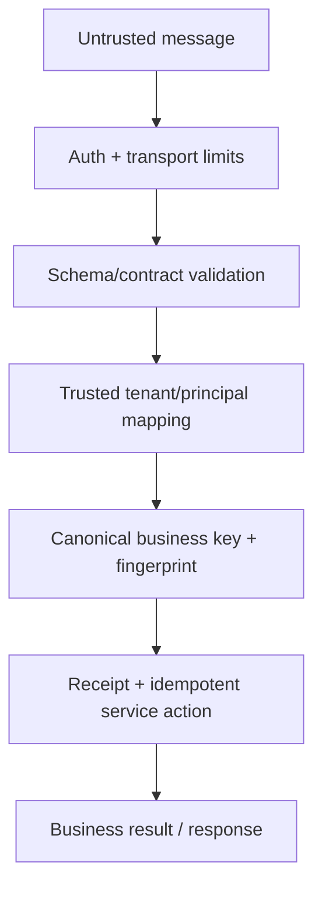
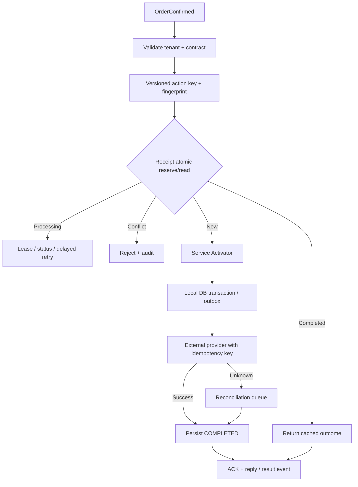

# Idempotency của service action

Một **Service Activator** trong Spring Integration là endpoint nối thông điệp với một phương thức hoặc dịch vụ thực hiện hành động. Nó có thể gọi business service để ghi cơ sở dữ liệu, tạo vận đơn, giữ chỗ, gửi yêu cầu thanh toán hoặc phát event mới. Chính tại đây, một message được chuyển thành **tác dụng phụ nghiệp vụ** (*business side effect*), nên chuyện message được giao lặp không còn là vấn đề của riêng broker.

Một sự kiện có thể được giao lại sau khi consumer xử lý thành công nhưng chưa kịp ACK; Gateway có thể gửi lại request vì timeout; một Retry Advice có thể gọi lại handler sau lỗi tạm; hoặc người vận hành có thể replay từ dead-letter queue. Nếu Service Activator cứ thực hiện hành động mỗi lần được gọi, ứng dụng có thể **trừ tiền hai lần, tạo hai nhãn vận chuyển, ghi hai dòng sổ hoặc gửi nhiều lệnh ra hệ thống ngoài**.

**Idempotency của service action** nghĩa là khi cùng **một yêu cầu nghiệp vụ được định danh ổn định** được đưa vào service nhiều lần, hệ thống giữ được **kết quả/tác dụng phụ đúng theo hợp đồng** mà không lặp lại những thay đổi không được phép. Đây là chủ đề của bài thuộc chương **Service activator**, module `SPRING_INTEGRATION_PATTERN`: học triển khai Enterprise Integration Patterns với Spring Integration để xây dựng luồng message ít phụ thuộc, dễ mở rộng, phối hợp Router, Filter, Transformer, Splitter, Aggregator, Gateway, retry, error channel và correlation, đồng thời kiểm thử các nhánh xử lý.

**Sau bài này, bạn có thể:**

- Phân biệt **message delivery**, **handler invocation**, **business action**, **business result** và **ACK**.
- Xác định **idempotency key** theo đơn vị công việc thay vì dùng một UUID kỹ thuật bất kỳ.
- Thiết kế **receipt/inbox** với trạng thái `PROCESSING`, `COMPLETED`, lỗi có thể thử lại và kết quả cũ.
- Sử dụng **unique constraint/atomic insert**, transaction DB và **business invariant** để ngăn hai instance cùng tạo tác dụng phụ.
- Phân biệt `IdempotentReceiverInterceptor` ở endpoint với idempotency **thực sự của service action**.
- Viết ví dụ Spring Integration Java DSL, service layer và JUnit cho trường hợp duplicate, concurrency và Gateway reply.
- Xử lý tình huống **side effect ở API bên ngoài**: timeout không rõ kết quả, lease, retry, outbox và reconciliation.
- Thiết kế ACK, errorChannel, DLQ, audit, metric và retention mà không đánh dấu thành công quá sớm.

## 1. Service Activator nằm ở ranh giới nào?

Một flow điển hình:



Spring Integration cung cấp hai cách quen thuộc để kích hoạt service:

- **Annotation:** một phương thức được nối với channel bằng `@ServiceActivator`.
- **Java DSL:** dùng `.handle(...)` hoặc endpoint handler có tên, được cấu hình qua `IntegrationFlow`.

Cả hai đều tạo nên **điểm gọi hành động**; tuy nhiên, chỉ việc thêm một endpoint **không làm hành động idempotent**.

Ví dụ service:

```java
public ShippingLabel createLabel(ShippingCommand command) {
    // Gọi carrier để tạo nhãn và lưu kết quả.
    return carrier.createLabel(command);
}
```

Nếu method trên được gọi hai lần với cùng command mà `carrier.createLabel()` tạo nhãn mới mỗi lần, ứng dụng **không idempotent** dù message có cùng `correlationId`.

### Service Activator khác một Transformer thuần

| Thành phần | Mục đích chính | Rủi ro khi gọi lại |
| --- | --- | --- |
| Transformer thuần | `f(payload) -> newPayload` không side effect. | Có thể tốn CPU, nhưng thường tính lại được. |
| Filter | Cho phép hoặc loại message theo predicate/policy. | Nếu predicate ghi trạng thái, bản thân nó cũng có side effect. |
| Service Activator | Gọi hành động nghiệp vụ; có thể có side effect. | Có thể nhân đôi DB write, remote command, payment, email. |
| Gateway | Request–reply với timeout/correlation. | Caller retry có thể kích hoạt cùng action thêm lần nữa. |
| Aggregator | Gom message group và phát một kết quả. | Redelivery/late message có thể tạo outcome trùng nếu không có policy. |

**Lưu ý:** Không phải mọi service activator đều có side effect. Nếu handler chỉ tính toán một giá trị, nó có thể tự nhiên idempotent. Bài tập trung vào những action **làm thay đổi trạng thái** hoặc **gọi hệ thống ngoài**.

## 2. Định nghĩa chính xác idempotency theo nghiệp vụ

Trong toán học, một phép toán \(f\) là idempotent nếu:

\[
f(f(x)) = f(x)
\]

Với service action, cách diễn đạt thực tế hơn là:

> Gửi lại cùng một lệnh hợp lệ với **cùng idempotency identity** không làm xuất hiện một business effect mới ngoài tác dụng được phép của lần đầu.

Ví dụ:

```text
CreateShippingLabel(
  tenant=TENANT-A,
  commandId=cmd-101,
  parcelId=P-1
)
```

Nếu lần đầu tạo `label-789`, các lần xử lý lặp theo cùng command không được tạo `label-790`, `label-791`, ... Chúng có thể trả lại **cùng nhãn** hoặc thông báo rằng lệnh **đang xử lý**, tùy hợp đồng.

### Phải phân biệt ba cấp độ

1. **At-most-once invocation:** handler được gọi tối đa một lần trong một phạm vi hẹp. Không bảo đảm nghiệp vụ hoàn thành.
2. **At-least-once delivery:** transport có thể giao lại cho tới khi có ACK/commit; ứng dụng phải chịu được duplicate.
3. **Effectively-once business effect:** dù delivery/handler invocation lặp, domain effect đúng một lần theo **business key và ranh giới được bảo vệ**.

Không nên tuyên bố **exactly-once end-to-end** khi một action đi qua database, broker và remote HTTP API **không cùng một transaction**.

### “Trả lại cùng kết quả” hay “thành công nhưng báo duplicate”?

Hai chiến lược đều có thể hợp lý:

```text
Duplicate cmd-101 -> SAME_RESULT(label-789)
```

hoặc:

```text
Duplicate cmd-101 -> ALREADY_COMPLETED(resultRef=label-789)
```

Điều quan trọng là caller biết outcome **không phải một tác vụ mới**. Với Gateway/API, trả cached business result thường hữu ích hơn việc im lặng bỏ message.

## 3. Vì sao Service Activator có thể chạy lại?

Xét timeline:



Những nguồn lặp phổ biến:

| Nguồn | Điều xảy ra | Ranh giới cần bảo vệ |
| --- | --- | --- |
| **Consumer redelivery** | Worker commit DB nhưng chưa ACK/commit offset. | Service action receipt + transaction. |
| **Producer retry** | Broker có thể chứa hai records với cùng event/command identity. | Consumer inbox/business key. |
| **HTTP/Gateway retry** | Client thấy timeout và gửi lại một action. | API receipt **và** service action. |
| **Retry advice** | Exception làm framework/caller gọi lại handler. | Không lặp side effect khi outcome chưa rõ. |
| **Manual replay/DLQ** | Operator phát lại event cũ. | Durable receipt còn đủ retention. |
| **Nhiều replicas** | Hai instance nhận cùng business command gần đồng thời. | Unique constraint/CAS trên shared store. |
| **Scheduler/job restart** | Công việc được lập lịch lại sau crash. | Stable job/business identity. |

**Một Spring `MessageHeaders.id` mới không chứng minh đây là công việc mới.** Message được reconstruct khi redeliver/transform có thể nhận ID khác. Dùng identity bền vững theo contract của domain.

## 4. Chọn khóa đúng cho một service action

Với lệnh tạo nhãn, một idempotency key có thể là:

```text
(tenantId, operation, commandId)

(TENANT-A, CREATE_SHIPPING_LABEL, cmd-101)
```

Nếu một command ID chỉ unique trong một phiên bản contract, có thể cần thêm `contractVersion` hoặc `businessRevision` theo thiết kế.

| Ứng viên key | Có phù hợp? | Lý do |
| --- | --- | --- |
| `commandId` ổn định do ingress cấp, scoped tenant/operation | Thường phù hợp. | Giữ nguyên khi retry cùng action. |
| Domain `eventId` ở consumer của một event | Phù hợp cho **event processing receipt**. | Phải scoped theo consumer/operation. |
| `MessageHeaders.id` | Không làm key nghiệp vụ duy nhất. | Có thể đổi mỗi lần tạo Spring message. |
| Kafka offset/Rabbit delivery tag | Không thay business key. | Mô tả record/delivery, không phải ý định action. |
| `traceId` | Không. | Một trace có thể chứa nhiều actions. |
| `correlationId` | Không mặc định. | Cùng workflow có thể có nhiều actions. |
| `customerId` | Quá rộng. | Khách có nhiều actions hợp lệ. |
| `parcelId` đơn thuần | Phụ thuộc business rule. | Cùng parcel có thể tạo nhãn lần mới sau hủy/revision. |
| `System.currentTimeMillis()` | Không. | Mỗi retry có một key khác. |

### Key theo command khác key theo event

Một command có thể phát nhiều events:

```text
cmd-101
  -> evt-1001: ShippingLabelRequested
  -> evt-1002: ShippingLabelCreated
  -> evt-1003: NotificationQueued
```

Nếu một consumer dùng `commandId` chung để dedup **mọi event type**, nó có thể loại nhầm hai events hợp lệ. Phải xác định **đơn vị idempotency tại action**, có thể là `(consumerName, eventId)` hoặc `(tenant, operation, commandId)` tùy service.

### Khi hai payload dùng cùng key nhưng khác dữ liệu

```text
cmd-101, parcelId=P-1
cmd-101, parcelId=P-2
```

Không nên âm thầm trả kết quả của P-1 rồi cho caller tin rằng P-2 đã được xử lý. Lưu **canonical request fingerprint** và từ chối `IDEMPOTENCY_CONFLICT` khi cùng key chứa payload khác theo contract.

## 5. Request fingerprint và giới hạn của hash

Một fingerprint nên được tính từ những field **quyết định nghĩa của action**:

```text
canonical payload:
  operation = CREATE_SHIPPING_LABEL
  tenantId  = TENANT-A
  parcelId  = P-1
  carrier   = CARRIER-X
  revision  = 3

requestFingerprint = SHA-256(canonical bytes)
```

Không dùng hash trực tiếp của JSON tùy ý nếu khác whitespace/thứ tự field không có nghĩa. Cần canonicalization nhất quán và version hóa quy tắc.

**Cẩn thận:**

- Hash không thay authentication hay authorization.
- Hash không tự chống replay; phải lưu key và state.
- Nếu request chứa dữ liệu nhạy cảm, không log raw canonical payload.
- Với field dễ đoán, digest có thể cho phép dò dictionary; không dùng fingerprint như giải pháp bảo mật thông tin cá nhân.
- Nếu canonicalization thay đổi khi nâng version, replay dữ liệu cũ có thể xuất hiện conflict giả. Lưu version của fingerprint strategy hoặc duy trì compatibility.

Một receipt nên lưu fingerprint **cùng transaction/lock** với quyết định duplicate để tránh race check-then-act.

## 6. Receipt store: “đã thấy” không đồng nghĩa “đã xong”

Một implementation chỉ giữ `Set<commandId>` dễ mắc lỗi:

```text
T1: add cmd-101 to seen
T2: call business service -> temporary failure
T3: broker redelivers cmd-101
T4: seen contains cmd-101 -> drop
```

Kết quả: lệnh **chưa thành công nhưng mọi retry đều bị loại**.

Thay vào đó, định nghĩa receipt:

```text
ActionReceipt {
  tenantId
  operation
  commandId
  requestFingerprint
  status
  resultReference
  owner
  leaseUntil
  attemptCount
  createdAt
  updatedAt
  expiresAt
}
```

Đây là **kiểu dữ liệu ứng dụng minh họa**, không phải class Spring Integration tự có.

### State machine của action



`UNKNOWN` là trạng thái **tùy thiết kế** cho remote side effect; không phải enum có sẵn trong framework.

| Receipt status | Ý nghĩa | Hành vi khi command trùng |
| --- | --- | --- |
| `ABSENT` | Chưa có receipt. | Thử reserve atomically. |
| `PROCESSING` | Có worker đang giữ action; outcome chưa xác định. | Chờ/status/retry theo lease, **không gọi side effect song song**. |
| `COMPLETED` | Đã xác nhận business result. | Trả cached outcome hoặc `ALREADY_COMPLETED`; không tạo effect mới. |
| `RETRYABLE` | Lỗi được biết là an toàn để retry. | Acquire lease/CAS rồi thực hiện lại. |
| `UNKNOWN` | Remote có thể đã làm nhưng local chưa chắc. | Reconcile với remote trước khi retry. |
| `FAILED_FINAL` | Lệnh bị từ chối cuối theo nghiệp vụ. | Trả cùng rejection, không retry vô hạn. |

Mỗi state phải có **định nghĩa rõ về persistence, ACK, lease, deadline và response**. Không dùng một Boolean `processed=true` cho mọi trường hợp.

## 7. Không dùng check-then-act khi có concurrency

Hai instance cùng nhận `cmd-101`:

```text
Worker A: receipt.find(key) -> not found
Worker B: receipt.find(key) -> not found
Worker A: createLabel(...)
Worker B: createLabel(...)
Worker A: receipt.save(key, COMPLETED)
Worker B: receipt.save(key, COMPLETED)
```

Cả hai có thể tạo side effect. Cần **quyết định độc quyền nguyên tử**, chẳng hạn:

- Database `PRIMARY KEY/UNIQUE` + `INSERT ... ON CONFLICT DO NOTHING`.
- `ConcurrentMetadataStore.putIfAbsent` trong phạm vi storage có semantics atomic phù hợp.
- CAS/versioned update cho một receipt đã tồn tại.
- Lock/transaction đúng phạm vi business key.
- Unique constraint tại **business table** nếu nghiệp vụ chỉ cho một hành động tương ứng.



` synchronized`, `ReentrantLock` hoặc một `ConcurrentHashMap` cục bộ **không bảo vệ nhiều JVM** nếu chúng không dùng chung state. Một lock đơn lẻ trên broker partition cũng chưa đủ cho manual replay, rebalance hoặc command trùng đến từ API khác.

## 8. Ba tầng bảo vệ và tính chất của từng tầng

| Tầng | Ví dụ | Điều bảo vệ | Điều chưa bảo vệ |
| --- | --- | --- | --- |
| **Transport dedup** | Broker producer idempotence/offset policy. | Một số trường hợp record/delivery lặp. | HTTP retry, business effects ở DB/remote. |
| **Receiver/inbox** | `IdempotentReceiverInterceptor`, metadata store, event receipt. | Lặp message theo event/consumer key. | Side effect đã thực hiện một phần, cached result, transaction ngoài store. |
| **Service-action idempotency** | Business unique key + receipt + DB transaction + remote idempotency. | Tác dụng phụ theo business action. | Các hệ thống ngoài ranh giới bảo vệ nếu không phối hợp. |

**Không chọn một tầng thay cho tất cả tầng còn lại.** Ví dụ API idempotent có thể chỉ phát một command, nhưng broker vẫn redeliver một event; inbox chặn event duplicate nhưng không đủ nếu remote payment API timeout sau khi trừ tiền.

## 9. Transaction DB: một ranh giới dễ đảm bảo nhất

Khi receipt và business rows **nằm trong cùng một database**, service có thể ghi chúng trong **một transaction**:

```text
BEGIN
  reserve receipt (unique key)
  if new:
      insert business row / update business state
      mark receipt COMPLETED with resultRef
  else:
      compare fingerprint
      read existing status/result
COMMIT
```

Tình huống:

- **Commit thành công nhưng ACK broker mất:** redelivery thấy `COMPLETED`, không thực hiện lại business write.
- **Business insert lỗi làm transaction rollback:** receipt reserve cùng transaction cũng rollback, retry có thể thử lại.
- **Hai transactions tranh cùng unique key:** database phân xử một winner theo isolation/locking thực tế.
- **Cùng key nhưng payload khác:** trả conflict thay vì chạy lại hoặc trả cached result sai.

**Cẩn thận:** Một transaction database không bao gồm HTTP carrier API, object store hoặc message broker nếu không có cơ chế phối hợp được hỗ trợ riêng. Không giữ một transaction DB mở trong nhiều phút khi chờ remote API rồi tin rằng mọi side effect đều atomic.

## 10. PostgreSQL: schema receipt và business uniqueness

Bảng receipt minh họa:

```sql
CREATE TABLE action_receipts (
    tenant_id           VARCHAR(80) NOT NULL,
    operation           VARCHAR(80) NOT NULL,
    command_id          VARCHAR(160) NOT NULL,
    request_fingerprint CHAR(64) NOT NULL,
    status              VARCHAR(32) NOT NULL,
    result_ref          VARCHAR(200),
    last_error_code     VARCHAR(80),
    owner_id            VARCHAR(120),
    lease_until         TIMESTAMPTZ,
    attempt_count       INTEGER NOT NULL DEFAULT 0,
    created_at          TIMESTAMPTZ NOT NULL,
    updated_at          TIMESTAMPTZ NOT NULL,
    expires_at          TIMESTAMPTZ,
    PRIMARY KEY (tenant_id, operation, command_id)
);
```

Bảng action ở cùng DB:

```sql
CREATE TABLE shipping_labels (
    label_id       VARCHAR(160) PRIMARY KEY,
    tenant_id      VARCHAR(80) NOT NULL,
    parcel_id      VARCHAR(160) NOT NULL,
    parcel_revision INTEGER NOT NULL,
    command_id     VARCHAR(160) NOT NULL,
    carrier_code   VARCHAR(80) NOT NULL,
    created_at     TIMESTAMPTZ NOT NULL,
    UNIQUE (tenant_id, command_id),
    UNIQUE (tenant_id, parcel_id, parcel_revision)
);
```

Unique key thứ hai là **giả định domain của ví dụ**: một parcel revision chỉ có một nhãn. Nếu nghiệp vụ cho phép tạo nhiều nhãn hợp lệ theo carrier/service khác nhau, phải thay unique key theo rule đó; **đừng áp dụng schema mà không xét business policy**.

### Reserve key atomically

```sql
INSERT INTO action_receipts (
    tenant_id,
    operation,
    command_id,
    request_fingerprint,
    status,
    created_at,
    updated_at
)
VALUES (
    :tenant_id,
    'CREATE_SHIPPING_LABEL',
    :command_id,
    :fingerprint,
    'PROCESSING',
    NOW(),
    NOW()
)
ON CONFLICT (tenant_id, operation, command_id)
DO NOTHING;
```

- **1 row inserted:** request lần đầu thắng atomic reservation.
- **0 row inserted:** key đã tồn tại; đọc receipt, so fingerprint, xử lý theo `status`.
- **SQL exception:** **không** coi là “đã xử lý”; phân loại lỗi DB và recovery.

Một transaction khác đang insert cùng key nhưng chưa commit có thể làm unique conflict processing **phải đợi**, tùy isolation/DB. Cần bounded lock timeout, deadlock handling và test race bằng DB thật.

### Bảo vệ cả business invariant

Receipt unique `(tenant, operation, commandId)` chỉ ngăn **cùng command ID**. Nếu client vô tình tạo **hai command IDs khác nhau cho cùng một intent**, business uniqueness tại `shipping_labels` vẫn có thể bảo vệ trường hợp “một nhãn cho một parcel revision” theo domain. Hai lớp giải quyết hai vấn đề khác nhau.

## 11. Java: hợp đồng action và outcome

Ví dụ service này dùng Java 17+, Spring transaction và DAO **do ứng dụng triển khai**. `ActionReceiptRepository` không phải interface Spring Integration có sẵn.

```java
record ShippingCommand(
        String tenantId,
        String commandId,
        String parcelId,
        int parcelRevision,
        String carrierCode
) {}

enum ActionStatus {
    COMPLETED,
    ALREADY_COMPLETED,
    IN_PROGRESS,
    REJECTED_FINAL
}

record ActionOutcome(
        ActionStatus status,
        String labelId,
        String reasonCode
) {}

record StoredActionReceipt(
        String requestFingerprint,
        String status,
        String resultRef
) {}

interface ActionReceiptRepository {
    // Must insert atomically under the shared DB unique constraint.
    boolean insertIfAbsent(
            ShippingCommand command,
            String requestFingerprint);

    StoredActionReceipt findExisting(ShippingCommand command);

    void markCompleted(
            ShippingCommand command, String resultRef);
}

interface ShippingLabelRepository {
    // Must write to SAME transaction/DB as the receipt.
    String createLocalLabel(ShippingCommand command);
}

interface ShippingCommandFingerprint {
    // Canonical/validated fields and versioned hashing policy.
    String fingerprint(ShippingCommand command);
}
```

Các repository có thể được triển khai với `JdbcTemplate`/JPA, nhưng phải bảo đảm **không phát sinh transaction độc lập** hoặc ghi sang DB khác nếu ví dụ đang yêu cầu atomicity.

### Vì sao outcome có trạng thái riêng?

Nếu service chỉ trả `boolean`, caller sẽ khó phân biệt:

```text
false = duplicate completed?
false = currently processing?
false = permanent reject?
false = timeout?
```

`ActionOutcome` nêu rõ điều gì đã xảy ra. Trong production, cần thêm stable error codes, retry hints hoặc resource URI theo API contract, nhưng không trả raw SQL exception ra bên ngoài.

## 12. Service method với `@Transactional`

Dùng một service method làm **ranh giới transaction**:

```java
import java.util.Objects;

import org.springframework.stereotype.Service;
import org.springframework.transaction.annotation.Transactional;

@Service
class IdempotentShippingService {
    private static final String OPERATION =
            "CREATE_SHIPPING_LABEL";

    private final ActionReceiptRepository receipts;
    private final ShippingLabelRepository labels;
    private final ShippingCommandFingerprint fingerprints;

    IdempotentShippingService(
            ActionReceiptRepository receipts,
            ShippingLabelRepository labels,
            ShippingCommandFingerprint fingerprints) {
        this.receipts = receipts;
        this.labels = labels;
        this.fingerprints = fingerprints;
    }

    @Transactional
    public ActionOutcome execute(ShippingCommand command) {
        validate(command);

        String hash = fingerprints.fingerprint(command);
        boolean first = receipts.insertIfAbsent(command, hash);

        if (!first) {
            StoredActionReceipt prior =
                    receipts.findExisting(command);

            if (prior == null) {
                // Defensive: do not create side effect
                // from an ambiguous/conflicting read.
                throw new IllegalStateException(
                        "RECEIPT_READ_INCONSISTENT");
            }

            if (!Objects.equals(
                    prior.requestFingerprint(), hash)) {
                return new ActionOutcome(
                        ActionStatus.REJECTED_FINAL,
                        null,
                        "IDEMPOTENCY_CONFLICT");
            }

            if ("COMPLETED".equals(prior.status())) {
                return new ActionOutcome(
                        ActionStatus.ALREADY_COMPLETED,
                        prior.resultRef(),
                        null);
            }

            return new ActionOutcome(
                    ActionStatus.IN_PROGRESS,
                    null,
                    "ACTION_NOT_COMPLETED");
        }

        // Must modify same DB under this transaction.
        String labelId = labels.createLocalLabel(command);
        receipts.markCompleted(command, labelId);

        return new ActionOutcome(
                ActionStatus.COMPLETED,
                labelId,
                null);
    }

    private static void validate(ShippingCommand command) {
        if (command == null
                || blank(command.tenantId())
                || blank(command.commandId())
                || blank(command.parcelId())
                || blank(command.carrierCode())
                || command.parcelRevision() < 0) {
            throw new IllegalArgumentException(
                    "SHIPPING_COMMAND_INVALID");
        }
    }

    private static boolean blank(String value) {
        return value == null || value.isBlank();
    }
}
```

### Đọc đúng giới hạn đoạn code

- `@Transactional` chỉ có hiệu lực đúng khi Spring proxy/transaction infrastructure và method invocation được cấu hình phù hợp. Gọi nội bộ (*self-invocation*) bỏ qua proxy có thể làm annotation không được áp dụng.
- `labels.createLocalLabel()` trong ví dụ **chỉ ghi cùng DB**; **không được lén gọi HTTP Carrier API** bên trong rồi coi đó là atomic.
- `insertIfAbsent()` phải được hiện thực bằng **atomic DB statement + unique constraint**, không phải `select` trước `insert`.
- `findExisting()` phải trả receipt đúng tenant/operation/command ID, không bao giờ tìm theo command ID đơn độc nếu nó chỉ unique trong tenant.
- `hash` được tính từ canonical request với policy được kiểm soát; không nhận một hash tùy ý của client làm bằng chứng payload.
- Ví dụ coi tất cả status khác `COMPLETED` là `IN_PROGRESS`; production có thể cần `RETRYABLE`, `UNKNOWN_REMOTE_OUTCOME`, `FAILED_FINAL`, lease và status query chi tiết.
- Nếu transaction rollback sau `labels.createLocalLabel`, phải rollback **cả label và receipt**. Cần integration test DB thật để chứng minh.

**Đừng kết luận `ALREADY_COMPLETED` nghĩa caller có quyền xem `labelId`.** Khi reply cho client/Gateway, authorization vẫn phải được kiểm tra theo principal/tenant đã xác thực.

## 13. Java DSL: nối Service Activator vào flow

Một `IntegrationFlow` có thể gọi service:

```java
import org.springframework.context.annotation.Bean;
import org.springframework.context.annotation.Configuration;
import org.springframework.integration.channel.DirectChannel;
import org.springframework.integration.channel.QueueChannel;
import org.springframework.integration.config.EnableIntegration;
import org.springframework.integration.dsl.IntegrationFlow;

@Configuration
@EnableIntegration
class ShippingActionFlowConfig {

    @Bean
    DirectChannel shippingActions() {
        return new DirectChannel();
    }

    @Bean
    QueueChannel shippingOutcomes() {
        return new QueueChannel();
    }

    @Bean
    IntegrationFlow shippingActionFlow(
            IdempotentShippingService shippingService) {
        return IntegrationFlow.from("shippingActions")
                .handle(ShippingCommand.class,
                        (command, headers) ->
                                shippingService.execute(command))
                .channel("shippingOutcomes")
                .get();
    }
}
```

**Giải thích:**

1. Channel `shippingActions` nhận `ShippingCommand`.
2. Service Activator `.handle(...)` gọi **Spring-managed service bean** đã có transaction.
3. Service trả `ActionOutcome` cho message response.
4. `shippingOutcomes` là `QueueChannel` để test; không phải broker bền vững.

Nếu handler dùng `DirectChannel`, lời gọi chạy trong **caller thread** theo topology đồng bộ. Với `ExecutorChannel`, poller hoặc broker adapter, semantics exception, transaction context và ACK có thể khác.

### `send()` không chứng minh remote side effect đã hoàn tất

`MessageChannel.send()` báo việc gửi message tới channel theo semantics của channel, **không phải một chứng nhận exactly-once ở mọi downstream systems**. Trong ví dụ `DirectChannel`, handler đồng bộ có thể hoàn tất trước khi `send()` trả, nhưng khi có async boundary hoặc outbound remote call, phải quan sát transaction/outcome/ACK cụ thể.

## 14. Alternative: `@ServiceActivator` annotation

Spring Integration cũng cho phép nối một method với channel bằng annotation:

```java
import org.springframework.integration.annotation.ServiceActivator;
import org.springframework.stereotype.Component;

@Component
class ShippingActionEndpoint {
    private final IdempotentShippingService service;

    ShippingActionEndpoint(IdempotentShippingService service) {
        this.service = service;
    }

    @ServiceActivator(
            inputChannel = "shippingActions",
            outputChannel = "shippingOutcomes")
    public ActionOutcome activate(ShippingCommand command) {
        return service.execute(command);
    }
}
```

Phương án này **thay thế endpoint `.handle(...)` ở mục 13**, không nên đăng ký cả hai như **hai consumer cạnh tranh** trên cùng channel nếu ý định là một action cho mỗi message.

### Vì sao đặt `@Transactional` ở business service?

`ShippingActionEndpoint` chỉ nên đảm nhiệm **biên messaging**. Đặt transaction trong `IdempotentShippingService` giúp:

- Service có thể được gọi từ HTTP/Gateway và broker mà vẫn đi qua cùng logic idempotency.
- Dễ test transaction/DAO độc lập với Spring Integration channel.
- Tránh che side effect trong một lambda/adapter khó tái sử dụng.
- Giữ nghiệp vụ và retry/ACK infrastructure tách nhiệm vụ.

Tuy nhiên, cần kiểm tra **transaction manager và invocation proxy** trong application thực. Annotation không tự tạo transaction với một external API.

## 15. Vì sao `IdempotentReceiverInterceptor` chưa đủ?

Spring Integration có các abstraction như:

- `MetadataStore`
- `ConcurrentMetadataStore`
- `MetadataStoreSelector`
- `IdempotentReceiverInterceptor`

Chúng có thể hỗ trợ nhận diện key đã thấy tại endpoint/handler advice. Tuy nhiên, **một marker tồn tại trong metadata store không tự chứng minh business action đã commit**.

Ví dụ:

```text
Interceptor:
  reserve key -> seen

Service Activator:
  external payment fails

Retry:
  interceptor sees key -> duplicate
```

Nếu advice bị cấu hình **drop tất cả duplicate**, retry có thể không vào service nữa dù payment chưa hoàn thành.

### Ba câu hỏi cần kiểm chứng với advice

1. **Khi nào** key được ghi: trước handler, sau handler hay trong transaction nào?
2. Handler thấy duplicate theo **header/advice behavior** nào; nó được chạy, bị discard hay bị ném lỗi?
3. Khi handler thất bại, marker được **reset/rollback** ra sao, và có giữ outcome để Gateway trả reply cũ không?

Không giả định chỉ thêm `IdempotentReceiverInterceptor` là handler tự trở thành exactly-once. Hành vi duplicate (đánh dấu header, discard, throw/retry) tùy cấu hình và phiên bản Spring Integration; cần kiểm tra API/semantics thực tế ở giai đoạn Content QA và integration test.

### `SimpleMetadataStore` hữu ích cho demo, chưa đủ production

Một store in-memory có thể dùng để dạy `putIfAbsent` trong một JVM nhưng **mất state khi restart** và không phối hợp các replicas. Cần persistent/shared store và business transaction nếu contract yêu cầu tránh effect trùng qua broker redelivery hoặc crash.

## 16. Demo cô lập: hành động idempotent trong một JVM

Để test wiring mà không cần PostgreSQL, có thể tạo một service **giả lập** dùng `ConcurrentHashMap.computeIfAbsent`. Hàm tạo outcome chỉ cập nhật một counter test, **không thực hiện side effect bên ngoài**.

```java
import java.util.concurrent.ConcurrentHashMap;
import java.util.concurrent.ConcurrentMap;
import java.util.concurrent.atomic.AtomicInteger;

final class InMemoryShippingDemo {
    private final ConcurrentMap<String, String> labels =
            new ConcurrentHashMap<>();
    private final AtomicInteger creations =
            new AtomicInteger();

    ActionOutcome execute(ShippingCommand command) {
        if (command == null
                || command.tenantId() == null
                || command.commandId() == null) {
            throw new IllegalArgumentException("INVALID_DEMO_KEY");
        }

        String key = command.tenantId() + "|"
                + "CREATE_SHIPPING_LABEL" + "|"
                + command.commandId();

        boolean existed = labels.containsKey(key);

        String labelId = labels.computeIfAbsent(key, ignored -> {
            creations.incrementAndGet();
            return "label-" + command.commandId();
        });

        return new ActionOutcome(
                existed ? ActionStatus.ALREADY_COMPLETED
                        : ActionStatus.COMPLETED,
                labelId,
                null);
    }

    int createdCount() {
        return creations.get();
    }
}
```

**Quan trọng:** Ví dụ có một **race chỉ ở phần phân loại status**: `containsKey` có thể trả `false` cho hai threads trước khi một `computeIfAbsent` hoàn tất; khi đó hai invocation đều có thể báo `COMPLETED` mặc dù **chỉ một value được tạo**. Vì vậy, các test concurrency phải kiểm tra **số lần tạo label giả lập và cùng `labelId`**, không dùng status đầu/duplicate để chứng minh atomicity. Production phải đưa status và outcome vào **cùng một receipt transaction/CAS**, không copy đoạn mã này để xử lý tiền.

Ngoài ra, `ConcurrentHashMap` chỉ atomic **trong một JVM** và không durable. Nó không bảo vệ effect ở một HTTP service. Khi có producer/consumer nhiều replica, dùng receipt storage dùng chung.

## 17. Spring Integration demo flow dùng service giả lập

Để có một test tự chứa không phụ thuộc DAO production:

```java
import org.springframework.context.annotation.Bean;
import org.springframework.context.annotation.Configuration;
import org.springframework.integration.channel.DirectChannel;
import org.springframework.integration.channel.QueueChannel;
import org.springframework.integration.config.EnableIntegration;
import org.springframework.integration.dsl.IntegrationFlow;

@Configuration
@EnableIntegration
class ShippingDemoFlowConfig {

    @Bean
    DirectChannel demoShippingInput() {
        return new DirectChannel();
    }

    @Bean
    QueueChannel demoShippingResults() {
        return new QueueChannel();
    }

    @Bean
    InMemoryShippingDemo inMemoryShippingDemo() {
        return new InMemoryShippingDemo();
    }

    @Bean
    IntegrationFlow demoShippingFlow(InMemoryShippingDemo action) {
        return IntegrationFlow.from("demoShippingInput")
                .handle(ShippingCommand.class,
                        (command, headers) ->
                                action.execute(command))
                .channel("demoShippingResults")
                .get();
    }
}
```

Flow này chỉ thể hiện **Service Activator invocation + idempotency concept** trong môi trường test. `demoShippingResults` nhận `ActionOutcome`, không có Kafka adapter, Postgres, policy/authorization hoặc external Carrier API.

## 18. JUnit integration test: lệnh được gửi lại hai lần

```java
import static org.junit.jupiter.api.Assertions.*;

import org.junit.jupiter.api.Test;
import org.springframework.beans.factory.annotation.Autowired;
import org.springframework.beans.factory.annotation.Qualifier;
import org.springframework.integration.channel.QueueChannel;
import org.springframework.messaging.MessageChannel;
import org.springframework.messaging.support.MessageBuilder;
import org.springframework.test.annotation.DirtiesContext;
import org.springframework.test.context.junit.jupiter.SpringJUnitConfig;

@SpringJUnitConfig(ShippingDemoFlowConfig.class)
@DirtiesContext(classMode = DirtiesContext.ClassMode.AFTER_EACH_TEST_METHOD)
class ShippingDemoFlowTest {

    @Autowired
    @Qualifier("demoShippingInput")
    MessageChannel input;

    @Autowired
    @Qualifier("demoShippingResults")
    QueueChannel output;

    @Autowired
    InMemoryShippingDemo action;

    private ActionOutcome reply() {
        var message = output.receive(1_000);
        assertNotNull(message);
        return (ActionOutcome) message.getPayload();
    }

    @Test
    void repeatedCommandDoesNotCreateSecondLabel() {
        ShippingCommand command = new ShippingCommand(
                "TENANT-A", "cmd-101", "P-1",
                1, "CARRIER-X");

        assertTrue(input.send(
                MessageBuilder.withPayload(command).build()));
        assertTrue(input.send(
                MessageBuilder.withPayload(command).build()));

        ActionOutcome first = reply();
        ActionOutcome second = reply();

        assertEquals("label-cmd-101", first.labelId());
        assertEquals(first.labelId(), second.labelId());
        assertEquals(1, action.createdCount());

        assertNull(output.receive(0));
    }

    @Test
    void differentCommandsAreAllowedWhenTheyAreDistinct() {
        ShippingCommand first = new ShippingCommand(
                "TENANT-A", "cmd-201", "P-1",
                1, "CARRIER-X");
        ShippingCommand second = new ShippingCommand(
                "TENANT-A", "cmd-202", "P-2",
                1, "CARRIER-X");

        input.send(MessageBuilder.withPayload(first).build());
        input.send(MessageBuilder.withPayload(second).build());

        assertNotNull(reply());
        assertNotNull(reply());
        assertEquals(2, action.createdCount());
    }

    @Test
    void sameCommandIdFromDifferentTenantsIsDistinct() {
        input.send(MessageBuilder.withPayload(
                new ShippingCommand(
                        "TENANT-A", "cmd-300",
                        "P-1", 1, "CARRIER-X")).build());
        input.send(MessageBuilder.withPayload(
                new ShippingCommand(
                        "TENANT-B", "cmd-300",
                        "P-2", 1, "CARRIER-X")).build());

        assertNotNull(reply());
        assertNotNull(reply());
        assertEquals(2, action.createdCount());
    }
}
```

**Giới hạn chính xác của bộ test:**

- `DirectChannel` là flow đồng bộ; `QueueChannel` nằm trong JVM.
- Chứng minh có **một fake creation** với cùng key, **không** chứng minh DB rollback/restart.
- Fake không so fingerprint nên **không được dùng** để quyết định cùng key nhưng payload khác.
- Cần test riêng cho authorization/tenant isolation trong service thật.
- `@DirtiesContext` cách ly state giữa test nhưng làm tăng thời gian boot Spring context.

## 19. JUnit concurrency: nhiều threads cùng một key

Cùng một JVM có thể chạy hai handler threads đồng thời. Cần xác minh `computeIfAbsent` không tạo **hai values** cho một key trong demo.

```java
import static org.junit.jupiter.api.Assertions.*;

import java.util.ArrayList;
import java.util.List;
import java.util.concurrent.Callable;
import java.util.concurrent.CountDownLatch;
import java.util.concurrent.ExecutorService;
import java.util.concurrent.Executors;
import java.util.concurrent.Future;
import java.util.concurrent.TimeUnit;

import org.junit.jupiter.api.Test;

class ShippingDemoConcurrencyTest {

    @Test
    void oneCreationForEightConcurrentInvocations()
            throws Exception {

        InMemoryShippingDemo action = new InMemoryShippingDemo();
        ShippingCommand command = new ShippingCommand(
                "TENANT-A", "cmd-concurrent", "P-1",
                1, "CARRIER-X");

        int threadCount = 8;
        ExecutorService pool =
                Executors.newFixedThreadPool(threadCount);
        CountDownLatch start = new CountDownLatch(1);

        try {
            List<Callable<ActionOutcome>> calls =
                    new ArrayList<>();
            for (int i = 0; i < threadCount; i++) {
                calls.add(() -> {
                    start.await();
                    return action.execute(command);
                });
            }

            List<Future<ActionOutcome>> futures =
                    new ArrayList<>();
            for (var call : calls) {
                futures.add(pool.submit(call));
            }

            start.countDown();
            for (var future : futures) {
                assertEquals(
                        "label-cmd-concurrent",
                        future.get(3, TimeUnit.SECONDS).labelId());
            }

            assertEquals(1, action.createdCount());
        } finally {
            start.countDown();
            pool.shutdownNow();
        }
    }
}
```

Test này chứng minh **tính chất demo trong một `ConcurrentHashMap` instance**, không chứng minh distributed locking, receipt transaction, remote idempotency hoặc business uniqueness.

### Để test production thật cần thêm

- Hai Spring Boot instances dùng chung PostgreSQL/Testcontainers.
- Hai requests đồng thời tới **cùng business key**.
- Unique key/transaction đảm bảo **một label row và một receipt COMPLETED**.
- Một worker bị kill khi đang xử lý rồi worker khác phục hồi.
- Cả hai requests có cùng key nhưng khác canonical fingerprint → conflict.
- Retry sau restart vẫn trả cùng result, không tạo row mới.

## 20. Test transactional rollback với DB thật

Giả sử service dùng PostgreSQL và `@Transactional`.

Một integration test có thể:

1. Gửi `cmd-rollback` khi `ShippingLabelRepository` được cấu hình ném lỗi **trước commit**.
2. Xác nhận transaction rollback cả `shipping_labels` **và** `action_receipts`.
3. Gửi lại đúng `cmd-rollback`.
4. Lần hai hoàn thành, kiểm tra một label và một receipt `COMPLETED`.
5. Gửi lần thứ ba sau commit, kiểm tra `ALREADY_COMPLETED` và **không thêm row**.

### Một bẫy của test transaction

Nếu test method mang `@Transactional`, transaction của service có thể tham gia **transaction của test**. Bạn có thể đọc dữ liệu chưa commit và nghĩ rằng flow xử lý xong, trong khi test sẽ rollback toàn bộ vào cuối. Để mô phỏng **broker redelivery sau commit/crash**, cần commit ở đúng mốc hoặc gọi qua transaction boundary thực, không chỉ kiểm tra cùng một transaction của test.

### Test cạnh tranh `INSERT ... ON CONFLICT`

Tạo hai transactions độc lập, cùng key và cùng payload; điều phối chúng bắt đầu gần đồng thời, test:

- Một transaction ghi business result thành công.
- Transaction còn lại sau conflict đọc được outcome đã commit (hoặc retry đọc theo isolation policy).
- Không deadlock kéo dài/hung indefinitely; có lock/statement timeout hợp lý.
- Khác fingerprint trả conflict.
- Rollback của transaction thắng cho phép transaction còn lại xử lý khi được thiết kế phù hợp.

Không thể kết luận một transaction implementation đúng chỉ từ `@Transactional` annotation hoặc test map trong JVM.

## 21. Hành động gọi API ngoài: vùng mơ hồ không có transaction chung

Bây giờ thay `createLocalLabel()` bằng một lời gọi HTTP Carrier API:

```text
T1 local receipt -> PROCESSING, committed
T2 POST /labels -> carrier creates label-789
T3 carrier response lost / client timeout
T4 worker cannot know if external action happened
T5 broker redelivers cmd-101
```

Nếu retry T5 dùng **idempotency key mới**, carrier có thể tạo label thứ hai. Nếu local code đánh dấu `COMPLETED` ở T3 dù không có xác nhận, nó có thể ghi thành công giả.



Sơ đồ giả định Carrier cung cấp **query/idempotency contract** phù hợp. Nếu API không hỗ trợ, ứng dụng cần cơ chế reconcile/compensation riêng và phải xác nhận rủi ro remaining duplicate.

### Các chiến lược cho external side effect

1. **Provider-side idempotency key:** gửi ổn định theo `(tenant, operation, commandId)` khi API hỗ trợ.
2. **Query-before-retry:** khi timeout không rõ outcome, tra cứu theo key/reference trước.
3. **Local receipt state:** giữ `PROCESSING`/`UNKNOWN`/`COMPLETED` thay vì một Boolean seen.
4. **Lease/CAS/fencing:** tránh hai worker cùng thực hiện hoặc cùng ghi outcome.
5. **Outbox:** nếu một business DB commit phải dẫn tới command/event gửi ra ngoài, lưu intent bền vững trong transaction DB.
6. **Reconciliation:** đối soát những trạng thái không chắc chắn bằng API của provider hoặc dữ liệu settlement.
7. **Compensation:** khi có effect trùng ngoài dự kiến, thực hiện quy trình nghiệp vụ để xử lý; compensation không phải atomic rollback.

**Một lock trong database không ngăn một HTTP request cũ hoàn thành muộn.** Provider cần hiểu idempotency/fencing, hoặc hệ thống phải chấp nhận và đối soát rủi ro.

## 22. Transactional Outbox khi Service Activator phải publish event

Một action có thể vừa ghi business DB vừa muốn phát:

```text
ShippingLabelCreated(label-789)
```

Nếu service thực hiện:

```text
save business row
publish broker event
```

mà không có transaction chung, có thể xảy ra:

- DB commit, publish thất bại → không phát result event.
- Publish thành công, DB rollback → consumer thấy event cho trạng thái không tồn tại.
- Publish thành công, producer ACK mất → publish lại thành duplicate.

**Outbox pattern** giúp đặt **business row + event intent** trong cùng transaction DB:

```text
DB transaction:
  reserve receipt
  insert label row
  mark receipt COMPLETED
  insert outbox event with stable eventId
COMMIT

Outbox relay:
  publish event to broker
  mark delivery progress
  retry if broker ACK ambiguous
```

Outbox relay có thể publish **at-least-once**; downstream vẫn cần **Inbox/Idempotent Receiver**. Không tạo một `eventId` mới cho mỗi relay retry nếu cần nhận diện cùng event.

### Trường hợp duplicate command sau commit

Service thấy `COMPLETED` và trả cached result; nó **không insert một outbox event mới** chỉ vì caller/broker gửi lại. Nếu outcome cũ cần được gửi lại cho caller, đó là **response/replay policy** riêng, không mặc định tạo thêm business event.

## 23. Lease, retry và worker đã chết

Với action kéo dài hoặc remote API, một receipt `PROCESSING` có thể tồn tại mãi nếu worker crash. Cần **lease**:

```text
receipt:
  commandId  = cmd-101
  status     = PROCESSING
  leaseOwner = worker-07
  leaseUntil = 2026-11-21T10:10:00Z
  version    = 18
```

Các bước:

1. Worker reserve key và lease atomically.
2. Trong lúc làm, worker có thể renew lease có điều kiện.
3. Khi lease hết hạn, worker khác acquire bằng CAS/versioned update.
4. Worker cũ chỉ được commit nếu **vẫn còn ownership/version hợp lệ**.
5. Với external API, phải có **provider idempotency/fencing** để ngăn side effect của lời gọi cũ đã gửi.

### CAS SQL minh họa

```sql
UPDATE action_receipts
SET owner_id      = :new_owner,
    lease_until   = :new_lease_until,
    attempt_count = attempt_count + 1,
    updated_at    = NOW()
WHERE tenant_id = :tenant_id
  AND operation = :operation
  AND command_id = :command_id
  AND status = 'PROCESSING'
  AND (lease_until IS NULL OR lease_until < NOW());
```

Nếu row count là 1, worker có quyền lease mới ở thời điểm update. Production nên thêm **monotonic fencing token/version** để chống stale worker ghi state sau khi mất lease. Với `UNKNOWN_REMOTE_OUTCOME`, không tự cho retry action khi lease hết hạn nếu remote có thể đã thực hiện.

### Retryable khác unknown

- `RETRYABLE`: đã biết action **chưa tạo effect**, hoặc provider cho phép gọi lại với cùng idempotency key một cách an toàn.
- `UNKNOWN`: chưa thể xác định remote đã làm hay chưa; phải query/reconcile, không khởi tạo action mới vô điều kiện.

Gộp hai trạng thái này làm một thường là nguồn gây double-charge/double-shipment.

## 24. ACK, commit offset và kết quả action

Một Service Activator có thể được gọi bởi một Kafka/AMQP inbound adapter hoặc một Gateway. Mốc xác nhận phải được hiểu rõ:

| Mốc | Chứng minh gì? | Không chứng minh gì? |
| --- | --- | --- |
| Message vào channel | Endpoint có thể nhận message theo semantics channel. | Action đã commit. |
| Receipt `PROCESSING` | Đã có quyền xử lý/đã nhận diện key. | Side effect hoàn thành. |
| Business DB `COMMIT` | Business rows và receipt trong transaction đã bền vững theo DB. | Broker đã commit offset. |
| Remote API HTTP `200` | Provider trả thành công theo contract. | Local DB đã commit kết quả; provider không phát duplicate khác. |
| Broker ACK/offset commit | Consumer xác nhận tiến độ theo adapter. | External side effect tự atomic với broker. |
| Gateway reply delivered | Caller có thể nhận result. | Broker/consumer khác đã xong nếu flow async. |

### Chính sách gợi ý theo receipt status

| Receipt | Broker redelivery | Gateway/API retry |
| --- | --- | --- |
| `COMPLETED` | Có thể ACK/commit mà không chạy lại action. | Trả cached result/status sau authorization. |
| `PROCESSING` | Chờ/hoãn/retry có backoff; không ACK coi như success khi work chưa an toàn. | Trả `PENDING`/status query hoặc đợi có giới hạn. |
| `UNKNOWN` | Reconcile; không tạo side effect mới mù quáng. | Trả pending/unknown theo contract. |
| `RETRYABLE` | Retry khi có lease và deadline hợp lệ. | Trả đang retry hoặc response phù hợp. |
| `FAILED_FINAL` | Không retry vô hạn; ACK theo business rejection policy. | Trả cached final rejection. |
| Fingerprint conflict | Quarantine/audit, không bỏ im lặng. | Trả conflict code. |

**Không có một lệnh `ack()` chung cho mọi adapter.** Kafka offset commit, Rabbit ACK và Spring Integration poller có semantics khác nhau; cần cấu hình/test transport cụ thể, không đưa ACK vào service logic như thể giống nhau.

## 25. Retry Advice và `errorChannel`: ai sở hữu quyết định retry?

Spring Integration có thể gắn retry advice vào handler hoặc cấu hình retry ở adapter/listener/container. Nếu **hai lớp retry độc lập** không được điều phối, một lỗi tạm có thể tạo **retry storm**.

Ví dụ:

```text
Broker redelivery up to N times
  x Spring Retry Advice M attempts
  x HTTP client internal retries K attempts
```

Tổng số lời gọi side effect có thể vượt xa dự kiến nếu không có idempotency key bền vững ở mỗi ranh giới.

### Quy tắc thực hành

1. **Chọn nơi sở hữu retry budget**: broker/container, advice, service hay remote client.
2. **Phân loại lỗi**:
   - Validation/permanent business rejection → không retry vô hạn.
   - DB transient/deadlock → retry có backoff với transaction mới khi cần.
   - External timeout với unknown outcome → reconcile trước khi gửi lại.
3. **Giữ cùng business key và fingerprint** xuyên mọi retry.
4. **Không đánh dấu `COMPLETED`** chỉ vì exception đã được error handler swallow.
5. **Không ACK mất work** nếu failed-message/audit chưa được lưu bền khi contract đòi hỏi.
6. **Không log raw sensitive payload** trong `ErrorMessage.failedMessage`.

### `errorChannel` không tự là nơi nhận mọi lỗi

Trong synchronous `DirectChannel`, exception có thể lan trực tiếp về caller. Với async endpoint/poller/broker listener, framework có thể phát `ErrorMessage` theo cấu hình. Test phải dùng đúng topology, không giả định mọi exception đều đến `errorChannel`.

**Service action idempotency cần hoạt động dù exception được xử lý ở kênh nào.**

## 26. Gateway: duplicate vẫn cần câu trả lời

Một lỗi phổ biến:

```text
Gateway call cmd-101
  -> idempotent filter sees duplicate
  -> message discarded
  -> Gateway times out waiting for reply
```

Nếu receipt đã `COMPLETED`, caller retry có thể cần **kết quả của lần đầu**, không phải timeout.

Một Gateway/service API nên có hợp đồng:

```text
cmd-101 new:
    -> PROCESSED(label-789)

cmd-101 repeated after completion:
    -> ALREADY_COMPLETED(label-789)

cmd-101 repeated while processing:
    -> IN_PROGRESS + stable command reference

cmd-101 repeated with different payload:
    -> IDEMPOTENCY_CONFLICT
```

Nếu API đồng bộ không thể chờ một công việc dài, có thể trả `202 Accepted` + status URL cho caller và dùng correlation để truy vấn outcome sau.

### Cached reply phải kiểm tra lại quyền

Một caller biết `commandId` không mặc định có quyền đọc `labelId`, địa chỉ hoặc dữ liệu thanh toán của owner. `tenantId`/authorization của caller hiện tại phải được xác minh trước khi trả cached result.

### `replyChannel` không phải durable business identity

`replyChannel` có thể là object nội bộ của JVM và biến mất sau restart/timeout. Service nên lưu outcome theo business key ở receipt/business DB; retry không được phụ thuộc vào việc reply channel của lần đầu còn tồn tại.

## 27. Router, Filter, Splitter và Aggregator ảnh hưởng thế nào?

### Router: key theo operation

Nếu Router chia `CREATE_LABEL` và `CANCEL_LABEL`, hai action có thể cùng parcel nhưng đều hợp lệ. Không dùng một `parcelId` làm key toàn cục khiến lệnh hủy bị coi là duplicate lệnh tạo.

### Filter: không bỏ `PROCESSING` như `COMPLETED`

Filter có predicate `seen(key)` có thể làm mất lệnh chưa hoàn thành. Nếu muốn lọc duplicate trước activator, phải có **receipt-aware decision** và output/result branch phù hợp.

### Splitter: mỗi item cần action identity riêng

```text
Batch B-101:
  parcel P-1 -> command B-101/P-1/CREATE_LABEL
  parcel P-2 -> command B-101/P-2/CREATE_LABEL
```

Dùng `batchId` đơn thuần cho mọi item sẽ khiến các item sau bị chặn nhầm. Cần `(batchId, itemId, operation)` hoặc command ID riêng theo item.

### Aggregator: group có thể cần kết quả từ duplicate

Nếu một item đã `COMPLETED` nhưng reply của nó tới Aggregator bị mất, lần redelivery nên có policy **trả lại cached ItemResult**, thay vì im lặng drop để group chờ mãi. `correlationId`, `sequenceNumber`, `sequenceSize` phục vụ grouping, **không tự thay** idempotency key.

### Publish–Subscribe và Scatter–Gather

Cùng event có thể cần nhiều service action độc lập. Đừng dùng **một inbox global key `eventId` cho mọi subscriber**: subscriber đầu tiên sẽ chặn các subscriber khác. Scope receipt theo `(consumerName, eventId)` hoặc business action phù hợp.

## 28. Xác thực key, tenant và command trước khi làm effect

Một action idempotent nhưng **không kiểm tra authorization** vẫn có thể thực hiện trái quyền:

```text
attacker sends:
  tenantId = TENANT-A
  commandId = cmd-101
```

Schema validation chỉ biết `tenantId` là string; nó **không chứng minh** caller thuộc TENANT-A.

Thứ tự hợp lý ở ingress:



### Các nguyên tắc quan trọng

- Tenant phải đến từ trusted principal/adapter context hoặc được đối chiếu với nó.
- Không dùng raw `MessageHeaders.id`, `traceId`, `replyChannel` hoặc header tự khai để quyết định quyền.
- Nếu cùng key nhưng fingerprint thay đổi, từ chối conflict có audit; không đè receipt cũ.
- Nếu một command ID đoán được, receipt lookup không được tiết lộ cached result chéo tenant.
- Nếu command thiếu business key, không tự tạo UUID mỗi retry rồi cho phép side effect lặp.
- Nếu validation thất bại, không đánh dấu business receipt `COMPLETED` hoặc thực hiện side effect.
- Không gửi raw request/PII trong error logs và DLQ không có kiểm soát.

**Idempotency là thuộc tính về lặp lại hành động, không phải một cơ chế bảo mật danh tính.**

## 29. Versioning và cách replay sau thay đổi schema

Một event cũ có thể được replay sau khi service đã nâng cấp từ schema V1 lên V2. Nếu canonicalization thay đổi:

```text
V1: amountMinor = 30000
V2: totalMinor  = 30000
```

Nếu cùng nghĩa, service cần quy tắc **upcast/normalize** để cùng business key và fingerprint tương đương theo contract. Nếu nghĩa khác, không thể âm thầm coi là cùng command.

### Những quyết định cần ghi rõ

1. Version nào của event/command được hỗ trợ?
2. Upcaster có bảo toàn command ID, tenant, operation và amount unit không?
3. Receipt lưu fingerprint theo version nào và so sánh cross-version ra sao?
4. Một replay V1 có được thực hiện ở thời điểm hiện tại hay đã quá retention?
5. Nâng business policy có làm một command cũ phải được **xử lý lại có chủ đích** không? Nếu có, đó là operation/reprocessing version mới, không phải duplicate ngẫu nhiên.
6. Một external provider còn chấp nhận idempotency key cũ bao lâu?

**Không thêm schemaVersion vào dedup key một cách máy móc.** Cùng một event re-encode V1/V2 có thể bị thực thi hai lần nếu version trở thành một phần của key, trừ khi contract chủ động phân biệt hai hành động.

## 30. Retention, TTL và tombstone của receipt

Không thể giữ mọi receipt mãi nhưng xóa sớm có thể làm event cũ bị coi là command mới:

```text
T0: cmd-101 COMPLETED
T0+1d: receipt expired/deleted
T0+7d: DLQ replay cmd-101
```

Nếu service không còn dấu vết, nó có thể tạo business effect thứ hai.

TTL phải xét:

- Broker retention/redelivery window.
- Manual DLQ replay window.
- Client/Gateway retry deadline.
- Thời gian xử lý tối đa, lease và recovery.
- Provider-side idempotency retention.
- Business/legal retention và quyền xóa dữ liệu.
- Khả năng reconstruct outcome từ business DB.

### Không xóa `PROCESSING` chỉ vì `createdAt` cũ

Một cleanup sai:

```sql
DELETE FROM action_receipts
WHERE created_at < :cutoff;
```

có thể xóa lease của action chưa hoàn tất, cho worker khác coi key mới và lặp side effect. Cleanup cần **status-aware**, tránh cạnh tranh với worker, và có thể giữ **tombstone** cho các công việc không được phép tái thực hiện.

### Business uniqueness có thể bền hơn receipt TTL

Nếu policy là “mỗi parcel revision có một label”, unique constraint trên business table có thể tiếp tục bảo vệ action ngay cả sau khi receipt hết hạn. Tuy nhiên, service vẫn cần tra cứu outcome cũ và giải quyết conflict chứ không chỉ trả lỗi SQL opaque.

## 31. Observability: nhìn thấy action effect, không chỉ số delivery

Một dashboard đếm số lần handler chạy có thể cho cảm giác hệ thống thực hiện nhiều giao dịch, trong khi phần lớn là retries. Cần tách **delivery count**, **first claim**, **duplicate**, **business effect** và **recovery**.

| Metric minh họa | Ý nghĩa |
| --- | --- |
| `service_action_received_total{operation}` | Tổng số lời gọi Service Activator. |
| `service_action_first_reserve_total` | Số key mới được reserve. |
| `service_action_duplicate_total{status}` | Số lần nhận key đã tồn tại theo trạng thái. |
| `service_action_completed_total{operation}` | Số action hoàn tất theo contract. |
| `service_action_conflict_total` | Cùng key nhưng fingerprint khác. |
| `service_action_processing_age_seconds` | Tuổi receipt đang xử lý. |
| `service_action_unknown_outcome_total` | Lần gọi remote không rõ kết quả. |
| `service_action_reconcile_total{outcome}` | Kết quả đối soát external API. |
| `service_action_lease_expired_total` | Số lease cần recovery. |
| `service_action_db_transaction_rollback_total` | Số rollback liên quan action. |
| `service_action_provider_retry_total` | Số lần gọi lại provider theo retry policy. |
| `service_action_cached_reply_total` | Số duplicate nhận kết quả cũ. |

Các tên metric là **đề xuất của ứng dụng**, không phải tên Spring Integration tự động tạo. Không đưa `commandId`, `customerId`, token, email, số điện thoại hoặc raw payload làm metric labels: high cardinality, rủi ro lộ dữ liệu.

Log an toàn:

```text
auditId=action-a100
operation=CREATE_SHIPPING_LABEL
decision=ALREADY_COMPLETED
receiptState=COMPLETED
traceRef=trace-a100
businessEffect=NOT_REPEATED
```

Nếu business ID cần log, phải có chính sách audit/redaction và quyền truy cập, không mặc định mọi trace backend đều được xem dữ liệu cá nhân.

### Cảnh báo nên có

- `PROCESSING` lâu hơn lease/deadline.
- `UNKNOWN_REMOTE_OUTCOME` tăng đột ngột.
- Duplicate tăng sau deploy/rebalance.
- DB unique conflicts tăng ngoài tỷ lệ bình thường.
- Receipt store unavailable hoặc p99 latency tăng.
- Retry gây nhiều remote requests nhưng số completed không tăng.
- Replays đến sau receipt TTL.
- Gateway timeout dù action đã `COMPLETED`.

## 32. Performance và kiểm soát contention

Idempotency có chi phí: shared DB round trip, unique index contention, lock waits, result lookups và có thể cached replies. Tuy nhiên, tối ưu bằng cách **bỏ transaction/unique check** có thể làm sai nghiệp vụ.

Các hướng thực tế:

1. Thiết kế key có cardinality hợp lý: không để mọi đơn của tenant vào cùng một key nóng.
2. Index đúng `(tenant, operation, commandId)` và các đường query status cần thiết.
3. Chỉ giữ transaction DB ngắn; không gọi HTTP ngoài trong transaction dài.
4. Chuyển tác vụ dài thành **persist intent + async worker + receipt status**.
5. Áp backpressure/rate limiting ở ingress để tránh flood command IDs.
6. Sử dụng batching phù hợp nhưng không trộn transaction semantics của nhiều business keys.
7. Cache read của receipt `COMPLETED` chỉ khi không phá authorization/consistency; shared DB vẫn là source of truth.
8. Định nghĩa lock timeout/deadlock retry, không chờ vô hạn.
9. Test duplicate storm: 1000 retries của cùng key có tạo 1000 external calls không?
10. Đảm bảo cleanup/partitioning receipt không làm mất dấu vết quá sớm.

**Cẩn thận cache failover:** một Redis receipt chỉ dùng `SETNX` có thể bị eviction hoặc mất dữ liệu chưa durable; nếu business effect ở DB khác, Redis atomic write **không kéo DB transaction** theo. Cần đánh giá đúng bảo đảm chứ không chỉ benchmark TPS.

## 33. Ma trận lỗi tại Service Activator

| Điểm lỗi | Rủi ro | Hành vi mong muốn |
| --- | --- | --- |
| Trước reserve receipt | Delivery được retry. | Lần sau có thể reserve như mới. |
| Receipt DB unavailable | Không biết key cũ/mới. | Fail closed/retry; không gọi side effect mù. |
| Reserve success rồi crash trước action | Kẹt `PROCESSING`. | Same transaction rollback hoặc lease/recovery. |
| Business insert fails trong cùng DB transaction | False completion nếu marker không rollback. | Rollback cả receipt và business row. |
| Business commit xong, broker ACK mất | Redelivery. | Đọc `COMPLETED`, không thêm row. |
| Two workers cùng key | Double side effect. | Unique constraint/CAS chỉ một owner. |
| Cùng key, payload khác | Cached result sai. | Fingerprint conflict + audit. |
| Remote API thành công, response mất | Unknown outcome. | Query/idempotency downstream, không gọi lần mới mù. |
| Remote API tạm không kết nối | Có thể chưa làm. | Retry/reconcile đúng error taxonomy. |
| Worker A lease hết, worker B takeover | Stale worker tiếp tục ghi. | Version/fencing và provider idempotency. |
| Outbox relay publish xong, ACK mất | Event publish lại. | Stable eventId và inbox ở downstream. |
| Error channel logger ghi failedMessage | Rò dữ liệu. | Safe error record/redaction/quarantine access. |
| Gateway duplicate bị Filter drop | Caller timeout. | Cached reply/status branch. |
| Receipt bị cleanup trước DLQ replay | Event cũ thành “mới”. | Retention/tombstone/business uniqueness. |
| Parser/schema đổi version | Fingerprint mismatch giả. | Versioned canonicalization/upcaster. |
| Two tenants cùng command ID | Cross-tenant record collision. | Tenant-scoped unique/query/authorization. |

**Failure injection** cần điều khiển từng mốc crash/rollback và xác nhận **business rows, receipt, outbox, broker progress và external provider outcome**; một unit test chỉ kiểm tra result DTO là chưa đủ.

## 34. Bài tập tình huống: thanh toán và tạo vận đơn

**Bối cảnh:** Một hệ thống thương mại nhận `OrderConfirmed`, dùng Service Activator để tạo nhãn vận chuyển và gửi yêu cầu thanh toán. Broker giao **at-least-once**, có ba consumer replicas, một API client có thể retry sau timeout. Provider thanh toán và carrier là **hai hệ thống ngoài**; `action_receipts` nằm trong PostgreSQL.



### Thiết kế cần hoàn thành

1. **Đơn vị idempotency:** tạo nhãn và thanh toán là hai operations riêng; xác định key cho từng action.
2. **Command identity:** cùng `OrderConfirmed` có thể sinh nhiều domain commands; mỗi action có ID ổn định qua retry.
3. **Fingerprint:** payment amount/currency và parcel details nào phải tham gia canonical hash?
4. **Tenant authorization:** ai xác thực tenant, dữ liệu nào được lấy từ broker headers/envelope?
5. **Receipt schema:** chọn states, resultRef, lastError, owner, lease, expiresAt.
6. **DB transaction:** ghi business DB và receipt cùng transaction thế nào? Event phát tiếp dùng outbox ra sao?
7. **Provider:** nếu payment API trả timeout sau khi charge, hệ thống nào biết chắc đã charge?
8. **Retry policy:** ai sở hữu retry budget—Spring Retry, Kafka listener hay HTTP client?
9. **Broker ACK:** với `COMPLETED`/`PROCESSING`/`UNKNOWN`, ACK/requeue/delay theo chính sách nào?
10. **Gateway response:** lần gọi lại khi completed trả gì? Khi vẫn processing trả gì?
11. **Concurrency:** hai replicas cùng `commandId`; SQL unique/CAS nào bảo vệ?
12. **Retention:** thời gian giữ receipt có bao phủ manual replay sau một tuần không?
13. **Splitter/Aggregator:** nếu một order có nhiều parcels, key theo parcel; kết quả duplicate phải giúp group hoàn tất như thế nào?
14. **Observability:** phân biệt count delivery, business effect và external unknown outcomes.
15. **Tests:** hai service replicas, crash before/after commit, remote timeout, ACK loss, retry after restart, payload conflict, late replay và DLQ recovery.

### Câu hỏi tự đánh giá

**Câu 1:** `@ServiceActivator` tự ngăn handler chạy hai lần cho cùng message ID chưa? **Chưa.** Nó nối message vào method; idempotency phải được thiết kế riêng.

**Câu 2:** Dùng `MetadataStoreSelector` lưu “seen” trước handler, handler lỗi, lần sau bị drop. Có phải idempotent đúng không? **Không.** Đây có thể là **mất việc xử lý**, cần trạng thái và recovery/rollback phù hợp.

**Câu 3:** `@Transactional` trên service có làm Carrier API nằm trong DB transaction không? **Không.** Cần downstream idempotency và reconciliation.

**Câu 4:** Hai worker cùng `SELECT` thấy key chưa tồn tại rồi cùng gọi action; `synchronized` trên mỗi JVM có đủ không? **Không.** Cần shared atomic reserve/unique constraint/CAS.

**Câu 5:** Broker redeliver sau khi DB commit, receipt `COMPLETED`. Có nên tạo label row mới không? **Không.** Trả result cũ và ACK theo contract.

**Câu 6:** Same key nhưng payload amount khác, có nên trả cached result của lần đầu? **Không.** Cần fingerprint conflict policy.

**Câu 7:** Gateway retry khi outcome đã hoàn tất; Filter bỏ duplicate mà không reply. Hậu quả? **Caller có thể timeout** dù action đã thành công.

**Câu 8:** Receipt TTL ngắn hơn thời gian DLQ replay có an toàn? **Không**, nếu business action không cho phép thực hiện lại và không còn business uniqueness/tombstone bảo vệ.

**Câu 9:** Hai event thuộc cùng `correlationId` có chắc là duplicate nhau? **Không.** Correlation dùng gom workflow; event/action identity khác.

**Câu 10:** Ghi `COMPLETED` rồi publish event trực tiếp, crash trước broker ACK. Outbox có thể giúp gì? **Lưu event intent cùng business transaction**, relay retry với stable eventId, downstream dùng inbox chống duplicate.

## 35. Checklist trước khi đưa vào production

- [ ] Định nghĩa rõ **business action** và những side effects cần chỉ xảy ra một lần theo contract.
- [ ] Có **key ổn định** theo tenant/operation/command, không dùng transport/Spring message ID.
- [ ] So fingerprint để phát hiện cùng key nhưng payload khác.
- [ ] Receipt có state đủ phân biệt `PROCESSING`, `COMPLETED`, `RETRYABLE`, `UNKNOWN`, `FAILED_FINAL`.
- [ ] Atomic reserve bằng unique constraint/put-if-absent với semantics distributed đúng.
- [ ] Business unique constraint bảo vệ domain invariant khi có thể.
- [ ] Business DB rows và receipt được ghi trong cùng transaction, kiểm chứng rollback.
- [ ] `@Transactional` chạy qua proxy/transaction manager phù hợp, không self-invocation sai.
- [ ] Service Activator chỉ có **một endpoint chủ đích** trên input channel; không tạo hai handler cạnh tranh ngoài thiết kế.
- [ ] Không coi `IdempotentReceiverInterceptor`/Filter là bảo đảm action completed.
- [ ] Remote API dùng idempotency key ổn định hoặc reconciliation khi outcome không chắc.
- [ ] Có lease/CAS/fencing và policy cho stale workers.
- [ ] Outbox dùng stable event IDs khi cần phát broker event sau business commit.
- [ ] Broker ACK/retry/DLQ theo receipt state; không ACK mất work chưa an toàn.
- [ ] Gateway duplicate nhận cached reply/status, không bị drop dẫn tới timeout.
- [ ] Splitter/Aggregator dùng item identity/correlation/release strategy chính xác.
- [ ] Tenant/principal được xác thực trước cached result hoặc business effect.
- [ ] Receipt TTL đủ cửa sổ broker/client/manual replay; cleanup status-aware.
- [ ] Error channel/log/trace không chứa raw PII hoặc secrets ngoài quyền.
- [ ] Có JUnit unit test, Spring Integration flow test, DB concurrency/rollback test và external failure injection.
- [ ] Dashboard đo receipt state, duplicate, unknown remote outcome, lease expiry, retries và business effects.
- [ ] Content QA, kiểm chứng API phiên bản và Gradle/integration tests được thực hiện ở bước chuyên môn tiếp theo.

## Tổng kết

- **Service Activator** là nơi message được chuyển thành **business action**. Broker, client, advice hoặc operator có thể làm handler được gọi lại, vì vậy tính đúng đắn không thể phụ thuộc vào giả định một message chỉ được giao một lần.
- **Idempotency của service action** dựa trên **business key ổn định, request fingerprint, shared atomic reservation, receipt state và kết quả cũ**. Một marker “seen” không chứng minh side effect đã hoàn thành.
- Nếu receipt và business effect ở **cùng database**, hãy dùng **unique constraint + transaction** để commit/rollback cùng nhau; test concurrency và crash windows với DB thật.
- Nếu action gọi **external API**, local DB transaction không bao trùm remote effect. Cần provider-side idempotency, trạng thái `UNKNOWN`, query/reconciliation, lease/fencing và outbox/inbox tại ranh giới thích hợp.
- **`IdempotentReceiverInterceptor`** có thể giúp nhận diện duplicate tại endpoint, nhưng phải kiểm tra advice/discard/rollback behavior; không tự bảo đảm exactly-once business effect hoặc cached reply cho Gateway.
- **ACK, retry, errorChannel, Gateway, Splitter, Aggregator và correlation** phải được thiết kế phù hợp receipt state để tránh cả **double effect** lẫn **mất lệnh chưa hoàn thành**.
- Hoàn thiện bằng **JUnit, Spring Integration wiring tests, DB transaction/concurrency tests, external failure injection, TTL/replay tests và observability**; chỉ khi đã xác minh các ranh giới mới có thể khẳng định mức bảo đảm cụ thể.
