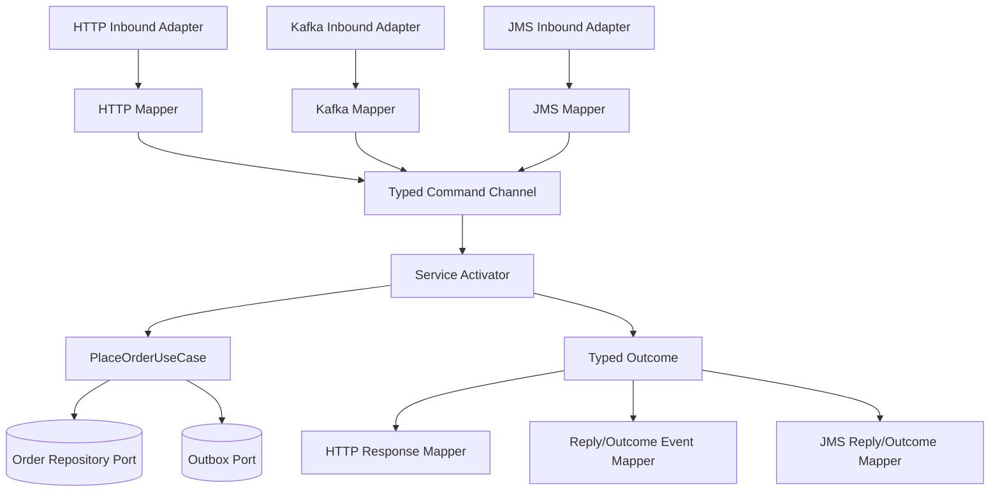
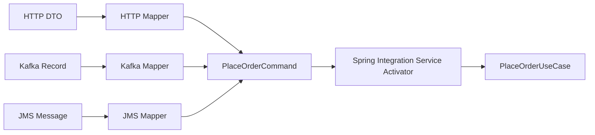
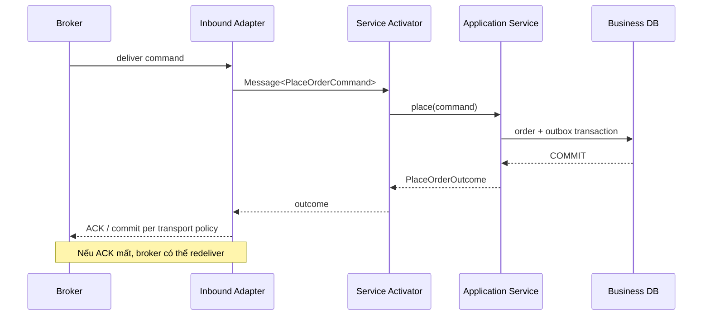
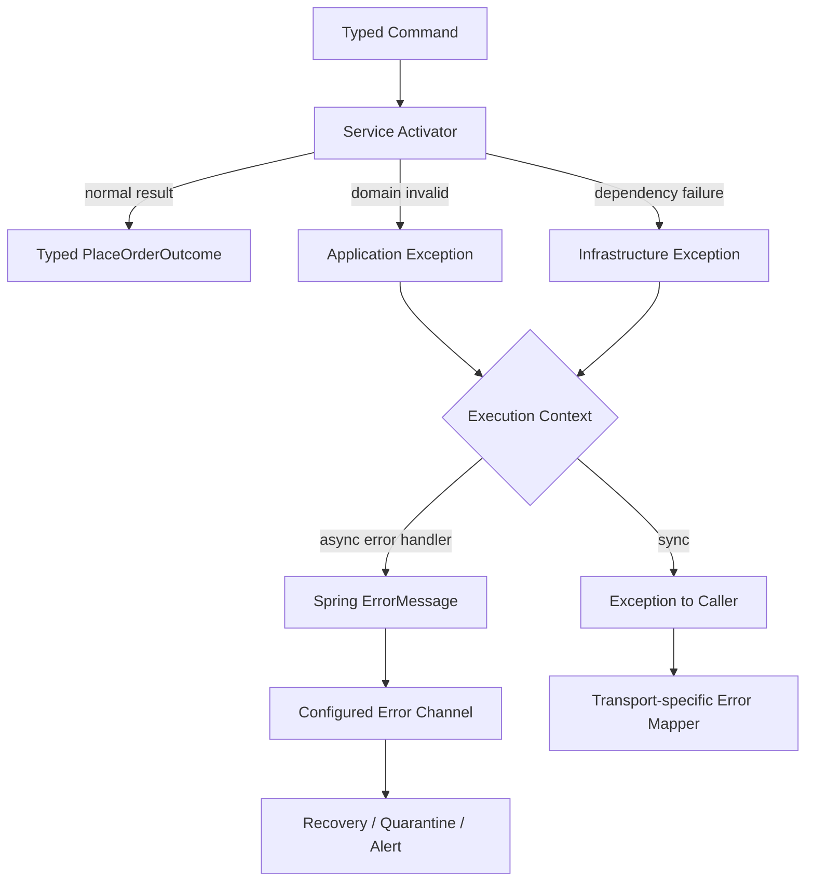
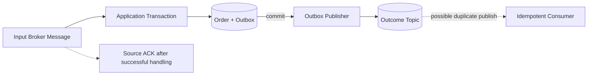
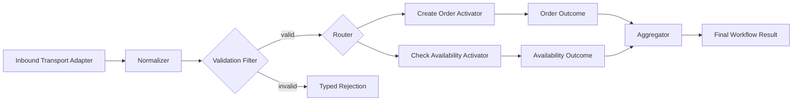
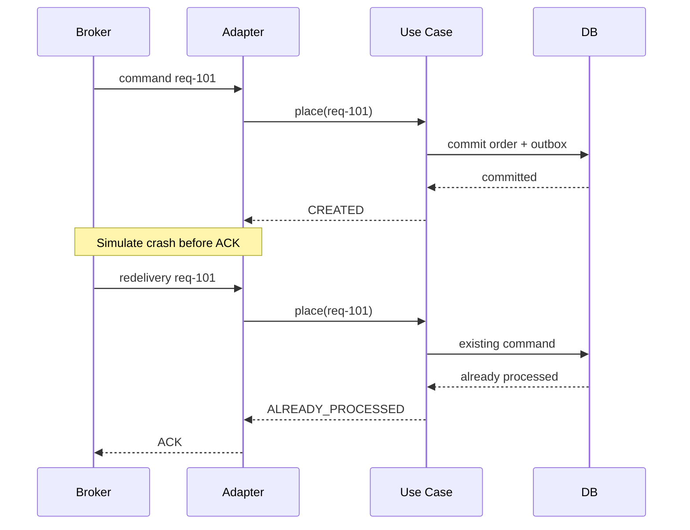
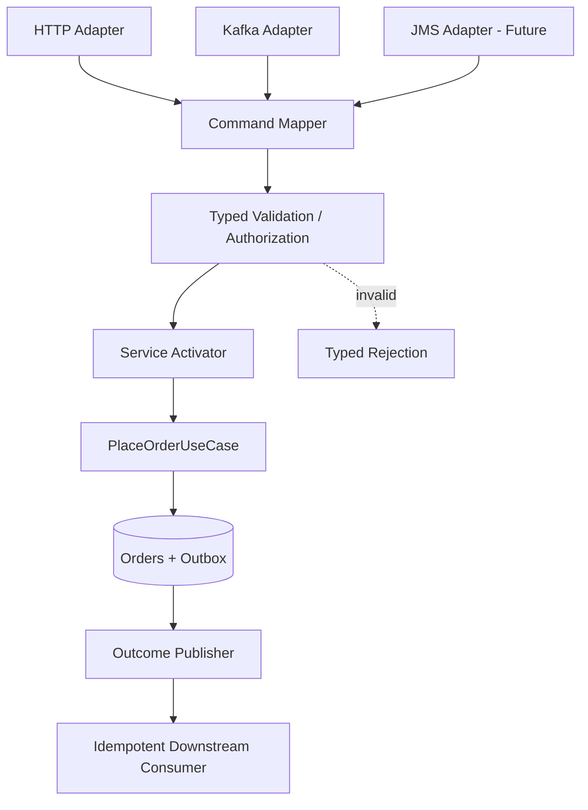

# Tách service activator khỏi transport

**Service Activator** là một Enterprise Integration Pattern (EIP) biến một message đến endpoint thành một lời gọi phương thức ứng dụng. Trong Spring Integration, nó thường xuất hiện dưới dạng `@ServiceActivator` hoặc endpoint `.handle(...)` trong Java DSL. Một Service Activator tốt **không cần biết lệnh đến từ HTTP, Kafka, JMS, file hay một ứng dụng Java khác**: nhiệm vụ của nó là nhận command đã được đưa về hợp đồng nội bộ, gọi đúng use case và trả kết quả theo hợp đồng của luồng.

Đây là tinh thần của bài **“Tách service activator khỏi transport”**, thuộc chương **Service activator** của module **SPRING_INTEGRATION_PATTERN**. Module hướng tới việc học triển khai Enterprise Integration Patterns với Spring Integration để xây dựng luồng thông điệp ít phụ thuộc và dễ mở rộng; thực hành Router, Filter, Transformer, Splitter, Aggregator, Gateway, retry, error channel và correlation, đồng thời kiểm thử và theo dõi các nhánh xử lý.

Một lỗi thiết kế thường thấy: `OrderService` trực tiếp nhận `ConsumerRecord<?, ?>` của Kafka, đọc `HttpServletRequest`, tự ACK JMS, tự xử lý header, rồi mới lưu đơn hàng. Khi đổi transport hoặc cần gọi lại nghiệp vụ từ batch job, class ấy phải thay đổi hoặc sinh các nhánh `if (source == ...)`. Retry, transaction và security của các transport khác nhau cũng bị trộn vào phương thức nghiệp vụ.

Bài này thiết kế một **application port** được gọi từ nhiều inbound adapter, đặt Service Activator ở ranh giới messaging, rồi kiểm chứng bằng Java/Spring Integration tests. Chú trọng những điểm dễ sai: identity và trust boundary, hợp đồng sync/async, ACK so với business commit, idempotency, outbox, exception/error channel và khả năng thay transport.

**Kết quả học tập:** giải thích được hướng phụ thuộc của kiến trúc; viết được domain command/outcome độc lập với Kafka/JMS/HTTP; nối chúng bằng `.handle(...)` hoặc `@ServiceActivator`; phân loại lỗi đúng lớp; và có bộ kiểm thử bảo đảm đổi adapter không đổi nghĩa nghiệp vụ.

## 1. Khi business service bị dính transport

Hãy tưởng tượng một handler xử lý lệnh đặt hàng:

```java
// PHẢN VÍ DỤ: domain bị trộn với HTTP/Kafka và transport ACK.
class TransportCoupledOrderService {
    void process(
            org.apache.kafka.clients.consumer.ConsumerRecord<String, String> record) {
        String json = record.value();
        // Parse JSON, đọc Kafka header, xác thực, xử lý nghiệp vụ,
        // rồi quyết định seek/commit offset ngay trong cùng method.
    }
}
```

Một biến thể khác nhận `HttpServletRequest` hoặc `jakarta.jms.Message` rồi đọc trực tiếp header để tính toán nghiệp vụ. Những kiểu class này thường kéo theo:

- Khó viết unit test thuần Java vì phải dựng Kafka/JMS/Servlet objects.
- Cùng business command nhưng phải tạo nhiều cách triển khai theo protocol.
- Domain service có quyền điều khiển ACK/offset mà không hiểu transaction của broker.
- Retry sai lớp: một lỗi HTTP response khiến toàn bộ remote side effect bị gọi lại.
- Correlation và idempotency dựa vào Kafka offset hoặc Spring Message ID thay vì business identity.
- Khi thêm một transport mới, phải sửa code nghiệp vụ đang ổn định.
- Error handling nhầm lẫn: mọi exception trở thành `HTTP 500`, hoặc mọi validation error bị retry qua broker.

**Mục tiêu không phải cấm toàn bộ transport API trong hệ thống**. Adapter cần biết protocol để đọc bytes, mapping headers và ACK. Chỉ nên giới hạn chúng ở đúng **ranh giới transport/infrastructure**, không để những chi tiết ấy trở thành tham số bắt buộc của application use case.

## 2. Kiến trúc đích: transport ở ngoài, use case ở trong



**Hướng phụ thuộc mong muốn:**

```text
Transport adapter --> Canonical command / application port
Spring Integration flow --> Application port
Application service --> Domain + infrastructure ports
Database / external adapters --> Implement application ports

Không có:
Application service --> Kafka ConsumerRecord / JMS Message / HttpServletRequest
Domain model --> Spring MessageHeaders / DirectChannel / Gateway annotation
```

Sơ đồ là mô hình thiết kế. Không có yêu cầu mọi command phải đồng thời đi ra ba output adapters; reply destination phụ thuộc nguồn, request-reply hay one-way contract.

### Ba lớp ranh giới

| Lớp | Được biết | Không nên phải biết |
| --- | --- | --- |
| **Inbound transport adapter** | HTTP status, Kafka offset, JMS ACK, JSON/header/converter, producer identity | Cách viết SQL/domain rules chi tiết |
| **Messaging application adapter / Service Activator** | Typed command, business metadata đã xác minh, routing, gọi method, reply mapping | Offset/Servlet request như một input nghiệp vụ |
| **Application use case/domain** | Command, domain invariants, repositories/ports, outcome, quyền nghiệp vụ | Channel name, Spring `Message<?>`, ACK, Kafka partitions |

**Tách biệt không có nghĩa mất thông tin cần thiết**: nếu tenant, actor, command identity và timestamp nghiệp vụ quan trọng, hãy đưa chúng vào một **hợp đồng ứng dụng có nguồn tin cậy**, thay vì truyền nguyên object transport.

## 3. Định nghĩa bất biến khi thay transport

Một thiết kế decoupled phải giữ được các tính chất sau:

1. **Cùng lệnh được xác thực và chuẩn hóa** tạo cùng business decision dù đến từ HTTP hay Kafka.
2. Service method không đổi chữ ký khi thêm JMS transport.
3. Domain validation và uniqueness có thể test **không khởi chạy Spring context**.
4. Các lỗi dữ liệu, quyền truy cập và hạ tầng có **phân loại ổn định**.
5. HTTP timeout hoặc Kafka redelivery không tự biến cùng command thành command mới.
6. ACK/commit/offset thuộc inbound adapter, không phải một dòng ở business method.
7. Không copy raw client `replyChannel`/`errorChannel` vào messaging control plane.
8. Service Activator không tự đảm bảo exactly-once; unique constraint/idempotency vẫn bảo vệ side effect.
9. Thay transport không làm sai amount, timezone, event ID hoặc tenant scope.
10. Test có thể thay một adapter bằng in-memory sender mà vẫn gọi cùng use case.

Nếu một thay đổi transport bắt buộc sửa business logic để “biết đây là Kafka”, cần xem lại hợp đồng hoặc chỗ đặt responsibility.

## 4. Transport identity khác business identity

Cùng một lệnh có nhiều cách nhận diện:

| Identity/metadata | Nơi thuộc về | Có nên dùng làm business idempotency key? |
| --- | --- | --- |
| `requestId` ổn định do caller cấp theo contract | Application command | Có thể, với scope và authorization rõ |
| `tenantId + operation + requestId` | Domain idempotency | Thường phù hợp nếu uniqueness contract bảo đảm |
| Kafka topic/partition/offset | Kafka adapter | Không thay business identity xuyên transport |
| Kafka record key | Transport routing | Chỉ nếu được xác minh là business key hợp lệ |
| JMSMessageID | JMS provider | Không bảo đảm cùng ID qua mọi republish |
| HTTP connection ID | HTTP infrastructure | Không |
| Spring `MessageHeaders.ID` | Spring message lifecycle | Không mặc định ổn định qua bridge/transform |
| `traceId` | Observability | Không |
| `correlationId` | Workflow/batch | Không tự đại diện một side effect duy nhất |

Một Kafka record được redeliver có thể giữ offset trong cùng topic/partition, nhưng **cùng lệnh cũng có thể được gửi lại bằng một record mới hoặc qua HTTP**. Khử duplicate ở business layer nên dựa trên **operation identity**, không chỉ trên vị trí record trong broker.

## 5. Contract nội bộ: typed command và typed outcome

Ta chọn ví dụ `PlaceOrder` với lệnh được chuẩn hóa trước khi vào Service Activator:

```java
import java.util.List;

record OrderLine(String sku, int quantity) {}

record PlaceOrderCommand(
    String tenantId,
    String commandId,
    String orderId,
    String customerId,
    List<OrderLine> lines
) {
    PlaceOrderCommand {
        if (lines != null) {
            lines = List.copyOf(lines);
        }
    }
}

enum PlaceOrderStatus {
    CREATED,
    ALREADY_PROCESSED
}

record PlaceOrderOutcome(
    String tenantId,
    String commandId,
    String orderId,
    PlaceOrderStatus status
) {}
```

**Giải thích ý nghĩa:**

- `tenantId` đã được ánh xạ và đối chiếu với principal hoặc nguồn đáng tin.
- `commandId` ổn định khi một lệnh được retry/replayed; không tạo UUID mới mỗi lần adapter nhận cùng lệnh.
- `orderId` là domain entity identity; **không tự đồng nhất** với `commandId`.
- `customerId`, `lines` là dữ liệu nghiệp vụ; không chứa `ConsumerRecord` hoặc `HttpServletRequest`.
- `PlaceOrderOutcome` là kết quả ứng dụng, **không chứa HTTP status/JMS destination/Kafka offset**.

Đây là contract minh họa, không phải một schema mặc định của Spring Integration. Các yêu cầu bảo mật, business uniqueness và versioning phải được quyết định dựa trên hệ thống thật.

### Một command không nhất thiết là một event

`PlaceOrderCommand` là **lệnh yêu cầu hành động**. `OrderPlacedEvent` là **sự kiện mô tả điều đã xảy ra**. Khi xử lý thành công, event phát đi cần identity và causation phù hợp; không tự copy toàn bộ command headers rồi coi là event hợp lệ.

## 6. Application port không phụ thuộc messaging

Dùng một interface để mô tả việc ứng dụng có thể làm:

```java
interface PlaceOrderUseCase {
    PlaceOrderOutcome place(PlaceOrderCommand command);
}
```

Port này không import Spring Integration, Kafka, JMS hoặc Servlet. Controller HTTP, Kafka consumer adapter, messaging gateway, test fixture hay scheduled task đều có thể gọi nó thông qua Service Activator hoặc một adapter tương ứng.

Một **business interface** không tự giải quyết coupling nếu tham số vẫn là `Message<ConsumerRecord<...>>`. Hãy kiểm tra **kiểu dữ liệu trong chữ ký**, không chỉ nhìn package của interface.

### Transport-neutral không bắt buộc “không dùng Spring ở đâu cả”

Một implementation use case có thể dùng Spring `@Transactional` như một lựa chọn hạ tầng. Tuy nhiên, giao diện public của use case nên giữ **ngôn ngữ domain/application**, và method có thể unit test qua fake repository. Mục tiêu là **cách ly protocol**, không ép mọi dự án phải là một kiến trúc framework-free tuyệt đối.

## 7. Domain validation và policy không nằm trong Kafka listener

Một application service có thể kiểm tra những bất biến được tái sử dụng từ mọi entrypoint.

```java
final class InvalidOrderCommand extends RuntimeException {
    private final String code;

    InvalidOrderCommand(String code) {
        super(code);
        this.code = code;
    }

    String code() {
        return code;
    }
}

final class IdempotencyConflict extends RuntimeException {
    IdempotencyConflict() {
        super("IDEMPOTENCY_KEY_CONFLICT");
    }
}

final class OrderRules {
    static void requireValid(PlaceOrderCommand cmd) {
        if (cmd == null || blank(cmd.tenantId())
                || blank(cmd.commandId())
                || blank(cmd.orderId())
                || blank(cmd.customerId())
                || cmd.lines() == null || cmd.lines().isEmpty()) {
            throw new InvalidOrderCommand("ORDER_REQUIRED_FIELDS");
        }
        for (OrderLine line : cmd.lines()) {
            if (line == null || blank(line.sku())
                    || line.quantity() <= 0) {
                throw new InvalidOrderCommand("ORDER_LINE_INVALID");
            }
        }
    }

    private static boolean blank(String value) {
        return value == null || value.isBlank();
    }
}
```

Phần này **không quyết định gửi HTTP 422 hay Kafka DLT**. Nó báo một lỗi nghiệp vụ có code ổn định. Adapter quyết định cách biểu diễn lỗi theo contract của transport.

### Không chỉ validate ở ingress

Ngay cả khi HTTP controller đã chạy `@Valid` và Kafka adapter đã check JSON Schema, use case vẫn nên bảo vệ **những invariants quan trọng trước side effect**. Nếu ngày mai có một batch adapter mới gọi port mà quên validation, domain vẫn không tạo đơn với quantity âm.

Validation của domain không thay thế authorization của caller; quyền của actor với tenant phải được kiểm tra ở security/application boundary.

## 8. Repository port và business uniqueness

Việc chống duplicate nên được mô hình hóa bằng domain operation, không bằng Kafka offset.

```java
record OrderWriteResult(
    boolean inserted,
    boolean sameCommand
) {}

interface OrderWritePort {
    // Atomic theo (tenantId, orderId) và/hoặc command identity.
    // sameCommand=false khi key cũ thuộc lệnh khác.
    OrderWriteResult saveIfAbsent(PlaceOrderCommand command);
}
```

Tùy domain, có thể cần hai ràng buộc:

- `(tenantId, commandId, operationType)` để xác định cùng lệnh.
- `(tenantId, orderId)` để ngăn tạo cùng một đơn hai lần.

Nếu cùng `commandId` xuất hiện với **payload khác**, phải trả conflict; không coi đó là retry hợp lệ. Nếu cùng `orderId` nhưng command khác, chính sách có thể là `ORDER_ALREADY_EXISTS` hoặc version conflict; không tùy tiện trả `ALREADY_PROCESSED` như thể đó là cùng message.

Một port tốt công bố **đủ outcome** để application service phân biệt các tình huống. Đừng che lỗi bằng một boolean duy nhất nếu domain có hơn hai trạng thái.

## 9. Application service và việc ghi outbox

Ví dụ skeleton đặt transaction ở use case implementation:

```java
import org.springframework.transaction.annotation.Transactional;

interface OrderOutboxPort {
    void enqueueOrderPlaced(PlaceOrderCommand command);
}

class PlaceOrderApplicationService implements PlaceOrderUseCase {
    private final OrderWritePort orders;
    private final OrderOutboxPort outbox;

    PlaceOrderApplicationService(
            OrderWritePort orders,
            OrderOutboxPort outbox) {
        this.orders = orders;
        this.outbox = outbox;
    }

    @Override
    @Transactional
    public PlaceOrderOutcome place(PlaceOrderCommand command) {
        OrderRules.requireValid(command);

        OrderWriteResult write = orders.saveIfAbsent(command);

        if (!write.sameCommand()) {
            throw new IdempotencyConflict();
        }

        if (write.inserted()) {
            // Ghi cùng DB transaction với order nếu cần atomicity.
            outbox.enqueueOrderPlaced(command);
        }

        return new PlaceOrderOutcome(
            command.tenantId(),
            command.commandId(),
            command.orderId(),
            write.inserted()
                ? PlaceOrderStatus.CREATED
                : PlaceOrderStatus.ALREADY_PROCESSED
        );
    }
}
```

**Điều kiện quan trọng của ví dụ:**

1. `PlaceOrderApplicationService` phải là **Spring-managed bean được gọi qua proxy/interceptor**, hoặc được bao bởi một transaction boundary tương đương, thì `@Transactional` mới có tác dụng.
2. `OrderWritePort`/`OrderOutboxPort` phải dùng **cùng database và transaction manager** để đảm bảo atomic commit như mô tả.
3. `saveIfAbsent` phải **atomic**, có unique constraints và xử lý collision, chứ không chỉ đọc `exists` rồi insert.
4. `sameCommand` cần so business identity/payload fingerprint theo một quy tắc canonical/versioned. Repository phải trả đúng cả trường hợp existing command và existing order collision.
5. Khi outbox enqueue lỗi, transaction nên rollback theo chính sách; không commit order rồi mất event phát đi.
6. Đây là **skeleton học thuật**: implementation JDBC/JPA, SQL locking, transactional inbox, security và tests hạ tầng phải được bổ sung ở dự án thật.

Không gọi Kafka producer trực tiếp trong database transaction rồi coi Kafka publish được rollback khi DB rollback. Dùng outbox/CDC hoặc một cơ chế đảm bảo giao dịch phù hợp; publisher có thể phát lại, nên consumer vẫn cần idempotency.

## 10. Service Activator là adapter mỏng vào application port

Bản đơn giản nhất là một class nhận typed command và gọi use case:

```java
final class PlaceOrderActivator {
    private final PlaceOrderUseCase useCase;

    PlaceOrderActivator(PlaceOrderUseCase useCase) {
        this.useCase = useCase;
    }

    public PlaceOrderOutcome handle(PlaceOrderCommand command) {
        return useCase.place(command);
    }
}
```

Class này không có `ConsumerRecord`, `HttpServletRequest` hay `jakarta.jms.Message`. Nếu adapter HTTP hoặc Kafka chuẩn hóa input thành `PlaceOrderCommand`, cùng một `handle` làm việc cho cả hai.

**Trách nhiệm của activator** nên là:

- Chuyển typed message thành lời gọi ứng dụng.
- Gắn/trích các business metadata thật sự cần thiết qua input contract.
- Trả outcome cho flow hoặc ánh xạ exception qua boundary.
- Không tự quyết định broker offset, HTTP status hoặc JMS ACK.

Không nhét toàn bộ SQL, retry driver, JSON parser và quy tắc thanh toán vào adapter này. Nó nên dễ thay thế bởi một unit test stub.

## 11. Spring Integration Java DSL: typed channel đến Service Activator

Một flow minh họa dùng `DirectChannel` cho request-reply đồng bộ và `QueueChannel` làm nơi quan sát outcome trong test:

```java
import org.springframework.context.annotation.Bean;
import org.springframework.context.annotation.Configuration;
import org.springframework.integration.channel.DirectChannel;
import org.springframework.integration.channel.QueueChannel;
import org.springframework.integration.config.EnableIntegration;
import org.springframework.integration.dsl.IntegrationFlow;
import org.springframework.messaging.MessageChannel;
import org.springframework.messaging.PollableChannel;

@Configuration
@EnableIntegration
class OrderMessagingConfiguration {

    @Bean("orders.command.in")
    MessageChannel commandsInput() {
        return new DirectChannel();
    }

    @Bean("orders.outcomes")
    PollableChannel outcomes() {
        // Test/demo: QueueChannel trong RAM, không durable.
        return new QueueChannel();
    }

    @Bean
    PlaceOrderActivator placeOrderActivator(
            PlaceOrderUseCase useCase) {
        return new PlaceOrderActivator(useCase);
    }

    @Bean
    IntegrationFlow placeOrderFlow(
            PlaceOrderActivator activator) {
        return IntegrationFlow.from("orders.command.in")
            .handle(activator, "handle")
            .channel("orders.outcomes")
            .get();
    }
}
```

Đoạn này **cần một bean `PlaceOrderUseCase`** từ application configuration trong context thật. Có thể thay `.handle(activator, "handle")` bằng handler lambda typed:

```java
@Bean
IntegrationFlow placeOrderFlowWithLambda(
        PlaceOrderUseCase useCase) {
    return IntegrationFlow.from("orders.command.lambda.in")
        .handle(PlaceOrderCommand.class,
            (command, headers) -> useCase.place(command))
        .channel("orders.command.lambda.out")
        .get();
}
```

Hai ví dụ là **cấu hình thay thế**; đoạn lambda yêu cầu khai báo các channel riêng. Không đăng ký hai flow dùng cùng tên bean hoặc cùng input để thử nghiệm một cách vô ý. Kiểm tra overload DSL theo phiên bản Spring Integration dự án khi build.

### Điều đã tách được

Không một dòng trong `PlaceOrderUseCase.place` phải biết input là HTTP hay Kafka. Code hạ tầng có thể đổi từ broker này sang broker khác mà không sửa logic tạo đơn.

## 12. Annotation `@ServiceActivator` cũng giữ ranh giới tương tự

Một phương án annotation thay cho DSL:

```java
import org.springframework.integration.annotation.ServiceActivator;
import org.springframework.stereotype.Component;

@Component
class AnnotatedPlaceOrderEndpoint {
    private final PlaceOrderUseCase useCase;

    AnnotatedPlaceOrderEndpoint(PlaceOrderUseCase useCase) {
        this.useCase = useCase;
    }

    @ServiceActivator(
        inputChannel = "orders.annotation.in",
        outputChannel = "orders.annotation.out")
    public PlaceOrderOutcome handle(PlaceOrderCommand command) {
        return useCase.place(command);
    }
}
```

Các channel trên phải được khai báo. Điều quan trọng không phải annotation hay DSL, mà là **method signature chỉ dùng kiểu của ứng dụng**.

Nếu đặt `@ServiceActivator` trực tiếp lên use case method, application service bắt đầu phụ thuộc annotation của framework. Điều đó có thể chấp nhận ở một số codebase, nhưng **lớp adapter mỏng** thường giúp thay framework/transport và unit test dễ hơn.

### Chọn một cách rõ ràng

| Trường hợp | Hướng thường phù hợp |
| --- | --- |
| Flow gồm nhiều bước decode/validate/route | Java DSL để thấy topology |
| Endpoint đơn lẻ với method rõ ràng | `@ServiceActivator` |
| Nhiều transports cùng kích hoạt một use case | Nhiều inbound adapters → chung typed flow/port |
| Cần chính sách đặc thù transport | Giữ ở adapter/inbound configuration |
| Cần reuse domain method ngoài Spring Integration | Interface use case + adapter mỏng |

## 13. Input adapter HTTP: chỉ làm việc của HTTP

Đối với HTTP inbound, trách nhiệm thường là:

1. Xác thực caller.
2. Kiểm tra content type, body size, JSON syntax và schema.
3. Chuyển DTO/raw input thành `PlaceOrderCommand`.
4. Đối chiếu tenant từ request với principal được xác thực.
5. Gửi command vào typed message channel hoặc gọi application gateway.
6. Map `PlaceOrderOutcome`/exception sang HTTP response có cấu trúc.

Ví dụ wire JSON:

```json
{
  "requestId": "req-101",
  "tenantId": "tenant-a",
  "orderId": "ORD-101",
  "customerId": "CUS-9",
  "lines": [
    {"sku": "SKU-1", "quantity": 2}
  ]
}
```

Một HTTP adapter **không được đưa cả `HttpServletRequest`** vào `PlaceOrderUseCase.place` chỉ để lấy `tenantId` hoặc `requestId`.

### Mẫu boundary ở mức Java

```java
record HttpPlaceOrderRequest(
    String requestId,
    String tenantId,
    String orderId,
    String customerId,
    java.util.List<OrderLine> lines
) {}

interface VerifiedTenantResolver {
    // Dữ liệu này phải được lấy từ security context có xác thực.
    String authenticatedTenant();
}

final class HttpOrderMapper {
    PlaceOrderCommand map(
            HttpPlaceOrderRequest request,
            String verifiedTenant) {
        if (request == null || verifiedTenant == null
                || !verifiedTenant.equals(request.tenantId())) {
            throw new InvalidOrderCommand("TENANT_NOT_AUTHORIZED");
        }
        return new PlaceOrderCommand(
            verifiedTenant,
            request.requestId(),
            request.orderId(),
            request.customerId(),
            request.lines());
    }
}
```

**Đây chỉ là boundary mapper**, không phải Spring MVC controller hoàn chỉnh. Trong production cần phân biệt authentication/authorization errors với validation errors; không trả `422 INVALID_INPUT` cho một lệnh mà caller không có quyền.

## 14. Input adapter Kafka: giữ offset và broker headers ở ngoài

Kafka có khái niệm topic, partition, offset, consumer group và acknowledgment/commit. Chúng thuộc **lớp vận hành transport**.

Một Kafka input record có thể chứa:

```json
{
  "commandId": "req-101",
  "tenant": "tenant-a",
  "order": {
    "id": "ORD-101",
    "customer": "CUS-9",
    "lines": [{"sku": "SKU-1", "qty": 2}]
  }
}
```

Adapter cần:

- Deserialize bytes với đúng source schema/version.
- Verify producer identity và tenant scope theo chính sách.
- Map source fields thành `PlaceOrderCommand`.
- Gắn business metadata vào envelope/header nội bộ nếu cần.
- Send command đến Service Activator.
- Map outcome vào event/reply/outcome store, hoặc ACK theo hợp đồng.
- Quyết định retry/seek/DLT/commit offset qua cấu hình của Kafka inbound adapter.

**Không truyền Kafka `ConsumerRecord` hoặc acknowledgment object vào domain method.** Nếu business logic thật sự cần biết thứ tự của events, hãy định nghĩa một business sequence/version field đã được xác minh, không dùng Kafka offset như phiên bản đơn hàng xuyên nhiều topics/partitions.

### Khi nào offset còn hữu ích?

Offset hữu ích cho **điều tra, replay transport, consumer lag và ACK semantics**. Lưu nó ở audit metadata hoặc logging có kiểm soát; đừng gắn nghĩa “order version” nếu business contract không quy định như vậy.

Một sự kiện có thể được republish sang topic khác, mang offset mới nhưng vẫn là **cùng command**.

## 15. Input adapter JMS: thay transport, giữ command

JMS có destination, delivery mode, message ID, properties, reply-to và acknowledgment/session transaction. Một adapter JMS có thể đọc JMS `TextMessage`/`BytesMessage`, decode thành `PlaceOrderCommand` rồi gửi tới **cùng channel** `orders.command.in`.



**JMSMessageID không thay thế commandId** trong business contract. Nếu producer redeliver hoặc tạo lại message, JMS identity có thể khác dù nghiệp vụ không đổi.

JMS transaction/session và database business transaction cũng không tự thành một giao dịch nguyên tử chỉ vì cùng một method được gọi. Cần xác định rõ commit/rollback của resource, adapter container và cơ chế recovery.

## 16. Message metadata nào được phép vượt qua ranh giới?

Không nhất thiết phải vứt mọi metadata. Nhưng hãy tách:

| Metadata | Chuyển vào use case? | Lý do |
| --- | --- | --- |
| Verified tenant ID | Có, dưới dạng field/application context | Phục vụ authorization và domain isolation |
| Stable command/request ID | Có | Idempotency và outcome lookup |
| Order ID, customer ID | Có | Domain data |
| Causation/business correlation ID | Khi thực sự cần | Workflow/correlation |
| Source occurredAt | Khi có ý nghĩa nghiệp vụ | Không dùng receive timestamp thay thế |
| Kafka offset/partition | Thường không | Transport operational data |
| JMS acknowledgment handle | Không | Transport control plane |
| Servlet response object | Không | HTTP response handling |
| Spring `replyChannel`/`errorChannel` | Không | Internal channel control plane |
| Trace ID | Không dùng làm business key | Observability |
| Authentication principal object thô | Thường không | Map thành verified actor/scope cần thiết |

### Dữ liệu nào nằm ở payload, dữ liệu nào ở header?

- Nếu một field **bắt buộc để xử lý đúng sau khi serialize qua broker**, nên có trong **versioned payload/envelope contract** hoặc một header wire contract được bảo đảm.
- Nếu là **control-plane metadata nội bộ**, giữ ở Spring headers, không copy từ request client.
- Nếu field có ý nghĩa business/identity, đừng chỉ dựa vào `MessageHeaders.ID` ngẫu nhiên.
- Nếu dùng `@Header` trong Service Activator, kiểm tra nguồn tin cậy và điều kiện tồn tại.

Sự “trong suốt” của headers khi chuyển qua các transport khác nhau **không được giả định**. Message mapper/serializer có thể làm mất hoặc đổi tên header; phải test.

## 17. Tạo typed message từ một boundary đáng tin

Ví dụ một helper chỉ dùng sau khi auth/validation:

```java
import org.springframework.messaging.Message;
import org.springframework.messaging.support.MessageBuilder;

final class TrustedCommandMessageFactory {
    Message<PlaceOrderCommand> toMessage(
            PlaceOrderCommand command,
            String verifiedTenant,
            String correlationId) {
        if (command == null || verifiedTenant == null
                || !verifiedTenant.equals(command.tenantId())) {
            throw new InvalidOrderCommand("TENANT_MISMATCH");
        }
        return MessageBuilder.withPayload(command)
            .setHeader("businessTenantId", verifiedTenant)
            .setHeader("businessCommandId", command.commandId())
            .setHeader("businessCorrelationId", correlationId)
            .build();
    }
}
```

Helper không thực hiện authentication; nó **giả định** `verifiedTenant` được tạo từ security context tin cậy. Trong production cũng phải validate `commandId`/correlation scope và không cho caller tự đặt internal channel destinations.

Một Service Activator có thể chỉ nhận payload `PlaceOrderCommand`. Nếu cần context bổ sung, tạo **application context** typed đã được xác minh hoặc dùng `@Header` trong lớp adapter mỏng; đừng ép domain service nhận `MessageHeaders` rồi tự duyệt raw client values.

## 18. Service Activator gọi use case với headers: lúc nào nên và không?

Một adapter method có thể dùng:

```java
import org.springframework.messaging.handler.annotation.Header;
import org.springframework.messaging.handler.annotation.Payload;

final class HeaderAwarePlaceOrderActivator {
    private final PlaceOrderUseCase useCase;

    HeaderAwarePlaceOrderActivator(PlaceOrderUseCase useCase) {
        this.useCase = useCase;
    }

    public PlaceOrderOutcome handle(
            @Payload PlaceOrderCommand command,
            @Header("businessTenantId") String verifiedTenant) {
        if (!command.tenantId().equals(verifiedTenant)) {
            throw new InvalidOrderCommand("TENANT_MISMATCH");
        }
        return useCase.place(command);
    }
}
```

Chữ ký này phù hợp khi ứng dụng muốn assert header/payload consistency. Tuy nhiên, **khớp hai chuỗi vẫn không chứng minh authorization** nếu attacker có thể sửa cả hai. Verified tenant phải đến từ trust boundary, không được lấy nguyên HTTP `X-Tenant-Id` do client khai.

### Header không phải application contract bất biến nếu chỉ tồn tại trong JVM

Khi input đi qua Kafka/HTTP/JMS bridge, một Spring header kiểu Java có thể bị bỏ. Nếu `businessTenantId` bắt buộc, nên định nghĩa nó trong wire envelope và **dựng lại trusted header sau kiểm tra**, hoặc đưa thông tin đã xác thực vào command/context.

Test phải chứng minh cùng một command sau roundtrip transport vẫn được hiểu đúng và không vô tình mất identity.

## 19. Request-reply khác one-way

Một `PlaceOrderOutcome` có thể được trả trực tiếp cho HTTP caller qua Gateway, nhưng Kafka/JMS consumer thường xử lý theo kiểu event/command bất đồng bộ.

| Đường đi | Hợp đồng | Điều caller biết |
| --- | --- | --- |
| HTTP synchronous request-reply | Chờ `PlaceOrderOutcome` hoặc lỗi | Business outcome nếu request hoàn thành đúng |
| HTTP `202 Accepted` | Công việc được nhận/lên lịch | Chưa đồng nghĩa order đã tạo |
| Kafka command consumer | ACK record theo policy, phát outcome event | Producer không nhất thiết chờ reply tức thì |
| JMS request-reply | Reply destination/correlation theo protocol | Outcome khi reply thực sự tới |
| Fire-and-forget in-memory | Handler one-way | Không có reply bình thường |

### Đừng nhầm one-way và asynchronous

`void` hoặc `return null` nghĩa là handler **không phát normal reply**. Nếu endpoint nằm trên `DirectChannel`, nó vẫn có thể chạy **đồng bộ trong sender thread**; muốn xử lý async cần `ExecutorChannel`, poller hoặc inbound adapter async phù hợp.

Nếu một Gateway yêu cầu reply nhưng endpoint trả `null`, caller có thể chờ đến timeout hoặc nhận required-reply error theo cấu hình. Không dùng reply timeout để báo một field invalid.

## 20. Gateway adapter cho caller đồng bộ

Một Spring Integration messaging gateway có thể cung cấp interface Java:

```java
import org.springframework.integration.annotation.Gateway;
import org.springframework.integration.annotation.MessagingGateway;

@MessagingGateway
interface PlaceOrderGateway {
    @Gateway(requestChannel = "orders.gateway.in")
    PlaceOrderOutcome place(PlaceOrderCommand command);
}
```

Flow tương ứng có thể được khai báo:

```java
@Bean
IntegrationFlow gatewayOrderFlow(PlaceOrderUseCase useCase) {
    return IntegrationFlow.from("orders.gateway.in")
        .handle(PlaceOrderCommand.class,
            (command, headers) -> useCase.place(command))
        .get();
}
```

Đây là **cấu hình thay thế có channel riêng**. Input channel `orders.gateway.in` và gateway bean cần được đăng ký đúng. Không đặt một fixed output channel không trả về Gateway mà lại kỳ vọng lời gọi nhận reply.

Tầng HTTP controller có thể gọi `PlaceOrderGateway.place` và map `PlaceOrderOutcome` thành 201/200/409 theo API contract. HTTP response code **không nằm trong return value của domain use case**.

### Timeout không đồng nghĩa rollback

Nếu use case đã commit nhưng reply chưa tới HTTP caller, caller có thể retry. Đó là lý do business command ID và idempotency phải ổn định **độc lập transport**.

## 21. ACK và transaction nằm ở ranh giới nào?

Có ba mốc khác nhau:

1. **Transport received:** adapter đã đọc hoặc nhận message.
2. **Business committed:** domain transaction đã commit order/outbox.
3. **Transport acknowledged:** broker/source được báo có thể tiến offset/xóa delivery hoặc phản hồi HTTP.



Sơ đồ trình bày **một chính sách mong muốn**, không bảo đảm mọi inbound adapter tự ACK sau commit. Một số adapter/consumer mode tự ACK sớm; một số hỗ trợ manual ack hoặc transaction. Phải cấu hình và kiểm thử semantics thật.

**Không để use case gọi Kafka `Acknowledgment.acknowledge()` hay JMS `message.acknowledge()`.** Use case trả outcome/exception; adapter quyết định ACK hoặc recovery theo chính sách transport và kết quả đã được commit.

### Mất ACK sau business commit

Khi ACK mất, record có thể được phát lại. Khi đó `PlaceOrderUseCase` phải trả outcome idempotent hoặc không chạy effect lần hai. Không có atomic transaction chung giữa broker và database thì không nên tuyên bố exactly-once end-to-end chỉ nhờ Service Activator.

## 22. Phân loại lỗi theo hợp đồng ứng dụng

Nên có một bảng phân loại:

| Loại lỗi | Ví dụ | Ý nghĩa | Retry nguyên message? |
| --- | --- | --- | --- |
| `INVALID_COMMAND` | Quantity âm, thiếu order ID | Dữ liệu sai chắc chắn | Thường không |
| `UNAUTHORIZED` | Actor không được phép vào tenant | Lỗi bảo mật | Không retry tự động |
| `IDEMPOTENCY_CONFLICT` | Cùng commandId, payload khác | Hợp đồng request bị vi phạm | Không |
| `BUSINESS_REJECTED` | Hết hạn đặt hàng | Quy tắc nghiệp vụ | Tùy contract; thường không |
| `DEPENDENCY_UNAVAILABLE` | Database chưa kết nối | Lỗi tạm thời | Có thể bounded retry |
| `OUTCOME_UNKNOWN` | Remote payment thành công nhưng response mất | Chưa biết đã commit chưa | Đối soát trước retry |
| `BUG/INTERNAL_ERROR` | NullPointerException do code | Lỗi triển khai | Alert, không đổ lỗi client |

Một application exception có code/cause ổn định giúp adapters map kết quả:

```text
INVALID_COMMAND
    HTTP -> 400/422 với field violations
    Kafka -> typed rejection event / quarantine / source ACK theo policy
    JMS -> reply lỗi / DLQ theo contract

DEPENDENCY_UNAVAILABLE
    HTTP -> 503 hoặc lỗi hạ tầng phù hợp
    Kafka -> bounded retry/backoff
    JMS -> redelivery / recovery policy
```

Đây là **gợi ý contract**, không phải bảng mapping mặc định của Spring Integration, Kafka hay Spring MVC. Quan trọng là giữ **cùng ý nghĩa lỗi ứng dụng**, còn biểu diễn vận chuyển có thể khác.

## 23. Spring `ErrorMessage` khác outcome nghiệp vụ

Khi Service Activator ném exception:

- Nếu đang chạy qua `DirectChannel` đồng bộ, exception có thể truyền ngược tới sender/Gateway, có thể được bọc `MessagingException`.
- Nếu exception được một async error handler bắt, nó **có thể** trở thành Spring `ErrorMessage` với `Throwable` là payload.
- `errorChannel` không phải “một channel chứa mọi `PlaceOrderOutcome(REJECTED)`”.
- `ErrorMessage`/`failedMessage` có thể chứa payload/headers nhạy cảm; không serialize nguyên exception ra HTTP/Kafka reply.



Không giả định một `ExecutorChannel` bất kỳ sẽ tự publish đến channel bạn đặt tên; phải xem error handler, headers, poller/adapter và phiên bản framework được cấu hình.

## 24. Retry nên đặt ở đâu?

Có thể retry ở nhiều lớp nhưng mỗi nơi có phạm vi khác nhau:

| Lớp retry | Điều được lặp | Rủi ro |
| --- | --- | --- |
| HTTP client retry | Toàn bộ request | Có thể tạo command mới nếu requestId thay đổi |
| Kafka/JMS redelivery | Toàn bộ record/message | Các bước trước khi fail có thể chạy lại |
| Spring Integration request handler advice | Service Activator invocation | Side effect trước exception có thể lặp |
| Application dependency retry | Một call DB/API phụ | Cần idempotency và timeout rõ |
| Outbox publisher retry | Phát outcome event | Consumer có thể nhận duplicate |

**Không bao quanh mọi lỗi bằng một retry advice chung**. Với validation deterministic, lặp cùng input không giúp gì. Với outage tạm thời, bounded retry/backoff có thể hiệu quả. Với `OUTCOME_UNKNOWN` sau remote side effect, phải **reconcile**, không gọi lại mù.

### Ví dụ phản ví dụ

```text
place():
  chargeRemotePayment()    <- provider đã thu tiền
  saveOrder()              <- database timeout
  throw DEPENDENCY_ERROR

retry whole activator:
  chargeRemotePayment()    <- có thể thu tiền lần hai
```

Giải pháp là provider idempotency key, outbox/command dispatch, reconciliation và xác định transaction boundary — không nằm ở việc đổi `KafkaListener` thành Service Activator.

## 25. Idempotency không phụ thuộc Kafka hay HTTP

Một khi nhận cả HTTP và Kafka, cùng request có thể xuất hiện qua **hai transport khác nhau**. Nếu dedup bằng Kafka offset, HTTP request sẽ không được phát hiện là duplicate.

Một khóa application-level có thể là:

```text
(tenantId, operationType, commandId)
```

Với operation `PLACE_ORDER`, có thể thêm business uniqueness `(tenantId, orderId)`. Nhưng phải kiểm tra **same command vs same order with different command**.

### Retention window và replay

Dù dùng Idempotent Receiver hoặc metadata store, cần giữ record đủ lâu theo broker redelivery, HTTP client retry, DLQ/manual replay và callback horizon. Nếu record hết TTL nhưng một lệnh cũ vẫn có thể đến, domain unique constraint/outcome lookup cần ngăn side effect cấm lặp.

Không nhầm processing lease với idempotency retention. Không coi `MessageHeaders.ID` mới sau retry là command mới.

## 26. Business transaction và broker transaction không tự ghép chung

Giả sử Kafka inbound nhận command, domain database commit order, sau đó adapter commit offset. Hai commit này thường **không cùng một transaction ACID**.



Một phương án vận hành phổ biến:

- Trong database transaction, ghi order + outbox row cùng lúc.
- Sau commit, outbox publisher phát event.
- Publisher có thể retry; event ID phải ổn định.
- Downstream consumer dedup.
- Inbound adapter ACK theo policy khi xử lý đã đạt điều kiện cần thiết.
- Khi crash trước ACK, command redeliver nhưng use case idempotent.

**Outbox không tự đảm bảo exactly-once publish**: nó giảm rủi ro “DB đã commit nhưng quên gửi event”, nhưng vẫn có khả năng phát duplicate khi ACK publish thất lạc.

Nếu ứng dụng đòi bảo đảm khác, cần mô tả rõ broker/DB transaction, failure model và kiểm thử tương ứng.

## 27. External side effects và provider idempotency

Một use case có thể gọi hệ thống thanh toán, gửi email hoặc đặt hàng vận chuyển. Database transaction không thể rollback một API ở tổ chức khác.

Cần trả lời:

- Provider có hỗ trợ idempotency key không?
- Provider giữ key bao lâu?
- Có API query outcome/transaction reference không?
- Retry có thể xảy ra sau thời hạn provider lưu key không?
- Có thể chia “persist intent” và “perform external effect” bằng outbox/worker không?
- Khi outcome chưa rõ, có state `REVIEW/PENDING` và người vận hành xử lý không?

Service Activator không nên nhận HTTP response của remote provider như **một xác nhận nghiệp vụ tuyệt đối** nếu kết nối có thể bị timeout sau khi phía ngoài đã commit. Dùng reconciliation và định nghĩa trạng thái outcome.

## 28. Backpressure và execution model thuộc topology

Transport-neutral use case có thể được kích hoạt bằng:

- `DirectChannel`: handler thường chạy trong caller thread.
- `ExecutorChannel`: dispatch qua task executor; có thể song song và thay đổi completion order.
- `QueueChannel` + poller: xử lý theo lịch poll.
- Kafka/JMS inbound adapter: concurrency, batching, session/partition semantics riêng.

Thay transport có thể làm **execution semantics thay đổi**, dù business method giữ nguyên. Vì vậy decoupling không có nghĩa bỏ qua concurrency.

| Vấn đề | Nơi kiểm soát |
| --- | --- |
| HTTP request timeout | HTTP adapter/Gateway |
| Kafka consumer concurrency | Inbound Kafka configuration |
| JMS session concurrency | Inbound JMS configuration |
| Thread pool size/queue capacity | ExecutorChannel/executor |
| DB connection pool | Data infrastructure |
| Per-order serialization/version guard | Application/domain + storage |
| Dedup atomicity | Repository unique constraint/idempotency store |
| Deadline/timeout của remote call | Outbound client/port |
| Business operation duration SLO | End-to-end observability và timeout policy |

Một singleton use case không nên giữ `currentOrderId` trong mutable field; dùng immutable commands/local variables hoặc state được đồng bộ qua repository.

## 29. Ordering và correlation không nên dựa mù vào partition/queue

Kafka partition order có thể hữu ích **trong một topic/partition**, nhưng:

- Hai transports khác nhau không chia sẻ một offset/partition.
- Kafka republish hoặc thay partitioning strategy có thể đổi ordering.
- JMS queue hoặc HTTP requests đồng thời có thể tới khác thứ tự.
- Một ExecutorChannel có thể làm completion order khác arrival order.

Nếu domain cần “cancel chỉ sau create” hoặc “payment revision tăng tuần tự”, dùng **business sequence/version** hay optimistic lock có contract rõ. Nếu cần Aggregate nhóm, dùng `(tenantId, batchId, generationId)` và unique part IDs thay cho chỉ đếm messages.

`correlationId` không đồng nghĩa idempotency key; một workflow có thể chứa nhiều lệnh hợp lệ chia sẻ correlation.

## 30. Fan-out, Filter và Aggregator vẫn dùng được port chung

Một luồng có thể:



Mỗi Service Activator gọi một **application port rõ ràng**. Kết quả cần giữ identity/correlation theo workflow; không tự gộp mọi thứ thành một method `process(Object)` rồi phải đoán loại message.

Nếu Filter loại một message mà Aggregator trông chờ, cần **rejected result/manifest adjustment/fail-fast policy**. Một one-way Service Activator trả `null` cũng có thể làm Aggregator thiếu reply. Đây là vấn đề flow contract, không phải transport implementation.

Khi Publish-Subscribe/Recipient List gửi cùng event đến nhiều subscribers, mỗi consumer có **idempotency scope riêng** để mỗi side effect hợp lệ vẫn được thực thi một lần.

## 31. Version hóa wire contract và application command

Khi thêm một nguồn mới, có thể không cần đổi `PlaceOrderCommand` nếu adapter mapping được đầy đủ. Nhưng nếu application contract thay đổi, cần quản lý version.

```text
HTTP request schema v2  -> HTTP mapper revision 4
Kafka order-command v1  -> Kafka mapper revision 8
JMS XML legacy v3       -> JMS mapper revision 2
                             |
                             v
                  PlaceOrderCommand v1
                             |
                             v
                    PlaceOrderUseCase
```

Các version có ý nghĩa khác nhau:

- **Wire schema version:** client/broker format của từng nguồn.
- **Adapter mapping revision:** logic chuyển source → application command.
- **Application command version:** contract nội bộ các use cases hiểu.
- **Business event version:** schema của outcome event phát đi.
- **Idempotency generation:** định danh một lần reprocess được phê duyệt.

Không tự đổi `commandId` chỉ vì mapper revision tăng. Nếu mapping mới sửa sai ý nghĩa của lượng tiền hoặc tenant, cần golden fixtures, replay policy và business reconciliation, không chỉ sửa code parser rồi deploy.

## 32. Security và trust boundary

Transport-specific authentication phải xảy ra ở adapter phù hợp: JWT/mTLS cho HTTP, credentials/ACL cho broker, identity của service producer. **Raw message metadata không phải security proof**.

Ví dụ kẻ tấn công:

```json
{
  "requestId": "req-evil",
  "tenantId": "tenant-victim",
  "orderId": "ORD-999",
  "customerId": "CUS-9",
  "lines": [{"sku": "SKU-1", "quantity": 1}]
}
```

JSON có thể đúng schema nhưng caller không được phép thao tác `tenant-victim`.

Những test bắt buộc:

1. Client A gửi tenant B qua HTTP → forbidden.
2. Kafka producer không thuộc allowlist tenant B nhưng khai B trong record → quarantine/deny.
3. JMS message properties giả tenant ID → không được copy thành trusted header khi chưa kiểm tra.
4. Client gửi `replyChannel`/`errorChannel` hoặc bean/method name tùy ý → không dùng điều khiển routing.
5. Hai tenant có cùng `commandId` → idempotency store vẫn tách biệt.
6. Domain operation bị replay sau khi quyền thay đổi → replay policy/authorization có chủ đích.
7. Error handling không tiết lộ raw PII, tokens, stack trace hoặc `failedMessage` cho bên ngoài.

**Tách transport khỏi Service Activator không đồng nghĩa dỡ bỏ kiểm tra quyền**. Các adapter cần tạo authenticated context; application service còn có thể thực thi permission/domain invariants quan trọng.

## 33. Observability xuyên transport

Một use case nên có metric/trace theo **operation** thay vì theo topic/destination làm identity duy nhất.

Gợi ý:

```text
order_place_total{transport="http",outcome="created"}
order_place_total{transport="kafka",outcome="already_processed"}
order_place_total{transport="jms",outcome="rejected"}
order_place_duration_seconds{operation="place_order"}
order_place_idempotency_conflict_total{operation="place_order"}
order_place_dependency_errors_total{operation="place_order"}
order_adapter_decode_errors_total{transport="kafka"}
order_adapter_ack_failures_total{transport="jms"}
order_outbox_publish_retries_total{event="order_placed"}
```

Các metric này **là ví dụ do ứng dụng instrument**, không phải tên metric mặc định của Spring Integration. Không dùng `orderId`, `commandId`, token hay customer ID làm metric labels.

Một structured log cho application:

```json
{
  "operation": "place_order",
  "commandId": "req-101",
  "tenantScope": "tenant-a",
  "outcome": "CREATED",
  "businessCorrelationId": "corr-77"
}
```

Adapter có thể thêm context `transport=http/kafka/jms` vào log/span ngoài domain method. Tách lớp quan sát giúp thấy lỗi do **source decode**, **routing**, **application validation**, **transaction** hay **outbound publish**.

## 34. Unit test application service hoàn toàn không cần Spring Integration

Một fake store dùng trong unit test:

```java
import java.util.concurrent.ConcurrentHashMap;
import java.util.concurrent.ConcurrentMap;
import java.util.Objects;

final class FakeOrderStore implements OrderWritePort {
    private record Key(String tenantId, String orderId) {}
    private record Saved(
        String commandId,
        PlaceOrderCommand command
    ) {}

    private final ConcurrentMap<Key, Saved> rows =
        new ConcurrentHashMap<>();

    @Override
    public OrderWriteResult saveIfAbsent(PlaceOrderCommand command) {
        Key key = new Key(command.tenantId(), command.orderId());
        Saved candidate = new Saved(command.commandId(), command);
        Saved previous = rows.putIfAbsent(key, candidate);

        if (previous == null) {
            return new OrderWriteResult(true, true);
        }
        boolean same = previous.commandId()
            .equals(command.commandId())
            && Objects.equals(previous.command(), command);
        return new OrderWriteResult(false, same);
    }

    int size() {
        return rows.size();
    }
}

final class FakeOutbox implements OrderOutboxPort {
    int events;

    @Override
    public void enqueueOrderPlaced(PlaceOrderCommand command) {
        events++;
    }
}
```

`FakeOutbox` chỉ là test double **không thread-safe, không durable và không transactional**. Dùng nó trong unit tests chạy tuần tự; test concurrent transaction/outbox phải dùng hạ tầng thật.

`FakeOrderStore` ở đây chỉ kiểm tra trùng `(tenantId, orderId)` và so nội dung của lần ghi vào đúng order. Nó **chưa thực thi unique constraint độc lập trên `(tenantId, operationType, commandId)`**: một commandId tái sử dụng cho orderId khác vẫn có thể được chấp nhận bởi fake này. Nếu business contract đòi uniqueness ở cả hai phạm vi, repository production phải enforce **cả hai ràng buộc bằng giao dịch/constraint nguyên tử**, và cần bổ sung test cùng commandId nhưng khác orderId. Không lấy độ đơn giản của fake làm bằng chứng rằng idempotency được bảo đảm trong production.

### Unit tests

```java
import static org.junit.jupiter.api.Assertions.*;
import java.util.List;
import org.junit.jupiter.api.Test;

class PlaceOrderApplicationServiceTest {
    private final FakeOrderStore orders = new FakeOrderStore();
    private final FakeOutbox outbox = new FakeOutbox();
    private final PlaceOrderUseCase useCase =
        new PlaceOrderApplicationService(orders, outbox);

    private PlaceOrderCommand command(String id) {
        return new PlaceOrderCommand(
            "tenant-a", id, "ORD-101", "CUS-9",
            List.of(new OrderLine("SKU-1", 2)));
    }

    @Test
    void createsOnceAndReturnsSameBusinessOutcomeOnRetry() {
        var first = useCase.place(command("req-101"));
        var duplicate = useCase.place(command("req-101"));

        assertEquals(PlaceOrderStatus.CREATED, first.status());
        assertEquals(
            PlaceOrderStatus.ALREADY_PROCESSED, duplicate.status());
        assertEquals(1, orders.size());
        assertEquals(1, outbox.events);
    }

    @Test
    void sameOrderWithDifferentCommandIsConflict() {
        useCase.place(command("req-101"));

        assertThrows(IdempotencyConflict.class,
            () -> useCase.place(command("req-102")));
        assertEquals(1, orders.size());
        assertEquals(1, outbox.events);
    }

    @Test
    void invalidQuantityIsRejectedWithoutSideEffect() {
        var invalid = new PlaceOrderCommand(
            "tenant-a", "req-103", "ORD-102", "CUS-9",
            List.of(new OrderLine("SKU-1", -1)));

        assertThrows(InvalidOrderCommand.class,
            () -> useCase.place(invalid));
        assertEquals(0, orders.size());
        assertEquals(0, outbox.events);
    }
}
```

**Kết luận test:** Service được chứng minh bằng Java thường, không cần Kafka broker, JMS session, HTTP server hay Spring channels. Test này **không chứng minh `@Transactional` đã hoạt động**; fake ports không có transaction, nên cần integration tests với DB production-like để kiểm tra atomic commit, uniqueness và outbox.

## 35. Test Service Activator gọi đúng use case qua Spring channel

Kiểm thử phần messaging riêng biệt với một fake use case. Có thể dùng một cấu hình Spring Integration test-specific để không phải dựng database.

```java
import org.springframework.context.annotation.Bean;
import org.springframework.context.annotation.Configuration;
import org.springframework.integration.channel.DirectChannel;
import org.springframework.integration.channel.QueueChannel;
import org.springframework.integration.config.EnableIntegration;
import org.springframework.integration.dsl.IntegrationFlow;
import org.springframework.messaging.MessageChannel;
import org.springframework.messaging.PollableChannel;
import java.util.concurrent.atomic.AtomicInteger;

@Configuration
@EnableIntegration
class ServiceActivatorContractTestConfig {

    @Bean
    AtomicInteger invocationCount() {
        return new AtomicInteger();
    }

    @Bean
    PlaceOrderUseCase fakeUseCase(AtomicInteger calls) {
        return cmd -> {
            calls.incrementAndGet();
            return new PlaceOrderOutcome(
                cmd.tenantId(), cmd.commandId(),
                cmd.orderId(), PlaceOrderStatus.CREATED);
        };
    }

    @Bean("test.commands")
    MessageChannel testCommands() {
        return new DirectChannel();
    }

    @Bean("test.outcomes")
    PollableChannel testOutcomes() {
        return new QueueChannel();
    }

    @Bean
    IntegrationFlow testedActivator(PlaceOrderUseCase useCase) {
        return IntegrationFlow.from("test.commands")
            .handle(PlaceOrderCommand.class,
                (cmd, headers) -> useCase.place(cmd))
            .channel("test.outcomes")
            .get();
    }
}
```

Một integration test JUnit:

```java
import static org.junit.jupiter.api.Assertions.*;
import java.util.List;
import java.util.concurrent.atomic.AtomicInteger;
import org.junit.jupiter.api.Test;
import org.springframework.beans.factory.annotation.Autowired;
import org.springframework.beans.factory.annotation.Qualifier;
import org.springframework.messaging.Message;
import org.springframework.messaging.MessageChannel;
import org.springframework.messaging.PollableChannel;
import org.springframework.messaging.support.MessageBuilder;
import org.springframework.test.context.junit.jupiter.SpringJUnitConfig;

@SpringJUnitConfig(ServiceActivatorContractTestConfig.class)
class ServiceActivatorContractTest {

    @Autowired @Qualifier("test.commands")
    MessageChannel input;

    @Autowired @Qualifier("test.outcomes")
    PollableChannel output;

    @Autowired
    AtomicInteger calls;

    @Test
    void invokesUseCaseAndSendsTypedOutcome() {
        PlaceOrderCommand cmd = new PlaceOrderCommand(
            "tenant-a", "req-101", "ORD-101", "CUS-9",
            List.of(new OrderLine("SKU-1", 2)));

        assertTrue(input.send(
            MessageBuilder.withPayload(cmd).build()));

        Message<?> reply = output.receive(1_000);
        assertNotNull(reply);

        PlaceOrderOutcome outcome =
            (PlaceOrderOutcome) reply.getPayload();

        assertEquals("req-101", outcome.commandId());
        assertEquals(PlaceOrderStatus.CREATED, outcome.status());
        assertEquals(1, calls.get());
        assertNull(output.receive(50));
    }
}
```

Test xác minh **message thực sự qua channel và kích hoạt method**. Nó không cần biết adapter Kafka/JMS/HTTP, nên phát hiện coupling nếu method bỗng yêu cầu một transport object.

Nếu test suite dùng chung ApplicationContext/QueueChannel, cần reset counter và dọn queue hoặc tách fixtures để tránh trạng thái từ test trước; không chạy song song vô kiểm soát trên một output queue.

## 36. Transport contract tests: thay adapter, outcome không đổi

Sau khi port và activator ổn định, hãy test **mỗi inbound adapter** tạo cùng command nội bộ từ cùng ý nghĩa nghiệp vụ.

| Contract test | Input | Điều phải xác minh |
| --- | --- | --- |
| HTTP valid request | JSON v1 | Command ID, verified tenant, orderId, lines |
| Kafka valid event | Kafka value/header/schema | Cùng canonical command semantics |
| JMS valid message | TextMessage/BytesMessage | Cùng typed command, không kéo JMS object vào port |
| HTTP missing body | Không có payload | Lỗi ingress; không gọi activator |
| Kafka invalid JSON/schema | Wrong type | Decode failure, recovery policy |
| JMS missing required property | Thiếu identity | Rejection/hold, không tự bịa ID |
| Forged tenant | Header/body khác principal | Authorization denied |
| Redelivery | Cùng command với transport ID mới | Application dedup vẫn đúng |
| Timeout after commit | Mất HTTP reply/broker ACK | Retry giữ command ID, không tạo duplicate |
| Header mapping | Bridge qua transport | Identity/correlation được bảo toàn |
| New transport | Adapter bổ sung | `PlaceOrderUseCase` không thay đổi |

### Kiểm thử mapper bằng cùng fixture

```java
import static org.junit.jupiter.api.Assertions.*;
import java.util.List;
import org.junit.jupiter.api.Test;

class HttpOrderMapperTest {
    @Test
    void mapsHttpDtoIntoApplicationCommand() {
        HttpPlaceOrderRequest raw = new HttpPlaceOrderRequest(
            "req-101", "tenant-a", "ORD-101", "CUS-9",
            List.of(new OrderLine("SKU-1", 2)));

        PlaceOrderCommand cmd = new HttpOrderMapper()
            .map(raw, "tenant-a");

        assertEquals("req-101", cmd.commandId());
        assertEquals("tenant-a", cmd.tenantId());
        assertEquals("ORD-101", cmd.orderId());
    }

    @Test
    void rejectsUnverifiedTenantClaim() {
        HttpPlaceOrderRequest raw = new HttpPlaceOrderRequest(
            "req-101", "tenant-b", "ORD-101", "CUS-9",
            List.of(new OrderLine("SKU-1", 2)));

        assertThrows(InvalidOrderCommand.class, () ->
            new HttpOrderMapper().map(raw, "tenant-a"));
    }
}
```

Một adapter Kafka/JMS riêng cần bài test tương ứng. Đừng mock Kafka/JMS trong **unit test business service** chỉ để chứng minh business hoạt động: đó là dấu hiệu domain contract chưa được tách.

## 37. Test ranh giới ACK, retry và crash

Những test cần vận hành broker/DB hoặc test container phù hợp:



Cần kiểm chứng bằng **failure injection** chứ không chỉ mô tả:

1. Message đầu tiên được xử lý và business state đã commit.
2. Mô phỏng ACK thất bại hoặc consumer restart trước ACK.
3. Cho broker redeliver cùng business command.
4. Assert side effect (order và outbox semantic event) không nhân đôi.
5. Assert transport commit/offset chỉ được tiến theo policy đã xác định.
6. Nếu `commandId` giống nhưng payload khác, assert conflict; không silently accept.
7. Với lỗi decoder deterministic, assert không retry vô hạn; DLT/rejection có audit.
8. Với lỗi DB tạm thời, assert bounded retry/recovery thay vì mark business success.

**Không thể khẳng định bảo đảm ACK đúng chỉ từ một unit test gọi `useCase.place`**.

## 38. Test concurrency và ordering xuyên nhiều transport

Một hệ thống có thể đồng thời nhận HTTP retry và Kafka redelivery của cùng lệnh. Test đơn luồng không phát hiện race.

Dùng database thật với **unique constraints** và hai workers nhận cùng `(tenantId, commandId)`, có thể đồng bộ điểm bắt đầu bằng `CountDownLatch` hoặc test barrier. Assert **một effect**, không chỉ “không ném exception”.

Khi dùng fake in-memory trong bài, `putIfAbsent` bảo vệ test-double state trên một JVM nhưng không đảm bảo:

- Durability qua restart.
- Atomic business + outbox transaction.
- Exactly-once giữa nhiều database/instances.
- Semantics của Kafka/JMS redelivery.
- Correct idempotency nếu same commandId có payload khác mà không có conflict check.

Nếu thứ tự các commands ảnh hưởng domain state, dùng optimistic version hoặc workflow sequence được xác minh, không dùng thời điểm message đến hoặc offset của một source để xử lý lệnh từ mọi transport.

## 39. Migration: bóc transport khỏi Service Activator từng bước

Một hệ thống đang có một Kafka handler “làm tất cả” có thể chuyển đổi theo cách giảm rủi ro:

1. **Ghi nhận contract hiện tại**: topic, payload schema, headers, ACK, error mapping, business side effect.
2. **Trích application command/outcome** với field mang ngữ nghĩa rõ.
3. **Trích application port** và unit tests cho business invariants.
4. **Trích mapper Kafka**: từ record/properties sang command typed, không mất identity.
5. **Đặt Service Activator mỏng** gọi port; giữ inbound adapter và error policy riêng.
6. **Thêm contract tests** cho offset/ACK/retry/old schemas.
7. **So sánh shadow/dry-run** nếu dữ liệu nhạy cảm; không phát side effect hai lần.
8. **Chuyển traffic có kiểm soát**, quan sát duplicate/error metrics và rollback.
9. **Thêm HTTP/JMS adapter mới** trỏ vào cùng command flow/port.
10. **Loại transport imports khỏi application module** và cố định architectural tests nếu phù hợp.

Không cần làm big-bang rewrite. Điều quan trọng là **chốt invariant về side effect và identity trước**. Một lần refactor làm `commandId` đổi theo Kafka offset sẽ có rủi ro tạo duplicate dù unit test vẫn xanh.

### Architectural dependency test

Có thể thêm một quy tắc CI: application/domain package **không phụ thuộc** `org.apache.kafka`, `jakarta.jms`, `jakarta.servlet` hoặc `org.springframework.messaging`. Điều này có thể kiểm tra bằng ArchUnit hoặc quy tắc build module. Đừng cấm các package ấy ở inbound adapter module nơi chúng cần thiết.

## 40. Ma trận kiểm thử tổng hợp

| ID | Tình huống | Kết quả cần có |
| --- | --- | --- |
| T01 | Gọi use case thuần Java | Không cần Spring context/broker |
| T02 | HTTP command hợp lệ | Map đúng canonical fields |
| T03 | Kafka command hợp lệ | Cùng meaning với HTTP |
| T04 | JMS command hợp lệ | Cùng application port |
| T05 | DTO thiếu `orderId` | Invalid domain command, không ghi DB |
| T06 | JSON sai type | Decoder error, không tới activator |
| T07 | HTTP principal khác tenant khai báo | Denied |
| T08 | Kafka producer giả tenant | Quarantine/deny theo policy |
| T09 | Missing stable commandId | Reject, không generate ID mỗi retry |
| T10 | Annotation Service Activator | Endpoint thật subscribe đúng channel |
| T11 | DSL `.handle(...)` | Method được gọi một lần cho mỗi delivery |
| T12 | Method trả outcome | Reply typed đến output |
| T13 | One-way method trả null | Không có normal reply |
| T14 | Gateway cần reply nhưng handler one-way | Timeout/required-reply behavior rõ |
| T15 | Exception qua DirectChannel | Propagate tới caller/cause đúng |
| T16 | Async exception | ErrorMessage đúng error handler nếu cấu hình |
| T17 | Same command replay | Không tạo order/outbox effect trùng |
| T18 | Same commandId, changed payload | Conflict |
| T19 | Same orderId, different commandId | Conflict/domain rule |
| T20 | Two tenants same commandId | Không lẫn scope |
| T21 | Business commit xong, ACK mất | Redelivery an toàn |
| T22 | DB failure trước commit | Rollback/retry đúng |
| T23 | Outbox failure | Không commit order nhưng thiếu event |
| T24 | Publisher retry | Event ID ổn định, downstream dedup |
| T25 | External provider timeout sau effect | Reconcile, không gọi lại mù |
| T26 | HTTP timeout sau commit | Client retry không tạo command mới |
| T27 | Kafka backlog tăng | Backpressure/consumer lag được đo |
| T28 | JMS redelivery | Không làm domain hiểu nhầm là event mới |
| T29 | Header replyChannel từ client | Không điều khiển internal reply channel |
| T30 | Trace ID thay đổi | Business idempotency không đổi |
| T31 | HTTP schema v2 và Kafka schema v1 | Cùng application command hợp lệ |
| T32 | Adapter mapper đổi revision | Golden fixtures phát hiện drift |
| T33 | Hai workers cùng business key | Atomic constraint, một effect |
| T34 | Entity cần version ordering | Không dùng arrival order tùy ý |
| T35 | Splitter có rejected part | Aggregator release/failure đúng contract |
| T36 | Security/PII trong ErrorMessage | Không log raw payload |
| T37 | Service Activator chậm | Timeout/retry/backpressure rõ |
| T38 | Bỏ Kafka adapter, thay JMS | Application use case không đổi |
| T39 | New adapter bỏ businessEventId | Contract test fail |
| T40 | Producer replay sau idempotency TTL | Domain guard/hold policy đúng |

Chia bộ test thành **application unit**, **Spring Integration endpoint**, **transport contract**, **database transaction**, **broker crash/retry** và **security/performance**. Mỗi nhóm có boundary riêng để lỗi hiện ra đúng nơi sửa.

## 41. Những sai lầm thường gặp

**“Đổi class nhận Kafka record thành một method có `@ServiceActivator` là đã decouple.”** Chưa, nếu method vẫn nhận `ConsumerRecord` hoặc tự commit offset.

**“Port interface là đủ để làm clean architecture.”** Chưa, nếu tham số interface là `HttpServletRequest` hoặc `Message<?>` chứa provider-specific object.

**“Chỉ cần đổi transport, Spring giữ nguyên mọi headers.”** Không; wire mapping có thể loại hoặc đổi headers. Cần contract test.

**“HTTP requestId không cần ổn định, Kafka offset đã đủ dedup.”** Sai khi cùng command đi qua nhiều transport hoặc bị republish.

**“Service Activator trả null nghĩa là asynchronous.”** Sai; one-way vẫn có thể đồng bộ trên DirectChannel.

**“Đã có `@Transactional` trên service thì Kafka ACK cũng atomic với DB.”** Không tự động.

**“Kafka ACK thành công nghĩa là business hoàn tất.”** Không khi adapter ACK trước handler commit hoặc flow async.

**“Outbox bảo đảm không có duplicate event.”** Không; publisher có thể retry và phát lại.

**“Gateway timeout nghĩa là domain rollback.”** Không, kết quả có thể đã commit.

**“Cứ retry toàn bộ Service Activator sau mọi exception.”** Có thể lặp external effect và retry dữ liệu invalid vô ích.

**“Cho client đặt errorChannel header để nhận lỗi nhanh.”** Không; control header nội bộ không được điều khiển từ nguồn không tin cậy.

**“Nhiều consumer transports dùng cùng schema thì security giống nhau.”** Không; principal/producer identity và authorization mapping có thể khác nhau.

**“Validation ở adapter đủ bảo vệ side effect.”** Không nếu use case có nhiều entrypoints.

**“Một unit test service chứng minh endpoint đã đăng ký.”** Không; cần Spring Integration channel test.

**“Transport-neutral nghĩa là bỏ hết observability metadata.”** Không; giữ field cần thiết trong trusted context, tránh coupling transport API.

**“Tăng consumer threads sẽ bảo đảm thứ tự nhanh hơn.”** Concurrency có thể phá ordering/overlap entity state nếu không có version guard.

**“Một eventId hợp lệ là quyền xử lý.”** Không; business identity và authorization là hai ranh giới khác nhau.

## 42. Bài tập: cùng một lệnh qua HTTP và Kafka

Một nền tảng thương mại nhận `PlaceOrder` từ hai nguồn:

- HTTP đồng bộ: caller muốn nhận `PlaceOrderOutcome`.
- Kafka bất đồng bộ: consumer muốn commit offset khi policy xác định công việc đã được lưu an toàn; outcome được publish qua outbox.
- Sắp bổ sung JMS inbound từ hệ thống cũ.
- Lệnh có `tenantId`, `commandId`, `orderId` và danh sách line.
- Cùng command có thể bị gửi hai lần qua HTTP và Kafka.
- Một database chứa orders và outbox rows.
- Một remote payment provider có thể timeout sau khi đã thực hiện charge.
- Router, Filter và Aggregator ở một workflow khác sẽ tiêu thụ outcome event.



**Yêu cầu thực hành:**

1. Viết chữ ký `PlaceOrderUseCase.place(PlaceOrderCommand)` không phụ thuộc HTTP/Kafka/JMS.
2. Thiết kế `PlaceOrderCommand` để không dùng Spring Message ID làm command ID.
3. Định nghĩa mapper riêng cho HTTP JSON và Kafka record, cùng golden fixtures.
4. Chọn metadata nào ở payload, metadata nào ở headers.
5. Xây `@ServiceActivator` hoặc DSL `.handle(...)` adapter.
6. Cấu hình Gateway cho HTTP reply mà không để domain trả `ResponseEntity`.
7. Thiết kế Kafka ACK sau business/outbox persistence theo policy; nêu failure modes.
8. Phân biệt invalid quantity, tenant unauthorized, DB outage và unknown payment outcome.
9. Khi cùng command tới từ hai transport, test một business effect.
10. Khi cùng commandId nhưng lines khác, test conflict thay vì silently dedup.
11. Viết unit tests không cần Spring và integration tests cho channel.
12. Test two-worker race và unique constraint ở DB.
13. Nếu provider trả timeout sau charge, làm sao query/reconcile trước retry?
14. Test HTTP timeout sau commit không tạo order mới.
15. Nếu có JMS sau này, những class nào phải sửa? Những class nào tuyệt đối không nên sửa?
16. Nếu outbound error mapper bị lỗi, hệ thống đã commit business thì trả/truy vấn outcome thế nào?
17. Thiết kế metrics cho transport decode error, service duration, duplicates và outbox backlog.
18. Nếu một event bị Filter loại trước Aggregator, cần outcome nào để không thiếu reply?
19. Định nghĩa architectural test cấm Kafka/JMS/Servlet imports trong application/domain.
20. Nêu đường rollback khi deploy mapper version mới làm thay đổi business identity.

**Tiêu chí đạt:** hai transport cùng gọi một use case có contract rõ, không trộn control metadata với domain, error mapping riêng, transaction/outbox và idempotency phù hợp, test chứng minh không double side effect, và thêm JMS không yêu cầu thay business service.

## 43. Checklist tách Service Activator khỏi transport

- [ ] Use case nhận command và trả outcome typed, không nhận Kafka/JMS/Servlet objects.
- [ ] Application/domain module không import transport-specific packages.
- [ ] Service Activator là endpoint adapter mỏng, không chứa parser/ACK/business SQL.
- [ ] Inbound adapters chịu trách nhiệm deserialize, transport metadata và error mapping.
- [ ] Các source formats được đưa về canonical command có ý nghĩa ổn định.
- [ ] Business command ID giữ ổn định khi retry/redelivery/re-publish.
- [ ] Tenant/actor được xác minh từ principal/producer identity đáng tin.
- [ ] Không dùng `MessageHeaders.ID` hoặc offset làm business idempotency key.
- [ ] Domain validation quan trọng được bảo vệ tại application service.
- [ ] Adapter validation và application authorization không bị nhầm với nhau.
- [ ] Method selection trong `@ServiceActivator`/`.handle(...)` rõ, không overload mơ hồ.
- [ ] Endpoint subscribe đúng input channel; không có accidental competing subscribers.
- [ ] Return outcome và one-way/no-reply có contract riêng.
- [ ] Gateway reply đi đúng caller và timeout không bị coi là rollback.
- [ ] HTTP status không nằm trong domain `PlaceOrderOutcome`.
- [ ] Kafka/JMS ACK/retry/offset logic không vào use case.
- [ ] Broker ACK policy được test ở đúng ranh giới transaction.
- [ ] Application transaction bảo vệ order/outbox khi cùng database.
- [ ] Outbox publisher retry không tạo side effect domain trùng.
- [ ] Downstream consumer có idempotency key và scope phù hợp.
- [ ] External provider dùng idempotency/reconciliation khi outcome chưa rõ.
- [ ] Retry phân loại invalid/unauthorized/unavailable/unknown.
- [ ] DirectChannel exception propagation được test riêng.
- [ ] Async `ErrorMessage`/error channel được test theo handler cấu hình thật.
- [ ] Control headers `replyChannel`/`errorChannel` không do client quyết định.
- [ ] Spring headers/wire metadata được allowlist và test roundtrip.
- [ ] Concurrency, ordering, backpressure có chính sách rõ.
- [ ] Fan-out consumers có idempotency riêng theo side-effect scope.
- [ ] Correlation/sequence/part identity giữ đúng cho Splitter/Aggregator.
- [ ] Metrics/logs phân biệt transport, application và outbox failures.
- [ ] Không log raw payload/failedMessage có PII/secrets.
- [ ] Có unit tests application service hoàn toàn không cần Spring/broker.
- [ ] Có Spring Integration test gửi `Message<Command>` thật và nhận outcome.
- [ ] Có contract tests cho từng transport và source schema version.
- [ ] Có DB/broker integration tests cho crash sau commit trước ACK.
- [ ] Có tests duplicate giữa HTTP và Kafka, conflict và multi-tenant.
- [ ] Có migration plan/golden fixtures khi đổi mapper hoặc thêm JMS.
- [ ] Đã đối chiếu API Spring Integration, converter và adapter version trong STEP 6 QA.

## Ghi nhớ

**Tách Service Activator khỏi transport** là giữ cho business operation nhận **hợp đồng ứng dụng** thay vì nhận object hạ tầng. Spring Integration có thể dùng `@ServiceActivator` hoặc Java DSL `.handle(...)` để kích hoạt `PlaceOrderUseCase`, trong khi HTTP/Kafka/JMS adapters nhận bytes, xác thực producer, chuyển đổi schema, quản lý ACK và map reply/error theo từng protocol.

Sự độc lập này chỉ thật sự có ích khi **command identity, tenant scope và ý nghĩa dữ liệu ổn định**, application service kiểm tra invariants cần thiết, và retry/redelivery được bảo vệ bởi idempotency, transaction/outbox cùng unique constraints. Không cho transport-specific concerns lẩn vào domain thông qua headers hoặc exception types; cũng không kỳ vọng Service Activator tự đảm bảo exactly-once hay quyết định ACK thay adapter.

**Kiểm thử đúng có ba tầng:** unit tests của use case không cần framework, integration tests chứng minh Service Activator gọi method qua Spring channel, và transport/DB/broker contract tests xác minh mapping, bảo mật, ACK, crash và duplicate. Khi những tầng này tách biệt mà vẫn khớp cùng business contract, hệ thống có thể đổi transport mà không đổi hành vi nghiệp vụ.

