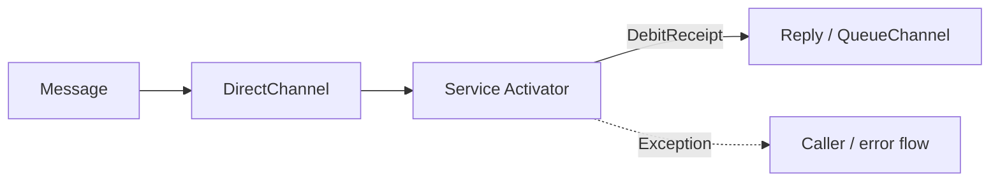
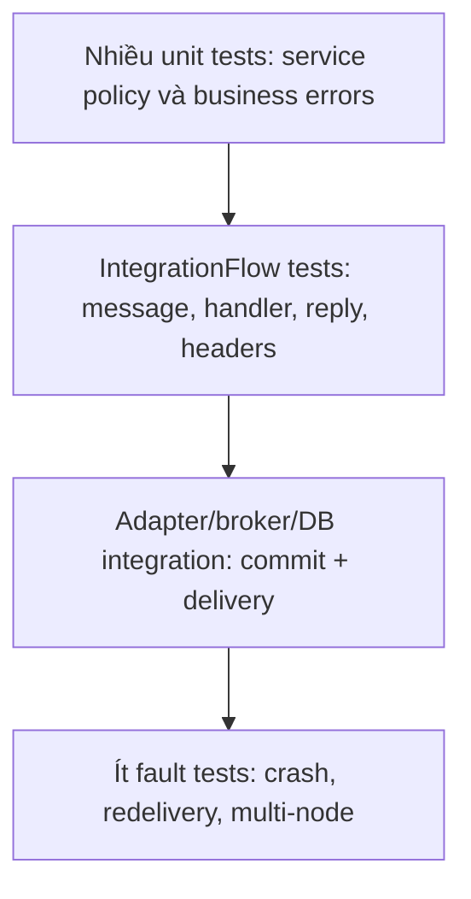
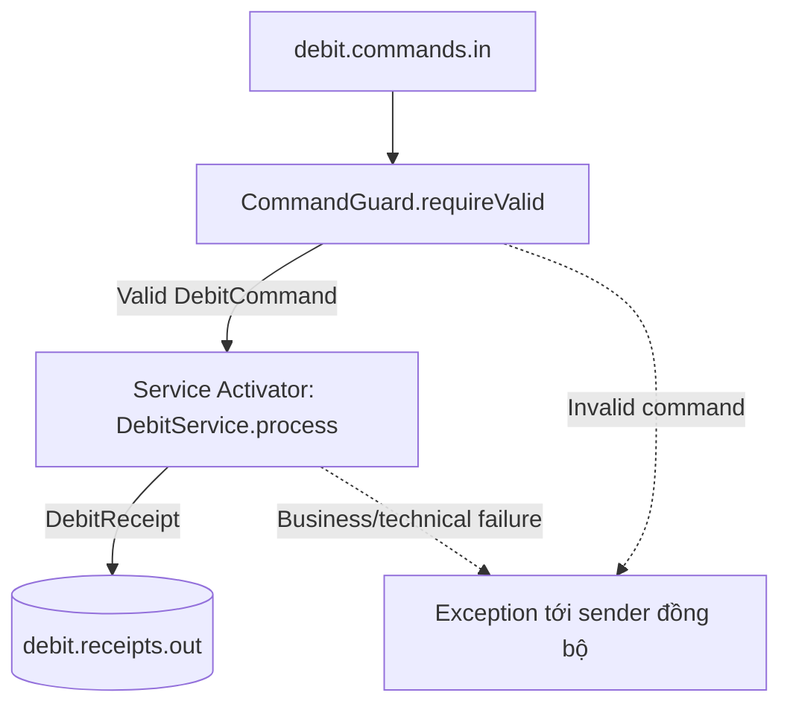
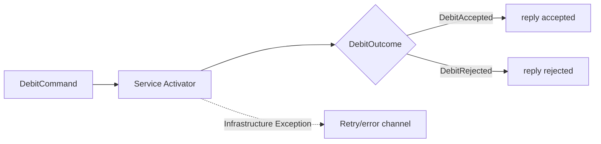
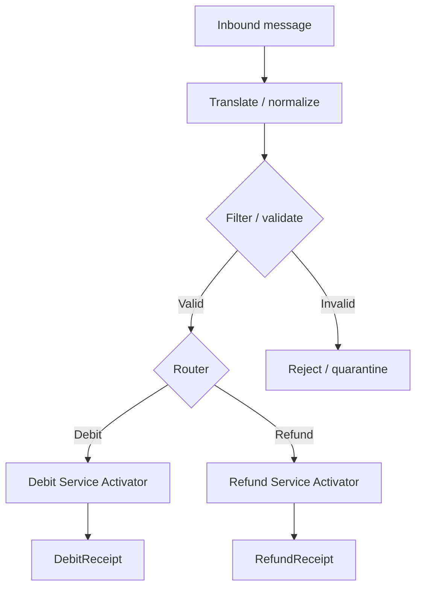

# Test input, output và lỗi của Service Activator trong Spring Integration

## Mục tiêu bài học

Một hệ thống nhận lệnh ghi nợ một tài khoản. Message đi từ API hoặc broker qua Spring Integration, sau đó tới một **Service Activator** gọi service nghiệp vụ. Khi thành công, handler trả `DebitReceipt`; khi dữ liệu sai, nó phải từ chối trước khi có side effect; khi tài khoản bị khóa, trả lỗi nghiệp vụ; khi kho lưu trữ tạm thời không sẵn sàng, báo lỗi hạ tầng để quy trình retry/error flow xử lý.

Nếu chỉ kiểm thử rằng `input.send(message)` trả `true`, ta **chưa chứng minh** handler đã xử lý đúng. Nếu chỉ kiểm tra output queue có một message, ta **chưa chứng minh** số tiền/tenant/headers đúng. Nếu chỉ kiểm tra exception đã xuất hiện, ta **chưa chứng minh** nguyên nhân lỗi, số lần gọi service, trạng thái output, side effect và cách lỗi đi qua sync/async boundary.

Bài này thiết kế một **bộ kiểm thử có nhiều tầng** cho Service Activator: **input → output → lỗi**, với ví dụ Java DSL, JUnit 5, AssertJ và các hướng mở rộng sang Mockito, Gateway, RequestHandlerRetryAdvice, error channel, broker và database.

Bài thuộc chương **Service activator** của module **SPRING_INTEGRATION_PATTERN**, phù hợp mục tiêu triển khai Enterprise Integration Patterns bằng Spring Integration để xây dựng luồng message ít phụ thuộc, dễ mở rộng. Ngữ cảnh module bao gồm Router, Filter, Transformer, Splitter, Aggregator, Gateway, retry, error channel, correlation, cùng kiểm thử và theo dõi các nhánh. Bài không yêu cầu ghi chú bổ sung ngoài chủ đề được giao.

Sau bài học, bạn có thể:

1. Giải thích hợp đồng của Service Activator: kiểu input, headers, kết quả trả về, cơ chế reply và exception.
2. Viết **unit tests** cho service thuần Java và **integration tests** qua `IntegrationFlow` thật.
3. Kiểm tra payload và metadata đúng khi đến endpoint, phân biệt **validated input** với **trusted identity**.
4. Khẳng định output có đúng kiểu, giá trị, correlation/trace metadata và chỉ có số reply dự kiến.
5. Kiểm thử validation failure, business rejection, transient infrastructure error và nguyên nhân gốc khi framework wrap exception.
6. Phân biệt một Service Activator request-reply với handler **one-way/void/null**, hiểu `requiresReply`, `replyChannel` và Gateway.
7. Xác định chính sách error channel cho bất đồng bộ mà không nhầm exception của `DirectChannel` với `ErrorMessage`.
8. Thiết kế các test bổ sung cho retry, redelivery, idempotency, transaction/outbox, concurrency và Splitter/Aggregator.

---

## 1. Service Activator là điểm giao giữa messaging và service nghiệp vụ

Trong Enterprise Integration Patterns, **Service Activator** nối một message channel với một service/POJO. Ở Spring Integration, nó là endpoint nhận message từ channel đầu vào, trích payload hoặc headers thích hợp để gọi method/handler, rồi có thể tạo reply.



Ví dụ Java DSL:

```java
IntegrationFlow.from("debits.in")
    .handle(DebitCommand.class,
        (command, headers) -> debitService.process(command))
    .channel("debits.out")
    .get();
```

`handle(...)` ở đây là điểm kết nối đến service nghiệp vụ. Dù code method có vẻ là lời gọi Java bình thường, những hành vi xung quanh còn phụ thuộc:

- **MessageChannel** nào đang phân phối message?
- Message đi qua **Transformer/Filter/Router** trước handler hay không?
- Handler trả một **payload**, một `Message<?>` hoàn chỉnh, `null` hay có kiểu `void`?
- Endpoint có **output channel** hay phải dùng inbound `replyChannel`?
- Handler chạy **cùng thread** với sender hay được gọi từ **ExecutorChannel/poller/broker**?
- Exception được truyền ngược trực tiếp, đi vào error handler hay được map thành reply?
- Có cấu hình retry, transaction, advice hoặc idempotency không?

**Một unit test của service không trả lời được hết những câu hỏi này.** Vì vậy, ta cần thêm test cho flow thực.

### Hành vi reply quan trọng

Theo Spring Integration Reference:

- Nếu Service Activator trả **giá trị khác null**, nó có thể gửi reply tới output channel đã cấu hình hoặc, nếu không có output channel, dùng `replyChannel` trong message.
- Nếu handler trả `null` hoặc method trả `void`, mặc định không có reply.
- Nếu endpoint bật `requiresReply=true` nhưng handler không trả reply, framework ném `ReplyRequiredException`.
- Nếu muốn một handler trả giá trị nhưng **cố ý bỏ kết quả**, có thể định tuyến tới `nullChannel`; không trộn trường hợp này với Service Activator one-way trả `void`.

Việc handler **được gọi** và việc **reply được gửi** là hai sự kiện khác nhau: test nên quan sát từng việc theo contract.

## 2. Phân biệt những câu hỏi mà mỗi tầng test trả lời

| Tầng test | Bằng chứng cần thu | Không đủ để khẳng định |
| --- | --- | --- |
| **Unit test service** | Hàm xử lý đúng input, trạng thái và exception | Channel routing/header propagation |
| **IntegrationFlow test** | Message đi tới endpoint, reply được chuyển, lỗi sync theo đúng flow | Broker/DB thật, multi-instance |
| **Gateway test** | Request → reply/error/timeout phù hợp | End-to-end across network |
| **Async/error flow test** | Exception được xử lý bởi error channel/DLQ đúng nơi | DB side effect exactly once |
| **DB/service integration test** | Transaction, constraint và commit state đúng | Remote API không lặp |
| **Adapter/broker contract test** | Serialization/headers/ACK/NACK/redelivery đúng | Mọi nghiệp vụ idempotent |
| **Fault-injection test** | Crash trước/sau commit, retry, duplicate được xử lý | Toàn bộ tình huống thực tế |

Đặt tên test theo **cam kết thực tế đã kiểm chứng**. Chẳng hạn `validCommandProducesOneReceiptInThisFlow()` chính xác hơn `guaranteesExactlyOnce()` khi chưa có DB/broker.

### Test pyramid đề xuất



Unit tests nhanh cho các ràng buộc dữ liệu. Integration tests kiểm tra Spring Integration wiring. Fault tests xác minh điều kiện khó như ACK bị mất và retry sau commit.

## 3. Định nghĩa contract input, output và lỗi trước khi code

Ta dùng một nghiệp vụ giả lập **ghi nợ tài khoản**. Không có kết nối DB/thanh toán thật trong ví dụ: Service Activator chỉ tăng counter khi “ghi nợ mô phỏng” thành công.

### Input `DebitCommand`

```java
public record DebitCommand(
    String tenantId,
    String commandId,
    String accountId,
    long amountMinor
) {}
```

Quy ước:

- `tenantId` xác định tenant trong mô hình, cần đối chiếu identity đã xác thực.
- `commandId` nhận diện một thao tác nghiệp vụ ổn định khi retry.
- `accountId` là đối tượng ghi nợ.
- `amountMinor` là số nguyên ở đơn vị tiền nhỏ nhất, phải dương và không vượt giới hạn demo.
- Message có thể mang `traceId`/`businessCorrelationId` phục vụ quan sát; chúng **không tự chứng minh quyền truy cập**.

### Output `DebitReceipt`

```java
public record DebitReceipt(
    String tenantId,
    String commandId,
    String accountId,
    long amountMinor,
    String status
) {}
```

Trường `status` dùng `ACCEPTED` trong ví dụ, **không có nghĩa** hệ thống ngân hàng thật đã chuyển tiền. Trong production nên phân biệt `RECEIVED`, `COMMITTED`, `SETTLED` và các trạng thái nghiệp vụ được phê duyệt.

### Failure contract

| Tình huống | Điểm phát hiện | Lỗi mong đợi | Side effect mô phỏng |
| --- | --- | --- | --- |
| Command hợp lệ | Service Activator | Không lỗi; trả `DebitReceipt` | Tăng 1 |
| Amount ≤ 0 | Validation gate trước handler | `INVALID_DEBIT_COMMAND` | Tăng 0 |
| Tenant không đúng verified context | Validation gate | `INVALID_DEBIT_COMMAND`/security policy | Tăng 0 |
| Account bị khóa | Service nghiệp vụ | `ACCOUNT_CLOSED` | Tăng 0 |
| Dependency tạm thời lỗi | Service nghiệp vụ | `LEDGER_UNAVAILABLE` | Tăng 0 trong demo |
| Handler không có reply khi bắt buộc | Messaging endpoint | `ReplyRequiredException` | Tùy handler, không được suy chỉ từ exception |
| Input JSON không parse được | Adapter/decoder | Decode/schema failure | Không vào handler |
| Retry sau DB commit | Broker/consumer boundary | Trả cached result theo idempotency | Không nhân đôi real effect |

### Tách “handler được gọi” với “side effect đã thành công”

Một counter `invocations` tăng ngay đầu service method. Counter `committedEffects` chỉ tăng sau khi các quy tắc giả lập hoàn tất:

```text
invalid input trước handler:
  invocations = 0, committedEffects = 0

account closed trong handler:
  invocations = 1, committedEffects = 0

valid input:
  invocations = 1, committedEffects = 1
```

Hai counter giúp test không gọi nhầm “handler không được gọi” khi thực tế handler đã được gọi rồi ném exception. Trong ví dụ, `committedEffects` chỉ là **fake counter**, không phải database commit thật.

## 4. Topology được dùng để kiểm thử



Chọn `DirectChannel` để test **đồng bộ** và `QueueChannel` cho output. Điều này cho phép JUnit gửi một message, đọc một reply và xác nhận không có reply dư **mà không dùng `Thread.sleep(...)`**.

Phạm vi của test:

- Có **một** Spring context.
- Không có broker/DB/HTTP thật.
- Có một service giả lập có kiểm soát để test success, business failure và transient failure.
- `@DirtiesContext` cô lập queue/counters giữa test methods.
- Không dùng các key trùng giữa test song song.

Không cần dùng `ExecutorChannel` để chứng minh việc một handler đồng bộ thực sự trả output. Với lỗi bất đồng bộ, phải tạo **test riêng** vì sender không thể nhận exception trực tiếp sau khi đã giao message sang worker thread.

## 5. Java DSL: cấu hình đầy đủ cho Service Activator có reply

Cấu hình dưới đây dành cho Java 17+ và Spring Integration 6.x/7.x ở mức API DSL thường dùng.

### Domain, validation, service và channel

```java
import java.util.concurrent.atomic.AtomicInteger;
import java.util.regex.Pattern;

import org.springframework.context.annotation.Bean;
import org.springframework.context.annotation.Configuration;
import org.springframework.integration.channel.DirectChannel;
import org.springframework.integration.channel.QueueChannel;
import org.springframework.integration.config.EnableIntegration;
import org.springframework.integration.dsl.IntegrationFlow;
import org.springframework.messaging.MessageChannel;
import org.springframework.messaging.PollableChannel;

@Configuration
@EnableIntegration
public class DebitServiceActivatorConfig {

    public record DebitCommand(
        String tenantId,
        String commandId,
        String accountId,
        long amountMinor
    ) {}

    public record DebitReceipt(
        String tenantId,
        String commandId,
        String accountId,
        long amountMinor,
        String status
    ) {}

    public static final class InvalidDebitCommand
            extends RuntimeException {
        public InvalidDebitCommand(String code) {
            super(code);
        }
    }

    public static final class BusinessRuleViolation
            extends RuntimeException {
        public BusinessRuleViolation(String code) {
            super(code);
        }
    }

    public static final class TemporaryLedgerFailure
            extends RuntimeException {
        public TemporaryLedgerFailure(String code) {
            super(code);
        }
    }

    public static final class CommandGuard {
        private static final Pattern SAFE_ID =
            Pattern.compile("[A-Za-z0-9_-]{1,80}");

        // Fixture tin cậy chỉ dùng trong demo/test.
        private final String verifiedTenant = "tenant-a";

        private static boolean validId(String value) {
            return value != null
                && SAFE_ID.matcher(value).matches();
        }

        public DebitCommand requireValid(DebitCommand command) {
            if (command == null
                    || !verifiedTenant.equals(command.tenantId())
                    || !validId(command.commandId())
                    || !validId(command.accountId())
                    || command.amountMinor() <= 0L
                    || command.amountMinor() > 1_000_000L) {
                throw new InvalidDebitCommand(
                    "INVALID_DEBIT_COMMAND");
            }

            return command;
        }
    }

    public static final class DebitService {
        private final AtomicInteger invocations =
            new AtomicInteger();

        private final AtomicInteger committedEffects =
            new AtomicInteger();

        public DebitReceipt process(DebitCommand command) {
            invocations.incrementAndGet();

            // Lỗi do domain service phát hiện.
            if (command.commandId().startsWith("BUSINESS-")) {
                throw new BusinessRuleViolation(
                    "ACCOUNT_CLOSED");
            }

            // Lỗi hạ tầng có thể cần retry khi production.
            if (command.commandId().startsWith("TRANSIENT-")) {
                throw new TemporaryLedgerFailure(
                    "LEDGER_UNAVAILABLE");
            }

            // Đây chỉ là side effect GIẢ LẬP trong bộ test.
            committedEffects.incrementAndGet();

            return new DebitReceipt(
                command.tenantId(),
                command.commandId(),
                command.accountId(),
                command.amountMinor(),
                "ACCEPTED");
        }

        public int invocations() {
            return invocations.get();
        }

        public int committedEffects() {
            return committedEffects.get();
        }
    }

    @Bean
    CommandGuard commandGuard() {
        return new CommandGuard();
    }

    @Bean
    DebitService debitService() {
        return new DebitService();
    }

    @Bean("debit.commands.in")
    MessageChannel input() {
        return new DirectChannel();
    }

    @Bean("debit.receipts.out")
    PollableChannel output() {
        // Test sink, chưa có consumer nền.
        return new QueueChannel();
    }

    @Bean
    IntegrationFlow debitProcessingFlow(
        CommandGuard guard,
        DebitService service
    ) {
        return IntegrationFlow.from("debit.commands.in")
            // Từ chối dữ liệu sai TRƯỚC Service Activator.
            .transform(DebitCommand.class, guard::requireValid)

            // Service Activator: gọi một POJO nghiệp vụ.
            .handle(DebitCommand.class,
                (command, headers) -> service.process(command))

            // Reply của Service Activator tới test sink.
            .channel("debit.receipts.out")
            .get();
    }
}
```

### Phân tích hành vi thực tế

1. `debit.commands.in` nhận `Message<DebitCommand>`.
2. Transformer gọi `guard.requireValid(...)`. Nếu invalid, exception được ném trong thread đang xử lý; không tới `DebitService`.
3. Service Activator trích `DebitCommand` rồi gọi `service.process(...)`.
4. Nếu service trả `DebitReceipt`, framework tạo reply message và gửi đến `debit.receipts.out`.
5. Nếu service throw `BusinessRuleViolation` hoặc `TemporaryLedgerFailure`, flow đồng bộ dừng tại handler; không có reply thành công.
6. `traceId` và các header ứng dụng phù hợp có thể được truyền cùng reply trong topology nội bộ này. Không lấy chúng làm authentication.
7. `input.send(...)` trả true là **channel đã giao message tới subscriber thành công theo semantics đồng bộ**, không phải bằng chứng “tiền đã được ghi nợ trong DB”.

**Không cần một `@ServiceActivator` annotation** khi dùng `.handle(...)` Java DSL như trên. Đây là hai cách cấu hình endpoint cùng ý nghĩa pattern.

### Tại sao guard đứng trước service?

Để chứng minh một input sai bị chặn trước khi handler được gọi. Các kiểm tra **có thể thay đổi do concurrency** (số dư, hạn mức, khóa đối tượng) vẫn cần được bảo vệ trong business transaction, không chỉ ở validation stage.

### Vì sao service có các nhánh lỗi theo commandId?

Chỉ để **kích hoạt fault deterministic trong demo**, không phải một thiết kế nghiệp vụ thật. Production tuyệt đối không dùng prefix của command ID làm nguồn kiểm tra account closed hoặc giả lập database outage. Test production nên dùng fake repository, stub provider hoặc Mockito.

---

## 6. Unit test service: kiểm tra nghiệp vụ mà không khởi tạo Spring

Đây là tầng nhanh nhất. Ta test trực tiếp method `DebitService.process` để xem success, business failure và transient failure. Không có channel, header, serialization hoặc queue nào trong unit test.

```java
import static org.assertj.core.api.Assertions.assertThat;
import static org.assertj.core.api.Assertions.assertThatThrownBy;

import org.junit.jupiter.api.Test;

class DebitServiceUnitTest {

    private final DebitServiceActivatorConfig.DebitService service =
        new DebitServiceActivatorConfig.DebitService();

    private DebitServiceActivatorConfig.DebitCommand command(
        String commandId
    ) {
        return new DebitServiceActivatorConfig.DebitCommand(
            "tenant-a", commandId, "ACC-01", 12_500L);
    }

    @Test
    void validCommandProducesExactReceiptAndOneFakeEffect() {
        var receipt = service.process(command("CMD-01"));

        assertThat(receipt.tenantId()).isEqualTo("tenant-a");
        assertThat(receipt.commandId()).isEqualTo("CMD-01");
        assertThat(receipt.accountId()).isEqualTo("ACC-01");
        assertThat(receipt.amountMinor()).isEqualTo(12_500L);
        assertThat(receipt.status()).isEqualTo("ACCEPTED");

        assertThat(service.invocations()).isEqualTo(1);
        assertThat(service.committedEffects()).isEqualTo(1);
    }

    @Test
    void businessRuleFailureDoesNotProduceFakeEffect() {
        assertThatThrownBy(
            () -> service.process(command("BUSINESS-01")))
            .isInstanceOf(
                DebitServiceActivatorConfig.BusinessRuleViolation.class)
            .hasMessage("ACCOUNT_CLOSED");

        assertThat(service.invocations()).isEqualTo(1);
        assertThat(service.committedEffects()).isZero();
    }

    @Test
    void temporaryFailureDoesNotProduceFakeEffect() {
        assertThatThrownBy(
            () -> service.process(command("TRANSIENT-01")))
            .isInstanceOf(
                DebitServiceActivatorConfig.TemporaryLedgerFailure.class)
            .hasMessage("LEDGER_UNAVAILABLE");

        assertThat(service.invocations()).isEqualTo(1);
        assertThat(service.committedEffects()).isZero();
    }
}
```

### Test guard riêng

```java
import static org.assertj.core.api.Assertions.assertThat;
import static org.assertj.core.api.Assertions.assertThatThrownBy;

import org.junit.jupiter.api.Test;

class DebitCommandGuardTest {

    private final DebitServiceActivatorConfig.CommandGuard guard =
        new DebitServiceActivatorConfig.CommandGuard();

    @Test
    void validCommandCanPassWithoutBeingChanged() {
        var raw = new DebitServiceActivatorConfig.DebitCommand(
            "tenant-a", "CMD-02", "ACC-02", 100L);

        assertThat(guard.requireValid(raw)).isSameAs(raw);
    }

    @Test
    void wrongTenantIsRejectedEvenWithValidLookingId() {
        var wrong = new DebitServiceActivatorConfig.DebitCommand(
            "tenant-b", "CMD-02", "ACC-02", 100L);

        assertThatThrownBy(() -> guard.requireValid(wrong))
            .isInstanceOf(
                DebitServiceActivatorConfig.InvalidDebitCommand.class)
            .hasMessage("INVALID_DEBIT_COMMAND");
    }

    @Test
    void zeroAmountIsRejectedBeforeService() {
        var wrong = new DebitServiceActivatorConfig.DebitCommand(
            "tenant-a", "CMD-03", "ACC-03", 0L);

        assertThatThrownBy(() -> guard.requireValid(wrong))
            .isInstanceOf(
                DebitServiceActivatorConfig.InvalidDebitCommand.class);
    }
}
```

**Đã test được gì?** Logic thuần Java trả đúng giá trị và exception. **Chưa test được gì?** Spring Integration có thực sự gọi method không, có preserve headers không, exception có bị wrap không và reply được gửi tới channel nào.

---

## 7. Integration test: gửi input thực và đọc reply

Đây là phần trọng tâm: khởi động Spring context chứa `IntegrationFlow`, gửi message qua input channel rồi quan sát output.

```java
import static org.assertj.core.api.Assertions.assertThat;
import static org.assertj.core.api.Assertions.catchThrowable;

import org.junit.jupiter.api.Test;
import org.springframework.beans.factory.annotation.Autowired;
import org.springframework.beans.factory.annotation.Qualifier;
import org.springframework.messaging.Message;
import org.springframework.messaging.MessageChannel;
import org.springframework.messaging.PollableChannel;
import org.springframework.messaging.support.MessageBuilder;
import org.springframework.test.annotation.DirtiesContext;
import org.springframework.test.context.junit.jupiter.SpringJUnitConfig;

@SpringJUnitConfig(DebitServiceActivatorConfig.class)
@DirtiesContext(
    classMode = DirtiesContext.ClassMode.AFTER_EACH_TEST_METHOD)
class DebitServiceActivatorFlowTest {

    @Autowired
    @Qualifier("debit.commands.in")
    MessageChannel input;

    @Autowired
    @Qualifier("debit.receipts.out")
    PollableChannel output;

    @Autowired
    DebitServiceActivatorConfig.DebitService service;

    private DebitServiceActivatorConfig.DebitCommand command(
        String tenant,
        String commandId,
        long amount
    ) {
        return new DebitServiceActivatorConfig.DebitCommand(
            tenant, commandId, "ACC-01", amount);
    }

    private boolean send(
        DebitServiceActivatorConfig.DebitCommand command
    ) {
        return input.send(
            MessageBuilder.withPayload(command)
                .setHeader("traceId", "trace-test")
                .setHeader(
                    "businessCorrelationId",
                    "tenant-a|ACC-01|run-1")
                .build());
    }

    private DebitServiceActivatorConfig.DebitReceipt receiveReceipt() {
        Message<?> reply = output.receive(2_000);

        assertThat(reply).isNotNull();
        assertThat(reply.getPayload()).isInstanceOf(
            DebitServiceActivatorConfig.DebitReceipt.class);

        return (DebitServiceActivatorConfig.DebitReceipt)
            reply.getPayload();
    }

    private static Throwable rootCause(Throwable error) {
        Throwable current = error;

        while (current.getCause() != null
                && current.getCause() != current) {
            current = current.getCause();
        }

        return current;
    }

    @Test
    void validInputGetsOneExactReply() {
        assertThat(send(
            command("tenant-a", "CMD-101", 12_500L)))
            .isTrue();

        var receipt = receiveReceipt();

        assertThat(receipt.tenantId()).isEqualTo("tenant-a");
        assertThat(receipt.commandId()).isEqualTo("CMD-101");
        assertThat(receipt.accountId()).isEqualTo("ACC-01");
        assertThat(receipt.amountMinor()).isEqualTo(12_500L);
        assertThat(receipt.status()).isEqualTo("ACCEPTED");

        assertThat(service.invocations()).isEqualTo(1);
        assertThat(service.committedEffects()).isEqualTo(1);
        assertThat(output.receive(0)).isNull();
    }

    @Test
    void replyCarriesExpectedInternalTrackingHeaders() {
        var request = MessageBuilder
            .withPayload(command("tenant-a", "CMD-102", 1L))
            .setHeader("traceId", "trace-102")
            .setHeader(
                "businessCorrelationId",
                "tenant-a|ACC-01|run-1")
            .build();

        assertThat(input.send(request)).isTrue();

        Message<?> reply = output.receive(2_000);
        assertThat(reply).isNotNull();

        assertThat(reply.getHeaders().get("traceId"))
            .isEqualTo("trace-102");
        assertThat(
            reply.getHeaders().get("businessCorrelationId"))
            .isEqualTo("tenant-a|ACC-01|run-1");

        assertThat(service.invocations()).isEqualTo(1);
    }

    @Test
    void invalidPayloadStopsBeforeServiceActivator() {
        Throwable failure = catchThrowable(() ->
            send(command("tenant-a", "CMD-103", 0L)));

        assertThat(failure).isNotNull();
        assertThat(rootCause(failure))
            .isInstanceOf(
                DebitServiceActivatorConfig.InvalidDebitCommand.class)
            .hasMessage("INVALID_DEBIT_COMMAND");

        assertThat(service.invocations()).isZero();
        assertThat(service.committedEffects()).isZero();
        assertThat(output.receive(0)).isNull();
    }

    @Test
    void wrongTenantIsNotSilentlyAccepted() {
        Throwable failure = catchThrowable(() ->
            send(command("tenant-b", "CMD-104", 100L)));

        assertThat(failure).isNotNull();
        assertThat(rootCause(failure))
            .isInstanceOf(
                DebitServiceActivatorConfig.InvalidDebitCommand.class);

        assertThat(service.invocations()).isZero();
        assertThat(output.receive(0)).isNull();
    }

    @Test
    void businessRuleFailureIsObservableWithNoSuccessReply() {
        Throwable failure = catchThrowable(() ->
            send(command("tenant-a", "BUSINESS-105", 100L)));

        assertThat(failure).isNotNull();
        assertThat(rootCause(failure))
            .isInstanceOf(
                DebitServiceActivatorConfig.BusinessRuleViolation.class)
            .hasMessage("ACCOUNT_CLOSED");

        assertThat(service.invocations()).isEqualTo(1);
        assertThat(service.committedEffects()).isZero();
        assertThat(output.receive(0)).isNull();
    }

    @Test
    void temporaryDependencyFailureIsDistinctFromBusinessRule() {
        Throwable failure = catchThrowable(() ->
            send(command("tenant-a", "TRANSIENT-106", 100L)));

        assertThat(failure).isNotNull();
        assertThat(rootCause(failure))
            .isInstanceOf(
                DebitServiceActivatorConfig.TemporaryLedgerFailure.class)
            .hasMessage("LEDGER_UNAVAILABLE");

        assertThat(service.invocations()).isEqualTo(1);
        assertThat(service.committedEffects()).isZero();
        assertThat(output.receive(0)).isNull();
    }

    @Test
    void twoDifferentCommandsYieldTwoReplies() {
        assertThat(send(
            command("tenant-a", "CMD-107", 10L))).isTrue();
        assertThat(send(
            command("tenant-a", "CMD-108", 20L))).isTrue();

        var first = receiveReceipt();
        var second = receiveReceipt();

        assertThat(first.commandId()).isEqualTo("CMD-107");
        assertThat(second.commandId()).isEqualTo("CMD-108");
        assertThat(service.invocations()).isEqualTo(2);
        assertThat(service.committedEffects()).isEqualTo(2);
        assertThat(output.receive(0)).isNull();
    }
}
```

### Vì sao chọn `@DirtiesContext`?

`DebitService` có `AtomicInteger` và `debit.receipts.out` là queue nằm trong Spring context. `@DirtiesContext(AFTER_EACH_TEST_METHOD)` tạo sự cô lập giữa các ca, giảm nguy cơ một test nhận reply còn tồn từ test khác. Nó có chi phí khởi tạo context; trong dự án lớn có thể thay bằng reset state/test fixture, **miễn là reset không làm mất một lỗi concurrency cần phát hiện**.

### Kết luận chính xác của bộ test

- Với một message hợp lệ, handler được gọi một lần trong topology đồng bộ này; output có đúng giá trị và kiểu.
- Với input bị validation gate từ chối, Service Activator không được gọi.
- Với lỗi trong service, handler đã được gọi nhưng không tạo side effect mô phỏng và không phát success reply.
- Một số tracking headers được truyền qua flow được cấu hình.
- Không tự kết luận có transaction commit, broker ACK, database rollback hay exactly-once effect.

### Cẩn thận với `receive(0)`

`QueueChannel.receive(0)` kiểm tra **ngay tại thời điểm gọi**. Trong ví dụ này, input channel và handler chạy đồng bộ, nên test “không còn reply” hợp lý sau khi `send` kết thúc. Trong async test, `receive(0)==null` **không chứng minh** sẽ không có một reply muộn; cần timeout phù hợp và đồng bộ hóa theo sự kiện/condition.

---

## 8. Cách assert exception đúng khi Spring Integration wrap lỗi

Nếu service thuần ném `BusinessRuleViolation`, integration endpoint có thể bọc nó trong `MessageHandlingException`, `MessagingException` hoặc một exception khác theo kiểu handler/topology.

Không nên viết unit và integration tests giống hệt:

```java
// Quá cứng nếu framework bọc exception:
assertThatThrownBy(() -> input.send(message))
    .isExactlyInstanceOf(BusinessRuleViolation.class);
```

Một cách kiểm tra ổn định hơn:

1. Bắt Throwable từ lời gọi `input.send(...)`.
2. Kiểm tra có exception.
3. Duyệt chuỗi `getCause()` hoặc dùng assertion hỗ trợ root cause.
4. Kiểm tra **root cause type + business error code**.
5. Kiểm tra **handler invocation và output/effect**.
6. Nếu cần, kiểm tra `failedMessage` của `MessagingException` mà không giả định mọi adapter cung cấp cùng metadata.

```java
Throwable failure = catchThrowable(() -> input.send(message));

assertThat(failure).isNotNull();
assertThat(rootCause(failure))
    .isInstanceOf(BusinessRuleViolation.class)
    .hasMessage("ACCOUNT_CLOSED");
```

Với app cần phân biệt nhiều loại lỗi, nên dùng **exception type hoặc stable code**, không phân loại theo substring tiếng Anh của stack trace.

### Phân biệt lỗi của endpoint và lỗi của domain

| Lỗi | Nguồn | Kiểm thử |
| --- | --- | --- |
| `InvalidDebitCommand` | Gate/contract validation | Service không được gọi |
| `BusinessRuleViolation` | Domain service | Handler có thể được gọi, side effect không |
| `TemporaryLedgerFailure` | Repository/provider | Retry/fault test theo contract |
| `MessageDeliveryException` | Channel/destination | Wiring/routing test |
| `ReplyRequiredException` | Handler không trả reply khi bắt buộc | Test `requiresReply` |
| `MessageConversionException` | Converter/serialization/binding | Adapter contract test |
| `TimeoutException` tại Gateway | Không có reply đúng hạn | Request-reply integration test |

Một exception có thể được bọc bởi nhiều tầng nên test **ngữ nghĩa** và **điểm xuất hiện** quan trọng hơn kiểm tra exact top-level class trong mọi môi trường.

---

## 9. Khi Service Activator không trả reply: `void`, `null` và `requiresReply`

Không phải mọi Service Activator đều là request-reply. Một handler audit hoặc notification có thể chỉ cần thực hiện một thao tác rồi kết thúc.

```java
import org.springframework.integration.annotation.ServiceActivator;

public final class AuditConsumer {

    @ServiceActivator(inputChannel = "audit.events.in")
    public void record(AuditEvent event) {
        // Ghi audit/metric theo hợp đồng của ứng dụng.
    }
}
```

Ở đây `AuditEvent` và bean/channel cần được định nghĩa trong ứng dụng. Đây là **một ví dụ annotation-driven**, không đăng ký đồng thời vào flow `debitProcessingFlow` của phần trước.

Theo Spring Integration, nếu method trả `void` hoặc `null`, Service Activator mặc định **không gửi reply**. Nếu `requiresReply=true`, việc không tạo reply làm phát sinh `ReplyRequiredException`.

### Test cái gì?

| Kiểu handler | Input kỳ vọng | Output kỳ vọng | Test cần chứng minh |
| --- | --- | --- | --- |
| `void record(AuditEvent)` | Event hợp lệ | **Không có reply** | Handler được gọi, audit effect được thực hiện |
| `DebitReceipt process(DebitCommand)` | Command hợp lệ | Một `DebitReceipt` | Đúng payload, headers và số lần gọi |
| Method trả `null` theo điều kiện | Command đặc biệt | Không có reply nếu contract cho phép | Không nhầm null thành success |
| Method trả `null` với `requiresReply=true` | Command hợp lệ | **Exception** | Không được im lặng bỏ response |
| Method trả giá trị rồi chuyển `nullChannel` | Request fire-and-forget | Không thấy reply | Đây là **discard reply có chủ đích** |

### Cấu hình Java DSL `requiresReply` (ví dụ thay thế)

```java
.handle(
    DebitCommand.class,
    (command, headers) -> debitService.process(command),
    endpoint -> endpoint.requiresReply(true))
```

**Đây là đoạn trích cấu hình thay thế** ở vị trí `.handle(...)` của flow, không phải một flow mới có thể tự chạy độc lập. Với DSL phiên bản dự án, xác minh endpoint option `requiresReply` tương ứng rồi test trường hợp handler cố tình trả null.

### Vì sao test `no reply` khó hơn test có reply?

Trong một flow đồng bộ, sau khi handler `void` hoàn tất, ta có thể assert audit counter đã tăng và một queue đích không có message. Nhưng `output.receive(0)==null` chỉ là một snapshot; với async flow, cần đợi handler hoàn thành có chứng cứ trước khi kết luận không có reply.

Không nên kiểm thử “không gửi reply” bằng một khoảng `Thread.sleep(100)` tùy tiện rồi kết luận chắc chắn. Dùng một `CountDownLatch` báo handler đã hoàn tất, timeout rõ và test sink được cô lập.

### Vì sao Gateway dễ timeout?

Nếu một `MessagingGateway` kỳ vọng trả `DebitReceipt` mà downstream handler lại là `void`, gateway có thể chờ reply tới timeout. Lỗi không nằm ở số tiền mà ở **mâu thuẫn contract request-reply**. Hãy chọn rõ một trong hai:

- Command có kết quả đồng bộ: service phải trả reply/error phù hợp.
- Command bất đồng bộ: Gateway/API trả acknowledgement hoặc request ID, kết quả đến qua kênh/event khác.

---

## 10. Gateway test: kiểm tra return address thay vì chỉ QueueChannel

Flow ở mục 5 có output channel tường minh. Với Gateway, reply đôi khi được gửi theo `replyChannel` mà framework đặt trên inbound message.

### Ví dụ cấu hình riêng

```java
import org.springframework.context.annotation.Bean;
import org.springframework.integration.annotation.Gateway;
import org.springframework.integration.annotation.MessagingGateway;
import org.springframework.integration.dsl.IntegrationFlow;

@MessagingGateway
interface DebitGateway {

    @Gateway(requestChannel = "debit.gateway.in")
    DebitServiceActivatorConfig.DebitReceipt debit(
        DebitServiceActivatorConfig.DebitCommand command);
}
```

Một flow cho Gateway:

```java
@Bean
IntegrationFlow debitGatewayFlow(
    DebitServiceActivatorConfig.CommandGuard guard,
    DebitServiceActivatorConfig.DebitService service
) {
    return IntegrationFlow.from("debit.gateway.in")
        .transform(
            DebitServiceActivatorConfig.DebitCommand.class,
            guard::requireValid)
        .handle(
            DebitServiceActivatorConfig.DebitCommand.class,
            (command, headers) ->
                service.process(command))
        .get();
}
```

Hai đoạn này là **cấu hình minh họa độc lập** cần được đặt trong Spring context có `@EnableIntegration`/bean registration tương ứng; không dùng cùng một bean method/channel của demo trước mà không điều chỉnh. Điểm khác biệt: flow không gắn `.channel("debit.receipts.out")` cố định ở cuối, để reply có thể được định tuyến theo `replyChannel` do Gateway thiết lập.

### Những assertion cần có

1. Gateway gọi một command hợp lệ → trả `DebitReceipt` đúng ID, amount, status.
2. Command invalid → caller nhận exception hoặc typed rejection theo contract; không chờ timeout vô ích.
3. Service trả null mà API cần reply → lỗi/timeout được quan sát và mapped rõ.
4. Handler throw business error → caller nhận exception/error response đã phân loại.
5. Timeout vì downstream bất đồng bộ chậm → không nhầm với `INVALID_DEBIT_COMMAND`.
6. Reply bị gửi sai channel → test phát hiện bằng destination/timeout assertion.
7. Có hai request xen kẽ → không trả reply của command A cho request B.

### Gateway không tự biến lỗi domain thành HTTP 4xx

`@MessagingGateway` thực hiện request-reply messaging. Nếu API ngoài dùng REST/HTTP, phải có controller/inbound adapter map `InvalidDebitCommand`, `BusinessRuleViolation` và timeout thành lỗi phù hợp. Chỉ viết một class tên `BusinessRuleViolation` không tự tạo HTTP status.

### Tránh test “lỗi = null”

Nếu Gateway trả null sau timeout và caller coi đó là “đã thành công”, hệ thống có thể mất công việc. Contract nên định nghĩa kết quả terminal hoặc acknowledgment với request ID và trạng thái có thể tra cứu.

---

## 11. Test error channel: synchronous khác asynchronous

Đây là phần dễ bị viết sai nhất khi kiểm thử Service Activator.

### Đường đồng bộ `DirectChannel`

```text
Test thread
  -> input.send(message)
     -> DirectChannel dispatcher
        -> Service Activator throws
  <- exception truyền ngược về test thread
```

Với topology đồng bộ, exception thường đi về caller; **không mặc định** có `ErrorMessage` trong global `errorChannel`. Unit/integration test nên dùng `catchThrowable(...)` hoặc `assertThatThrownBy(...)`.

### Đường bất đồng bộ `ExecutorChannel`

```text
Test thread
  -> input.send(message)
  <- send có thể trả trước khi handler chạy

Worker thread
  -> Service Activator throws
  -> MessagePublishingErrorHandler / configured error handling
  -> ErrorMessage tới errorChannel được chọn
```

Theo Spring Integration, các channel có executor có thể dùng `MessagePublishingErrorHandler`. Khi xử lý bất đồng bộ, exception không thể tự “quay lại” caller bằng cơ chế ném exception trên thread cũ. Tùy cấu hình adapter/channel, lỗi có thể đi đến header `errorChannel` hoặc global `errorChannel`.

**Test đúng là đợi thông điệp lỗi tại kênh được cấu hình**, không assert `input.send(...)` phải ném business exception như `DirectChannel`.

### Cấu hình async minh họa

```java
import org.springframework.context.annotation.Bean;
import org.springframework.context.annotation.Configuration;
import org.springframework.core.task.SimpleAsyncTaskExecutor;
import org.springframework.integration.channel.ExecutorChannel;
import org.springframework.integration.channel.QueueChannel;
import org.springframework.integration.config.EnableIntegration;
import org.springframework.integration.dsl.IntegrationFlow;
import org.springframework.messaging.MessageChannel;
import org.springframework.messaging.PollableChannel;

@Configuration
@EnableIntegration
class AsyncDebitErrorConfig {

    @Bean("debit.async.in")
    MessageChannel input() {
        return new ExecutorChannel(
            new SimpleAsyncTaskExecutor("debit-test-"));
    }

    @Bean("debit.async.errors")
    PollableChannel errors() {
        return new QueueChannel();
    }

    @Bean
    IntegrationFlow alwaysFails() {
        return IntegrationFlow.from("debit.async.in")
            .handle(String.class, (commandId, headers) -> {
                throw new IllegalStateException(
                    "LEDGER_UNAVAILABLE");
            })
            .get();
    }
}
```

**Cấu hình này cố ý giả lập lỗi bất đồng bộ**, không tạo tiền hoặc gọi database. `SimpleAsyncTaskExecutor` phục vụ ví dụ đơn giản, không phải chính sách pool/backpressure khuyến nghị cho production.

### JUnit cho `ErrorMessage` ở async boundary

```java
import static org.assertj.core.api.Assertions.assertThat;

import org.junit.jupiter.api.Test;
import org.springframework.beans.factory.annotation.Autowired;
import org.springframework.beans.factory.annotation.Qualifier;
import org.springframework.messaging.Message;
import org.springframework.messaging.MessageChannel;
import org.springframework.messaging.MessageHeaders;
import org.springframework.messaging.PollableChannel;
import org.springframework.messaging.support.ErrorMessage;
import org.springframework.messaging.support.MessageBuilder;
import org.springframework.test.context.junit.jupiter.SpringJUnitConfig;

@SpringJUnitConfig(AsyncDebitErrorConfig.class)
class AsyncDebitErrorFlowTest {

    @Autowired
    @Qualifier("debit.async.in")
    MessageChannel input;

    @Autowired
    @Qualifier("debit.async.errors")
    PollableChannel errors;

    @Test
    void asynchronousFailureIsPublishedAsErrorMessage() {
        Message<?> request = MessageBuilder
            .withPayload("CMD-ASYNC-1")
            .setHeader(MessageHeaders.ERROR_CHANNEL, errors)
            .build();

        assertThat(input.send(request)).isTrue();

        // Chờ event có timeout, không dùng Thread.sleep.
        Message<?> received = errors.receive(5_000);
        assertThat(received).isInstanceOf(ErrorMessage.class);

        Throwable error =
            ((ErrorMessage) received).getPayload();

        assertThat(error).isNotNull();
        assertThat(rootCause(error))
            .isInstanceOf(IllegalStateException.class)
            .hasMessage("LEDGER_UNAVAILABLE");
    }

    private static Throwable rootCause(Throwable error) {
        Throwable current = error;
        while (current.getCause() != null
                && current.getCause() != current) {
            current = current.getCause();
        }
        return current;
    }
}
```

Với Spring Integration channel/error-handler implementation khác, cần cấu hình rõ error publisher/handler thay vì giả định bất kỳ executor nào cũng tự dùng cùng cơ chế. **Đây là test cho cấu hình `ExecutorChannel` có error publication mặc định của framework**, không suy ra mọi Kafka/JMS/HTTP inbound adapter có giống như vậy.

### Test thêm lỗi gì?

- `ErrorMessage.payload` có cause phù hợp.
- ErrorMessage đến đúng `errorChannel` header hay global fallback, theo topology.
- Nếu có `originalMessage`/`failedMessage`, correlation ID và source metadata được phép sử dụng để điều tra.
- Lỗi không bị swallow; không rơi vào queue không consumer.
- Không có duplicate error event vô hạn vì retry nóng.
- Một success reply không được phát sau khi handler fail trước commit.
- Error handler cũng có thể fail — cần có fallback logging/alert và bài test fault riêng.

**Đừng serialize nguyên `ErrorMessage` với payload Throwable vào broker DLQ** mà không kiểm soát thông tin nhạy cảm hoặc khả năng serialize. Có thể chuyển thành một `FailureRecord` an toàn chứa errorCode, requestId, timestamp và protected payload reference.

---

## 12. Một hướng khác: trả typed outcome thay vì ném exception cho business rejection

Không phải mọi business rejection đều nên được mô hình hóa thành hạ tầng lỗi. Nếu service trả kết quả “tài khoản bị khóa”, Gateway có thể cần một response ngay, còn infrastructure error tiếp tục vào retry/error flow.

Một kiểu kết quả:

```java
public sealed interface DebitOutcome
    permits DebitAccepted, DebitRejected {}

public record DebitAccepted(
    DebitServiceActivatorConfig.DebitReceipt receipt
) implements DebitOutcome {}

public record DebitRejected(
    String commandId,
    String reasonCode
) implements DebitOutcome {}
```

Flow có thể:



### Ưu điểm

- Business rejection là **terminal business outcome**, caller có thể nhận trực tiếp.
- Không cần đặt mọi từ chối nghiệp vụ vào log như stack trace hạ tầng.
- Gateway có thể phản hồi nhanh và tránh timeout do Filter drop.
- Consumer có thể phân biệt outcome `REJECTED` với giao dịch chưa xử lý do outage.

### Nhược điểm và lưu ý

- Nếu API hiện tại đã quy định business rejection là exception, phải giữ contract hoặc version hóa.
- Không tự bắt mọi exception thành `DebitRejected("UNKNOWN")`, vì outage sẽ bị đối xử như input sai.
- Một `DebitRejected` không có nghĩa side effect đã rollback; nếu service từng gọi external provider rồi mới phát hiện lỗi, cần reconciliation.

### Test cần có

1. Rule reject → `DebitRejected(reasonCode)`.
2. Infrastructure failure → exception/error flow, **không** `DebitRejected`.
3. Valid → `DebitAccepted(receipt)`.
4. Mỗi request chỉ có **một** terminal outcome.
5. Rejection không tạo success event, không ghi side effect không được phép.

---

## 13. Mockito và `MockIntegrationContext`: nên mock ở đâu?

Spring Integration có `spring-integration-test` và `spring-integration-test-support` cho những test liên quan flow. Với `@SpringIntegrationTest`, có thể inject `MockIntegrationContext` để substitute message source hoặc handler **theo bean/endpoint ID đã được đăng ký**, rồi `resetBeans()` khi test kết thúc.

### Khi chỉ kiểm tra Service Activator gọi đúng dependency

Dùng Mockito fake repository/provider **bên dưới service**:

```java
import static org.mockito.Mockito.*;

DebitRepository repository = mock(DebitRepository.class);
DebitService service = new DebitService(repository);

// Chỉ minh họa ý tưởng; hai type này thuộc ứng dụng thật.
when(repository.store(any())).thenReturn("RESULT-42");
service.process(validCommand);

verify(repository, times(1)).store(any());
verifyNoMoreInteractions(repository);
```

**Đoạn này là pseudocode Java cho dependency riêng của dự án**, không chạy trực tiếp với `DebitService` fake ở mục 5 (vì nó không có constructor nhận repository). Điểm cần nhớ: để kiểm tra handler gọi dependency nào và bao nhiêu lần, mock **dependency**, không mock luôn behavior cần đo.

### Khi cần test routing xung quanh handler

Có thể thay handler bằng `MockIntegrationContext.substituteMessageHandlerFor(endpointId, mockHandler)` để quan sát message được route tới endpoint nào. Cần gắn endpoint ID rõ ràng trong config, chẳng hạn một `.handle(..., endpoint -> endpoint.id("debitServiceActivator"))` và kiểm tra API phù hợp với phiên bản Spring Integration đang dùng.

**Đừng substitute chính Service Activator** trong bài test cần xác minh business method trả đúng output — test như vậy sẽ chỉ kiểm tra mock của bạn.

### Một nguyên tắc sử dụng test double

| Mục đích | Nên dùng | Không nên dùng |
| --- | --- | --- |
| Logic input/output service | POJO thật và fake/in-memory repository | Mock toàn bộ service rồi kiểm tra cùng output do mock trả |
| Spring message/header handling | `IntegrationFlow` thật với Direct/Queue channels | Gọi trực tiếp method rồi tuyên bố header propagation PASS |
| Dependency failure | Stub/Mockito ném exception có chủ đích | Dùng lệnh sleep/random để gây lỗi |
| Error channel async | Flow async + error sink thật | Expect direct synchronous exception |
| Broker ACK/NACK | Test broker/adapter thật | Chỉ dựa trên `input.send(...)` |
| DB transaction | DB transaction integration test | Chỉ dựa trên AtomicInteger fake |
| External provider idempotency | Sandbox/provider mock có stable key | Giả định RetryAdvice đảm bảo exactly once |

---

## 14. Input test sâu hơn: payload type, missing field và header

Một Service Activator có thể nhận payload dạng DTO, `Message<DTO>` hoặc thông số trích từ header. Hãy xác định hợp đồng method đang sử dụng.

### Unit test cho DTO không hợp lệ

Ví dụ các ca:

- `tenantId` null/rỗng/khác authenticated tenant.
- `commandId` null, quá dài, chứa dấu phân cách không được phép.
- `accountId` null hoặc không đúng format.
- `amountMinor=0`, số âm hoặc vượt giới hạn.
- Input account tồn tại nhưng đang đóng.
- Duplicate command ID, thay đổi amount giữa hai lần gửi.
- Nhiều input xen kẽ thuộc hai tenant.
- Invalid header/metadata bị giả mạo.

Đừng tự gửi một `Message` có payload `null` thông thường để giả lập “missing field”: Spring Messaging không cho payload null theo cách thông dụng. Muốn test missing JSON field, đi qua **decoder/binding layer** với JSON thiếu trường hoặc dùng DTO có trường null.

### Payload type mismatch

Nếu channel nhận `String` thay vì `DebitCommand` trong khi `.handle(DebitCommand.class,...)` kỳ vọng DTO, framework có thể cố conversion hoặc ném lỗi tùy cấu hình converter. Test phải:

1. Xác định có converter/transformer trước handler không.
2. Assert input sai kiểu bị xử lý theo contract.
3. Không bắt lỗi type mismatch rồi gọi service với default command.
4. Không nhầm lỗi decoder/serialization với business rule từ Service Activator.

### Header trust

Một header `tenantId=tenant-b` có thể do client tự gửi, không phải principal đã xác thực. Demo guard ở mục 5 dùng fixture `tenant-a` để so với payload; production cần identity provider thực ở ingress và kiểm tra resource authorization tại service.

Nếu Service Activator có chữ ký:

```java
@ServiceActivator(inputChannel = "orders.in")
public OrderReceipt process(
    OrderCommand command,
    @org.springframework.messaging.handler.annotation.Header(
        "businessCorrelationId") String correlationId
) { ... }
```

…thì `businessCorrelationId` là metadata thuận tiện cho routing/audit, **không tự là quyền truy cập**. Đoạn trên mang tính minh họa; `OrderReceipt`/`OrderCommand` là DTO ứng dụng, không trùng với demo debit.

### Cần kiểm tra header nào?

| Header | Test tích hợp |
| --- | --- |
| `traceId` | Được propagate trong internal flow theo policy |
| `businessCorrelationId` | Được giữ hoặc tính lại từ nguồn tin cậy |
| `replyChannel` | Reply tới đúng caller/Gateway |
| `errorChannel` | Error flow/adapter sử dụng đúng |
| `sequenceNumber`/`sequenceSize` | Giữ đúng khi là part của Splitter |
| `contentType` | Converter/adapter hiểu đúng format |
| `tenantId` từ untrusted source | Bị reject/strip hoặc đối chiếu với principal |
| `idempotencyKey` | Ổn định theo business operation, không theo Message ID |

---

## 15. Test output sâu hơn: không chỉ `assertNotNull`

Một output test tốt xác minh **đúng dữ liệu, đúng thời điểm và đúng số lần** trong phạm vi flow đang xét.

### Payload contract

```java
assertThat(receipt.commandId()).isEqualTo("CMD-101");
assertThat(receipt.accountId()).isEqualTo("ACC-01");
assertThat(receipt.amountMinor()).isEqualTo(12_500L);
assertThat(receipt.status()).isEqualTo("ACCEPTED");
```

### Reply channel contract

```java
Message<?> reply = output.receive(2_000);
assertThat(reply).isNotNull();
assertThat(output.receive(0)).isNull();
```

Assertion thứ hai hợp lý trong **synchronous DirectChannel demo**. Với async topology, đợi tất cả worker hoàn tất hoặc xác định khoảng quan sát đủ theo SLA.

### Header contract

```java
assertThat(reply.getHeaders().get("traceId"))
    .isEqualTo("trace-102");
```

Không yêu cầu `MessageHeaders.ID` của output phải bằng ID input nếu framework tạo message mới. Điều cần kiểm tra là **business identity và correlation** theo hợp đồng.

### Error output contract

Với lỗi nghiệp vụ hoặc hạ tầng:

- Không phát success receipt giả.
- Không cập nhật `committedEffects` giả.
- Error code/cause đúng.
- Có một lỗi hoặc một typed rejection theo policy.
- Không gửi đồng thời một success reply và một rejection reply cho cùng request.

### Side effect contract

Nếu Service Activator ghi DB, một reply `"SUCCESS"` có thể được tạo **trước commit** hoặc sau một external call không rõ kết quả tùy code. Trong production, test transaction/repository state thay vì dựa vào reply DTO như bằng chứng duy nhất.

### Khi Service Activator trả `Message<?>` hoàn chỉnh

Có một khác biệt đáng kiểm thử giữa **Service Activator** và **Transformer**:

- Service Activator trả **payload** → framework tạo reply message và copy các inbound headers theo semantics của handler.
- Service Activator trả **`Message<?>`** → những inbound headers **chưa có trong reply message** vẫn có thể được framework bổ sung. Việc không copy một header trong method **không có nghĩa** header đó đã bị loại khỏi reply.
- Transformer trả **`Message<?>`** → code Transformer chịu trách nhiệm quản lý headers của outbound message. Không suy hành vi từ Service Activator sang Transformer.

Vì vậy, nếu mục tiêu là **loại token/header nhạy cảm** khỏi reply, nên đặt một `HeaderFilter` rõ ràng trên output path thay vì mong rằng chỉ cần dựng một `Message<?>` mới với ít header hơn. Test phải xác nhận header nhạy cảm **thực sự không còn** ở endpoint cuối.

### Future-based reply và `async(true)`

Spring Integration hỗ trợ Service Activator trả `CompletableFuture<?>`. Theo cấu hình:

- Nếu handler không bật chế độ async, một future có thể trở thành **payload của reply** thay vì đợi kết quả bên trong future.
- Khi dùng `async(true)` với một reply-producing handler thích hợp, framework có thể gửi reply khi future hoàn thành; nếu future hoàn thành **exceptionally**, lỗi cần đi vào error handling tương ứng.

Test nên phân biệt **future object đã trả về** với **business reply đã hoàn tất**, kiểm tra trường hợp future success, exceptional completion, timeout và header/error-channel propagation. Đây là bộ test riêng với `ExecutorChannel` ở mục 11, vì async reply và async message dispatch không đồng nghĩa.

---

## 16. Test retry: thời điểm đặt advice thay đổi kết quả

Service Activator có thể được bọc `RequestHandlerRetryAdvice` để thử lại khi lỗi. Tuy nhiên:

- Retry làm **số lần service method được gọi tăng**, ngay cả khi chỉ có một input message.
- Nếu handler đã tạo side effect rồi mới throw, retry có thể lặp lại side effect.
- Nếu một Idempotent Receiver advice đã claim key ở attempt đầu, thứ tự advice có thể ảnh hưởng việc retry nội bộ có bị coi là duplicate hay không.
- Lỗi validation/permanent business không nên bị retry như transient DB timeout.
- Khi retry hết, exception đi đâu còn phụ thuộc recoverer/error channel/adapter.

### Ma trận kỳ vọng

| Lỗi | Retry policy | Kỳ vọng |
| --- | --- | --- |
| `INVALID_DEBIT_COMMAND` | Không retry | Service không được gọi |
| `ACCOUNT_CLOSED` | Không retry nóng | Domain rejection rõ, không tăng side effect |
| `LEDGER_UNAVAILABLE` trước commit | Có thể retry giới hạn | Thử tối đa N, backoff rõ |
| Timeout sau external provider call | Không retry mù | Reconcile với cùng provider idempotency key |
| Duplicate redelivery sau DB commit | Không chạy business write lần nữa | Result replay/ledger |
| Poison message invalid | Quarantine/terminal rejection | Không tạo vòng NACK vô hạn |

### Pseudocode test retry

```text
Given a fake ledger:
  attempt 1 -> transient failure before commit
  attempt 2 -> transient failure before commit
  attempt 3 -> success

When one command enters Service Activator
Then:
  serviceInvocationCount == 3
  committedBusinessEffects == 1
  successReplyCount == 1
  no permanent validation retries
```

Đây là **kịch bản cần hiện thực bằng Spring Retry/RequestHandlerRetryAdvice test** theo configuration đang dùng. Không tạo một assertion `invocations==1` nếu đã bật retry 3 lượt.

### Test cả exhausted retries

```text
Given all 3 attempts fail with transient error
Then:
  invocationCount == 3
  successReplyCount == 0
  terminal error published/mapped once according to policy
  no fake effect committed
```

Không suy rằng Spring Integration mặc định retry ba lần: **số attempt là cấu hình ứng dụng**. Nếu dùng default advice hoặc Spring Retry version khác, phải assert theo retry policy thật.

---

## 17. Database transaction và exactly-once effect là bài test khác

Một Service Activator thực tế có thể làm:

```text
Receive debit command
  -> Read account
  -> Debit balance
  -> Store ledger row
  -> Publish event
  -> Return receipt
```

Đây là một chuỗi side effects. Nếu `debit balance` đã commit nhưng `Publish event` lỗi, test chỉ dựa vào exception có thể khiến người viết hiểu sai rằng “không có tác động nào xảy ra”.

### Vì sao counter demo không đủ?

Counter `committedEffects` chỉ là biến trong JVM. Nó không chứng minh:

- Transaction đã commit.
- Rollback có hiệu lực.
- Unique constraint chặn duplicate.
- Service khác có nhận được event hay không.
- ACK broker có xảy ra không.
- Một remote payment provider đã thu tiền một lần hay hai lần.

### Test transaction nên làm gì?

1. Chuẩn bị một DB test với account balance và ledger table.
2. Gửi command hợp lệ, chờ commit, kiểm tra balance/ledger rows.
3. Gửi **cùng commandId** lần nữa; kiểm tra balance không giảm thêm.
4. Hai worker gửi cùng key đồng thời; unique index/locking không cho commit hai lần.
5. Crash sau DB commit nhưng trước broker ACK; broker redelivery không tạo debit thứ hai.
6. Nếu dùng outbox, debit row + outbox record commit atomically.
7. Thử lỗi trong transaction để xác minh rollback thật.
8. Thử lỗi sau external API response không rõ kết quả, đối soát theo provider idempotency key.

### SQL ledger minh họa

```sql
CREATE TABLE debit_command (
    tenant_id    VARCHAR(100) NOT NULL,
    command_id   VARCHAR(120) NOT NULL,
    account_id   VARCHAR(120) NOT NULL,
    amount_minor BIGINT NOT NULL,
    status       VARCHAR(24) NOT NULL,
    result_ref   VARCHAR(160),
    PRIMARY KEY (tenant_id, command_id)
);
```

Khóa này biểu diễn một operation trong một tenant. Nếu cùng command ID có thể dùng cho nhiều operations, cần thêm `operation`/generation phù hợp. Với cùng key nhưng amount khác, phải xác định **key-reuse conflict**, không trả result của request khác một cách im lặng.

### ACK không phải transaction

`input.send(...) == true` hoặc broker ACK không tự chứng minh DB và outbound event đã commit. Muốn một cam kết business exactly-once trong một phạm vi cụ thể, cần transaction/unique ledger/idempotency/reconciliation phù hợp — không chỉ test endpoint Java DSL.

---

## 18. Khi Service Activator là consumer một chiều

Đối với message-driven event processing, một Service Activator có thể không cần trả payload:

```text
Kafka event -> decoder -> Service Activator(void) -> DB update
```

Bộ test phù hợp:

- Handler đã được gọi với đúng event ID và schema version.
- Input invalid không gây side effect.
- Business state được commit đúng.
- Exception transient dẫn đến retry/NACK theo adapter policy.
- Permanent invalid event đi quarantine/DLQ, không loop vô hạn.
- Duplicate event không tạo side effect thêm.
- Offset/ack policy được kiểm tra trên integration broker test.
- Không kỳ vọng một `DebitReceipt` ở `replyChannel` nếu handler là one-way.

### Vì sao một-way test khác Gateway test?

Gateway thường **chờ phản hồi**. Consumer event có thể chỉ trả ACK ở tầng broker; nó không có nghiệp vụ reply payload. Nếu dùng một test “phải nhận receipt” cho handler `void`, ta đang áp **sai contract**.

### Batch/poller

Khi consumer là poller đọc `QueueChannel`, JDBC, SFTP hoặc nguồn khác, test phải kiểm tra thời điểm poll, giới hạn concurrency và lỗi phát ra tại worker thread. Không dùng semantics của `DirectChannel` để giải thích việc một poller đã lấy message từ durable queue.

---

## 19. Router/Filter/Transformer đứng trước Service Activator

Một flow phức tạp:



### Test route trước handler

- Một debit command phải tới **debit handler**, không tới refund handler.
- Input invalid không tới handler nào.
- Header/metadata cần để route phải được xác thực, không tin input tùy ý.
- Unknown route phải được xử lý theo default/reject policy rõ.
- Translator không được âm thầm thay amount/currency trước handler.
- Mỗi nhánh tạo outcome type mà caller có thể hiểu.

### Filter discard và Gateway

Nếu Filter trả false rồi drop message, Gateway có thể timeout. Test không nên chỉ assert “DebitService không gọi”, mà cần kiểm tra **error response/rejection** nếu đây là request bắt buộc nhận phản hồi.

### Header propagation

Một Transformer trả payload thường cho framework cơ hội propagate headers, nhưng khi trả `Message<?>` hoàn chỉnh, programmer phải quản lý header. Test output cần kiểm tra correlation/trace và các header điều khiển quan trọng, không giả định chúng luôn giữ qua mọi adapter.

---

## 20. Splitter, Aggregator và Service Activator trên từng phần

Một batch ba lệnh:

```text
Batch request B-1
  -> Splitter tạo 3 part
  -> Service Activator xử lý từng part
  -> Aggregator tổng hợp 3 terminal outcomes
```

Nếu một part invalid bị Filter drop mà không tạo outcome, Aggregator có thể chỉ nhận 2/3, chờ mãi.

### Test terminal outcome từng part

| Part | Kết quả | Được đưa về Aggregator? |
| --- | --- | --- |
| #1 | `SUCCEEDED` | Có |
| #2 | `REJECTED_INVALID_INPUT` | Có, nếu policy cần summary đủ |
| #3 | `FAILED_BUSINESS_RULE` | Có, nếu policy cần summary đủ |

Nếu policy fail-fast và không muốn xử lý phần còn lại, batch contract phải nói rõ **partial results** và cancellation. Không tự dùng Filter discard làm cơ chế failure của cả batch.

### Các assertion quan trọng

1. Có một outcome theo **partId/sequenceNumber** mà policy yêu cầu.
2. `correlationId` nhóm đúng batch/workflow; không trộn hai tenant/run.
3. Duplicate part không làm release sớm chỉ vì count.
4. Aggregator tạo đúng summary, gồm trạng thái failed/rejected.
5. Missing part có deadline/timeout policy nếu không thể đợi vô hạn.
6. Summary consumer idempotent với retry/redelivery.

### Service Activator trả null trong một batch

Nếu handler của part #2 trả null mà Aggregator chờ đủ 3 reply, group có thể không release. Cần quy định rõ `RejectedPart`/`FailedPart` như một terminal outcome hoặc tự chủ động cập nhật expected count theo contract.

---

## 21. Concurrency: một integration test đồng bộ chưa kiểm được multi-node

Giả sử hai worker nhận cùng `commandId` cùng lúc:

```text
Worker A: command not seen -> process
Worker B: command not seen -> process
```

Nếu Service Activator chỉ có counter trong JVM, test đơn luồng sẽ không phát hiện race. Production cần:

- DB unique constraint hoặc atomic claim.
- Idempotency state gắn với transaction hoặc recovery.
- Distributed lock/partition ownership khi phù hợp.
- External provider idempotency key ổn định.
- Message Group Store/LockRegistry đúng khi dùng Aggregator/Resequencer đa node.

### Kiểm thử concurrency

Một bài test có thể dùng `CountDownLatch` để buộc hai worker bắt đầu cùng lúc, sau đó assert **một effect** được commit; tránh `Thread.sleep(...)` để “hy vọng” race xảy ra. Nếu không có DB/fault injection, không gọi đây là bằng chứng exactly-once production.

### Không chia sẻ mutable fake service state thiếu kiểm soát

Counter `AtomicInteger` bảo vệ phép cộng của một biến, nhưng không bảo vệ một business transaction phức tạp. Hai bước `read balance` và `write balance` vẫn có race dù counter atomic. Với tests nghiệp vụ, phải dùng storage/transaction semantics của thiết kế thật.

---

## 22. Test exception classification thay vì bắt mọi Throwable

Đừng viết:

```java
try {
    service.process(command);
} catch (Exception ex) {
    return new DebitReceipt(
        command.tenantId(), command.commandId(),
        command.accountId(), 0L, "ACCEPTED");
}
```

Đây là **phản ví dụ**: trả success sau lỗi làm sai dữ liệu và khiến operator mất tín hiệu sự cố.

Một chính sách:

| Failure type | Retry? | Response/error flow |
| --- | --- | --- |
| Invalid input | Không retry nguyên payload | Validation rejection, client sửa |
| Unauthorized | Không retry như DB outage | Deny + audit |
| Business rule permanent | Không retry nóng | Business rejection/4xx tùy protocol |
| Temporary DB/network | Retry giới hạn/backoff | Error flow sau exhausted |
| Unknown external effect | Reconcile | Không retry mù tạo effect mới |
| Programming bug | Alert/fail | Không gắn BAD_INPUT tùy tiện |
| Duplicate request đã hoàn tất | Không làm effect lần hai | Cached receipt/idempotency result |

### Assert lỗi cụ thể

```java
Throwable error = catchThrowable(() -> input.send(message));

assertThat(error).isNotNull();
assertThat(rootCause(error))
    .isInstanceOf(TemporaryLedgerFailure.class)
    .hasMessage("LEDGER_UNAVAILABLE");
```

Trong request-reply HTTP, phải có mapper quyết định 4xx/5xx và safe error body; một exception Java không tự chuyển thành HTTP status chỉ vì tên class.

---

## 23. Test correlation và message history khi xử lý nhiều nhánh

Một message có thể mang:

```text
businessCorrelationId = tenant-a|ACC-01|run-1
traceId = trace-42
commandId = CMD-101
messageId = random UUID
```

Các ID không có cùng mục đích:

- **Business correlation:** liên hệ những message của một workflow.
- **Trace ID:** liên kết spans để đo thời gian.
- **Message ID:** phân biệt một instance của Spring message; có thể thay khi dựng lại.
- **Idempotency key:** liên hệ những lần gửi cùng command cần chống side effect trùng.

Một bài test không nên khẳng định `outputMessage.getHeaders().getId() == inputMessage.getHeaders().getId()` nếu flow có endpoint tạo message mới. Hãy assert **business IDs mà contract yêu cầu**.

### Message history

Spring Integration hỗ trợ Message History cho những component được theo dõi khi được bật. Nó hữu ích để biết message qua endpoint nào, nhưng:

- Không thay thế audit log lâu dài.
- Không tự chứng minh DB commit.
- Không tự chạy qua mọi HTTP/Kafka/JMS adapter.
- Có overhead và nguy cơ metadata nhạy cảm.
- Không phải chứng cứ AuthN/AuthZ chỉ vì một header được propagate.

Test history nên kiểm tra component path ở Spring context cần thiết, còn tracing xuyên service cần bộ test observation/distributed trace riêng.

---

## 24. Kiểm thử Service Activator với security boundary

Ví dụ message có header:

```text
tenantId = tenant-b
role = ADMIN
replyChannel = chosen-by-client
```

Không thể coi các giá trị đó là đã xác thực. Một Service Activator có thể vô tình truy vấn tài khoản của tenant-b nếu tin raw header.

### Bộ test an toàn nên có

1. Client tenant-a gửi header `tenantId=tenant-b` → deny/strip theo policy.
2. AccountId của tenant-b không được phép được ghi nợ từ principal tenant-a.
3. Reply trả đúng channel/destination hợp lệ, không theo return address tùy ý của client ngoài.
4. Validation error không lộ account balance, token, SQL exception hoặc PII.
5. ErrorMessage/DLQ không serialize raw security context hoặc credential.
6. Retry/idempotency key có scope tenant và operation.
7. Audit có actor/source, result và correlation thích hợp.
8. Trong async worker, identity context được thiết lập từ trusted token/service identity, không giả định thread-local từ sender tự truyền.

### Vì sao không đủ nếu chỉ dùng `@NotBlank` cho tenant?

Một chuỗi `"tenant-b"` có định dạng hợp lệ nhưng actor hiện tại có thể không được phép truy cập. Format validation và authorization là hai điều kiện khác nhau. Test **Service Activator side effect** phải bảo đảm domain-level authorization tại nơi ghi dữ liệu, kể cả khi message trước đó đã qua một Filter.

---

## 25. Observability: metric để biết test và production đang nhìn thấy gì

Một bộ metric gợi ý:

| Metric do ứng dụng đặt | Ý nghĩa |
| --- | --- |
| `service_activator_received_total{operation}` | Số message được gửi tới handler |
| `service_activator_validated_total{operation}` | Số message qua input gate |
| `service_activator_invoked_total{operation}` | Số lần business method được gọi |
| `service_activator_success_total{operation}` | Số kết quả thành công |
| `service_activator_business_rejected_total{reason}` | Số rejection nghiệp vụ |
| `service_activator_infrastructure_failed_total{reason}` | Lỗi DB/network |
| `service_activator_duration_seconds{operation}` | Thời gian xử lý |
| `service_activator_reply_sent_total{channel}` | Số reply thực gửi |
| `service_activator_reply_timeout_total` | Số lần caller không có reply đúng hạn |
| `service_activator_async_error_published_total` | Lỗi đã đưa vào error flow |
| `service_activator_retry_attempt_total{operation}` | Tổng attempts của retry |
| `service_activator_effect_replayed_total` | Result replay do duplicate |
| `service_activator_commit_rollback_total` | Số business transaction rollback |
| `service_activator_dead_letter_total{reason}` | Lỗi bị đưa vào DLQ |

Đây là **đề xuất custom metrics**, không phải Spring Integration tự tạo đầy đủ các metric đúng tên này. Có thể phối hợp Micrometer, Observation, tracing, structured logs và business audit store. Không dùng raw `commandId`, `accountId`, `traceId` làm label cardinality cao.

### Structured log ví dụ

```text
event=debit_received
operation=debit commandRef=<redacted>
correlationRef=<redacted> stage=service_activator

event=debit_rejected
operation=debit errorCode=ACCOUNT_CLOSED
serviceInvocations=1 effectCommitted=false

event=debit_failed
operation=debit errorCode=LEDGER_UNAVAILABLE
retryable=true attempt=2 traceId=<redacted>

event=debit_completed
operation=debit status=ACCEPTED
resultRef=<redacted> effectCommitted=true
```

Đừng log raw account identifiers, payment secrets hoặc toàn bộ originalMessage từ exception nếu nó chứa dữ liệu nhạy cảm.

### Quan sát “send=true” có thể gây hiểu sai

Nếu dashboard đếm “message accepted by channel” nhưng không đếm “business commit”, hệ thống có thể báo 100% successful delivery trong khi service đang lỗi. Test và metrics phải tách:

```text
received -> validated -> invoked -> committed -> replied
```

Với retry, một business command có thể có nhiều `invoked`; với partial failure, `committed` và `replied` có thể lệch nhau. Mục tiêu là **thấy được chính xác điều gì đã xảy ra**.

---

## 26. Những test anti-pattern cần tránh

### Anti-pattern 1: chỉ assert send trả true

```java
assertThat(input.send(message)).isTrue();
// Chưa kiểm output, side effect hay error.
```

Cần thêm assertions cho receipt, service invocation và failure path.

### Anti-pattern 2: chỉ assert output không null

```java
assertThat(output.receive(2_000)).isNotNull();
// Chưa xác minh amount/currency/status/commandId.
```

Phải kiểm tra **nội dung nghiệp vụ**, không chỉ có message.

### Anti-pattern 3: trông đợi async error ném ở sender thread

```java
assertThatThrownBy(() -> executorChannel.send(message))
    .isInstanceOf(BusinessRuleViolation.class);
```

Điều này **sai trong nhiều topology async**. Đợi error event từ error channel/adapter thay vì exception của sender.

### Anti-pattern 4: test Service Activator bằng mock của chính nó

```text
Mock service.process(...) -> expectedReceipt
Call mock
Assert expectedReceipt
```

Test chỉ chứng minh stub đã được cấu hình, không chứng minh logic thật.

### Anti-pattern 5: dùng sleep thay vì đồng bộ hóa

```java
Thread.sleep(100);
assertThat(output.receive(0)).isNull();
```

Có thể fail ngẫu nhiên tùy CPU, máy CI hoặc scheduling. Dùng queue polling có timeout, latch, future hoặc Awaitility phù hợp.

### Anti-pattern 6: coi “một call” là exactly once

```text
JUnit direct send -> invocations == 1
=> Exactly-once payment? KHÔNG.
```

Một call duy nhất trong JVM test không đo được broker redelivery sau crash hoặc idempotency của provider.

### Anti-pattern 7: catch mọi lỗi rồi trả success

```text
catch Exception -> return Receipt(status=ACCEPTED)
```

Có thể che lỗi DB và tạo giả success. Phải phân loại và giữ signal.

### Anti-pattern 8: dùng cùng correlation cho mọi command

```text
correlationId="DEFAULT"
```

Khi nhiều workflow chạy xen kẽ, Aggregator/log có thể trộn nhóm. Tạo key ổn định theo tenant/workflow/generation.

### Anti-pattern 9: quên negative side-effect assertion

Test validation fail nhưng không kiểm `service.invocations()==0` hoặc DB state khiến lỗi wiring “gate đặt sau handler” không bị phát hiện.

### Anti-pattern 10: tính expected bằng chính code cần test

Nếu expected receipt dựng bằng cùng helper đang chạy trong service, bug có thể khiến actual/expected sai giống nhau. Dùng expected literal hoặc oracle độc lập đã được business xác nhận.

---

## 27. Bảng chẩn đoán sự cố

| Triệu chứng | Nguyên nhân có thể | Kiểm tra/khắc phục |
| --- | --- | --- |
| `input.send(...)` true nhưng không thấy receipt | Handler void/null; wrong output channel; async chưa hoàn tất | Xác định reply contract, endpoint wiring |
| Gateway timeout dù service chạy | Thiếu `replyChannel`/reply destination hoặc no reply | Test request-reply, requiresReply |
| Handler chạy khi input invalid | Gate đặt sau handler hoặc catch rồi cho qua | Negative integration test invocations/effects |
| Reply có sai `amountMinor` | Map tiền sai hoặc dịch vụ dùng double | Assert exact fields, independent oracle |
| Output status “ACCEPTED” sau exception | Catch-all trả default success | Tách outcome/error |
| Business error bị coi DB outage | Exception classifier sai | Test root cause và error code |
| `DirectChannel` không gửi `ErrorMessage` | Exception đồng bộ truyền ngược caller | Assert thrown tại send, không chờ global channel |
| `ExecutorChannel` không ném exception tại send | Handler ở worker thread | Assert error sink/MessagePublishingErrorHandler |
| Test async pass giả | `receive(0)` được gọi quá sớm | Bounded wait + completion signal |
| Test flaky khi chạy song song | Shared context/queue/fake state | Cô lập hoặc reset có kiểm soát |
| Service xử lý hai lần khi một command | Retry hoặc redelivery | Count attempts, business idempotency ledger |
| Fake `AtomicInteger` đúng nhưng DB sai | Fake không đại diện transaction | DB integration/fault tests |
| Reply sang nhầm request | Correlation/return address sai | Gateway concurrent request test |
| Filter invalid làm Aggregator chờ | Part bị drop mà không terminal outcome | Emit rejection part / release policy |
| Lỗi log không có correlation | Metadata bị mất ở Transformer/broker | Propagation tests & structured log |
| Nguyên nhân gốc bị wrap nhiều tầng | MessagingException/adapter | Inspect cause chain, stable code |
| Broker redelivery tạo effect lần hai | ACK mất sau commit, không ledger | Unique key + transaction/outbox |
| Duplicate event không có reply | Idempotent Receiver discard trước Gateway | Cached result/typed response |
| External provider timeout nhưng đã xử lý | Không reconcile | Same provider key + status query |
| Header tenant giả được tin | AuthN/AuthZ chỉ qua raw header | Verify principal/service identity |
| Output queue đầy | Không có consumer/backpressure | Queue capacity, draining, DLQ/retention |
| Metrics nói “success” dù DB fail | Đếm send thay vì commit | Separate accepted/invoked/committed/replied |

---

## 28. Bài tập thực hành

### Bài 1 — Unit test một Service Activator

Viết `DebitService.process` với DTO input/output. Tạo test thành công kiểm tra **từng field** của receipt, service invocation và fake side effect.

### Bài 2 — Gửi message qua Spring Integration channel

Dùng `DebitServiceActivatorConfig` và `DebitServiceActivatorFlowTest`. Assert input hợp lệ sinh đúng một reply và không còn message dư.

### Bài 3 — Validation trước handler

Thử amount `0`, âm và vượt giới hạn. Assert guard báo `INVALID_DEBIT_COMMAND`, Service Activator không được gọi và output rỗng.

### Bài 4 — Business rule exception

Dùng fake account closed. Assert root cause `ACCOUNT_CLOSED`, handler có attempt nhưng không có fake committed effect.

### Bài 5 — Transient exception

Cho fake repository ném `LEDGER_UNAVAILABLE`. Assert không có success reply, phân biệt loại này với input rejection và business rejection.

### Bài 6 — Metadata

Đưa `traceId`/`businessCorrelationId` vào message. Kiểm tra reply header propagation trong internal flow; thử thay header ở Transformer rồi sửa theo chính sách.

### Bài 7 — Reply-required

Viết Service Activator trả null. Bật `requiresReply=true` và assert `ReplyRequiredException`; tắt flag rồi xác minh one-way behavior.

### Bài 8 — Messaging Gateway

Đăng ký Gateway request-reply và flow không có output channel cố định. Assert Gateway nhận đúng `DebitReceipt`, lỗi và timeout được map phù hợp.

### Bài 9 — Async error channel

Chạy `AsyncDebitErrorConfig`. Gửi message có header errorChannel trỏ đến test sink; đợi `ErrorMessage`, kiểm tra root cause và correlation.

### Bài 10 — Mockito dependency

Thay fake repository bằng một mock ở dưới service. Xác minh `save(...)` được gọi đúng một lần cho success và không được gọi khi validation fail.

### Bài 11 — Thứ tự advice

Gắn `RequestHandlerRetryAdvice` theo policy chỉ retry transient. Assert invocation count, successful effect count và error khi exhausted.

### Bài 12 — Database idempotency

Dùng DB test với unique constraint `(tenantId, commandId)`. Gửi hai lần cùng command, xác nhận chỉ có một debit row/effect và lần sau trả result cũ.

### Bài 13 — Concurrency

Cho hai worker cùng command bắt đầu bằng latch. Kiểm tra unique business key ngăn side effect trùng, không chỉ counter atomic.

### Bài 14 — Broker redelivery

Giả lập commit thành công nhưng ACK mất. Gửi lại message với Message ID khác, cùng business commandId. Test business result replay thay vì ghi nợ lần nữa.

### Bài 15 — Splitter/Aggregator

Split 3 debit commands, một invalid. Thay drop bằng `PartOutcome(REJECTED)` để Aggregator tạo summary đầy đủ; test `correlationId` và unique part keys.

### Bài 16 — Fault trong error handler

Cho handler lỗi hạ tầng, error sink cũng gặp lỗi lưu trữ. Xác định fallback alert/DLQ, tránh mất thông tin và redelivery vô hạn.

### Bài 17 — Security

Gửi message có `tenantId=tenant-b` từ principal tenant-a. Test không có side effect cross-tenant, kể cả khi header chứa role giả.

### Bài 18 — Observability

Thêm metrics/log cho `received`, `validated`, `invoked`, `committed`, `replied` và `errorCode`. Chứng minh một request retry có nhiều invocations nhưng chỉ một business commit.

---

## 29. Checklist kiểm thử trước khi đưa Service Activator vào production

1. Đã định nghĩa **input payload type**, required fields và schema version?
2. Đã kiểm tra dữ liệu sai trước handler khi có thể?
3. Handler có kiểm tra lại **stateful invariant** tại transaction boundary?
4. Đã biết metadata nào từ trusted principal, metadata nào chỉ là header ngoài?
5. Unit tests có kiểm tra từng field của reply, không chỉ non-null?
6. Unit tests có các business rule và infrastructure failure riêng?
7. Integration tests có gửi message qua **input channel thật**?
8. Có xác minh handler invocation và side effect trong từng kịch bản?
9. Có kiểm tra reply đúng type, value, channel và số lượng?
10. Có test propagation/derivation của correlation và trace metadata?
11. Đã phân biệt `replyChannel`, output channel và no-reply behavior?
12. Với `requiresReply=true`, có test handler không trả reply?
13. Gateway có nhận reply/rejection rõ mà không timeout do Filter drop?
14. Test DirectChannel có assert exception tại caller thay vì tự đợi errorChannel?
15. Test async có assert `ErrorMessage` ở error sink với timeout phù hợp?
16. Error flow có bảo vệ payload nhạy cảm, không forward raw Throwable tùy tiện?
17. Có phân biệt invalid input, permanent business rule, transient outage và unknown provider effect?
18. Retry policy có giới hạn attempts, backoff, recoverer và exception classifier?
19. Có test fail sau n lần retry mà không tạo fake success?
20. Handler có idempotency key và ledger khi có at-least-once delivery?
21. Có unique constraint/DB transaction tests và fault injection trước/sau commit?
22. Với external APIs, có provider idempotency key/reconciliation?
23. Không gọi một single-thread test là exactly-once proof?
24. Có test hai request chạy xen kẽ/đồng thời và reply correlation đúng?
25. Với Splitter/Aggregator, invalid part có terminal outcome hoặc timeout policy?
26. Với Filter/Router, unknown/invalid input có rejected path theo contract?
27. Có test adapter binding/serialization và broker header mapping khi dùng transport thật?
28. Test có kiểm soát clock/randomness/queue state để không flaky?
29. Có metric/log tách **received, invoked, committed, replied**?
30. Có bảo mật tenant, authorization, header allowlist và redaction?
31. Sau deploy, có dashboard/alert cho error code, latency, duplicate và DLQ?
32. Đã xác nhận contract với consumer: reply là kết quả terminal hay chỉ là acknowledgement?

### Ghi nhớ

**Test Service Activator** phải xem **input, output và lỗi là ba hợp đồng độc lập**. Một lời gọi `send(...)` thành công không chứng minh business effect đã commit; một reply không null không chứng minh giá trị đúng; một exception xuất hiện không chứng minh handler chưa tạo side effect.

Với Spring Integration, nên kết hợp:

- **Unit test POJO service** để xác minh business semantics.
- **IntegrationFlow test** với `DirectChannel`/`QueueChannel` để xác minh message wiring, reply, header propagation và lỗi đồng bộ.
- **Async error test** với error sink rõ ràng khi dùng `ExecutorChannel`/poller/broker.
- **Gateway test** để biết caller nhận reply, rejection hay timeout.
- **DB/broker/fault tests** để kiểm tra transaction, ACK/NACK, retry, idempotency và side effect thật.

Service Activator có thể trả payload, Message, null hoặc void; `requiresReply` và return address quyết định có cần reply hay không. Khi có lỗi, phải phân biệt validation rejection, business rejection và infrastructure failure. Với retry hoặc redelivery, kiểm thử **số lần handler được gọi** chưa đủ; cần kiểm tra **số tác động nghiệp vụ được commit**.

Một bộ test tốt giúp trả lời: **“Message nào đã vào handler, handler thực sự trả gì, lỗi đi đâu, và điều gì đã thay đổi trong trạng thái nghiệp vụ?”** Đó là nền tảng xây dựng integration flow dễ bảo trì, quan sát được và an toàn khi vận hành.

### Tài liệu tham khảo

- [Enterprise Integration Patterns — Service Activator](https://www.enterpriseintegrationpatterns.com/patterns/messaging/MessagingAdapter.html)
- [Spring Integration Reference — Service Activator](https://docs.spring.io/spring-integration/reference/service-activator.html)
- [Spring Integration Reference — Testing](https://docs.spring.io/spring-integration/reference/testing.html)
- [Spring Integration Reference — Error Handling](https://docs.spring.io/spring-integration/reference/error-handling.html)
- [Spring Integration Reference — Message Channels](https://docs.spring.io/spring-integration/reference/channel/configuration.html)
- [Spring Integration Reference — Messaging Gateway](https://docs.spring.io/spring-integration/reference/gateway.html)
- [Spring Integration Reference — Message](https://docs.spring.io/spring-integration/reference/message.html)
- [Spring Integration Reference — Request Handler Advice](https://docs.spring.io/spring-integration/reference/handler-advice.html)
- [Spring Integration Reference — Aggregator](https://docs.spring.io/spring-integration/reference/aggregator.html)
- [Spring Integration API — GenericHandler](https://docs.spring.io/spring-integration/api/org/springframework/integration/handler/GenericHandler.html)
- [Spring Integration API — ServiceActivatingHandler](https://docs.spring.io/spring-integration/api/org/springframework/integration/handler/ServiceActivatingHandler.html)
- [JUnit 5 User Guide](https://junit.org/junit5/docs/current/user-guide/)
