# Gateway request-reply

## 1. Một lời gọi Java đi qua nhiều message endpoint rồi trở về

Giả sử ứng dụng bán hàng có một hàm báo giá vận chuyển:

```java
ShippingQuoteResult result = quoteGateway.quote(
    new ShippingQuoteRequest("Q-204", "HCM", 1500));
```

Với người gọi, đây là một method Java thông thường. Nhưng phía sau, yêu cầu có thể đi qua:

```text
Java caller
   ↓ Messaging Gateway
Message<ShippingQuoteRequest>
   ↓ request channel
Filter / Transformer / Router
   ↓ Service Activator
ShippingQuoteResult
   ↓ reply channel
Messaging Gateway
   ↓
Java caller nhận ShippingQuoteResult
```

Đó là **Gateway request-reply**: một điểm vào theo kiểu method call nhưng thực hiện trao đổi qua messaging và chờ một phản hồi tương ứng.

Bài **“Gateway request-reply”** thuộc chương **Messaging gateway**, module **SPRING_INTEGRATION_PATTERN**. Module học triển khai Enterprise Integration Patterns với Spring Integration để xây dựng luồng thông điệp ít phụ thuộc, dễ mở rộng; thực hành Router, Filter, Transformer, Splitter, Aggregator, Gateway, retry, error channel, correlation và kiểm thử, quan sát các nhánh xử lý.

Sau bài này, người học có thể:

1. Giải thích bản chất **request-reply** của Messaging Gateway và sự khác biệt với gửi message một chiều.
2. Tạo interface `@MessagingGateway` có method đồng bộ trả kết quả typed.
3. Hiểu cách request được chuyển thành Spring `Message<?>` và reply được đưa về caller.
4. Phân biệt `requestChannel`, `replyChannel`, reply header, correlation và timeout.
5. Dùng Spring Integration Java DSL để nối Gateway với Service Activator.
6. Phân tích trường hợp **không có reply, reply đến muộn, handler lỗi, channel đầy**.
7. Thấy giới hạn của timeout trong `DirectChannel` đồng bộ và khi đi qua executor/broker.
8. Tách domain service khỏi metadata messaging, bảo vệ tenant và idempotency.
9. Viết JUnit kiểm tra success, validation failure, independent requests và reply contract.
10. Thiết kế observability, retry, error channel, production checklist và các bài tập.

## 2. Messaging Gateway trong Enterprise Integration Patterns

Trong EIP, **Messaging Gateway** bao giấu thao tác gửi/nhận message phía sau một interface quen thuộc cho application code.

Người gọi muốn:

```java
QuoteResult quote(QuoteRequest request);
```

Nhưng messaging infrastructure phải:

- Tạo message từ đối số method.
- Chọn request channel.
- Đặt thông tin reply và correlation cần thiết.
- Gửi message.
- Chờ hoặc phối hợp nhận reply.
- Chuyển reply thành return value hoặc failure theo hợp đồng.

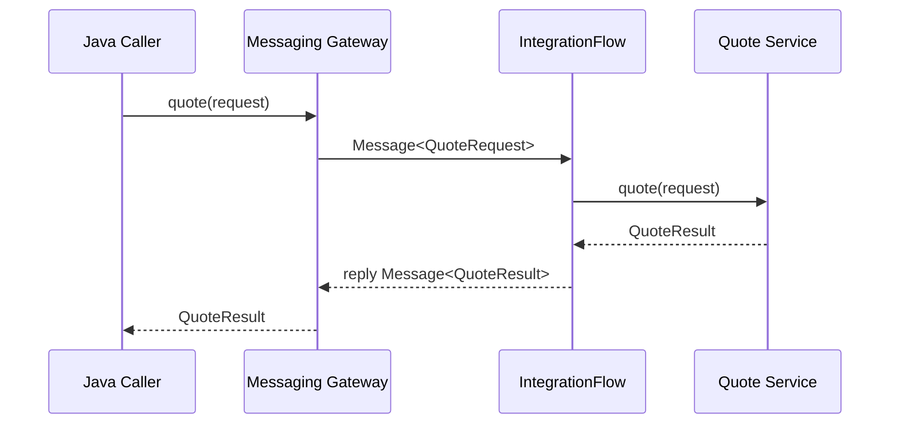

Một ứng dụng có thể đổi topology messaging mà caller vẫn giữ cùng interface. Tuy nhiên **API trả về đồng bộ vẫn là một hợp đồng chờ đợi**, kéo theo timeout, lỗi và latency; nó không biến tất cả messaging thành fire-and-forget.

### Gateway không tự làm gì?

Gateway **không** tự động:

- Bảo đảm exactly-once business side effect.
- Tạo distributed transaction qua broker, database và HTTP.
- Giữ mọi header qua tất cả adapter.
- Chặn duplicate khi caller retry.
- Chuyển một request–reply thành protocol đáng tin với mọi remote service.
- Bảo đảm handler sẽ trả reply trong thời hạn.
- Tự quyết định authorization, format lỗi hoặc SLA.

Những việc đó cần được thiết kế trong flow và các adapter liên quan.

## 3. So sánh request-reply với one-way

| Tiêu chí | One-way | Request-reply |
| --- | --- | --- |
| Caller mong đợi | Gửi yêu cầu, không chờ kết quả nghiệp vụ ngay | Nhận kết quả/exception theo contract |
| Gateway method | Thường `void` hoặc dạng fire-and-forget phù hợp | Thường trả DTO/value hoặc asynchronous result |
| Messaging flow | Producer → handler, có thể không có reply | Producer → handler → reply path |
| Failure có thể nhìn thấy | Có thể chỉ là lỗi gửi hoặc asynchronous failure | Có thể là send failure, handler error, reply timeout |
| Timeout | Send/publish deadline có thể liên quan | Send deadline và reply deadline cần phân biệt |
| Điều kiện thành công | Message đã được gửi/chấp nhận theo contract | Reply hợp lệ tới caller (không nhất thiết business đã commit) |
| Dùng khi | Audit, event notification, background job | Quote, tra trạng thái, request cần kết quả ngay |

**Sai lầm:** một method `void` đã gửi command vào broker **không chứng minh** downstream xử lý thành công. Ngược lại, method request-reply nhận reply `ACCEPTED` cũng không mặc định chứng minh tác vụ dài hạn đã hoàn tất. Cần định nghĩa *reply nghĩa là gì*: đã nhận, đã validate, đã commit hay chỉ đã xếp hàng.

### Khi nào không nên request-reply?

Một tác vụ mất nhiều phút, cần approval hoặc phụ thuộc nhiều hệ thống dễ vượt timeout nên dùng **202 Accepted + operationId, durable command và status/event notification** thay vì giữ Java/HTTP thread chờ. Gateway request-reply phù hợp hơn với tác vụ có thời hạn, chi phí và semantics rõ.

## 4. Gateway khác Service Activator

Đây là hai đầu của một interaction thường gặp:

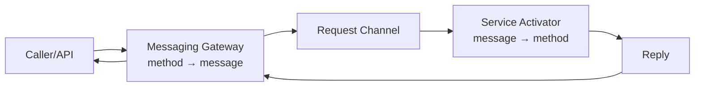

- **Messaging Gateway:** giúp code gọi flow như một method; chịu trách nhiệm chuyển call ↔ messaging.
- **Service Activator:** giúp flow gọi một service/method; chịu trách nhiệm message ↔ invocation.
- **Transformer:** đổi payload schema/type.
- **Filter:** nhận hoặc loại message.
- **Router:** chọn nhánh.
- **Aggregator:** gom nhiều message theo group/correlation, có release strategy.
- **Idempotent Receiver:** bảo vệ business operation khỏi duplicate.
- **Error Channel:** xử lý lỗi theo endpoint/adapters khi được cấu hình.

Một flow có thể đi qua nhiều Transformer/Router rồi mới tới Service Activator. Nhưng Gateway vẫn cần một đường reply có thể tìm lại caller tương ứng.

## 5. Thành phần cốt lõi của request-reply

### 5.1. Request

Là message mang command/query do Gateway phát đi. Payload có thể là DTO hoặc primitive, headers có thể gồm request ID, trusted context, correlation và reply destination.

### 5.2. Request channel

Channel mà Gateway gửi message vào. Nó có thể là `DirectChannel`, `QueueChannel` hoặc cấu trúc khác. Loại channel quyết định phần nào tính đồng bộ, backpressure, khả năng lưu trữ và mô hình lỗi.

### 5.3. Handler

Các endpoint nhận, xử lý, định tuyến và cuối cùng phát kết quả hoặc lỗi. Một Service Activator trả payload là ví dụ đơn giản.

### 5.4. Reply channel hoặc reply destination

Nơi reply được gửi để Gateway nhận. Với Gateway trong một JVM, framework có thể dùng **temporary reply channel** gắn trong request headers để nối reply đúng caller. Khi đi qua broker, cần một contract reply destination/correlation tương thích transport.

### 5.5. Timeout và error path

Nếu send không hoàn tất, không có reply, reply lỗi hoặc trả sai type, caller cần nhận một outcome có thể xử lý. Timeout không có nghĩa chắc chắn **business operation chưa xảy ra**.

### 5.6. Correlation

Một reply phải được ghép về **đúng request**. Có thể dựa vào reply channel riêng, correlation ID, hoặc reply-to metadata tùy topology. Không được suy rằng việc hai message có cùng payload là đủ để ghép.

## 6. Hai cách nhìn về request-reply trong Spring Integration

**Java interface Gateway** dùng `@MessagingGateway`: client gọi interface, framework tạo proxy gửi message và nhận reply.

**Gateway endpoint trong flow**: một endpoint gửi message sang một request/reply subflow hoặc hệ thống ngoài, chờ reply rồi đưa kết quả trở lại flow. DSL có thể dùng các thành phần gateway phù hợp version.

Bài này triển khai **Java interface Gateway** làm ví dụ chính, vì dễ nhìn thấy:

```java
ShippingQuoteResult quote(ShippingQuoteRequest request);
```

Phần về cross-flow/outbound gateway ở sau sẽ chỉ ra điểm khác biệt. Đừng nhầm với **HTTP API Gateway** (reverse proxy, routing HTTP, authentication ở edge). Cùng từ “gateway” nhưng không cùng chức năng.

## 7. Domain contract của ví dụ

Ta dùng một yêu cầu báo giá vận chuyển giả lập. Đây là *query* thuần, không thực hiện trừ tiền hay reserve kho.

```java
record ShippingQuoteRequest(
    String quoteRequestId,
    String zoneCode,
    int weightGrams) {}

record ShippingQuoteResult(
    String quoteRequestId,
    String zoneCode,
    long totalVnd,
    String currencyCode,
    String rateVersion) {}
```

Hợp đồng ví dụ:

- `quoteRequestId` là ID hợp lệ, dùng để đối chiếu và quan sát request; không phải broker message ID.
- `zoneCode` có hai giá trị demo: `HCM` hoặc `HN`.
- `weightGrams` là số nguyên trong khoảng 1 đến 20.000.
- Báo giá dùng **VND nguyên** để tránh làm tròn tiền không rõ ràng.
- Phí nền HCM = 16.000 VND, HN = 22.000 VND.
- Mỗi block 1.000 g (làm tròn lên) thêm 5.000 VND.
- Service trả `rateVersion="demo-v1"`.
- Demo không gọi nhà vận chuyển ngoài, không làm side effect tiền hoặc kho.

Ví dụ `zone=HCM, weight=1500g`: số block = 2, phí = 16.000 + 2 × 5.000 = **26.000 VND**.

### Tách dữ liệu nghiệp vụ và transport

Record không chứa `replyChannel`, `KafkaHeaders.RECEIVED_TOPIC`, HTTP status, trace span hoặc broker offset. Một integration adapter có thể dùng những thứ đó nhưng service tính phí không cần.

## 8. Service tính giá thuần Java

```java
import java.util.concurrent.atomic.AtomicInteger;

final class ShippingQuoteService {

    private final AtomicInteger calculations =
        new AtomicInteger();

    ShippingQuoteResult quote(ShippingQuoteRequest request) {
        if (request == null
                || request.quoteRequestId() == null
                || !request.quoteRequestId()
                    .matches("[A-Z0-9-]{1,40}")
                || request.zoneCode() == null
                || request.weightGrams() <= 0
                || request.weightGrams() > 20_000) {
            throw new IllegalArgumentException(
                "Invalid quote request");
        }

        long baseVnd = switch (request.zoneCode()) {
            case "HCM" -> 16_000L;
            case "HN" -> 22_000L;
            default -> throw new IllegalArgumentException(
                "Unsupported zone");
        };

        // Ép sang long trước khi cộng, tránh integer overflow.
        long blocks =
            (request.weightGrams() + 999L) / 1000L;

        long total = baseVnd + blocks * 5_000L;

        calculations.incrementAndGet();

        return new ShippingQuoteResult(
            request.quoteRequestId(),
            request.zoneCode(),
            total,
            "VND",
            "demo-v1");
    }

    int calculations() {
        return calculations.get();
    }
}
```

Java `switch` trên String sẽ ném `NullPointerException` nếu `zoneCode=null`. Vì vậy hàm kiểm tra `zoneCode == null` **trước khi vào switch**, chuyển dữ liệu thiếu thành `IllegalArgumentException` theo contract đầu vào. Nếu zone khác `HCM` và `HN`, nhánh `default` từ chối rõ thay vì tự chọn bảng giá mặc định.

**Service này không phải Service Activator:** nó là business collaborator thuần Java. Khi được gọi từ Spring Integration, một endpoint Service Activator đảm nhiệm việc nối message với phương thức.

## 9. Định nghĩa interface `@MessagingGateway`

Spring Integration hỗ trợ tạo **Messaging Gateway proxy** qua interface.

```java
import org.springframework.integration.annotation.MessagingGateway;

@MessagingGateway(
    defaultRequestChannel = "shipping.quote.requests",
    defaultRequestTimeout = "1000",
    defaultReplyTimeout = "2000")
public interface ShippingQuoteGateway {

    ShippingQuoteResult quote(
        ShippingQuoteRequest request);
}
```

Caller không cần tạo `Message<?>`:

```java
ShippingQuoteResult result = gateway.quote(
    new ShippingQuoteRequest(
        "Q-204", "HCM", 1500));
```

Gateway proxy thực hiện mapping arguments → request message, gửi vào channel và chờ reply theo method return contract.

### Hai attribute timeout có cùng đơn vị không?

Trong annotation, các timeout thường được biểu diễn bằng **chuỗi giá trị milliseconds hoặc property expression** theo API của Spring Integration đang dùng. Trong code demo, `"1000"` nghĩa là 1.000 ms, `"2000"` nghĩa là 2.000 ms. Cần xác minh kiểu/semantics chính xác của dependency và không tự áp dụng chúng như một deadline end-to-end tuyệt đối.

### Đăng ký interface Gateway

Một interface có annotation chỉ tạo proxy khi Spring Integration scan/đăng ký nó. Cấu hình tiếp theo dùng `@IntegrationComponentScan` để đăng ký Gateway interface.

Không phải mọi `@ComponentScan` thông thường đều xử lý Gateway interface theo cách mong đợi. Test ApplicationContext phải thật sự thấy bean `ShippingQuoteGateway`.

## 10. Java DSL: request channel → Service Activator → reply

Đây là topology chính:

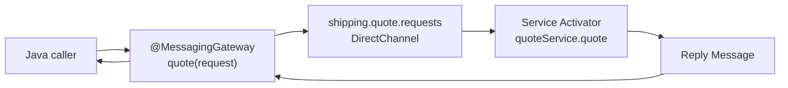

Cấu hình:

```java
import org.springframework.context.annotation.Bean;
import org.springframework.context.annotation.Configuration;
import org.springframework.integration.annotation.IntegrationComponentScan;
import org.springframework.integration.channel.DirectChannel;
import org.springframework.integration.config.EnableIntegration;
import org.springframework.integration.dsl.IntegrationFlow;

@Configuration
@EnableIntegration
@IntegrationComponentScan(
    basePackageClasses = ShippingQuoteGateway.class)
public class ShippingQuoteFlowConfig {

    @Bean
    ShippingQuoteService shippingQuoteService() {
        return new ShippingQuoteService();
    }

    @Bean("shipping.quote.requests")
    DirectChannel quoteRequests() {
        return new DirectChannel();
    }

    @Bean
    IntegrationFlow shippingQuoteFlow(
            ShippingQuoteService service) {

        return IntegrationFlow
            .from("shipping.quote.requests")
            .handle(
                ShippingQuoteRequest.class,
                (request, headers) ->
                    service.quote(request))
            .get();
    }
}
```

**Điểm mấu chốt:** flow **không gắn cố định** `.channel("some.queue")` ở cuối. Reply-producing handler có thể gửi result đến reply channel gắn trên request (do Gateway cung cấp) theo semantics của framework. Với một Gateway trong JVM, đây là cách đơn giản để caller nhận chính reply của request của mình.

Nếu bạn cố gửi mọi reply tới một `QueueChannel` chung mà không có consumer/correlation đúng, các caller có thể timeout, reply bị đọc nhầm hoặc không có ai đưa reply về Gateway.

### Vì sao không cần khai báo một reply channel toàn cục?

Gateway thường cung cấp reply-to context cho request, phù hợp với từng invocation. Service Activator trả `ShippingQuoteResult`, reply được framework định tuyến lại. Khi dùng **remote broker**, yêu cầu khác: không thể gửi đối tượng Spring `MessageChannel` qua mạng; phải dùng reply destination/correlation có thể serialize.

### Domain giữ được tính độc lập như thế nào?

- Gateway interface là integration-facing API.
- Flow biết payload class, headers và channel.
- `ShippingQuoteService.quote()` chỉ biết `ShippingQuoteRequest`/`ShippingQuoteResult`.
- Nếu đổi request channel từ `DirectChannel` sang async transport, business calculation không cần import Kafka/AMQP.

**Đây là ví dụ đồng bộ trong JVM.** Nó chưa chứng minh broker durability, remote reply correlation hoặc end-to-end timeout.

## 11. Giải phẫu một lần gọi thành công

Giả sử caller thực hiện:

```java
ShippingQuoteResult r = gateway.quote(
    new ShippingQuoteRequest("Q-204", "HCM", 1500));
```

Trình tự:

1. Java gọi proxy của `ShippingQuoteGateway`.
2. Proxy chuyển argument thành request `Message<ShippingQuoteRequest>`.
3. Gateway gắn reply context cần thiết và gửi vào `shipping.quote.requests`.
4. `DirectChannel` chuyển message tới endpoint subscriber.
5. Service Activator lấy payload đúng type.
6. `ShippingQuoteService.quote(...)` trả `ShippingQuoteResult`.
7. Reply-producing handler phát reply theo reply context.
8. Gateway nhận kết quả và chuyển thành `ShippingQuoteResult` cho caller.

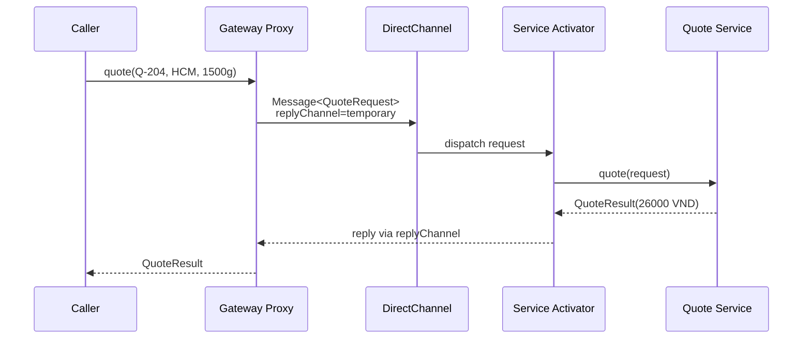

Trong ví dụ in-memory, Gateway có thể dùng temporary reply channel thay vì một shared reply queue. Đây là cơ chế phổ biến; chi tiết internal classes cần đối chiếu phiên bản Spring Integration nếu muốn dựa vào behavior đặc thù.

## 12. JUnit 5: kiểm thử request-reply end-to-end

Test dùng Spring Test context, JUnit 5 và AssertJ.

```java
import static org.assertj.core.api.Assertions.assertThat;
import static org.assertj.core.api.Assertions.assertThatThrownBy;

import org.junit.jupiter.api.Test;
import org.springframework.beans.factory.annotation.Autowired;
import org.springframework.test.context.junit.jupiter.SpringJUnitConfig;

@SpringJUnitConfig(ShippingQuoteFlowConfig.class)
class ShippingQuoteGatewayTest {

    @Autowired
    ShippingQuoteGateway gateway;

    @Autowired
    ShippingQuoteService service;

    @Test
    void methodCallReturnsTypedReply() {
        int before = service.calculations();

        ShippingQuoteResult result = gateway.quote(
            new ShippingQuoteRequest(
                "Q-204", "HCM", 1500));

        assertThat(result).isNotNull();
        assertThat(result.quoteRequestId())
            .isEqualTo("Q-204");
        assertThat(result.zoneCode())
            .isEqualTo("HCM");
        assertThat(result.totalVnd())
            .isEqualTo(26_000L);
        assertThat(result.currencyCode())
            .isEqualTo("VND");
        assertThat(result.rateVersion())
            .isEqualTo("demo-v1");
        assertThat(service.calculations() - before)
            .isEqualTo(1);
    }

    @Test
    void twoRequestsReturnTheirOwnResults() {
        ShippingQuoteResult hcm = gateway.quote(
            new ShippingQuoteRequest(
                "Q-205", "HCM", 1000));

        ShippingQuoteResult hn = gateway.quote(
            new ShippingQuoteRequest(
                "Q-206", "HN", 1000));

        assertThat(hcm.quoteRequestId())
            .isEqualTo("Q-205");
        assertThat(hcm.totalVnd())
            .isEqualTo(21_000L);

        assertThat(hn.quoteRequestId())
            .isEqualTo("Q-206");
        assertThat(hn.totalVnd())
            .isEqualTo(27_000L);
    }

    @Test
    void invalidRequestDoesNotBecomeSuccessfulReply() {
        int before = service.calculations();

        assertThatThrownBy(() ->
            gateway.quote(
                new ShippingQuoteRequest(
                    "Q-207", "HCM", -1)))
            .isInstanceOf(RuntimeException.class);

        assertThat(service.calculations() - before)
            .isZero();
    }

    @Test
    void unsupportedZoneIsRejected() {
        assertThatThrownBy(() ->
            gateway.quote(
                new ShippingQuoteRequest(
                    "Q-208", "UNKNOWN", 1000)))
            .isInstanceOf(RuntimeException.class);
    }
}
```

### Test nào đang được xác nhận?

- `@MessagingGateway` interface được tạo thành Spring bean.
- Method argument được đưa vào request channel.
- Service Activator trả typed payload.
- Gateway lấy đúng reply và trả cho Java caller.
- Domain validation failure không biến thành successful quote.
- Hai request riêng có result riêng, không bị đưa nhầm vào cùng response.

### Không nên suy quá mức từ test

Test chạy trong **một JVM với DirectChannel**. Nó không chứng minh:

- Reply tới sau timeout được xử lý đúng.
- Broker reply-to/correlation hoạt động qua network.
- Queue bền vững qua restart.
- Nhiều process đồng thời không nhận nhầm reply.
- Caller cancellation thực sự dừng handler.
- Timeout đảm bảo không có side effect.
- Retry có idempotency hoặc transaction.

Những trường hợp này cần dedicated integration/failure tests theo topology thật.

## 13. Unit test domain không cần Spring context

Vì service tính giá không import Spring Integration, logic có thể kiểm thử riêng:

```java
import static org.assertj.core.api.Assertions.assertThat;
import static org.assertj.core.api.Assertions.assertThatThrownBy;

import org.junit.jupiter.api.Test;

class ShippingQuoteServiceTest {

    private final ShippingQuoteService service =
        new ShippingQuoteService();

    @Test
    void oneToOneThousandGramsCountAsOneBlock() {
        assertThat(service.quote(
            new ShippingQuoteRequest(
                "Q-301", "HCM", 1)).totalVnd())
            .isEqualTo(21_000L);

        assertThat(service.quote(
            new ShippingQuoteRequest(
                "Q-302", "HCM", 1000)).totalVnd())
            .isEqualTo(21_000L);
    }

    @Test
    void oneThousandAndOneGramsCountAsTwoBlocks() {
        assertThat(service.quote(
            new ShippingQuoteRequest(
                "Q-303", "HCM", 1001)).totalVnd())
            .isEqualTo(26_000L);
    }

    @Test
    void invalidWeightCannotBeCalculated() {
        assertThatThrownBy(() ->
            service.quote(
                new ShippingQuoteRequest(
                    "Q-304", "HCM", 0)))
            .isInstanceOf(IllegalArgumentException.class);
    }
}
```

Không cần dựng Gateway proxy hay MessageHeaders cho các rule tính phí. Integration tests ở mục trước chỉ tập trung vào **method-to-message-to-reply wiring**.

## 14. Request channel: gửi được không đồng nghĩa đã xử lý xong

`DirectChannel` dispatch tới subscriber trong cùng thread call, theo semantics của DirectChannel. Thường handler hoàn tất trước khi send trở về.

`QueueChannel` là pollable channel; Gateway có thể enqueue request nhưng một poller/consumer riêng phải lấy ra, xử lý và phát reply.

`ExecutorChannel` có thể chuyển handling sang thread khác. Gateway gửi rồi chờ reply độc lập, nếu method return type là synchronous.

| Channel | Đặc điểm | Nguy cơ trong request-reply |
| --- | --- | --- |
| `DirectChannel` | Gọi subscriber đồng bộ | Handler chặn thread gọi; timeout không cắt ngang handler đang chạy |
| `ExecutorChannel` | Dispatch qua executor | Queue đầy, thread pool cạn, late reply, mất context |
| `QueueChannel` | Pollable, cần consumer/poller | Không có poller → Gateway chờ đến timeout |
| Broker adapter | Remote/bền vững tùy config | Reply destination, correlation, ACK, retry, reordering |
| `PublishSubscribeChannel` | Fan-out tới subscribers | Nhiều reply cho một request nếu không có policy rõ |

**Quan trọng:** Không nên chỉ đổi `DirectChannel` thành `QueueChannel` rồi cho rằng flow sẽ hoạt động bất đồng bộ. Cần endpoint poller/consumer nhận queue, và phải giữ reply metadata qua các bước.

## 15. `requestTimeout` và `replyTimeout` là hai thứ khác nhau

Một Gateway request-reply thường có hai timeout cấu hình:

- **Request/send timeout:** thời gian cho phép hoàn thành việc **gửi** message đến request channel, tùy channel semantics.
- **Reply timeout:** thời gian Gateway **chờ reply** qua reply mechanism.

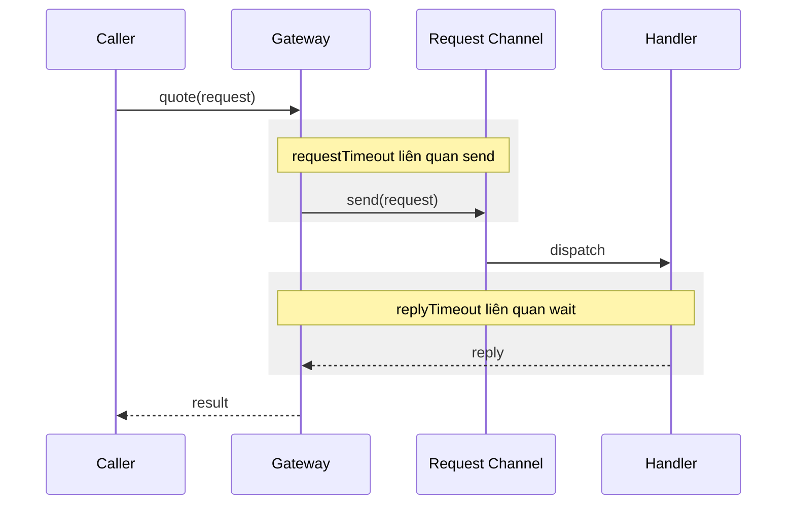

### Tình huống request timeout

Nếu request channel có capacity giới hạn và không thể nhận thêm, send có thể bị block hoặc thất bại. Gateway cần xác định send deadline. Nhưng semantics cụ thể khác nhau giữa `DirectChannel`, `QueueChannel`, broker adapter hoặc custom channel.

### Tình huống reply timeout

Request đã được gửi, nhưng không có reply trong thời gian dự kiến. Ví dụ:

- Handler không trả result.
- Filter discard message nhưng không trả rejection.
- Remote service chậm.
- Reply channel/correlation bị mất.
- Executor pool bị bão hòa.
- Reply có nhưng lỗi schema hoặc đi sai destination.

**Timeout không chứng minh handler chưa chạy.** Sender có thể timeout khi downstream đã commit nhưng reply bị mất hoặc đến muộn.

### Với DirectChannel, timeout có chặn handler quá lâu không?

**Không nên coi `replyTimeout` là deadline cứng cho một service call đồng bộ đang chiếm thread.** Với DirectChannel, lời gọi send có thể trực tiếp chạy handler lâu hơn timeout cấu hình trước khi tới giai đoạn chờ reply.

Nếu cần hard deadline end-to-end, bạn phải thiết kế riêng các lớp:

- Timeout của HTTP client/remote provider.
- Deadline/timeout của execution hoặc executor.
- Cancellation/cooperative interruption được hỗ trợ.
- Operation-level recovery khi outcome mơ hồ.
- Gateway send/reply timeouts.
- Retry budget tổng, không chỉ mỗi attempt.

Một timeout trên Gateway **không tự hủy transaction** và không bảo đảm request downstream bị hủy.

## 16. Không có reply: phân biệt Filter discard và Service Activator `void`

Ví dụ một Filter loại request:

```text
Gateway quote(request)
  ↓ Filter: invalid → false
  ↓ Không có reply
Gateway chờ ...
```

Nếu Filter chỉ discard mà không phát rejection message, caller có thể đợi tới reply timeout. Một Service Activator có `void` hoặc return `null` cũng có thể tạo **no-reply path**.

Giải pháp theo contract:

1. Với request–reply, tạo **typed rejection reply** (ví dụ `QuoteRejected`) hoặc ném exception được ánh xạ.
2. Với one-way, đổi method Gateway thành mô hình không chờ business response.
3. Nếu cần async, trả operation ID ngay rồi dùng status/event sau.
4. Đừng để mọi lỗi validation biến thành im lặng.
5. Kiểm thử cả reply timeout lẫn fail-fast error mapping.

### Reply `null` hay exception khi timeout?

Hành vi khi timeout có thể phụ thuộc return type, interface method, error handling và phiên bản/cấu hình Spring Integration. Một số call trả `null`/empty result, một số luồng có thể ném messaging exception. **Không dựa vào mặc định nếu API business cần fail-fast rõ ràng.**

Hãy định nghĩa policy của application wrapper, chẳng hạn:

```java
// Pseudocode application facade:
ShippingQuoteResult quoteOrFail(ShippingQuoteRequest request) {
    ShippingQuoteResult reply = gateway.quote(request);

    if (reply == null) {
        throw new QuoteUnavailableException(
            "No reply before deadline");
    }

    return reply;
}
```

`QuoteUnavailableException` là exception ứng dụng cần tự định nghĩa. Ví dụ nhằm thể hiện **error contract**, không nói tất cả Spring versions luôn trả null.

## 17. Reply channel: cơ chế trả đúng người gọi

Một request từ Gateway thường mang metadata tương tự:

```text
payload = ShippingQuoteRequest(...)
headers:
  replyChannel = temporaryReplyChannel
  errorChannel = ... (tùy cấu hình)
  requestRef   = Q-204
```

Một reply-producing handler có thể gửi result về `replyChannel`. Nếu nhiều Java threads gọi Gateway đồng thời, mỗi invocation có thể có reply path riêng.

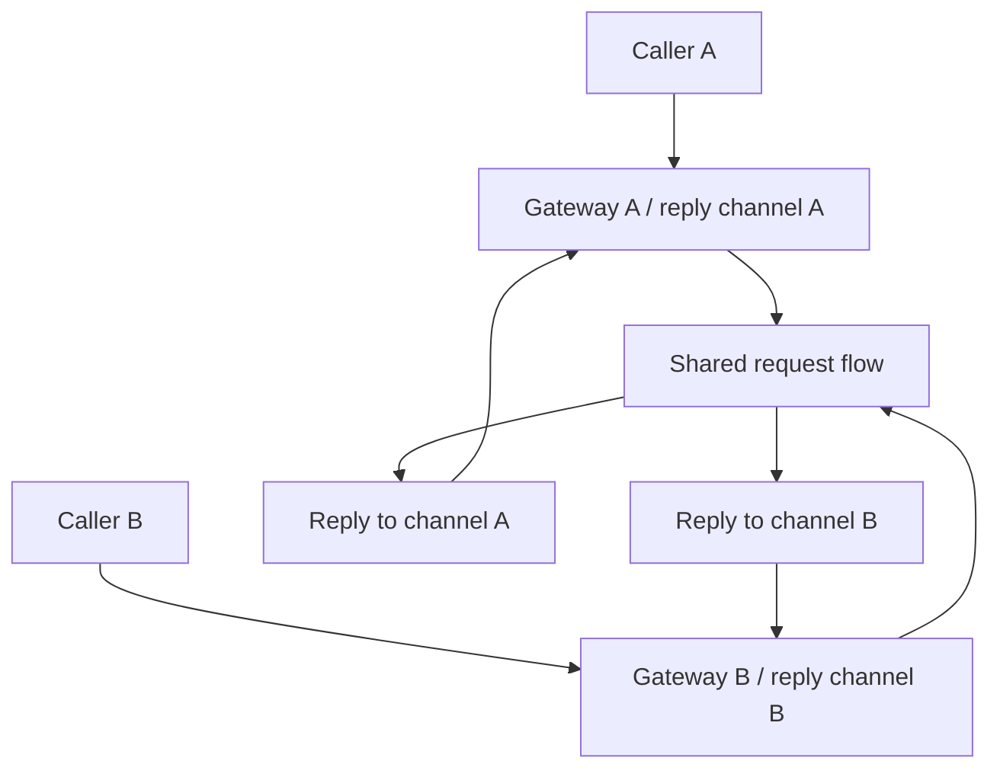

Trong flow đơn giản, framework quản lý reply context giúp giảm nhu cầu tự viết queue/correlation logic. Nhưng khi một message bị serialize qua Kafka/HTTP:

- Không thể truyền trực tiếp một `MessageChannel` object qua wire.
- Cần reply-to destination hoặc topic/queue thực.
- Cần correlation ID có contract giữa sender và receiver.
- Cần consumer/reply listener ghép reply đúng pending request.
- Cần retention, timeout, late reply và duplicate reply policy.

Không chỉ copy raw `replyChannel` header sang JSON rồi kỳ vọng remote service dùng được.

## 18. Correlation: cùng payload không có nghĩa cùng request

Giả sử cùng người dùng hỏi cùng zone/weight hai lần:

```text
Request A: quoteRequestId=Q-301, HCM, 1500g
Request B: quoteRequestId=Q-302, HCM, 1500g
```

Hai payload kinh tế gần giống nhưng là **hai lời gọi khác nhau**. Nếu broker gửi reply theo thứ tự B trước A, correlation phải dựa vào ID/destination phù hợp, không dựa vào payload equality hoặc FIFO thuần túy.

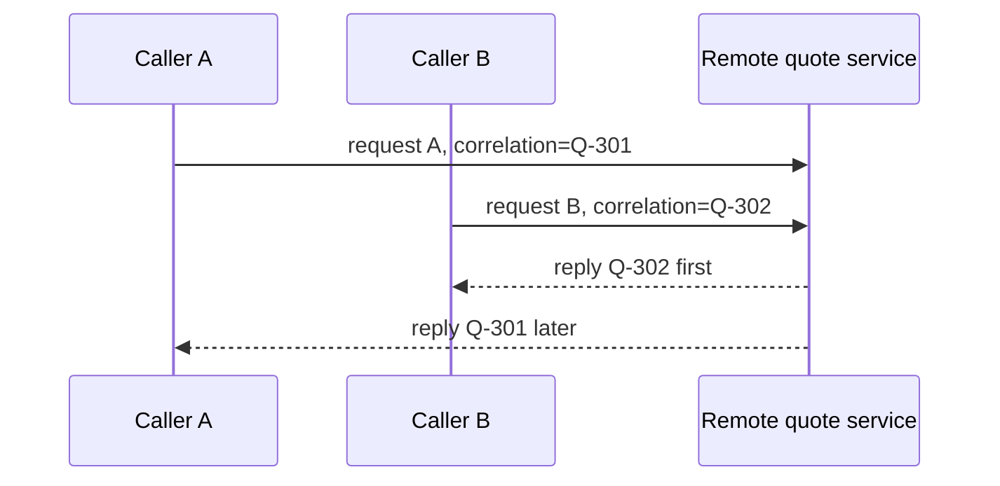

Các ID cần phân biệt:

| ID | Mục đích | Có ổn định qua retry? |
| --- | --- | --- |
| `MessageHeaders.ID` | Nhận diện instance message Spring | Không chắc |
| Broker delivery ID/offset | Delivery/record mechanics | Không chắc khi republish |
| Request/reply correlation ID | Ghép reply với invocation | Theo conversation/attempt contract |
| Business operation ID | Nhận diện cùng hành động nghiệp vụ | **Có** nếu là retry cùng operation |
| Logical event ID | Nhận diện event qua redelivery | **Có** cho cùng event |
| Trace ID | Observability | Tùy tracing/attempt |

Một hệ thống có thể dùng business ID làm correlation nếu contract cho phép và uniqueness được bảo đảm trong phạm vi pending requests. Nhưng **đừng suy rằng mọi correlation ID cũng là idempotency key**.

## 19. Gateways có nhiều method và `@Gateway` riêng

Một interface có thể có nhiều use case:

```java
import org.springframework.integration.annotation.Gateway;
import org.springframework.integration.annotation.MessagingGateway;

@MessagingGateway
public interface OrderQueryGateway {

    @Gateway(
        requestChannel = "orders.quote.requests",
        replyTimeout = "2000")
    ShippingQuoteResult quote(
        ShippingQuoteRequest request);

    @Gateway(
        requestChannel = "orders.status.requests",
        replyTimeout = "1500")
    OrderStatusResult status(
        OrderStatusRequest request);
}
```

`OrderStatusRequest` và `OrderStatusResult` là DTO ứng dụng riêng trong ví dụ này; chúng cần được định nghĩa tại dự án nếu áp dụng.

Ý nghĩa:

- `@MessagingGateway`: khai báo interface proxy.
- `@Gateway`: có thể điều chỉnh request channel/reply timeout cho từng method.
- Return type phản ánh reply contract của method tương ứng.
- Service Activators/flows đằng sau từng channel phải tạo result phù hợp.

**Không phải cứ đặt hai method trong một interface là chúng bắt buộc dùng chung channel.** Mỗi method cần flow/protocol rõ; nếu một method không có responder, Gateway sẽ không tự tạo result.

## 20. Đưa headers từ tham số Gateway vào request

Một interface có thể map method arguments thành payload và headers:

```java
import org.springframework.integration.annotation.MessagingGateway;
import org.springframework.messaging.handler.annotation.Payload;
import org.springframework.messaging.handler.annotation.Header;

@MessagingGateway(
    defaultRequestChannel = "shipping.secure-quote.requests")
public interface SecureQuoteGateway {

    ShippingQuoteResult quote(
        @Payload ShippingQuoteRequest request,
        @Header("verifiedTenantId") String verifiedTenantId);
}
```

Ở flow, Service Activator hoặc Mapper đọc header đã được đưa vào Message:

```java
// Ví dụ integration boundary, không phải xác thực token.
.handle(ShippingQuoteRequest.class, (request, headers) -> {
    Object tenant = headers.get("verifiedTenantId");

    if (!(tenant instanceof String id) || id.isBlank()) {
        throw new IllegalArgumentException(
            "Missing verified tenant");
    }

    return quoteApplicationService.quoteForTenant(
        id, request);
})
```

`quoteApplicationService` là collaborator ứng dụng giả định trong ví dụ, không phải một class đã định nghĩa trong cấu hình chính.

**Cực kỳ quan trọng:** truyền `verifiedTenantId` làm Gateway argument không tự biến nó thành trusted. Chỉ adapter/controller đã xác thực mới được gọi interface với tenant có authority. Nếu public caller tự chọn string, đó là spoofing. Domain/application phải kiểm tra quyền trên resource ở điểm thực hiện.

### Khi không cần header argument?

Nếu Gateway method đã nhận một `QuoteCommand` có tenant và actor context **được xác thực tại application boundary**, hãy dùng DTO typed. Không thêm `@Header` cho mọi trường chỉ vì framework hỗ trợ.

## 21. Gateway, Transformer và Normalizer

Một Gateway có thể nhận request ở schema ngoài rồi cần đổi thành canonical command:

```text
Caller: LegacyQuoteRequest
   ↓ Gateway
Message<LegacyQuoteRequest>
   ↓ Transformer / Normalizer
Message<ShippingQuoteRequest>
   ↓ Service Activator
ShippingQuoteResult
   ↓ Gateway reply
Caller
```

Tuy nhiên **Gateway không tự normalize schema**. Việc chuyển payload nên ở adapter/Transformer, được test riêng.

Nếu một partner gửi V1 với `weightKg` và V2 với `weightGrams`, Normalizer có thể biến cả hai thành `ShippingQuoteRequest`. Gateway return type vẫn giữ stable khi thay source representation.

### Reply type mismatch

Nếu handler trả `Map<String,Object>` nhưng Gateway method muốn `ShippingQuoteResult`, framework cần converter phù hợp hoặc sẽ thất bại. Đừng giả định tự cast/deserialize tùy ý chỉ vì field names giống nhau.

Một contract test nên xác nhận reply typed, header mapping và lỗi conversion.

## 22. Gateway và Filter: reject phải có đường trả lời

Giả sử route:

```text
Gateway → Filter(eligible?) → Service Activator → reply
```

Nếu Filter loại message mà không reply:

- Gateway có thể chờ timeout.
- Caller nhận `null`/exception tùy contract.
- Monitoring chỉ thấy “timeout”, không biết rule từ chối.
- Caller retry có thể làm tăng tải dù input vĩnh viễn không hợp lệ.

Thiết kế tốt hơn:

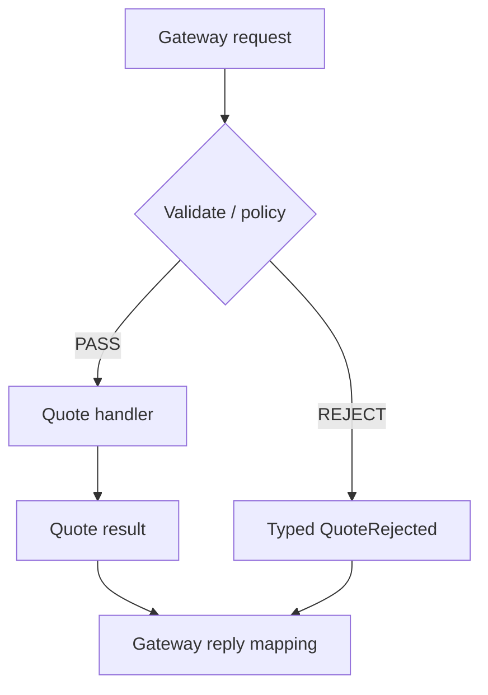

Hai cách phổ biến:

1. **Application result envelope:** trả một sealed result/status có type Success/Rejected; caller xử lý theo contract.
2. **Typed exception:** validation/policy error được ném hoặc route qua error flow đã cấu hình, ánh xạ sang API error.

Không gửi một `QuoteRejected` vào cùng Gateway method trả cứng `ShippingQuoteResult` nếu chưa có converter/type mapping; cần đổi return contract hoặc ánh xạ lỗi thành exception.

## 23. Gateway và Router: không mất reply context

Router có thể đưa request tới:

```text
Shipping Quote Gateway
   ↓
Router by zone/service level
   ├── HCM handler
   └── HN handler
       ↓
  Reply to original Gateway
```

Mỗi branch phải trả reply đúng type và giữ reply/correlation metadata cần thiết. Nếu một branch gửi ra một channel không có responder hoặc tự xây Message mới làm rơi `replyChannel`, Gateway có thể timeout dù branch đã chạy.

### Test những gì?

- HCM và HN chọn đúng branch.
- Mỗi branch tạo result tương thích.
- Header reply/context được bảo toàn.
- Unknown zone trả rejection/exception, không discard im lặng.
- Thời gian xử lý đáp ứng SLA.
- Không có hai branch cùng tạo reply cho một request trừ khi có policy aggregation.

## 24. Aggregator/Scatter-Gather trước Gateway reply

Có trường hợp quote cần hỏi nhiều hãng vận chuyển và trả **một best quote**:

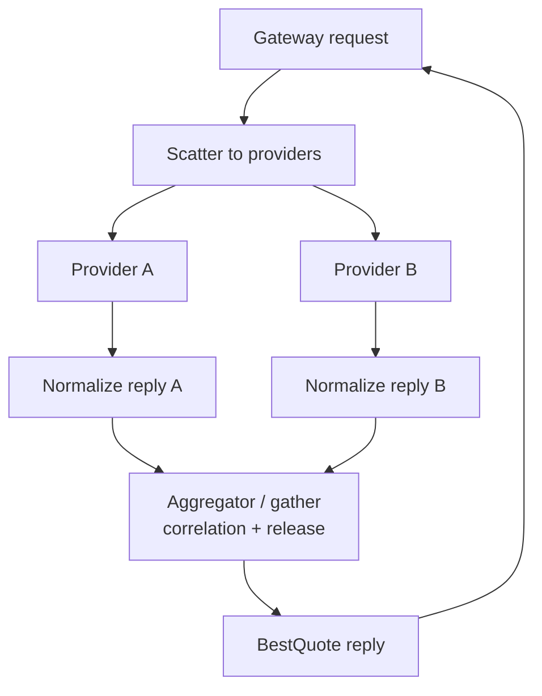

Gateway chỉ muốn **một reply cuối**. Aggregator phải:

- Dùng trusted correlation/group ID.
- Biết expected responders/unique part IDs.
- Không đếm duplicate reply của Provider A thành Provider B.
- Có release timeout/partial result/failure policy.
- Có idempotency khi remote provider reply nhiều lần.
- Giữ reply destination của request gốc cho output.

**Không phải vì Gateway cần một reply mà framework tự gom mọi reply thành một.** Nếu route tạo nhiều message replies, phải có aggregator/gatherer hoặc một chính sách rõ để chọn kết quả.

## 25. Reply đến muộn: caller đã timeout nhưng handler vẫn tiếp tục

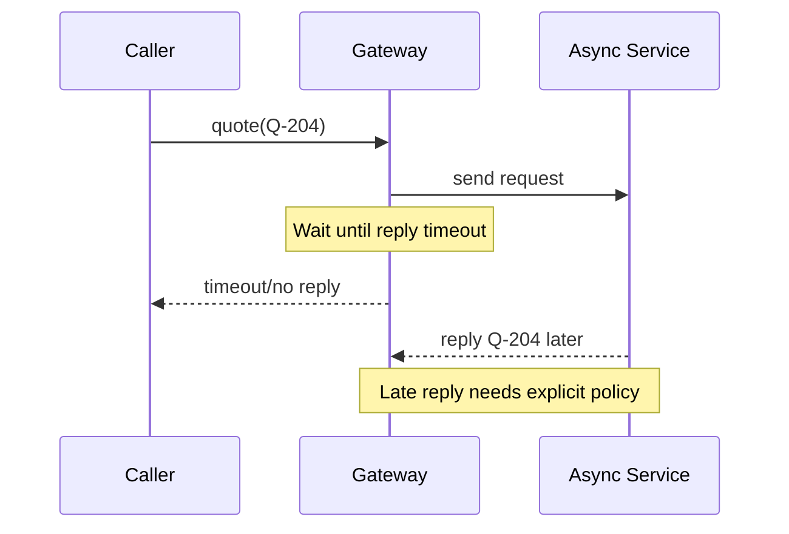

Không nên nhầm timeout với cancel thành công:

- Handler có thể còn chạy.
- Remote provider có thể đã commit.
- Reply tới temporary channel sau khi caller đi có thể bị loại, lỗi hoặc không còn consumer.
- Caller có thể retry với request ID mới và tạo business operation thứ hai nếu đây là command có side effect.
- Thread/queue hoặc reply correlation store có thể còn giữ pending state.

Cần định nghĩa:

1. Caller nhận error hay operationId khi hết hạn?
2. Pending request được dọn dẹp thế nào?
3. Late reply được log, lưu result, reconcile hay bỏ có kiểm soát?
4. Cách retry giữ stable business operation identity?
5. Có cần durable reply store nếu response được chờ qua restart?
6. Remote timeout/cancellation có làm side effect dừng thật không?

**Timeout là outcome của người chờ, không phải bằng chứng hành động chưa xảy ra.**

## 26. Bài toán deadlock khi request-reply dùng executor có giới hạn

Một lỗi điển hình:

```text
Executor pool = 1 thread

Task A trên executor:
  gọi Gateway request-reply
  gửi request vào queue
  chờ reply

Task B cần chính executor đó để:
  lấy request
  xử lý
  phát reply

Kết quả: Task B không có thread để chạy.
Task A chờ đến timeout.
```

Nếu dùng thread pool nhỏ, nested synchronous gateways hoặc flow gửi vòng lại executor đang bị block, có thể dẫn đến **thread starvation/deadlock theo topology**.

Biện pháp:

- Tách executor cho caller blocking và worker/responder.
- Không chờ reply đồng bộ trong cùng thread pool xử lý request.
- Giới hạn concurrency, queue capacity và backpressure.
- Dùng bounded deadlines và circuit breaker khi phù hợp.
- Với tác vụ dài, chuyển sang async job/status event.
- Viết load/failure tests cho thread pool saturation.

Không tự coi việc đặt `replyTimeout=2000` là giải pháp cho starved executor. Nó chỉ giới hạn một kiểu chờ; nguyên nhân cấu trúc vẫn còn.

## 27. Tại sao Gateway làm caller dễ lầm tưởng đây là RPC bình thường?

Interface:

```java
ShippingQuoteResult quote(ShippingQuoteRequest request);
```

trông giống gọi method trong process. Nhưng có khác biệt:

| Gọi method thuần Java | Gateway request-reply |
| --- | --- |
| Invocation trực tiếp | Message có thể đi qua nhiều endpoints/threads/processes |
| Exception gần như đồng bộ | Error có thể phát sinh ở adapter, handler, broker hoặc reply mapping |
| Return type do method thực thi | Return type còn phụ thuộc converter/reply routing |
| Không có send/reply channel | Có channel semantics và timeout |
| Một call có thể chạy một lần | Retry/redelivery có thể gọi business effect nhiều lần |
| Caller giữ stack tới return | Async boundaries có lifecycle riêng |
| Không cần correlation qua network | Remote replies phải match |
| Cancellation có semantics ngôn ngữ | Cancellation không tự rollback business action |

Giữ API dễ dùng nhưng phải **ghi rõ tính phân tán trong contract**: timeout, retryability, operation identity, loại lỗi và nghĩa của response.

## 28. Error handling: lỗi send, lỗi handler, lỗi nhận reply

| Vị trí | Ví dụ | Phản ứng phù hợp |
| --- | --- | --- |
| Gateway proxy | Method/argument mapping thất bại | Fail fast, validation/contract error |
| Request channel | Channel đầy, không subscriber | Send error/timeout, alert topology |
| Transformer | JSON/DTO không convert | Permanent input rejection |
| Filter | Dữ liệu không hợp lệ | Typed error/rejection reply |
| Router | Unknown route | Explicit reject/error flow |
| Service Activator | Domain rule từ chối | Business error |
| Outbound provider | HTTP 503 | Bounded retry/backoff |
| Provider timeout | Không rõ đã commit | Reconciliation, không tạo operation mới |
| Reply channel | Reply mất/sai correlation | Timeout + investigate |
| Reply conversion | Payload trả sai type | Contract failure, không báo success |
| Gateway deadline | Reply đến muộn | Late reply cleanup/reconcile |
| Store unavailable | Ledger/correlation store lỗi | Fail safe, retry theo policy |

**Không mặc định mọi exception được gửi vào global `errorChannel`.** Trong DirectChannel đồng bộ, exception có thể lan ngược về sender và bị wrapper thành MessagingException. Với executor, poller và broker, error channel/recovery có semantics khác.

Một Gateway có error channel/advice/error flow được cấu hình có thể biến lỗi thành reply hoặc exception. Phải test đúng mode và tránh làm caller hiểu một error reply là successful business result.

## 29. Header propagation qua các bước

Gateway request có thể có:

```text
payload: ShippingQuoteRequest
headers:
  replyChannel
  errorChannel
  requestRef
  correlationId
  traceparent
  verifiedTenantId
```

Trong một flow nội bộ, nhiều transformer/handler giữ context headers khi trả payload, nhưng không phải mọi cách tạo Message mới đều giống nhau.

Các tình huống làm mất context:

- Tự tạo `MessageBuilder.withPayload(...).build()` mà không giữ headers cần thiết.
- Adapter outbound chỉ map một subset header.
- Serialize `replyChannel` JVM object qua transport không hỗ trợ.
- Header Enricher ghi đè correlation.
- Aggregator tạo output thiếu original reply destination.
- Security boundary xóa đúng một số headers nhưng không thay bằng trusted context.

**Khuyến nghị:** có test cho header có ý nghĩa, đặc biệt reply/correlation và business event ID, ở mỗi network boundary. Không tin client tự gửi `replyChannel` để ép hệ thống phát reply tới một destination tùy ý nếu chưa authorize.

## 30. Authentication, authorization và tenant trong Gateway

Messaging Gateway giúp map method arguments thành message headers/payload, **không xác minh danh tính người gọi**.

Nếu interface có:

```java
QuoteResult quote(
    @Payload QuoteRequest req,
    @Header("tenantId") String tenantId);
```

và public API cho client tự chọn tenantId, đó có thể là lỗ hổng.

Quy trình tin cậy:

1. HTTP/mTLS/JWT hoặc broker ACL xác thực actor/producer.
2. Adapter tạo server-owned trusted tenant/scope.
3. Gateway chỉ nhận từ service/application đã xác minh quyền.
4. Service Activator/domain xác minh resource ownership khi cần.
5. Error reply không rò rỉ dữ liệu tenant khác.
6. Correlation/reply destination được giới hạn quyền.
7. Tracing và headers không chứa token/secret trong log.

**Không dùng `requestId` hoặc correlation ID làm authentication token.** Chúng phục vụ matching/observability, không cấp quyền.

## 31. Gateway request-reply và idempotency

Bài demo báo giá là một query không có side effect. Nhưng cùng cấu trúc có thể được dùng để gửi:

```java
PaymentReceipt capture(CapturePayment command);
```

Nếu caller timeout rồi retry, một payment provider có thể đã commit lần đầu. Gateway không tự chặn việc gọi hai lần.

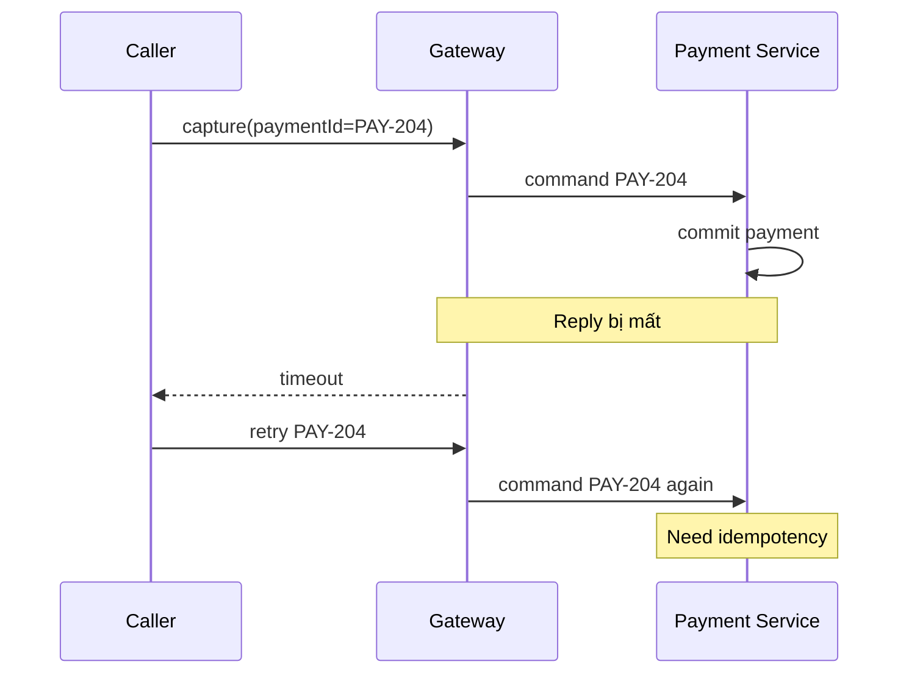

Để đúng hơn:

- Dùng stable business operation ID qua retry: `paymentRequestId`/`reservationId`.
- Không dùng Spring MessageHeaders.ID hoặc broker delivery ID làm business key.
- Ledger có unique constraint/atomic claim và trạng thái PROCESSING/COMPLETED/UNKNOWN.
- Cùng key nhưng business data khác phải báo **conflict**.
- Nếu remote provider hỗ trợ idempotency key, truyền cùng key.
- Nếu outcome unknown sau timeout, reconcile trước khi tạo operation mới.
- Caller có thể nhận stored result của lần đầu thay vì chạy lại side effect.
- Retention đủ dài cho retry, broker redelivery và DLQ replay.

Gateway request-reply giải quyết **communication**, Idempotent Receiver/transaction giải quyết **effect safety**. Không đồng nhất hai trách nhiệm.

## 32. Request-reply qua broker: cần protocol rõ

Một Gateway có thể được nối với outbound adapter tới remote service. Khi đó cần một **wire protocol** có request/reply semantics:

```text
Caller Gateway
  → request topic / queue
  → Remote consumer
  → reply topic / queue
  → Reply listener + correlation
  → Caller Gateway
```

Các trường quan trọng:

```text
request:
  correlationRef = req-204
  replyTo = quote.replies.instance-A
  operationRef = Q-204
  messageType = SHIPPING_QUOTE_REQUEST

reply:
  correlationRef = req-204
  messageType = SHIPPING_QUOTE_RESULT
  payload = ...
```

Phải thống nhất:

1. Ai tạo correlation ID và phạm vi uniqueness?
2. Reply tới queue/topic nào, có TTL và ACL ra sao?
3. Khi một request có nhiều attempts, correlation mỗi attempt hay một logical operation?
4. Pending requests được lưu ở đâu, có survive process restart không?
5. Nếu reply tới trước listener/lookup hoặc sau timeout thì sao?
6. Duplicate replies được xử lý thế nào?
7. Nếu responder không hỗ trợ schema/version, caller nhận lỗi có kiểu nào?
8. Request được ACK khi nào; gửi reply có transaction/outbox không?
9. Trace context được map thế nào qua transport?
10. Khi scale nhiều Gateway instances, reply routing có đúng instance/pending state không?

**Không serialize Spring `MessageChannel` object** và không coi một shared reply queue không có correlation là đủ. Kế hoạch transport cần được test riêng.

## 33. Thao tác lâu: tách Gateway response khỏi completion

Với workflow tạo vận đơn mất vài phút:

```text
HTTP request
   ↓ API accepts command
202 Accepted + operationId
   ↓ durable command / queue
Worker / partner fulfillment
   ↓ event/DB state update
Client polls GET /operations/{id}
   hoặc nhận webhook/event
```

Một Gateway đồng bộ có thể dùng để **kiểm tra/accept nhanh** và trả operation ID, không nên block đến khi toàn bộ workflow xong.

Phân biệt:

- **Accepted:** command đã qua validation và vào hạ tầng theo contract.
- **Processing:** công việc còn đang thực hiện.
- **Completed:** business action hoàn tất.
- **Failed:** business action kết thúc với lỗi.
- **Unknown:** external outcome chưa xác nhận, cần reconciliation.

Nếu trả `"OK"` ngay sau khi enqueue, đừng để caller hiểu đó là đã giao vận thành công. Tài liệu API và event schema phải mô tả nghĩa chính xác.

## 34. Performance, timeout budget và backpressure

Trong request-reply, Gateway chiếm tài nguyên trong thời gian chờ. Với lưu lượng cao:

- Blocking callers có thể làm cạn servlet threads hoặc application executors.
- Queue đầy làm send chậm hoặc thất bại.
- Timeout ngắn tạo retry storm.
- Reply muộn tạo orphaned work/correlation state.
- Remote service và gateway concurrency không cân bằng.
- Multiple hop timeouts cộng dồn vượt SLA.
- Retry ở nhiều lớp nhân số requests ngoài dự kiến.

Một timeout budget minh họa:

| Chặng | Budget giả định |
| --- | --- |
| Parse/validate ingress | 50 ms |
| Queue/dispatch | 100 ms |
| Business handler | 300 ms |
| Remote lookup | 500 ms |
| Reply mapping | 50 ms |
| Dự phòng | 100 ms |
| **Tổng** | **1.100 ms** |

Bảng chỉ để tập thiết kế SLA; thời gian thực phụ thuộc deployment. Nếu caller deadline 1.100 ms, không nên cấu hình **mỗi hop** 1.100 ms rồi cho phép ba lần retry. Cần một **overall deadline/retry budget**.

### Bounded concurrency

- Queue capacity theo khả năng xử lý thực.
- Timeouts cho provider client.
- Circuit breaker/bulkhead khi appropriate.
- Separate executor nếu nested blocking calls.
- Rate limit nếu caller tạo retry storm.
- Metrics pending count, success/timeout và latency percentile.
- Graceful degradation hoặc async response nếu không đạt SLA.

Gateway không tự thay thế backpressure design.

## 35. Observability: theo dõi cả send và reply

Log mẫu:

```text
event=gateway_request_sent
gateway=ShippingQuoteGateway.quote
requestRef=Q-204
requestChannel=shipping.quote.requests
payloadType=ShippingQuoteRequest
traceRef=trace-801
```

Khi thành công:

```text
event=gateway_reply_received
gateway=ShippingQuoteGateway.quote
requestRef=Q-204
replyType=ShippingQuoteResult
outcome=SUCCESS
elapsedMs=83
```

Khi timeout:

```text
event=gateway_reply_timeout
gateway=ShippingQuoteGateway.quote
requestRef=Q-204
timeoutMs=2000
outcome=UNKNOWN
```

Đây là **event schema đề xuất**, không phải tất cả trường được framework xuất sẵn. Không log raw token, PII hoặc secret trong headers.

| Metric gợi ý | Câu hỏi |
| --- | --- |
| `gateway.calls.total{method}` | Có bao nhiêu lời gọi? |
| `gateway.requests.sent.total{channel}` | Đã gửi tới channel nào? |
| `gateway.request.send.errors.total{reason}` | Request lỗi vì sao? |
| `gateway.replies.total{resultType}` | Reply types nào đang trả về? |
| `gateway.reply.timeouts.total{method}` | Caller chờ quá hạn bao nhiêu lần? |
| `gateway.latency{method}` | P50/P95/P99 end-to-end |
| `gateway.pending.requests` | Bao nhiêu calls đang chờ? |
| `gateway.late.replies.total` | Reply đến sau deadline? |
| `gateway.correlation.mismatches.total` | Reply thiếu/sai correlation |
| `gateway.reply.mapping.errors.total` | Return type/serializer mismatches |
| `gateway.handler.errors.total{type}` | Business/infrastructure errors |
| `gateway.idempotency.hits.total` | Duplicate business command được nhận diện |

Không dùng `requestId`, `userId`, `tenantId` tùy ý thành metric labels có cardinality cao. Dùng tracing/log có quyền truy cập để tra một request cụ thể.

## 36. Troubleshooting

| Triệu chứng | Khả năng | Hướng kiểm tra |
| --- | --- | --- |
| Gateway bean không tồn tại | Thiếu IntegrationComponentScan | Kiểm tra annotation scan và Spring context |
| Gateway ném exception không có subscriber | Channel sai tên/không có endpoint | Kiểm tra flow wiring |
| Gateway timeout dù handler chạy | Reply channel mất/sai | Kiểm tra reply metadata |
| Quote trả null sau timeout | Không có reply path | Typed rejection hoặc deadline/timeout policy |
| Handler chạy lâu quá cấu hình replyTimeout | DirectChannel synchronous | Giới hạn handler/provider, async architecture |
| Request channel đầy | Queue capacity/backpressure | Bounded queue, pool sizing |
| Reply sai caller | Shared reply channel không correlation | Correlation/destination mapping |
| Reply tới sau timeout | Remote chậm, caller hủy chờ | Late reply handling/recovery |
| Một invalid request gây timeout | Filter discard im lặng | Return typed rejection |
| Payload reply sai type | Adapter/Transformer schema | Explicit reply conversion/contract test |
| Multi-instance remote reply fail | Reply routed sai instance | Reply listener/registry/destination thiết kế |
| Threads bị block | Nested Gateway trong single executor | Separate pools, avoid blocking loops |
| Request retry tạo side effect trùng | Timeout rồi retry ID mới | Stable operation ID, ledger |
| Error không tới global errorChannel | Synchronous exception / adapter semantics | Error flow theo channel/thread |
| Handler void nhưng method trả DTO | Không có reply | Sửa one-way/reply contract |
| Correlation biến mất sau Transformer | Tạo Message không giữ metadata | Test headers và mapping |
| Test DirectChannel pass, Kafka fail | Serialization/reply protocol khác | Transport integration tests |
| Transaction commit nhưng Gateway timeout | Reply/ACK mất sau commit | Stored outcome/reconciliation |
| Timeout tăng sau deploy | Pool saturation hoặc routing | P95, pending, queue, thread dumps |
| Request bị xử lý ở hai branch | Router/recipient list sai topology | Single reply/aggregation strategy |
| Header tenant giả mạo | Gateway args chưa được authorize | Trusted ingress và resource authorization |

## 37. Ma trận kiểm thử production

| Test case | Kỳ vọng |
| --- | --- |
| Request hợp lệ qua Gateway | Nhận typed reply đúng |
| Hai request khác nhau | Mỗi reply đúng request |
| Payload type sai | Conversion/validation error rõ |
| Handler ném business exception | Không trả successful reply |
| Gateway interface không được scan | Context test bắt lỗi sớm |
| Request channel không có subscriber | Send failure/timeout có observability |
| Reply mất | Caller có deadline/timeout outcome |
| Filter discard | Có rejection path, không chờ vô nghĩa |
| Handler `void` | One-way contract rõ |
| Return payload sai type | Reply mapping failure |
| Request timeout khi QueueChannel đầy | Send budget được kiểm chứng |
| Reply timeout khi async handler chậm | Caller hết hạn, late reply policy |
| DirectChannel handler chậm | Chứng minh gateway timeout không cắt ngang handler |
| Executor starved | Test nested gateway, không deadlock |
| Correlation sai | Không gửi reply tới caller khác |
| Reply qua broker | Topic/replyTo/correlation đúng |
| Gateway scale nhiều replicas | Reply vẫn tới đúng pending request |
| Broker redelivery | Consumer idempotent khi cần |
| Caller retry sau unknown outcome | Dùng stable operation ID |
| Provider commit rồi ACK/reply mất | Reconcile/trả stored result |
| Payload chứa PII/token | Không dump raw logs |
| Tenant header giả mạo | Rejected trước domain |
| Gateway shutdown có pending calls | Cleanup/metrics/recovery |
| Reply tới sau deadline | Không lẫn vào invocation mới |
| Schema V1/V2 | Contract/migration test |
| Router/Scatter-Gather replies | Release đúng expected unique responders |

## 38. Bài tập thực hành

### Bài 1 — Vẽ request–reply

Vẽ sequence caller → Gateway → request channel → Service Activator → reply channel → caller. Ghi rõ ai tạo Message, ai tạo reply và correlation/reply-to được truyền ở đâu.

### Bài 2 — Chạy Java DSL demo

Đăng ký `ShippingQuoteGateway` và `ShippingQuoteFlowConfig`. Gọi `quote("Q-204","HCM",1500)`, xác minh 26.000 VND. Thay zone HN và kiểm tra 32.000 VND cho 1500g.

### Bài 3 — Kiểm tra method return type

Thay return type Gateway thành String nhưng handler vẫn trả ShippingQuoteResult. Kiểm tra conversion/exception theo version, sau đó sửa bằng converter cụ thể hoặc giữ typed return.

### Bài 4 — RequestTimeout vs ReplyTimeout

Thiết lập request channel có bounded capacity và không có consumer; đo lỗi send. Sau đó dùng async handler chậm nhưng send thành công, đo reply timeout. Phân biệt hai nguyên nhân và không áp dụng cùng một metric.

### Bài 5 — DirectChannel không tạo deadline cứng

Trong demo đồng bộ, cho handler ngủ lâu hơn `defaultReplyTimeout` rồi quan sát elapsed time. Giải thích vì sao timeout trên Gateway không bảo đảm cắt ngang một method đang chạy cùng thread. Không dùng sleep trong production code.

### Bài 6 — Filter và typed rejection

Thêm Filter check zone; thay vì discard im lặng, định nghĩa typed `QuoteRejected`/exception mapping. Test caller nhận lỗi có nghĩa, không chờ đến deadline chỉ để biết input invalid.

### Bài 7 — Gateway với hai methods

Dùng `@Gateway(requestChannel=...)` để tách quote và status. Thiết kế mỗi flow trả đúng DTO, kiểm thử route và timeout riêng.

### Bài 8 — Argument-to-header mapping

Dùng `@Payload` và `@Header("verifiedTenantId")` trong Gateway method. Chứng minh header đi tới Service Activator; thiết kế trusted ingress để client không tự chọn tenant.

### Bài 9 — Correlation đảo thứ tự

Hai request A/B đi qua một async worker và reply B tới trước A. Dùng correlation ID/reply destination đúng để mỗi caller nhận result của chính mình. Thử missing/duplicate reply.

### Bài 10 — Scatter-Gather

Một quote gửi tới hai providers. Aggregator chỉ release khi có unique expected responses hoặc timeout policy rõ. Test duplicate Provider A không được tính thành Provider B.

### Bài 11 — One-way vs request–reply

Thử Service Activator `void` với một Gateway synchronous trả DTO. Mô tả timeout; refactor thành Gateway one-way hoặc tạo receipt/operationId.

### Bài 12 — Timeout sau side effect

Thay QuoteService bằng một command reserve có effect. Mô phỏng commit rồi reply mất, caller retry. Xây ledger idempotency và trả stored result; không dùng MessageHeaders.ID.

### Bài 13 — Broker reply protocol

Thiết kế request topic, reply topic, correlationRef, replyTo và pending registry/TTL cho ba Gateway instances. Giải thích late reply và instance crash.

### Bài 14 — Load test và backpressure

Giả lập 1000 calls đồng thời, thread pool nhỏ và remote latency tăng. Đo P95, pending count, error rate; điều chỉnh concurrency, queue và overall deadline thay vì chỉ nâng timeout.

### Bài 15 — Error channel và DLQ

Tách validation errors, provider HTTP 503, DB unavailable, unknown outcome và wrong reply type. Mỗi loại có retry/error contract phù hợp. Kiểm tra exception routing trong DirectChannel và executor-backed flows.

### Bài 16 — Thiết kế API bất đồng bộ

Chuyển một tác vụ vận đơn lâu sang `202 Accepted + operationId` và status endpoint/event callback. Giải thích khi nào một Gateway request–reply trả accepted là hợp lý và khi nào không nên chờ completion.

**Tiêu chí hoàn thành:** người học tạo được Gateway proxy, hiểu request/reply path, đo phân biệt send/reply timeout, test no-reply/error, giữ correlation, và giải thích vì sao Gateway không mặc nhiên bảo đảm idempotency hay completion.

## 39. Checklist trước production

- [ ] Gateway interface và method return contract được định nghĩa rõ.
- [ ] `@MessagingGateway` interface được scan/đăng ký trong ApplicationContext.
- [ ] Request channel tồn tại và có subscriber/consumer phù hợp.
- [ ] Reply-producing handler có đường trả reply tới Gateway.
- [ ] Không kết thúc flow ở QueueChannel chung nếu không có reply relay/correlation.
- [ ] `defaultRequestTimeout` và `defaultReplyTimeout` được hiểu đúng semantics.
- [ ] Overall business deadline không phụ thuộc riêng Gateway timeout.
- [ ] Với DirectChannel, handler/remote client có timeout riêng.
- [ ] Với ExecutorChannel/QueueChannel, có pool/poller và capacity tương ứng.
- [ ] Không để nested blocking Gateway tạo thread starvation.
- [ ] Mọi Filter reject trong request–reply đều có explicit error/reply policy.
- [ ] Method `void` không đi với API bắt buộc reply trừ khi có reply riêng.
- [ ] Return payload type/serializer/converter được kiểm thử.
- [ ] Reply channel và correlation metadata được bảo toàn qua internal flow.
- [ ] Qua broker, dùng reply-to destination và correlation có thể serialize.
- [ ] Late/missing/duplicate reply có cleanup/recovery policy.
- [ ] Gateway nhiều instances có per-instance reply routing/pending registry phù hợp.
- [ ] Cấu hình error channel/advice đúng sync/async execution model.
- [ ] Authentication/authorization không dựa vào tên header do client tự gửi.
- [ ] Domain service chỉ nhận command/query typed, không buộc biết transport headers.
- [ ] Retry không sinh business operation ID mới theo attempt.
- [ ] Side-effect handlers có idempotency, transaction/outbox và reconciliation khi cần.
- [ ] Có tests sync, async, timeout, error, correlation, retry/redelivery và multi-instance.
- [ ] Có metrics call/send/reply/error/timeout/P95, không log PII.
- [ ] Schema version và failure mapping có contract tương thích.
- [ ] Kiểm tra API/overload theo Spring Integration version cụ thể trước deploy.

## 40. Tổng kết

Gateway request-reply nối một **method call** với một **message exchange**:

```text
Java interface
    ↓ Gateway builds Message
Request Channel
    ↓ Filter / Transformer / Router / Service Activator
Reply Message
    ↓ replyChannel / correlation
Gateway maps result
    ↓
Java return value
```

Những điểm phải nhớ:

1. **Gateway** giúp caller không cần biết Messaging API; **Service Activator** gọi logic ứng dụng bên trong flow.
2. Một **reply path đúng** cần được định nghĩa; handler trả kết quả không có nghĩa caller tự động nhận nếu headers/channels bị mất.
3. **Request timeout** và **reply timeout** giới hạn hai giai đoạn khác nhau. Với DirectChannel, chúng không thay thế timeout của handler.
4. **No reply**, **late reply** và **error reply** cần hợp đồng riêng thay vì mặc định im lặng.
5. Qua broker, không truyền object `MessageChannel`; dùng reply destination/correlation có thể serialize.
6. Timeout không phải bằng chứng business operation chưa chạy, nên retry side effect phải giữ stable ID và idempotency.
7. Khi workflow quá dài, dùng operation ID và async completion tốt hơn giữ caller chờ.

**Hãy coi Gateway như một ranh giới giao tiếp có deadline và failure contract, không phải phép thuật biến messaging bất đồng bộ thành một method đồng bộ luôn thành công.**

## Tài liệu tham khảo

- [Enterprise Integration Patterns — Messaging Gateway](https://www.enterpriseintegrationpatterns.com/patterns/messaging/MessagingGateway.html)
- [Enterprise Integration Patterns — Request-Reply](https://www.enterpriseintegrationpatterns.com/patterns/messaging/RequestReply.html)
- [Enterprise Integration Patterns — Correlation Identifier](https://www.enterpriseintegrationpatterns.com/patterns/messaging/CorrelationIdentifier.html)
- [Enterprise Integration Patterns — Return Address](https://www.enterpriseintegrationpatterns.com/patterns/messaging/ReturnAddress.html)
- [Enterprise Integration Patterns — Service Activator](https://www.enterpriseintegrationpatterns.com/patterns/messaging/MessagingAdapter.html)
- [Spring Integration Reference — Messaging Gateways](https://docs.spring.io/spring-integration/reference/gateway.html)
- [Spring Integration Reference — Java DSL](https://docs.spring.io/spring-integration/reference/dsl.html)
- [Spring Integration Reference — Service Activator](https://docs.spring.io/spring-integration/reference/service-activator.html)
- [Spring Integration Reference — Message Channels](https://docs.spring.io/spring-integration/reference/channel.html)
- [Spring Integration Reference — Message Routing](https://docs.spring.io/spring-integration/reference/router.html)
- [Spring Integration Reference — Error Handling](https://docs.spring.io/spring-integration/reference/error-handling.html)
- [Spring Integration Reference — Aggregator](https://docs.spring.io/spring-integration/reference/aggregator.html)
- [Spring Integration Reference — Idempotent Receiver](https://docs.spring.io/spring-integration/reference/handler-advice/idempotent-receiver.html)

Ví dụ sử dụng Java 17+ (record, switch expression), Spring Integration Java DSL, `@MessagingGateway`/`@Gateway` và JUnit 5/AssertJ với QuoteService mô phỏng. Chúng không triển khai authentication, remote broker ACK, durable correlation store hoặc side effect thật. Cần đối chiếu annotation attributes, DSL overloads, timeout/error behavior, async cancellation và header mapping với dependency trong dự án trước triển khai. Bài thuộc STEP 4 NEW; build, kiểm thử hạ tầng và vòng Content QA chuyên môn được thực hiện ở bước riêng.
