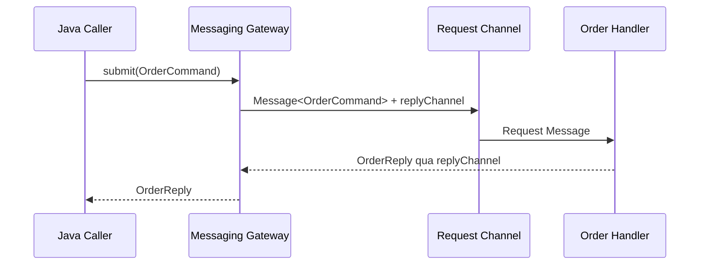
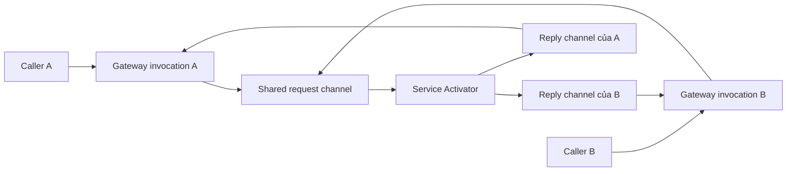
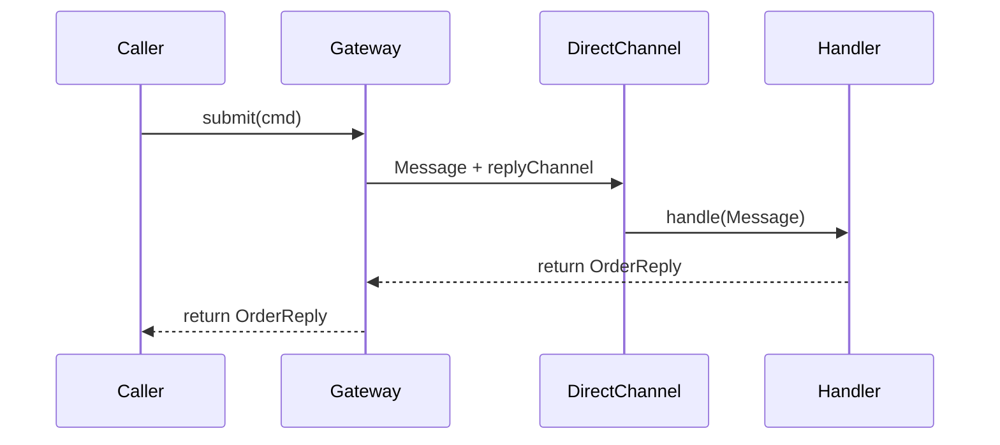
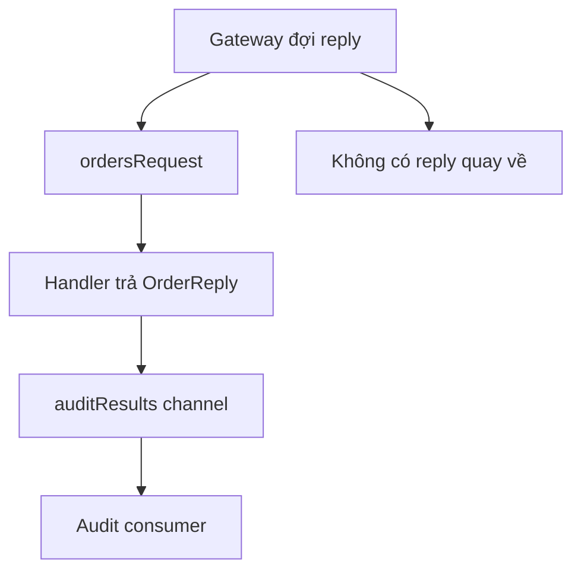
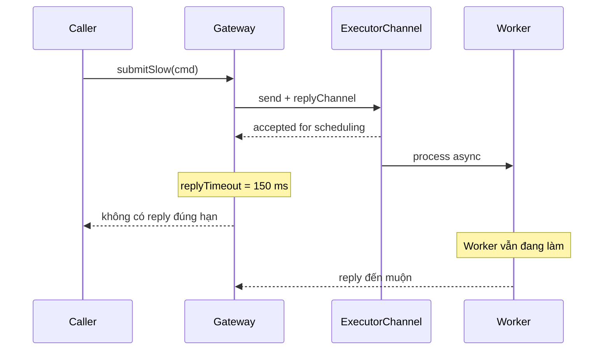
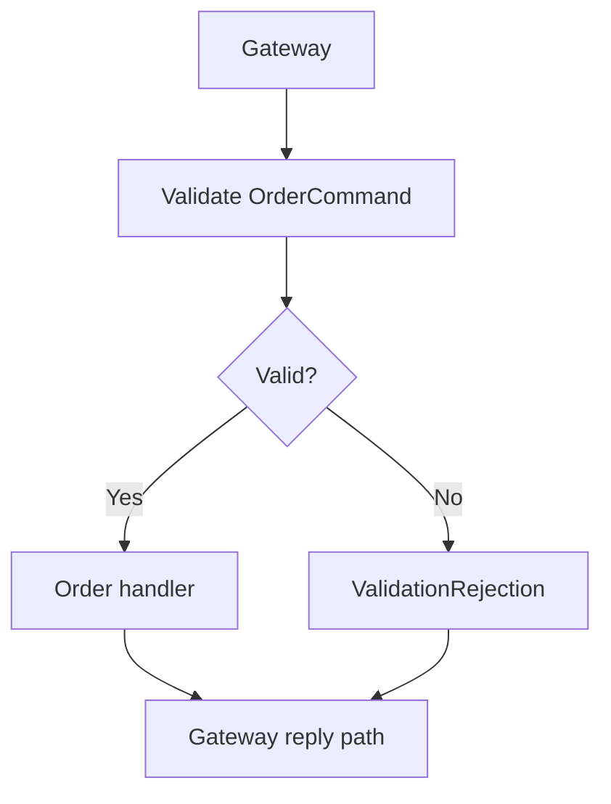
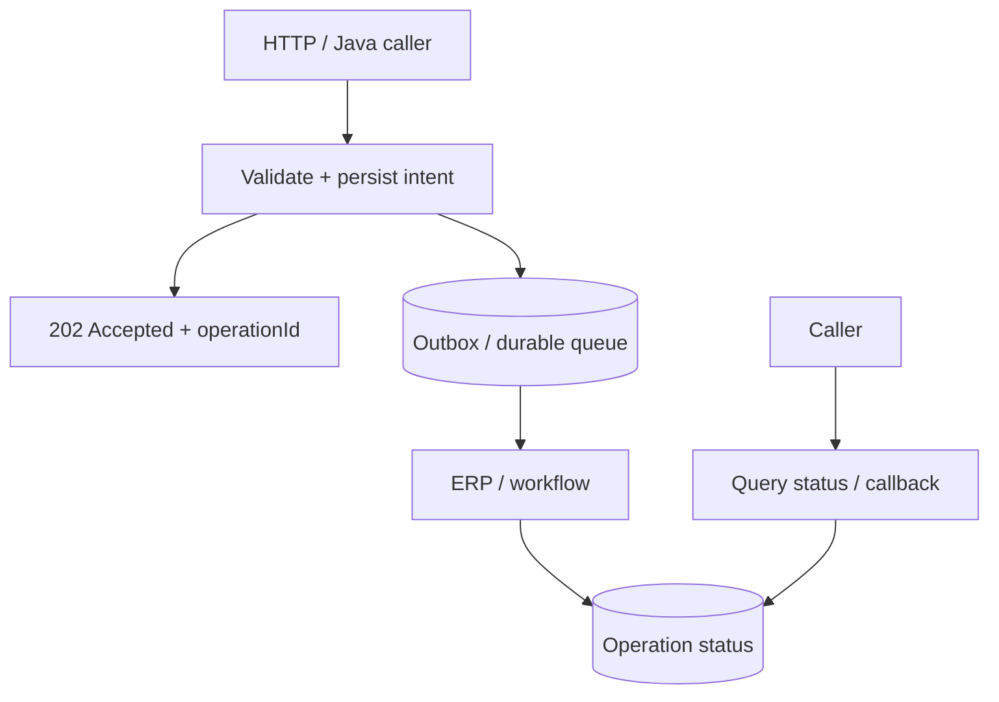
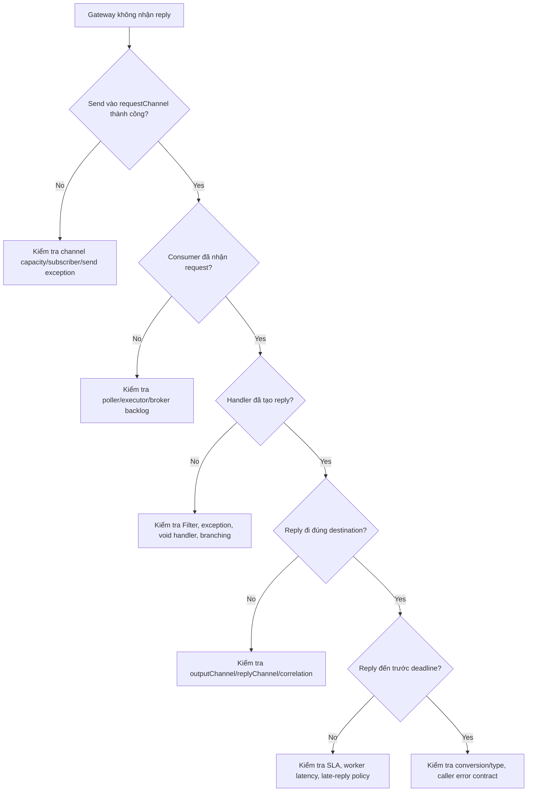

# Gateway timeout và reply channel

Một ứng dụng Java gọi `orderGateway.submit(command)` và mong nhận `OrderReply`, nhưng phía sau lời gọi ấy là một chuỗi Spring Integration gồm Message Channel, Transformer, Service Activator, đôi khi cả Executor, broker hoặc hệ thống ERP. Khi xử lý nhanh, method hoạt động như một lời gọi Java bình thường. Khi một handler không trả kết quả, bộ lọc loại Message, worker chậm hoặc phản hồi gửi nhầm channel, caller có thể **đợi đến timeout dù request đã được tiếp nhận**. Đây là lý do cần hiểu rõ **Gateway timeout** và **reply channel** thay vì chỉ thêm một annotation rồi hy vọng request–reply tự hoạt động.

**Messaging Gateway** là mẫu Enterprise Integration Patterns (EIP) cho phép code nghiệp vụ gọi một **giao diện hướng phương thức**, còn Spring Integration chuyển lời gọi thành Message, gửi qua channel và ánh xạ Message phản hồi thành kiểu trả về. Với request–reply, Gateway cần biết **gửi request đi đâu**, **reply quay về đâu**, **chờ tối đa bao lâu** và **xử lý gì nếu không có reply**.

Bài **Gateway timeout và reply channel** thuộc chương **Messaging gateway** của module `SPRING_INTEGRATION_PATTERN`. Module học triển khai EIP bằng Spring Integration để tạo các luồng Message ít phụ thuộc, dễ mở rộng; thực hành Router, Filter, Transformer, Splitter, Aggregator, Gateway, retry, error channel và correlation, đồng thời kiểm thử và quan sát các nhánh xử lý. Bài này sẽ đi từ mô hình request–reply tới code Java 17, `@MessagingGateway`, `@Gateway`, `replyChannel`, `requestTimeout`, `replyTimeout`, timeout trong flow đồng bộ/bất đồng bộ, kiểm thử, lỗi hạ tầng, late reply, correlation và độ tin cậy khi nối broker/ERP.

## 1. Câu chuyện: gửi request thành công không có nghĩa đã nhận reply

Giả sử một ứng dụng gọi:

```java
OrderReply reply = orderGateway.submit(
        new OrderCommand("tenant-7", "req-1001", "ORD-1001"));
```

Gateway gửi Message vào `ordersRequest`. Một handler kiểm tra đơn rồi tạo `OrderReply`. Đường đi kỳ vọng:



Nhưng có thể xảy ra:

- Không có subscriber/consumer nhận Message từ request channel.
- Filter loại Message và **không tạo rejection reply**.
- Handler nhận Message nhưng không trả giá trị.
- Handler gửi reply tới một output channel không nối về Gateway.
- Executor/broker xử lý chậm hơn thời hạn Gateway chờ.
- Reply được phát nhưng đến sau khi caller đã timeout.
- Một lỗi kỹ thuật xảy ra ở thread khác; Gateway chờ reply trong khi lỗi đi vào error flow.

Khi chẩn đoán, phải phân biệt **request có gửi thành công không**, **request có được xử lý không**, **reply có được tạo không**, **reply có tới đúng channel không**, và **caller còn chờ khi reply đến không**.

## 2. Bốn khái niệm không nên nhập nhằng

| Khái niệm | Ý nghĩa | Điều nó không bảo đảm |
| --- | --- | --- |
| `requestChannel` | Kênh Gateway gửi request | Consumer đã xử lý xong |
| `requestTimeout` | Thời gian chờ khi **gửi request** vào channel có thể blocking | Deadline tổng cho database/HTTP handler |
| `replyChannel` | Đích đưa kết quả trả về cho Gateway | Tự động có reply trong mọi nhánh |
| `replyTimeout` | Thời gian Gateway **chờ reply** sau thao tác gửi phù hợp | Hủy hoặc rollback công việc downstream khi hết hạn |

**Cần đặc biệt tránh:** `replyTimeout=500` **không đồng nghĩa** “toàn bộ lệnh được xử lý tối đa 500 ms”. Với request channel đồng bộ như `DirectChannel`, code của handler có thể chạy trên caller thread trong quá trình `send`, nên việc thực thi handler không nhất thiết bị giới hạn bởi `replyTimeout`.

### 2.1. Request timeout khác HTTP client timeout

Nếu handler gọi ERP qua HTTP, có thêm các timeout của HTTP client:

```text
Gateway requestTimeout  -> send vào Spring MessageChannel
Gateway replyTimeout    -> chờ Message reply
HTTP connectTimeout     -> tạo kết nối ERP
HTTP response/read timeout -> chờ ERP trả response
Broker delivery timeout -> cơ chế transport riêng
```

Chúng có **đối tượng và phạm vi khác nhau**. Không nên sử dụng một giá trị `replyTimeout` để thay thế connect/read timeout của adapter.

### 2.2. Đơn vị timeout

Các thuộc tính timeout số dạng chuỗi của annotation Gateway thường được diễn giải theo **mili giây**, tùy hợp đồng API/phiên bản và cơ chế expression được cấu hình. Ví dụ `replyTimeout="1500"` biểu thị thời hạn chờ 1,5 giây trong ví dụ này. Khi áp dụng phiên bản cụ thể, cần kiểm tra đúng annotation và cấu hình runtime.

## 3. Gateway biến lời gọi method thành Message như thế nào?

Một Messaging Gateway có thể được khai báo dưới dạng interface:

```java
package example.integration.gateway;

import org.springframework.integration.annotation.Gateway;
import org.springframework.integration.annotation.MessagingGateway;

@MessagingGateway(
        name = "orderGateway",
        defaultRequestChannel = "ordersRequest",
        defaultRequestTimeout = "500",
        defaultReplyTimeout = "1500")
public interface OrderGateway {

    @Gateway
    OrderReply submit(OrderCommand command);
}
```

Khi caller gọi `submit()`:

1. Proxy Gateway chuyển argument thành **payload của một Spring Message**.
2. Gateway cung cấp metadata cần thiết cho request–reply, trong đó có đường đi để nhận reply khi phù hợp.
3. Message được gửi tới `ordersRequest`.
4. Downstream Message handler chạy, đồng bộ hoặc bất đồng bộ tùy channel.
5. Nếu có reply, Gateway chuyển payload phản hồi về `OrderReply` theo contract method.
6. Nếu không có reply trong điều kiện/thời hạn chờ, caller nhận **kết quả timeout** theo cách API Gateway/return type/error configuration xử lý; không được mặc định là ERP chưa thực hiện side effect.

Các interface Gateway có thể được đăng ký qua `@IntegrationComponentScan`, thông qua cấu hình phù hợp của Spring Integration, hoặc bằng cách tạo proxy bean theo cơ chế Gateway tương ứng. Ví dụ ở phần Java sử dụng `@IntegrationComponentScan`.

### 3.1. Request–reply không phải yêu cầu mọi endpoint có reply

Một Messaging Gateway có method trả `void` cho kiểu **fire-and-forget**; một method trả `OrderReply` ngụ ý caller kỳ vọng **một kết quả**. Không dùng method `void` rồi chờ Gateway tự đồng bộ hoàn tất mọi worker asynchronous.

### 3.2. Gateway không phải một broker

Một Gateway không tự lưu bền vững mọi request, không tự tạo exactly-once delivery và không tự bảo đảm transaction từ caller tới ERP. Những đặc tính đó phụ thuộc channel, endpoint, adapter, transaction và idempotency của cả flow.

## 4. `replyChannel` nằm trong Message ở đâu?

Spring Messaging có header kỹ thuật `MessageHeaders.REPLY_CHANNEL`. Khi Gateway xử lý một lời gọi request–reply, nó có thể cung cấp **kênh phản hồi tạm thời** để chỉ đúng lời gọi đang chờ.

```text
Request Message:
  payload = OrderCommand(...)
  headers:
    id = <framework message id>
    timestamp = ...
    replyChannel = <temporary reply channel cho invocation này>
```

`replyChannel` này khác với business `orderId`, `requestId` hoặc `eventId`. Nó thường là metadata của runtime để nối response về invocation đang chờ; **không serialize object channel của JVM ra JSON/broker**.



Sơ đồ trên biểu diễn **hai reply path logic**, không có nghĩa handler tự phải lấy `requestId` rồi chọn một channel theo tên. Trong request–reply nội bộ thông thường, framework và header reply cần được bảo toàn để endpoint gửi kết quả đúng nơi.

### 4.1. Temporary reply channel và fixed reply channel

| Kiểu | Mô tả | Rủi ro cần biết |
| --- | --- | --- |
| Reply channel tạm theo invocation | Gateway tạo đường nhận riêng cho lời gọi đang chờ | Late reply khi invocation đã kết thúc |
| Reply channel cố định/named | Có một channel định danh do cấu hình cho reply | Phải quản lý routing/correlation và nhiều caller |
| Reply destination qua broker | Queue/topic/reply address của transport bên ngoài | Cần correlation ID, timeout, consumer và lưu trạng thái |

**Không được suy ra** rằng có một `QueueChannel` tên `replies` là tất cả Gateway đang chờ sẽ tự biết reply nào thuộc caller nào. Với shared reply destination, cần cơ chế correlation/reply routing thật sự, phù hợp với Gateway/adapter của phiên bản đang dùng.

### 4.2. Không overwrite replyChannel tùy tiện

Một Transformer hoặc Enricher có thể tạo Message mới. Nếu bỏ `replyChannel`, handler cuối có thể **không biết đường gửi reply về Gateway**. Nếu đổi sang một channel khác, Gateway có thể đợi tới timeout mặc dù Message đã được xử lý.

Khi biến đổi Message, hãy kiểm tra chính sách **header propagation**. Nếu qua một transport không hỗ trợ object channel, cần thiết kế **reply destination + correlation** khác phù hợp, không mong header object đi nguyên qua mạng.

## 5. Demo cơ bản: tạo reply tự động bằng Service Activator

Trước tiên xây một ví dụ đồng bộ **có thể đọc riêng** để thấy Gateway nhận reply mà không phải gửi Message thủ công.

### 5.1. Model Java 17

```java
package example.integration.gateway;

public record OrderCommand(
        String tenantId,
        String requestId,
        String orderId) {
}
```

```java
package example.integration.gateway;

public record OrderReply(
        String requestId,
        String orderId,
        String status) {
}
```

Ví dụ dùng string status `"ACCEPTED"` như một quyết định nội bộ. Trong production, cần quy định rõ accepted, committed và fulfilled khác nhau như thế nào.

### 5.2. Interface Gateway

```java
package example.integration.gateway;

import org.springframework.integration.annotation.Gateway;
import org.springframework.integration.annotation.MessagingGateway;

@MessagingGateway(
        name = "orderGateway",
        defaultRequestChannel = "ordersRequest",
        defaultRequestTimeout = "500",
        defaultReplyTimeout = "1500")
public interface OrderGateway {

    @Gateway
    OrderReply submit(OrderCommand command);
}
```

### 5.3. Cấu hình Spring Integration

```java
package example.integration.gateway;

import org.springframework.context.annotation.Bean;
import org.springframework.context.annotation.Configuration;
import org.springframework.integration.annotation.IntegrationComponentScan;
import org.springframework.integration.annotation.ServiceActivator;
import org.springframework.integration.channel.DirectChannel;
import org.springframework.integration.config.EnableIntegration;
import org.springframework.messaging.Message;
import org.springframework.messaging.MessageChannel;
import org.springframework.messaging.MessageHeaders;

@Configuration
@EnableIntegration
@IntegrationComponentScan(basePackageClasses = OrderGateway.class)
public class GatewayReplyConfiguration {

    @Bean
    public MessageChannel ordersRequest() {
        return new DirectChannel();
    }

    @ServiceActivator(inputChannel = "ordersRequest")
    public OrderReply handleOrder(Message<OrderCommand> message) {
        OrderCommand command = message.getPayload();

        // Cho thấy Gateway đã cung cấp reply destination.
        Object replyTo = message.getHeaders()
                .get(MessageHeaders.REPLY_CHANNEL);
        if (replyTo == null) {
            throw new IllegalStateException(
                    "Missing gateway reply channel");
        }

        return new OrderReply(
                command.requestId(),
                command.orderId(),
                "ACCEPTED");
    }
}
```

Điểm chính: `handleOrder(...)` **trả về `OrderReply`**, không tự tạo một thread rồi `send` vào channel bất kỳ. Service Activator có thể tạo reply Message và gửi về **reply channel của request** theo cơ chế request–reply chuẩn của Spring Integration khi không có output channel cố định chiếm đường phản hồi.

### 5.4. Chạy Gateway

```java
package example.integration.gateway;

import org.springframework.context.annotation.AnnotationConfigApplicationContext;

public class GatewayReplyDemo {

    public static void main(String[] args) {
        try (var context = new AnnotationConfigApplicationContext(
                GatewayReplyConfiguration.class)) {

            OrderGateway gateway = context.getBean(OrderGateway.class);
            OrderReply reply = gateway.submit(
                    new OrderCommand(
                            "tenant-7", "req-1001", "ORD-1001"));

            System.out.println(reply.status()); // ACCEPTED
            System.out.println(reply.requestId()); // req-1001
        }
    }
}
```

Demo có đường xử lý **đồng bộ** qua `DirectChannel`; không có broker, queue bền vững hay ERP network. Nó minh họa đường reply và cách Gateway ẩn chi tiết Message/channel khỏi caller, **không** chứng minh tính bền vững khi process crash.

## 6. Vì sao không cần tự chỉ định replyChannel trong ví dụ cơ bản?

Trong lời gọi đồng bộ thông thường, Gateway đã có cơ chế reply destination cho invocation. Nếu Service Activator trả giá trị, endpoint có thể dùng thông tin reply trong request để đưa kết quả về caller.



**Không nhất thiết cấu hình**:

```text
outputChannel = "someReplies"
```

chỉ để Gateway có reply. Một `outputChannel` cố định không phù hợp có thể khiến kết quả đi tới chỗ khác và Gateway không nhận được. Khi cần named reply channel, phải thiết kế **hợp đồng nối lại với Gateway**, chứ không chỉ đặt tên cho channel.

### 6.1. Reply header không phải dấu hiệu request đã commit

Header tồn tại chỉ cho biết **đường trả lời được cung cấp**. Nó không bảo đảm handler đã chạy, đã commit database hoặc đã phát kết quả bền vững. Sau timeout, handler vẫn có thể tiếp tục hoàn thành ở một thread khác.

### 6.2. Có thể trả một Message thay vì payload không?

Có. Handler có thể trả `Message<OrderReply>` khi cần chủ động gắn headers được kiểm soát. Tuy nhiên, phải hiểu chính sách propagation của endpoint; không copy mọi client header hoặc credential ra reply. Khi chỉ cần payload, trả `OrderReply` là lựa chọn đơn giản.

## 7. `requestTimeout`: điều gì đang được chờ?

`requestTimeout` liên quan tới **thao tác gửi** Message tới request channel, đặc biệt khi channel có thể phải chờ chỗ trống hoặc tài nguyên consumer.

Ví dụ một request `QueueChannel` đã đầy:

```text
Gateway
  -> QueueChannel(capacity = 1)
      slot #1: đang chứa Message X
      Message Y: chờ có chỗ để send
```

Khi `QueueChannel` còn đủ capacity, `send` có thể hoàn tất nhanh dù **chưa có consumer nào xử lý Message**. Khi capacity đầy, `send` có thể chặn; `requestTimeout` đặt giới hạn chờ cho thao tác gửi theo semantics của channel.

### 7.1. Không nhầm timeout gửi với timeout công việc

Ví dụ:

```text
10:00:00.000 Gateway gửi vào queue thành công
10:00:00.010 Gateway bắt đầu đợi reply
10:00:05.000 Poller mới lấy request khỏi queue
10:00:05.020 Handler xử lý xong
```

Nếu `replyTimeout` ngắn hơn thời gian chờ queue + xử lý, Gateway có thể hết hạn **dù request đã enqueue thành công**. Tăng `requestTimeout` không giải quyết tình trạng này.

### 7.2. `DirectChannel` có gì khác?

Với `DirectChannel`, subscriber thường xử lý request **trong caller thread** ngay lúc gửi. Nếu handler gọi DB chậm 10 giây, `requestTimeout` không phải một công tắc có thể tự động ngắt method đang chạy sau 500 ms. Cần timeout ở API client, database hoặc chính logic xử lý và biết cancellation có thực sự hỗ trợ hay không.

## 8. `replyTimeout`: chờ câu trả lời chứ không hủy side effect

`replyTimeout` quy định thời gian Gateway đợi một reply khi flow có đường phản hồi bất đồng bộ hoặc có bước chờ reply. Khi hết hạn, lời gọi có thể kết thúc bằng timeout result/exception theo cấu hình Gateway và kiểu trả về. **Tuyệt đối không suy ra handler đã bị dừng hoặc transaction đã rollback.**

Một timeline:

```text
0 ms       Gateway gửi request
10 ms      ExecutorChannel nhận và lập lịch worker
100 ms     Gateway ngừng chờ theo replyTimeout
250 ms     Worker hoàn tất và cố gửi reply
```

**Late reply** ở 250 ms có thể không còn người nhận. Cần quan sát error handling/drop/expiry của runtime/adapter và không mặc định reply muộn sẽ tự được lưu lại cho caller.

### 8.1. Đừng đồng nhất reply timeout với lỗi nghiệp vụ

Những kết luận khác nhau:

| Quan sát | Có thể kết luận chắc chắn? |
| --- | --- |
| Gateway không nhận reply trong hạn | Caller không nhận được reply đúng hạn |
| Gateway không nhận reply trong hạn | **Không** kết luận chắc chắn ERP chưa tạo đơn |
| ERP trả `REJECTED` | Có business rejection nếu contract đã xác thực |
| Adapter báo connect refused trước khi gửi | Có thể request chưa tới ERP, tùy giai đoạn |
| HTTP read timeout sau khi gửi | Remote outcome có thể chưa rõ |

Khi timeout xảy ra sau remote side effect, retry không có idempotency có thể tạo đơn trùng. Đây là nguyên nhân quan trọng để Gateway và Idempotent Receiver được thiết kế cùng nhau.

## 9. DirectChannel, ExecutorChannel và QueueChannel ảnh hưởng timeout khác nhau

| Channel | Cách gửi/nhận phổ biến | Ảnh hưởng tới Gateway |
| --- | --- | --- |
| `DirectChannel` | Subscriber xử lý cùng thread của sender | Handler chậm có thể giữ caller trong send |
| `ExecutorChannel` | Giao Message cho executor, handler chạy thread khác | Gateway có thể đợi reply độc lập và timeout trước worker |
| `QueueChannel` | Message được giữ đến khi poller/consumer lấy ra | Reply chậm do backlog hoặc thiếu poller |
| Broker adapter | Qua network/consumer ngoài tiến trình | Cần correlation, destination, retry/ACK và timeout riêng |

### 9.1. Không có consumer là lỗi khác với reply chậm

Nếu không có subscriber trên `DirectChannel`, việc gửi có thể thất bại ngay bằng exception, **không nhất thiết** chờ `replyTimeout`. Nếu QueueChannel có consumer nhưng consumer không trả reply, request có thể được nhận mà Gateway vẫn timeout.

### 9.2. QueueChannel không tự chạy handler

Khi dùng QueueChannel làm request channel, thường cần **poller** hoặc consumer đọc queue. Chỉ khai báo:

```java
@Bean
public QueueChannel ordersQueue() {
    return new QueueChannel(100);
}
```

không có nghĩa Spring Integration sẽ tự lấy Message và gọi một handler. Phải nối endpoint polling hoặc component tiêu thụ phù hợp.

### 9.3. Timeout không phải cơ chế backpressure đầy đủ

Đặt requestTimeout ngắn có thể giúp caller không đợi quá lâu khi queue đầy, nhưng nó không tự giới hạn số request đang thực thi, kích thước backlog hay remote retry storm. Cần capacity, worker concurrency, rate limit, circuit breaker và metrics phù hợp.

## 10. Named reply channel: khi nào thật sự cần?

Trong flow nội bộ trực tiếp, **temporary reply channel** thường đủ. Named reply channel hữu ích khi:

- Có một adapter cụ thể nhận reply từ hệ thống ngoài.
- Cần cấu hình một tuyến reply chung để bridge về Gateway.
- Có một broker reply queue/topic hoặc application response dispatcher.
- Có yêu cầu quan sát và điều phối phản hồi qua nhiều bước.

Một cấu hình method có thể chỉ rõ tên kênh:

```java
@MessagingGateway(defaultRequestChannel = "ordersRequest")
public interface NamedReplyGateway {

    @Gateway(
            requestChannel = "ordersRequest",
            replyChannel = "ordersReplies",
            replyTimeout = "2000")
    OrderReply submit(OrderCommand command);
}
```

**Đoạn trên là khai báo phía Gateway, chưa phải flow hoàn chỉnh.** Phải có channel `ordersReplies`, endpoint thật phát reply tới nó và cấu hình Gateway xử lý/correlate phản hồi đúng theo phiên bản Spring Integration đang dùng. Không dùng chung một QueueChannel để trả nhiều request đồng thời mà **không xác minh** cơ chế correlation/reply-routing của Gateway.

### 10.1. Không đặt named reply channel chỉ để “cho rõ ràng”

Nếu không có nhu cầu chia sẻ reply destination, cấu hình thêm channel có thể tạo thêm một hop, subscriber/poller và nguồn lỗi. Chọn đường phản hồi đơn giản nhất đáp ứng hợp đồng.

### 10.2. Coi replyChannel là địa chỉ kỹ thuật có vòng đời

Một reply channel tạm do Gateway tạo không phải tài nguyên dùng vô hạn; khi invocation đã timeout, đường trả lời có thể không còn hiệu lực. Với broker reply queue dài hạn, TTL/expiry và completion-state là trách nhiệm riêng.

## 11. Vì sao trả reply vào output channel tùy ý làm Gateway timeout?

Ví dụ sai:

```java
@ServiceActivator(
        inputChannel = "ordersRequest",
        outputChannel = "auditResults")
public OrderReply handle(OrderCommand command) {
    return new OrderReply(
            "req-1001", command.orderId(), "ACCEPTED");
}
```

Handler tạo `OrderReply`, nhưng **đã cấu hình outputChannel cố định là `auditResults`**. Nếu không có route nào nối từ `auditResults` về reply destination của Gateway, caller có thể không bao giờ nhận được Message.



**Cách sửa** không phải luôn thêm thời gian chờ:

1. Nếu handler trả lời trực tiếp, **bỏ `outputChannel` cố định** để endpoint dùng reply destination từ request, khi cấu hình cho phép.
2. Nếu có tuyến xử lý trung gian, tiếp tục chuyển Message tới endpoint **cuối cùng thực sự trả reply** về Gateway.
3. Nếu audit là side effect phụ, dùng một nhánh audit riêng có hợp đồng rõ, **không chiếm đường reply** của Gateway.
4. Với async/broker, tạo reply dispatcher/correlation và kiểm chứng bằng integration tests.

**`send()` thành công và log “handler returned” không chứng minh Gateway nhận được reply.** Phải test ngay tại caller hoặc qua reply destination tương ứng.

## 12. Ví dụ bất đồng bộ: worker hoàn thành sau `replyTimeout`

Để thấy sự khác biệt so với `DirectChannel`, ta dùng `ExecutorChannel`: Gateway gửi request, executor tiếp nhận công việc, worker xử lý trên thread khác, trong khi caller chờ reply.



### 12.1. Interface Gateway riêng cho demo async

Các class async sau dùng package riêng để tránh trùng tên/channel/bean khi bạn thử cùng ví dụ đồng bộ ở phần trước:

```java
package example.integration.gateway.async;

import org.springframework.integration.annotation.Gateway;
import org.springframework.integration.annotation.MessagingGateway;

import example.integration.gateway.OrderCommand;
import example.integration.gateway.OrderReply;

@MessagingGateway(
        name = "slowOrderGateway",
        defaultRequestChannel = "slowOrders",
        defaultRequestTimeout = "500",
        defaultReplyTimeout = "150")
public interface SlowOrderGateway {

    @Gateway
    OrderReply submitSlow(OrderCommand command);
}
```

### 12.2. Handler dùng latch để test, không giả vờ `sleep` là xử lý thật

```java
package example.integration.gateway.async;

import java.util.concurrent.CountDownLatch;
import java.util.concurrent.TimeUnit;
import java.util.concurrent.atomic.AtomicBoolean;

import org.springframework.integration.annotation.ServiceActivator;

import example.integration.gateway.OrderCommand;
import example.integration.gateway.OrderReply;

public final class SlowOrderHandler {

    private final CountDownLatch started = new CountDownLatch(1);
    private final CountDownLatch allowCompletion =
            new CountDownLatch(1);
    private final AtomicBoolean completed = new AtomicBoolean();

    @ServiceActivator(inputChannel = "slowOrders")
    public OrderReply process(OrderCommand command) {
        started.countDown();
        try {
            if (!allowCompletion.await(5, TimeUnit.SECONDS)) {
                throw new IllegalStateException(
                        "DEMO_WORKER_WAIT_EXPIRED");
            }
        } catch (InterruptedException ex) {
            Thread.currentThread().interrupt();
            throw new IllegalStateException(
                    "DEMO_WORKER_INTERRUPTED", ex);
        }
        completed.set(true);
        return new OrderReply(
                command.requestId(),
                command.orderId(),
                "ACCEPTED");
    }

    public boolean awaitStarted() throws InterruptedException {
        return started.await(2, TimeUnit.SECONDS);
    }

    public void release() {
        allowCompletion.countDown();
    }

    public boolean isCompleted() {
        return completed.get();
    }
}
```

### 12.3. Cấu hình ExecutorChannel

```java
package example.integration.gateway.async;

import org.springframework.context.annotation.Bean;
import org.springframework.context.annotation.Configuration;
import org.springframework.integration.annotation.IntegrationComponentScan;
import org.springframework.integration.channel.ExecutorChannel;
import org.springframework.integration.config.EnableIntegration;
import org.springframework.messaging.MessageChannel;
import org.springframework.scheduling.concurrent.ThreadPoolTaskExecutor;

@Configuration
@EnableIntegration
@IntegrationComponentScan(basePackageClasses = SlowOrderGateway.class)
public class SlowGatewayConfiguration {

    @Bean
    public ThreadPoolTaskExecutor gatewayWorkerExecutor() {
        var executor = new ThreadPoolTaskExecutor();
        executor.setCorePoolSize(2);
        executor.setMaxPoolSize(2);
        executor.setQueueCapacity(10);
        executor.setThreadNamePrefix("gateway-demo-");
        executor.setWaitForTasksToCompleteOnShutdown(true);
        return executor;
    }

    @Bean
    public MessageChannel slowOrders(
            ThreadPoolTaskExecutor gatewayWorkerExecutor) {
        return new ExecutorChannel(gatewayWorkerExecutor);
    }

    @Bean
    public SlowOrderHandler slowOrderHandler() {
        return new SlowOrderHandler();
    }
}
```

Sau khi `ExecutorChannel` chấp nhận Message để xử lý, Gateway có thể chờ reply tối đa khoảng `150 ms` **theo cấu hình ví dụ**, trong khi worker còn bị latch giữ. Khi Gateway ngừng chờ, điều đó không tự giải phóng latch, hủy task, rollback database hoặc xóa một command đã được đưa tới broker.

**Đây là demo nhằm quan sát timeout, không phải cách giữ thread worker trong production.** Production cần pool sizing, backpressure, monitoring và xử lý stuck task riêng.

## 13. JUnit: request–reply đồng bộ nhận đúng DTO

Trước khi kiểm tra timeout, hãy có một test đường thành công:

```java
package example.integration.gateway;

import static org.junit.jupiter.api.Assertions.*;

import org.junit.jupiter.api.Test;
import org.springframework.context.annotation.AnnotationConfigApplicationContext;

class GatewayReplyIntegrationTest {

    @Test
    void gatewayReceivesReplyFromServiceActivator() {
        try (var context = new AnnotationConfigApplicationContext(
                GatewayReplyConfiguration.class)) {

            OrderGateway gateway = context.getBean(OrderGateway.class);

            OrderReply response = gateway.submit(
                    new OrderCommand(
                            "tenant-7", "req-1001", "ORD-1001"));

            assertNotNull(response);
            assertEquals("req-1001", response.requestId());
            assertEquals("ORD-1001", response.orderId());
            assertEquals("ACCEPTED", response.status());
        }
    }
}
```

Test này kiểm tra **từ interface Gateway tới handler và quay về caller**. Chỉ test `handleOrder()` trả `OrderReply` là chưa đủ, vì reply có thể bị cấu hình gửi sai channel.

### 13.1. Kiểm tra replyChannel ở handler

`GatewayReplyConfiguration.handleOrder()` đã đọc:

```java
message.getHeaders().get(MessageHeaders.REPLY_CHANNEL)
```

và từ chối request không có reply destination. Đây là cách minh họa metadata tồn tại khi Gateway tạo request. Trong thực tế, không phải mọi Message vào `ordersRequest` đều đến từ Gateway; nếu một producer tự gửi Message không có reply channel, handler cần hợp đồng rõ: trả fire-and-forget, đưa vào error flow hoặc từ chối. **Đừng áp đặt yêu cầu reply cho những producer vốn chỉ gửi một chiều.**

### 13.2. Đây là integration test, chưa phải transport contract test

Test trong cùng JVM không chứng minh response qua Kafka/AMQP/HTTP có schema đúng, không bị mất correlation ID hoặc không lộ header. Những adapter thật phải có test riêng.

## 14. JUnit: Gateway hết hạn trước khi worker hoàn tất

Test async nên kiểm chứng **thứ tự quan sát**, không chỉ dùng `Thread.sleep(300)` rồi hy vọng máy CI luôn có tốc độ giống máy local.

```java
package example.integration.gateway.async;

import static org.junit.jupiter.api.Assertions.*;

import java.util.concurrent.Callable;
import java.util.concurrent.Executors;
import java.util.concurrent.TimeUnit;

import org.junit.jupiter.api.Test;
import org.springframework.context.annotation.AnnotationConfigApplicationContext;

import example.integration.gateway.OrderCommand;

class SlowGatewayIntegrationTest {

    @Test
    void replyTimeoutDoesNotMeanWorkerWasCancelled()
            throws Exception {
        try (var context = new AnnotationConfigApplicationContext(
                SlowGatewayConfiguration.class)) {

            SlowOrderGateway gateway =
                    context.getBean(SlowOrderGateway.class);
            SlowOrderHandler worker =
                    context.getBean(SlowOrderHandler.class);

            var callerPool = Executors.newSingleThreadExecutor();
            try {
                Callable<Object> invokeGateway = () -> {
                    try {
                        // Một số Gateway contracts trả null khi hết
                        // replyTimeout; những cấu hình khác có thể
                        // chuyển timeout thành exception/error reply.
                        return gateway.submitSlow(
                                new OrderCommand(
                                        "tenant-7", "req-slow",
                                        "ORD-1001"));
                    } catch (RuntimeException ex) {
                        return ex;
                    }
                };

                var invocation = callerPool.submit(invokeGateway);
                assertTrue(worker.awaitStarted());

                // Gateway kết thúc chờ trong hạn ngắn,
                // nhưng latch của worker vẫn chưa được mở.
                Object observed = invocation.get(2, TimeUnit.SECONDS);
                assertTrue(observed == null
                        || observed instanceof RuntimeException);
                assertFalse(worker.isCompleted());
            } finally {
                worker.release();
                callerPool.shutdownNow();
            }
        }
    }
}
```

Test này có chủ đích tập trung vào **Gateway không chờ worker mãi và worker chưa hoàn tất khi invocation trả về**; nó không áp đặt một exception class giống nhau cho mọi phiên bản/configuration. Một test production cần cố định phiên bản dependency, cấu hình timeout/error handling và **assert chính xác** response hoặc exception contract mà ứng dụng cam kết.

### 14.1. Vì sao kiểm tra `observed` theo nhiều dạng?

Gateway có thể báo không có reply bằng `null` ở một số đường gọi hoặc gửi lỗi theo policy/configuration. Điều quan trọng về mặt EIP là: **không nhận reply đúng hạn không đồng nghĩa business operation đã bị hủy**. Người dùng API cần một hợp đồng công khai riêng, chẳng hạn `TIMEOUT/UNKNOWN_OUTCOME`, thay vì dựa vào cấu trúc exception của framework.

### 14.2. Không dùng test này làm bằng chứng an toàn tài chính

`SlowOrderHandler` chỉ đợi latch và tạo DTO. Nếu worker thật gọi ERP/DB, timeout của Gateway không chứng minh transaction đã rollback. Cần failure-injection test có resources thật và kiểm tra remote state/idempotency.

## 15. Filter có thể tạo “mất reply” dù dữ liệu đã được kiểm tra

Một `Message Filter` trả `false` có thể loại Message:

```text
Gateway -> Validation Transformer -> Filter
                                    |
                               false (discard)
                                    |
                              không có reply
```

Nếu Gateway method có kiểu trả về `OrderReply`, caller có thể chờ hết hạn trong khi Filter hoạt động **đúng** theo predicate. Đây là lỗi **hợp đồng request–reply**, không phải bằng chứng Filter bị hỏng.

### 15.1. Anti-pattern

```java
@Filter(inputChannel = "ordersRequest")
public boolean hasOrderId(OrderCommand order) {
    return order.orderId() != null
            && !order.orderId().isBlank();
}
```

Nếu Filter bỏ Message mà không có đường phát reply từ chối, Gateway có thể không có kết quả để trả.

### 15.2. Cách đúng theo hợp đồng nghiệp vụ



Với request–reply, nên đảm bảo **mỗi nhánh kết thúc hợp lệ có một phản hồi**: `Accepted`, `Rejected`, `Pending` hoặc exception contract. Không nhất thiết dùng `Filter` nếu một Router/Service Activator trả sealed business result biểu đạt rõ hơn.

### 15.3. `discardChannel` chưa tự trở thành reply

Filter có thể chuyển Message bị loại sang `discardChannel`, nhưng **handler của discard branch vẫn phải tạo reply** và bảo toàn đường phản hồi. Nếu discard handler chỉ ghi audit rồi trả `void`, Gateway vẫn không nhận được phản hồi.

## 16. Lỗi kỹ thuật có thể đi tới error flow thay vì reply

Một handler có thể ném exception:

```java
@ServiceActivator(inputChannel = "ordersRequest")
public OrderReply process(OrderCommand command) {
    throw new IllegalStateException(
            "ORDER_SERVICE_TEMPORARILY_UNAVAILABLE");
}
```

Trong flow đồng bộ qua `DirectChannel`, exception thường có thể lan về caller của Gateway. Khi dùng executor, poller, inbound adapter hoặc broker, lỗi có thể được xử lý trong thread khác hoặc gửi tới error channel đã cấu hình.

| Tình huống | Tín hiệu | Ý nghĩa |
| --- | --- | --- |
| Filter reject hợp lệ | Business result/discard | Đầu vào không đạt rule |
| Handler ném exception đồng bộ | Exception có thể tới caller | Lỗi thực thi |
| Handler async ném exception | Error flow/log theo cấu hình | Lỗi ở thread khác |
| Gateway chờ quá hạn | Timeout/absence of reply | Chưa có phản hồi đúng hạn |
| ERP trả business `REJECTED` | ERP reply có status | Remote business outcome |
| ERP timeout sau send | Unknown remote outcome | Có thể đã có side effect |

**`errorChannel` không đồng nghĩa `replyChannel`.** Một `ErrorMessage` chứa `Throwable` không nên tự được trả ra API công khai dưới dạng payload tùy ý, vì có thể tiết lộ stack trace, dữ liệu hoặc endpoint nội bộ.

### 16.1. Khi Gateway có error channel riêng

Spring Integration hỗ trợ cấu hình error-handling cho Messaging Gateway và endpoint tương ứng. Cần quyết định:

- Exception nào được ánh xạ sang **technical error response**?
- Business rejection nào được trả như dữ liệu nghiệp vụ?
- Khi nào nên propagate exception?
- Error flow có reply về caller hay chỉ ghi dead-letter/audit?
- Caller nhận kết quả gì khi đã quá timeout?

Một error handler chỉ log rồi bỏ Message không phải là request–reply error contract hoàn chỉnh.

## 17. Reply channel cần sống đủ lâu, nhưng không được tích tụ vô hạn

Một temporary reply channel gắn với một invocation. Khi caller không còn chờ:

- Reply đến muộn có thể không được nhận.
- Một endpoint có thể báo lỗi khi gửi reply vào channel không còn consumer.
- Một phần framework có thể bỏ response hoặc chuyển qua error handling tùy cấu hình.
- Một resource external có thể vẫn tiếp tục xử lý vì nó không biết Gateway đã timeout.

Với fixed reply queue trên broker, vấn đề khác:

```text
Request expired at caller
Reply queue still exists
ERP publishes late reply
Reply consumer sees no pending request
```

Cần chính sách **TTL, correlation-store cleanup, dead-letter/late-reply handling** để không lưu vô hạn những Message đã hết ý nghĩa.

### 17.1. Không gửi reply thủ công vào một channel từ request nếu không hiểu vòng đời

Ví dụ phải thận trọng:

```java
Object value = message.getHeaders()
        .get(MessageHeaders.REPLY_CHANNEL);
if (value instanceof MessageChannel channel) {
    channel.send(MessageBuilder
            .withPayload(result)
            .build());
}
```

Đoạn này chỉ minh họa việc header đôi khi chứa object channel. Nó **không** phải một thuật toán reply toàn năng: reply destination có thể được biểu diễn bằng tên, adapter có thể map khác và manual send muộn có thể mất receiver. Trong flow cơ bản, để `@ServiceActivator` return reply cho framework định tuyến thường ít lỗi hơn.

### 17.2. Không nối reply channel vô hạn với audit queue

Một reply queue không có consumer hoặc completion tracking có thể tích tụ dữ liệu/PII. Audit là công việc có chính sách retention riêng; reply là thông tin gửi về một request có vòng đời hữu hạn. Tránh dùng cùng một channel làm cả hai nếu chưa xác định trách nhiệm/cleanup.

## 18. Correlation cho nhiều caller đồng thời

Giả sử hai người dùng gửi cùng lúc:

```text
Caller A: requestId=req-A, orderId=ORD-1
Caller B: requestId=req-B, orderId=ORD-2
```

Nếu mỗi invocation dùng đường reply tạm tương ứng, framework có cơ chế route reply về đúng invocation khi **reply header được giữ**. Nhưng khi qua Kafka/JMS/AMQP, object replyChannel của JVM không thể đơn giản chuyển thẳng sang consumer ở process khác.

Một hợp đồng ngoài tiến trình có thể cần:

```json
{
  "requestId": "req-A",
  "correlationId": "corr-A",
  "replyDestination": "orders.replies",
  "data": {
    "orderId": "ORD-1"
  }
}
```

Response tương ứng:

```json
{
  "correlationId": "corr-A",
  "result": {
    "orderId": "ORD-1",
    "status": "ACCEPTED"
  }
}
```

`correlationId` và `replyDestination` phải được **kiểm soát**, không cho client tùy ý yêu cầu gửi dữ liệu nhạy cảm tới destination mà nó không có quyền. Phía gửi cần theo dõi request đang chờ, TTL, duplicate reply và authorization.

### 18.1. Correlation ID không phải Message ID hay order ID

| ID | Vai trò | Vì sao khác? |
| --- | --- | --- |
| `MessageHeaders.ID` | Object Message cụ thể | Có thể thay khi transform/redelivery |
| `orderId` | Thực thể nghiệp vụ | Nhiều request có thể cùng order |
| `requestId` | Một lượt yêu cầu logic | Có thể đến nhiều lần do retry |
| `correlationId` | Ghép reply về request/workflow phù hợp | Cần duy nhất trong phạm vi pending replies |
| `eventId` | Logical event dùng dedupe | Không nhất thiết là request/reply key |

Không dùng `orderId` làm reply correlation key khi có thể có **hai yêu cầu song song cho cùng đơn hàng**. Chúng sẽ có nguy cơ nhận nhầm reply hoặc ghi đè pending state.

### 18.2. Cross-process request–reply phức tạp hơn Gateway nội bộ

Một Gateway Java proxy chỉ ở một process. Nếu request qua broker, cần thêm outbound adapter, inbound reply adapter, correlation mapping/reply dispatcher hoặc cơ chế request–reply của transport phù hợp. Không mặc định `replyChannel` object đã được truyền xuyên network.

## 19. Tránh nhầm lẫn `replyTimeout` với transaction/ACK timeout

Những thời điểm có thể xảy ra trong hệ thống thật:

```text
00 ms  Gateway gửi input vào broker
50 ms  Broker xác nhận producer send
100 ms Consumer nhận input
200 ms Consumer bắt đầu DB transaction
400 ms Gateway replyTimeout
700 ms Consumer DB COMMIT thành công
750 ms Consumer publish reply
800 ms Consumer ACK input
```

Khi caller đã timeout ở 400 ms, command **vẫn có thể thành công** ở 700 ms. Nếu caller lập tức gửi một command mới với ID khác, ERP có thể tạo side effect trùng.

### 19.1. Ba loại mốc kết thúc

| Mốc | Có nghĩa gì? |
| --- | --- |
| Gateway method trả/timeout | Caller đã nhận hoặc không nhận kết quả trong hạn |
| Input ACK | Consumer/adapter đã xác nhận theo semantics transport |
| Business COMMIT | Dữ liệu nghiệp vụ đã được commit trong resource phù hợp |

Ba mốc không nhất thiết diễn ra cùng lúc. Đặt `replyTimeout` không điều khiển trực tiếp thời điểm ACK và không tự rollback remote database.

### 19.2. Input ACK sớm là một vấn đề riêng

Nếu broker ACK ngay khi enqueue vào RAM rồi process crash trước DB commit, request có thể bị mất dù Gateway từng send thành công. Cần thiết kế durability và ACK policy ở inbound adapter, không dựa vào reply channel để quyết định message đã an toàn.

## 20. Timeout và retry: bảo toàn logical operation

Giả sử Gateway timeout khi gửi lệnh `CreateOrder`:

```text
requestId = req-1001
sourceEventId = evt-1001
orderId = ORD-1001
```

Một retry an toàn cần sử dụng **logical operation ID ổn định** thay vì tạo ID khác cho mỗi lần gửi lại:

```text
idempotencyKey =
  tenantId + ":" + sourceSystem + ":" + sourceEventId
  + ":" + operationType
```

Giải pháp thực tế có thể gồm:

1. ERP/receiver hỗ trợ idempotency key.
2. Dedupe marker và business update trong transaction phù hợp.
3. Lookup remote state bằng external business reference khi timeout.
4. Transactional outbox để không mất command sau local commit.
5. Completion/reconciliation job xử lý kết quả đến muộn.

**Gateway timeout không tạo exactly-once semantics**. Nếu hệ thống chưa bảo đảm idempotency/reconciliation, không nên retry mù lệnh thanh toán, đặt hàng hoặc giữ hàng chỉ vì caller chưa nhận reply.

### 20.1. Retry advice có thể lặp toàn flow

Khi đặt retry quanh Gateway hoặc handler, phải xác định đoạn nào được chạy lại. Mapping thuần có thể lặp tương đối an toàn; remote ERP call, email hoặc trừ kho cần idempotency và side-effect boundary rõ.

### 20.2. Reply duplicate cũng cần xử lý

Broker có thể redeliver một reply. Pending-request store phải biết request đã hoàn tất hay chưa; reply trùng không được tạo hai business completion hoặc hai HTTP response. `correlationId` giúp tìm pending request nhưng không tự thực hiện deduplication.

## 21. Chọn timeout theo SLA và khả năng chịu tải

Không có một giá trị đúng cho mọi hệ thống. Cần đặt timeout dựa trên **SLA của caller, tải thực tế, queue backlog và loại side effect**.

Ví dụ giả định:

| Thành phần | Khoảng dự toán | Vai trò |
| --- | --- | --- |
| Send vào request channel | 0–50 ms | Inbound capacity/backpressure |
| Chờ trong queue | 0–300 ms | Backlog/consumer concurrency |
| Business processing | 50–500 ms | DB, pricing, validation |
| ERP network call | 100–1000 ms | Connect/read/remote |
| Reply mapping/delivery | 0–100 ms | Outbound response |

Các con số **chỉ minh họa**, không phải SLA mặc định của Spring Integration. Nếu mục tiêu caller là 800 ms nhưng đường ERP p99 vượt 2 giây, tăng `replyTimeout` lên vô hạn chỉ làm **tăng số caller đang chờ** và có nguy cơ cạn thread.

### 21.1. Một deadline end-to-end tốt hơn nhiều timeout rời rạc

Ở hệ thống phức tạp, có thể truyền một deadline/remaining budget đáng tin giữa các bước để tránh mỗi adapter chờ đủ thời hạn riêng rồi tổng thời gian bị cộng dồn. Ví dụ caller cần kết quả trong 2 giây, application service phân bổ budget cho queue, DB và ERP; một bước đã tiêu hết budget thì downstream không tiếp tục chờ không giới hạn.

Deadline là metadata có ngữ nghĩa nghiệp vụ/vận hành; không tin thời hạn do client tự khai nếu nó có thể gây tiêu hao tài nguyên. Hệ thống phải giới hạn budget tối đa và có chính sách cancellation/compensation riêng.

### 21.2. Timeout ngắn không đồng nghĩa hiệu năng tốt

Nếu Gateway thường xuyên timeout nhưng worker vẫn tiếp tục xử lý, số task còn chạy có thể tăng, reply bị bỏ và retry làm tải hệ thống nặng hơn. Cần quan sát queue depth, active workers, latency và timeout rate trước khi chọn giá trị.

## 22. Kiểm tra `replyChannel` sau Transformer và Enricher

Một Transformer có thể thay đổi payload:

```text
OrderCommand
  -> toErpCommand
  -> ERP adapter
  -> fromErpResponse
  -> OrderReply
```

Nhưng nếu tạo Message mới và làm mất hoặc thay đổi header reply mà framework cần, dù payload phản hồi đúng, caller vẫn có thể không nhận được.

### 22.1. So sánh hai cách trả kết quả

**Thông thường đơn giản nhất:** trả payload:

```java
@ServiceActivator(inputChannel = "ordersRequest")
public OrderReply handle(OrderCommand command) {
    return new OrderReply(
            command.requestId(),
            command.orderId(),
            "ACCEPTED");
}
```

**Khi cần header nghiệp vụ:** trả Message có header được chọn:

```java
@ServiceActivator(inputChannel = "ordersRequest")
public Message<OrderReply> handle(Message<OrderCommand> request) {
    OrderCommand command = request.getPayload();
    OrderReply reply = new OrderReply(
            command.requestId(),
            command.orderId(),
            "ACCEPTED");

    return MessageBuilder.withPayload(reply)
            .setHeader("result.code", "ORDER_ACCEPTED")
            .build();
}
```

Đoạn thứ hai là ví dụ **tạo reply Message**; endpoint cần được cấu hình để định tuyến nó theo reply destination của request. Không giả định việc tạo Message mới đã tự giữ toàn bộ header cũ, cũng không nên copy toàn bộ raw client headers vào response để “giữ an toàn”.

### 22.2. Endpoint có output channel rõ khác endpoint trả về qua header

Một endpoint request–reply có thể được cấu hình `outputChannel`. Khi output channel đã được chỉ định, reply thường đi theo channel đó thay vì ngầm gửi trực tiếp về Gateway. Nếu có nhiều endpoint nối tiếp, chỉ endpoint cuối hoặc một bridge/reply router phù hợp mới cần trả về caller.

### 22.3. Header mapping qua boundary

Khi qua Kafka, HTTP, AMQP, JMS hoặc serialization, mỗi adapter có **header mapper và giới hạn riêng**. `replyChannel` có thể là object runtime không phù hợp để serialize. Ở outbound boundary:

- Chỉ xuất những header transport cần.
- Dùng `correlationId`, reply destination, TTL theo giao thức ngoài.
- Không xuất credential, raw exception hoặc Spring channel object.
- Test JSON/bytes/headers với adapter thực tế.

`@Transformer` unit test PASS không chứng minh broker sẽ bảo toàn đường reply.

## 23. Một Gateway có nhiều method và timeout khác nhau

Trong một interface, các operation có thể có SLA khác nhau. Annotation ở method cho phép cấu hình riêng request channel và timeout phù hợp:

```java
package example.integration.gateway;

import org.springframework.integration.annotation.Gateway;
import org.springframework.integration.annotation.MessagingGateway;

@MessagingGateway(
        defaultRequestChannel = "ordersRequest",
        defaultRequestTimeout = "500",
        defaultReplyTimeout = "1500")
public interface MultiOperationGateway {

    @Gateway
    OrderReply submit(OrderCommand command);

    @Gateway(
            requestChannel = "orderStatusRequest",
            requestTimeout = "250",
            replyTimeout = "700")
    OrderReply queryStatus(OrderCommand command);
}
```

Đây là **interface minh họa về cấu hình**, không phải ví dụ hoàn chỉnh: để chạy cần cung cấp endpoint `orderStatusRequest`, cơ chế reply và dữ liệu query status. Không tự khai báo hai gateway interface cùng tên bean khi ghép các snippet demo vào một Spring context.

### 23.1. Tại sao các method có timeout khác nhau?

- `submit` có thể cần kiểm tra dữ liệu và gửi request vào workflow.
- `queryStatus` chỉ tra cache/database nên có thể cam kết phản hồi nhanh hơn.
- Một operation batch có thể không phù hợp synchronous Gateway; hãy dùng `202 Accepted`/async completion API thay vì giữ HTTP caller trong nhiều phút.

### 23.2. Timeout config thuộc integration contract, không phải domain rule

Chuyển `replyTimeout` từ 700 ms lên 1200 ms là một thay đổi về **đặc tính vận hành**. Nó không nên thay đổi định nghĩa business của `ACCEPTED` hay `REJECTED`. Tương tự, một domain policy không nên tự đổi `replyChannel` để ép caller chờ.

## 24. Khi nào nên chọn request–reply và khi nào nên chuyển sang async workflow?

Gateway đồng bộ phù hợp khi:

- Handler thường trả lời trong một SLA ngắn và tương đối ổn định.
- Caller cần kết quả ngay để tiếp tục một thao tác.
- Có thể định nghĩa rõ failure/timeout contract.
- Không cần giữ thread chờ một quy trình lâu dài.

Với những tác vụ như ERP posting, phê duyệt thủ công hoặc aggregation nhiều đối tác, một kiểu **command + async result** có thể phù hợp hơn:



Caller nhận một **operation ID** và có thể tra trạng thái/callback khi hoàn tất, thay vì đặt `replyTimeout` rất dài để chờ ERP. Đây là một **thay đổi hợp đồng API**, không phải chỉ đổi tham số Gateway.

### 24.1. `202 Accepted` chưa phải business commit

Khi trả `202`, server phải thật sự có **durable intent** hoặc cơ chế đủ tin cậy để tiếp tục. Nếu chỉ enqueue vào `QueueChannel` trong RAM rồi trả `202`, process crash có thể làm mất công việc nhưng caller tưởng request đã được nhận bền vững.

### 24.2. Gateway vẫn có thể dùng ở bên trong async workflow

Một async worker có thể dùng Gateway nội bộ để gọi service khác theo request–reply ngắn. Không nhất thiết bỏ mẫu Gateway hoàn toàn; quan trọng là **không dùng synchronous wait thay cho workflow completion state**.

## 25. Logging và metrics để chẩn đoán timeout

Nếu Gateway timeout, người vận hành thường hỏi “request có đi đâu không?”. Hãy instrument các giai đoạn thay vì chỉ log ở caller.

| Metric đề xuất | Điều cần quan sát |
| --- | --- |
| `gateway.request.attempts` | Số lời gọi Gateway |
| `gateway.request.send_failures` | Gửi vào channel thất bại |
| `gateway.request.send_wait` | Thời gian chờ send |
| `gateway.reply.success` | Reply tới caller đúng hạn |
| `gateway.reply.timeout` | Caller không nhận reply đúng hạn |
| `gateway.reply.latency` | Thời gian request–reply |
| `gateway.reply.late` | Reply được nhận/quan sát sau deadline |
| `gateway.reply.unmatched` | Reply không có pending correlation |
| `gateway.handler.error` | Lỗi trong handler |
| `gateway.request.queue_depth` | Backlog request |
| `gateway.worker.active` | Worker đang chạy |
| `gateway.correlation.pending` | Số lượt request còn chờ |
| `gateway.correlation.expired` | Pending requests bị hết hạn |

Các tên trên là **gợi ý metric do ứng dụng instrument**, không phải tất cả metric mặc định Spring Integration/Micrometer cung cấp.

### 25.1. Log có cấu trúc

```json
{
  "stage": "order-gateway",
  "requestId": "req-1001",
  "operation": "CREATE_ORDER",
  "requestChannel": "ordersRequest",
  "outcome": "REPLY_TIMEOUT",
  "elapsedMs": 150
}
```

Không ghi toàn bộ `Message.toString()` khi Message có payload khách hàng, token hoặc headers chứa credential. Việc log replyChannel runtime object cũng có thể tiết lộ topology nội bộ và làm log dài khó quản lý.

### 25.2. Cardinality

Tag metrics có thể dùng `gatewayOperation`, `resultCode`, `channelType`, `sourceSystem` nếu tập giá trị hữu hạn. Không gắn `requestId`, `orderId`, email hay `correlationId` làm metric label vì tạo cardinality cao. Các ID có thể xuất hiện ở log/tracing **có kiểm soát quyền và retention**.

### 25.3. Trace ID không thay reply correlation

Distributed tracing giúp tìm các span của workflow, nhưng một trace ID **không tự** bảo đảm reply được route tới một pending Gateway invocation. Reply routing vẫn cần cơ chế channel/correlation thực sự. Ngược lại, reply đúng channel cũng không tự có đầy đủ trace nếu chưa propagate tracing context.

## 26. Cách chẩn đoán Gateway timeout theo từng điểm

Thay vì tăng `replyTimeout` ngay, hãy đặt một chuỗi câu hỏi có thể kiểm chứng:



### 26.1. Checkpoint 1: request send

Kiểm tra channel name có đúng không; có subscriber không; queue đã đầy chưa; executor có từ chối task không. Một send thất bại ngay cần được xử lý khác với một Message đã vào queue nhưng chưa được consumer lấy ra.

### 26.2. Checkpoint 2: consume

Với `DirectChannel`, handler thường chạy ngay khi send. Với `QueueChannel`, cần poller. Với `ExecutorChannel`, có thể cần kiểm tra thread pool, task queue và rejection policy.

### 26.3. Checkpoint 3: tạo reply

Đảm bảo mọi nhánh bình thường có giá trị trả về: valid, invalid, not found, business reject. Xem Filter có discard không; nếu có, handler discard có gửi reply không; exception có đi vào một error flow chỉ log không.

### 26.4. Checkpoint 4: route reply

Kiểm tra `replyChannel` của request có được bảo toàn, có output channel cố định nào chiếm đường reply, named reply channel có consumer/correlation không, và adapter có header mapping phù hợp.

### 26.5. Checkpoint 5: deadline

Nếu reply đến sau timeout, đánh giá queue delay, handler execution, external ERP latency và deadline tổng. **Không** mặc định retry bằng một business event ID mới khi remote outcome chưa rõ.

## 27. Ma trận kiểm thử cần có cho Gateway

| Ca kiểm thử | Điều cần chứng minh |
| --- | --- |
| DirectChannel reply nhanh | Gateway trả đúng `OrderReply` |
| Handler nhận request từ Gateway | Có reply destination theo contract |
| Không có subscriber | Send failure được xử lý, không nhầm với reply timeout |
| QueueChannel đầy | Request send timeout/backpressure xử lý rõ |
| QueueChannel không có poller | Không có reply dù request enqueue được |
| ExecutorChannel worker chậm | Gateway timeout nhưng worker có thể còn chạy |
| Filter loại Message | Có rejection reply hoặc error contract, không chờ vô hạn |
| Handler trả `void` | Gateway không kỳ vọng reply hoặc timeout được xử lý rõ |
| Output channel cấu hình sai | Test phát hiện reply không quay về Gateway |
| Hai caller đồng thời | Response không lẫn request A/B |
| Reply đến muộn | Late reply được quan sát và cleanup |
| Reply trùng | Không hoàn tất workflow hai lần |
| Handler ném exception đồng bộ | Caller nhận error theo contract |
| Handler async ném exception | Error flow có vận hành/giải thích rõ |
| Broker reply correlation | Reply đúng pending request, không chỉ đúng orderId |
| Broker consumer restart | Pending state/expiry được thiết kế |
| ERP timeout sau remote success | Không lặp side effect khi retry |
| Gateway timeout ở peak load | Queue/pool/latency metrics đủ chẩn đoán |
| Outbound header mapper | Không serialize replyChannel object/credentials |

### 27.1. Cần tránh test timing dễ flake

Không nên viết:

```java
Thread.sleep(170);
assertTrue(gatewayTimedOut);
```

rồi tin rằng test luôn đúng trên CI. Dùng `CountDownLatch`, `CompletableFuture`, mock transport/virtual clock khi phù hợp, và timeout test hữu hạn. Test ở mục 14 chứng minh **caller hoàn tất việc chờ trước khi worker được thả**, nhờ latch thay cho giả định tốc độ CPU.

### 27.2. Unit test không thay integration test

Gọi trực tiếp handler:

```java
assertEquals("ACCEPTED", handler.process(command).status());
```

không chứng minh Gateway proxy đã đăng ký, replyChannel đúng, output channel không làm lạc reply hoặc executor xử lý được. Cần test ở **Gateway interface**, không chỉ handler class.

### 27.3. Test broker thật cần khác test JVM

Nếu triển khai qua Kafka/JMS/AMQP, thêm contract tests về correlation headers, serialization, expiry, reply queue, redelivery, unknown outcome, acknowledgment và restart. Bài STEP 4 chỉ minh họa API và test code, chưa chạy các bài test đó.

## 28. Các lỗi thiết kế thường gặp

| Triệu chứng | Nguyên nhân có thể | Hướng khắc phục |
| --- | --- | --- |
| Gateway chờ dù handler log “done” | Reply bị gửi sang channel khác | Kiểm tra `outputChannel`/`replyChannel` |
| Handler không có reply | Method `void`, Filter discard, branch chỉ audit | Tạo reply/error result rõ |
| Gateway không đợi tới timeout | DirectChannel không có subscriber hoặc send exception | Phân biệt send failure |
| Handler chậm hơn `replyTimeout` nhưng caller vẫn đợi | DirectChannel xử lý đồng bộ trong send | Timeout tại handler/external client hoặc async design |
| `requestTimeout` tăng mà vấn đề không hết | Queue delay hoặc reply bị lạc | Kiểm tra poller/reply path |
| Gateway timeout nhưng ERP vẫn tạo đơn | Remote side effect tiếp tục sau deadline | Idempotency/reconciliation |
| Reply A tới caller B | Shared reply destination thiếu correlation đúng | Pending request mapping, per-request reply |
| `replyChannel` biến mất | Transformer/adapter bỏ header | Test propagation, correlation qua transport |
| Reply muộn làm lỗi log | Temporary reply receiver đã hết vòng đời | Late-reply handling và metrics |
| Queue request phình to | Thiếu poller/worker hoặc overload | Capacity/backpressure/worker scale |
| Timeout bùng nổ ở peak | Retries làm nặng thêm tải | Bounded retry, circuit breaker |
| Gateway tự động dùng replyChannel của client | Tin header ngoài không xác thực | Strip untrusted headers |
| Gửi `ErrorMessage` ra HTTP | Serialize Throwable nội bộ | Safe error mapping |
| Gateway timeout bị xem business reject | Gộp lỗi kỹ thuật và dữ liệu nghiệp vụ | Error taxonomy rõ |
| Một event được tạo hai lần khi retry | Event ID mới mỗi lần | Stable idempotency key |
| Log/metric rất nhiều ID riêng | Tag bằng requestId/orderId | Cardinality thấp, trace riêng |
| Trả `202` nhưng job mất khi crash | Queue chỉ nằm trong RAM | Durable intent/outbox |

## 29. Checklist triển khai Gateway timeout và reply channel

- **Xác định contract method:** request-only hay request–reply? Kiểu trả về và error result gì?
- **Chọn requestChannel đúng loại:** Direct, Executor, Queue hoặc transport adapter.
- **Phân biệt `requestTimeout` với `replyTimeout`:** send wait khác chờ reply.
- **Không coi `replyTimeout` là deadline thực thi của DirectChannel handler.**
- **Bảo toàn reply destination:** không làm mất hoặc đổi sai `replyChannel`.
- **Không gắn output channel cố định nếu nó làm reply lạc khỏi Gateway.**
- **Có reply cho các nhánh business hợp lệ:** accepted, rejected, not found, pending.
- **Tách exception kỹ thuật, errorChannel và Filter discard.**
- **Không để Gateways chờ vô hạn khi workflow có thể kéo dài.**
- **Có correlation đúng khi nhiều caller hoặc qua broker.**
- **Phân biệt request ID, event ID, order ID, correlation ID và Spring Message ID.**
- **Có TTL/cleanup cho pending requests và late replies.**
- **Không serialize object replyChannel, credential hoặc raw exception qua transport.**
- **Có HTTP/DB/broker timeout riêng phù hợp.**
- **Quy định SLA end-to-end, backpressure, thread pool và queue capacity.**
- **Không retry lệnh remote mù chỉ vì Gateway timeout.**
- **Dùng stable idempotency key, outbox hoặc reconciliation khi có side effect.**
- **Thiết kế ACK/transaction boundary theo tài nguyên thực tế.**
- **Test Gateway từ interface**, không chỉ test handler return payload.
- **Test ExecutorChannel với latch và QueueChannel có/không poller.**
- **Test reply routing/concurrent requests/late reply/error path trên adapter thật.**
- **Theo dõi send failure, reply timeout, latency, pending correlation và worker backlog.**
- **Tránh PII và high-cardinality IDs trong log/metrics chung.**

## 30. Bài tập thực hành: ba Gateway, ba loại sự cố

Một nhóm triển khai ba endpoint:

```text
Endpoint A:
  Gateway -> DirectChannel -> handler gọi ERP 5 giây
  requestTimeout = 200 ms
  replyTimeout = 500 ms

Endpoint B:
  Gateway -> ExecutorChannel -> worker 800 ms
  requestTimeout = 200 ms
  replyTimeout = 500 ms

Endpoint C:
  Gateway -> QueueChannel(capacity=10)
      -> Filter loại đơn thiếu ID
      -> discardChannel chỉ ghi audit
  replyTimeout = 500 ms
```

Hãy trả lời:

1. Ở **A**, vì sao `replyTimeout=500 ms` không đủ bảo đảm caller thoát sau đúng nửa giây?
2. Ở **B**, worker có bị hủy khi Gateway ngừng chờ không? Reply 800 ms sẽ được xử lý thế nào?
3. Ở **C**, có reply nào được tạo cho đơn không hợp lệ không? Vì sao Gateway có thể chờ dù Filter đã chạy?
4. Nếu thêm một `outputChannel="auditResults"` vào handler của A, điều đó có thể ảnh hưởng đường reply ra sao?
5. Nếu hai caller đều gửi cùng `orderId` qua broker, khóa correlation nào cần thiết để không trộn hai response?
6. Khi ERP tạo đơn rồi Gateway timeout, retry bằng `eventId` mới có nguy cơ gì?
7. Trong production nên đo những metric nào để phân biệt **send không thành công**, **handler chậm** và **reply lạc đường**?
8. Nếu quy trình ERP thường mất hàng phút, có nên tăng `replyTimeout` lên một giờ hay chuyển sang durable async workflow?

**Gợi ý trả lời:** A có handler chạy đồng bộ trên caller thread, nên cần timeout ở chính external call hoặc thay đổi kiến trúc; B cần xử lý late reply và không suy ra worker bị cancel; C cần nhánh rejection tạo response cho Gateway. Correlation phải theo **logical request**, không đơn thuần orderId. Side effect từ xa cần stable idempotency key/reconciliation; workflow dài nên có durable intent và operation status thay vì giữ caller chờ vô hạn.

---

**Gateway timeout và reply channel là một hợp đồng phối hợp giữa caller, Message Channel và endpoint xử lý, không chỉ là hai thuộc tính annotation.** `requestTimeout` giới hạn việc chờ gửi trong những channel có thể blocking; `replyTimeout` giới hạn chờ phản hồi trong điều kiện phù hợp; `replyChannel` dẫn kết quả về đúng invocation. Nếu reply bị discard, bị chuyển sang output channel khác, đến muộn hoặc mất correlation khi qua broker, Gateway có thể timeout dù handler đã làm việc. Thiết kế đúng cần đường reply rõ cho mọi nhánh, error taxonomy, timeout theo SLA, correlation an toàn và idempotency/reconciliation cho side effect — cùng với kiểm thử đồng bộ, bất đồng bộ và các ranh giới transport thực tế.
