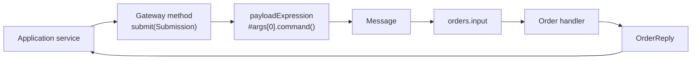
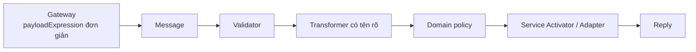
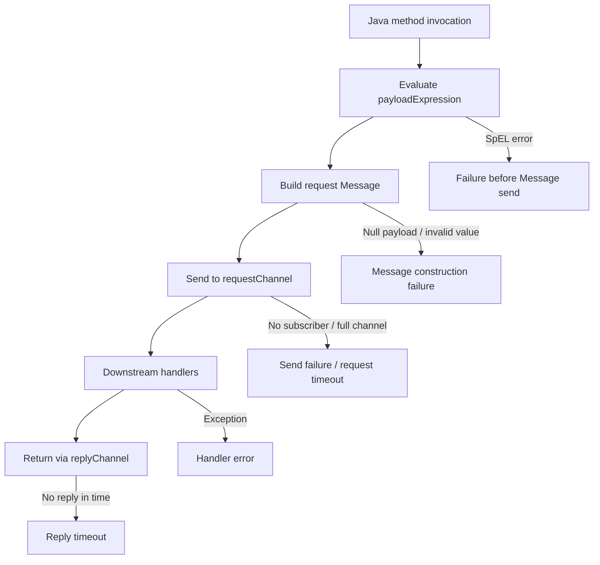
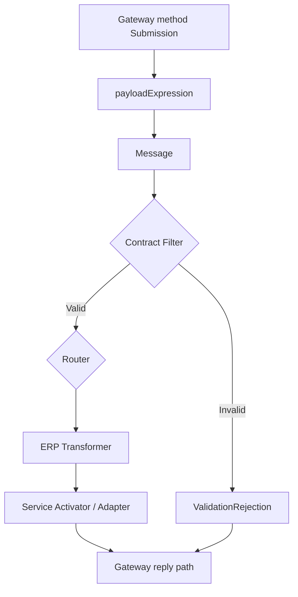
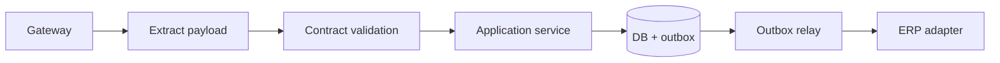
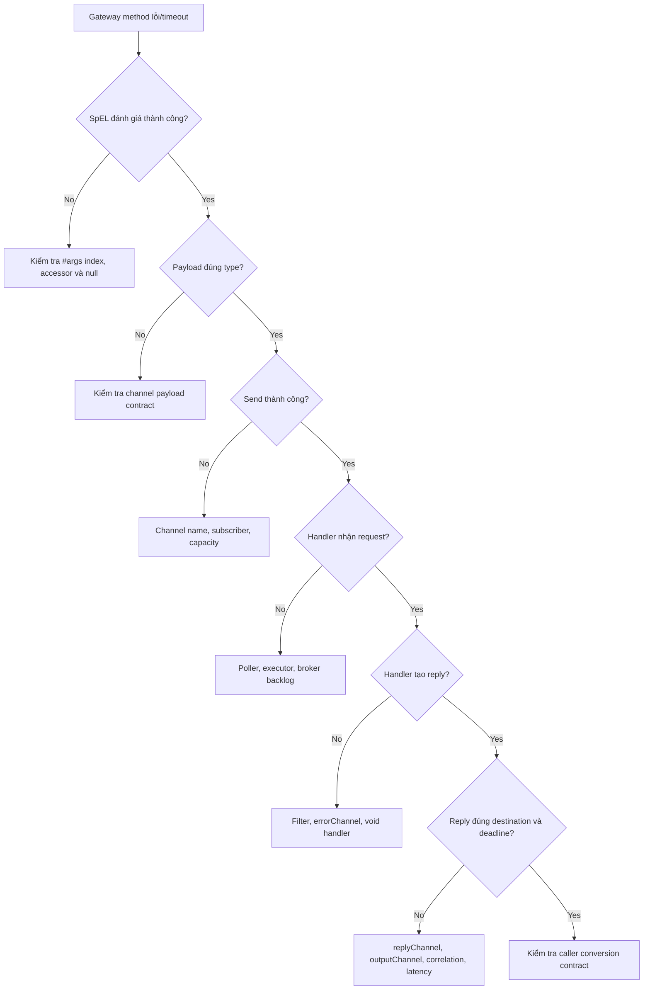

# Gateway payload expression

Một service Java nhận yêu cầu `Submission(requestId, orderCommand)` và cần gọi hệ thống xử lý đơn hàng thông qua Spring Integration. Code nghiệp vụ mong muốn gọi một method dễ hiểu như `gateway.submit(submission)`, trong khi handler phía sau chỉ nhận **payload là `OrderCommand`**, không phải toàn bộ object `Submission`. Nếu cứ gửi nguyên object wrapper, các Service Activator, Transformer hoặc Router downstream phải biết thêm về cấu trúc request của tầng API, gây phụ thuộc không cần thiết.

**`payloadExpression` của Messaging Gateway** cho phép chỉ định một biểu thức **Spring Expression Language (SpEL)** để lấy hoặc tạo **payload của Message đầu vào** từ các đối số của method Gateway. Ví dụ, `#args[0].command()` trích `OrderCommand` từ đối số thứ nhất; một `@GatewayHeader` riêng có thể đưa `requestId` vào header phục vụ tracing hoặc workflow. Như vậy Gateway trở thành ranh giới giữa **method invocation** và **Message contract** mà không buộc handler nhận DTO đặc thù của controller.

Bài **Gateway payload expression** thuộc chương **Messaging gateway** của module `SPRING_INTEGRATION_PATTERN`. Module hướng tới học triển khai Enterprise Integration Patterns (EIP) bằng Spring Integration để xây luồng thông điệp ít phụ thuộc, dễ mở rộng; thực hành Router, Filter, Transformer, Splitter, Aggregator, Gateway, retry, error channel và correlation, đồng thời kiểm thử, theo dõi các nhánh xử lý. Trọng tâm bài này là cú pháp và ngữ cảnh đánh giá `payloadExpression`, cách phối hợp `@MessagingGateway`, `@Gateway`, header expression, validation, request–reply, xử lý lỗi, correlation, bảo mật và kiểm thử qua một luồng cụ thể.

## 1. Messaging Gateway giải quyết ranh giới nào?

Trong một kiến trúc tích hợp, code nghiệp vụ thường muốn gọi method và nhận kiểu Java bình thường, nhưng Spring Integration xử lý `Message<?>` trên channel:

```text
Business code:
  OrderReply reply = gateway.submit(submission);

Integration:
  Message<OrderCommand>
       |
       v
  orders.input -> Service Activator -> replyChannel
```



Gateway proxy chuyển lời gọi method thành request Message, gửi vào channel rồi ánh xạ reply Message về giá trị trả của method. Nó **không phải broker** và không tự bảo đảm durability, retry hoặc exactly-once; những đặc tính đó phụ thuộc các channel, endpoint và adapter phía sau.

`payloadExpression` chỉ giải quyết một phần: **payload sẽ được tạo như thế nào từ đối số gọi method**. Nó không tự chọn routing, không tạo reply và không thay thế transaction hoặc authentication.

### 1.1. Vì sao cần chọn payload ngay tại Gateway?

Khi một method nhận wrapper giàu metadata:

```java
Submission(requestId, command)
```

nhưng downstream chỉ cần:

```java
OrderCommand(orderId, amount, currency)
```

ta có thể trích payload tại boundary. Handler không phải biết tên field `command` của API wrapper; nếu wrapper thay đổi, **Gateway contract/mapping** là nơi xử lý khác biệt.

### 1.2. Không phải Gateway nào cũng cần biểu thức

Với method chỉ có một tham số đúng kiểu payload:

```java
OrderReply submit(OrderCommand command);
```

Gateway thông thường có thể lấy đối số đó làm payload mà **không cần** `payloadExpression`. Chỉ thêm biểu thức khi nó làm rõ hợp đồng hoặc thực sự cần trích xuất/tạo một giá trị khác.

## 2. `@MessagingGateway` và `@Gateway` có vai trò khác nhau

Hai annotation thường được dùng cùng nhau:

| Annotation | Vai trò | Ví dụ |
| --- | --- | --- |
| `@MessagingGateway` | Khai báo interface Gateway và cấu hình mặc định | `defaultRequestChannel="orders.input"` |
| `@Gateway` | Tùy biến một method cụ thể | `payloadExpression="#args[0].command()"` |
| `@GatewayHeader` | Khai báo header cho request Message | `app.requestId` từ argument |
| `@IntegrationComponentScan` | Đăng ký interface Gateway trong Spring context | Quét package chứa Gateway |
| `@ServiceActivator` | Xử lý Message ở downstream endpoint | Nhận `OrderCommand`, trả `OrderReply` |

Ví dụ interface:

```java
@MessagingGateway(defaultRequestChannel = "orders.input")
public interface OrderSubmissionGateway {

    @Gateway(payloadExpression = "#args[0].command()")
    OrderReply submit(Submission submission);
}
```

**Không nhầm `payloadExpression` của method Gateway với expression trong một downstream Transformer.** Gateway expression chạy khi ứng dụng **gọi method và chuẩn bị request Message**; Transformer expression chạy khi một **Message đã tồn tại trong flow**.

### 2.1. Scope của cấu hình

`@MessagingGateway` thường mang những giá trị mặc định áp dụng cho các method của interface như request channel, reply channel và timeout. `@Gateway` có thể override request channel, reply channel, timeout và chỉ định `payloadExpression`/`headers` cho một method.

Khi đọc code, nên xác định **cấu hình hiệu lực theo method**, không chỉ nhìn annotation cấp interface. Một interface có thể có method gửi `orders.input`, method khác gửi `orders.audit`.

## 3. SpEL của Gateway: `#args` là gì?

Tại thời điểm gọi method, Gateway có **danh sách các đối số**. Biểu thức SpEL trong `payloadExpression` có thể tham chiếu chúng qua biến **`#args`**, chẳng hạn:

| Biểu thức | Ý nghĩa | Kiểu kết quả mong đợi |
| --- | --- | --- |
| `#args[0]` | Đối số thứ nhất | Tùy method |
| `#args[0].command()` | Gọi accessor `command()` của argument đầu | `OrderCommand` |
| `#args[0].orderId()` | Gọi accessor của một record order | `String` |
| `#args[1]` | Đối số thứ hai | Tùy method |
| `#args[0].command().orderId()` | Trích sâu mã đơn từ wrapper | `String` |

`#args[0]` là **vị trí trong lời gọi method** (đánh số từ 0), không phải vị trí của Message trong queue và không phải header `correlationId`.

Ví dụ:

```java
Submission submission = new Submission(
        "req-1001",
        new OrderCommand("ORD-1001", new BigDecimal("49.95"), "USD"));

gateway.submit(submission);
```

Expression:

```spel
#args[0].command()
```

trả `OrderCommand("ORD-1001", 49.95, "USD")`, là payload mà handler nhận.

### 3.1. Vì sao dùng `command()` với Java record?

Record Java 17 có accessor `command()`. Cú pháp `#args[0].command()` gọi method rõ ràng. Với JavaBean, ta có thể dùng property/getter tương ứng nếu SpEL hỗ trợ theo cấu trúc object.

Không nên viết expression dựa vào cấu trúc field nội bộ không công khai hoặc reflection không cần thiết. Giữ expression dễ đọc, dễ test và phù hợp hợp đồng của DTO.

### 3.2. Sai ngữ cảnh thường gặp

```text
Gateway payloadExpression: #args[0].command()
Transformer bên trong flow: payload / #root / expression theo Message context
```

Khi method Gateway **chưa tạo request Message**, không nên mặc định có một biến `payload` chứa Message payload như bên trong Transformer. Hãy dùng ngữ cảnh method invocation mà Gateway cung cấp.

### 3.3. Khi expression trả kiểu sai

Nếu handler cần `OrderCommand` nhưng expression là:

```spel
#args[0].command().orderId()
```

Gateway sẽ tạo payload dạng `String` theo giá trị expression. Endpoint nhận `OrderCommand` có thể bị mismatch type, lỗi method invocation hoặc conversion; **không phải cứ SpEL parse thành công là Message đã đúng contract**.

## 4. Khi nào nên dùng `payloadExpression`?

Những tình huống có ích:

1. **Trích payload từ request wrapper:** `Submission → OrderCommand`.
2. **Method có nhiều đối số:** chọn một đối số làm payload, đưa phần metadata vào headers.
3. **Đơn giản hóa hợp đồng downstream:** handler không phải nhận DTO tầng controller.
4. **Áp dụng phép biến đổi biểu diễn nhỏ, ổn định:** ví dụ lấy một property theo schema.
5. **Thích nghi một method Java với một input channel đã có hợp đồng payload cụ thể.**

Những việc **không nên** nhồi vào expression:

- Tính giá, ưu đãi, credit limit hoặc kiểm tra quyền khách hàng.
- Gọi database, HTTP, broker hoặc API bên ngoài.
- Mở transaction, đặt hàng, giữ kho, gửi email.
- Parse raw JSON phức tạp, schema migration nhiều phiên bản hoặc mapping object đồ sộ.
- Tạo event ID ngẫu nhiên mỗi lần retry để dùng làm idempotency key.

Những trách nhiệm lớn ấy nên được đặt trong **Transformer có tên rõ, domain service, application service hoặc adapter** và có test riêng.

## 5. Ví dụ dữ liệu: wrapper ở tầng API, command trong Message

Ta dùng Java 17 record và chỉ một module demo:

```java
package example.gateway;

import java.math.BigDecimal;

public final class GatewayPayloadModel {

    private GatewayPayloadModel() {
    }

    // Payload mà downstream hiểu.
    public record OrderCommand(
            String orderId,
            BigDecimal amount,
            String currency) {
    }

    // Wrapper của method Gateway, không truyền nguyên vào flow.
    public record Submission(
            String requestId,
            OrderCommand command) {
    }

    public record OrderReply(
            String requestId,
            String orderId,
            String status) {
    }
}
```

Hợp đồng nội bộ:

```text
Gateway Java method:
  submit(Submission)

request Message được tạo:
  payload = OrderCommand
  header  = app.requestId

Service Activator:
  input  = Message<OrderCommand>
  output = OrderReply
```

`requestId` ở đây phục vụ **liên hệ/quan sát request trong demo**, không phải bằng chứng client được quyền thao tác trên đơn hàng. Nếu cần tenant/actor đã xác thực, hãy đưa context từ boundary bảo mật đáng tin thay vì tin chuỗi tự khai trong request.

## 6. Gateway interface dùng `payloadExpression` và header expression

```java
package example.gateway;

import org.springframework.integration.annotation.Gateway;
import org.springframework.integration.annotation.GatewayHeader;
import org.springframework.integration.annotation.MessagingGateway;

import example.gateway.GatewayPayloadModel.*;

@MessagingGateway(
        name = "orderSubmissionGateway",
        defaultRequestChannel = "orders.input",
        defaultRequestTimeout = "500",
        defaultReplyTimeout = "1500")
public interface OrderSubmissionGateway {

    @Gateway(
            payloadExpression = "#args[0].command()",
            headers = @GatewayHeader(
                    name = "app.requestId",
                    expression = "#args[0].requestId()"))
    OrderReply submit(Submission submission);

    @Gateway(
            payloadExpression = "#args[0]",
            headers = @GatewayHeader(
                    name = "app.requestId",
                    expression = "#args[1]"))
    OrderReply submitSeparate(
            OrderCommand command,
            String requestId);
}
```

Ở method `submit(...)`, `#args[0]` là `Submission`, còn expression lấy `OrderCommand`. Header expression độc lập lấy `requestId` từ **cùng đối số**.

Ở `submitSeparate(...)`, Gateway nhận **hai tham số**; biểu thức chỉ rõ `OrderCommand` là payload và `requestId` là header. Đây là lý do rõ ràng để không phụ thuộc vào hành vi mặc định khi một method có nhiều arguments.

### 6.1. Header và payload là hai hợp đồng riêng

| Từ method | Gateway mapping | Handler nhận |
| --- | --- | --- |
| `submission.command()` | `payloadExpression` | `Message.getPayload(): OrderCommand` |
| `submission.requestId()` | `@GatewayHeader.expression` | `app.requestId` |
| `command` trong `submitSeparate` | `#args[0]` | `OrderCommand` |
| `requestId` trong `submitSeparate` | `#args[1]` | `app.requestId` |

Không đặt cả `Submission` vào payload rồi lại kỳ vọng handler tự nhận `OrderCommand`. Cần test payload type của **Message thực tế**.

### 6.2. Literal header và expression header khác nhau

Với header có giá trị không phụ thuộc method arguments, ta có thể dùng một giá trị literal **theo thuộc tính annotation phù hợp**. Với header dẫn xuất từ argument, dùng `expression`:

```java
@GatewayHeader(
        name = "app.requestId",
        expression = "#args[0].requestId()")
```

Không đặt `"#args[0].requestId()"` vào field literal rồi kỳ vọng framework luôn đánh giá nó như SpEL. Các thuộc tính `value` và `expression` có ngữ nghĩa khác nhau.

### 6.3. Expression phải được quản trị như code

Đây là **cấu hình do developer viết**, không phải script do caller gửi. Cho phép client chọn một SpEL string rồi đưa thẳng vào evaluator là một rủi ro nghiêm trọng: SpEL có thể có khả năng truy cập method/bean/type tùy evaluation context và cấu hình.

**Không bao giờ** nhận biểu thức tùy ý từ HTTP payload rồi dùng nó làm `payloadExpression` hay gọi `SpelExpressionParser` không kiểm soát.

## 7. Spring Integration configuration với `DirectChannel`

Ta tạo một request channel `DirectChannel` và Service Activator trả `OrderReply`. Vì Gateway đã trích `OrderCommand` thành payload, Service Activator **không phải nhận `Submission`**.

```text
OrderSubmissionGateway.submit(Submission)
   -> payloadExpression="#args[0].command()"
   -> Message<OrderCommand>
   -> orders.input (DirectChannel)
   -> OrderSubmissionHandler.process(Message<OrderCommand>)
   -> OrderReply theo replyChannel của Gateway
```

Trong Spring, tên request channel phải khớp với **tên bean**, không phải tự suy ra từ tên method. Ví dụ, `@Bean(name = "orders.input")` tạo một bean đúng tên mà Gateway đang tham chiếu. Một method `ordersInput()` không có tên bean tường minh sẽ mặc định có tên `ordersInput`, **khác** `orders.input`.

Với luồng request–reply đơn giản, handler có thể **trả payload `OrderReply`** để endpoint gửi tới reply destination của request; không cần tự mở thread hoặc gửi Message vào channel tùy ý. Nếu handler cần state/counter hay service dependency, hãy inject qua constructor ở component riêng. Mục 8 cung cấp **cấu hình thực hành duy nhất** cho các ví dụ và test phía sau.

### 7.1. Vì sao không nhét mọi thứ vào một method annotation?

Method Service Activator thường được framework gọi theo hợp đồng message handling, không phải một constructor có thể tùy tiện nhận thêm mọi bean như tham số. Để tránh giả định sai về method argument resolution, dùng một handler class với **constructor injection** rõ ràng, rồi để method `process(Message<OrderCommand>)` nhận đúng một Message.

## 8. Cấu hình thực hành khuyến nghị: handler tách class, DI rõ ràng

Để tránh ambiguity về injection và giúp test dễ dàng, dùng một `OrderSubmissionHandler` có constructor:

```java
package example.gateway;

import java.math.BigDecimal;
import java.util.concurrent.atomic.AtomicInteger;

import org.springframework.integration.annotation.ServiceActivator;
import org.springframework.messaging.Message;

import example.gateway.GatewayPayloadModel.*;

public final class OrderSubmissionHandler {

    private final AtomicInteger handledCount;

    public OrderSubmissionHandler(AtomicInteger handledCount) {
        this.handledCount = handledCount;
    }

    @ServiceActivator(inputChannel = "orders.input")
    public OrderReply process(Message<OrderCommand> message) {
        OrderCommand command = message.getPayload();
        Object value = message.getHeaders().get("app.requestId");

        if (!(value instanceof String requestId)
                || !requestId.matches("[A-Za-z0-9_-]{1,80}")) {
            throw new IllegalArgumentException("INVALID_REQUEST_ID");
        }

        if (command == null
                || command.orderId() == null
                || !command.orderId()
                    .matches("[A-Za-z0-9_-]{1,80}")
                || command.amount() == null
                || command.amount().signum() < 0
                || !"USD".equals(command.currency())) {
            throw new IllegalArgumentException("INVALID_ORDER_COMMAND");
        }

        handledCount.incrementAndGet();
        return new OrderReply(
                requestId, command.orderId(), "ACCEPTED");
    }

    public int processedCount() {
        return handledCount.get();
    }
}
```

Trong cấu hình Spring, chỉ cần đăng ký `OrderSubmissionHandler` làm bean và bảo đảm chỉ có **một** Service Activator của flow này lắng nghe `orders.input`. Cấu hình thực hành bên dưới hiện thực sơ đồ mục 7:

```java
package example.gateway;

import java.util.concurrent.atomic.AtomicInteger;

import org.springframework.context.annotation.Bean;
import org.springframework.context.annotation.Configuration;
import org.springframework.integration.annotation.IntegrationComponentScan;
import org.springframework.integration.channel.DirectChannel;
import org.springframework.integration.config.EnableIntegration;
import org.springframework.messaging.MessageChannel;

@Configuration
@EnableIntegration
@IntegrationComponentScan(
        basePackageClasses = OrderSubmissionGateway.class)
public class RunnableGatewayPayloadConfiguration {

    @Bean(name = "orders.input")
    public MessageChannel ordersInput() {
        return new DirectChannel();
    }

    @Bean
    public OrderSubmissionHandler orderSubmissionHandler() {
        return new OrderSubmissionHandler(new AtomicInteger());
    }
}
```

**Các đoạn code ở mục 5, 6 và mục 8 tạo thành bộ ví dụ thực hành được dùng trong những test phía sau.** Mục 7 giải thích đường Message, tên bean channel và dependency injection; mục 8 cung cấp cấu hình tương ứng. Không đăng ký thêm một Service Activator cạnh tranh trên cùng `DirectChannel` nếu bài toán chỉ mong một handler nhận request.

### 8.1. Vì sao tách handler?

- Không cần giả định một tham số phụ của `@ServiceActivator` được container inject.
- Có thể unit test method `process(...)` với Message tự tạo.
- Có thể quan sát số Message thực sự tới handler.
- Có thể thay handler bằng service thật mà không thay `payloadExpression` của Gateway.

### 8.2. `payloadExpression` được đánh giá trước handler

Nếu SpEL không trích được `command()` (null, sai kiểu, method không tồn tại), lỗi có thể xảy ra **ở bước dựng request Message**, trước khi handler được gọi. Test handler không đủ để phát hiện lỗi đó; phải gọi **Gateway interface**.

## 9. Demo: một Gateway method, một Message payload chuẩn

```java
package example.gateway;

import java.math.BigDecimal;

import org.springframework.context.annotation.AnnotationConfigApplicationContext;

import example.gateway.GatewayPayloadModel.*;

public class GatewayPayloadDemo {

    public static void main(String[] args) {
        try (var context = new AnnotationConfigApplicationContext(
                RunnableGatewayPayloadConfiguration.class)) {

            OrderSubmissionGateway gateway =
                    context.getBean(OrderSubmissionGateway.class);
            OrderSubmissionHandler handler =
                    context.getBean(OrderSubmissionHandler.class);

            var request = new Submission(
                    "req-1001",
                    new OrderCommand(
                            "ORD-1001",
                            new BigDecimal("49.95"),
                            "USD"));

            OrderReply reply = gateway.submit(request);
            System.out.println(reply.requestId()); // req-1001
            System.out.println(reply.orderId());   // ORD-1001
            System.out.println(reply.status());    // ACCEPTED
            System.out.println(handler.processedCount()); // 1
        }
    }
}
```

Ở đây `Submission` được truyền vào Gateway method nhưng **handler nhận `Message<OrderCommand>`**. Đó là phép chuyển hợp đồng của `payloadExpression`, còn `app.requestId` đi qua header riêng.

### 9.1. Vì sao code demo chưa chứng minh security?

`requestId` vẫn do caller cung cấp; việc match regex chỉ kiểm tra format. Nếu cần tenant/authorization, application hoặc inbound adapter phải xác thực principal/ACL và gắn trusted metadata. **Đừng mặc định một header được Gateway tạo từ argument là header đáng tin về mặt bảo mật**.

## 10. `payloadExpression` với nhiều tham số

Method thứ hai trong interface:

```java
@Gateway(
        payloadExpression = "#args[0]",
        headers = @GatewayHeader(
                name = "app.requestId",
                expression = "#args[1]"))
OrderReply submitSeparate(
        OrderCommand command,
        String requestId);
```

Giữ `OrderCommand` ở payload và `requestId` ở header. Cách khai báo này tránh nhầm lẫn với các cơ chế mặc định biến nhiều method arguments thành request Message.

Tuy nhiên, expression dựa trên index **dễ bị thay đổi khi developer đổi thứ tự tham số**:

```java
// Nguy hiểm nếu không cập nhật SpEL:
OrderReply submitSeparate(String requestId, OrderCommand command);
```

`#args[0]` giờ trở thành `String`, không còn `OrderCommand`. Dù Java method compile thành công, Gateway có thể gửi sai payload type. Nên ưu tiên một request record rõ ràng khi số tham số tăng và có integration test bảo vệ expression.

### 10.1. Không dùng payloadExpression để dồn mọi tham số thành một chuỗi

Ví dụ nên tránh:

```spel
#args[0] + ':' + #args[1] + ':' + #args[2]
```

nếu downstream thực sự cần một object có schema. Việc nối chuỗi tự phát mất type safety, khó escape, dễ nhầm dấu phân cách và có thể làm lộ metadata. Hãy dùng DTO/Transformer được kiểm thử khi hợp đồng đầu vào gồm nhiều field.

## 11. Header expression và payload expression khác nhiệm vụ

Một request Message có thể gồm:

```text
payload:
  OrderCommand(orderId=ORD-1001, amount=49.95, currency=USD)

headers:
  app.requestId = req-1001
  id            = <Spring Messaging message id>
  timestamp     = <framework timestamp>
  replyChannel  = <runtime reply destination>
```

`app.requestId` là **header ứng dụng** do Gateway mapping tạo. `replyChannel` có thể được Gateway/framework cung cấp để Service Activator trả kết quả về method invocation đang chờ. Hai header này **không phải một**.

### 11.1. Có thể đưa requestId vào payload không?

Có, khi `requestId` là một phần hợp đồng nghiệp vụ/wire schema. Nhưng nếu nó chỉ phục vụ tracing hoặc routing nội bộ, header có thể phù hợp. Khi qua broker hoặc process khác, phải cân nhắc **header mapper và serialization**; metadata quan trọng cho audit/replay không nên chỉ sống trong một header JVM dễ bị bỏ.

### 11.2. Không mặc định header được bảo toàn qua mọi endpoint

Transformer/Enricher, endpoint output channel, adapter HTTP/Kafka/AMQP hoặc việc tạo Message mới có thể ảnh hưởng việc truyền header. `payloadExpression` xác định payload **ở đầu vào**; nó không bảo đảm mọi header sẽ đi xuyên toàn bộ flow hoặc qua mạng.

### 11.3. Không đưa raw security context vào header tùy ý

Không đặt token, password, toàn bộ principal object hoặc raw Authorization header vào `@GatewayHeader` để “tiện cho downstream”. Nếu cần claim đã xác thực, truyền metadata đã rút gọn và có quyền truy cập thích hợp; adapter outbound cần allowlist rõ.

## 12. Khi nào nên chuyển từ SpEL sang Transformer riêng?

Một phép trích:

```spel
#args[0].command()
```

rất phù hợp vì nó ngắn và không có side effect. Nhưng một expression kiểu:

```text
parse JSON -> lookup customer -> convert currency
  -> calculate discount -> choose ERP route -> send HTTP
```

là dấu hiệu cần **tách logic**. Thiết kế nên là:



| Đặt trong Gateway expression | Đặt trong component riêng |
| --- | --- |
| Lấy trường từ wrapper | Mapping nhiều schema/version |
| Chọn một argument | Đọc reference data qua API |
| Chuẩn hóa một accessor có contract ổn định | Tính giá/ưu đãi/credit limit |
| Tạo một payload đơn giản, không I/O | Retry, transaction, outbound HTTP |
| Mapping header metadata tối thiểu | Error taxonomy phức tạp |

**SpEL không có lỗi về bản chất.** Rủi ro là dùng expression như một chương trình nghiệp vụ ẩn trong annotation: khó review, thiếu test riêng và có thể chứa side effect không mong đợi.

## 13. JUnit 5: xác minh Gateway trích đúng payload và header

Muốn biết `payloadExpression` chạy đúng, không chỉ gọi thẳng `OrderSubmissionHandler.process(...)`. Hãy gọi **interface Gateway thật** trong Spring context, vì đây mới là nơi expression được đánh giá và Message được tạo.

```java
package example.gateway;

import static org.junit.jupiter.api.Assertions.*;

import java.math.BigDecimal;

import org.junit.jupiter.api.Test;
import org.springframework.context.annotation.AnnotationConfigApplicationContext;

import example.gateway.GatewayPayloadModel.*;

class GatewayPayloadIntegrationTest {

    private static OrderCommand validCommand() {
        return new OrderCommand(
                "ORD-1001",
                new BigDecimal("49.95"),
                "USD");
    }

    @Test
    void extractsNestedCommandAsPayloadAndRequestIdAsHeader() {
        try (var context = new AnnotationConfigApplicationContext(
                RunnableGatewayPayloadConfiguration.class)) {

            OrderSubmissionGateway gateway =
                    context.getBean(OrderSubmissionGateway.class);
            OrderSubmissionHandler handler =
                    context.getBean(OrderSubmissionHandler.class);

            OrderReply reply = gateway.submit(
                    new Submission("req-1001", validCommand()));

            assertNotNull(reply);
            assertEquals("req-1001", reply.requestId());
            assertEquals("ORD-1001", reply.orderId());
            assertEquals("ACCEPTED", reply.status());
            assertEquals(1, handler.processedCount());
        }
    }

    @Test
    void choosesFirstArgumentAsPayloadAndSecondAsHeader() {
        try (var context = new AnnotationConfigApplicationContext(
                RunnableGatewayPayloadConfiguration.class)) {

            OrderSubmissionGateway gateway =
                    context.getBean(OrderSubmissionGateway.class);
            OrderSubmissionHandler handler =
                    context.getBean(OrderSubmissionHandler.class);

            OrderReply reply = gateway.submitSeparate(
                    validCommand(), "req-2002");

            assertNotNull(reply);
            assertEquals("req-2002", reply.requestId());
            assertEquals("ORD-1001", reply.orderId());
            assertEquals(1, handler.processedCount());
        }
    }
}
```

**Điều test xác minh:** Gateway tạo request Message có payload mà handler xử lý như `OrderCommand`, và `app.requestId` đúng từ expression. Nếu `payloadExpression` bị đổi sang `#args[0].requestId()`, handler sẽ không nhận đúng kiểu; test sẽ phát hiện.

### 13.1. Tại sao không chỉ test kết quả business?

Nếu handler chấp nhận `Object` và tự kiểm tra runtime type, có thể vô tình “sửa hộ” một Gateway mapping sai. Khi test mục tiêu là expression, nên để handler có **hợp đồng `Message<OrderCommand>` rõ** và kiểm tra metadata liên quan.

### 13.2. Đây là integration test trong JVM

Các test sử dụng `DirectChannel`, không có broker hay external API. Chúng chưa chứng minh adapter HTTP/Kafka sẽ serialize đúng payload, giữ headers hoặc trả kết quả trong SLA thật.

## 14. JUnit: expression trả `null` hoặc input không hợp lệ

Khi `Submission.command()` là `null`, SpEL có thể đánh giá thành giá trị `null`. Nhưng **Spring Messaging Message không có payload null hợp lệ**, nên việc dựng request Message có thể thất bại trước khi Service Activator được gọi.

```java
// Thêm method này vào GatewayPayloadIntegrationTest.
@Test
void nullNestedPayloadFailsBeforeOrderHandlerRuns() {
    try (var context = new AnnotationConfigApplicationContext(
            RunnableGatewayPayloadConfiguration.class)) {

        OrderSubmissionGateway gateway =
                context.getBean(OrderSubmissionGateway.class);
        OrderSubmissionHandler handler =
                context.getBean(OrderSubmissionHandler.class);

        assertThrows(RuntimeException.class, () ->
                gateway.submit(new Submission("req-null", null)));

        assertEquals(0, handler.processedCount());
    }
}
```

Lỗi cụ thể có thể được bọc bởi Messaging Gateway/SpEL/framework. Trong bài học, test khóa **hành vi kỹ thuật**: không tạo `OrderReply` và handler không được gọi. Trong dự án thực tế, hãy xác định exception class/error code chuẩn theo phiên bản dependency và bổ sung response contract ở API boundary.

### 14.1. Đối số đầu tiên chính nó là null

Nếu caller gọi:

```java
gateway.submit(null);
```

expression `#args[0].command()` còn có thể lỗi vì cố gọi accessor trên `null`, trước cả bước dựng Message. Không nên bắt mọi exception và trả một `OrderReply(ACCEPTED)` để che lỗi hợp đồng.

### 14.2. Một command parse được vẫn có thể sai dữ liệu

Ví dụ:

```java
new Submission(
        "req-invalid",
        new OrderCommand(
                "ORD-1001",
                new BigDecimal("-10.00"),
                "USD"))
```

Expression **vẫn trích thành công một `OrderCommand`**. Nhưng handler/validator phải từ chối amount âm theo hợp đồng demo; một biểu thức có thể chạy đúng mà request vẫn không hợp lệ.

```java
// Thêm method này vào GatewayPayloadIntegrationTest.
@Test
void validExtractionDoesNotBypassPayloadValidation() {
    try (var context = new AnnotationConfigApplicationContext(
            RunnableGatewayPayloadConfiguration.class)) {

        OrderSubmissionGateway gateway =
                context.getBean(OrderSubmissionGateway.class);
        OrderSubmissionHandler handler =
                context.getBean(OrderSubmissionHandler.class);

        assertThrows(RuntimeException.class, () ->
                gateway.submit(new Submission(
                        "req-invalid",
                        new OrderCommand(
                                "ORD-1001",
                                new BigDecimal("-10.00"),
                                "USD"))));

        assertEquals(0, handler.processedCount());
    }
}
```

Ở `DirectChannel` đồng bộ, lỗi từ handler có thể lan về caller, nên `assertThrows` là phù hợp cho demo. Với `ExecutorChannel` hoặc broker, `send()` và lỗi handler có thể ở hai thread khác nhau; khi đó phải quan sát `errorChannel`/reply error contract chứ không đơn giản assert một exception đồng bộ.

## 15. Kiểm thử handler độc lập với Gateway

Vì handler là một class riêng, ta có thể kiểm tra hợp đồng payload và header khi đã có Message:

```java
package example.gateway;

import static org.junit.jupiter.api.Assertions.*;

import java.math.BigDecimal;
import java.util.concurrent.atomic.AtomicInteger;

import org.junit.jupiter.api.Test;
import org.springframework.messaging.support.MessageBuilder;

import example.gateway.GatewayPayloadModel.*;

class OrderSubmissionHandlerTest {

    @Test
    void handlesTypedPayloadAndSafeRequestHeader() {
        var handler = new OrderSubmissionHandler(
                new AtomicInteger());

        var message = MessageBuilder.withPayload(
                new OrderCommand(
                        "ORD-1001",
                        new BigDecimal("49.95"),
                        "USD"))
                .setHeader("app.requestId", "req-1001")
                .build();

        OrderReply reply = handler.process(message);

        assertEquals("ACCEPTED", reply.status());
        assertEquals("req-1001", reply.requestId());
        assertEquals(1, handler.processedCount());
    }

    @Test
    void rejectsMessageWithMissingRequestHeader() {
        var handler = new OrderSubmissionHandler(
                new AtomicInteger());

        var message = MessageBuilder.withPayload(
                new OrderCommand(
                        "ORD-1001",
                        new BigDecimal("49.95"),
                        "USD"))
                .build();

        var ex = assertThrows(
                IllegalArgumentException.class,
                () -> handler.process(message));
        assertEquals("INVALID_REQUEST_ID", ex.getMessage());
        assertEquals(0, handler.processedCount());
    }
}
```

**Hai loại test bổ sung cho nhau:** unit test handler chứng minh downstream xử lý Message đúng, còn integration test Gateway chứng minh `payloadExpression` và header expression tạo ra **Message đó**.

### 15.1. Test trực tiếp không đủ xác minh Gateway proxy

Nếu chỉ gọi `handler.process(...)`, test vẫn PASS ngay cả khi annotation `@Gateway(payloadExpression=...)` bị xóa hoặc viết sai. Vì vậy phải giữ test qua interface Gateway như ở mục 13.

## 16. Lỗi SpEL xảy ra ở giai đoạn nào?

Một yêu cầu thường có các bước:



| Thời điểm | Ví dụ | Đã gửi request đến handler chưa? |
| --- | --- | --- |
| Evaluate expression | `#args[0].wrongMethod()` | Chưa, nếu evaluation thất bại |
| Build Message | Expression trả `null` | Chưa, nếu payload bị từ chối |
| Send channel | Không có subscriber `DirectChannel` | Có thể chưa có handler nào chạy |
| Handler | Amount âm theo contract | Có, handler đã được gọi |
| Reply | Handler xử lý nhưng trả `void` | Có thể đã xử lý, nhưng không có reply |
| Async worker | Reply tới sau deadline | Request có thể đã được xử lý xong |

Điều này quan trọng cho retry: một lỗi trước send khác với timeout **sau khi remote side effect có thể đã xảy ra**. Không nên retry toàn bộ operation bằng ID mới chỉ dựa trên việc Gateway chưa nhận kết quả.

### 16.1. `errorChannel` không tự nhận mọi lỗi expression

`errorChannel` là cơ chế xử lý `ErrorMessage` của các endpoint/adapter theo cấu hình. Lỗi đánh giá `payloadExpression` có thể xảy ra trên thread caller **trước khi Message được gửi**; nó có thể nổi lên như exception của Gateway thay vì được gửi tới error channel của downstream.

**Cần test đúng boundary**: API caller nhận exception gì, log ở đâu, có phản hồi JSON lỗi nào và có khả năng retry không.

### 16.2. SpEL evaluation không phải business rejection

Một expression sai vì developer đổi tên accessor không phải bằng chứng rằng đơn hàng bị domain policy từ chối. Phân loại:

```text
SPEL_EVALUATION_FAILURE -> lỗi mapping/Gateway configuration
INVALID_COMMAND        -> lỗi hợp đồng dữ liệu
BUSINESS_REJECTED       -> kết quả policy nghiệp vụ
REMOTE_TIMEOUT          -> remote outcome chưa rõ
```

Mã là gợi ý từ ứng dụng, **không phải error code tự phát sinh mặc định của Spring Integration**.

## 17. `payloadExpression` và `replyChannel` không thay thế nhau

Hai nhiệm vụ nằm ở hai đầu request–reply:

```text
Caller
  |
  v
Gateway:
  payloadExpression => Message payload
  header expression => app.requestId
  replyChannel      => nơi nhận response cho lời gọi
  |
  v
orders.input -> Handler -> replyChannel -> Gateway -> Caller
```

`payloadExpression` **không chọn reply destination**. Khi method trả `OrderReply`, Gateway/handler cần một đường phản hồi phù hợp. Trong flow nội bộ, Gateway thường cung cấp temporary reply channel cho invocation; nếu handler trả một payload và không có output channel khác chiếm đường đi, Spring Integration có thể đưa reply về đúng caller.

### 17.1. Nếu handler tự đẩy kết quả vào một channel khác

Ví dụ:

```java
@ServiceActivator(
        inputChannel = "orders.input",
        outputChannel = "audit.results")
public OrderReply process(OrderCommand command) {
    return new OrderReply(
            "req-1001", command.orderId(), "ACCEPTED");
}
```

Nếu `audit.results` không nối về reply path của Gateway, caller có thể **timeout dù handler đã trả object**. Tăng `replyTimeout` không sửa được đường trả lời sai.

### 17.2. Handler không trả reply

Nếu `@ServiceActivator` trả `void`, hoặc Filter loại Message mà không có nhánh rejection reply, Gateway method yêu cầu `OrderReply` có thể chờ hết timeout. Với request–reply, hãy thiết kế **mỗi nhánh hợp lệ trả một response** hoặc một exception contract rõ, không chỉ ghi audit rồi bỏ Message.

### 17.3. Không serialize runtime replyChannel object

Qua HTTP/Kafka/AMQP, header `replyChannel` có thể là object channel trong JVM. Không đẩy object đó sang broker bằng cách serialize toàn bộ `MessageHeaders`. Cross-process request–reply cần **reply destination và correlation ID theo transport**.

## 18. Request timeout và reply timeout khi có expression

Biểu thức `payloadExpression` được đánh giá ở bước **chuẩn bị request**. Từ đó tới kết quả còn các thời hạn:

| Timeout | Đang giới hạn điều gì? | Không giới hạn trực tiếp điều gì? |
| --- | --- | --- |
| `requestTimeout` | Thời gian chờ khi gửi vào channel có thể blocking | Tổng thời gian handler `DirectChannel` làm việc |
| `replyTimeout` | Thời gian chờ reply trong điều kiện request–reply phù hợp | Hủy công việc sau khi caller thôi chờ |
| HTTP connect/read timeout | Tạo kết nối, chờ remote response | Lịch xử lý của các consumer khác |
| Broker request/reply TTL | Expiry của message/pending request | Business commit của ERP |

Với `DirectChannel`, handler thường chạy **trong caller thread** khi gửi Message. Nếu handler mất 5 giây, `replyTimeout="1500"` không nhất thiết buộc caller thoát sau đúng 1,5 giây; phải có timeout/cancellation ở chính handler/external client hoặc thiết kế async.

### 18.1. `payloadExpression` chạy nhanh nhưng reply vẫn timeout

Expression `#args[0].command()` có thể chạy trong micro/milliseconds; sau đó handler gọi ERP chậm hoặc Filter bỏ reply. Khi đó sửa expression hoặc tăng `requestTimeout` không giải quyết đúng nguyên nhân.

### 18.2. Expression tốn thời gian cũng có thể làm caller chậm

Nếu một SpEL expression gọi một method chậm hoặc thực hiện I/O, caller có thể bị giữ **trước khi gửi Message**. Đây là một lý do khác để giới hạn expression ở phép trích dữ liệu ngắn, không lạm dụng nó làm service orchestration.

## 19. Khi dùng ExecutorChannel hoặc QueueChannel

Flow đồng bộ trong ví dụ:

```text
Gateway -> DirectChannel -> handler -> reply
```

Nếu chuyển sang:

```text
Gateway -> ExecutorChannel -> worker -> reply
```

Gateway có thể gửi Message thành công rồi chờ reply; worker xử lý trên thread khác và có thể hoàn thành sau `replyTimeout`.

| Channel | Cách tiếp nhận | Lưu ý |
| --- | --- | --- |
| `DirectChannel` | Subscriber chạy đồng bộ | Handler time có thể nằm trong send |
| `ExecutorChannel` | Executor chạy task ở thread khác | Late reply, thread pool capacity, rejection |
| `QueueChannel` | Lưu Message cho consumer/poller | Backlog, thiếu poller, reply chậm |
| Broker adapter | Qua external transport | Serialization, correlation, TTL/ACK, transaction |

### 19.1. `QueueChannel` không tự chạy handler

Chỉ khai báo:

```java
@Bean
public QueueChannel ordersQueue() {
    return new QueueChannel(20);
}
```

chưa tạo một consumer. Cần poller hoặc thành phần đọc queue; nếu không, Gateway có thể enqueue request nhưng **không bao giờ có reply**.

### 19.2. Late reply không tự bị hủy

Khi caller timeout, worker có thể vẫn tiếp tục thực thi. Nếu sau đó gửi reply vào một temporary channel không còn invocation chờ, reply có thể bị bỏ, báo lỗi hoặc đi vào error handling theo cấu hình. Với shared broker reply queue, cần TTL và cleanup của pending requests.

### 19.3. Mỗi timeout có error contract khác nhau

Không đồng nhất “Gateway không nhận được reply” với “ERP chưa tạo đơn”. Caller có thể cần trạng thái `UNKNOWN_OUTCOME` hoặc `PENDING` để truy vấn lại, đặc biệt với side effect quan trọng như thanh toán, trừ tồn kho hoặc tạo đơn.

## 20. Correlation và idempotency không chỉ là `app.requestId`

`app.requestId` trong demo hữu ích để liên hệ log và reply, nhưng nó không mặc nhiên là một **idempotency key bền vững và được xác thực**.

| ID | Ý nghĩa | Có thể thay đổi khi retry? |
| --- | --- | --- |
| `requestId` | Định danh request logic do hợp đồng chọn | Nên ổn định nếu retry cùng request |
| `eventId` | Logical event từ nguồn | Nên ổn định qua redelivery |
| `correlationId` | Liên hệ workflow/request–reply | Có thể theo invocation hoặc logical request |
| `orderId` | Thực thể nghiệp vụ | Nhiều event có thể cùng order |
| `MessageHeaders.ID` | Object Message của Spring | Có thể đổi khi tạo Message mới |
| `idempotencyKey` | Xác định operation không lặp side effect | Phải ổn định trong phạm vi operation |

Ví dụ idempotency key do server xây:

```text
tenantId + ":" + sourceSystem + ":" + sourceEventId
    + ":" + operationType

tenant-7:PARTNER_API:evt-1001:CREATE_ORDER
```

Một Gateway method có thể nhận `requestId` tự khai từ client, nhưng **không nên để một SpEL expression tự quyết định quyền hạn hoặc idempotency chỉ dựa trên header không xác thực**. Boundary ứng dụng cần authentication, authorization và quy tắc ID ổn định.

### 20.1. Retry sau timeout và duplicate side effect

```text
0 ms    Gateway gửi CreateOrder(evt-1001)
500 ms  Gateway timeout
800 ms  ERP commit đơn hàng
900 ms  Caller retry
```

Nếu retry tạo event ID mới, ERP có thể coi đó là **một lệnh khác** và tạo thêm đơn. Giữ stable key, dùng idempotent receiver, remote lookup hoặc reconciliation là yêu cầu của **application/adapter**, không phải `payloadExpression`.

### 20.2. Correlation qua broker

Một temporary reply channel chỉ có ý nghĩa trong runtime phù hợp. Khi request/reply đi qua Kafka/JMS/AMQP, cần correlation key có phạm vi đúng, reply queue/adapter, pending request store và expiry. Không mặc định `app.requestId` tự kích hoạt correlation của mọi adapter.

## 21. Header expression và an toàn dữ liệu

`@GatewayHeader(expression=...)` có thể đọc metadata từ argument, nhưng không có nghĩa nó đã **được xác thực**.

Một caller không đáng tin có thể gửi:

```json
{
  "requestId": "req-1001",
  "tenantId": "tenant-admin",
  "isAdmin": true,
  "command": {
    "orderId": "ORD-1001",
    "amount": "49.95"
  }
}
```

Nếu Gateway mapping tạo `headers.isAdmin=true` và Router/Filter tin nó để bỏ qua authorization, đây là lỗ hổng kiến trúc.

**Đề xuất:**

1. Xác thực producer/caller tại inbound HTTP/broker adapter.
2. Đối chiếu tenant/permissions theo principal/ACL đã xác thực.
3. Chỉ map các metadata cần thiết và có giới hạn độ dài/kiểu.
4. Không cho caller tự chọn SpEL hoặc tên arbitrary internal headers.
5. Không đặt token, password hoặc raw security principal vào outbound payload/header.
6. Test rằng forged headers không thể điều khiển route hoặc policy nhạy cảm.

### 21.1. Expression injection khác payload độc hại thông thường

Nếu `payloadExpression` là **hằng số do developer khai báo** như `#args[0].command()`, input string `"T(java.lang.Runtime)..."` nằm trong `orderId` vẫn chỉ là **dữ liệu**, miễn ứng dụng không parse/evaluate nó thêm lần nữa.

Rủi ro nghiêm trọng xuất hiện khi app **lấy một chuỗi SpEL từ người dùng** rồi chạy như biểu thức có quyền, hoặc gọi những method/bean nhạy cảm trong expression. Không biến dữ liệu bên ngoài thành mã SpEL thực thi.

### 21.2. Hạn chế logging

Khi lỗi đánh giá expression, log tên Gateway method, error code và request ID đã được kiểm soát; không dump toàn bộ object nguồn nếu có PII, token hoặc payment data. Exception message từ SpEL có thể chứa một phần biểu thức hoặc thông tin object; kiểm soát những gì được đưa vào API response công khai.

## 22. Payload type, schema version và contract evolution

Expression có thể hoạt động hôm nay nhưng hỏng khi DTO đổi:

```java
public record Submission(
        String requestId,
        OrderCommand command) {
}
```

Đổi sang:

```java
public record SubmissionV2(
        String requestId,
        OrderData payload) {
}
```

trong khi Gateway vẫn dùng:

```spel
#args[0].command()
```

thì accessor không còn đúng. Đây là lỗi **Gateway mapping contract**, không phải lỗi của Service Activator hay ERP.

### 22.1. Cách nâng phiên bản an toàn

- Có interface/method Gateway hoặc mapper tương ứng với DTO mới.
- Có integration test gọi **đúng proxy method** để phát hiện expression cũ.
- Giữ payload contract nội bộ ổn định khi có thể.
- Với mapping phức tạp, chuyển sang một Transformer class có version được quản trị.
- Không parse schema v2 như v1 chỉ vì field names có vẻ giống nhau.

### 22.2. Không phụ thuộc vào `toString()` làm wire contract

Một expression như:

```spel
#args[0].toString()
```

có thể tạo chuỗi mô tả Java object không ổn định hoặc chứa PII. Nó không thay thế JSON/Avro/Protobuf serialization theo schema khi gửi qua broker/API.

### 22.3. Type conversion không tự làm business mapping

SpEL có thể trả `String`, `Integer` hoặc object khác. Việc framework có converter giữa những type đó **không chứng minh** semantic conversion như `"49.95" USD → 4995 cents` đã đúng. Với tiền, timezone, enum và schema quan trọng, dùng typed DTO/Transformer với quy tắc explicit và unit tests.

## 23. Kết hợp Gateway expression với Router, Filter và Transformer

`payloadExpression` chạy **ở Gateway boundary**. Những Enterprise Integration Patterns phía sau vẫn dùng Message đã tạo:



### 23.1. Router phải hiểu kiểu payload sau mapping

Trước Gateway, request có `submission.command().currency()`. Sau `#args[0].command()`, payload là `OrderCommand`, nên Router/Filter phải truy cập **`command.currency()`**, không còn `payload.command()`. Khi đổi Gateway expression, cần test cả những endpoint downstream phụ thuộc kiểu payload.

### 23.2. Filter không tự trả rejection

Nếu Filter loại Message rồi chỉ ghi audit, Gateway đang chờ `OrderReply` có thể timeout. Một nhánh từ chối hợp lệ phải có **business rejection reply** hoặc error contract phù hợp; `discardChannel` không tự bảo đảm trả reply về caller.

### 23.3. Transform business mapping ở bước riêng

Nếu ERP cần `ErpCreateOrder`, hãy tạo một Transformer nhận `OrderCommand` và chuyển sang target schema có unit tests. Không nhét bảng mapping 50 trường, tra cứu khách hàng, tính tiền và gửi ERP trong `payloadExpression`.

### 23.4. Splitter và Aggregator

Gateway có thể chọn `#args[0].orders()` để làm payload `List<OrderCommand>`. Splitter chia từng đơn và Aggregator gom kết quả; **correlation key, sequenceSize, release strategy và timeout nhóm** vẫn phải được thiết kế riêng. Chỉ trích list bằng SpEL không tự sinh metadata này. Nếu Filter bỏ một child không có rejection reply, Aggregator có thể chờ thiếu kết quả.

## 24. Transaction và side effect không nên nằm trong expression

Một Gateway có thể điều phối:

```text
submit(Submission)
  -> payloadExpression
  -> validate
  -> application service
  -> database transaction / outbox
  -> ERP adapter
  -> OrderReply
```

Nếu viết một SpEL kiểu:

```spel
@orderService.placeOrder(#args[0].command())
```

và service có side effect, lời gọi ấy có thể thực hiện **khi Gateway đang dựng request**, trước cả send vào request channel. Retry hoặc lỗi ở bước sau có thể khiến operation bị lặp mà không có transaction boundary đúng.

### 24.1. Ranh giới nên rõ



Expression không nên tự đọc database, gọi network, gửi email, giữ tồn kho hoặc dùng `Instant.now()` để quyết định nghiệp vụ. Với cùng arguments và cùng mapping version, một expression **thuần dữ liệu** dễ kiểm thử/replay hơn.

### 24.2. Timeout không hủy ERP

Gateway có thể hết `replyTimeout` sau khi ERP đã tạo đơn nhưng trước khi caller thấy reply. Retry không được tự tạo logical event ID khác; cần stable idempotency key, remote lookup, outbox hoặc reconciliation phù hợp. **`payloadExpression` không tạo exactly-once semantics**.

### 24.3. Chọn async workflow khi công việc dài

Nếu nghiệp vụ cần ERP posting nhiều phút, thay vì giữ synchronous Gateway caller, có thể ghi **durable intent** rồi trả `PENDING + operationId`. Worker xử lý sau, caller poll/callback kết quả. Đây là thay đổi API contract, không chỉ tăng `replyTimeout`.

## 25. Observability: đo riêng mapping, send, handler và reply

Một log ứng dụng:

```json
{
  "stage": "gateway-payload-mapping",
  "gatewayMethod": "submit",
  "requestChannel": "orders.input",
  "requestId": "req-1001",
  "payloadType": "OrderCommand",
  "result": "MAPPED"
}
```

Đây là **schema log gợi ý**, không phải log tự sinh mặc định của Spring Integration. Không in toàn bộ `Submission` hoặc `MessageHeaders` nếu có PII/token.

| Metric gợi ý | Theo dõi |
| --- | --- |
| `gateway.payload_mapping.success` | Lượt tạo payload hợp lệ |
| `gateway.payload_mapping.failure` | Lỗi đánh giá expression |
| `gateway.payload_mapping.null` | Expression trả null |
| `gateway.payload_type.invalid` | Handler nhận sai kiểu |
| `gateway.request.send_failure` | Không gửi được vào channel |
| `gateway.reply.success` | Reply tới caller đúng hạn |
| `gateway.reply.timeout` | Không có reply đúng hạn |
| `gateway.handler.technical_error` | Lỗi downstream |
| `gateway.reply.unmatched` | Reply không có pending correlation |
| `gateway.queue.depth` | Backlog request |

Tên metric này là gợi ý **instrument ở ứng dụng**, không phải khẳng định framework cung cấp sẵn. Tag chỉ nên dùng giá trị hữu hạn như Gateway method, payload type, channel type và result code; không dùng request ID, order ID hoặc correlation ID làm label cardinality cao.

### 25.1. Một timeout log không chứng minh SpEL sai

Nếu chỉ thấy `"Gateway timed out"`, còn nhiều khả năng: request channel không có subscriber, worker chậm, Filter discard hoặc reply route sai. Cần có log/trace các checkpoint **mapped → sent → consumed → processed → replied → delivered**.

### 25.2. Trace ID không thay thế reply correlation

Một trace ID có thể nối log nhiều service nhưng không bảo đảm reply được gửi về pending Gateway invocation. Reply routing vẫn phải dùng reply destination và correlation mechanism đúng theo channel/transport.

## 26. Chẩn đoán theo từng bước



**Trước send:** nếu accessor bị đổi tên hoặc null, expression có thể thất bại trước khi Service Activator chạy. **Sau send:** nếu handler nhận `OrderCommand` hợp lệ nhưng caller timeout, hãy kiểm tra reply path, handler latency và external transport thay vì sửa SpEL.

Để phân loại lỗi:

```text
SPEL_EVALUATION_FAILURE -> Gateway mapping/configuration
INVALID_ORDER_COMMAND  -> Request contract validation
BUSINESS_REJECTED      -> Domain decision
REMOTE_TIMEOUT         -> Outcome chưa rõ sau remote call
REPLY_ROUTING_FAILURE  -> Reply path/correlation
```

Những mã này do ứng dụng tự chọn, **không phải error codes mặc định của Spring Integration**.

## 27. Ma trận kiểm thử trước production

| Kịch bản | Kỳ vọng |
| --- | --- |
| `Submission` hợp lệ | Handler nhận `OrderCommand`, không phải wrapper |
| `Submission.requestId` | Header `app.requestId` đúng |
| Method hai arguments | `#args[0]` payload, `#args[1]` header |
| Đổi thứ tự arguments | Gateway integration test phát hiện |
| `Submission` null | SpEL error, handler chưa thực hiện |
| `Submission.command()` null | Không tạo Message payload null |
| Amount âm | Handler/validator từ chối |
| Currency không hỗ trợ | Contract validation failure |
| Đổi DTO `command()` thành `payload()` | Test phát hiện expression cũ |
| Expression trích `orderId` String | Payload type mismatch được phát hiện |
| Client gửi chuỗi trông giống SpEL | Chỉ được xem là dữ liệu |
| Client giả header quyền | Authentication/authorization không tin raw header |
| `DirectChannel` không subscriber | Phân biệt send failure với reply timeout |
| `QueueChannel` không poller | Có backlog nhưng không reply |
| `ExecutorChannel` worker chậm | Timeout không đồng nghĩa worker bị hủy |
| Filter loại request | Có rejection reply/error contract |
| Output channel bị đổi | Test Gateway phát hiện reply thất lạc |
| Hai caller song song | Reply/correlation không lẫn |
| Reply tới muộn | TTL/cleanup/late reply handling |
| ERP timeout sau commit | Retry với stable idempotency key |
| Adapter HTTP/Kafka/AMQP | Wire schema và header allowlist đúng |

### 27.1. Test từ Gateway interface là bắt buộc cho chủ đề này

Gọi trực tiếp handler không đánh giá `payloadExpression`. Vì vậy test quan trọng là **`gateway.submit(...)` sinh đúng Message và nhận đúng reply**. Test handler riêng chỉ chứng minh downstream behavior.

### 27.2. Các lớp test có mục đích khác nhau

**Unit test** kiểm tra handler/DTO và mapping thuần. **Gateway integration test** chạy proxy Gateway và channel. **Adapter contract test** kiểm tra serialization, headers, correlation qua transport. **Failure-injection test** kiểm tra timeout, retry, ACK loss, crash và late reply. Ví dụ STEP 4 chưa thực thi build/JUnit; các bước đó được thực hiện khi QA/test dự án.

## 28. Những lỗi thường gặp

| Dấu hiệu | Nguyên nhân | Cách khắc phục |
| --- | --- | --- |
| Handler nhận cả wrapper | Quên/sai `payloadExpression` | Trích `#args[0].command()` |
| Handler nhận String thay DTO | Expression chọn `orderId()` | Xác định payload type |
| Đổi thứ tự method args làm lỗi | `#args[n]` phụ thuộc index | Dùng wrapper hoặc sửa test/annotation |
| Null payload gây exception | Không kiểm tra input | Validation/error contract |
| Thiếu `app.requestId` | Header expression sai | Test header mapping |
| Gateway timeout dù handler xong | replyChannel/outputChannel sai | Kiểm tra reply path |
| Expression gọi HTTP/database | Trộn orchestration vào SpEL | Tách component/port |
| Client cung cấp expression | SpEL injection | Chỉ developer-controlled SpEL |
| Header `isAdmin` giả được tin | Thiếu authn/authz | Xác minh tại ingress |
| Retry tạo hai đơn ERP | ID không ổn định | Idempotency/reconciliation |
| DTO v2 làm expression v1 hỏng | Accessor đổi | Version + integration tests |
| DirectChannel chậm hơn replyTimeout | Handler chạy trong send | External timeout hoặc async design |
| Queue có request nhưng không reply | Không có poller/consumer | Cấu hình consumer |
| Hai caller nhận nhầm response | Shared reply channel không correlation | Per-request reply/dispatcher |
| Broker xuất token/replyChannel object | Thiếu header allowlist | Adapter contract test |
| Metrics bùng cardinality | Tag bằng request ID | Tags giá trị hữu hạn |

## 29. Checklist triển khai

- Xác định rõ **payload contract** của input channel và handler.
- Chỉ dùng `payloadExpression` khi method Gateway cần trích/tạo payload khác.
- Hiểu `#args` và index từ 0; kiểm tra thay đổi signature.
- Ưu tiên accessor/DTO rõ, expression ngắn và không side effect.
- Không gọi database, HTTP, broker hay domain policy trong SpEL.
- Dùng `@GatewayHeader(expression=...)` cho metadata tách khỏi payload.
- Phân biệt request ID, event ID, correlation ID, replyChannel và Message ID.
- Không tin metadata từ caller như bằng chứng authorization.
- Không nhận expression string từ input không đáng tin.
- Có error contract cho null argument, null payload và type mismatch.
- Có versioning/test khi đổi DTO record/accessor.
- Cấu hình request channel đúng tên bean và loại channel.
- Có reply hoặc business rejection cho từng nhánh request–reply hợp lệ.
- Không đổi hoặc làm mất reply destination của Gateway.
- Hiểu requestTimeout khác replyTimeout; không coi timeout là rollback.
- Có stable idempotency key khi downstream có remote side effect.
- Có transaction/outbox/reconciliation nếu SLA yêu cầu durability.
- Test Gateway thật, handler, adapter và timeout/failure windows.
- Kiểm soát outbound header mapper, PII và secret redaction.
- Theo dõi mapping failure, send failure, handler error và reply timeout riêng.

## 30. Bài tập: thay chữ ký method làm lệch `#args`

Team viết:

```java
@Gateway(
        payloadExpression = "#args[0]",
        headers = @GatewayHeader(
                name = "app.requestId",
                expression = "#args[1]"))
OrderReply submitSeparate(OrderCommand command, String requestId);
```

Sau refactor:

```java
OrderReply submitSeparate(String requestId, OrderCommand command);
```

Hãy trả lời:

1. `#args[0]` trước và sau refactor có cùng kiểu không?
2. Handler `Message<OrderCommand>` sẽ nhận gì nếu annotation không sửa?
3. `@GatewayHeader(expression="#args[1]")` có thể chứa giá trị sai nào?
4. Vì sao test gọi trực tiếp `OrderSubmissionHandler` không phát hiện lỗi?
5. Nếu `Submission.command()` null, lỗi có thể xảy ra ở bước nào?
6. Nếu Gateway timeout sau khi ERP nhận command, có thể kết luận ERP chưa xử lý không?
7. Có nên đặt logic khuyến mãi, credit limit, truy vấn khách trong expression không?
8. Cần test/metric nào để phân biệt lỗi SpEL, sai payload type, handler error và reply lạc đường?

**Hướng giải:** `#args[0]` sau refactor trở thành `String requestId`, không còn `OrderCommand`; `#args[1]` lại là object command. Gateway integration test phải gọi method thật để phát hiện. Lỗi null có thể xảy ra trước send; timeout không chứng minh remote side effect chưa xảy ra. Mapping phức tạp và business policy phải được đặt trong component riêng có kiểm thử.

---

**`Gateway payload expression` là công cụ giúp định nghĩa chính xác payload Message tại ranh giới giữa lời gọi Java và Spring Integration flow.** Dùng `#args` để trích DTO phù hợp, dùng header expression cho metadata cần thiết, giữ SpEL ngắn và không side effect, rồi test trực tiếp qua Gateway interface. Khi phân biệt rõ payload mapping với validation, domain policy, reply channel, timeout, correlation và idempotency, một ứng dụng có thể thay đổi API wrapper mà vẫn giữ channel contract ổn định và tránh lỗi khó chẩn đoán như sai kiểu payload, mất reply hoặc retry tạo nghiệp vụ trùng lặp.
